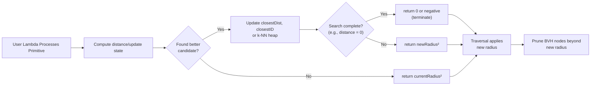
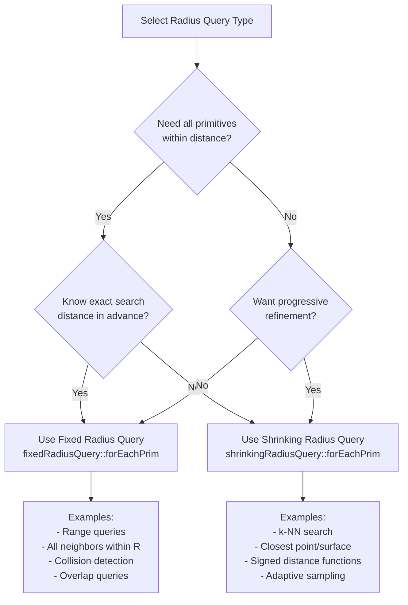
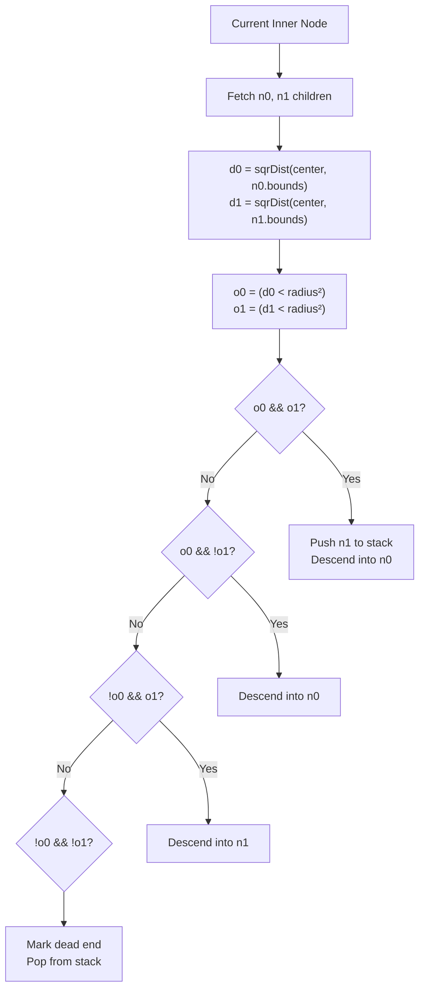
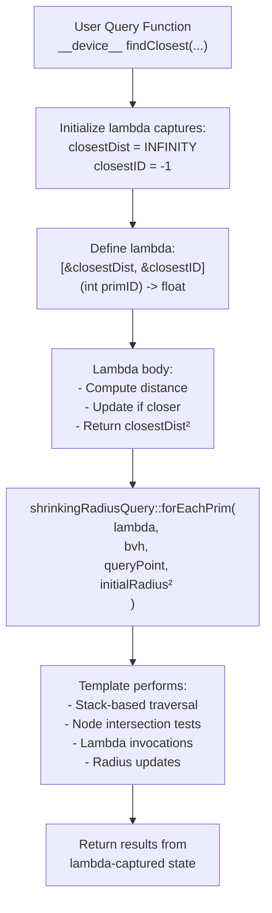
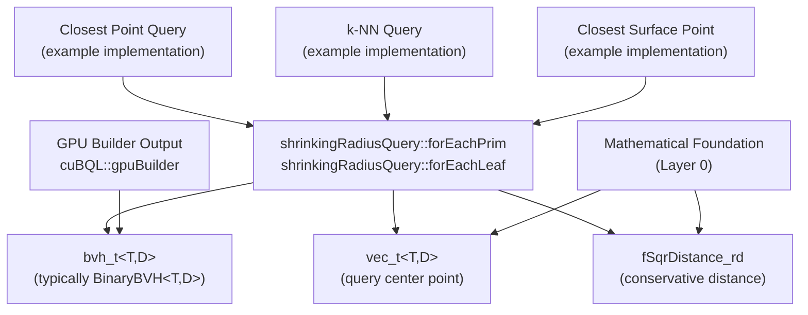

<!-- source: DeepWiki mcp.deepwiki.com · repo NVIDIA/cuBQL · extra page Shrinking Radius Query · fetched 2026-10-26 -->

# Shrinking Radius Query

<details>
<summary>Relevant source files</summary>

The following files were used as context for generating this wiki page:

- [README.md](README.md)
- [cuBQL/traversal/fixedRadiusQuery.h](cuBQL/traversal/fixedRadiusQuery.h)

</details>


## Purpose and Scope

This page documents the **shrinking radius query** traversal template, which enables dynamic radius reduction during BVH traversal for queries such as k-nearest neighbor (k-NN) and closest point searches. Unlike fixed radius queries ([7.2.1](#7.2.1)), where the search radius remains constant, shrinking radius queries allow user-provided lambda callbacks to progressively reduce the search radius as closer primitives are discovered, enabling efficient pruning of the search space.

This template is part of Layer 3 (BVH Traversal Templates) in cuBQL's architecture and serves as the foundation for implementing various proximity-based geometric queries.

For information about ray-based queries with dynamic range reduction, see [7.1.2](#7.1.2). For radius queries without dynamic shrinking, see [7.2.1](#7.2.1).

**Sources:** [README.md:223-234](), [README.md:45-53]()

---

## Overview

The shrinking radius query traverses a BVH to find primitives within a ball-shaped region centered at a query point. The distinguishing characteristic is that the search radius can **shrink dynamically** during traversal based on the primitives encountered. This enables several important optimization patterns:

| Feature | Fixed Radius Query | Shrinking Radius Query |
|---------|-------------------|------------------------|
| **Search radius** | Constant throughout traversal | Dynamically reduces during traversal |
| **Lambda return type** | `int` (terminate/continue signal) | `T` (new search radius) |
| **Use cases** | Range queries, all neighbors within distance | k-NN, closest point, closest surface point |
| **Pruning efficiency** | Prunes based on initial radius | Progressively improves pruning as better candidates are found |
| **Traversal order** | Unordered (arbitrary child visitation) | May benefit from front-to-back ordering |
| **Typical result** | All primitives within fixed distance | Single best primitive or k best primitives |

**Sources:** [README.md:45-53](), [README.md:223-234]()

---

## Traversal Pattern

### Mermaid: Shrinking Radius Query Execution Flow

```mermaid
flowchart TD
    Start["Query Initialization<br/>center, initialRadius, lambda"]
    Init["currentRadius = initialRadius<br/>stackPtr = traversalStack<br/>node = bvh.nodes[0]"]
    
    DownTraversal{"node.count == 0<br/>(inner node)?"}
    
    GetChildren["n0 = nodes[offset+0]<br/>n1 = nodes[offset+1]"]
    TestDist["d0 = sqrDistance(center, n0.bounds)<br/>d1 = sqrDistance(center, n1.bounds)"]
    TestOverlap["o0 = (d0 < currentRadius²)<br/>o1 = (d1 < currentRadius²)"]
    
    BothOverlap{"Both o0<br/>and o1?"}
    OnlyN0{"Only o0?"}
    OnlyN1{"Only o1?"}
    
    PushN1["Push n1.admin to stack"]
    DescendN0["node = n0.admin"]
    DescendN1["node = n1.admin"]
    DeadEnd["node.count = 0<br/>(mark as dead end)"]
    
    CheckLeaf{"node.count != 0<br/>(leaf node)?"}
    
    CallLambda["newRadius = lambda(primIDs, count)<br/>or per-prim variant"]
    UpdateRadius["currentRadius = newRadius"]
    CheckTerminate{"newRadius indicates<br/>termination?"}
    
    PopStack{"stackPtr ==<br/>traversalStack?"}
    PopNode["node = *--stackPtr"]
    
    Return["Return from traversal"]
    
    Start --> Init
    Init --> DownTraversal
    
    DownTraversal -->|Yes| GetChildren
    DownTraversal -->|No| CheckLeaf
    
    GetChildren --> TestDist
    TestDist --> TestOverlap
    
    TestOverlap --> BothOverlap
    BothOverlap -->|Yes| PushN1
    PushN1 --> DescendN0
    BothOverlap -->|No| OnlyN0
    
    OnlyN0 -->|Yes| DescendN0
    OnlyN0 -->|No| OnlyN1
    
    OnlyN1 -->|Yes| DescendN1
    OnlyN1 -->|No| DeadEnd
    
    DescendN0 --> DownTraversal
    DescendN1 --> DownTraversal
    DeadEnd --> CheckLeaf
    
    CheckLeaf -->|Yes| CallLambda
    CheckLeaf -->|No| PopStack
    
    CallLambda --> UpdateRadius
    UpdateRadius --> CheckTerminate
    CheckTerminate -->|Yes| Return
    CheckTerminate -->|No| PopStack
    
    PopStack -->|Yes (empty)| Return
    PopStack -->|No| PopNode
    PopNode --> DownTraversal
```

**Sources:** [cuBQL/traversal/fixedRadiusQuery.h:120-188]() (analogous structure), [README.md:223-234]()

---

## Interface Functions

The shrinking radius query template provides two primary entry points, similar to the fixed radius variant but with different lambda signatures:

### forEachPrim

```cpp
template<typename T, int D, typename PerPrimLambda>
__cubql_both void forEachPrim(
    PerPrimLambda lambdaToCallForEachPrimInSphere,
    bvh_t<T,D> bvh,
    vec_t<T,D> queryBallCenter,
    T initialQueryBallRadiusSquare,
    bool dbg = false
);
```

**Purpose:** Traverses the BVH and invokes the lambda callback for each primitive whose bounding box potentially overlaps the current search sphere.

**Lambda Signature:** `[captures](int primID) -> T`
- **Input:** `primID` - index of a candidate primitive
- **Return:** New search radius squared, or special termination value

### forEachLeaf

```cpp
template<typename T, int D, typename PerLeafLambda>
__cubql_both void forEachLeaf(
    PerLeafLambda lambdaToCallForEachLeaf,
    bvh_t<T,D> bvh,
    vec_t<T,D> queryBallCenter,
    T initialQueryBallRadiusSquare,
    bool dbg = false
);
```

**Purpose:** Traverses the BVH and invokes the lambda callback for each leaf node whose bounding box overlaps the current search sphere.

**Lambda Signature:** `[captures](const uint32_t *primIDs, size_t numPrims) -> T`
- **Input:** Pointer to primitive IDs array and count
- **Return:** New search radius squared, or special termination value

### Key Parameters

| Parameter | Type | Description |
|-----------|------|-------------|
| `queryBallCenter` | `vec_t<T,D>` | Center point of the search sphere |
| `initialQueryBallRadiusSquare` | `T` | **Square** of the initial search radius (can be `CUBQL_INF` for unbounded) |
| `bvh` | `bvh_t<T,D>` | The BVH structure to traverse (typically `BinaryBVH<T,D>`) |
| `lambdaToCall...` | Lambda/Functor | User-provided callback implementing query-specific logic |
| `dbg` | `bool` | Optional debug flag (default: false) |

**Sources:** [cuBQL/traversal/fixedRadiusQuery.h:41-56]() (interface pattern), [README.md:235-248]()

---

## Lambda Callback Patterns

### Return Value Semantics

The lambda's return value serves dual purposes:

1. **Radius Update:** The returned value becomes the new search radius squared for subsequent traversal
2. **Early Termination:** Returning a special value (typically `0` or negative) signals traversal should terminate

### Mermaid: Lambda Return Value Flow



**Sources:** [README.md:254-267]()

---

## Common Usage Patterns

### Pattern 1: Closest Point Query

**Objective:** Find the single closest primitive to a query point.

```
Lambda captures:
  - float closestDist = INFINITY
  - int closestID = -1
  - const MyPrimitive* prims

Lambda logic:
  1. Compute distance from queryPoint to prims[primID]
  2. If distance < closestDist:
       closestDist = distance
       closestID = primID
  3. Return closestDist * closestDist  (squared distance)
```

**Shrinking behavior:** Each closer primitive found reduces the search radius, progressively eliminating more distant BVH regions.

**Sources:** [README.md:254-267]()

### Pattern 2: k-Nearest Neighbors (k-NN)

**Objective:** Find the k closest primitives to a query point.

```
Lambda captures:
  - std::priority_queue<...> knnHeap (max-heap of size k)
  - const MyPrimitive* prims

Lambda logic:
  1. Compute distance from queryPoint to prims[primID]
  2. If knnHeap.size() < k OR distance < knnHeap.top():
       Add/update heap with (distance, primID)
       Maintain heap size ≤ k
  3. If knnHeap.size() == k:
       return knnHeap.top().distance²  (furthest of k neighbors)
     Else:
       return currentRadius²
```

**Shrinking behavior:** Once k neighbors are found, radius shrinks to distance of k-th nearest neighbor.

### Pattern 3: Closest Surface Point (Triangles)

**Objective:** Find the closest point on a triangle mesh surface.

```
Lambda captures:
  - float closestDist = INFINITY
  - vec3f closestSurfacePoint
  - const Triangle* triangles

Lambda logic:
  1. Compute closest point on triangle surface to queryPoint
  2. Compute distance to that surface point
  3. If distance < closestDist:
       closestDist = distance
       closestSurfacePoint = computed point
  4. Return closestDist * closestDist
```

**Shrinking behavior:** Same as point query, but distance computation is to triangle surface rather than triangle vertices.

**Sources:** [README.md:254-268]()

### Pattern 4: Conditional Search with Culling

**Objective:** Find closest primitive meeting certain criteria (e.g., based on normal orientation).

```
Lambda captures:
  - float closestDist = INFINITY
  - int closestID = -1
  - vec3f queryNormal
  - const MyPrimitive* prims

Lambda logic:
  1. Compute distance and check primitive normal
  2. If dot(prims[primID].normal, queryNormal) > threshold:
       If distance < closestDist:
         closestDist = distance
         closestID = primID
  3. Return closestDist * closestDist
```

**Sources:** [README.md:203-207]()

---

## Comparison with Fixed Radius Query

### Mermaid: Query Type Decision Tree



**Sources:** [README.md:45-53](), [README.md:200-222]()

---

## Implementation Details

### Stack-Based Traversal

Both query types use iterative stack-based traversal to avoid recursion:

| Component | Purpose |
|-----------|---------|
| `traversalStack[64]` | Fixed-size array for pending nodes to visit |
| `stackPtr` | Pointer to current stack top |
| `node` | Current node being processed |

The stack size of 64 is sufficient for typical BVH depths (binary tree with millions of primitives typically has depth < 30).

**Sources:** [cuBQL/traversal/fixedRadiusQuery.h:120-121]()

### Distance Computation

The traversal uses `fSqrDistance_rd` for conservative distance estimation:

- **`_rd` suffix:** "Round down" - ensures conservative culling
- **Squared distances:** Avoids expensive square root operations
- **All comparisons:** Performed in squared distance space

**Sources:** [cuBQL/traversal/fixedRadiusQuery.h:143-146]()

### Node Intersection Logic



**Key optimization:** When both children overlap, the second child is pushed to stack for later processing, while first child is processed immediately (no additional push/pop).

**Sources:** [cuBQL/traversal/fixedRadiusQuery.h:138-170]()

---

## Performance Considerations

### Radius Shrinking Strategy

| Strategy | Characteristics | Best For |
|----------|----------------|----------|
| **Aggressive shrinking** | Return smallest possible radius | Dense primitive distributions, many candidates |
| **Conservative shrinking** | Return slightly larger radius | Sparse distributions, risk of missing candidates |
| **Exact shrinking** | Return exact current best distance | Most common, balances traversal vs computation |

### Traversal Efficiency

**Factors affecting performance:**

1. **Initial radius:** Smaller initial radius → fewer nodes visited → faster traversal
2. **Primitive distribution:** Clustered primitives → faster radius shrinking → more pruning
3. **BVH quality:** Tighter bounds (SAH builder) → better early culling
4. **Lambda complexity:** Keep per-primitive computation lightweight

### Memory Access Patterns

The traversal exhibits good cache behavior:
- Sequential node access during downward traversal
- Limited stack size (64 entries) fits in cache
- BVH nodes accessed in roughly depth-first order

**Sources:** [README.md:112-121]() (builder performance context)

---

## Integration Example Template

### Mermaid: Typical Usage Flow in User Code



**Key integration points:**

1. **State management:** All query-specific state stored in lambda captures
2. **Type flexibility:** Template works with any `<T,D>` configuration
3. **Device execution:** Entire flow executes on GPU via `__cubql_both` or `__device__`
4. **Single-source:** Lambda and traversal compiled together for optimal inlining

**Sources:** [README.md:235-267]()

---

## Type Parameterization

The shrinking radius query template accepts the same type parameters as the BVH structure:

| Template Parameter | Description | Examples |
|--------------------|-------------|----------|
| `T` | Scalar coordinate type | `float`, `double`, `int32_t`, `int64_t` |
| `D` | Dimensionality | `2`, `3`, `4` (or higher) |
| `PerPrimLambda` | User lambda type (deduced) | Any callable with signature `T(int)` |
| `PerLeafLambda` | User lambda type (deduced) | Any callable with signature `T(const uint32_t*, size_t)` |

**Common instantiations:**
- `shrinkingRadiusQuery::forEachPrim<float, 3, MyLambda>` - 3D float queries (most common)
- `shrinkingRadiusQuery::forEachPrim<double, 3, MyLambda>` - High-precision 3D queries
- `shrinkingRadiusQuery::forEachPrim<float, 2, MyLambda>` - 2D spatial queries

**Sources:** [README.md:68-104](), [cuBQL/traversal/fixedRadiusQuery.h:41-42]()

---

## Relationship to Other Components

### Mermaid: Shrinking Radius Query Dependencies



**Layer context:**
- **Layer 0 (Math):** Provides `vec_t<T,D>` and distance functions
- **Layer 1 (Data Structures):** Provides `BinaryBVH<T,D>` storage format
- **Layer 2 (Builders):** Creates BVH structures for traversal
- **Layer 3 (Traversal Templates):** Shrinking radius query resides here
- **Layer 4 (Geometric Queries):** Implements specific queries using this template

**Sources:** [README.md:30-60](), Diagram 1 from high-level architecture

---

## Summary

The shrinking radius query traversal template provides a flexible, high-performance foundation for implementing proximity-based spatial queries on GPU-accelerated BVH structures. Its key characteristics are:

- **Dynamic radius reduction** for progressive search space pruning
- **Lambda-based customization** for diverse query types
- **Type-generic template** supporting various scalar types and dimensionalities
- **Stack-based iterative traversal** avoiding recursion overhead
- **Conservative distance testing** ensuring correct results

This template enables users to implement custom geometric queries without modifying core BVH traversal logic, following cuBQL's design principle of providing flexible building blocks rather than fixed high-level queries.

**Sources:** [README.md:209-222](), [README.md:45-53]()

---

