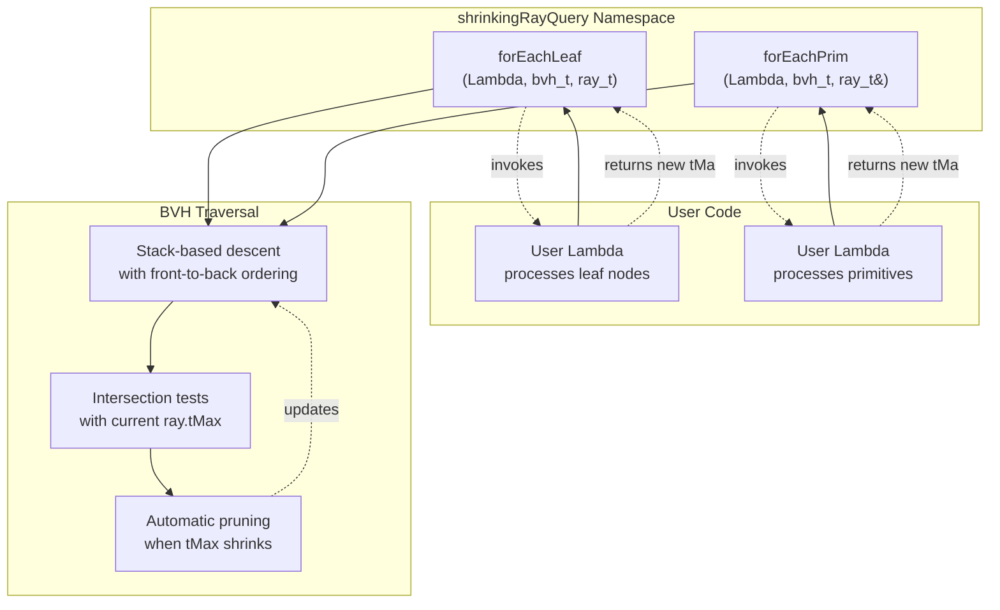
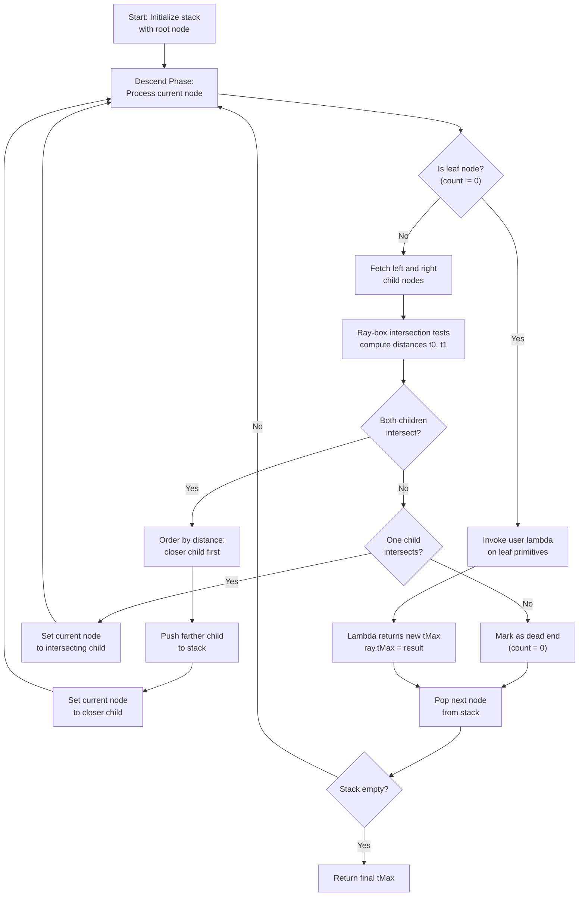
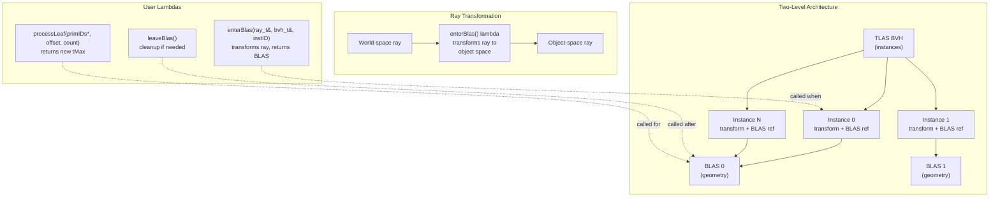
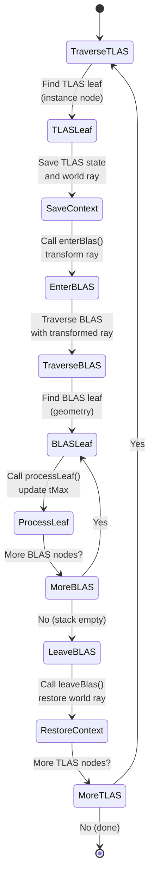

<!-- source: DeepWiki mcp.deepwiki.com · repo NVIDIA/cuBQL · extra page Shrinking Ray Query · fetched 2026-10-26 -->

# Shrinking Ray Query

<details>
<summary>Relevant source files</summary>

The following files were used as context for generating this wiki page:

- [cuBQL/traversal/rayQueries.h](cuBQL/traversal/rayQueries.h)

</details>


## Purpose and Scope

This document describes the **shrinking ray query** traversal pattern provided by the `shrinkingRayQuery` namespace in cuBQL. Shrinking ray queries enable **closest-hit ray tracing** where the ray's maximum distance parameter (`ray.tMax`) can be dynamically reduced during traversal as closer intersections are found. This allows subsequent subtrees to be pruned if they are farther than the closest hit found so far.

For ray queries with a constant `tMax` value (any-hit queries), see [Fixed Ray Query](#7.1.1). For ball-shaped spatial queries rather than ray-based queries, see [Radius Queries](#7.2). For the underlying ray and BVH data structures, see [Rays (ray_t)](#4.3) and [BinaryBVH](#5.1).

**Sources:** [cuBQL/traversal/rayQueries.h:71-149]()

---

## Overview

Shrinking ray queries implement **ordered traversal** with **dynamic distance culling**. Unlike fixed ray queries that traverse in arbitrary order, shrinking queries sort child nodes by their intersection distance and process closer nodes first. This enables the user lambda to shrink `ray.tMax` when a closer intersection is found, causing farther subtrees to be automatically pruned from further traversal.

### Key Characteristics

| Characteristic | Shrinking Ray Query | Fixed Ray Query |
|---------------|---------------------|-----------------|
| **Traversal Order** | Front-to-back (closest first) | Arbitrary (unordered) |
| **ray.tMax Behavior** | Dynamically reduced by lambda | Constant during traversal |
| **Child Ordering** | Sorted by distance to ray origin | No ordering |
| **Use Case** | Closest-hit queries (e.g., primary rays) | Any-hit queries (e.g., shadow rays) |
| **Performance** | More efficient for closest-hit due to early pruning | More efficient for any-hit queries |

**Sources:** [cuBQL/traversal/rayQueries.h:71-74]()

---

## API Functions

The `shrinkingRayQuery` namespace provides two primary traversal patterns for single-level BVHs and a `twoLevel` sub-namespace for hierarchical TLAS/BLAS traversal.

### Single-Level Traversal



**forEachLeaf**

Template signature:
```cpp
template<typename Lambda, typename bvh_t, typename ray_t>
float forEachLeaf(const Lambda &lambdaToCallOnEachLeaf,
                  bvh_t bvh,
                  ray_t ray,
                  bool dbg=false);
```

**Parameters:**
- `lambdaToCallOnEachLeaf`: User-provided lambda invoked for each intersected leaf node
- `bvh`: BVH structure to traverse (typically `bvh3f` or `bvh3d`)
- `ray`: Ray to trace through the BVH (note: passed by value, not reference)
- `dbg`: Optional debug flag for printing traversal information

**Returns:** Final `ray.tMax` value after traversal completes

**Lambda Signature:**
```cpp
float operator()(const uint32_t *leafPrims, size_t numPrims) const
```

The lambda receives pointers to primitive IDs in the leaf and must return the new `tMax` value (typically the distance to the closest hit found so far).

**Sources:** [cuBQL/traversal/rayQueries.h:80-85](), [cuBQL/traversal/rayQueries.h:344-420]()

---

**forEachPrim**

Template signature:
```cpp
template<typename Lambda, typename bvh_t, typename ray_t>
void forEachPrim(const Lambda &lambdaToExecuteForEachCandidate,
                 bvh_t bvh,
                 ray_t &ray,
                 bool dbg=false);
```

**Parameters:**
- `lambdaToExecuteForEachCandidate`: User-provided lambda invoked for each primitive
- `bvh`: BVH structure to traverse
- `ray`: **Reference** to ray, allowing lambda to observe tMax shrinkage
- `dbg`: Optional debug flag

**Lambda Signature:**
```cpp
float operator()(uint32_t primID) const
```

The lambda receives individual primitive IDs and must return the new `tMax` value. Internally, `forEachPrim` wraps the user lambda with a per-leaf lambda that iterates over all primitives in each leaf.

**Sources:** [cuBQL/traversal/rayQueries.h:90-95](), [cuBQL/traversal/rayQueries.h:422-436]()

---

## Traversal Algorithm

The shrinking ray query traversal uses a **stack-based iterative descent** with **front-to-back ordering** of child nodes.



**Key Implementation Details:**

### Front-to-Back Ordering

When both child nodes intersect the ray, they are sorted by their entry distance:

```cpp
float node_t0 = 0.f, node_t1 = 0.f;
bool o0 = rayIntersectsBox(node_t0, ray, rcp_dir, n0.bounds);
bool o1 = rayIntersectsBox(node_t1, ray, rcp_dir, n1.bounds);

if (o0 && o1) {
    *stackPtr++ = (node_t0 < node_t1) ? n1.admin : n0.admin;  // Push farther
    node = (node_t0 < node_t1) ? n0.admin : n1.admin;          // Traverse closer
}
```

This ensures that closer nodes are processed first, allowing early hits to shrink `tMax` and prune distant nodes.

**Sources:** [cuBQL/traversal/rayQueries.h:384-403]()

### Ray Direction Perturbation

To avoid division by zero in ray-box intersection tests, zero components of the ray direction are perturbed to a small non-zero value:

```cpp
if (ray.direction.x == (T)0) ray.direction.x = T(1e-20);
if (ray.direction.y == (T)0) ray.direction.y = T(1e-20);
if (ray.direction.z == (T)0) ray.direction.z = T(1e-20);
vec_t<T,3> rcp_dir = rcp(ray.direction);
```

**Sources:** [cuBQL/traversal/rayQueries.h:359-362]()

### Dynamic tMax Update

After processing each leaf, the lambda's return value becomes the new `ray.tMax`:

```cpp
if (node.count != 0) {
    ray.tMax = lambdaToCallOnEachLeaf(bvh.primIDs+node.offset, node.count);
}
```

Nodes on the stack that are now farther than the updated `tMax` are automatically pruned by subsequent intersection tests.

**Sources:** [cuBQL/traversal/rayQueries.h:406-411]()

---

## Lambda Requirements

User-provided lambdas for shrinking ray queries must return a `float` (or template type `T`) representing the updated maximum distance for ray traversal.

### forEachLeaf Lambda

**Signature:**
```cpp
float operator()(const uint32_t *leafPrims, size_t numPrims) const
```

**Responsibilities:**
1. Iterate over primitive IDs in the range `[leafPrims, leafPrims + numPrims)`
2. Perform ray-primitive intersection tests
3. Track the closest hit found so far
4. Return the distance to the closest hit (or current `tMax` if no hit found)

**Example Pattern:**
```cpp
float closestT = ray.tMax;
auto lambda = [&](const uint32_t *prims, size_t count) {
    for (size_t i = 0; i < count; i++) {
        float t = intersectPrimitive(prims[i], ray);
        if (t < closestT) {
            closestT = t;
            // Optionally store hit information
        }
    }
    return closestT;
};
```

**Sources:** [cuBQL/traversal/rayQueries.h:344-420]()

### forEachPrim Lambda

**Signature:**
```cpp
float operator()(uint32_t primID) const
```

**Responsibilities:**
1. Perform ray-primitive intersection for a single primitive
2. Return the intersection distance if hit, or current `tMax` if miss

**Example Pattern:**
```cpp
float closestT = ray.tMax;
auto lambda = [&](uint32_t primID) {
    float t = intersectPrimitive(primID, ray);
    if (t < closestT) {
        closestT = t;
        // Optionally store hit information
    }
    return closestT;
};
```

Note that `forEachPrim` automatically wraps this lambda to iterate over leaf nodes, invoking the per-primitive lambda for each primitive in the leaf.

**Sources:** [cuBQL/traversal/rayQueries.h:422-436]()

---

## Two-Level Traversal (TLAS/BLAS)

The `shrinkingRayQuery::twoLevel` sub-namespace provides hierarchical traversal for instanced geometry, where a **Top-Level Acceleration Structure (TLAS)** contains instances that each reference a **Bottom-Level Acceleration Structure (BLAS)**.



### forEachLeaf (Two-Level)

Template signature:
```cpp
template<typename EnterBlasLambda,
         typename LeaveBlasLambda,
         typename ProcessLeafLambda,
         typename bvh_t, typename ray_t>
void forEachLeaf(const EnterBlasLambda   &enterBlas,
                 const LeaveBlasLambda   &leaveBlas,
                 const ProcessLeafLambda &processLeaf,
                 bvh_t bvh,
                 ray_t &ray,
                 bool dbg=false);
```

**Lambda Signatures:**

**enterBlas:**
```cpp
void operator()(ray_t &ray, bvh_t &blas, int instID) const
```
- **Purpose:** Transform ray from world space to instance/object space and return the BLAS to traverse
- **Parameters:**
  - `ray`: Reference to ray; modify `origin` and `direction` for transformation
  - `blas`: Output parameter; set `nodes` and `primIDs` to the BLAS structure
  - `instID`: Instance ID from the TLAS leaf

**leaveBlas:**
```cpp
void operator()() const
```
- **Purpose:** Perform cleanup when exiting a BLAS (optional, can be empty)

**processLeaf:**
```cpp
float operator()(const uint32_t *primIDs, int offset, int count) const
```
- **Purpose:** Process primitives in a BLAS leaf, same as single-level `forEachLeaf`
- **Returns:** Updated `tMax` value

**Sources:** [cuBQL/traversal/rayQueries.h:110-121](), [cuBQL/traversal/rayQueries.h:457-607]()

### forEachPrim (Two-Level)

Template signature:
```cpp
template<typename EnterBlasLambda,
         typename LeaveBlasLambda,
         typename IntersectPrimLambda,
         typename bvh_t, typename ray_t>
void forEachPrim(const EnterBlasLambda     &enterBlas,
                 const LeaveBlasLambda     &leaveBlas,
                 const IntersectPrimLambda &intersectPrim,
                 bvh_t bvh,
                 ray_t &ray,
                 bool dbg=false);
```

**intersectPrim Lambda:**
```cpp
float operator()(int primIdx) const
```
- **Purpose:** Intersect ray with a single primitive in the current BLAS
- **Returns:** Updated `tMax` value

Internally, this wraps the per-primitive lambda to iterate over all primitives in each BLAS leaf.

**Sources:** [cuBQL/traversal/rayQueries.h:135-146](), [cuBQL/traversal/rayQueries.h:621-651]()

### Two-Level Traversal Flow



**Key Implementation Details:**

The two-level traversal maintains separate stack regions for TLAS and BLAS traversal:

```cpp
typename node_t::Admin
    traversalStack[STACK_DEPTH],
    *stackPtr = traversalStack,
    *blasStackBase = nullptr;  // Marks start of BLAS stack region
```

When entering a BLAS, the world-space ray is saved and the BLAS begins traversal:

```cpp
saved_dir = ray.direction;
saved_org = ray.origin;
bvh_t blas;
ray_t transformed_ray = ray;
enterBlas(transformed_ray, blas, instID);
ray.origin = transformed_ray.origin;
ray.direction = transformed_ray.direction;
blasStackBase = stackPtr;  // Mark BLAS stack region
```

When the BLAS stack is exhausted, the world-space ray is restored:

```cpp
if (stackPtr == blasStackBase) {
    leaveBlas();
    ray.direction = saved_dir;
    ray.origin = saved_org;
    blasStackBase = nullptr;
    bvh.nodes = tlasSavedNodePtr;
    bvh.primIDs = tlasSavedPrimIDs;
}
```

**Sources:** [cuBQL/traversal/rayQueries.h:472-606]()

---

## Use Cases

Shrinking ray queries are optimized for **closest-hit queries** where finding the nearest intersection is required and traversal should terminate as soon as no closer hit is possible.

### Typical Applications

| Application | Description | Lambda Behavior |
|------------|-------------|----------------|
| **Primary Ray Tracing** | Camera rays finding nearest visible surface | Returns distance to closest hit; shrinks `tMax` on each closer hit |
| **Reflection Rays** | Finding nearest surface for mirror reflections | Same as primary rays |
| **Refraction Rays** | Glass/transparent material ray intersections | Returns distance to entry/exit points |
| **First-Hit Particle Queries** | Particle systems finding first collision | Returns distance to first obstacle encountered |

### Performance Characteristics

**Advantages:**
- **Early pruning:** Closer hits shrink search space, eliminating distant subtrees
- **Fewer intersection tests:** Front-to-back ordering reduces total primitive tests
- **Optimal for closest-hit:** Designed specifically for finding nearest intersection

**Disadvantages:**
- **Ordering overhead:** Computing and sorting child distances adds cost per node
- **Suboptimal for any-hit:** If any intersection suffices, use [Fixed Ray Query](#7.1.1) instead

**Sources:** [cuBQL/traversal/rayQueries.h:71-74]()

---

## Comparison with Fixed Ray Query

| Aspect | Shrinking Ray Query | Fixed Ray Query |
|--------|--------------------|--------------------|
| **Namespace** | `shrinkingRayQuery` | `fixedRayQuery` |
| **ray.tMax** | Modified during traversal | Constant throughout |
| **Child Ordering** | Front-to-back by distance | Arbitrary (no ordering) |
| **Lambda Return** | `float` (new tMax) | `int` (CONTINUE/TERMINATE) |
| **Typical Use** | Closest-hit queries | Any-hit queries |
| **File Location** | [cuBQL/traversal/rayQueries.h:344-651]() | [cuBQL/traversal/rayQueries.h:203-342]() |

For shadow rays or occlusion queries where any intersection is sufficient, prefer `fixedRayQuery` which avoids the overhead of ordering and distance updates.

**Sources:** [cuBQL/traversal/rayQueries.h]()

---

## Related Systems

- **[Fixed Ray Query](#7.1.1):** Unordered ray traversal for any-hit queries
- **[Shrinking Radius Query](#7.2.2):** Ball-shaped spatial queries with dynamic radius reduction
- **[Ray-Triangle Intersection](#8.2):** Geometric primitives commonly used with ray queries
- **[BinaryBVH](#5.1):** Primary BVH data structure traversed by these queries
- **[Rays (ray_t)](#4.3):** Ray data structure with origin, direction, tMin, and tMax

**Sources:** [cuBQL/traversal/rayQueries.h]()

---

