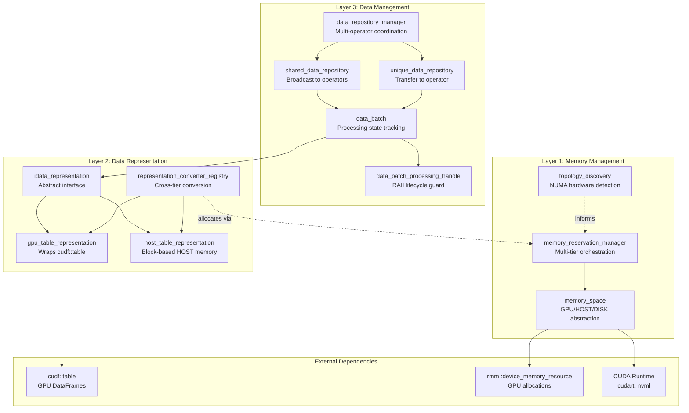
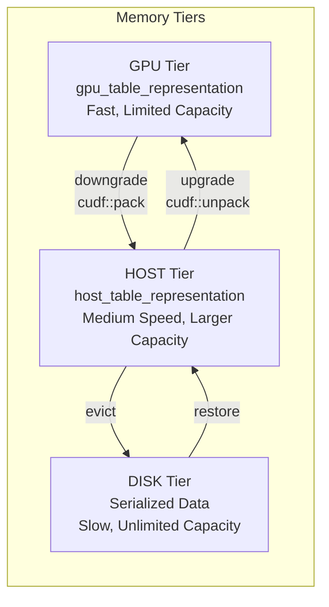
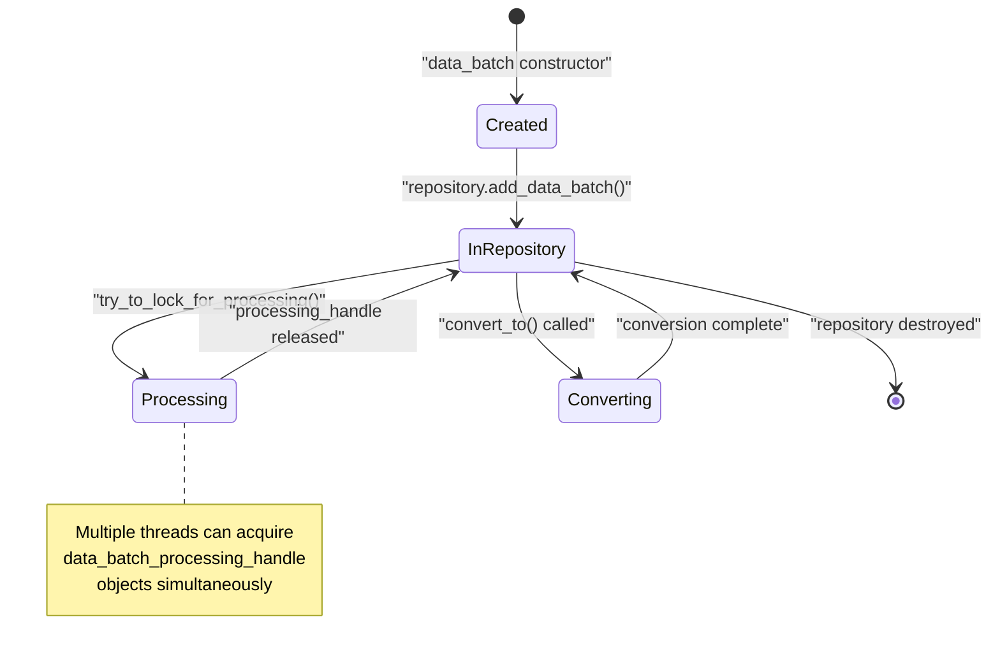
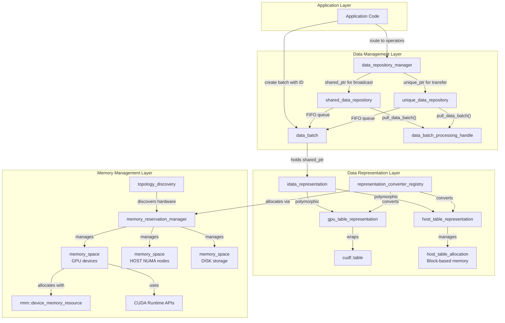
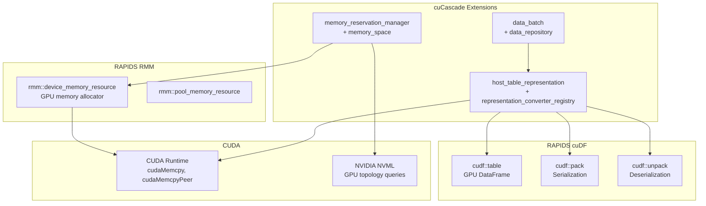

<!-- source: DeepWiki mcp.deepwiki.com · repo NVIDIA/cuCascade · page 1 Overview · fetched 2026-10-26 -->

# Overview

Relevant source files

The following files were used as context for generating this wiki page:

- [CMakeLists.txt](CMakeLists.txt)
- [cmake/cuCascadeConfig.cmake.in](cmake/cuCascadeConfig.cmake.in)
- [src/data/CMakeLists.txt](src/data/CMakeLists.txt)
- [test/CMakeLists.txt](test/CMakeLists.txt)

This document provides a high-level introduction to cuCascade, its architecture, and core concepts. For detailed information about building and configuring cuCascade, see [Getting Started](#2). For in-depth documentation of individual subsystems, see [Architecture Overview](#3), [Memory Management Subsystem](#4), [Data Representation Subsystem](#5), and [Data Management Subsystem](#6).

## Purpose and Scope

cuCascade is a GPU memory management and data representation library designed to enable efficient multi-tier data processing across heterogeneous memory spaces (GPU, HOST, and DISK). The library provides abstractions for managing data lifecycle, coordinating access across multiple operators, and automatically converting data between different memory representations based on access patterns and memory pressure.

**Sources:** [CMakeLists.txt:21-25]()

## What cuCascade Provides

cuCascade delivers three core capabilities:

| Capability | Description | Key Components |
|------------|-------------|----------------|
| **Heterogeneous Memory Management** | Orchestrate allocations across GPU, HOST (with NUMA awareness), and DISK tiers | `memory_reservation_manager`, `memory_space` |
| **Data Representation Abstraction** | Polymorphic data storage with automatic conversion between GPU tables (cuDF) and HOST tables | `idata_representation`, `gpu_table_representation`, `host_table_representation`, `representation_converter_registry` |
| **Batch Lifecycle Management** | Thread-safe data batch processing with FIFO queues, multi-operator routing, and RAII-based state management | `data_batch`, `data_repository`, `data_repository_manager`, `data_batch_processing_handle` |

The library integrates with the RAPIDS ecosystem, wrapping cuDF for GPU dataframes and RMM for GPU memory allocation, while adding support for HOST and DISK storage tiers with automatic conversion capabilities.

**Sources:** [CMakeLists.txt:48-56](), [src/data/CMakeLists.txt:18-25]()

## System Architecture

cuCascade is organized into three architectural layers, each building on the layer below:

**Diagram: Three-Layer Architecture with Key Classes**

Each layer provides a distinct abstraction:

- **Layer 1 (Memory Management)**: Manages heterogeneous memory resources across GPU, HOST, and DISK tiers with NUMA-aware allocation strategies
- **Layer 2 (Data Representation)**: Provides polymorphic data storage with transparent conversion between memory tiers
- **Layer 3 (Data Management)**: Coordinates data batch lifecycle, operator routing, and concurrent access control

**Sources:** [CMakeLists.txt:105-107](), [src/data/CMakeLists.txt:18-25]()

## Core Concepts

### Memory Tier Hierarchy

cuCascade operates on a three-tier memory model where data can reside in different storage locations with varying access performance:

**Diagram: Memory Tier Transitions**

Data moves between tiers based on:
- **Memory pressure**: When a tier runs low on space, data is downgraded to the next tier
- **Access patterns**: Data is upgraded to faster tiers when needed for processing
- **Explicit conversion**: Applications can request specific tier placement via `convert_to()` operations

**Sources:** [CMakeLists.txt:49-56]()

### Data Batch Lifecycle

The `data_batch` class tracks data through its lifecycle with concurrent access support:

**Diagram: Data Batch State Machine**

The `data_batch_processing_handle` RAII class ensures safe concurrent access: multiple threads can process the same batch simultaneously, but conversions are blocked while processing is active.

**Sources:** [src/data/CMakeLists.txt:21]()

## Key Components and Their Relationships

The following diagram maps cuCascade's major components to their implementation classes and shows data flow through the system:

**Diagram: Component Relationships and Data Flow**

This architecture enables:
- **Decoupled processing**: Operators process batches independently via their own repositories
- **Flexible ownership**: Batches can be broadcast (shared) or transferred (unique) between operators
- **Transparent tier migration**: Data representations handle memory tier transitions without application intervention
- **Concurrent access**: RAII handles coordinate safe multi-threaded batch access

**Sources:** [src/data/CMakeLists.txt:18-25](), [CMakeLists.txt:116-117]()

## Build System Organization

cuCascade uses a modern CMake build system with an object library pattern for efficient compilation:

| Target | Type | Purpose |
|--------|------|---------|
| `cucascade_objects` | OBJECT | Compiles all sources once, shared by static and shared libraries |
| `cucascade_static` | STATIC | Static library variant |
| `cucascade_shared` | SHARED | Shared library variant with versioning |
| `cuCascade::cucascade` | ALIAS | Convenience alias pointing to preferred library variant |
| `cucascade_tests` | EXECUTABLE | Test suite using Catch2 framework |

The build system requires:
- **CMake 3.26.4+**
- **C++20** compiler with full standard library support
- **CUDA Toolkit** with CUDA 20 support
- **RAPIDS ecosystem**: RMM and cuDF libraries
- **System libraries**: NUMA, pthreads

**Sources:** [CMakeLists.txt:18-46](), [CMakeLists.txt:94-120](), [test/CMakeLists.txt:18-24]()

## Integration with RAPIDS Ecosystem

cuCascade extends the RAPIDS ecosystem by adding multi-tier memory management capabilities:

**Diagram: cuCascade Integration with RAPIDS and CUDA**

cuCascade wraps `cudf::table` in `gpu_table_representation`, uses `rmm::device_memory_resource` for GPU allocations, and leverages cuDF's pack/unpack operations for serialization during tier migrations.

**Sources:** [CMakeLists.txt:49-56](), [CMakeLists.txt:116-117](), [cmake/cuCascadeConfig.cmake.in:5-9]()

## Thread Safety and Concurrency Model

cuCascade is designed for high-concurrency workloads with the following guarantees:

- **Concurrent reads**: Multiple threads can hold `data_batch_processing_handle` objects for the same batch simultaneously
- **Exclusive conversions**: Tier conversions (via `convert_to()`) and batch state changes acquire locks and block processing
- **Lock-free batch addition**: Adding batches to repositories uses atomic operations where possible
- **RAII-based resource management**: All resource lifetimes are tied to scoped handle objects

For detailed concurrency patterns and best practices, see [Thread Safety and Concurrency](#8.1).

**Sources:** [src/data/CMakeLists.txt:21]()

## Next Steps

To get started with cuCascade:

1. **Build and Install**: Follow the instructions in [Building and Installation](#2.1)
2. **Understand the Architecture**: Read [Architecture Overview](#3) for detailed layer descriptions
3. **Explore Components**: Review subsystem documentation:
   - [Memory Management Subsystem](#4) for heterogeneous memory management
   - [Data Representation Subsystem](#5) for data format abstractions
   - [Data Management Subsystem](#6) for batch lifecycle coordination
4. **Review Examples**: See test cases in [Testing and Development](#7) for usage patterns

**Sources:** [CMakeLists.txt:1-242](), [test/CMakeLists.txt:1-62]()

---

