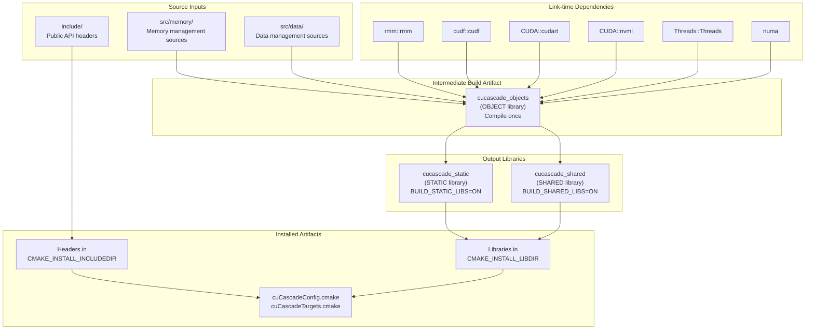
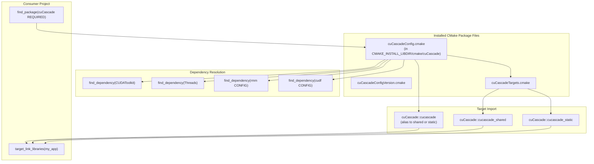

<!-- source: DeepWiki mcp.deepwiki.com · repo NVIDIA/cuCascade · page 2 Getting Started · fetched 2026-10-26 -->

# Getting Started

<details>
<summary>Relevant source files</summary>

The following files were used as context for generating this wiki page:

- [CMakeLists.txt](CMakeLists.txt)
- [cmake/cuCascadeConfig.cmake.in](cmake/cuCascadeConfig.cmake.in)
- [include/data/data_repository.hpp](include/data/data_repository.hpp)
- [pixi.toml](pixi.toml)

</details>


This page provides an overview of how to build, install, and configure cuCascade. It covers the prerequisites, basic build workflow, and environment setup needed to start developing with or integrating cuCascade into your application.

For detailed build instructions and CMake options, see [Building and Installation](#2.1). For comprehensive dependency information and environment configuration, see [Dependencies and Environment Setup](#2.2).

## Prerequisites

cuCascade requires the following minimum versions and components:

| Component | Minimum Version | Purpose |
|-----------|----------------|---------|
| CMake | 3.26.4 | Build system generator |
| C++ Standard | C++20 | Language features |
| CUDA Standard | C++20 | Device code compilation |
| CUDA Toolkit | 11.x or 13.x | GPU runtime and development tools |
| cuDF | 25.10.* | GPU DataFrame operations |
| RMM | (via cuDF) | GPU memory management |
| NUMA libraries | system | NUMA-aware memory allocation |

Sources: [CMakeLists.txt:18-34](), [CMakeLists.txt:49-56](), [pixi.toml:8-30]()

## Quick Start Workflow

The basic workflow to build and test cuCascade follows these steps:


**Minimum Command Sequence:**

Using pixi (recommended):
```bash
# Install dependencies and build
pixi run build

# Run tests
pixi run test
```

Manual workflow:
```bash
# Configure with preset
cmake --preset release

# Build
cmake --build build/release

# Test
cd build/release && ctest --output-on-failure

# Install
cmake --install build/release --prefix /path/to/install
```

Sources: [pixi.toml:32-35](), [CMakeLists.txt:1-241]()

## Build System Architecture

cuCascade uses a modern CMake build system that compiles sources once into an object library, then links them into both static and shared library variants. This architecture minimizes compilation time while providing flexibility in how consumers link against cuCascade.

**CMake Target Structure:**



**Key Build Targets:**

| Target Name | Type | Description |
|------------|------|-------------|
| `cucascade_objects` | OBJECT | Compiled object files (internal) |
| `cucascade_static` | STATIC | Static library (libcucascade.a) |
| `cucascade_shared` | SHARED | Shared library (libcucascade.so) |
| `cuCascade::cucascade` | ALIAS | Default target (prefers shared) |
| `cuCascade::cucascade_static` | ALIAS | Explicit static target |
| `cuCascade::cucascade_shared` | ALIAS | Explicit shared target |

Sources: [CMakeLists.txt:94-176](), [CMakeLists.txt:178-233]()

## Build Configuration Options

cuCascade provides several CMake options to customize the build:

| Option | Default | Description |
|--------|---------|-------------|
| `BUILD_TESTS` | ON | Build the test suite with Catch2 |
| `BUILD_SHARED_LIBS` | ON | Build shared library variant |
| `BUILD_STATIC_LIBS` | ON | Build static library variant |
| `WARNINGS_AS_ERRORS` | ON | Treat compiler warnings as errors |
| `CMAKE_CUDA_ARCHITECTURES` | 75;80;86;90 | Target GPU architectures |

**Note:** At least one of `BUILD_SHARED_LIBS` or `BUILD_STATIC_LIBS` must be enabled. The build will fail if both are disabled.

Sources: [CMakeLists.txt:36-61](), [CMakeLists.txt:66-84]()

## Environment Setup with Pixi

cuCascade provides a `pixi.toml` configuration file for reproducible environment management. Pixi is a package manager that simplifies dependency installation across different platforms.

**Pixi Environment Configuration:**

```mermaid
graph TB
    subgraph "Pixi Workspace Configuration"
        TOML["pixi.toml"]
    end
    
    subgraph "Channel Sources"
        RAPIDS["rapidsai channel"]
        CONDA["conda-forge channel"]
        NVIDIA["nvidia channel"]
    end
    
    subgraph "System Requirements"
        CUDA_REQ["CUDA >= 13"]
    end
    
    subgraph "Build Dependencies"
        CMAKE["cmake 4.1.*"]
        NVCC["cuda-nvcc"]
        NVML["cuda-nvml-dev"]
        CUDA_VER["cuda-version 13.*"]
        CXX["cxx-compiler"]
        NINJA["ninja"]
        SCCACHE["sccache"]
    end
    
    subgraph "Library Dependencies"
        LIBCUDF["libcudf 25.10.*"]
        LIBCURAND["libcurand-dev"]
        FMT["fmt"]
        NUMA_PKG["numactl-devel-cos7-x86_64"]
    end
    
    subgraph "Development Tools"
        PRECOMMIT["pre-commit"]
    end
    
    subgraph "Environment Variables"
        LIBCUDF_PREFIX["LIBCUDF_ENV_PREFIX=$CONDA_PREFIX"]
        CUDAARCHS["CUDAARCHS=75-real;80-real;..."]
    end
    
    TOML --> RAPIDS
    TOML --> CONDA
    TOML --> NVIDIA
    
    TOML --> CUDA_REQ
    
    RAPIDS --> LIBCUDF
    NVIDIA --> NVCC
    NVIDIA --> NVML
    NVIDIA --> CUDA_VER
    NVIDIA --> LIBCURAND
    CONDA --> CMAKE
    CONDA --> CXX
    CONDA --> NINJA
    CONDA --> SCCACHE
    CONDA --> FMT
    CONDA --> NUMA_PKG
    CONDA --> PRECOMMIT
    
    TOML --> LIBCUDF_PREFIX
    TOML --> CUDAARCHS
```



**Pixi Tasks:**

The `pixi.toml` file defines several convenience tasks:

| Task | Command | Description |
|------|---------|-------------|
| `build` | `cmake --preset release && cmake --build build/release` | Configure and build cuCascade |
| `test` | `cd build/release && ctest --output-on-failure` | Run test suite |
| `lint` | `pre-commit run -a` | Run code linting |
| `lint-install` | `pre-commit install` | Install pre-commit hooks |

Sources: [pixi.toml:1-37]()

## Consuming cuCascade in Downstream Projects

Once installed, cuCascade can be consumed by downstream CMake projects using the standard `find_package()` mechanism. The installation creates a CMake package configuration that automatically resolves all transitive dependencies.

**CMake Integration Example:**

```cmake
# In your project's CMakeLists.txt
find_package(cuCascade REQUIRED)

# Link against cuCascade
target_link_libraries(my_application
  PRIVATE
    cuCascade::cucascade        # Default (prefers shared)
    # OR
    cuCascade::cucascade_shared  # Explicit shared
    # OR
    cuCascade::cucascade_static  # Explicit static
)
```

**Package Configuration Structure:**



Sources: [cmake/cuCascadeConfig.cmake.in:1-27](), [CMakeLists.txt:178-233]()

## Compiler Requirements

cuCascade enforces strict compiler warnings to ensure code quality. The following warning flags are enabled by default:

**C/C++ Warning Flags:**
- `-Wall`, `-Wextra`, `-Wpedantic`: Standard warning sets
- `-Wcast-align`: Alignment issues in casts
- `-Wunused`: Unused variables/functions
- `-Wconversion`, `-Wsign-conversion`: Type conversion warnings
- `-Wnull-dereference`: Potential null pointer dereferences
- `-Wdouble-promotion`: Float to double promotions
- `-Wformat=2`: Format string vulnerabilities
- `-Wimplicit-fallthrough`: Missing break statements

**CUDA Compilation:**
Warning flags are passed to the host compiler via `-Xcompiler` when compiling CUDA sources.

When `WARNINGS_AS_ERRORS=ON` (default), all warnings are treated as compilation errors.

Sources: [CMakeLists.txt:64-103]()

## Verification

After building cuCascade, verify the installation by running the test suite:

```bash
# If using pixi
pixi run test

# If using manual build
cd build/release
ctest --output-on-failure
```

The test suite uses the Catch2 framework and validates:
- Memory management operations across GPU/HOST/DISK tiers
- Data representation conversions
- Data batch lifecycle and state management
- Repository operations and concurrency
- Topology discovery and NUMA awareness

For details on the testing infrastructure, see [Testing and Development](#7).

Sources: [pixi.toml:34](), [CMakeLists.txt:236-241]()

## Next Steps

After successfully building and verifying cuCascade:

1. **Explore the architecture**: See [Architecture Overview](#3) for the three-layer design
2. **Understand memory management**: See [Memory Management Subsystem](#4) for heterogeneous memory orchestration
3. **Learn data representations**: See [Data Representation Subsystem](#5) for GPU/HOST table abstractions
4. **Integrate into your application**: Use the CMake package configuration shown above
5. **Review examples**: Examine the test suite in `test/` for usage patterns

For detailed API documentation, refer to the public headers in the `include/` directory.

Sources: [CMakeLists.txt:106-107]()

---

