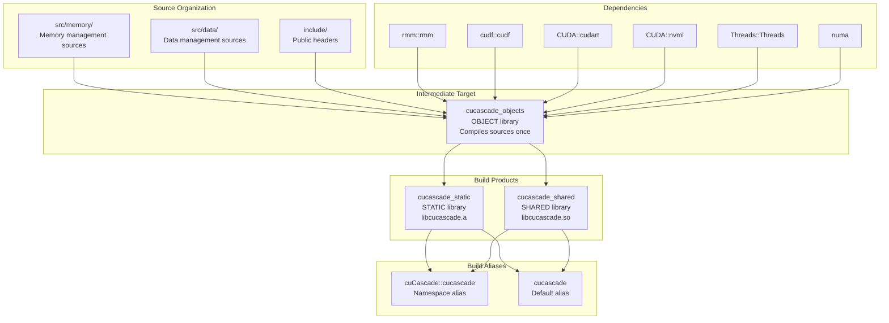
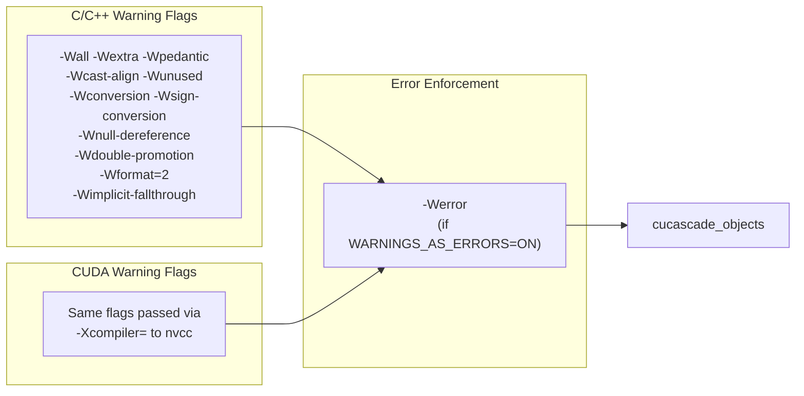
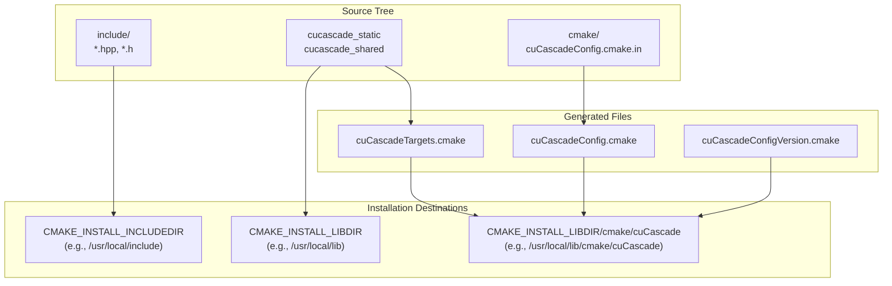
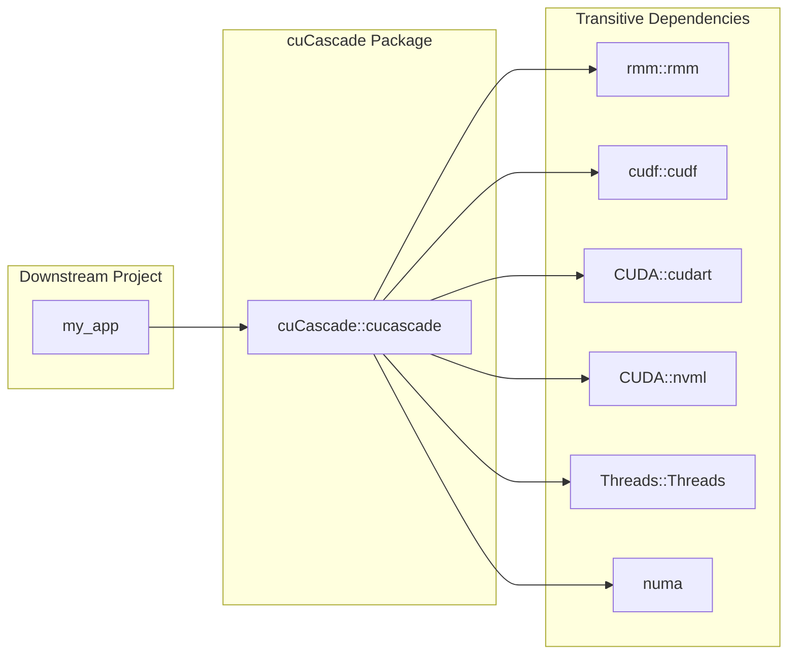

<!-- source: DeepWiki mcp.deepwiki.com · repo NVIDIA/cuCascade · page 2.1 Building and Installation · fetched 2026-10-26 -->

# Building and Installation

<details>
<summary>Relevant source files</summary>

The following files were used as context for generating this wiki page:

- [CMakeLists.txt](CMakeLists.txt)
- [cmake/cuCascadeConfig.cmake.in](cmake/cuCascadeConfig.cmake.in)

</details>


## Purpose and Scope

This page provides detailed instructions for building and installing cuCascade from source using CMake. It covers compiler requirements, build configuration options, the CMake target structure, and the installation process. For information about setting up dependencies and environment configuration, see [Dependencies and Environment Setup](#2.2).

---

## Prerequisites

cuCascade requires the following tools and environment:

| Requirement | Minimum Version | Notes |
|-------------|----------------|-------|
| CMake | 3.26.4 | Build system |
| C++ Compiler | C++20 support | GCC 11+, Clang 14+, or MSVC 2019+ |
| CUDA Toolkit | CUDA 20 support | nvcc compiler with C++20 support |
| NVIDIA GPU | Compute capability 7.5+ | Architectures: 75, 80, 86, 90 |

**Sources:** [CMakeLists.txt:18-34]()

### Dependency Libraries

cuCascade depends on the RAPIDS ecosystem and system libraries:

- **cuDF**: GPU DataFrame library for data representation
- **RMM**: RAPIDS Memory Manager for GPU memory allocation
- **CUDA Runtime** (`cudart`): CUDA runtime library
- **CUDA NVML** (`nvml`): NVIDIA Management Library for topology discovery
- **libnuma**: NUMA memory allocation support
- **Threads**: POSIX threads library

Refer to [Dependencies and Environment Setup](#2.2) for detailed installation instructions for these dependencies.

**Sources:** [CMakeLists.txt:49-56, 116-117]()

---

## Build System Architecture

cuCascade uses a modern CMake build system with an **object library** pattern to optimize compilation. The system compiles source files once into an intermediate object library, then links these objects into both static and shared library variants.

### CMake Target Structure



**Diagram: CMake Target Dependency Graph**

The `cucascade_objects` target is an `OBJECT` library that compiles all source files. Both `cucascade_static` and `cucascade_shared` link against `$<TARGET_OBJECTS:cucascade_objects>`, avoiding duplicate compilation. The default `cuCascade::cucascade` alias points to the shared library if enabled, otherwise to the static library.

**Sources:** [CMakeLists.txt:94-176]()

---

## Building cuCascade

### Basic Build Steps

```bash
# 1. Clone the repository
git clone https://github.com/NVIDIA/cuCascade.git
cd cuCascade

# 2. Create build directory
mkdir build
cd build

# 3. Configure with CMake
cmake ..

# 4. Build the library
cmake --build . --parallel

# 5. Run tests (optional)
ctest --output-on-failure
```

### CMake Configuration Options

The following CMake options control the build configuration:

| Option | Type | Default | Description |
|--------|------|---------|-------------|
| `BUILD_SHARED_LIBS` | BOOL | ON | Build shared library (`libcucascade.so`) |
| `BUILD_STATIC_LIBS` | BOOL | ON | Build static library (`libcucascade.a`) |
| `BUILD_TESTS` | BOOL | ON | Build test suite |
| `WARNINGS_AS_ERRORS` | BOOL | ON | Treat compiler warnings as errors |
| `CMAKE_CUDA_ARCHITECTURES` | LIST | "75;80;86;90" | Target CUDA compute capabilities |

**Sources:** [CMakeLists.txt:36-66]()

### Configuration Examples

**Build shared library only:**
```bash
cmake -DBUILD_STATIC_LIBS=OFF ..
```

**Build static library only:**
```bash
cmake -DBUILD_SHARED_LIBS=OFF ..
```

**Custom CUDA architectures (e.g., for A100 and H100 only):**
```bash
cmake -DCMAKE_CUDA_ARCHITECTURES="80;90" ..
```

**Disable tests for faster builds:**
```bash
cmake -DBUILD_TESTS=OFF ..
```

**Development build with lenient warnings:**
```bash
cmake -DWARNINGS_AS_ERRORS=OFF ..
```

**Note:** At least one of `BUILD_SHARED_LIBS` or `BUILD_STATIC_LIBS` must be `ON`. The configuration will fail otherwise.

**Sources:** [CMakeLists.txt:42-46, 59-61, 66]()

---

## Compiler Flags and Standards

### Language Standards

cuCascade enforces modern C++ and CUDA standards:

- **C++20** standard required for host code (no compiler extensions)
- **CUDA 20** standard required for device code

**Sources:** [CMakeLists.txt:27-34]()

### Warning Flags

The build system enables comprehensive compiler warnings for code quality:



**Diagram: Compiler Warning Configuration Flow**

CUDA warning flags are passed to the host compiler using `-Xcompiler=` prefix, ensuring consistent warning behavior across compilation units.

**Sources:** [CMakeLists.txt:64-103]()

---

## Installation

### Installation Targets

The installation process installs the following components:



**Diagram: Installation Directory Structure**

**Sources:** [CMakeLists.txt:179-233]()

### Installation Commands

**Standard installation (requires root/sudo):**
```bash
cd build
cmake --install .
```

**Custom installation prefix:**
```bash
cmake --install . --prefix /custom/install/path
```

**Installation to a staging directory:**
```bash
cmake --install . --prefix /tmp/staging
```

### Installed Files

After installation, the following structure is created:

```
<install-prefix>/
├── include/
│   └── cucascade/           # Public headers
│       ├── memory/
│       ├── data/
│       └── ...
├── lib/
│   ├── libcucascade.so      # Shared library (if BUILD_SHARED_LIBS=ON)
│   ├── libcucascade.a       # Static library (if BUILD_STATIC_LIBS=ON)
│   └── cmake/
│       └── cuCascade/
│           ├── cuCascadeTargets.cmake
│           ├── cuCascadeConfig.cmake
│           └── cuCascadeConfigVersion.cmake
```

**Sources:** [CMakeLists.txt:184-233]()

---

## Using cuCascade in Downstream Projects

### CMake Integration

After installation, downstream projects can consume cuCascade using `find_package()`:

```cmake
# Find cuCascade package
find_package(cuCascade REQUIRED CONFIG)

# Link your target to cuCascade
add_executable(my_app main.cpp)
target_link_libraries(my_app PRIVATE cuCascade::cucascade)
```

### Available CMake Targets

The package exports the following targets:

| Target | Description |
|--------|-------------|
| `cuCascade::cucascade` | Default target (shared if available, else static) |
| `cuCascade::cucascade_shared` | Shared library variant (if installed) |
| `cuCascade::cucascade_static` | Static library variant (if installed) |

**Example: Force linking to static library:**
```cmake
target_link_libraries(my_app PRIVATE cuCascade::cucascade_static)
```

**Sources:** [cmake/cuCascadeConfig.cmake.in:1-27]()

### Package Configuration

The `cuCascadeConfig.cmake` file automatically finds and links all transitive dependencies:



**Diagram: Automatic Dependency Resolution**

The configuration file uses `find_dependency()` to locate all required packages. Downstream projects do not need to explicitly find `rmm`, `cudf`, or CUDA components—these are resolved automatically.

**Sources:** [cmake/cuCascadeConfig.cmake.in:3-12]()

### Version Compatibility

The package configuration supports **same major version** compatibility:

- cuCascade 0.1.x is compatible with cuCascade 0.1.y
- cuCascade 1.2.x is compatible with cuCascade 1.3.y
- cuCascade 2.0.x is **not** compatible with cuCascade 1.x.y

Specify version requirements in `find_package()`:

```cmake
# Require minimum version
find_package(cuCascade 0.1.0 REQUIRED)

# Require exact version
find_package(cuCascade 0.1.0 EXACT REQUIRED)
```

**Sources:** [CMakeLists.txt:225-228]()

---

## Build System Details

### Object Library Pattern

The build uses an **OBJECT** library to optimize compilation:

1. `cucascade_objects` compiles all source files once with position-independent code (PIC)
2. Both static and shared libraries link against `$<TARGET_OBJECTS:cucascade_objects>`
3. Avoids recompiling sources for each library variant

**Sources:** [CMakeLists.txt:94-120]()

### Include Directory Management

The build system uses **generator expressions** for proper include directory handling:

- **Build interface**: `$<BUILD_INTERFACE:${CMAKE_CURRENT_SOURCE_DIR}/include>`
  - Used during build, points to source tree
- **Install interface**: `$<INSTALL_INTERFACE:include>`
  - Used after installation, points to install prefix

This ensures headers are found correctly both during development and after installation.

**Sources:** [CMakeLists.txt:110-113, 129-132, 150-153]()

### Library Versioning

The shared library is versioned using the project version:

- `VERSION`: Full semantic version (e.g., `0.1.0`)
- `SOVERSION`: Major version only (e.g., `0`)

This enables multiple major versions to coexist on the same system.

**Sources:** [CMakeLists.txt:159-163]()

---

## Troubleshooting

### Common Build Issues

**Issue: CMake cannot find cuDF or RMM**
```
CMake Error: Could not find a package configuration file provided by "cudf"
```

**Solution:** Ensure cuDF and RMM are installed and their installation directories are in `CMAKE_PREFIX_PATH`. See [Dependencies and Environment Setup](#2.2).

**Issue: CUDA architecture not supported**
```
nvcc fatal: Unsupported gpu architecture 'compute_75'
```

**Solution:** Your GPU or CUDA toolkit may not support the default architectures. Override with:
```bash
cmake -DCMAKE_CUDA_ARCHITECTURES="80" ..
```

**Issue: Missing libnuma**
```
/usr/bin/ld: cannot find -lnuma
```

**Solution:** Install the NUMA library:
```bash
# Ubuntu/Debian
sudo apt-get install libnuma-dev

# RHEL/CentOS
sudo yum install numactl-devel
```

**Issue: C++20 compiler required**
```
error: #error This file requires compiler and library support for the ISO C++ 2020 standard.
```

**Solution:** Use a compiler with C++20 support (GCC 11+, Clang 14+) or upgrade your CUDA toolkit.

---

**Sources:** [CMakeLists.txt:1-242](), [cmake/cuCascadeConfig.cmake.in:1-27]()

---

