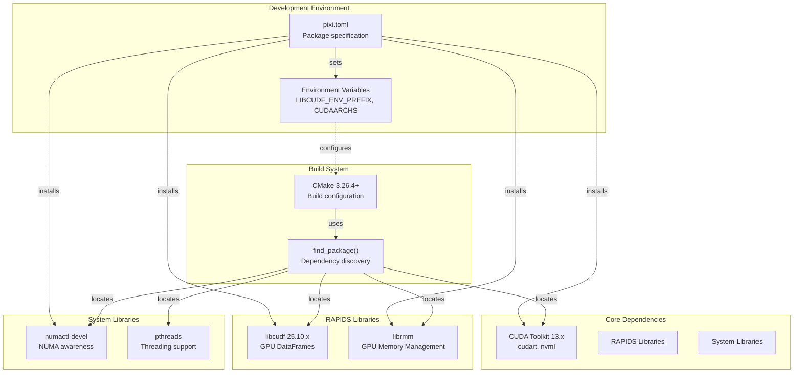
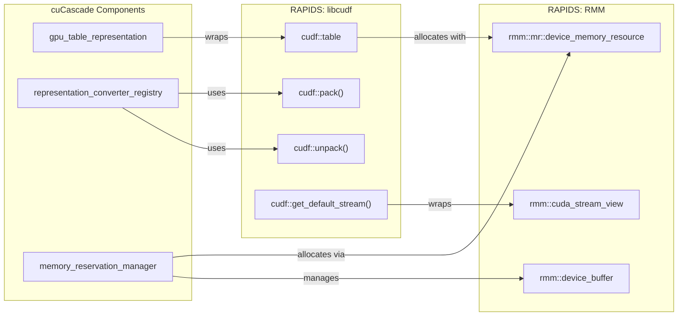
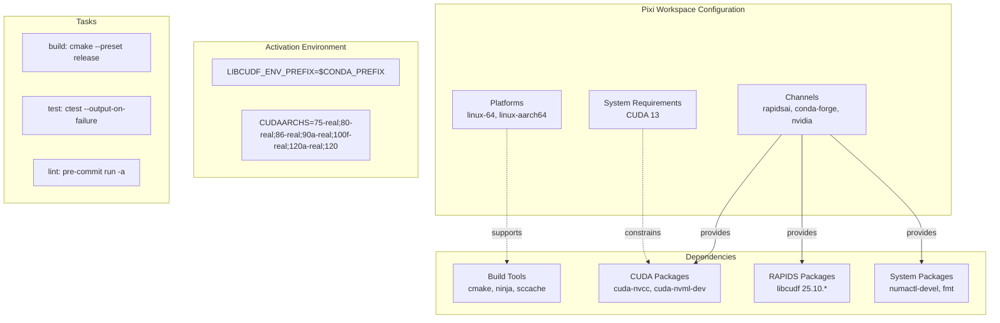
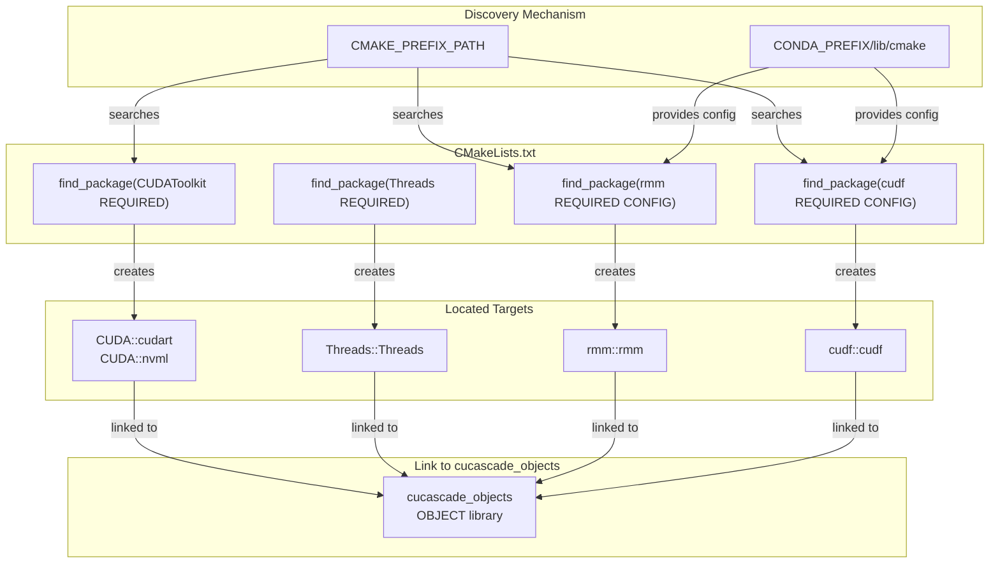
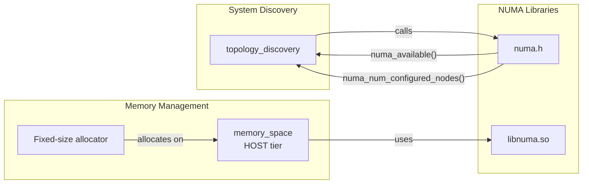

<!-- source: DeepWiki mcp.deepwiki.com · repo NVIDIA/cuCascade · page 2.2 Dependencies and Environment Setup · fetched 2026-10-26 -->

# Dependencies and Environment Setup

<details>
<summary>Relevant source files</summary>

The following files were used as context for generating this wiki page:

- [CMakeLists.txt](CMakeLists.txt)
- [cmake/cuCascadeConfig.cmake.in](cmake/cuCascadeConfig.cmake.in)
- [include/data/data_repository.hpp](include/data/data_repository.hpp)
- [pixi.toml](pixi.toml)

</details>


## Purpose and Scope

This page documents the external dependencies required by cuCascade and the environment configuration process. It covers dependency versions, package management using pixi, environment variables, and CMake integration patterns.

For build instructions and CMake configuration options, see [Building and Installation](#2.1). For system architecture and how these dependencies integrate into cuCascade's subsystems, see [Architecture Overview](#3).

---

## Overview

cuCascade requires a specific set of dependencies from the RAPIDS ecosystem, CUDA platform, and system libraries. The project provides two environment setup methods:

1. **Pixi-based setup** (recommended): Automated dependency resolution using the pixi package manager
2. **Manual setup**: Direct installation of dependencies for custom environments



**Diagram: Dependency Resolution and Build Integration**

Sources: [pixi.toml:1-37](), [CMakeLists.txt:48-57](), [cmake/cuCascadeConfig.cmake.in:1-27]()

---

## Required Dependencies

### Dependency Version Matrix

| Dependency | Minimum Version | Pixi Version | Purpose |
|------------|----------------|--------------|---------|
| CMake | 3.26.4 | 4.1.* | Build system configuration |
| C++ Compiler | C++20 support | - | Code compilation (host code) |
| CUDA Toolkit | 11.3+ | 13.* | GPU runtime and compiler |
| libcudf | - | 25.10.* | GPU DataFrame operations |
| RMM | - | (via libcudf) | GPU memory management |
| NUMA libraries | - | numactl-devel | NUMA-aware host memory |
| pthreads | - | (system) | Thread synchronization |

Sources: [CMakeLists.txt:18-34](), [pixi.toml:15-30]()

### CUDA Requirements

cuCascade requires CUDA 11.3 or later with support for:
- **CUDA Runtime API** (`cudart`): Asynchronous memory operations, stream management
- **CUDA NVML** (`nvml`): GPU topology discovery and memory queries
- **CUDA Standard**: C++20 device code compilation

**Default CUDA Architectures**:
```
75  (Turing: T4)
80  (Ampere: A100)
86  (Ampere: RTX 30xx)
90  (Hopper: H100)
```

Sources: [CMakeLists.txt:32-61](), [pixi.toml:8-19]()

### RAPIDS Ecosystem Integration



**Diagram: RAPIDS Integration Points**

- **libcudf**: Provides `cudf::table` for columnar GPU data storage, used by [gpu_table_representation](#5.2)
- **RMM**: Manages GPU memory allocation through `rmm::mr::device_memory_resource`, integrated with [memory_reservation_manager](#4.1)

Sources: [CMakeLists.txt:52-56](), [include/data/data_repository.hpp:1-149]()

---

## Environment Setup with Pixi

### Pixi Configuration File

The [pixi.toml:1-37]() file defines the complete development environment:



**Diagram: Pixi Environment Structure**

Sources: [pixi.toml:1-37]()

### Installation Steps

1. **Install Pixi** (if not already installed):
   ```bash
   curl -fsSL https://pixi.sh/install.sh | bash
   ```

2. **Initialize Environment**:
   ```bash
   pixi install
   ```
   This resolves and installs all dependencies from the configured channels.

3. **Activate Environment**:
   ```bash
   pixi shell
   ```
   Sets all environment variables defined in [pixi.toml:10-13]().

Sources: [pixi.toml:1-37]()

---

## Environment Variables

### Critical Environment Variables

| Variable | Value | Purpose |
|----------|-------|---------|
| `LIBCUDF_ENV_PREFIX` | `$CONDA_PREFIX` | Points cuDF to the conda environment for library loading |
| `CUDAARCHS` | See below | Specifies target GPU architectures for CUDA compilation |

**CUDAARCHS Format**:
```
75-real;80-real;86-real;90a-real;100f-real;120a-real;120
```

- `75-real`: Turing (compute capability 7.5)
- `80-real`: Ampere (8.0)
- `86-real`: Ampere (8.6)
- `90a-real`: Hopper (9.0a)
- `100f-real`: Future architecture (10.0f)
- `120a-real`: Future architecture (12.0a)
- `120`: Virtual architecture for forward compatibility

The `-real` suffix generates native GPU code for the specified architecture, while the final `120` generates PTX intermediate code for future GPU compatibility.

Sources: [pixi.toml:10-13]()

### Additional Build Variables

These are typically auto-detected by CMake but can be overridden:

| Variable | Default | Description |
|----------|---------|-------------|
| `CMAKE_CUDA_ARCHITECTURES` | `75;80;86;90` | CMake-specific architecture list |
| `CMAKE_BUILD_TYPE` | `Release` | Build configuration |
| `BUILD_TESTS` | `ON` | Enable test suite compilation |
| `WARNINGS_AS_ERRORS` | `ON` | Treat warnings as compilation errors |

Sources: [CMakeLists.txt:36-66]()

---

## CMake Dependency Discovery

### Find Package Integration

The build system uses CMake's `find_package()` mechanism to locate dependencies:



**Diagram: CMake Dependency Resolution Flow**

Sources: [CMakeLists.txt:48-117]()

### Linking Configuration

The [CMakeLists.txt:116-117]() links all dependencies to the `cucascade_objects` OBJECT library:

```cmake
target_link_libraries(cucascade_objects 
    PUBLIC 
        rmm::rmm 
        cudf::cudf 
        CUDA::cudart
        CUDA::nvml 
        Threads::Threads 
        numa
)
```

This configuration ensures:
- Both static and shared libraries inherit dependencies
- Transitive dependencies are automatically resolved
- Include paths are propagated to consuming targets

Sources: [CMakeLists.txt:94-120]()

### Downstream Package Configuration

The [cmake/cuCascadeConfig.cmake.in:1-27]() template enables downstream projects to use cuCascade:

```cmake
find_dependency(CUDAToolkit REQUIRED)
find_dependency(Threads REQUIRED)
find_dependency(rmm REQUIRED CONFIG)
find_dependency(cudf REQUIRED CONFIG)
```

Downstream projects can then use:
```cmake
find_package(cuCascade REQUIRED)
target_link_libraries(my_app PRIVATE cuCascade::cucascade)
```

Sources: [cmake/cuCascadeConfig.cmake.in:1-27]()

---

## System Library Dependencies

### NUMA Support

cuCascade requires **numactl-devel** for NUMA-aware host memory allocation:



**Diagram: NUMA Integration**

The NUMA library enables:
- NUMA node discovery and topology mapping
- NUMA-local memory allocation for performance
- Cross-NUMA data transfer optimization

For details on NUMA-aware allocation, see [Topology Discovery and NUMA Support](#4.3).

Sources: [CMakeLists.txt:117](), [pixi.toml:30]()

### Threading Support

cuCascade uses **pthreads** (via `Threads::Threads` CMake target) for:
- Thread-safe repository access (mutexes in `idata_repository`)
- Concurrent data batch processing
- Lock-free atomic operations in `data_batch`

Sources: [CMakeLists.txt:50](), [include/data/data_repository.hpp:72-98]()

---

## Verification

### Verifying Pixi Environment

After `pixi install`, verify dependencies:

```bash
# Check CMake version
cmake --version  # Should be >= 3.26.4

# Check CUDA version
nvcc --version   # Should be CUDA 13.x

# Check cuDF installation
python -c "import cudf; print(cudf.__version__)"  # Should be 25.10.x

# Verify environment variables
echo $LIBCUDF_ENV_PREFIX  # Should point to conda prefix
echo $CUDAARCHS           # Should show architecture list
```

### Verifying CMake Configuration

Test dependency discovery without building:

```bash
cmake -S . -B build/test
```

Expected output includes:
```
-- Found CUDAToolkit: ...
-- Found Threads: ...
-- Found rmm: ...
-- Found cudf: ...
```

If dependencies are not found, check:
1. `CMAKE_PREFIX_PATH` includes conda environment
2. `LIBCUDF_ENV_PREFIX` is set correctly
3. RMM and cuDF config files exist in `$CONDA_PREFIX/lib/cmake`

Sources: [CMakeLists.txt:48-57]()

---

## Troubleshooting

### Common Issues

| Issue | Cause | Solution |
|-------|-------|----------|
| `Could not find cudf` | Missing CMAKE_PREFIX_PATH | Ensure pixi environment is activated |
| `undefined reference to numa_*` | Missing libnuma | Install numactl-devel package |
| `CUDA architecture mismatch` | Wrong CUDAARCHS | Set CUDAARCHS or CMAKE_CUDA_ARCHITECTURES |
| `C++20 required but not available` | Old compiler | Use GCC 10+ or Clang 10+ |

### Manual Dependency Installation

For non-pixi environments:

1. **Install CUDA Toolkit** from NVIDIA's repository
2. **Build RMM and cuDF** from source (requires matching CUDA version)
3. **Install NUMA libraries**: 
   ```bash
   # Ubuntu/Debian
   apt-get install libnuma-dev
   
   # RHEL/CentOS
   yum install numactl-devel
   ```
4. **Set CMAKE_PREFIX_PATH** to RMM/cuDF installation directories

Sources: [CMakeLists.txt:48-57]()

---

## Summary

cuCascade's dependency stack integrates:

1. **CUDA Platform**: GPU execution, memory management, topology discovery
2. **RAPIDS Ecosystem**: cuDF for GPU DataFrames, RMM for memory pooling
3. **System Libraries**: NUMA for host memory optimization, pthreads for concurrency

The pixi-based workflow automates this setup, while CMake's package configuration enables flexible integration into existing build systems.

Sources: [pixi.toml:1-37](), [CMakeLists.txt:1-242](), [cmake/cuCascadeConfig.cmake.in:1-27]()

---

