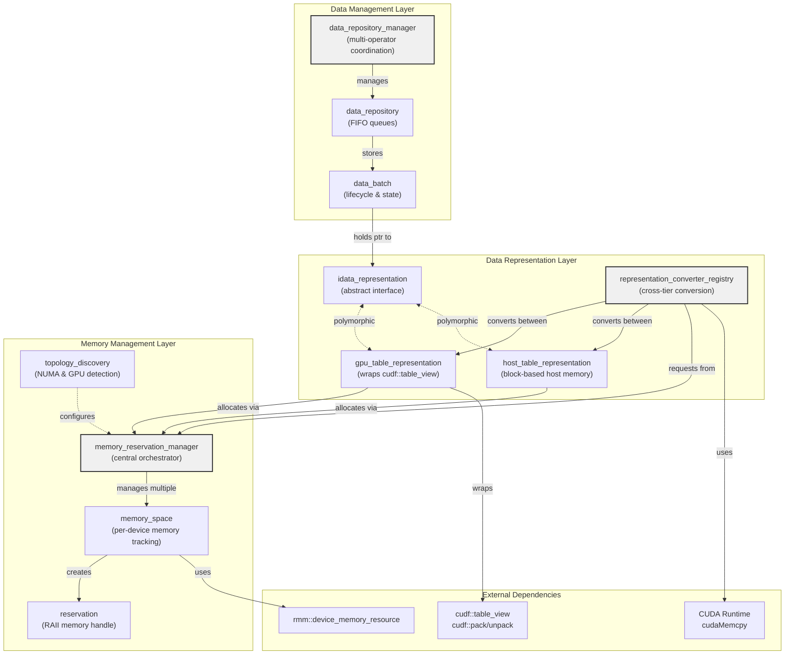
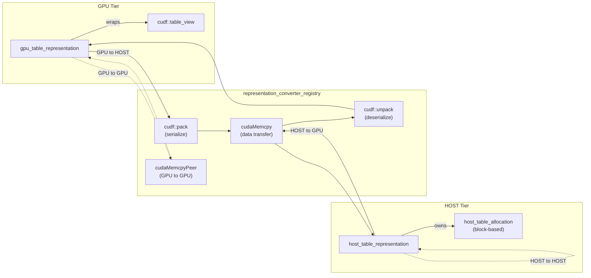
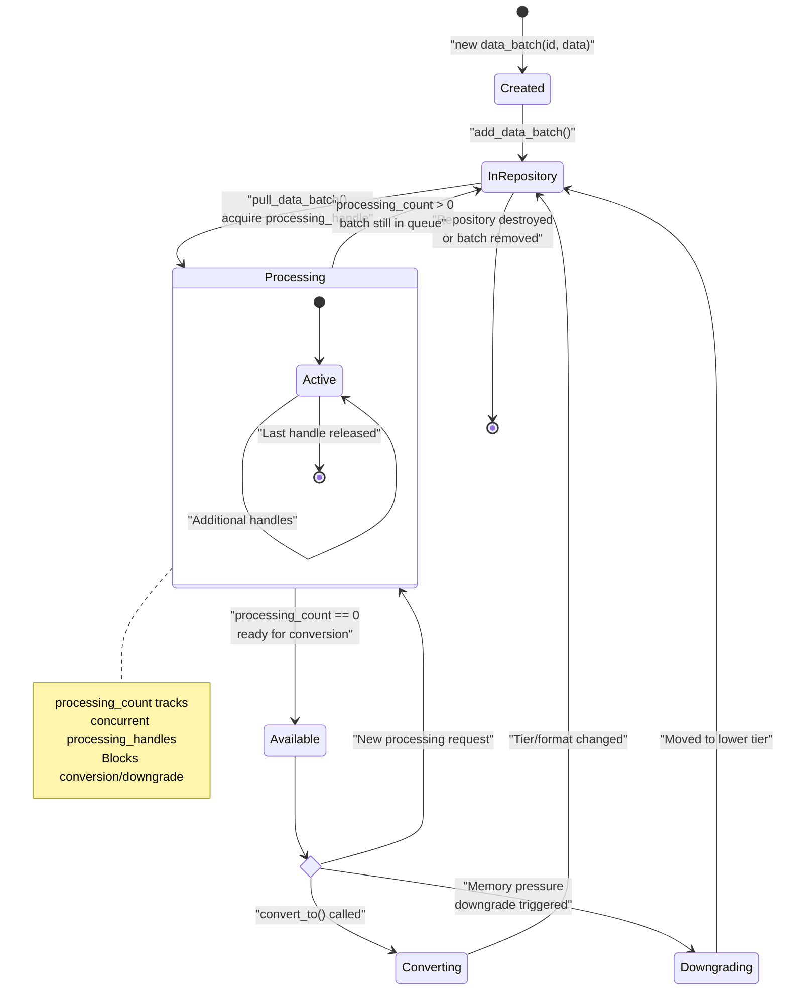
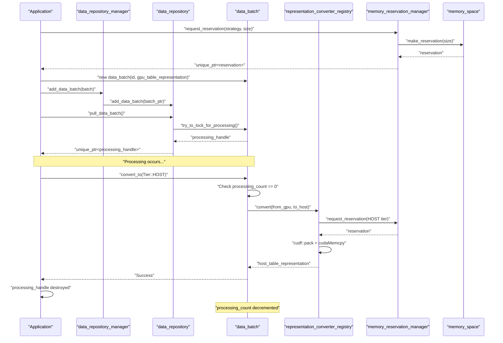
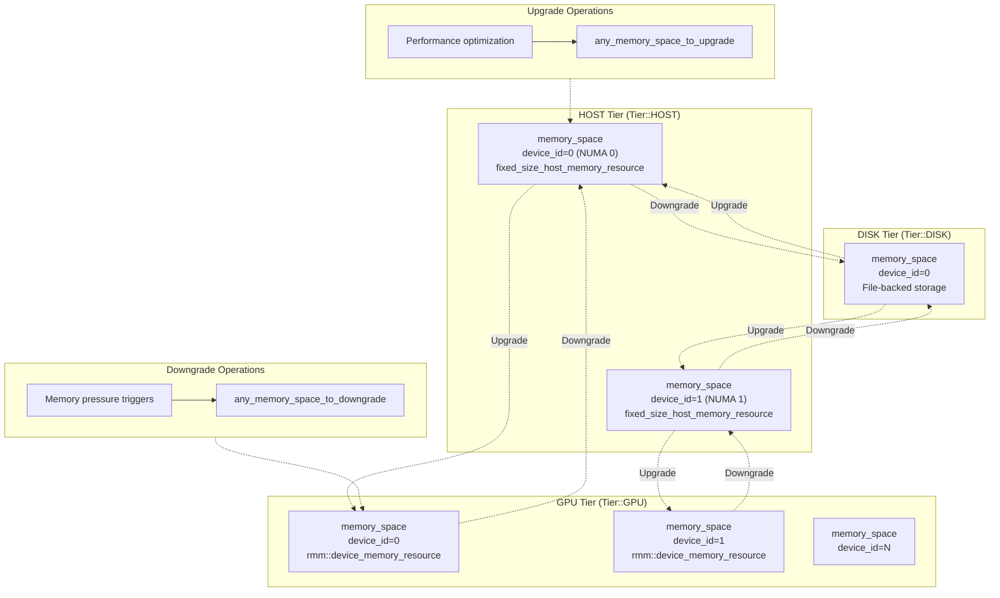
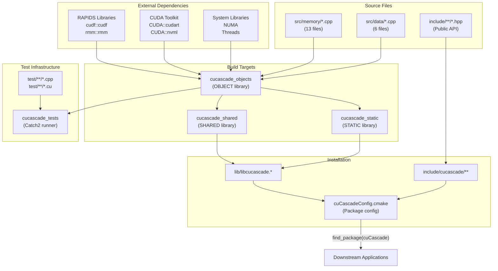

<!-- source: DeepWiki mcp.deepwiki.com · repo NVIDIA/cuCascade · page 3 Architecture Overview · fetched 2026-10-26 -->

# Architecture Overview

Relevant source files

The following files were used as context for generating this wiki page:

- [include/memory/memory_reservation_manager.hpp](include/memory/memory_reservation_manager.hpp)
- [src/data/CMakeLists.txt](src/data/CMakeLists.txt)
- [src/memory/CMakeLists.txt](src/memory/CMakeLists.txt)
- [src/memory/memory_reservation_manager.cpp](src/memory/memory_reservation_manager.cpp)
- [test/CMakeLists.txt](test/CMakeLists.txt)
- [test/memory/test_memory_reservation_manager.cpp](test/memory/test_memory_reservation_manager.cpp)

This page provides a high-level overview of cuCascade's architecture, describing the three fundamental layers that compose the system: Memory Management, Data Representation, and Data Management. Each layer addresses a specific aspect of heterogeneous memory management and data processing on GPU systems.

For detailed information about specific components within each layer, see [System Components](#3.1). For information about the memory tier hierarchy and data movement patterns, see [Memory Tier Hierarchy](#3.2). For implementation details of individual subsystems, refer to the Memory Management Subsystem ([section 4](#4)), Data Representation Subsystem ([section 5](#5)), and Data Management Subsystem ([section 6](#6)).

## Three-Layer Architecture

cuCascade is organized into three distinct architectural layers, each responsible for a specific domain of functionality:

| Layer | Primary Responsibility | Key Abstractions |
|-------|----------------------|------------------|
| **Memory Management** | Allocate and track memory across heterogeneous memory tiers (GPU, HOST, DISK) | `memory_reservation_manager`, `memory_space`, `reservation` |
| **Data Representation** | Abstract data storage formats and enable cross-tier data movement | `idata_representation`, `gpu_table_representation`, `host_table_representation` |
| **Data Management** | Manage data batch lifecycle and multi-operator routing | `data_batch`, `data_repository`, `data_repository_manager` |

Sources: [include/memory/memory_reservation_manager.hpp:178-303](), [src/data/CMakeLists.txt:18-25](), [src/memory/CMakeLists.txt:18-33]()

**Diagram: Core Architectural Components and Dependencies**

Sources: [src/data/CMakeLists.txt:18-25](), [src/memory/CMakeLists.txt:18-33](), [include/memory/memory_reservation_manager.hpp:178-303]()

## Memory Management Layer

The Memory Management Layer provides heterogeneous memory allocation and tracking across GPU devices, host memory (with NUMA awareness), and disk storage. This layer is the foundation of cuCascade's multi-tier memory architecture.

### Core Components

- **`memory_reservation_manager`**: Central orchestrator that coordinates memory reservations across all memory spaces. Implements multiple reservation strategies (`any_memory_space_in_tier`, `specific_memory_space`, `any_memory_space_in_tiers`) for flexible allocation policies.

- **`memory_space`**: Represents a single memory space (e.g., GPU device 0, NUMA node 1). Tracks memory capacity, reservations, and enforces limits. Each space owns a `rmm::device_memory_resource` or `fixed_size_host_memory_resource`.

- **`reservation`**: RAII handle for reserved memory. Guarantees memory availability until destroyed. Provides access to the underlying memory resource for actual allocations.

- **`topology_discovery`**: Detects system hardware topology including GPU devices, NUMA nodes, and device-to-NUMA affinity for optimal memory placement.

### Reservation Strategies

The system supports multiple reservation request strategies defined in [include/memory/memory_reservation_manager.hpp:55-167]():

| Strategy Class | Purpose | Use Case |
|---------------|---------|----------|
| `any_memory_space_in_tier_with_preference` | Allocate in a tier, preferring a specific device | GPU allocation with device preference |
| `any_memory_space_in_tier` | Allocate in any device within a tier | Flexible GPU or HOST allocation |
| `any_memory_space_in_tiers` | Allocate across multiple tiers with priority order | Cascading allocation (GPU → HOST → DISK) |
| `specific_memory_space` | Allocate in a specific device | Pinned device allocation |
| `any_memory_space_to_downgrade` | Downgrade from one tier to lower tiers | Memory pressure response |
| `any_memory_space_to_upgrade` | Upgrade from lower tier to higher tier | Performance optimization |

Sources: [include/memory/memory_reservation_manager.hpp:42-306](), [src/memory/memory_reservation_manager.cpp:122-365](), [test/memory/test_memory_reservation_manager.cpp:57-515]()

## Data Representation Layer

The Data Representation Layer abstracts data storage formats and enables seamless conversion between memory tiers. This layer bridges the gap between GPU-native cuDF tables and host memory representations.

### Core Components

- **`idata_representation`**: Abstract interface defining the polymorphic contract for all data representations. Provides methods for memory tier identification, size queries, and conversion operations.

- **`gpu_table_representation`**: Wraps `cudf::table_view` and manages GPU memory. Uses `cudf::pack` for serialization and `cudf::unpack` for deserialization during tier transitions.

- **`host_table_representation`**: Manages data in host memory using a block-based allocation strategy via `host_table_allocation`. Data is stored as serialized contiguous metadata and data blocks.

- **`representation_converter_registry`**: Central registry for conversion operations. Implements conversions for:
  - GPU → HOST (via `cudf::pack` + `cudaMemcpy`)
  - HOST → GPU (via `cudaMemcpy` + `cudf::unpack`)
  - GPU → GPU (via `cudaMemcpyPeer` for peer-to-peer transfer)
  - HOST → HOST (via block-based copy for cross-NUMA transfer)

**Diagram: Data Representation Conversion Paths**

Sources: [src/data/CMakeLists.txt:20-25](), [include/memory/memory_reservation_manager.hpp:42-306]()

## Data Management Layer

The Data Management Layer orchestrates the lifecycle of data batches and manages routing to multiple operators. This layer implements the producer-consumer patterns that drive data processing workflows.

### Core Components

- **`data_batch`**: Represents a unit of data with a unique batch ID. Tracks processing state via reference counting (`processing_count`). Holds a polymorphic pointer to `idata_representation` for actual data storage.

- **`data_batch_processing_handle`**: RAII handle acquired when processing a batch. Increments `processing_count` on acquisition, decrements on destruction. Prevents unsafe data movement while processing is active.

- **`data_repository`**: FIFO queue of data batches for a single operator. Two variants:
  - `shared_data_repository`: Holds `std::shared_ptr<data_batch>` for broadcast patterns
  - `unique_data_repository`: Holds `std::unique_ptr<data_batch>` for exclusive ownership

- **`data_repository_manager`**: Routes incoming batches to multiple operator-specific repositories. Generates unique batch IDs and distributes batches according to ownership semantics.

### Batch Lifecycle States

**Diagram: Data Batch State Machine**

Sources: [src/data/data_batch.cpp](), [src/data/data_repository.cpp](), [src/data/data_repository_manager.cpp]()

## Component Interaction Flow

The following diagram illustrates how the three layers interact during a typical data processing workflow:

**Diagram: Typical Data Flow Sequence**

Sources: [src/data/data_batch.cpp](), [src/data/data_repository_manager.cpp](), [src/data/representation_converter.cpp]()

## Memory Tier Hierarchy

cuCascade organizes memory into three tiers, each with distinct performance and capacity characteristics:

**Diagram: Memory Tier Hierarchy and Movement**

| Tier | Performance | Capacity | Memory Resource Type | Use Case |
|------|------------|----------|---------------------|----------|
| GPU | Highest (TB/s bandwidth) | Limited (GBs) | `rmm::device_memory_resource` | Active processing |
| HOST | Medium (GB/s bandwidth) | Large (10s-100s GB) | `fixed_size_host_memory_resource` | Staging, overflow |
| DISK | Lowest (MB/s bandwidth) | Very Large (TBs) | File-backed | Archival, cold data |

Sources: [include/memory/memory_reservation_manager.hpp:42-306](), [include/memory/common.hpp](), [test/memory/test_memory_reservation_manager.cpp:52-68]()

## Build and Integration Architecture

cuCascade uses modern CMake practices to integrate with the RAPIDS ecosystem and provide a clean API for downstream consumers:

**Diagram: Build System Architecture**

### Build Configuration

The build system compiles sources once using an `OBJECT` library (`cucascade_objects`), then links into both static and shared library variants. This approach minimizes compilation time while supporting multiple distribution formats.

**Key Build Characteristics:**

- **Language Requirements**: C++20, CUDA 12.0+
- **Build System**: CMake 3.26+
- **Primary Dependencies**: cuDF, RMM (from RAPIDS), CUDA Toolkit
- **Test Framework**: Catch2 v2.13.10
- **Installation**: Produces CMake package config for downstream consumption

Sources: [src/data/CMakeLists.txt:18-25](), [src/memory/CMakeLists.txt:18-33](), [test/CMakeLists.txt:18-61]()

## Thread Safety and Concurrency

cuCascade is designed for concurrent operation with careful synchronization boundaries:

- **`memory_reservation_manager`**: Thread-safe reservation requests with cross-space condition variable for blocking when no space is available
- **`data_batch`**: Thread-safe processing state management via atomic `processing_count` 
- **`data_repository`**: Thread-safe FIFO operations with mutex protection
- **`processing_handle`**: RAII pattern ensures correct reference counting even with exceptions

The system prevents race conditions during tier conversions by blocking `convert_to()` operations when `processing_count > 0`, ensuring data is not moved while being actively processed.

Sources: [test/memory/test_memory_reservation_manager.cpp:210-515](), [src/memory/memory_reservation_manager.cpp:180-191](), [test/data/test_data_batch.cpp]()

---

