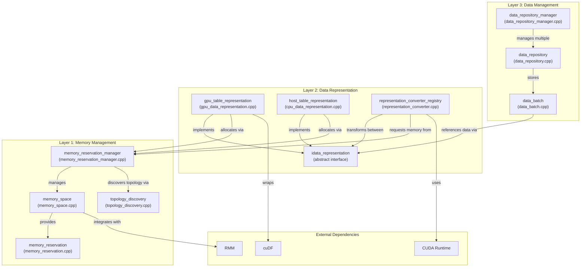
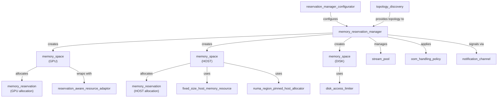
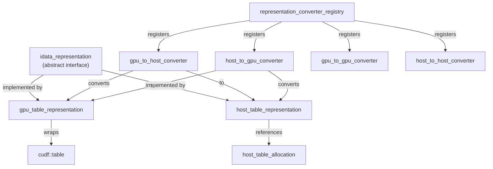
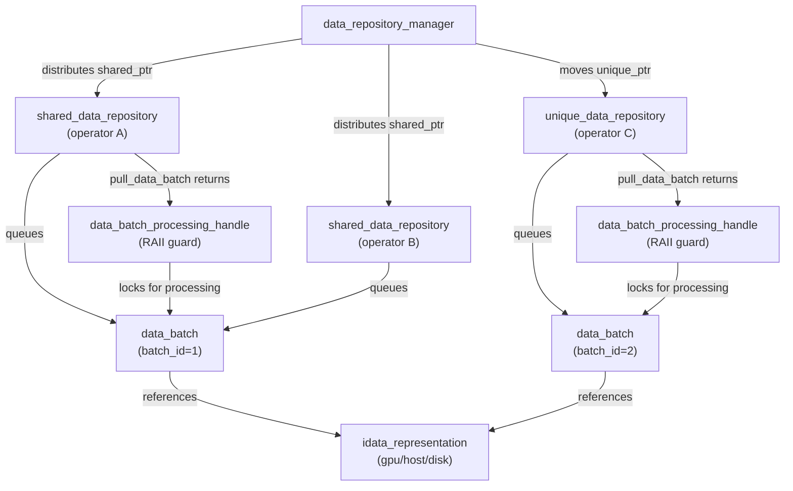
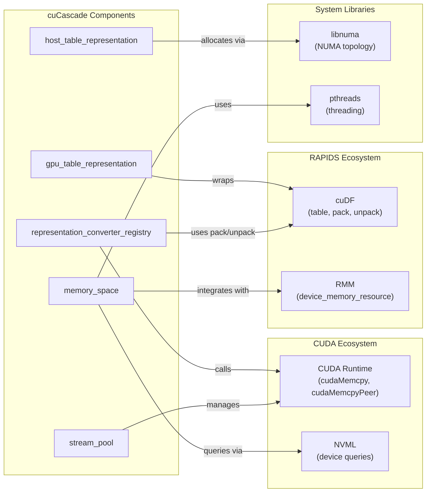
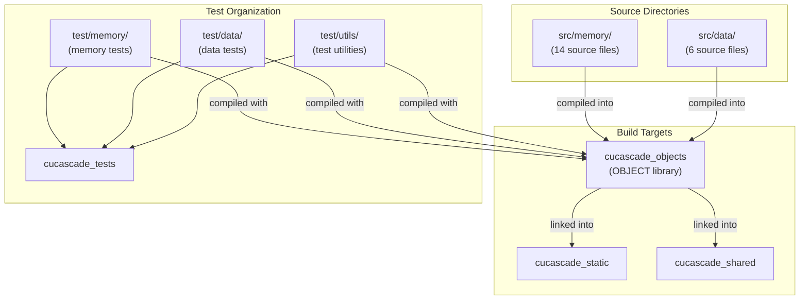

<!-- source: DeepWiki mcp.deepwiki.com · repo NVIDIA/cuCascade · page 3.1 System Components · fetched 2026-10-26 -->

# System Components

Relevant source files

The following files were used as context for generating this wiki page:

- [src/data/CMakeLists.txt](src/data/CMakeLists.txt)
- [src/memory/CMakeLists.txt](src/memory/CMakeLists.txt)
- [test/CMakeLists.txt](test/CMakeLists.txt)

## Purpose and Scope

This page documents the major subsystems within cuCascade and their core responsibilities. It provides an architectural map of the components that implement cuCascade's three-layer design: **Memory Management**, **Data Representation**, and **Data Management**. 

For detailed implementation of each layer, see:
- Memory Management implementation details: [Memory Management Subsystem](#4)
- Data Representation implementation details: [Data Representation Subsystem](#5)
- Data Management implementation details: [Data Management Subsystem](#6)
- Build system and deployment: [Building and Installation](#2.1)

## Architectural Layers

cuCascade organizes its components into three distinct architectural layers, each with well-defined responsibilities. The layers build upon each other to provide heterogeneous memory management for GPU dataframes.

### Layer Architecture Diagram

**Sources:** [src/data/CMakeLists.txt:18-25](), [src/memory/CMakeLists.txt:18-33]()

## Memory Management Layer

The Memory Management Layer provides the foundation for heterogeneous memory allocation across GPU, host, and disk storage tiers. This layer abstracts hardware topology and memory resources, enabling unified memory management across diverse memory types.

### Core Components

| Component | Source File | Primary Responsibility |
|-----------|-------------|------------------------|
| `memory_reservation_manager` | [memory_reservation_manager.cpp]() | Orchestrates multi-tier memory allocation and enforces reservation policies |
| `memory_space` | [memory_space.cpp]() | Represents a distinct memory region (GPU device, NUMA node, disk) |
| `memory_reservation` | [memory_reservation.cpp]() | RAII handle for allocated memory blocks |
| `topology_discovery` | [topology_discovery.cpp]() | Detects GPU devices, NUMA nodes, and hardware topology |

### Supporting Components

| Component | Source File | Purpose |
|-----------|-------------|---------|
| `fixed_size_host_memory_resource` | [fixed_size_host_memory_resource.cpp]() | Block-based allocator for host memory |
| `numa_region_pinned_host_allocator` | [numa_region_pinned_host_allocator.cpp]() | NUMA-aware pinned memory allocation |
| `reservation_aware_resource_adaptor` | [reservation_aware_resource_adaptor.cpp]() | Adapts RMM resources to reservation system |
| `null_device_memory_resource` | [null_device_memory_resource.cpp]() | Placeholder resource for unsupported operations |
| `stream_pool` | [stream_pool.cpp]() | Manages reusable CUDA stream objects |
| `disk_access_limiter` | [disk_access_limiter.cpp]() | Rate-limits disk I/O operations |
| `oom_handling_policy` | [oom_handling_policy.cpp]() | Defines out-of-memory handling strategies |
| `reservation_manager_configurator` | [reservation_manager_configurator.cpp]() | Configuration builder for memory manager |
| `notification_channel` | [notification_channel.cpp]() | Thread-safe event notification system |

**Sources:** [src/memory/CMakeLists.txt:18-33]()

### Memory Management Component Relationships

**Sources:** [src/memory/CMakeLists.txt:18-33]()

## Data Representation Layer

The Data Representation Layer abstracts data storage formats and enables seamless conversion between memory tiers. This layer provides polymorphic data representations that hide the underlying storage details (GPU vs. host memory, serialized vs. tabular).

### Core Components

| Component | Source File | Primary Responsibility |
|-----------|-------------|------------------------|
| `idata_representation` | (header-only interface) | Abstract interface defining data representation contract |
| `gpu_table_representation` | [gpu_data_representation.cpp]() | GPU-resident cuDF table representation |
| `host_table_representation` | [cpu_data_representation.cpp]() | Host-resident block-allocated table representation |
| `representation_converter_registry` | [representation_converter.cpp]() | Registry of conversion functions between representation types |

### Data Representation Class Hierarchy

**Sources:** [src/data/CMakeLists.txt:18-25]()

### Key Design Patterns

The Data Representation Layer employs several design patterns:

1. **Polymorphic Representation**: All representations implement `idata_representation`, enabling uniform handling of data regardless of storage location
2. **Strategy Pattern**: The converter registry selects appropriate conversion strategies based on source and target memory spaces
3. **Lazy Conversion**: Data conversions occur only when explicitly requested or required by memory pressure
4. **Type Erasure**: `data_batch` holds representations via type-erased pointers, decoupling batch management from specific representation types

**Sources:** [src/data/CMakeLists.txt:20,24]()

## Data Management Layer

The Data Management Layer orchestrates data batch lifecycle, processing state, and multi-operator routing. This layer sits atop the representation layer and provides thread-safe queuing, RAII-based processing handles, and batch identity management.

### Core Components

| Component | Source File | Primary Responsibility |
|-----------|-------------|------------------------|
| `data_batch` | [data_batch.cpp]() | Container for data with unique batch ID and processing state tracking |
| `data_repository` | [data_repository.cpp]() | FIFO queue for data batches with shared or unique ownership |
| `data_repository_manager` | [data_repository_manager.cpp]() | Routes data batches to operator-specific repositories |

### Data Management Component Interactions

**Sources:** [src/data/CMakeLists.txt:21-23]()

### Processing State Management

The Data Management Layer implements sophisticated state management to ensure thread-safe concurrent access:

1. **Processing Count**: Each `data_batch` tracks how many threads are actively processing it
2. **RAII Handles**: `data_batch_processing_handle` automatically increments/decrements processing count
3. **State Locking**: Downgrade and conversion operations block when processing count > 0
4. **Concurrent Reads**: Multiple threads can hold processing handles simultaneously for read-only operations

**Sources:** [src/data/CMakeLists.txt:21]()

## External Dependencies

cuCascade integrates with several external libraries to provide GPU dataframe and memory management capabilities:

### Dependency Integration Map

**Sources:** [src/data/CMakeLists.txt:18-25](), [src/memory/CMakeLists.txt:18-33]()

### Dependency Roles

| Library | Usage | Key Integration Points |
|---------|-------|------------------------|
| **cuDF** | GPU dataframe operations | `gpu_table_representation` wraps `cudf::table`; converters use `cudf::pack`/`cudf::unpack` |
| **RMM** | GPU memory management | `memory_space` integrates with `rmm::mr::device_memory_resource` |
| **CUDA Runtime** | Device operations | Memory copies, stream management, device queries |
| **NVML** | Hardware discovery | GPU device enumeration and capability detection |
| **libnuma** | NUMA topology | Host memory affinity and NUMA node discovery |
| **pthreads** | Thread synchronization | Mutexes, condition variables, thread-safe operations |

**Sources:** [src/data/CMakeLists.txt:18-25](), [src/memory/CMakeLists.txt:18-33]()

## Build System Organization

cuCascade's build system reflects the component architecture through organized source directory structure:

### Build Target Composition

**Sources:** [src/memory/CMakeLists.txt:18-33](), [src/data/CMakeLists.txt:18-25](), [test/CMakeLists.txt:31-45]()

### Component File Organization

The build system separates concerns through directory structure:

**Memory Management Layer** (`src/memory/`):
- Core: `memory_reservation_manager.cpp`, `memory_space.cpp`, `memory_reservation.cpp`
- Topology: `topology_discovery.cpp`
- Resources: `fixed_size_host_memory_resource.cpp`, `numa_region_pinned_host_allocator.cpp`, `reservation_aware_resource_adaptor.cpp`
- Utilities: `stream_pool.cpp`, `disk_access_limiter.cpp`, `notification_channel.cpp`, `oom_handling_policy.cpp`
- Configuration: `reservation_manager_configurator.cpp`, `common.cpp`

**Data Representation & Management Layer** (`src/data/`):
- Representations: `gpu_data_representation.cpp`, `cpu_data_representation.cpp`
- Conversion: `representation_converter.cpp`
- Management: `data_batch.cpp`, `data_repository.cpp`, `data_repository_manager.cpp`

**Sources:** [src/memory/CMakeLists.txt:18-33](), [src/data/CMakeLists.txt:18-25]()

## Testing Infrastructure

Each component has corresponding test coverage that validates functionality and thread-safety:

### Test Coverage Map

| Component | Test File | Key Test Scenarios |
|-----------|-----------|-------------------|
| `memory_reservation_manager` | [test_memory_reservation_manager.cpp]() | Allocation strategies, tier management, OOM handling |
| `topology_discovery` | [test_topology_discovery.cpp]() | GPU detection, NUMA discovery, topology queries |
| `data_batch` | [test_data_batch.cpp]() | Lifecycle, state transitions, processing handles |
| `data_repository` | [test_data_repository.cpp]() | FIFO behavior, concurrent access, shared/unique ownership |
| `data_repository_manager` | [test_data_repository_manager.cpp]() | Multi-operator routing, batch ID generation |
| `idata_representation` | [test_data_representation.cpp]() | GPU/host representations, memory space queries |
| `representation_converter_registry` | [test_representation_converter.cpp]() | Cross-tier conversions, GPU-to-GPU, host-to-host |

**Test Utilities** (located in `test/utils/`):
- `cudf_test_utils.cpp`: Stream-aware cuDF table comparison
- `mock_test_utils.hpp`: Mock memory spaces and representations for isolated testing
- `test_gpu_kernels.cu`: Synthetic GPU workload generation for stress testing

**Sources:** [test/CMakeLists.txt:31-45]()

## Summary

cuCascade's component architecture cleanly separates concerns across three layers:

1. **Memory Management Layer**: Handles heterogeneous allocation across GPU/HOST/DISK with NUMA awareness
2. **Data Representation Layer**: Provides polymorphic data abstractions and cross-tier conversion
3. **Data Management Layer**: Orchestrates batch lifecycle, processing state, and operator routing

The build system mirrors this architecture through organized source directories (`src/memory/`, `src/data/`) and comprehensive test coverage (`test/memory/`, `test/data/`). Integration with RAPIDS (cuDF, RMM) and CUDA provides the foundational GPU computing infrastructure.

For detailed implementation documentation of each layer, refer to:
- [Memory Management Subsystem](#4)
- [Data Representation Subsystem](#5)
- [Data Management Subsystem](#6)

**Sources:** [src/memory/CMakeLists.txt:18-33](), [src/data/CMakeLists.txt:18-25](), [test/CMakeLists.txt:1-62]()

---

