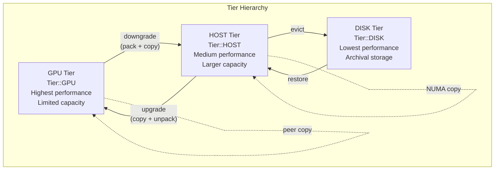
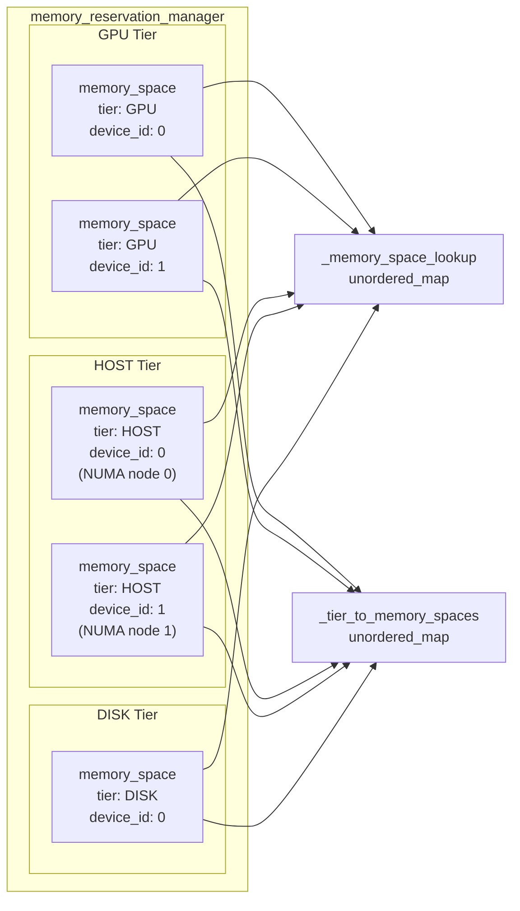
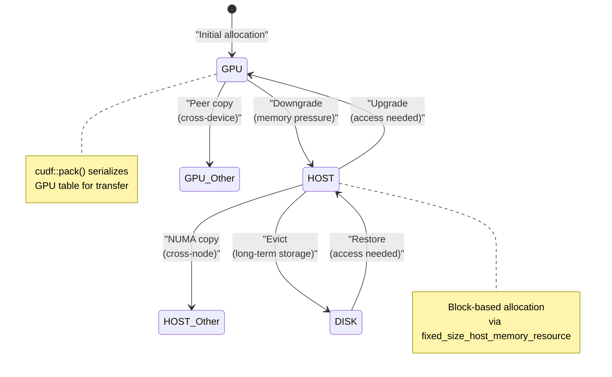
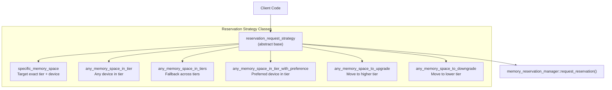
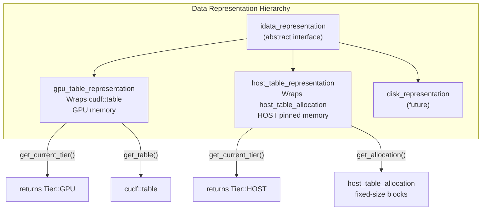

<!-- source: DeepWiki mcp.deepwiki.com · repo NVIDIA/cuCascade · page 3.2 Memory Tier Hierarchy · fetched 2026-10-26 -->

# Memory Tier Hierarchy

<details>
<summary>Relevant source files</summary>

The following files were used as context for generating this wiki page:

- [include/memory/memory_reservation_manager.hpp](include/memory/memory_reservation_manager.hpp)
- [src/memory/memory_reservation_manager.cpp](src/memory/memory_reservation_manager.cpp)
- [test/data/test_data_representation.cpp](test/data/test_data_representation.cpp)
- [test/memory/test_memory_reservation_manager.cpp](test/memory/test_memory_reservation_manager.cpp)

</details>


## Purpose and Scope

This document describes cuCascade's three-tier memory hierarchy that enables data to move between GPU, host, and disk storage. It covers the tier model, memory space organization, tier characteristics, and strategies for requesting memory across tiers.

For details on the memory reservation system within each tier, see [Memory Reservation Manager](#4.1). For information on how data representations are converted between tiers, see [Representation Converters](#5.4).

**Sources:** High-level system diagrams (Diagram 3: Memory Tier Hierarchy and Conversion Paths)

---

## The Three-Tier Model

cuCascade organizes memory into three tiers, each with distinct performance and capacity characteristics:



### Tier Enumeration

The `Tier` enum defines the memory hierarchy levels:

| Tier | Purpose | Typical Use Case |
|------|---------|------------------|
| `Tier::GPU` | Active processing on GPU devices | Computation-intensive operations requiring high bandwidth |
| `Tier::HOST` | CPU-accessible pinned memory | Staging area for data transfers, overflow storage |
| `Tier::DISK` | Persistent storage | Long-term archival (not yet fully implemented) |

**Sources:**
- [include/memory/common.hpp]() (Tier enum definition)
- [include/memory/memory_reservation_manager.hpp:42-306]()

---

## Memory Space Organization

Each tier consists of one or more `memory_space` instances, identified by tier and device ID:



### Memory Space Identification

Each `memory_space` is uniquely identified by a `memory_space_id` struct containing:
- `tier`: The memory tier (GPU, HOST, or DISK)
- `device_id`: Device index within the tier

For GPU tier, `device_id` corresponds to CUDA device numbers. For HOST tier, `device_id` typically corresponds to NUMA node numbers.

### Manager Lookup Tables

The `memory_reservation_manager` maintains fast lookup structures:

```cpp
// Direct lookup by memory_space_id
std::unordered_map<memory_space_id, memory_space*> _memory_space_lookup;

// Group memory spaces by tier
std::unordered_map<Tier, std::vector<memory_space*>> _tier_to_memory_spaces;
```

**Sources:**
- [include/memory/memory_reservation_manager.hpp:178-303]()
- [src/memory/memory_reservation_manager.cpp:337-357]()
- [test/memory/test_memory_reservation_manager.cpp:84-112]()

---

## Tier Characteristics and Configuration

### GPU Tier

GPU tier provides the highest performance but limited capacity:

| Characteristic | Details |
|----------------|---------|
| **Performance** | Highest throughput (100s of GB/s) |
| **Capacity** | Limited (typically 16-80 GB per device) |
| **Access Pattern** | Optimized for parallel computation |
| **Memory Resource** | RMM device memory resources |
| **Data Format** | `gpu_table_representation` wrapping cuDF tables |

### HOST Tier

HOST tier provides larger capacity with moderate performance:

| Characteristic | Details |
|----------------|---------|
| **Performance** | Medium throughput (10-50 GB/s) |
| **Capacity** | Large (typically 128+ GB per NUMA node) |
| **Access Pattern** | Sequential and random CPU access |
| **Memory Resource** | `fixed_size_host_memory_resource` with block allocation |
| **Data Format** | `host_table_representation` with serialized data |

### DISK Tier

DISK tier provides archival storage (currently under development):

| Characteristic | Details |
|----------------|---------|
| **Performance** | Lowest throughput (1-5 GB/s) |
| **Capacity** | Very large (TB scale) |
| **Access Pattern** | Sequential file I/O |
| **Memory Resource** | File system backed |
| **Data Format** | Serialized data on disk |

### Configuration Example

```cpp
// From test configuration
const size_t expected_gpu_capacity  = 2ull << 30;  // 2GB per GPU
const size_t expected_host_capacity = 4ull << 30;  // 4GB per NUMA node
const double limit_ratio            = 0.75;        // Reserve 75% for allocations

reservation_manager_configurator builder;
builder.set_gpu_usage_limit(expected_gpu_capacity);
builder.set_reservation_limit_ratio_per_gpu(limit_ratio);
builder.set_capacity_per_numa_node(expected_host_capacity);
builder.set_reservation_limit_ratio_per_numa_node(limit_ratio);
```

**Sources:**
- [test/memory/test_memory_reservation_manager.cpp:52-68]()
- [include/memory/memory_reservation_manager.hpp:191-212]()

---

## Data Movement Between Tiers

### Tier Transitions

Data moves between tiers through conversion operations:



### GPU to HOST Downgrade

The downgrade path converts GPU data to HOST storage:

1. **Pack**: `cudf::pack()` serializes the GPU table into contiguous buffers
2. **Copy**: `cudaMemcpy()` transfers data from GPU to HOST (device-to-host)
3. **Block allocation**: Data is distributed across fixed-size HOST memory blocks
4. **Metadata**: Serialized column metadata is stored alongside data

```cpp
// GPU to HOST conversion involves packing
auto view   = gpu_table.view();
auto packed = cudf::pack(view, stream.view());

// Copy to HOST allocation blocks
auto allocation = host_mr->allocate_multiple_blocks(packed.gpu_data->size());
// ... block-by-block copy via cudaMemcpy ...
```

### HOST to GPU Upgrade

The upgrade path converts HOST data back to GPU:

1. **Block copy**: Data is copied from HOST blocks to a contiguous GPU buffer
2. **Unpack**: `cudf::unpack()` deserializes the buffer into a cuDF table
3. **GPU representation**: The table is wrapped in `gpu_table_representation`

### GPU to GPU Peer Copy

Direct GPU-to-GPU transfers use peer memory access when available:

```cpp
// Peer copy via cudaMemcpyPeer
cudaMemcpyPeer(dst_ptr, dst_device, src_ptr, src_device, size, stream);
```

**Sources:**
- [test/data/test_data_representation.cpp:78-133]()
- [test/data/test_data_representation.cpp:232-254]()
- [test/data/test_data_representation.cpp:269-304]()

---

## Reservation Strategies Across Tiers

The `memory_reservation_manager` provides multiple strategies for requesting memory across tiers:



### Strategy Types

#### Specific Memory Space

Target a specific tier and device:

```cpp
// Request reservation on GPU device 0
auto res = manager->request_reservation(
    specific_memory_space(Tier::GPU, 0), 
    size
);
```

#### Any Space in Tier

Request memory from any device in a tier (no ordering preference):

```cpp
// Any GPU device
auto res = manager->request_reservation(
    any_memory_space_in_tier(Tier::GPU), 
    size
);
```

#### Any Space in Tier with Preference

Request memory from a tier with device preference:

```cpp
// Prefer GPU 0, but accept any GPU
auto res = manager->request_reservation(
    any_memory_space_in_tier_with_preference(Tier::GPU, 0), 
    size
);
```

#### Multi-Tier Fallback

Request memory with tier fallback order:

```cpp
// Try GPU first, fall back to HOST, then DISK
std::vector<Tier> tiers = {Tier::GPU, Tier::HOST, Tier::DISK};
auto res = manager->request_reservation(
    any_memory_space_in_tiers(tiers), 
    size
);
```

### Strong vs Weak Ordering

Reservation strategies have ordering semantics:

| Strategy Type | Strong Ordering | Behavior |
|--------------|-----------------|----------|
| `specific_memory_space` | Yes | Only the target space is tried |
| `any_memory_space_in_tier_with_preference` | Yes | Preferred device tried first, then others in order |
| `any_memory_space_in_tier` | No | All devices in tier tried in any order |
| `any_memory_space_in_tiers` | No | Tiers tried in sequence, but devices within tier unordered |

Strong ordering strategies block if the preferred space cannot satisfy the request. Weak ordering strategies try all candidates before blocking.

**Sources:**
- [include/memory/memory_reservation_manager.hpp:52-167]()
- [src/memory/memory_reservation_manager.cpp:64-116]()
- [test/memory/test_memory_reservation_manager.cpp:168-208]()

---

## Tier Access Methods

The `memory_reservation_manager` provides methods to query and access memory spaces by tier:

### Querying Specific Memory Spaces

```cpp
// Get a specific memory space
const memory_space* space = manager->get_memory_space(Tier::GPU, 0);

// Get all spaces for a tier
std::span<const memory_space*> gpu_spaces = 
    manager->get_memory_spaces_for_tier(Tier::GPU);

// Get all memory spaces
std::span<const memory_space*> all_spaces = 
    manager->get_all_memory_spaces();
```

### Aggregated Tier Statistics

```cpp
// Tier-level statistics
size_t gpu_available = manager->get_available_memory_for_tier(Tier::GPU);
size_t gpu_reserved = manager->get_total_reserved_memory_for_tier(Tier::GPU);
size_t gpu_res_count = manager->get_active_reservation_count_for_tier(Tier::GPU);

// System-wide statistics
size_t total_available = manager->get_total_available_memory();
size_t total_reserved = manager->get_total_reserved_memory();
size_t total_count = manager->get_active_reservation_count();
```

**Sources:**
- [include/memory/memory_reservation_manager.hpp:244-273]()
- [src/memory/memory_reservation_manager.cpp:193-306]()
- [test/memory/test_memory_reservation_manager.cpp:84-112]()

---

## Tier-Specific Data Representations

Each tier uses a specific data representation class optimized for that tier's characteristics:



### Representation-Tier Mapping

| Representation Class | Tier | Underlying Storage |
|---------------------|------|-------------------|
| `gpu_table_representation` | `Tier::GPU` | `cudf::table` (GPU memory) |
| `host_table_representation` | `Tier::HOST` | `host_table_allocation` (pinned HOST memory) |
| (future) disk representation | `Tier::DISK` | File-backed storage |

Each representation implements `get_current_tier()` to identify its tier:

```cpp
// Check which tier holds the data
if (repr->get_current_tier() == Tier::GPU) {
    auto& gpu_repr = repr->cast<gpu_table_representation>();
    // Work with GPU table
}
```

**Sources:**
- [test/data/test_data_representation.cpp:139-230]()
- [test/data/test_data_representation.cpp:78-133]()

---

## Practical Usage Examples

### Single-Tier Allocation

```cpp
// Create manager with single GPU and HOST tier
auto manager = createSingleDeviceMemoryManager();

// Reserve memory on GPU tier
auto gpu_res = manager->request_reservation(
    specific_memory_space(Tier::GPU, 0),
    200 * 1024 * 1024  // 200MB
);

// Reserve memory on HOST tier
auto host_res = manager->request_reservation(
    any_memory_space_in_tier(Tier::HOST),
    500 * 1024 * 1024  // 500MB
);
```

### Multi-Tier Fallback

```cpp
// Try GPU first, fall back to HOST if GPU is full
std::vector<Tier> preferences = {Tier::GPU, Tier::HOST};
auto res = manager->request_reservation(
    any_memory_space_in_tiers(preferences),
    allocation_size
);

// Check where memory was actually allocated
if (res->tier() == Tier::GPU) {
    // Got fast GPU memory
} else if (res->tier() == Tier::HOST) {
    // Fell back to HOST memory
}
```

### Cross-Device Operations

```cpp
// Create data on GPU 0
auto table = create_simple_cudf_table(256);
gpu_table_representation src_repr(std::move(table), *src_space);

// Convert to GPU 1 via representation converter
representation_converter_registry registry;
register_builtin_converters(registry);

auto dst_any = registry.convert<gpu_table_representation>(
    src_repr, 
    dst_space, 
    xfer_stream
);
```

**Sources:**
- [test/memory/test_memory_reservation_manager.cpp:114-166]()
- [test/memory/test_memory_reservation_manager.cpp:168-208]()
- [test/data/test_data_representation.cpp:269-304]()

---

