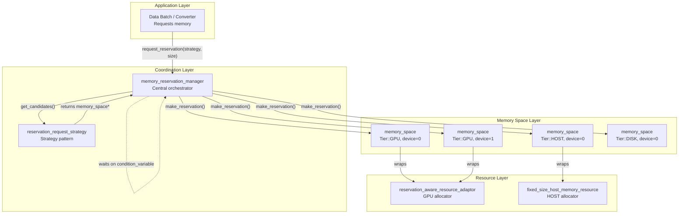
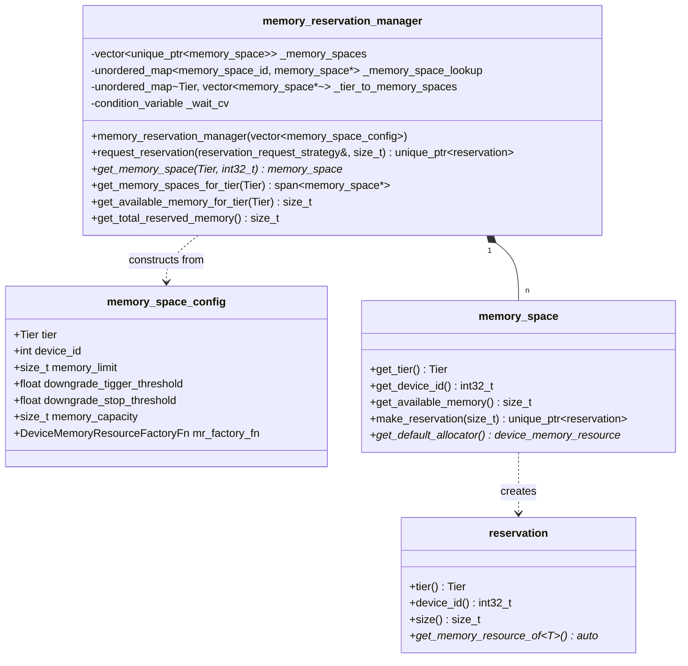
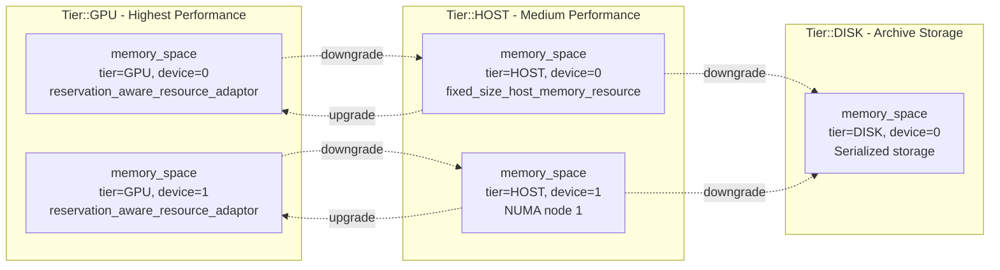
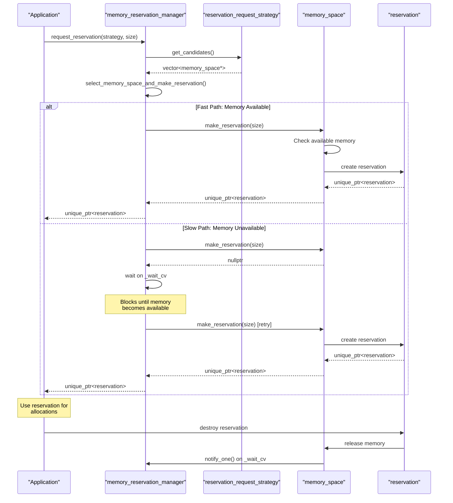
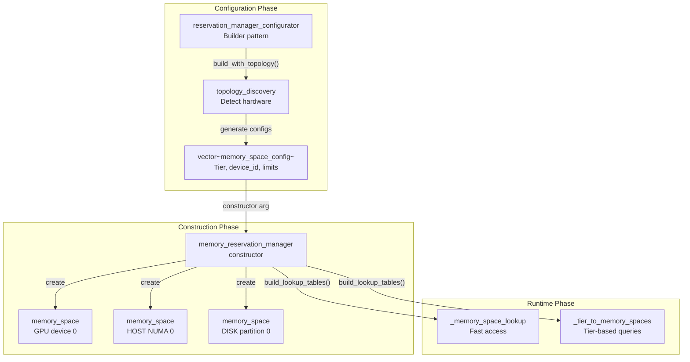
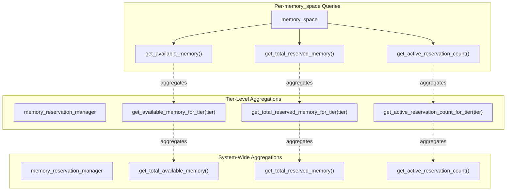
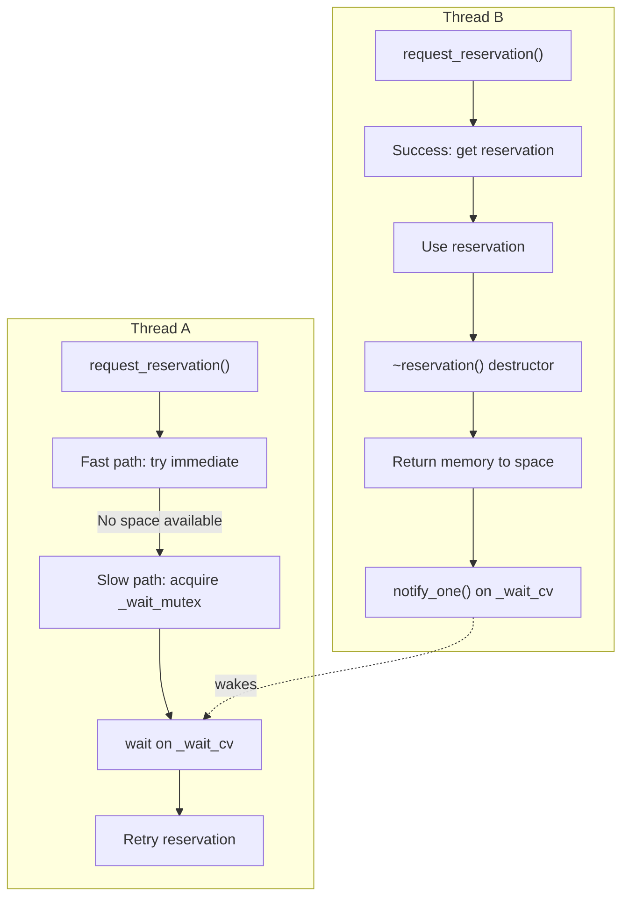
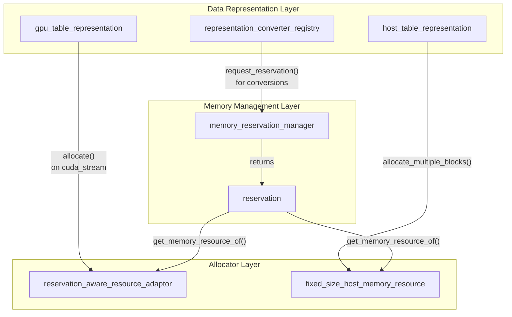

<!-- source: DeepWiki mcp.deepwiki.com · repo NVIDIA/cuCascade · page 4 Memory Management Subsystem · fetched 2026-10-26 -->

# Memory Management Subsystem

<details>
<summary>Relevant source files</summary>

The following files were used as context for generating this wiki page:

- [include/memory/memory_reservation_manager.hpp](include/memory/memory_reservation_manager.hpp)
- [src/memory/CMakeLists.txt](src/memory/CMakeLists.txt)
- [src/memory/memory_reservation_manager.cpp](src/memory/memory_reservation_manager.cpp)
- [test/memory/test_memory_reservation_manager.cpp](test/memory/test_memory_reservation_manager.cpp)

</details>


## Purpose and Scope

The Memory Management Subsystem provides heterogeneous memory orchestration across GPU, HOST, and DISK tiers in cuCascade. This subsystem is responsible for:

- Allocating and tracking memory reservations across multiple memory tiers
- Managing memory spaces with device-specific allocators (RMM for GPU, pinned memory for HOST)
- Implementing reservation strategies that abstract memory placement decisions
- Supporting NUMA-aware host memory allocation
- Coordinating memory pressure handling and tier transitions

This page provides an architectural overview of the memory management system. For detailed documentation of specific components, see:
- Memory Reservation Manager implementation details: [#4.1](#4.1)
- Memory space abstractions and resource types: [#4.2](#4.2)
- Hardware topology detection and NUMA configuration: [#4.3](#4.3)
- Data representation conversion that uses this subsystem: [#5](#5)

**Sources:** [include/memory/memory_reservation_manager.hpp:1-307](), [src/memory/memory_reservation_manager.cpp:1-368]()

---

## System Overview

The memory management subsystem consists of three primary architectural layers:

1. **Central Coordination Layer**: `memory_reservation_manager` coordinates reservation requests across all available memory spaces
2. **Memory Space Layer**: Individual `memory_space` instances represent specific memory resources (e.g., GPU device 0, HOST NUMA node 1)
3. **Allocation Strategy Layer**: `reservation_request_strategy` implementations define placement policies for memory reservations



**Diagram: Memory Management Subsystem Architecture**

The `memory_reservation_manager` acts as a centralized coordinator that maintains a collection of `memory_space` instances. When a reservation is requested, a `reservation_request_strategy` determines which memory spaces are candidates. The manager attempts to create a reservation on one of the candidates, blocking if necessary until memory becomes available.

**Sources:** [include/memory/memory_reservation_manager.hpp:178-303](), [src/memory/memory_reservation_manager.cpp:122-148]()

---

## Core Components

### memory_reservation_manager

The `memory_reservation_manager` class is the central entry point for all memory allocation requests in cuCascade. It maintains a registry of all available memory spaces and coordinates reservation requests across them.

| Component | Type | Purpose |
|-----------|------|---------|
| `_memory_spaces` | `std::vector<std::unique_ptr<memory_space>>` | Owned storage of all memory spaces |
| `_memory_space_lookup` | `std::unordered_map<memory_space_id, memory_space*>` | Fast lookup by tier and device ID |
| `_tier_to_memory_spaces` | `std::unordered_map<Tier, std::vector<memory_space*>>` | Grouped by tier for tier-based strategies |
| `_wait_cv` | `std::condition_variable` | Coordination for blocking reservation requests |



**Diagram: Core Memory Management Classes**

**Sources:** [include/memory/memory_reservation_manager.hpp:178-303](), [src/memory/memory_reservation_manager.cpp:122-148]()

### memory_space

Each `memory_space` instance represents a single memory resource with a specific tier and device ID. It encapsulates:
- A device memory resource (e.g., `reservation_aware_resource_adaptor` for GPU, `fixed_size_host_memory_resource` for HOST)
- Memory accounting: available memory, reserved memory, active reservation count
- Reservation lifecycle management

Memory spaces are created during `memory_reservation_manager` initialization from `memory_space_config` objects.

**Sources:** [include/memory/memory_reservation_manager.hpp:191-212](), [src/memory/memory_reservation_manager.cpp:128-146]()

### reservation

A `reservation` represents an allocated chunk of memory within a specific `memory_space`. It provides:
- RAII semantics: memory is returned to the space when the reservation is destroyed
- Access to the underlying device memory resource for actual allocations
- Metadata: tier, device ID, and size

Reservations are returned as `std::unique_ptr<reservation>` to enforce single ownership.

**Sources:** [include/memory/memory_reservation_manager.hpp:237-238](), [test/memory/test_memory_reservation_manager.cpp:128-138]()

---

## Memory Tier Hierarchy

cuCascade organizes memory into three tiers, each with different performance and capacity characteristics:



**Diagram: Three-Tier Memory Hierarchy**

| Tier | Characteristics | Typical Capacity | Allocator Type |
|------|----------------|------------------|----------------|
| `Tier::GPU` | Fastest access, limited capacity, one per GPU device | 2-80 GB per device | `reservation_aware_resource_adaptor` wrapping RMM |
| `Tier::HOST` | Medium speed, larger capacity, one per NUMA node | 4-512 GB per node | `fixed_size_host_memory_resource` with pinned memory |
| `Tier::DISK` | Slowest access, effectively unlimited | Terabytes | Serialization to filesystem |

Each tier consists of one or more `memory_space` instances identified by `(Tier, device_id)` pairs. The `device_id` represents:
- For `Tier::GPU`: CUDA device ID
- For `Tier::HOST`: NUMA node ID
- For `Tier::DISK`: Logical disk partition ID

**Sources:** [include/memory/common.hpp]() (implied from Tier enum usage), [test/memory/test_memory_reservation_manager.cpp:52-56]()

---

## Reservation Strategies

The subsystem uses the Strategy pattern to decouple reservation requests from memory placement decisions. All strategies inherit from `reservation_request_strategy`:

```mermaid
classDiagram
    class reservation_request_strategy {
        <<abstract>>
        #bool _strong_ordering
        +get_candidates(memory_reservation_manager&)* vector~memory_space*~
        +has_strong_ordering() bool
    }
    
    class any_memory_space_in_tier {
        +Tier tier
        +get_candidates() vector~memory_space*~
    }
    
    class any_memory_space_in_tier_with_preference {
        +Tier tier
        +optional~size_t~ preferred_device_id
        +get_candidates() vector~memory_space*~
    }
    
    class any_memory_space_in_tiers {
        +vector~Tier~ tiers
        +get_candidates() vector~memory_space*~
    }
    
    class specific_memory_space {
        +memory_space_id target_id
        +get_candidates() vector~memory_space*~
    }
    
    class any_memory_space_to_downgrade {
        +memory_space_id src_id
        +vector~Tier~ target_tiers
        +get_candidates() vector~memory_space*~
    }
    
    class any_memory_space_to_upgrade {
        +memory_space_id src_id
        +Tier target_tier
        +get_candidates() vector~memory_space*~
    }
    
    reservation_request_strategy <|-- any_memory_space_in_tier
    reservation_request_strategy <|-- any_memory_space_in_tier_with_preference
    reservation_request_strategy <|-- any_memory_space_in_tiers
    reservation_request_strategy <|-- specific_memory_space
    reservation_request_strategy <|-- any_memory_space_to_downgrade
    reservation_request_strategy <|-- any_memory_space_to_upgrade
```



**Diagram: Reservation Strategy Class Hierarchy**

### Strategy Types

| Strategy | Purpose | Strong Ordering | Example Usage |
|----------|---------|-----------------|---------------|
| `specific_memory_space` | Allocate on exact tier and device | Yes | Pin data to specific GPU |
| `any_memory_space_in_tier` | Any device within a tier | No | "Any GPU will do" |
| `any_memory_space_in_tier_with_preference` | Prefer specific device, fallback to others | Yes | Prefer local GPU, accept remote |
| `any_memory_space_in_tiers` | Try tiers in preference order | No | Try GPU first, fallback to HOST |
| `any_memory_space_to_downgrade` | Move data to lower tier | Yes | Free GPU memory under pressure |
| `any_memory_space_to_upgrade` | Move data to higher tier | Yes | Promote data to GPU for processing |

**Strong ordering** means the strategy defines a strict preference order that must be respected. When `_strong_ordering = true`, the manager will only try the first successful candidate. When `false`, it tries all candidates non-deterministically first (with `make_reservation_or_null`), then falls back to blocking attempts.

**Sources:** [include/memory/memory_reservation_manager.hpp:55-167](), [src/memory/memory_reservation_manager.cpp:64-116](), [src/memory/memory_reservation_manager.cpp:308-335]()

### Usage Example

```cpp
// Example from test suite
auto manager = createSingleDeviceMemoryManager();

// Strategy 1: Specific GPU device
auto gpu_res = manager->request_reservation(
    specific_memory_space(Tier::GPU, 0), 
    200 * 1024 * 1024  // 200 MB
);

// Strategy 2: Any HOST device
auto host_res = manager->request_reservation(
    any_memory_space_in_tier(Tier::HOST), 
    500 * 1024 * 1024  // 500 MB
);

// Strategy 3: Try multiple tiers with preference
std::vector<Tier> preferences = {Tier::GPU, Tier::HOST, Tier::DISK};
auto flexible_res = manager->request_reservation(
    any_memory_space_in_tiers(preferences),
    100 * 1024 * 1024  // 100 MB
);
```

**Sources:** [test/memory/test_memory_reservation_manager.cpp:114-208]()

---

## Reservation Request Flow

The following diagram shows the complete flow from a reservation request to allocation:



**Diagram: Reservation Request Sequence**

The manager uses a two-phase approach:
1. **Fast path**: Immediately try to make a reservation on candidate spaces using `make_reservation_or_null()` (non-blocking)
2. **Slow path**: If fast path fails, acquire `_wait_mutex` and block on `_wait_cv` until another thread releases memory

When a reservation is destroyed, the underlying `memory_space` notifies the manager's condition variable, potentially waking blocked threads.

**Sources:** [src/memory/memory_reservation_manager.cpp:172-191](), [src/memory/memory_reservation_manager.cpp:308-335]()

---

## Configuration and Initialization

The `memory_reservation_manager` is constructed from a vector of `memory_space_config` objects. The configuration pattern allows fine-grained control over each memory space:



**Diagram: Configuration and Initialization Flow**

### memory_space_config

Each configuration specifies:

| Field | Type | Description |
|-------|------|-------------|
| `tier` | `Tier` | Memory tier (GPU, HOST, or DISK) |
| `device_id` | `int` | Device identifier within tier |
| `memory_limit` | `size_t` | Maximum reservable memory |
| `memory_capacity` | `size_t` | Total device memory (defaults to limit) |
| `downgrade_tigger_threshold` | `float` | Usage ratio triggering downgrade (default 0.75) |
| `downgrade_stop_threshold` | `float` | Usage ratio to stop downgrade (default 0.65) |
| `mr_factory_fn` | `DeviceMemoryResourceFactoryFn` | Factory for creating allocators |

The `mr_factory_fn` is a callable that creates the appropriate memory resource type:
- For GPU: Returns `reservation_aware_resource_adaptor` wrapping RMM's CUDA memory resource
- For HOST: Returns `fixed_size_host_memory_resource` with NUMA-aware pinned allocations
- For DISK: Not typically used (disk I/O handles differently)

**Sources:** [include/memory/memory_reservation_manager.hpp:191-212](), [src/memory/memory_reservation_manager.cpp:150-170]()

### Example: Single-Device Configuration

```cpp
// From test suite
reservation_manager_configurator builder;
builder.set_gpu_usage_limit(2ULL << 30);  // 2 GB per GPU
builder.set_reservation_limit_ratio_per_gpu(0.75);
builder.set_capacity_per_numa_node(4ULL << 30);  // 4 GB per NUMA node
builder.set_host_id_to_numa_maps({{0, -1}});  // GPU 0 -> NUMA node -1 (auto)
builder.set_reservation_limit_ratio_per_numa_node(0.75);

auto space_configs = builder.build_with_topology();
auto manager = std::make_unique<memory_reservation_manager>(
    std::move(space_configs)
);
```

**Sources:** [test/memory/test_memory_reservation_manager.cpp:57-68]()

---

## Memory Accounting and Queries

The manager provides comprehensive memory accounting at both tier-level and system-wide granularity:



**Diagram: Memory Accounting Hierarchy**

### Query Methods

| Method | Scope | Returns |
|--------|-------|---------|
| `memory_space::get_available_memory()` | Single device | Free memory in bytes |
| `memory_space::get_total_reserved_memory()` | Single device | Reserved memory in bytes |
| `memory_space::get_active_reservation_count()` | Single device | Number of active reservations |
| `get_available_memory_for_tier(Tier)` | All devices in tier | Sum of available memory |
| `get_total_reserved_memory_for_tier(Tier)` | All devices in tier | Sum of reserved memory |
| `get_active_reservation_count_for_tier(Tier)` | All devices in tier | Sum of reservation counts |
| `get_total_available_memory()` | All devices | System-wide available memory |
| `get_total_reserved_memory()` | All devices | System-wide reserved memory |
| `get_active_reservation_count()` | All devices | System-wide reservation count |

**Sources:** [include/memory/memory_reservation_manager.hpp:244-274](), [src/memory/memory_reservation_manager.cpp:245-306]()

---

## Thread Safety and Concurrency

The memory management subsystem is designed for multi-threaded environments with the following guarantees:

### Reservation Request Synchronization

The `memory_reservation_manager` uses a mutex and condition variable for cross-space coordination:



**Diagram: Concurrent Reservation Coordination**

- **`_wait_mutex`**: Protects the condition variable and ensures only one thread blocks/wakes at a time
- **`_wait_cv`**: Allows threads to wait for memory availability without busy-waiting
- Each `memory_space` has internal synchronization for its reservation count and available memory

### Lock-Free Fast Path

When memory is available, `request_reservation()` completes without acquiring the wait mutex. This optimizes the common case where contention is low.

**Sources:** [include/memory/memory_reservation_manager.hpp:301-302](), [src/memory/memory_reservation_manager.cpp:172-191]()

---

## Integration with Other Subsystems

The Memory Management Subsystem serves as the foundation for higher-level cuCascade components:



**Diagram: Integration with Data Representation Layer**

- **Data Representation Converters** ([#5.4](#5.4)): Request reservations when converting data between tiers
- **GPU Table Representation** ([#5.2](#5.2)): Uses GPU memory resources from reservations for cuDF table allocations
- **Host Table Representation** ([#5.3](#5.3)): Uses HOST memory resources for block-based allocations

**Sources:** [include/memory/memory_reservation_manager.hpp:1-307](), test usage patterns throughout [test/memory/test_memory_reservation_manager.cpp]()

---

## Source Files Overview

The Memory Management Subsystem is implemented across multiple source files:

| File | Purpose |
|------|---------|
| `include/memory/memory_reservation_manager.hpp` | Manager and strategy interfaces |
| `src/memory/memory_reservation_manager.cpp` | Manager implementation |
| `include/memory/memory_space.hpp` | Memory space abstraction |
| `src/memory/memory_space.cpp` | Memory space implementation |
| `include/memory/memory_reservation.hpp` | Reservation RAII wrapper |
| `src/memory/memory_reservation.cpp` | Reservation implementation |
| `src/memory/reservation_aware_resource_adaptor.cpp` | GPU allocator with reservation tracking |
| `src/memory/fixed_size_host_memory_resource.cpp` | HOST block-based allocator |
| `src/memory/numa_region_pinned_host_allocator.cpp` | NUMA-aware pinned memory |
| `src/memory/topology_discovery.cpp` | Hardware detection |
| `src/memory/reservation_manager_configurator.cpp` | Configuration builder |
| `src/memory/oom_handling_policy.cpp` | Out-of-memory policies |
| `test/memory/test_memory_reservation_manager.cpp` | Comprehensive test suite |

**Sources:** [src/memory/CMakeLists.txt:18-33]()

---

