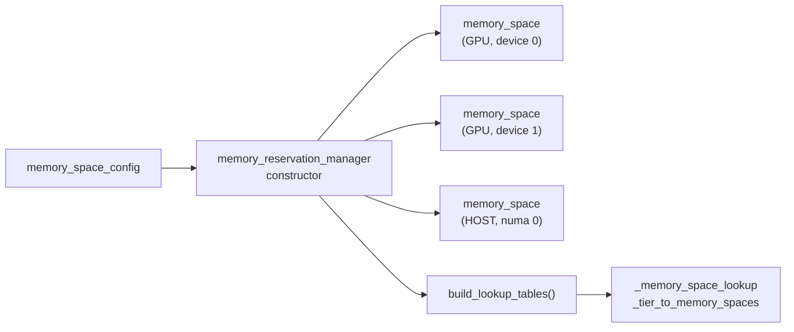
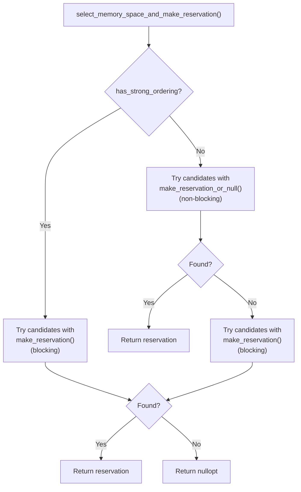
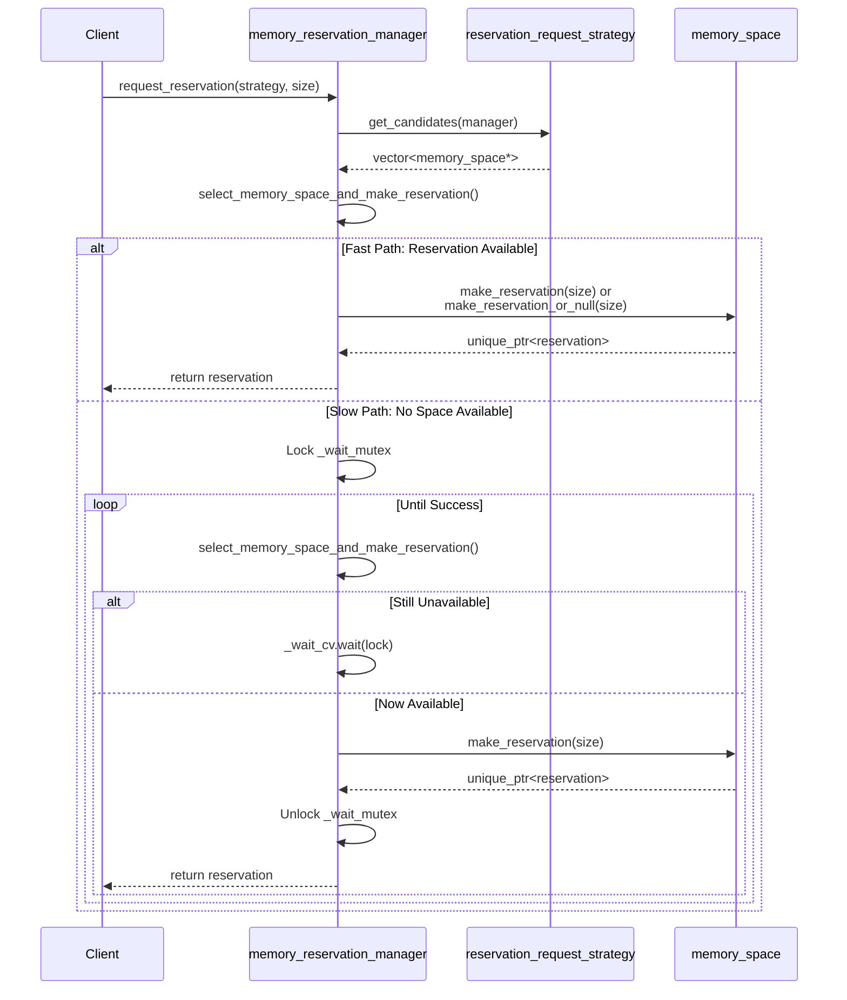
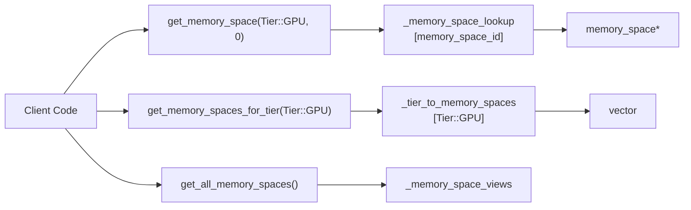
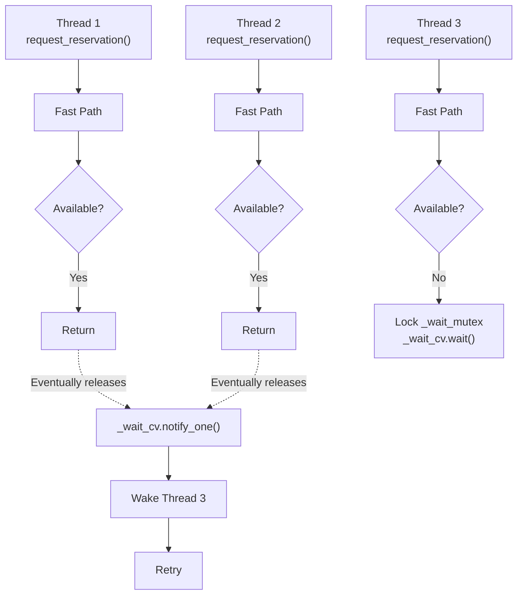

<!-- source: DeepWiki mcp.deepwiki.com · repo NVIDIA/cuCascade · page 4.1 Memory Reservation Manager · fetched 2026-10-26 -->

# Memory Reservation Manager

<details>
<summary>Relevant source files</summary>

The following files were used as context for generating this wiki page:

- [include/memory/memory_reservation_manager.hpp](include/memory/memory_reservation_manager.hpp)
- [src/memory/memory_reservation_manager.cpp](src/memory/memory_reservation_manager.cpp)
- [test/memory/test_memory_reservation_manager.cpp](test/memory/test_memory_reservation_manager.cpp)

</details>


## Purpose and Scope

The `memory_reservation_manager` class is the central coordinator for memory reservations across heterogeneous memory spaces (GPU, HOST, DISK). It implements a strategy-based system for allocating memory across multiple devices and tiers, with automatic fallback and blocking semantics when resources are unavailable.

This document covers the reservation manager's architecture, configuration, and reservation request mechanisms. For details on the underlying memory spaces, see [Memory Spaces and Resources](#4.2). For information on reservation objects themselves, including RAII semantics and memory resource integration, see [Memory Spaces and Resources](#4.2). For NUMA topology detection and device discovery, see [Topology Discovery and NUMA Support](#4.3).

**Sources:** [include/memory/memory_reservation_manager.hpp:1-307]()

---

## Core Concepts

The memory reservation manager operates on three key abstractions:

| Concept | Description | Code Entity |
|---------|-------------|-------------|
| **Memory Space** | An individual memory arena with specific tier and device ID | `memory_space` |
| **Reservation** | A granted allocation slot within a memory space | `reservation` |
| **Strategy** | A policy defining which memory spaces can satisfy a request | `reservation_request_strategy` |

The manager maintains ownership of all `memory_space` instances and coordinates reservation requests using a strategy pattern. When a reservation is requested, the manager:
1. Evaluates candidate memory spaces based on the strategy
2. Attempts to make a reservation in the first available candidate
3. Blocks the caller if no space can currently satisfy the request
4. Wakes the caller when memory becomes available

**Sources:** [include/memory/memory_reservation_manager.hpp:173-303](), [src/memory/memory_reservation_manager.cpp:122-191]()

---

## Architecture Overview

### Class Structure

```mermaid
classDiagram
    class memory_reservation_manager {
        -vector~unique_ptr~memory_space~~ _memory_spaces
        -unordered_map~memory_space_id, memory_space*~ _memory_space_lookup
        -unordered_map~Tier, vector~memory_space*~~ _tier_to_memory_spaces
        -mutex _wait_mutex
        -condition_variable _wait_cv
        +memory_reservation_manager(vector~memory_space_config~)
        +request_reservation(strategy, size) unique_ptr~reservation~
        +get_memory_space(Tier, device_id) memory_space*
        +get_memory_spaces_for_tier(Tier) span~memory_space*~
        +get_all_memory_spaces() span~memory_space*~
        +get_available_memory_for_tier(Tier) size_t
        +get_total_reserved_memory_for_tier(Tier) size_t
        +shutdown()
    }
    
    class reservation_request_strategy {
        <<abstract>>
        #bool _strong_ordering
        +get_candidates(manager) vector~memory_space*~*
        +has_strong_ordering() bool
    }
    
    class memory_space {
        -Tier _tier
        -int _device_id
        -size_t _memory_limit
        +make_reservation(size) unique_ptr~reservation~
        +make_reservation_or_null(size) unique_ptr~reservation~
        +get_available_memory() size_t
    }
    
    class reservation {
        -memory_space* _space
        -size_t _size
        +tier() Tier
        +device_id() int
        +size() size_t
    }
    
    class memory_space_config {
        +Tier tier
        +int device_id
        +size_t memory_limit
        +size_t memory_capacity
        +DeviceMemoryResourceFactoryFn mr_factory_fn
    }
    
    memory_reservation_manager "1" *-- "*" memory_space : owns
    memory_reservation_manager ..> reservation_request_strategy : uses
    memory_reservation_manager ..> memory_space_config : configured by
    memory_space ..> reservation : creates
```



**Diagram: Memory Reservation Manager Class Structure**

The manager owns all `memory_space` instances and uses strategy objects to determine reservation candidates. Each `memory_space` can create `reservation` objects that represent granted memory slots.

**Sources:** [include/memory/memory_reservation_manager.hpp:173-303](), [include/memory/memory_reservation_manager.hpp:55-167]()

### Configuration System

Memory spaces are configured via `memory_space_config` structures passed to the constructor:



**Diagram: Configuration and Initialization Flow**

**Sources:** [include/memory/memory_reservation_manager.hpp:191-212](), [src/memory/memory_reservation_manager.cpp:122-146]()

#### memory_space_config Structure

| Field | Type | Description |
|-------|------|-------------|
| `tier` | `Tier` | Memory tier (GPU, HOST, or DISK) |
| `device_id` | `int` | Device or NUMA node identifier |
| `memory_limit` | `size_t` | Maximum reservable memory |
| `memory_capacity` | `size_t` | Total device capacity (defaults to `memory_limit`) |
| `downgrade_trigger_threshold` | `float` | Threshold ratio to trigger downgrades (default 0.75) |
| `downgrade_stop_threshold` | `float` | Threshold ratio to stop downgrades (default 0.65) |
| `mr_factory_fn` | `DeviceMemoryResourceFactoryFn` | Factory for creating memory resources |

The constructor validates that at least one configuration is provided and that `memory_limit <= memory_capacity`. If no `mr_factory_fn` is specified, a default allocator for the tier is used.

**Sources:** [include/memory/memory_reservation_manager.hpp:191-212](), [src/memory/memory_reservation_manager.cpp:150-171]()

### Lookup Tables

The manager maintains several lookup structures for efficient access:

| Lookup Structure | Type | Purpose |
|------------------|------|---------|
| `_memory_space_lookup` | `unordered_map<memory_space_id, memory_space*>` | Direct lookup by tier and device ID |
| `_tier_to_memory_spaces` | `unordered_map<Tier, vector<memory_space*>>` | All spaces for a given tier |
| `_memory_space_views` | `vector<memory_space*>` | All spaces in a flat vector |

These are built once during construction via `build_lookup_tables()` and provide O(1) or O(k) access patterns for reservation strategies.

**Sources:** [include/memory/memory_reservation_manager.hpp:284-291](), [src/memory/memory_reservation_manager.cpp:337-357]()

---

## Reservation Request Strategies

The manager uses a strategy pattern to determine which memory spaces can satisfy a request. All strategies inherit from `reservation_request_strategy` and implement `get_candidates()`.

```mermaid
classDiagram
    class reservation_request_strategy {
        <<abstract>>
        #bool _strong_ordering
        +get_candidates(manager)* vector~memory_space*~
        +has_strong_ordering() bool
    }
    
    class any_memory_space_in_tier_with_preference {
        +Tier tier
        +optional~size_t~ preferred_device_id
        +get_candidates(manager) vector~memory_space*~
    }
    
    class any_memory_space_in_tier {
        +Tier tier
        +get_candidates(manager) vector~memory_space*~
    }
    
    class any_memory_space_in_tiers {
        +vector~Tier~ tiers
        +get_candidates(manager) vector~memory_space*~
    }
    
    class specific_memory_space {
        +memory_space_id target_id
        +get_candidates(manager) vector~memory_space*~
    }
    
    class any_memory_space_to_downgrade {
        +memory_space_id src_id
        +vector~Tier~ target_tiers
        +get_candidates(manager) vector~memory_space*~
    }
    
    class any_memory_space_to_upgrade {
        +memory_space_id src_id
        +Tier target_tier
        +get_candidates(manager) vector~memory_space*~
    }
    
    reservation_request_strategy <|-- any_memory_space_in_tier_with_preference
    reservation_request_strategy <|-- any_memory_space_in_tier
    reservation_request_strategy <|-- any_memory_space_in_tiers
    reservation_request_strategy <|-- specific_memory_space
    reservation_request_strategy <|-- any_memory_space_to_downgrade
    reservation_request_strategy <|-- any_memory_space_to_upgrade
```



**Diagram: Reservation Strategy Hierarchy**

**Sources:** [include/memory/memory_reservation_manager.hpp:55-167]()

### Strategy Details

#### any_memory_space_in_tier_with_preference

Requests reservation in any memory space within a tier, with optional device preference. If `preferred_device_id` is specified, that device is tried first via `std::stable_partition`.

- **Strong ordering:** Yes
- **Usage:** When you want a specific tier but prefer a particular device
- **Example:** Request GPU memory, preferring device 0

**Sources:** [include/memory/memory_reservation_manager.hpp:81-92](), [src/memory/memory_reservation_manager.cpp:64-76]()

#### any_memory_space_in_tier

Requests reservation in any memory space within a single tier, no preference.

- **Strong ordering:** No
- **Usage:** When you want any device in a tier
- **Example:** Request any GPU memory

**Sources:** [include/memory/memory_reservation_manager.hpp:97-102](), [src/memory/memory_reservation_manager.cpp:78-83]()

#### any_memory_space_in_tiers

Requests reservation across multiple tiers, ordered by preference. The manager tries each tier in sequence.

- **Strong ordering:** No
- **Usage:** Multi-tier fallback (e.g., try GPU first, then HOST, then DISK)
- **Example:** `any_memory_space_in_tiers({Tier::GPU, Tier::HOST, Tier::DISK})`

**Sources:** [include/memory/memory_reservation_manager.hpp:108-117](), [src/memory/memory_reservation_manager.cpp:85-96]()

#### specific_memory_space

Requests reservation in a specific memory space by tier and device ID.

- **Strong ordering:** Yes
- **Usage:** When you must use a specific device
- **Example:** `specific_memory_space(Tier::GPU, 0)` for GPU device 0

**Sources:** [include/memory/memory_reservation_manager.hpp:123-132](), [src/memory/memory_reservation_manager.cpp:98-104]()

#### any_memory_space_to_downgrade

Requests reservation by downgrading from a source memory space to target tiers. Currently returns empty candidates (placeholder for future downgrade logic).

- **Strong ordering:** Yes
- **Usage:** Moving data from higher to lower tier
- **Example:** Downgrade from GPU to HOST

**Sources:** [include/memory/memory_reservation_manager.hpp:137-152](), [src/memory/memory_reservation_manager.cpp:106-110]()

#### any_memory_space_to_upgrade

Requests reservation by upgrading from a source memory space to a target tier. Currently returns empty candidates (placeholder for future upgrade logic).

- **Strong ordering:** Yes
- **Usage:** Moving data from lower to higher tier
- **Example:** Upgrade from HOST to GPU

**Sources:** [include/memory/memory_reservation_manager.hpp:157-167](), [src/memory/memory_reservation_manager.cpp:112-116]()

### Strong vs. Weak Ordering

The `_strong_ordering` flag controls fallback behavior:

| Ordering | Behavior |
|----------|----------|
| **Strong** | Tries candidates in order, blocks if the first candidate cannot satisfy the request |
| **Weak** | Tries all candidates with `make_reservation_or_null()` first (non-blocking), then tries with blocking `make_reservation()` |

This is implemented in `select_memory_space_and_make_reservation()`:



**Diagram: Strong vs. Weak Ordering Logic**

**Sources:** [include/memory/memory_reservation_manager.hpp:55-75](), [src/memory/memory_reservation_manager.cpp:308-335]()

---

## Reservation Request Flow

The main interface for requesting memory is `request_reservation()`:



**Diagram: Reservation Request Sequence**

The flow uses a fast path that attempts immediate reservation, falling back to a blocking wait with condition variables when memory is unavailable. Other threads signal `_wait_cv` when they release reservations.

**Sources:** [src/memory/memory_reservation_manager.cpp:172-191](), [include/memory/memory_reservation_manager.hpp:233-238]()

### Fast Path

The fast path calls `select_memory_space_and_make_reservation()` without holding the wait mutex:

1. Strategy provides candidate memory spaces via `get_candidates()`
2. Manager iterates through candidates
3. For each candidate, calls `make_reservation()` or `make_reservation_or_null()` depending on ordering
4. Returns the first successful reservation

**Sources:** [src/memory/memory_reservation_manager.cpp:176-178](), [src/memory/memory_reservation_manager.cpp:308-335]()

### Blocking Path

When no space can satisfy the request:

1. Acquire `_wait_mutex`
2. Loop indefinitely:
   - Try `select_memory_space_and_make_reservation()` again
   - If successful, unlock and return
   - Otherwise, wait on `_wait_cv`
3. Other threads notify `_wait_cv` when they release memory

**Sources:** [src/memory/memory_reservation_manager.cpp:181-191](), [include/memory/memory_reservation_manager.hpp:301-302]()

---

## Memory Space Access and Queries

### Direct Access Methods

| Method | Return Type | Description |
|--------|-------------|-------------|
| `get_memory_space(tier, device_id)` | `const memory_space*` | Get specific space, returns `nullptr` if not found |
| `get_memory_spaces_for_tier(tier)` | `span<const memory_space*>` | All spaces for a tier |
| `get_all_memory_spaces()` | `span<const memory_space*>` | All managed spaces |



**Diagram: Memory Space Access Patterns**

**Sources:** [include/memory/memory_reservation_manager.hpp:244-259](), [src/memory/memory_reservation_manager.cpp:193-213]()

### Aggregated Queries

The manager provides aggregated statistics across memory spaces:

#### Tier-Level Aggregations

| Method | Description |
|--------|-------------|
| `get_available_memory_for_tier(tier)` | Sum of available memory across all spaces in tier |
| `get_total_reserved_memory_for_tier(tier)` | Sum of reserved memory across all spaces in tier |
| `get_active_reservation_count_for_tier(tier)` | Total number of active reservations in tier |

**Sources:** [include/memory/memory_reservation_manager.hpp:265-268](), [src/memory/memory_reservation_manager.cpp:245-279]()

#### System-Wide Aggregations

| Method | Description |
|--------|-------------|
| `get_total_available_memory()` | Sum of available memory across all spaces |
| `get_total_reserved_memory()` | Sum of reserved memory across all spaces |
| `get_active_reservation_count()` | Total number of active reservations system-wide |

**Sources:** [include/memory/memory_reservation_manager.hpp:270-273](), [src/memory/memory_reservation_manager.cpp:281-306]()

---

## Thread Safety and Lifecycle

### Thread Safety

The `memory_reservation_manager` is thread-safe for concurrent reservation requests:

- The fast path is lock-free (reads only)
- The blocking path uses `_wait_mutex` and `_wait_cv`
- Multiple threads can block waiting for memory
- When a reservation is released, `memory_space` notifies the manager's condition variable



**Diagram: Concurrent Reservation Requests**

The condition variable ensures fair wakeup semantics when memory becomes available. However, note that the manager is **non-movable and non-copyable** due to internal synchronization primitives and owned resources.

**Sources:** [include/memory/memory_reservation_manager.hpp:222-225](), [src/memory/memory_reservation_manager.cpp:181-191]()

### Shutdown

The `shutdown()` method calls `shutdown()` on all owned `memory_space` instances, ensuring proper cleanup. This is also invoked by the destructor.

**Sources:** [include/memory/memory_reservation_manager.hpp:275](), [src/memory/memory_reservation_manager.cpp:148](), [src/memory/memory_reservation_manager.cpp:359-364]()

---

## Usage Examples from Tests

### Single Device Configuration

```cpp
// Create manager with single GPU and HOST memory spaces
reservation_manager_configurator builder;
builder.set_gpu_usage_limit(2ULL << 30);  // 2 GB GPU
builder.set_reservation_limit_ratio_per_gpu(0.75);
builder.set_capacity_per_numa_node(4ULL << 30);  // 4 GB HOST
builder.set_host_id_to_numa_maps({{0, -1}});

auto configs = builder.build_with_topology();
auto manager = std::make_unique<memory_reservation_manager>(std::move(configs));
```

**Sources:** [test/memory/test_memory_reservation_manager.cpp:57-68]()

### Specific Device Reservation

```cpp
// Request 200MB on GPU device 0
auto gpu_reservation = manager->request_reservation(
    specific_memory_space(Tier::GPU, 0), 
    200ULL * 1024 * 1024
);
```

**Sources:** [test/memory/test_memory_reservation_manager.cpp:128-129]()

### Multi-Tier Fallback

```cpp
// Try GPU first, fall back to HOST, then DISK
std::vector<Tier> preferences = {Tier::GPU, Tier::HOST, Tier::DISK};
auto reservation = manager->request_reservation(
    any_memory_space_in_tiers(preferences), 
    allocation_size
);
```

**Sources:** [test/memory/test_memory_reservation_manager.cpp:188-192]()

### Tier-Based Reservation with Preference

```cpp
// Request GPU memory, prefer device 0
auto reservation = manager->request_reservation(
    any_memory_space_in_tier_with_preference(Tier::GPU, 0),
    allocation_size
);
```

**Sources:** [test/memory/test_memory_reservation_manager.cpp:179-182]()

---

## Integration with Memory Resources

Once a reservation is granted, it provides access to memory resources via:

```cpp
// For GPU reservations
auto* gpu_mr = reservation->get_memory_resource_of<Tier::GPU>();

// For HOST reservations  
auto* host_mr = reservation->get_memory_resource_of<Tier::HOST>();

// Type-specific access
auto* adaptor = reservation->get_memory_resource_as<reservation_aware_resource_adaptor>();
```

The reservation can then be attached to CUDA streams (for GPU) or used directly for HOST allocations. See [Memory Spaces and Resources](#4.2) for details on memory resource types and their APIs.

**Sources:** [test/memory/test_memory_reservation_manager.cpp:223-274](), [test/memory/test_memory_reservation_manager.cpp:529-530]()

---

