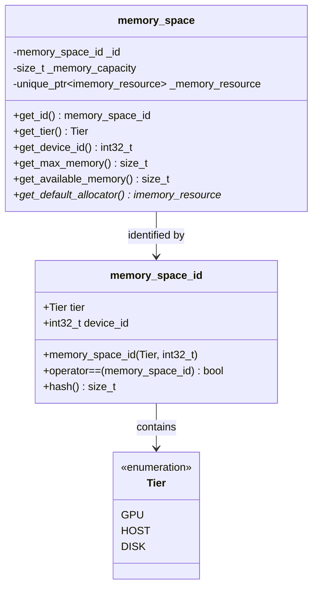
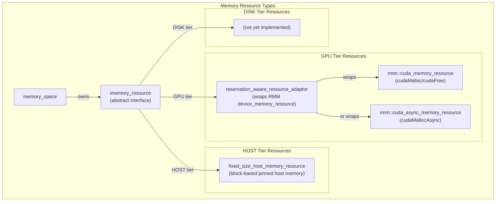
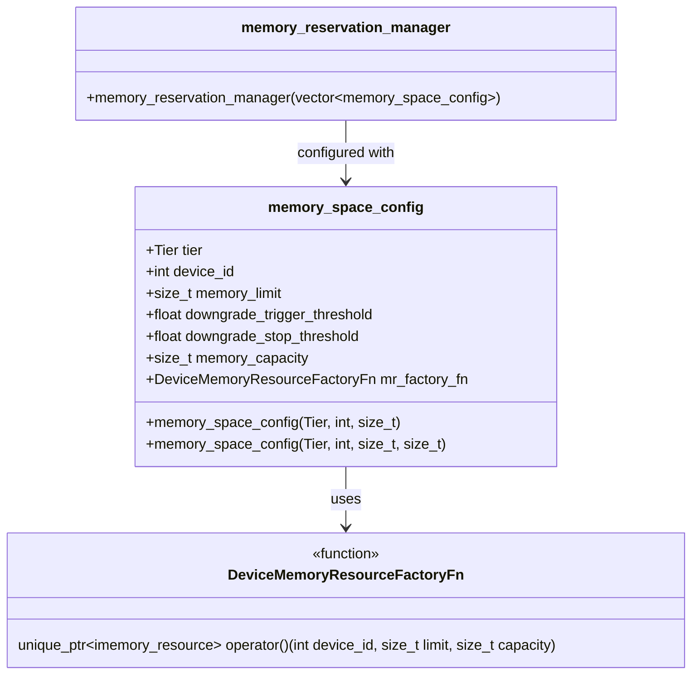
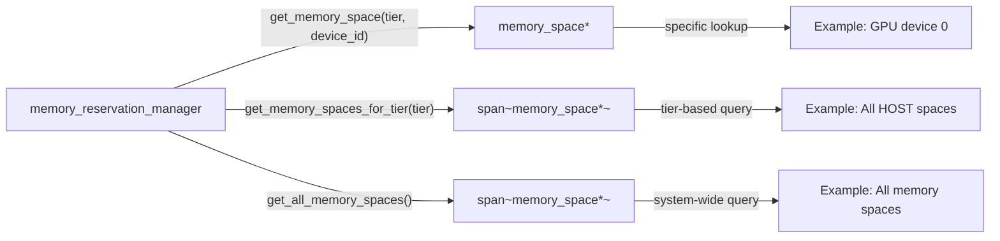
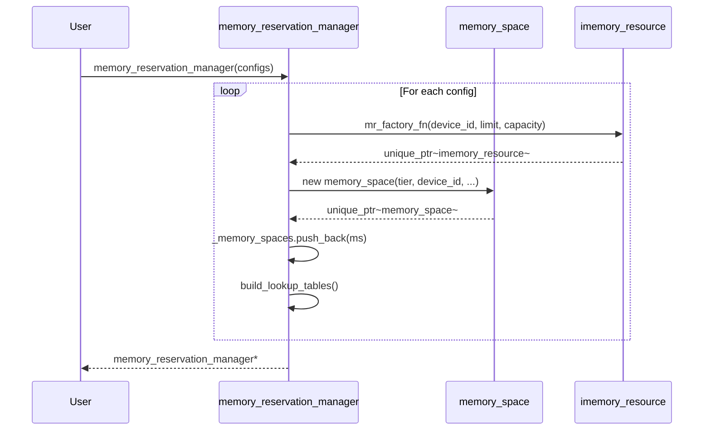
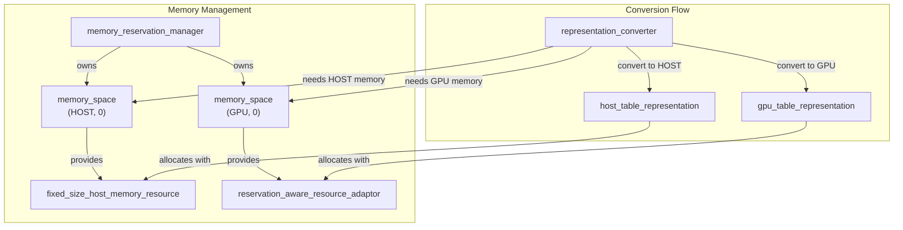

<!-- source: DeepWiki mcp.deepwiki.com · repo NVIDIA/cuCascade · page 4.2 Memory Spaces and Resources · fetched 2026-10-26 -->

# Memory Spaces and Resources

<details>
<summary>Relevant source files</summary>

The following files were used as context for generating this wiki page:

- [include/memory/memory_reservation_manager.hpp](include/memory/memory_reservation_manager.hpp)
- [src/memory/memory_reservation_manager.cpp](src/memory/memory_reservation_manager.cpp)
- [test/data/test_data_representation.cpp](test/data/test_data_representation.cpp)
- [test/memory/test_memory_reservation_manager.cpp](test/memory/test_memory_reservation_manager.cpp)

</details>


## Purpose and Scope

This page documents the `memory_space` abstraction, which represents a single memory space within a specific memory tier and device. A `memory_space` encapsulates the memory resources (allocators) and provides access to memory allocation capabilities for a particular location in the memory hierarchy.

This page covers the `memory_space` class, memory resource types, RMM integration for GPU memory, and how memory resources are configured and accessed. For information about coordinating reservations across multiple memory spaces, see [Memory Reservation Manager](#4.1). For information about hardware topology detection and NUMA node mapping, see [Topology Discovery and NUMA Support](#4.3).

---

## Memory Space Abstraction

### Overview

A `memory_space` represents a single allocatable memory region identified by a memory tier (GPU, HOST, or DISK) and a device ID. Each `memory_space` owns a memory resource (allocator) appropriate for its tier and manages reservations within that space.

### Memory Space Identification

Each `memory_space` is uniquely identified by a `memory_space_id`:



**Sources:** [include/memory/memory_reservation_manager.hpp:191-212](), [src/memory/memory_reservation_manager.cpp:122-146]()

### Memory Space Properties

Each `memory_space` maintains several key properties:

| Property | Type | Description |
|----------|------|-------------|
| `tier` | `Tier` | Memory tier (GPU, HOST, or DISK) |
| `device_id` | `int32_t` | Device identifier (GPU device or NUMA node) |
| `memory_capacity` | `size_t` | Total memory capacity available |
| `memory_limit` | `size_t` | Maximum memory that can be reserved |
| `downgrade_trigger_threshold` | `size_t` | Memory pressure threshold to trigger downgrades |
| `downgrade_stop_threshold` | `size_t` | Memory level to stop downgrading |
| `memory_resource` | `unique_ptr<imemory_resource>` | Underlying allocator |

**Sources:** [include/memory/memory_reservation_manager.hpp:191-212](), [src/memory/memory_reservation_manager.cpp:128-142]()

---

## Memory Resources and Allocators

### Memory Resource Types by Tier

Different memory tiers use different underlying allocator types:



**Sources:** [src/memory/memory_reservation_manager.cpp:128-142](), [test/memory/test_memory_reservation_manager.cpp:57-82]()

### RMM Integration for GPU Memory

GPU memory spaces use RMM (RAPIDS Memory Manager) device memory resources wrapped in a `reservation_aware_resource_adaptor`:

```cpp
// Example from test code showing RMM usage
auto gpu_device_0 = manager->get_memory_space(Tier::GPU, 0);
auto* mr = dynamic_cast<reservation_aware_resource_adaptor*>(
    gpu_device_0->get_default_allocator());

// Allocate GPU memory through RMM
void* ptr = mr->allocate(size, stream);
mr->deallocate(ptr, size, stream);
```

The `reservation_aware_resource_adaptor` provides:
- Stream-aware allocation tracking
- Reservation enforcement and overflow policies
- Peak memory usage monitoring
- Integration with cuCascade's reservation system

**Sources:** [test/memory/test_memory_reservation_manager.cpp:220-254](), [test/memory/test_memory_reservation_manager.cpp:332-394]()

### Host Memory Resources

HOST tier memory spaces use `fixed_size_host_memory_resource`, which allocates pinned host memory in fixed-size blocks:

```cpp
// Example from test code showing host memory resource
auto host_space = mgr.get_memory_space(memory::Tier::HOST, 0);
auto host_mr = host_space->get_memory_resource_as<memory::fixed_size_host_memory_resource>();

// Allocate multiple blocks for large data
auto allocation = host_mr->allocate_multiple_blocks(total_size);
```

Block-based allocation is necessary because pinned host memory has OS-imposed limits on individual allocation sizes. The `fixed_size_host_memory_resource` transparently manages multiple blocks to satisfy larger allocation requests.

**Sources:** [test/data/test_data_representation.cpp:94-99](), [test/memory/test_memory_reservation_manager.cpp:516-600]()

### Memory Resource Access Patterns

There are two primary ways to access memory resources from a `memory_space`:

#### 1. Type-Safe Casting

```cpp
// Get specific memory resource type
auto* gpu_mr = memory_space->get_memory_resource_as<reservation_aware_resource_adaptor>();
auto* host_mr = memory_space->get_memory_resource_as<fixed_size_host_memory_resource>();
```

#### 2. Generic Interface

```cpp
// Get generic memory resource interface
imemory_resource* mr = memory_space->get_default_allocator();
```

**Sources:** [test/memory/test_memory_reservation_manager.cpp:345-346](), [test/data/test_data_representation.cpp:94]()

---

## Memory Space Configuration

### Configuration Structure

Memory spaces are configured using `memory_space_config`:



**Sources:** [include/memory/memory_reservation_manager.hpp:191-212](), [src/memory/memory_reservation_manager.cpp:150-170]()

### Configuration Example

```cpp
// Create configuration for a GPU memory space
memory_reservation_manager::memory_space_config gpu_config(
    Tier::GPU,           // tier
    0,                   // device_id
    2ULL << 30,         // memory_limit (2 GB)
    2ULL << 30,         // memory_capacity
    nullptr              // use default factory function
);

// Create configuration for a HOST memory space
memory_reservation_manager::memory_space_config host_config(
    Tier::HOST,          // tier
    0,                   // NUMA node
    4ULL << 30,         // memory_limit (4 GB)
    4ULL << 30,         // memory_capacity
    nullptr              // use default factory function
);

// Create manager with configurations
std::vector<memory_reservation_manager::memory_space_config> configs;
configs.push_back(std::move(gpu_config));
configs.push_back(std::move(host_config));
auto manager = std::make_unique<memory_reservation_manager>(std::move(configs));
```

**Sources:** [include/memory/memory_reservation_manager.hpp:191-212](), [test/memory/test_memory_reservation_manager.cpp:57-82]()

### Default Memory Resource Factories

When `mr_factory_fn` is `nullptr`, the system uses tier-specific default factories:

| Tier | Default Factory | Creates |
|------|----------------|---------|
| GPU | `make_default_allocator_for_tier(Tier::GPU)` | `reservation_aware_resource_adaptor` wrapping `rmm::cuda_async_memory_resource` |
| HOST | `make_default_allocator_for_tier(Tier::HOST)` | `fixed_size_host_memory_resource` |
| DISK | `make_default_allocator_for_tier(Tier::DISK)` | Not yet implemented |

**Sources:** [src/memory/memory_reservation_manager.cpp:169]()

### Custom Memory Resource Factories

Custom factories can be provided for specialized memory management:

```cpp
// Custom factory function signature
auto custom_factory = [](int device_id, size_t limit, size_t capacity) 
    -> std::unique_ptr<imemory_resource> {
    // Create custom memory resource
    return std::make_unique<custom_memory_resource>(device_id, limit);
};

memory_space_config config(
    Tier::GPU,
    0,
    memory_limit,
    memory_capacity,
    custom_factory  // Use custom factory
);
```

**Sources:** [include/memory/memory_reservation_manager.hpp:198](), [src/memory/memory_reservation_manager.cpp:169]()

---

## Stream Management

### CUDA Stream Acquisition

GPU memory spaces provide stream acquisition for asynchronous operations:

```cpp
auto gpu_space = manager->get_memory_space(Tier::GPU, 0);

// Acquire a CUDA stream for async operations
auto stream = gpu_space->acquire_stream();

// Use the stream for GPU operations
auto packed = cudf::pack(table_view, stream.view());

// Stream is automatically synchronized and returned when destroyed
```

The `acquire_stream()` method returns an RAII handle that:
- Provides a CUDA stream for asynchronous operations
- Automatically synchronizes the stream on destruction
- Manages stream lifetime and pooling

**Sources:** [test/data/test_data_representation.cpp:90-93](), [test/data/test_data_representation.cpp:126-128]()

### Stream-Aware Memory Operations

Memory resources support stream-specific tracking and allocation:

```cpp
auto* mr = gpu_space->get_default_allocator();
rmm::cuda_stream stream1, stream2;

// Attach reservation to specific stream
mr->attach_reservation_to_tracker(stream1, std::move(reservation));

// Query stream-specific metrics
size_t available = mr->get_available_memory(stream1);
size_t allocated = mr->get_allocated_bytes(stream1);
size_t peak = mr->get_peak_allocated_bytes(stream1);
```

This enables:
- Per-stream memory accounting
- Independent memory limits per stream
- Reservation enforcement per stream
- Cross-stream memory isolation

**Sources:** [test/memory/test_memory_reservation_manager.cpp:220-254](), [test/memory/test_memory_reservation_manager.cpp:256-330]()

---

## Memory Space Lookup and Queries

### Accessing Memory Spaces

The `memory_reservation_manager` provides multiple methods to access `memory_space` instances:



**Sources:** [include/memory/memory_reservation_manager.hpp:244-259](), [src/memory/memory_reservation_manager.cpp:193-213]()

### Query Methods

```cpp
// Get specific memory space
const memory_space* gpu0 = manager->get_memory_space(Tier::GPU, 0);
const memory_space* host0 = manager->get_memory_space(Tier::HOST, 0);

// Get all memory spaces in a tier
auto gpu_spaces = manager->get_memory_spaces_for_tier(Tier::GPU);
for (const auto* space : gpu_spaces) {
    // Process each GPU memory space
}

// Get all memory spaces
auto all_spaces = manager->get_all_memory_spaces();
for (const auto* space : all_spaces) {
    // Process each memory space
}
```

**Sources:** [test/memory/test_memory_reservation_manager.cpp:84-112](), [src/memory/memory_reservation_manager.cpp:193-213]()

### Memory Space Metrics

Each `memory_space` provides metrics about its memory usage:

| Method | Returns | Description |
|--------|---------|-------------|
| `get_max_memory()` | `size_t` | Maximum reservable memory (limit) |
| `get_available_memory()` | `size_t` | Currently available memory for new allocations |
| `get_total_reserved_memory()` | `size_t` | Total memory currently reserved |
| `get_active_reservation_count()` | `size_t` | Number of active reservations |

```cpp
auto* space = manager->get_memory_space(Tier::GPU, 0);

// Query space metrics
size_t max = space->get_max_memory();
size_t available = space->get_available_memory();
size_t reserved = space->get_total_reserved_memory();
size_t count = space->get_active_reservation_count();
```

**Sources:** [test/memory/test_memory_reservation_manager.cpp:94-96](), [test/memory/test_memory_reservation_manager.cpp:136-161]()

---

## Memory Space Lifecycle and Ownership

### Creation and Ownership

Memory spaces are owned by the `memory_reservation_manager` and created during manager construction:



**Sources:** [src/memory/memory_reservation_manager.cpp:122-146](), [src/memory/memory_reservation_manager.cpp:337-357]()

### Lifetime Management

Memory spaces live for the entire lifetime of the `memory_reservation_manager`:

1. **Creation**: Memory spaces are created in `memory_reservation_manager` constructor
2. **Access**: Memory spaces are accessed via const pointers throughout their lifetime
3. **Destruction**: Memory spaces are destroyed when `memory_reservation_manager` is destroyed

```cpp
{
    // Create manager - creates memory spaces
    auto manager = std::make_unique<memory_reservation_manager>(configs);
    
    // Access memory spaces (non-owning pointers)
    const memory_space* space = manager->get_memory_space(Tier::GPU, 0);
    
    // Use space...
    
} // Manager destroyed - memory spaces cleaned up
```

**Sources:** [src/memory/memory_reservation_manager.cpp:148](), [src/memory/memory_reservation_manager.cpp:359-364]()

### Thread Safety

Memory space access is designed for concurrent use:

- **Read operations**: Thread-safe (querying metrics, getting allocators)
- **Reservation operations**: Thread-safe (coordinated by internal locking)
- **Allocation operations**: Thread-safe at the memory resource level

The `memory_reservation_manager` uses a wait condition variable (`_wait_cv`) to coordinate threads when no memory space can satisfy a reservation request.

**Sources:** [include/memory/memory_reservation_manager.hpp:301-302](), [src/memory/memory_reservation_manager.cpp:172-191]()

---

## Integration with Data Representations

### Memory Space Usage in Conversions

Data representations use memory spaces to obtain appropriate memory resources for allocations:



**Example from test code:**

```cpp
// Get memory spaces for conversion
const memory::memory_space* host_space = mgr.get_memory_space(memory::Tier::HOST, 0);
const memory::memory_space* gpu_space = mgr.get_memory_space(memory::Tier::GPU, 0);

// Get host memory resource for allocation
auto host_mr = host_space->get_memory_resource_as<memory::fixed_size_host_memory_resource>();
auto allocation = host_mr->allocate_multiple_blocks(packed.gpu_data->size());

// Create representation with allocated memory
host_table_representation host_repr(std::move(host_alloc), 
                                   const_cast<memory::memory_space*>(host_space));

// Convert using GPU memory space
auto gpu_stream = gpu_space->acquire_stream();
auto gpu_any = registry.convert<gpu_table_representation>(host_repr, gpu_space, stream);
```

**Sources:** [test/data/test_data_representation.cpp:78-133](), [test/data/test_data_representation.cpp:232-254]()

### Memory Space Reference in Representations

Each data representation stores a reference to its `memory_space`:

- `host_table_representation`: Holds pointer to HOST tier `memory_space`
- `gpu_table_representation`: Holds pointer to GPU tier `memory_space`

This reference is used for:
- Querying memory properties (tier, device_id)
- Obtaining memory resources for operations
- Coordinating memory management operations

**Sources:** [test/data/test_data_representation.cpp:122-123](), [test/data/test_data_representation.cpp:144-148]()

---

