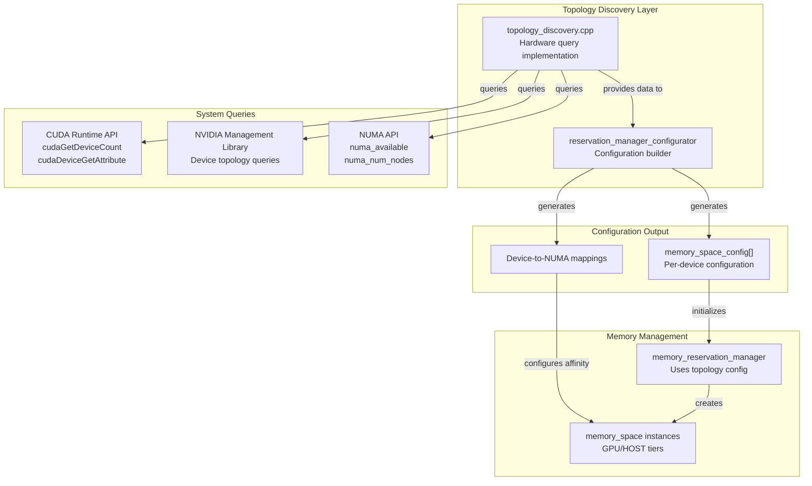
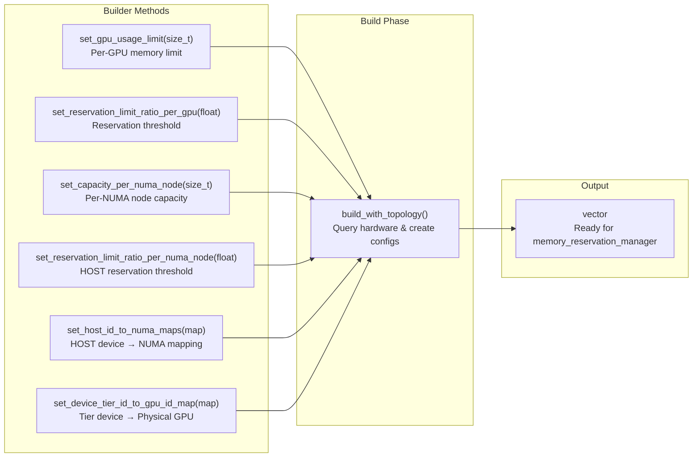
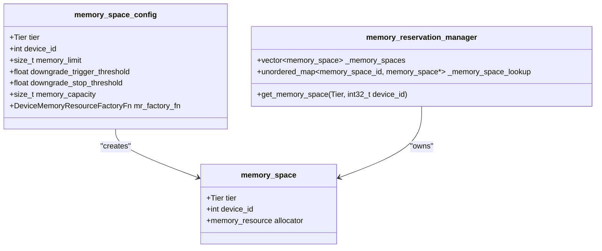
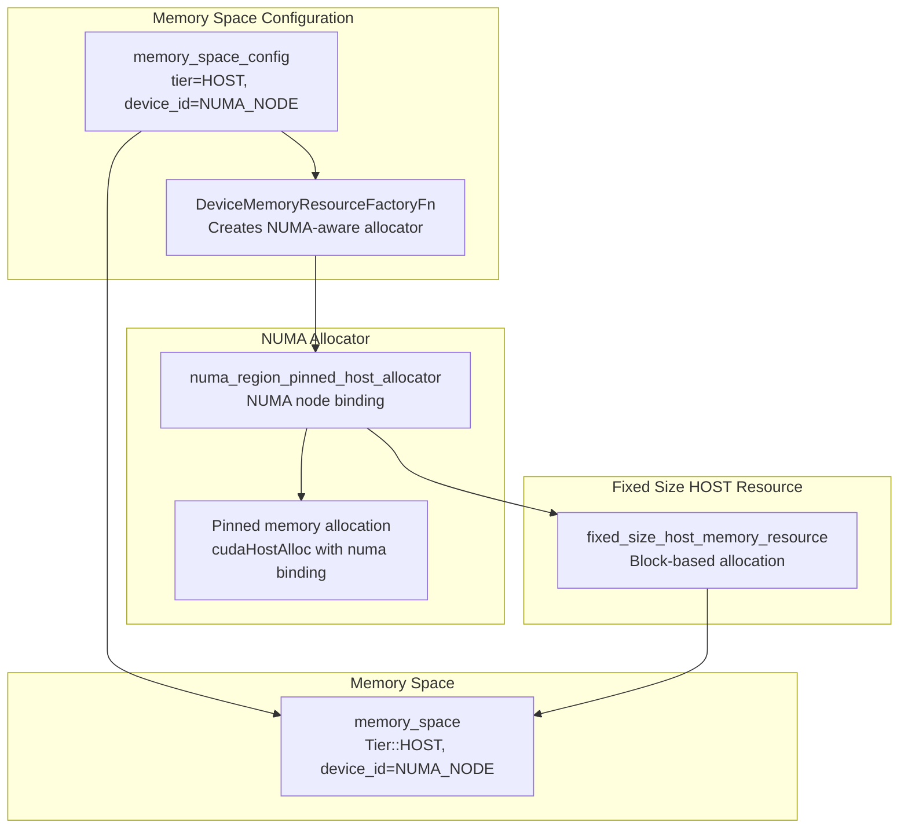
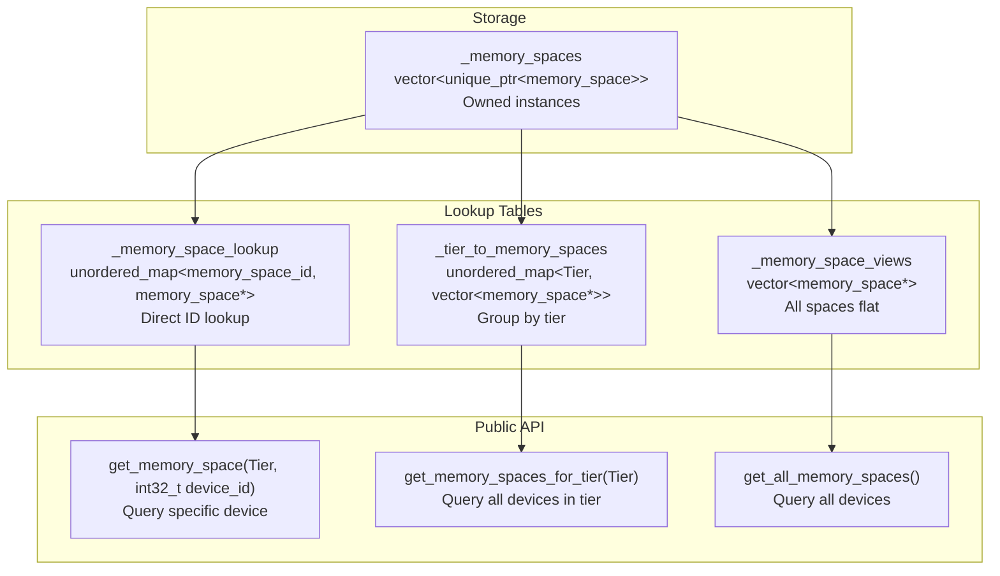
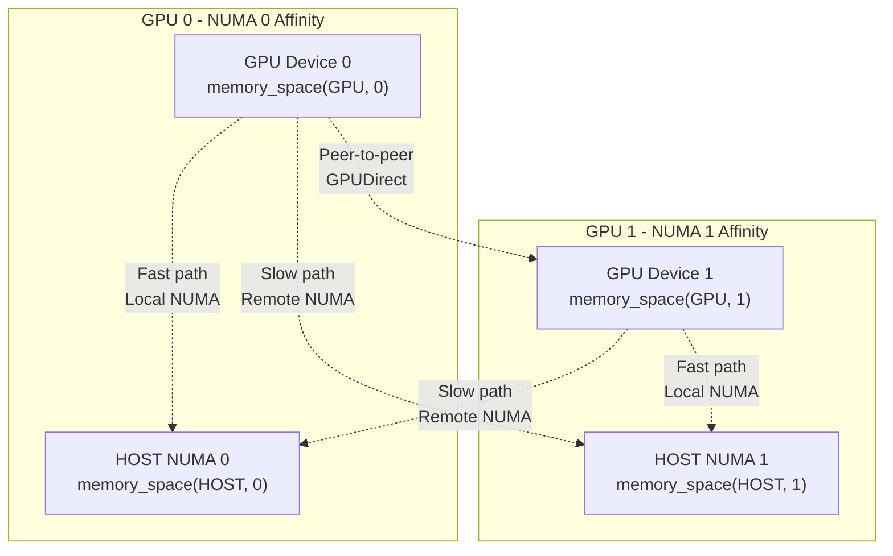
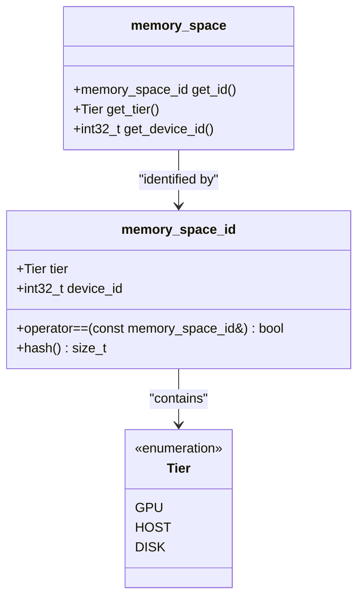

<!-- source: DeepWiki mcp.deepwiki.com · repo NVIDIA/cuCascade · page 4.3 Topology Discovery and NUMA Support · fetched 2026-10-26 -->

# Topology Discovery and NUMA Support

<details>
<summary>Relevant source files</summary>

The following files were used as context for generating this wiki page:

- [include/memory/memory_reservation_manager.hpp](include/memory/memory_reservation_manager.hpp)
- [src/memory/CMakeLists.txt](src/memory/CMakeLists.txt)
- [src/memory/memory_reservation_manager.cpp](src/memory/memory_reservation_manager.cpp)
- [test/memory/test_memory_reservation_manager.cpp](test/memory/test_memory_reservation_manager.cpp)

</details>


## Purpose and Scope

This page documents cuCascade's hardware topology discovery capabilities and Non-Uniform Memory Access (NUMA) support. The topology discovery subsystem detects the system's hardware configuration (GPU devices, NUMA nodes, device-to-NUMA affinity) and enables NUMA-aware memory allocation strategies that optimize data locality and memory bandwidth.

For information about the memory reservation manager that uses topology information, see [Memory Reservation Manager](#4.1). For details on memory space abstraction and allocation, see [Memory Spaces and Resources](#4.2).

**Sources:** High-level architecture diagrams, [test/memory/test_memory_reservation_manager.cpp:1-601]()

---

## Hardware Topology Concepts

### NUMA Architecture

Non-Uniform Memory Access (NUMA) is a computer memory design where memory access time depends on the memory location relative to the processor. In multi-socket systems, each CPU socket has local memory with lower latency access, while access to memory on remote sockets incurs higher latency.

cuCascade's topology discovery identifies NUMA regions and maps them to HOST tier memory spaces, enabling applications to allocate data close to the CPU cores that will process it.

### GPU-to-NUMA Affinity

Modern systems with multiple GPUs often have each GPU connected to a specific NUMA node via PCIe. Placing data in the NUMA node closest to a GPU minimizes PCIe transfer latency and maximizes bandwidth for GPU↔HOST transfers.

**Sources:** [test/memory/test_memory_reservation_manager.cpp:62-68]()

---

## Topology Discovery Architecture

### Component Overview



**Topology Discovery Flow:**

1. **Hardware Query Phase:** `topology_discovery.cpp` queries CUDA runtime, NVML, and system NUMA APIs to detect available GPUs and NUMA nodes
2. **Configuration Phase:** `reservation_manager_configurator` processes hardware information and builds memory space configurations
3. **Initialization Phase:** `memory_reservation_manager` creates memory spaces based on topology-aware configurations

**Sources:** [src/memory/CMakeLists.txt:33](), [test/memory/test_memory_reservation_manager.cpp:57-82]()

---

## Reservation Manager Configurator

The `reservation_manager_configurator` class provides a builder interface for constructing topology-aware memory reservation managers.

### Configuration Builder Pattern



**Sources:** [test/memory/test_memory_reservation_manager.cpp:57-82]()

### Configuration Example: Single Device System

```cpp
// Configure a single-GPU, single-NUMA system
reservation_manager_configurator builder;
builder.set_gpu_usage_limit(2ULL << 30);           // 2 GB per GPU
builder.set_reservation_limit_ratio_per_gpu(0.75); // 75% utilization threshold
builder.set_capacity_per_numa_node(4ULL << 30);    // 4 GB per NUMA node
builder.set_host_id_to_numa_maps({{0, -1}});       // HOST device 0 → default NUMA
builder.set_reservation_limit_ratio_per_numa_node(0.75);

auto space_configs = builder.build_with_topology();
auto manager = std::make_unique<memory_reservation_manager>(
    std::move(space_configs));
```

| Configuration Method | Purpose | Example Value |
|---------------------|---------|---------------|
| `set_gpu_usage_limit()` | Maximum memory per GPU device | 2 GB |
| `set_reservation_limit_ratio_per_gpu()` | GPU reservation threshold (0.0-1.0) | 0.75 (75%) |
| `set_capacity_per_numa_node()` | HOST memory capacity per NUMA node | 4 GB |
| `set_host_id_to_numa_maps()` | Map HOST device IDs to NUMA nodes | `{{0, -1}}` for default |
| `set_device_tier_id_to_gpu_id_map()` | Map tier device IDs to physical GPUs | `{{0, 0}, {1, 0}}` for dual-tier single GPU |
| `set_reservation_limit_ratio_per_numa_node()` | HOST reservation threshold | 0.75 (75%) |
| `build_with_topology()` | Execute topology discovery and generate configs | Returns `vector<memory_space_config>` |

**Sources:** [test/memory/test_memory_reservation_manager.cpp:57-68]()

### Configuration Example: Multi-GPU System

```cpp
// Configure a dual-GPU system with shared NUMA node
reservation_manager_configurator builder;
builder.set_gpu_usage_limit(2ULL << 30);
builder.set_reservation_limit_ratio_per_gpu(0.75);
builder.set_capacity_per_numa_node(4ULL << 30);
builder.set_host_id_to_numa_maps({{0, -1}});
builder.set_device_tier_id_to_gpu_id_map({{0, 0}, {1, 0}}); // Two tier devices map to GPU 0
builder.set_reservation_limit_ratio_per_numa_node(0.75);

auto space_configs = builder.build_with_topology();
auto manager = std::make_unique<memory_reservation_manager>(
    std::move(space_configs));
```

This configuration creates:
- GPU tier device 0 → Physical GPU 0
- GPU tier device 1 → Physical GPU 0 (can have multiple logical devices per physical GPU)
- HOST tier device 0 → NUMA node -1 (default/any NUMA node)

**Sources:** [test/memory/test_memory_reservation_manager.cpp:70-82]()

---

## NUMA-Aware Memory Allocation

### Memory Space Configuration with Device IDs

The `memory_space_config` structure associates each memory space with a specific device identifier:



**Device ID Semantics:**
- **GPU tier:** `device_id` corresponds to CUDA device ordinal (0, 1, 2, ...)
- **HOST tier:** `device_id` corresponds to NUMA node identifier (0, 1, 2, ... or -1 for default)
- **DISK tier:** `device_id` typically 0 (single disk pool)

**Sources:** [include/memory/memory_reservation_manager.hpp:191-212](), [src/memory/memory_reservation_manager.cpp:122-146]()

### Device-Specific Reservation Strategies

cuCascade provides multiple reservation strategies that leverage topology information:

#### `specific_memory_space`: Target Specific Device

```cpp
// Allocate on specific GPU device
auto reservation = manager->request_reservation(
    specific_memory_space(Tier::GPU, 0),  // GPU 0
    allocation_size);

// Allocate on specific NUMA node
auto host_reservation = manager->request_reservation(
    specific_memory_space(Tier::HOST, 1),  // NUMA node 1
    allocation_size);
```

**Sources:** [include/memory/memory_reservation_manager.hpp:123-132](), [test/memory/test_memory_reservation_manager.cpp:128-132]()

#### `any_memory_space_in_tier_with_preference`: NUMA-Aware with Preference

```cpp
// Prefer GPU 1, but allow fallback to other GPUs in tier
auto reservation = manager->request_reservation(
    any_memory_space_in_tier_with_preference(
        Tier::GPU, 
        std::optional<size_t>(1)),  // Prefer GPU 1
    allocation_size);
```

This strategy uses `std::stable_partition` to prioritize the preferred device while maintaining access to all devices in the tier:

**Sources:** [include/memory/memory_reservation_manager.hpp:81-92](), [src/memory/memory_reservation_manager.cpp:64-76]()

---

## NUMA Region Pinned Host Allocator

### Purpose

The `numa_region_pinned_host_allocator` class provides NUMA-aware host memory allocation with pinned (page-locked) memory for optimal GPU transfer performance.

### Integration with Topology



The NUMA allocator ensures:
1. **Memory locality:** Allocations are bound to specific NUMA nodes
2. **Pinned memory:** Host memory is page-locked for DMA transfers
3. **Block-based management:** Fixed-size blocks for HOST tier (see [Host Table Representation](#5.3))

**Sources:** [src/memory/CMakeLists.txt:28](), [src/memory/memory_reservation_manager.cpp:23]()

---

## Topology-Aware Lookup Tables

### Internal Memory Space Organization

The `memory_reservation_manager` maintains multiple lookup structures for efficient topology-aware queries:



**Lookup Table Construction:**

The `build_lookup_tables()` method constructs these indices during initialization:

**Sources:** [include/memory/memory_reservation_manager.hpp:286-292](), [src/memory/memory_reservation_manager.cpp:337-357]()

### Query Methods

| Method | Return Type | Purpose |
|--------|------------|---------|
| `get_memory_space(Tier, int32_t)` | `const memory_space*` | Get specific device in tier |
| `get_memory_spaces_for_tier(Tier)` | `span<const memory_space*>` | Get all devices in tier |
| `get_all_memory_spaces()` | `span<const memory_space*>` | Get all memory spaces |

**Sources:** [include/memory/memory_reservation_manager.hpp:244-259](), [src/memory/memory_reservation_manager.cpp:193-213]()

---

## Device Affinity in Conversion Operations

### Cross-Device Memory Movement

Topology information is critical when converting data representations across devices. The system optimizes transfer paths based on device relationships:



**Optimal Transfer Strategies:**
1. **Local NUMA transfers:** GPU ↔ Local HOST NUMA (lowest latency)
2. **Peer-to-peer transfers:** GPU ↔ GPU via GPUDirect (if available)
3. **Remote NUMA transfers:** GPU ↔ Remote HOST NUMA (highest latency)

**Sources:** High-level architecture diagram (Diagram 3), [test/memory/test_memory_reservation_manager.cpp:88-112]()

---

## Testing Topology Configuration

### Single-Device Test Configuration

The test suite provides helper functions to create topology-aware managers:

**Sources:** [test/memory/test_memory_reservation_manager.cpp:57-68]()

### Multi-Device Test Configuration

**Sources:** [test/memory/test_memory_reservation_manager.cpp:70-82]()

### Test Verification

Tests verify topology-aware behavior:

```cpp
TEST_CASE("Single-Device Memory Space Access", "[memory_space]")
{
  auto manager = createSingleDeviceMemoryManager();

  // Verify GPU device 0 exists with correct topology info
  auto gpu_device_0 = manager->get_memory_space(Tier::GPU, 0);
  REQUIRE(gpu_device_0 != nullptr);
  REQUIRE(gpu_device_0->get_tier() == Tier::GPU);
  REQUIRE(gpu_device_0->get_device_id() == 0);

  // Verify HOST NUMA 0 exists
  auto host_numa_0 = manager->get_memory_space(Tier::HOST, 0);
  REQUIRE(host_numa_0 != nullptr);
  REQUIRE(host_numa_0->get_tier() == Tier::HOST);
  REQUIRE(host_numa_0->get_device_id() == 0);

  // Verify non-existent devices return nullptr
  REQUIRE(manager->get_memory_space(Tier::GPU, 1) == nullptr);
  REQUIRE(manager->get_memory_space(Tier::HOST, 1) == nullptr);
}
```

**Sources:** [test/memory/test_memory_reservation_manager.cpp:84-112]()

---

## Memory Space ID Structure

### `memory_space_id` Composite Key



The `memory_space_id` is a composite key `(Tier, device_id)` that uniquely identifies each memory space:

- `(GPU, 0)` → First GPU device
- `(GPU, 1)` → Second GPU device
- `(HOST, 0)` → First NUMA node
- `(HOST, 1)` → Second NUMA node
- `(DISK, 0)` → Disk storage

**Sources:** [include/memory/memory_reservation_manager.hpp:68-69](), [src/memory/memory_reservation_manager.cpp:215-220]()

---

## Tier-Level Aggregated Queries

The memory reservation manager provides topology-aware aggregations:

### Per-Tier Queries

```cpp
// Query total available memory across all GPUs
size_t gpu_available = manager->get_available_memory_for_tier(Tier::GPU);

// Query total reserved memory across all NUMA nodes
size_t host_reserved = manager->get_total_reserved_memory_for_tier(Tier::HOST);

// Count active reservations on GPU tier
size_t gpu_reservations = manager->get_active_reservation_count_for_tier(Tier::GPU);
```

### System-Wide Queries

```cpp
// Query across all tiers
size_t total_available = manager->get_total_available_memory();
size_t total_reserved = manager->get_total_reserved_memory();
size_t total_count = manager->get_active_reservation_count();
```

**Implementation:** These methods iterate over topology-aware lookup tables to aggregate statistics:

**Sources:** [include/memory/memory_reservation_manager.hpp:262-273](), [src/memory/memory_reservation_manager.cpp:245-306]()

---

## Summary

The topology discovery and NUMA support subsystem provides:

1. **Hardware Detection:** Automatic discovery of GPU devices, NUMA nodes, and device-to-NUMA affinity
2. **Configuration Builder:** `reservation_manager_configurator` for constructing topology-aware memory managers
3. **NUMA-Aware Allocation:** Strategies to prefer specific devices or NUMA nodes
4. **Device Affinity:** Optimal transfer paths based on physical topology
5. **Topology Lookups:** Fast queries for device-specific and tier-level memory statistics

This enables cuCascade to optimize data placement and minimize transfer latency in heterogeneous multi-GPU, multi-NUMA systems.

**Sources:** [src/memory/CMakeLists.txt:33](), [src/memory/memory_reservation_manager.cpp:1-368](), [test/memory/test_memory_reservation_manager.cpp:1-601]()

---

