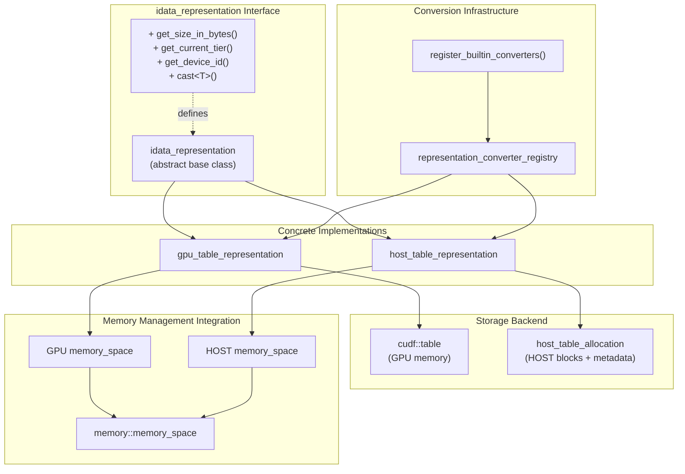
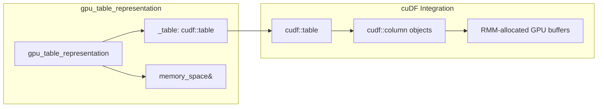
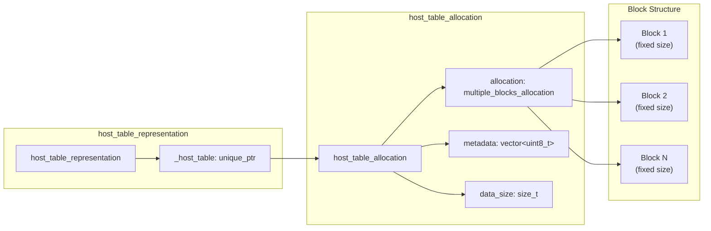
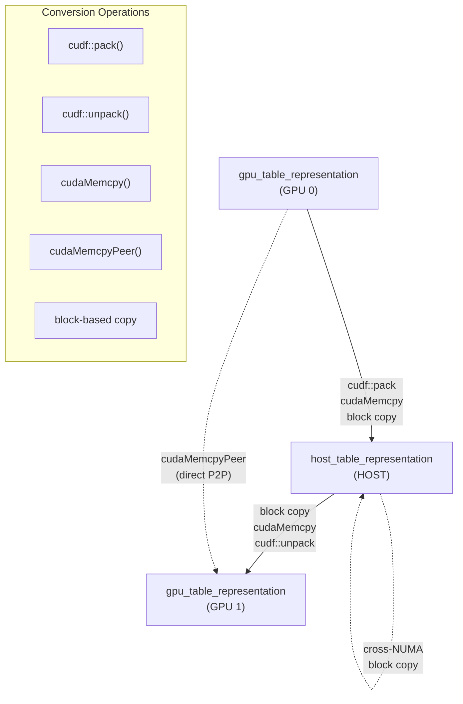
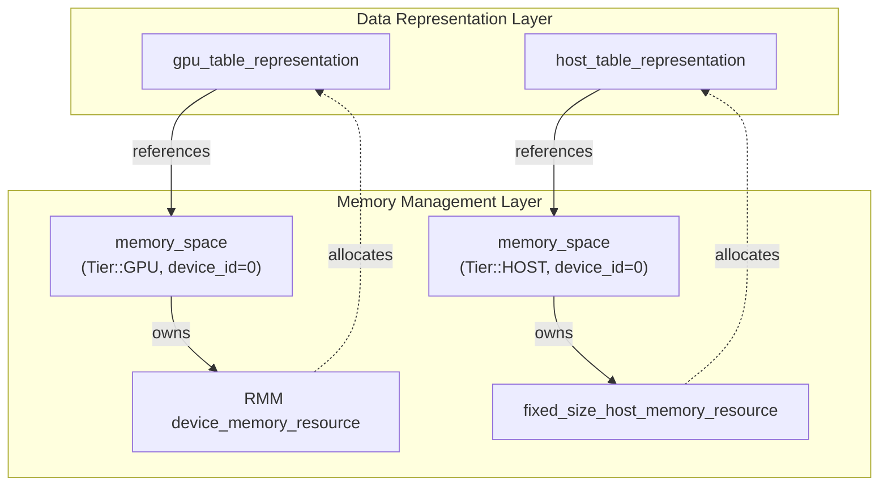
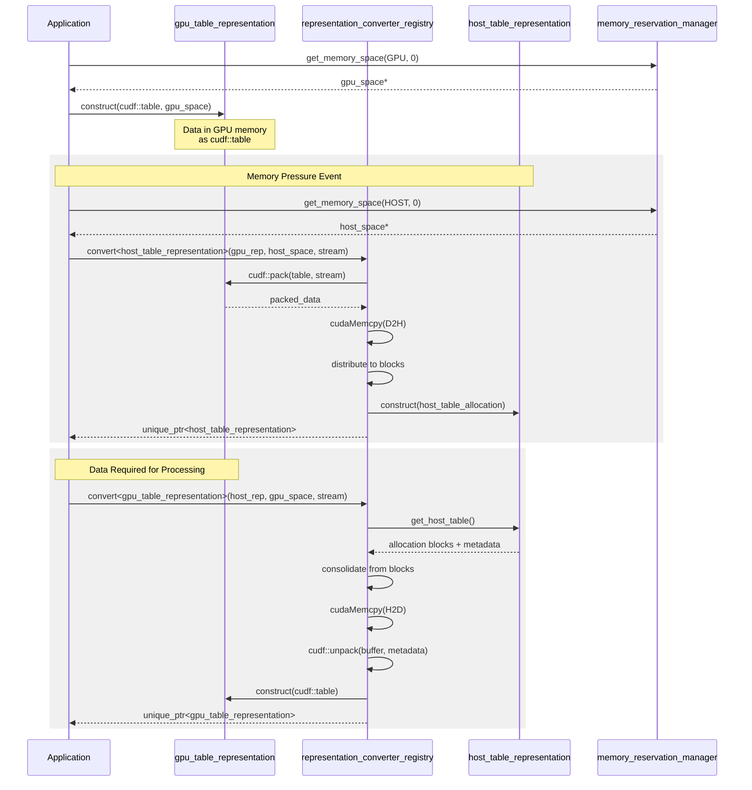

<!-- source: DeepWiki mcp.deepwiki.com · repo NVIDIA/cuCascade · page 5 Data Representation Subsystem · fetched 2026-10-26 -->

# Data Representation Subsystem

Relevant source files

The following files were used as context for generating this wiki page:

- [include/data/cpu_data_representation.hpp](include/data/cpu_data_representation.hpp)
- [include/data/gpu_data_representation.hpp](include/data/gpu_data_representation.hpp)
- [src/data/cpu_data_representation.cpp](src/data/cpu_data_representation.cpp)
- [src/data/gpu_data_representation.cpp](src/data/gpu_data_representation.cpp)
- [test/data/test_data_representation.cpp](test/data/test_data_representation.cpp)

## Purpose and Scope

The Data Representation Subsystem provides an abstraction layer for storing and manipulating tabular data across different memory tiers (GPU, HOST, DISK). This subsystem defines polymorphic interfaces for data representations, concrete implementations for GPU and host memory storage, and a conversion registry for transforming data between representations.

This document provides an overview of the subsystem architecture and the relationships between components. For detailed documentation of specific components, see:
- [Data Representation Interface](#5.1) - The polymorphic `idata_representation` base class
- [GPU Table Representation](#5.2) - GPU memory storage using cuDF tables
- [Host Table Representation](#5.3) - Host memory storage with block-based allocation
- [Representation Converters](#5.4) - The conversion registry and built-in converters
- [Data Packing and Serialization](#5.5) - cuDF pack/unpack and data movement operations

For information about how data representations are managed as batches in processing workflows, see [Data Batch](#6.1). For memory space abstractions, see [Memory Spaces and Resources](#4.2).

**Sources:** [include/data/gpu_data_representation.hpp](), [include/data/cpu_data_representation.hpp](), test files

## System Architecture

The Data Representation Subsystem sits between the Memory Management Layer and the Data Management Layer in the cuCascade architecture. It provides type-safe abstractions for data stored in different memory tiers while maintaining a consistent interface for data access and manipulation.

### Core Components

**Key Components:**

| Component | Purpose | Header File |
|-----------|---------|-------------|
| `idata_representation` | Abstract base interface for all data representations | `include/data/common.hpp` |
| `gpu_table_representation` | GPU memory representation wrapping `cudf::table` | `include/data/gpu_data_representation.hpp` |
| `host_table_representation` | Host memory representation with block-based storage | `include/data/cpu_data_representation.hpp` |
| `representation_converter_registry` | Registry for converting between representation types | `include/data/representation_converter.hpp` |
| `host_table_allocation` | Fixed-size block allocation for host memory | `include/memory/host_table.hpp` |

**Sources:** [include/data/gpu_data_representation.hpp:1-69](), [include/data/cpu_data_representation.hpp:1-70]()

## Data Representation Interface

All data representations in cuCascade inherit from the `idata_representation` abstract base class. This polymorphic design enables:

1. **Uniform access patterns** - Code can operate on representations without knowing the specific memory tier
2. **Type-safe downcasting** - The `cast<T>()` method provides safe conversion to derived types
3. **Memory space association** - Each representation maintains a reference to its `memory_space`

The interface defines the following contract:

| Method | Return Type | Purpose |
|--------|-------------|---------|
| `get_size_in_bytes()` | `std::size_t` | Total bytes consumed by the representation |
| `get_current_tier()` | `memory::Tier` | Memory tier (GPU, HOST, or DISK) |
| `get_device_id()` | `int` | Device ID (relevant for GPU/HOST with NUMA) |
| `cast<T>()` | `T&` | Type-safe downcast to derived representation |

**Sources:** [test/data/test_data_representation.cpp:309-347]()

## Representation Types

### GPU Table Representation

The `gpu_table_representation` class wraps a `cudf::table` object and stores data in GPU memory. This is the primary representation for GPU-accelerated operations.

**Key characteristics:**
- Stores data as native cuDF columns in contiguous GPU memory
- Size calculation traverses all columns: `col.size() * cudf::size_of(col.type())`
- Direct compatibility with cuDF APIs (no copy required)
- Allocated via the RMM memory resource associated with the GPU `memory_space`

**Sources:** [src/data/gpu_data_representation.cpp:24-45](), [include/data/gpu_data_representation.hpp:30-67]()

### Host Table Representation

The `host_table_representation` class stores data in host memory using a block-based allocation strategy. This is necessary because host memory is allocated in fixed-size blocks by `fixed_size_host_memory_resource`.

**Key characteristics:**
- Data distributed across multiple fixed-size host memory blocks
- Metadata stored separately for cuDF unpacking
- Block-based copying required for data movement
- Size obtained directly from `host_table_allocation.data_size`

**Sources:** [src/data/cpu_data_representation.cpp:22-37](), [include/data/cpu_data_representation.hpp:30-68]()

## Conversion System

The `representation_converter_registry` manages conversions between different representation types. Converters are registered at startup via `register_builtin_converters()` and provide the following transformations:

### Built-in Conversion Paths

**Conversion Matrix:**

| Source Tier | Target Tier | Converter Function | Operations |
|-------------|-------------|-------------------|------------|
| GPU | HOST | GPU→HOST converter | `cudf::pack()`, `cudaMemcpy()`, block distribution |
| HOST | GPU | HOST→GPU converter | Block consolidation, `cudaMemcpy()`, `cudf::unpack()` |
| GPU | GPU | GPU→GPU converter | `cudaMemcpyPeer()` (peer-to-peer) or via HOST |
| HOST | HOST | HOST→HOST converter | Block-based memory copy (cross-NUMA) |

**Sources:** [test/data/test_data_representation.cpp:78-133](), [test/data/test_data_representation.cpp:232-254]()

## Integration with Memory Management

Each data representation maintains a reference to its associated `memory_space`, establishing a bidirectional relationship between data and memory:

**Key relationships:**

1. **Construction**: Representations require a `memory_space` reference at construction time
   - GPU: `gpu_table_representation(cudf::table, memory_space&)` [src/data/gpu_data_representation.cpp:24-28]()
   - Host: `host_table_representation(unique_ptr<host_table_allocation>, memory_space*)` [src/data/cpu_data_representation.cpp:22-27]()

2. **Tier identification**: The `get_current_tier()` method returns the tier from the associated `memory_space`

3. **Device affinity**: The `get_device_id()` method returns the device ID from the associated `memory_space`

4. **Stream management**: `memory_space` provides CUDA streams for asynchronous operations during conversions

**Sources:** [include/data/gpu_data_representation.hpp:43-48](), [include/data/cpu_data_representation.hpp:46-47]()

## Data Flow Through Representations

The following diagram illustrates the typical lifecycle of data as it moves between representations during processing:

**Key steps in representation lifecycle:**

1. **Initial creation**: Data typically enters as a `cudf::table` wrapped in `gpu_table_representation`
2. **Downgrade (GPU→HOST)**: When memory pressure occurs, `cudf::pack()` serializes the table, data is copied to host, and distributed across fixed-size blocks
3. **Storage**: Host representation maintains both serialized data blocks and metadata for reconstruction
4. **Upgrade (HOST→GPU)**: When data is needed, blocks are consolidated, copied to GPU, and `cudf::unpack()` reconstructs the `cudf::table`
5. **Cross-device**: GPU-to-GPU conversions use peer-to-peer transfers when available

**Sources:** [test/data/test_data_representation.cpp:78-133](), [test/data/test_data_representation.cpp:232-254](), [test/data/test_data_representation.cpp:269-304]()

## Testing Infrastructure

The data representation subsystem includes comprehensive tests covering construction, size calculation, tier identification, and roundtrip conversions:

**Test categories:**

| Test Category | Test File | Coverage |
|--------------|-----------|----------|
| Basic construction and properties | `test_data_representation.cpp:139-230` | Constructor, size, tier, device_id |
| Interface polymorphism | `test_data_representation.cpp:309-347` | `cast<T>()`, base pointer access |
| GPU→HOST conversion | `test_data_representation.cpp:78-133` | Pack, copy, block distribution |
| Roundtrip preservation | `test_data_representation.cpp:232-254` | GPU→HOST→GPU data integrity |
| Cross-device transfers | `test_data_representation.cpp:269-304` | Multi-GPU peer-to-peer |
| Edge cases | `test_data_representation.cpp:386-437` | Single column, multiple types, empty tables |

**Test utilities:**
- `create_simple_cudf_table(rows)`: Generates test tables with INT32 and INT64 columns
- `expect_cudf_tables_equal_on_stream()`: Stream-aware comparison for async operations
- `create_conversion_test_configs()`: Memory space configurations for conversion tests

**Sources:** [test/data/test_data_representation.cpp:1-447]()

---

