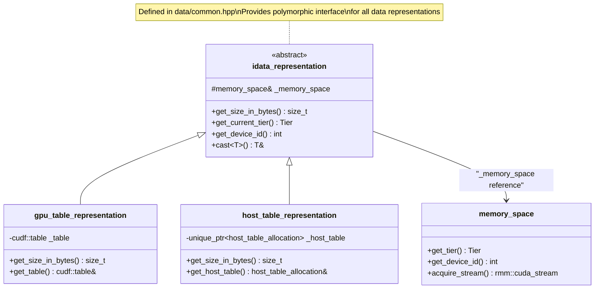
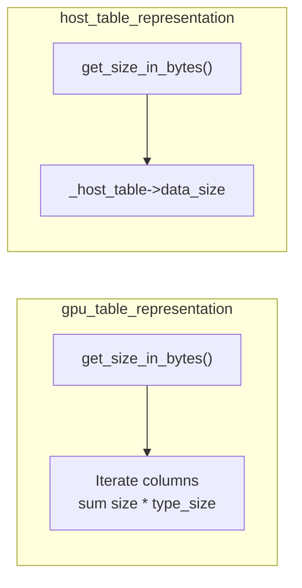
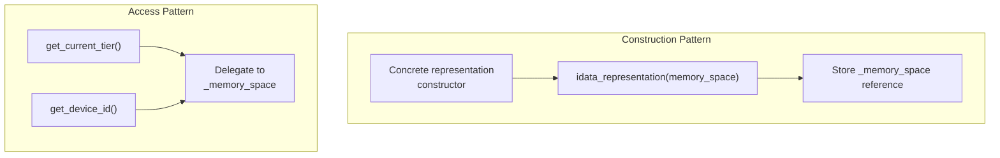
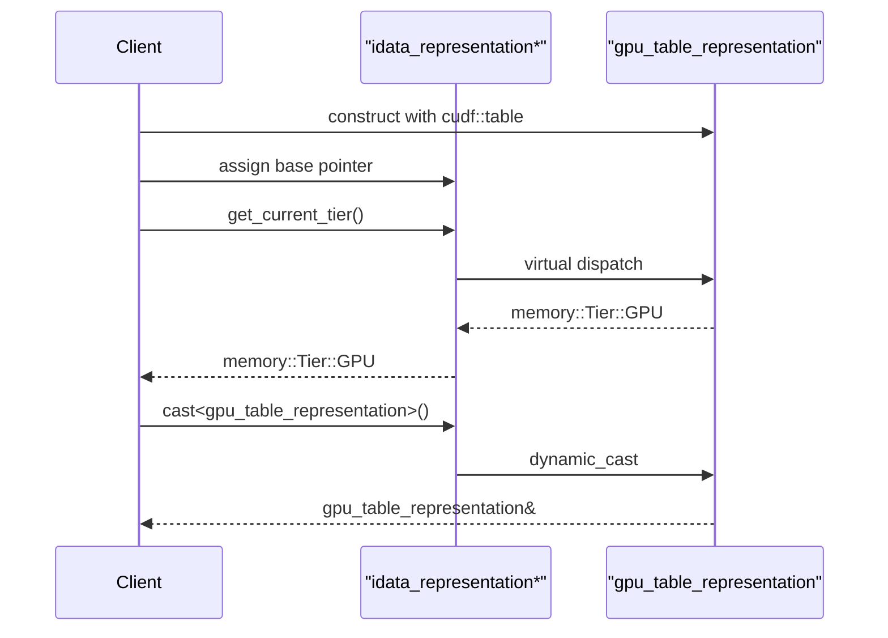
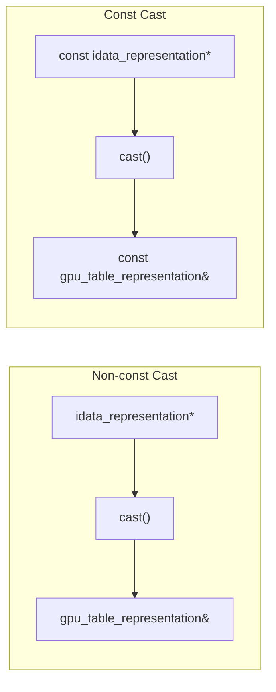
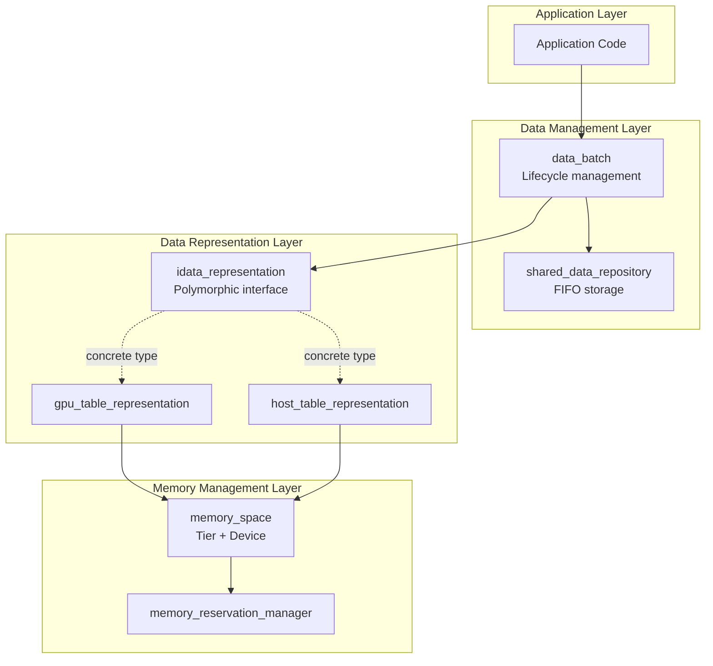
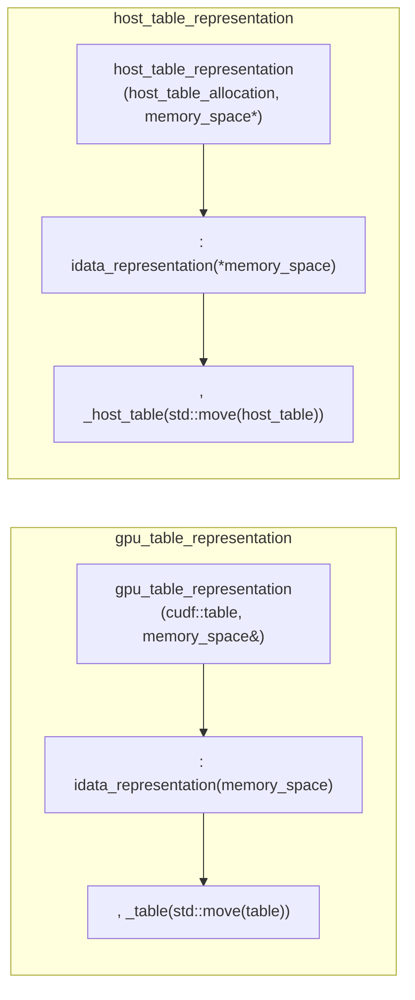

<!-- source: DeepWiki mcp.deepwiki.com · repo NVIDIA/cuCascade · page 5.1 Data Representation Interface · fetched 2026-10-26 -->

# Data Representation Interface

Relevant source files

The following files were used as context for generating this wiki page:

- [include/data/cpu_data_representation.hpp](include/data/cpu_data_representation.hpp)
- [include/data/gpu_data_representation.hpp](include/data/gpu_data_representation.hpp)
- [src/data/cpu_data_representation.cpp](src/data/cpu_data_representation.cpp)
- [src/data/gpu_data_representation.cpp](src/data/gpu_data_representation.cpp)
- [test/data/test_data_representation.cpp](test/data/test_data_representation.cpp)

## Purpose and Scope

This document describes the `idata_representation` abstract interface, which defines the polymorphic abstraction for data stored in different memory tiers and formats within cuCascade. This interface enables type-erasure of the underlying storage format while providing unified access to metadata such as memory tier, device ID, and size.

For details on specific implementations, see [GPU Table Representation](#5.2) and [Host Table Representation](#5.3). For information on converting between representations, see [Representation Converters](#5.4).

**Sources:** [include/data/cpu_data_representation.hpp:1-70](), [include/data/gpu_data_representation.hpp:1-69](), [test/data/test_data_representation.cpp:309-347]()

## Interface Architecture

The `idata_representation` interface serves as the abstract base class for all data representation types in cuCascade. It provides a polymorphic abstraction over heterogeneous data storage formats while maintaining association with the memory tier where the data resides.

### Class Hierarchy

**Sources:** [include/data/cpu_data_representation.hpp:37-67](), [include/data/gpu_data_representation.hpp:41-66](), [src/data/cpu_data_representation.cpp:22-27](), [src/data/gpu_data_representation.cpp:24-28]()

## Core Interface Methods

The `idata_representation` interface defines the following essential methods that all concrete implementations must provide:

| Method | Return Type | Purpose |
|--------|-------------|---------|
| `get_size_in_bytes()` | `std::size_t` | Returns the total memory footprint of the representation in bytes |
| `get_current_tier()` | `memory::Tier` | Returns the memory tier (GPU/HOST/DISK) where data resides |
| `get_device_id()` | `int` | Returns the device ID for GPU representations, or NUMA node for HOST |
| `cast<T>()` | `T&` | Type-safe downcast to concrete representation type |

### Size Calculation

Each representation type implements `get_size_in_bytes()` to report its memory footprint:

- **GPU representations** calculate size based on cuDF table column buffers (data, validity, offsets)
- **Host representations** track size via the `host_table_allocation::data_size` field

**Sources:** [src/data/gpu_data_representation.cpp:30-41](), [src/data/cpu_data_representation.cpp:29]()

## Memory Space Association

Every `idata_representation` instance maintains a reference to its associated `memory_space`, which determines:

- The memory tier (GPU, HOST, or DISK)
- The device ID or NUMA node
- The memory allocator used for conversions
- Available CUDA streams for asynchronous operations

### Memory Space Binding

The memory space is provided during construction and remains immutable for the lifetime of the representation:

- **GPU representations**: Pass `memory_space&` by reference
- **Host representations**: Pass `memory_space*` by pointer

**Sources:** [src/data/gpu_data_representation.cpp:24-28](), [src/data/cpu_data_representation.cpp:22-27]()

## Polymorphic Design Pattern

The `idata_representation` interface enables polymorphic handling of data across different memory tiers and formats. This design supports:

1. **Type Erasure**: Store heterogeneous representations in containers using base pointers
2. **Uniform Metadata Access**: Query size, tier, and device without knowing concrete type
3. **Conversion Pipeline**: Pass representations through converters without static type knowledge
4. **Dynamic Dispatch**: Select appropriate processing paths based on runtime tier information

### Polymorphic Usage Example

The following test demonstrates polymorphic usage through base class pointers:

**Sources:** [test/data/test_data_representation.cpp:309-327]()

## Type-Safe Downcasting

The `cast<T>()` method provides type-safe downcasting from the base `idata_representation` interface to concrete representation types. This method is used when:

- Converting representations requires access to format-specific data
- Processing operations need the underlying storage (e.g., `cudf::table`)
- Test code validates representation types

### Cast Method Signatures

The interface provides both non-const and const overloads:

### Cast Usage Pattern

The cast operation is commonly used in conversion operations and processing handles:

| Scenario | Pattern |
|----------|---------|
| **Converter Access** | `auto& gpu_repr = source.cast<gpu_table_representation>()` |
| **Table Extraction** | `const cudf::table& table = repr.cast<gpu_table_representation>().get_table()` |
| **Host Block Access** | `auto& allocation = repr.cast<host_table_representation>().get_host_table()` |

**Sources:** [test/data/test_data_representation.cpp:319-326](), [test/data/test_data_representation.cpp:340-346]()

## Integration with Data Management Layer

The `idata_representation` interface integrates with the data management subsystem to enable:

- **Data Batches**: Wrap representations with processing state and lifecycle management (see [Data Batch](#6.1))
- **Repositories**: Store batches containing representations in FIFO queues (see [Data Repository](#6.2))
- **Converters**: Transform representations between tiers and formats (see [Representation Converters](#5.4))

### Data Flow Through Abstractions

**Sources:** [test/data/test_data_representation.cpp:78-133](), [test/data/test_data_representation.cpp:232-254]()

## Implementation Requirements

Concrete implementations of `idata_representation` must:

1. **Invoke Base Constructor**: Pass `memory_space` reference to base class during construction
2. **Override get_size_in_bytes()**: Provide accurate memory footprint calculation
3. **Manage Ownership**: Ensure proper lifetime of underlying data (e.g., `cudf::table`, `host_table_allocation`)
4. **Support Const Access**: Enable const operations on immutable representations

### Constructor Pattern

Both concrete representations follow this initialization pattern:

**Sources:** [src/data/gpu_data_representation.cpp:24-28](), [src/data/cpu_data_representation.cpp:22-27]()

## Thread Safety Considerations

The `idata_representation` interface itself does not provide thread-safety guarantees. Thread-safe access is managed at higher layers:

- **data_batch**: Provides processing state tracking and prevents concurrent mutations (see [Data Batch](#6.1))
- **processing_handle**: RAII wrapper ensures exclusive access during processing
- **Const Methods**: `get_size_in_bytes()`, `get_current_tier()`, and `get_device_id()` are safe for concurrent reads

Applications should not directly mutate representations held by active data batches. Instead, conversions create new representation instances.

**Sources:** [test/data/test_data_representation.cpp:139-254]()

---

