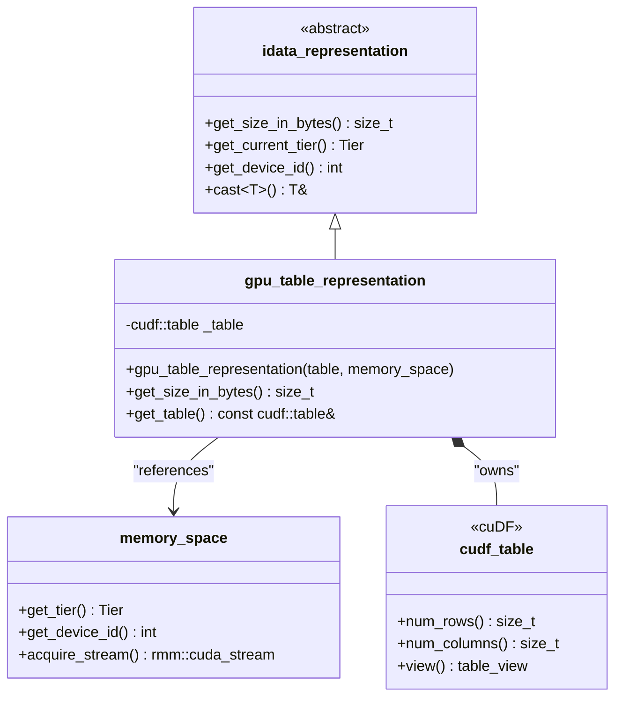
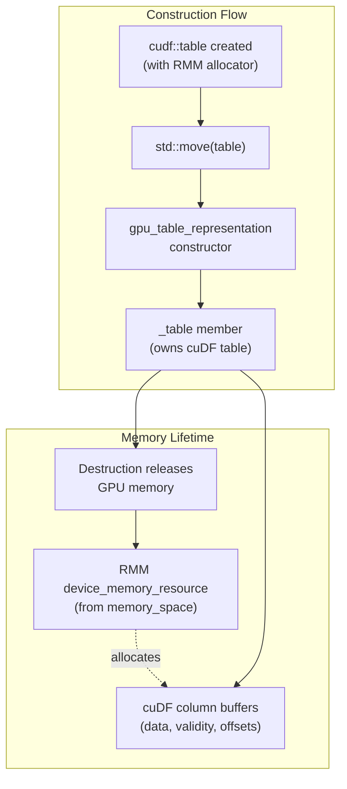
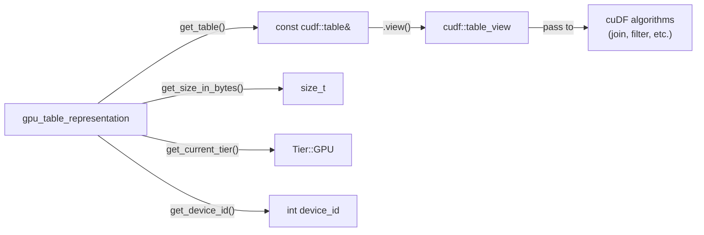
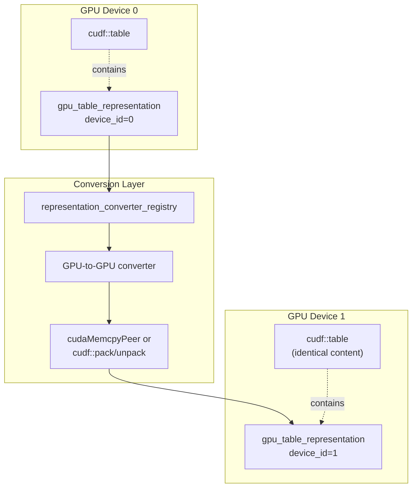

<!-- source: DeepWiki mcp.deepwiki.com · repo NVIDIA/cuCascade · page 5.2 GPU Table Representation · fetched 2026-10-26 -->

# GPU Table Representation

<details>
<summary>Relevant source files</summary>

The following files were used as context for generating this wiki page:

- [include/data/cpu_data_representation.hpp](include/data/cpu_data_representation.hpp)
- [include/data/gpu_data_representation.hpp](include/data/gpu_data_representation.hpp)
- [src/data/cpu_data_representation.cpp](src/data/cpu_data_representation.cpp)
- [src/data/gpu_data_representation.cpp](src/data/gpu_data_representation.cpp)
- [test/data/test_data_representation.cpp](test/data/test_data_representation.cpp)

</details>


## Purpose and Scope

This document describes the `gpu_table_representation` class, which provides a concrete implementation of the data representation interface for tabular data stored in GPU memory. This class wraps cuDF tables and integrates them with cuCascade's memory management system.

For information about the abstract interface that this class implements, see [Data Representation Interface](#5.1). For the host memory equivalent, see [Host Table Representation](#5.3). For details on converting between representations, see [Representation Converters](#5.4).

**Sources:** [include/data/gpu_data_representation.hpp:30-40]()

## Class Overview

The `gpu_table_representation` class serves as the primary data container for GPU-resident tabular data in cuCascade. It wraps a `cudf::table` object and associates it with a specific `memory_space`, enabling integration between cuDF's GPU dataframe capabilities and cuCascade's heterogeneous memory management system.



**Diagram: Class Structure of gpu_table_representation**

**Sources:** [include/data/gpu_data_representation.hpp:41-66](), [src/data/gpu_data_representation.cpp:24-28]()

## Construction and Ownership

### Constructor

The `gpu_table_representation` constructor takes ownership of a `cudf::table` by move semantics and associates it with a `memory_space`:

```cpp
gpu_table_representation(cudf::table table, cucascade::memory::memory_space& memory_space);
```

The constructor:
1. Moves the provided `cudf::table` into internal storage
2. Stores a reference to the associated `memory_space`
3. Initializes the base `idata_representation` with the memory space

**Sources:** [include/data/gpu_data_representation.hpp:43-48](), [src/data/gpu_data_representation.cpp:24-28]()

### Ownership Semantics

The `gpu_table_representation` takes full ownership of the cuDF table. The table's underlying GPU memory allocations are managed by the memory resource associated with the `memory_space`. This design ensures that:

- The table's lifetime is tied to the representation object
- Memory is properly tracked by cuCascade's memory management system
- The table can be safely passed to cuDF operations without additional copying



**Diagram: Construction and Memory Ownership Flow**

**Sources:** [src/data/gpu_data_representation.cpp:24-28](), [test/data/test_data_representation.cpp:139-149]()

## Integration with Memory Spaces

Each `gpu_table_representation` is associated with a specific `memory_space` that identifies:

| Property | Accessor | Description |
|----------|----------|-------------|
| Memory Tier | `get_current_tier()` | Always returns `memory::Tier::GPU` |
| Device ID | `get_device_id()` | GPU device index (0, 1, 2, etc.) |
| Memory Resource | Via `memory_space` | RMM-based allocator for GPU memory |

The memory space association enables:
- Tracking which GPU device owns the data
- Acquiring appropriate CUDA streams for operations
- Allocating new GPU memory from the correct resource
- Converting data between different memory tiers

**Sources:** [test/data/test_data_representation.cpp:199-230]()

## Size Calculation

### Current Implementation

The `get_size_in_bytes()` method calculates the total memory footprint of the table by iterating over all columns and summing their sizes:

```cpp
std::size_t get_size_in_bytes() const {
    std::size_t total_size = 0;
    for (auto const& col : _table.view()) {
        total_size += static_cast<std::size_t>(col.size()) * cudf::size_of(col.type());
    }
    return total_size;
}
```

This calculation:
- Iterates over each column in the table
- Multiplies row count by the size of the column's data type
- Returns zero for empty tables

**Sources:** [src/data/gpu_data_representation.cpp:30-41]()

### Known Limitations

The current implementation provides a rough estimate and does not account for:
- Validity (null) masks
- Offset buffers (for variable-length types like strings)
- Child column buffers (for nested types)
- cuDF's internal metadata structures

The source code contains a TODO comment noting this limitation. Future implementations should use more comprehensive size calculation methods.

**Sources:** [src/data/gpu_data_representation.cpp:32-38]()

### Size Validation Tests

The test suite validates size calculations for various scenarios:

| Test Scenario | Expected Minimum Size | Notes |
|---------------|----------------------|-------|
| 100 rows, 2 columns (INT32, INT64) | 1,200 bytes | 100 × (4 + 8) |
| 1000 rows, 2 columns (INT32, INT64) | 12,000 bytes | 1000 × (4 + 8) |
| Empty table | 0 bytes | No data allocated |
| Single INT32 column, 100 rows | 400 bytes | 100 × 4 |
| Multi-type (INT8, INT16, INT32, INT64) | 1,500 bytes | 100 × (1 + 2 + 4 + 8) |

**Sources:** [test/data/test_data_representation.cpp:151-182](), [test/data/test_data_representation.cpp:386-437]()

## Accessing Table Data

### Direct Table Access

The `get_table()` method provides const access to the underlying cuDF table:

```cpp
const cudf::table& get_table() const;
```

This method returns a const reference, allowing:
- Passing the table directly to cuDF algorithms
- Inspecting table metadata (row count, column count, schema)
- Creating table views for operations
- Zero-copy access to the data

**Sources:** [include/data/gpu_data_representation.hpp:57-62](), [src/data/gpu_data_representation.cpp:43](), [test/data/test_data_representation.cpp:184-197]()

### Usage Pattern



**Diagram: Accessing GPU Table Data**

**Sources:** [test/data/test_data_representation.cpp:184-197](), [test/data/test_data_representation.cpp:232-254]()

## Cross-Device Operations

### GPU-to-GPU Conversion

When multiple GPUs are available, `gpu_table_representation` supports peer-to-peer transfers between devices through the converter system. The representation can be converted from one GPU device to another while preserving table contents.



**Diagram: Cross-Device GPU Table Transfer**

The conversion process:
1. Source `gpu_table_representation` on device A provides its table
2. Converter serializes the table (via `cudf::pack`)
3. Data is copied to device B (via peer-to-peer or through host)
4. Table is reconstructed on device B (via `cudf::unpack`)
5. New `gpu_table_representation` is created on device B

**Sources:** [test/data/test_data_representation.cpp:269-304]()

## Round-Trip Conversion Guarantees

The test suite validates that GPU table contents are preserved through conversion cycles:

### GPU → HOST → GPU Round-Trip

A `gpu_table_representation` can be converted to host memory and back to GPU without data loss:

1. Original GPU table on device 0
2. Convert to `host_table_representation` (serialized via `cudf::pack`)
3. Convert back to `gpu_table_representation` on device 0
4. Content comparison confirms identical data

This round-trip guarantee ensures that:
- No precision is lost during serialization
- Null masks are preserved
- Column types and metadata remain intact
- Table structure is maintained

**Sources:** [test/data/test_data_representation.cpp:232-254]()

## Type Support and Column Varieties

### Supported Column Types

The `gpu_table_representation` supports all cuDF column types through its underlying `cudf::table`. Tests validate behavior with:

- **Fixed-width numeric types**: INT8, INT16, INT32, INT64
- **Single-column tables**: Minimal data structures
- **Multi-column tables**: Heterogeneous type combinations
- **Empty tables**: Zero rows, defined schema

**Sources:** [test/data/test_data_representation.cpp:386-437]()

### Column Configuration Examples

| Configuration | Columns | Rows | Characteristics |
|---------------|---------|------|-----------------|
| Simple table | INT32, INT64 | 100-1000 | Basic test case |
| Single column | INT32 | 100 | Minimal structure |
| Multi-type | INT8, INT16, INT32, INT64 | 100 | Type heterogeneity |
| Empty | INT32, INT64 | 0 | Schema without data |

**Sources:** [test/data/test_data_representation.cpp:151-182](), [test/data/test_data_representation.cpp:386-437]()

## Polymorphic Access Patterns

### Type Casting

The `gpu_table_representation` inherits polymorphic casting from `idata_representation`:

```cpp
idata_representation* base_ptr = &gpu_repr;
gpu_table_representation& casted = base_ptr->cast<gpu_table_representation>();
```

This enables:
- Runtime type identification
- Safe downcasting from base interface
- Type-specific method access after casting

Both mutable and const variants are supported:

```cpp
const idata_representation* const_base_ptr = &gpu_repr;
const gpu_table_representation& const_casted = 
    const_base_ptr->cast<gpu_table_representation>();
```

**Sources:** [test/data/test_data_representation.cpp:309-347]()

## Integration with cuDF Ecosystem

### Memory Allocator Integration

GPU tables are allocated using RMM (RAPIDS Memory Manager) memory resources provided by the associated `memory_space`. This integration ensures:

- All GPU allocations are tracked by cuCascade's memory management
- Memory limits can be enforced across the system
- Stream-ordered allocations are properly managed
- Allocations can be attributed to specific memory spaces

### Stream-Aware Operations

When performing conversions or operations on `gpu_table_representation`, CUDA streams are acquired from the associated `memory_space`:

```cpp
auto stream = gpu_space->acquire_stream();
auto packed = cudf::pack(table.view(), stream.view());
```

This ensures:
- Asynchronous operation execution
- Proper synchronization points
- Stream-ordered memory operations
- Efficient GPU utilization

**Sources:** [test/data/test_data_representation.cpp:78-133](), [test/data/test_data_representation.cpp:232-254]()

## Usage Examples from Tests

### Basic Construction and Access

```cpp
// Create GPU table representation with mock memory space
mock_memory_space gpu_space(memory::Tier::GPU, 0);
auto table = create_simple_cudf_table(100);
gpu_table_representation repr(std::move(table), gpu_space);

// Access properties
REQUIRE(repr.get_current_tier() == memory::Tier::GPU);
REQUIRE(repr.get_device_id() == 0);
REQUIRE(repr.get_size_in_bytes() > 0);

// Access underlying table
const cudf::table& retrieved = repr.get_table();
```

**Sources:** [test/data/test_data_representation.cpp:139-149]()

### Multi-Device Scenario

```cpp
// Create manager with multiple GPU spaces
auto mgr = create_multi_gpu_manager(dev_src, dev_dst);
representation_converter_registry registry;
register_builtin_converters(registry);

// Get memory spaces for both devices
const memory::memory_space* src_space = mgr->get_memory_space(memory::Tier::GPU, dev_src);
const memory::memory_space* dst_space = mgr->get_memory_space(memory::Tier::GPU, dev_dst);

// Create representation on source device
auto table = create_simple_cudf_table(256);
gpu_table_representation src_repr(std::move(table), *src_space);

// Convert to destination device
auto xfer_stream = src_space->acquire_stream();
auto dst_any = registry.convert<gpu_table_representation>(src_repr, dst_space, xfer_stream);
```

**Sources:** [test/data/test_data_representation.cpp:269-304]()

## Key Design Considerations

### Memory Ownership

The `gpu_table_representation` owns the cuDF table, which in turn owns its GPU memory allocations. This clear ownership hierarchy prevents:
- Memory leaks through proper RAII semantics
- Use-after-free errors
- Double-free issues
- Unclear allocation responsibilities

### Zero-Copy Philosophy

The class provides direct access to the underlying cuDF table via `get_table()`, enabling zero-copy integration with cuDF operations. Data processing code can:
- Pass the table directly to cuDF algorithms
- Avoid unnecessary memory copies
- Maintain GPU residency throughout operations
- Minimize CPU-GPU transfers

### Type Safety

By wrapping a strongly-typed `cudf::table`, the representation maintains type safety while providing polymorphic access through the `idata_representation` interface. The `cast<>` method enables safe runtime type identification and downcasting.

**Sources:** [include/data/gpu_data_representation.hpp:30-40](), [src/data/gpu_data_representation.cpp:24-28]()

---

