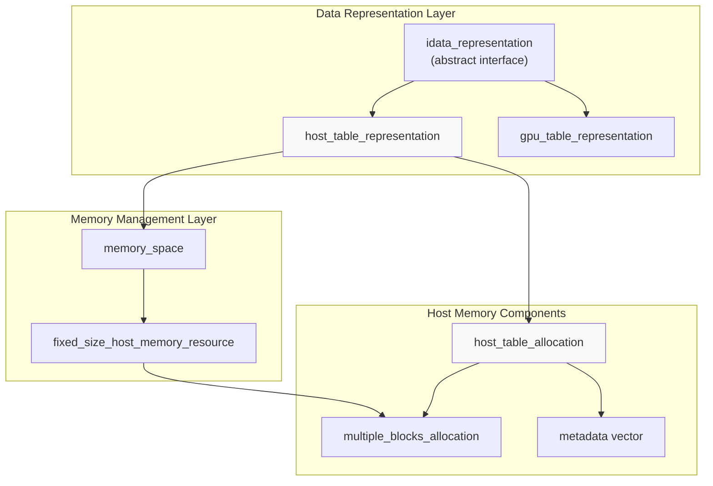
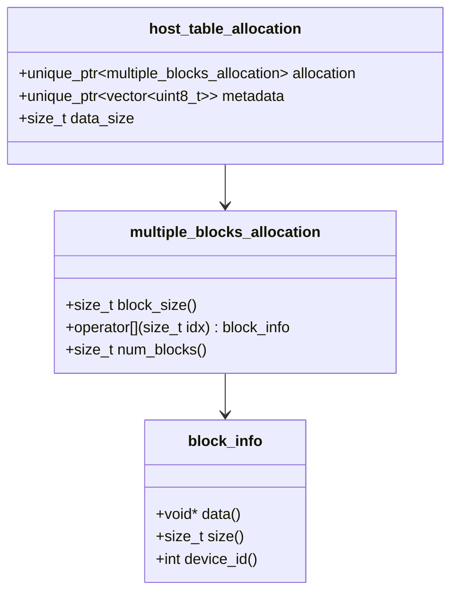
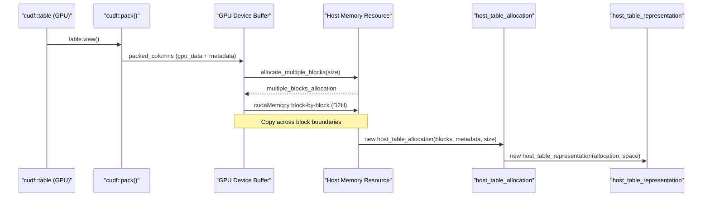
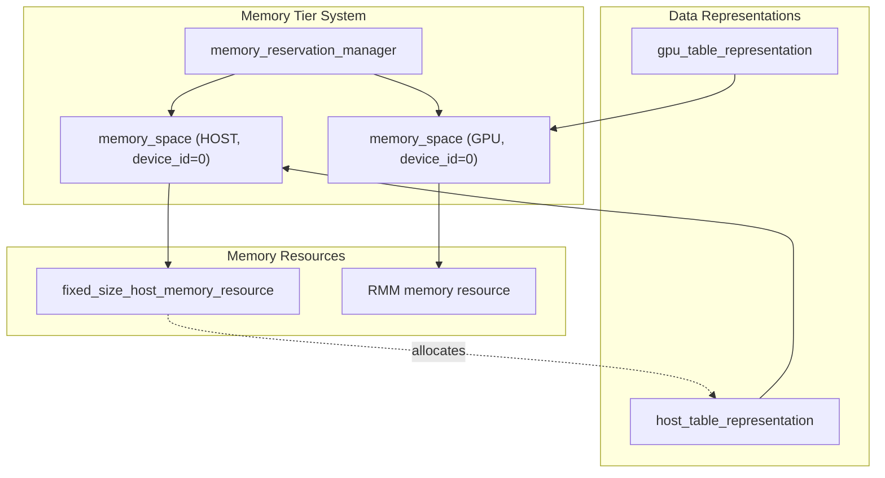

<!-- source: DeepWiki mcp.deepwiki.com · repo NVIDIA/cuCascade · page 5.3 Host Table Representation · fetched 2026-10-26 -->

# Host Table Representation

<details>
<summary>Relevant source files</summary>

The following files were used as context for generating this wiki page:

- [include/data/cpu_data_representation.hpp](include/data/cpu_data_representation.hpp)
- [include/data/gpu_data_representation.hpp](include/data/gpu_data_representation.hpp)
- [src/data/cpu_data_representation.cpp](src/data/cpu_data_representation.cpp)
- [src/data/gpu_data_representation.cpp](src/data/gpu_data_representation.cpp)
- [test/data/test_data_representation.cpp](test/data/test_data_representation.cpp)

</details>


## Purpose and Scope

This document describes the `host_table_representation` class, which provides CPU memory storage for tabular data within cuCascade's data representation layer. This class enables data to reside in host (CPU) memory using a block-based allocation strategy managed by the fixed-size host memory resource.

For information about the abstract data representation interface, see [Data Representation Interface](#5.1). For GPU memory storage, see [GPU Table Representation](#5.2). For conversion operations between host and GPU representations, see [Representation Converters](#5.4).

**Sources:** [include/data/cpu_data_representation.hpp:1-70]()

## Overview

The `host_table_representation` class wraps a `host_table_allocation` structure that stores serialized cuDF table data in host memory. Unlike GPU tables that maintain cuDF's native column format, host tables store data in a packed, serialized format across multiple fixed-size memory blocks. This design accommodates the host memory allocator's block-based allocation strategy and enables efficient memory management for data residing in CPU memory.



**Diagram: Host Table Representation Architecture**

**Sources:** [include/data/cpu_data_representation.hpp:30-48](), [include/memory/host_table.hpp:1-70]()

## Class Definition

The `host_table_representation` class inherits from `idata_representation` and provides a minimal interface focused on wrapping the underlying host allocation:

| Method | Return Type | Description |
|--------|-------------|-------------|
| Constructor | - | Initializes with `host_table_allocation` and `memory_space` |
| `get_size_in_bytes()` | `std::size_t` | Returns total data size from allocation |
| `get_host_table()` | `const std::unique_ptr<host_table_allocation>&` | Provides access to underlying allocation |

The class does not directly manage memory; instead, it serves as a typed wrapper around the `host_table_allocation` structure that owns the actual data blocks.

**Sources:** [include/data/cpu_data_representation.hpp:37-67](), [src/data/cpu_data_representation.cpp:22-35]()

## Host Table Allocation Structure

The `host_table_allocation` structure encapsulates three components:

1. **Block allocation**: A `multiple_blocks_allocation` containing the serialized table data
2. **Metadata**: A vector of bytes containing cuDF metadata for unpacking
3. **Data size**: Total size of the serialized data in bytes



**Diagram: host_table_allocation Structure**

The `multiple_blocks_allocation` manages a collection of fixed-size memory blocks allocated from the host memory resource. Each block is independently allocated but collectively represents the contiguous serialized table data.

**Sources:** [include/memory/host_table.hpp:1-70](), [test/data/test_data_representation.cpp:98-117]()

## Block-Based Memory Layout

Host table data is distributed across multiple fixed-size blocks due to the allocation strategy of `fixed_size_host_memory_resource`. When a cuDF table is serialized using `cudf::pack()`, the resulting contiguous device buffer must be copied to host memory. This copying occurs block-by-block:

```mermaid
graph LR
    subgraph "Packed GPU Data"
        GPU_BUF["Contiguous GPU buffer<br/>size: N bytes"]
    end
    
    subgraph "Host Memory Blocks"
        BLOCK0["Block 0<br/>size: B bytes"]
        BLOCK1["Block 1<br/>size: B bytes"]
        BLOCKN["Block N<br/>size: remainder"]
    end
    
    GPU_BUF -.copy 0 to B.-> BLOCK0
    GPU_BUF -.copy B to 2B.-> BLOCK1
    GPU_BUF -.copy ... to N.-> BLOCKN
```

**Diagram: Block-Based Copy Process**

The copying algorithm handles the block boundaries:

```
copied = 0
block_idx = 0
block_offset = 0

while copied < total_size:
    remaining = total_size - copied
    bytes_to_copy = min(remaining, block_size - block_offset)
    
    dst_ptr = block[block_idx].data() + block_offset
    cudaMemcpy(dst_ptr, src_ptr + copied, bytes_to_copy, DeviceToHost)
    
    copied += bytes_to_copy
    block_offset += bytes_to_copy
    
    if block_offset == block_size:
        block_offset = 0
        block_idx++
```

**Sources:** [test/data/test_data_representation.cpp:98-117]()

## Construction Process

Creating a `host_table_representation` requires several steps, typically performed during conversion from GPU to host:



**Diagram: Host Table Representation Construction Flow**

The key steps are:

1. **Packing**: Use `cudf::pack()` to serialize the GPU table into a contiguous format
2. **Allocation**: Request blocks from `fixed_size_host_memory_resource`
3. **Transfer**: Copy data from GPU to host blocks using `cudaMemcpy`
4. **Metadata**: Copy the cuDF metadata vector to host memory
5. **Wrapping**: Construct `host_table_allocation` with blocks, metadata, and size
6. **Representation**: Wrap the allocation in `host_table_representation`

**Sources:** [test/data/test_data_representation.cpp:89-123](), [src/data/representation_converter.cpp:1-200]()

## Memory Size Calculation

The `get_size_in_bytes()` method returns the total data size from the underlying allocation:

```cpp
std::size_t host_table_representation::get_size_in_bytes() const { 
    return _host_table->data_size; 
}
```

This size represents only the serialized table data, not including:
- Metadata overhead
- Block allocation overhead
- Internal pointers or structures

The size matches the original packed GPU buffer size before transfer to host memory.

**Sources:** [src/data/cpu_data_representation.cpp:29](), [include/data/cpu_data_representation.hpp:54]()

## Metadata Storage

The metadata component of `host_table_allocation` contains the serialized schema and structural information required by `cudf::unpack()` to reconstruct the table. This metadata includes:

- Column types and hierarchy
- Null mask information
- String column offsets
- Nested column structure

The metadata is stored as a `std::unique_ptr<std::vector<uint8_t>>` copied from the `packed_columns::metadata` returned by `cudf::pack()`. During conversion back to GPU, this metadata is passed to `cudf::unpack()` along with the reconstructed contiguous device buffer.

**Sources:** [test/data/test_data_representation.cpp:119-121]()

## Integration with Memory Spaces

The `host_table_representation` associates with a `memory_space` object that manages the HOST tier:



**Diagram: Memory Space Integration**

The memory space provides:
- Access to the `fixed_size_host_memory_resource` for allocation
- Device ID information (always 0 for HOST tier)
- Tier identification (`memory::Tier::HOST`)

**Sources:** [include/data/cpu_data_representation.hpp:46-47](), [src/data/cpu_data_representation.cpp:22-27]()

## Conversion Operations

Host table representations participate in two primary conversion scenarios:

### Host to GPU Conversion

When converting from host to GPU memory:

1. Reconstruct contiguous device buffer from blocks
2. Transfer data from host blocks to GPU memory
3. Use `cudf::unpack()` with metadata to create `cudf::table`
4. Wrap result in `gpu_table_representation`

### GPU to Host Conversion  

The reverse operation (shown in construction process):

1. Use `cudf::pack()` on GPU table
2. Allocate host blocks
3. Transfer packed data to blocks
4. Create `host_table_allocation` with blocks and metadata
5. Wrap in `host_table_representation`

**Sources:** [test/data/test_data_representation.cpp:78-133](), [test/data/test_data_representation.cpp:232-254]()

## Example: Creating a Host Representation

The following test demonstrates the complete process:

```cpp
// Start with cuDF table on GPU
auto original = create_simple_cudf_table(128);
auto packed = cudf::pack(original.view(), stream);

// Allocate host blocks
auto host_mr = host_space->get_memory_resource_as<fixed_size_host_memory_resource>();
auto allocation = host_mr->allocate_multiple_blocks(packed.gpu_data->size());

// Copy GPU data to host blocks
size_t copied = 0;
size_t block_idx = 0;
size_t block_offset = 0;
while (copied < packed.gpu_data->size()) {
    size_t bytes = std::min(remain, block_size - block_offset);
    void* dst = (*allocation)[block_idx].data() + block_offset;
    cudaMemcpy(dst, packed.gpu_data->data() + copied, bytes, cudaMemcpyDeviceToHost);
    // ... update counters ...
}

// Create allocation wrapper
auto meta_copy = std::make_unique<std::vector<uint8_t>>(*packed.metadata);
auto host_alloc = std::make_unique<host_table_allocation>(
    std::move(allocation), std::move(meta_copy), packed.gpu_data->size());

// Wrap in representation
host_table_representation repr(std::move(host_alloc), host_space);
```

**Sources:** [test/data/test_data_representation.cpp:89-123]()

## Thread Safety Considerations

The `host_table_representation` itself is not thread-safe. Concurrent access must be coordinated through the `data_batch` processing state mechanism, which prevents simultaneous modification during active processing. The underlying memory blocks are immutable once allocated, but the representation should not be accessed from multiple threads without synchronization.

For concurrent access patterns and locking mechanisms, see [Thread Safety and Concurrency](#8.1).

**Sources:** [include/data/cpu_data_representation.hpp:30-67]()

---

