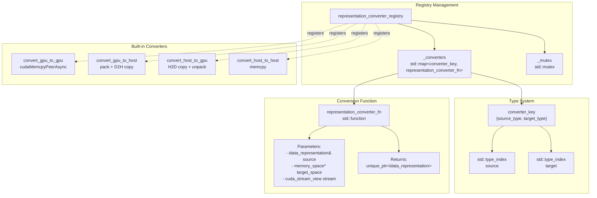
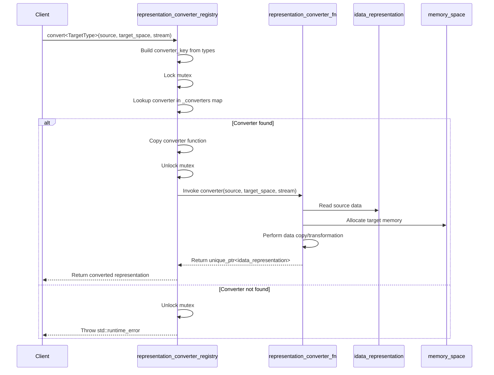
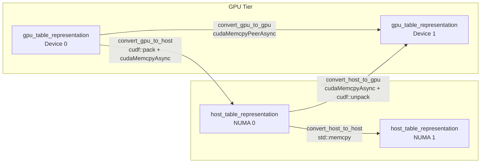
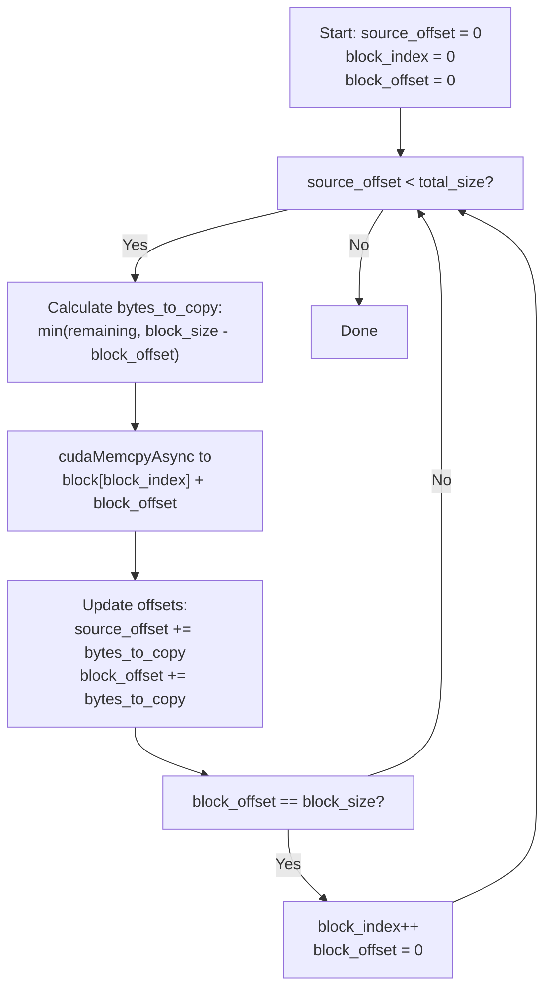
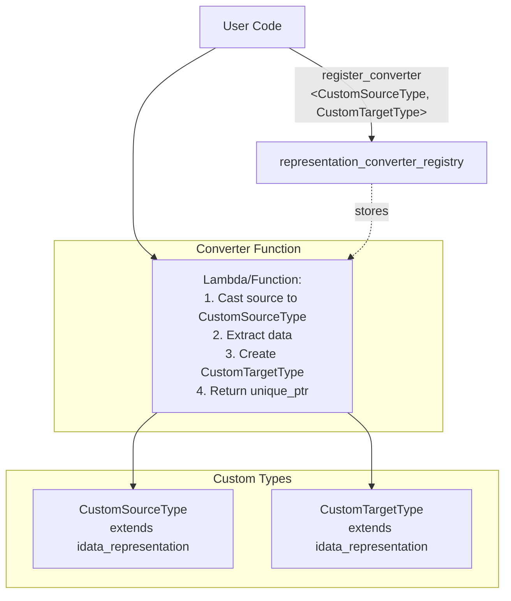

<!-- source: DeepWiki mcp.deepwiki.com · repo NVIDIA/cuCascade · page 5.4 Representation Converters · fetched 2026-10-26 -->

# Representation Converters

<details>
<summary>Relevant source files</summary>

The following files were used as context for generating this wiki page:

- [src/data/representation_converter.cpp](src/data/representation_converter.cpp)
- [test/data/test_representation_converter.cpp](test/data/test_representation_converter.cpp)

</details>


## Purpose and Scope

This document describes the **representation converter system** in cuCascade, which enables data movement between different memory tiers (GPU ↔ HOST) and across different devices (GPU-to-GPU, HOST-to-HOST). The converter system provides a registry-based architecture for registering, discovering, and invoking conversion functions that transform data between different representation types.

For information about the representation types themselves, see [Data Representation Interface](#5.1), [GPU Table Representation](#5.2), and [Host Table Representation](#5.3). For details on the serialization mechanisms used during conversions, see [Data Packing and Serialization](#5.5).

---

## Architecture Overview

The representation converter system is built around a **registry pattern** that maps pairs of source and target representation types to conversion functions. The system provides both compile-time type safety through templates and runtime flexibility through type erasure using `std::type_index`.

### Converter Registry Architecture



**Sources:** [src/data/representation_converter.cpp:37-106](), [test/data/test_representation_converter.cpp:77-118]()

### Conversion Flow



**Sources:** [src/data/representation_converter.cpp:62-94](), [test/data/test_representation_converter.cpp:249-283]()

---

## Registry Interface

The `representation_converter_registry` class provides the central interface for managing and invoking converters.

### Core Methods

| Method | Template Parameters | Description |
|--------|---------------------|-------------|
| `register_converter<Source, Target>()` | Source, Target types | Registers a conversion function for a type pair |
| `has_converter<Source, Target>()` | Source, Target types | Checks if a converter exists (compile-time) |
| `has_converter_for<Target>()` | Target type | Checks if a converter exists for a source instance (runtime) |
| `convert<Target>()` | Target type | Converts a source instance to target type |
| `convert()` | None (runtime) | Converts using `std::type_index` for target type |
| `unregister_converter<Source, Target>()` | Source, Target types | Removes a registered converter |
| `clear()` | None | Removes all registered converters |

**Sources:** [src/data/representation_converter.cpp:41-106](), [test/data/test_representation_converter.cpp:120-162]()

### Thread Safety

All registry operations are protected by an internal `std::mutex` to ensure thread-safe registration, lookup, and conversion operations. The mutex is acquired during:
- Converter registration ([src/data/representation_converter.cpp:44]())
- Converter lookup ([src/data/representation_converter.cpp:58]())
- Converter retrieval for conversion ([src/data/representation_converter.cpp:70]())
- Converter unregistration ([src/data/representation_converter.cpp:98]())

The converter function itself is copied outside the lock to minimize lock contention during the actual conversion operation.

**Sources:** [src/data/representation_converter.cpp:44-80]()

### Registration Example

```cpp
// From test code demonstrating custom converter registration
registry.register_converter<custom_test_representation, another_test_representation>(
  [](idata_representation& source,
     const memory::memory_space* target_space,
     rmm::cuda_stream_view stream) -> std::unique_ptr<idata_representation> {
    auto& src = source.cast<custom_test_representation>();
    return std::make_unique<another_test_representation>(
      static_cast<double>(src.get_value()), 
      *const_cast<memory::memory_space*>(target_space));
  });
```

**Sources:** [test/data/test_representation_converter.cpp:85-93]()

---

## Built-in Converters

cuCascade provides four built-in converters registered via `register_builtin_converters()`:

### Converter Matrix

| Source Type | Target Type | Function | Mechanism |
|-------------|-------------|----------|-----------|
| `gpu_table_representation` | `gpu_table_representation` | `convert_gpu_to_gpu` | Peer-to-peer GPU copy |
| `gpu_table_representation` | `host_table_representation` | `convert_gpu_to_host` | Pack + device-to-host copy |
| `host_table_representation` | `gpu_table_representation` | `convert_host_to_gpu` | Host-to-device copy + unpack |
| `host_table_representation` | `host_table_representation` | `convert_host_to_host` | Host-to-host memcpy |

**Sources:** [src/data/representation_converter.cpp:314-331](), [test/data/test_representation_converter.cpp:323-348]()

### Built-in Converter Architecture



**Sources:** [src/data/representation_converter.cpp:117-311]()

---

## Conversion Mechanisms

### GPU-to-GPU Conversion

Cross-GPU conversion uses CUDA peer-to-peer memory transfers for efficient direct GPU-to-GPU copies.

**Implementation Steps:**
1. Pack source GPU table using `cudf::pack()` ([src/data/representation_converter.cpp:123]())
2. Acquire target GPU stream ([src/data/representation_converter.cpp:132]())
3. Allocate destination buffer on target GPU ([src/data/representation_converter.cpp:135]())
4. Perform peer copy with `cudaMemcpyPeerAsync()` ([src/data/representation_converter.cpp:141-146]())
5. Unpack on target GPU using `cudf::unpack()` ([src/data/representation_converter.cpp:154-156]())
6. Construct new `gpu_table_representation` ([src/data/representation_converter.cpp:161-162]())

**Key Operations:**
- Device switching: `cudaSetDevice(target_device_id)` ([src/data/representation_converter.cpp:134]())
- Peer transfer: `cudaMemcpyPeerAsync(dst, target_id, src, source_id, bytes, stream)` ([src/data/representation_converter.cpp:141-146]())
- Stream synchronization: `stream.synchronize()` ([src/data/representation_converter.cpp:147]())

**Sources:** [src/data/representation_converter.cpp:117-163]()

### GPU-to-HOST Conversion

GPU-to-HOST conversion serializes GPU data and copies it into fixed-size host memory blocks.

**Implementation Steps:**
1. Pack GPU table using `cudf::pack()` ([src/data/representation_converter.cpp:174]())
2. Allocate multiple host memory blocks ([src/data/representation_converter.cpp:177]())
3. Copy data block-by-block using `cudaMemcpyAsync()` ([src/data/representation_converter.cpp:179-199]())
4. Create `host_table_allocation` with metadata ([src/data/representation_converter.cpp:201-202]())
5. Construct `host_table_representation` ([src/data/representation_converter.cpp:203-204]())

**Block-based Copy Logic:**


**Sources:** [src/data/representation_converter.cpp:168-205](), [src/data/representation_converter.cpp:179-199]()

### HOST-to-GPU Conversion

HOST-to-GPU conversion reconstructs GPU tables from host memory blocks.

**Implementation Steps:**
1. Get host table allocation and data size ([src/data/representation_converter.cpp:215-217]())
2. Set target GPU device ([src/data/representation_converter.cpp:222]())
3. Allocate device buffer ([src/data/representation_converter.cpp:224]())
4. Copy from host blocks to device buffer ([src/data/representation_converter.cpp:225-245]())
5. Unpack metadata to reconstruct table ([src/data/representation_converter.cpp:247-251]())
6. Restore previous device ([src/data/representation_converter.cpp:254]())

**Block-to-Buffer Copy:**
- Iterates through source host blocks ([src/data/representation_converter.cpp:229]())
- Tracks position within each block using `src_block_offset` ([src/data/representation_converter.cpp:226]())
- Advances to next block when current block exhausted ([src/data/representation_converter.cpp:241-244]())
- Uses `cudaMemcpyAsync(..., cudaMemcpyHostToDevice, ...)` ([src/data/representation_converter.cpp:234-238]())

**Sources:** [src/data/representation_converter.cpp:210-257]()

### HOST-to-HOST Conversion

HOST-to-HOST conversion performs pure CPU memory copies between NUMA domains.

**Implementation Steps:**
1. Get source host table and data size ([src/data/representation_converter.cpp:267-269]())
2. Allocate target host memory blocks ([src/data/representation_converter.cpp:277]())
3. Perform block-to-block copy using `std::memcpy()` ([src/data/representation_converter.cpp:278-304]())
4. Copy metadata ([src/data/representation_converter.cpp:305]())
5. Construct target `host_table_representation` ([src/data/representation_converter.cpp:306-309]())

**Block-to-Block Copy Logic:**
- Handles potentially different block sizes in source and target ([src/data/representation_converter.cpp:282-283]())
- Copies smallest available chunk per iteration ([src/data/representation_converter.cpp:289]())
- Advances both source and destination block indices independently ([src/data/representation_converter.cpp:296-303]())
- Pure CPU operation, no CUDA calls required ([src/data/representation_converter.cpp:265]())

**Sources:** [src/data/representation_converter.cpp:262-310]()

---

## Custom Converters

Users can register custom converters for their own representation types.

### Converter Function Signature

```cpp
// Type alias from the codebase
using representation_converter_fn = std::function<std::unique_ptr<idata_representation>(
  idata_representation& source,
  const memory::memory_space* target_memory_space,
  rmm::cuda_stream_view stream)>;
```

### Registration Pattern



**Sources:** [test/data/test_representation_converter.cpp:77-118]()

### Custom Converter Example

From the test suite, a custom converter that transforms integer values to doubles:

```cpp
// Custom representation types
class custom_test_representation : public idata_representation {
  int _value;
  // ... implementation ...
};

class another_test_representation : public idata_representation {
  double _value;
  // ... implementation ...
};

// Register custom converter
registry.register_converter<custom_test_representation, another_test_representation>(
  [](idata_representation& source,
     const memory::memory_space* target_space,
     rmm::cuda_stream_view /*stream*/) -> std::unique_ptr<idata_representation> {
    auto& src = source.cast<custom_test_representation>();
    return std::make_unique<another_test_representation>(
      static_cast<double>(src.get_value() * 2), 
      *const_cast<memory::memory_space*>(target_space));
  });
```

**Sources:** [test/data/test_representation_converter.cpp:42-71](), [test/data/test_representation_converter.cpp:256-263]()

### Bidirectional Converters

Converters are unidirectional. To support bidirectional conversion, register both directions:

```cpp
// Forward: A -> B
registry.register_converter<TypeA, TypeB>(converter_a_to_b);

// Reverse: B -> A
registry.register_converter<TypeB, TypeA>(converter_b_to_a);
```

**Sources:** [test/data/test_representation_converter.cpp:464-504]()

---

## Error Handling

### Converter Not Found

When a converter is not registered for a requested type pair, `convert()` throws `std::runtime_error` with a descriptive message including type names:

```
No converter registered for source type '<source_type_name>' to target type '<target_type_name>'
```

**Sources:** [src/data/representation_converter.cpp:74-77](), [test/data/test_representation_converter.cpp:506-520]()

### Duplicate Registration

Attempting to register a converter that already exists throws `std::runtime_error`:

```
Converter already registered for source type '<source_type_name>' to target type '<target_type_name>'
```

**Sources:** [src/data/representation_converter.cpp:46-50](), [test/data/test_representation_converter.cpp:522-543]()

### Converter Unregistration

The `unregister_converter()` method returns a boolean:
- `true` if the converter was found and removed
- `false` if no converter existed for that type pair

**Sources:** [src/data/representation_converter.cpp:96-100](), [test/data/test_representation_converter.cpp:192-237]()

---

## Usage Patterns

### Compile-time Type Conversion

When target type is known at compile time, use the templated `convert()` method:

```cpp
// Type-safe conversion
auto host_repr = registry.convert<host_table_representation>(
  gpu_repr, host_space, stream);
```

**Sources:** [test/data/test_representation_converter.cpp:369]()

### Runtime Type Conversion

When target type is only known at runtime, use `std::type_index`:

```cpp
std::type_index target_type = typeid(host_table_representation);
auto result = registry.convert(source, target_type, target_space, stream);
```

**Sources:** [src/data/representation_converter.cpp:86-94](), [test/data/test_representation_converter.cpp:285-317]()

### Roundtrip Conversion

Converters preserve data integrity across roundtrip conversions (GPU→HOST→GPU):

```cpp
// Original GPU data
gpu_table_representation original_repr(table, gpu_space);

// Convert to host
auto host_repr = registry.convert<host_table_representation>(
  original_repr, host_space, stream);

// Convert back to GPU
auto result_repr = registry.convert<gpu_table_representation>(
  *host_repr, gpu_space, stream);

// Verify data integrity
expect_cudf_tables_equal_on_stream(
  original_repr.get_table(), 
  result_repr->get_table(), 
  stream);
```

**Sources:** [test/data/test_representation_converter.cpp:405-433]()

---

## Integration Points

### Memory Management Integration

Converters integrate with the memory management system through `memory_space` objects:
- Target memory allocation uses `target_memory_space->get_default_allocator()` ([src/data/representation_converter.cpp:129]())
- HOST allocations use `target_memory_space->get_memory_resource_as<fixed_size_host_memory_resource>()` ([src/data/representation_converter.cpp:176]())
- Target GPU streams acquired via `target_memory_space->acquire_stream()` ([src/data/representation_converter.cpp:132]())

**Sources:** [src/data/representation_converter.cpp:129-132](), [src/data/representation_converter.cpp:176]()

### Stream Management

All GPU operations are stream-ordered:
- Converters accept `rmm::cuda_stream_view` parameter ([src/data/representation_converter.cpp:66]())
- cuDF operations use provided stream ([src/data/representation_converter.cpp:123]())
- CUDA memory copies are asynchronous on stream ([src/data/representation_converter.cpp:188]())
- Stream synchronization ensures completion ([src/data/representation_converter.cpp:200]())

**Sources:** [src/data/representation_converter.cpp:66](), [src/data/representation_converter.cpp:123](), [src/data/representation_converter.cpp:188-200]()

### Data Representation Integration

Converters operate on the `idata_representation` interface:
- Source cast to concrete type: `source.cast<gpu_table_representation>()` ([src/data/representation_converter.cpp:122]())
- Return type is `std::unique_ptr<idata_representation>` ([src/data/representation_converter.cpp:62]())
- Preserves memory space properties ([test/data/test_representation_converter.cpp:439-462]())

**Sources:** [src/data/representation_converter.cpp:62-84](), [src/data/representation_converter.cpp:122]()

---

