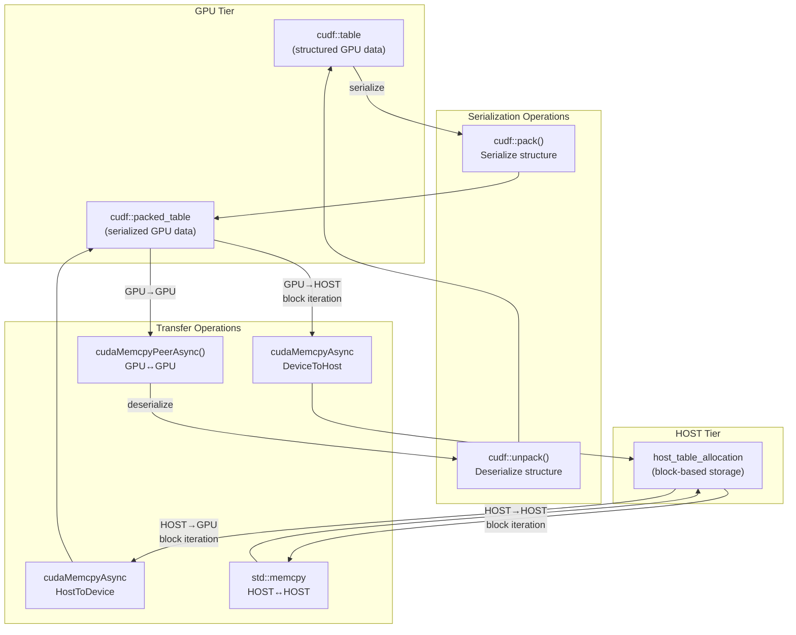
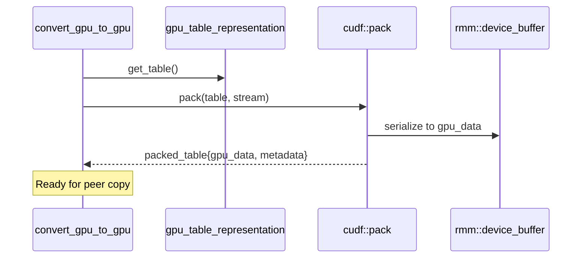
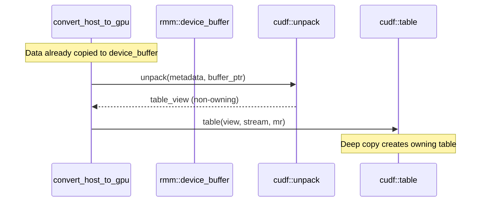
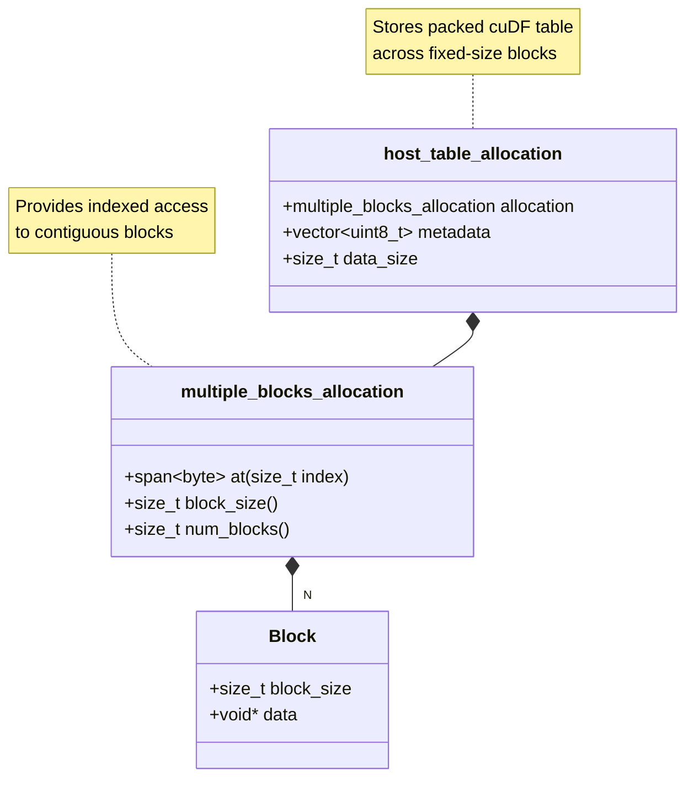
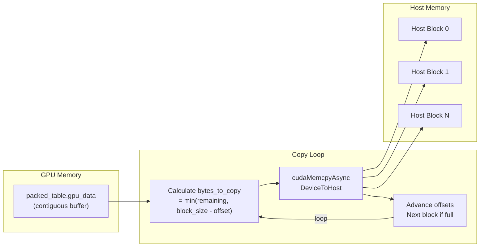
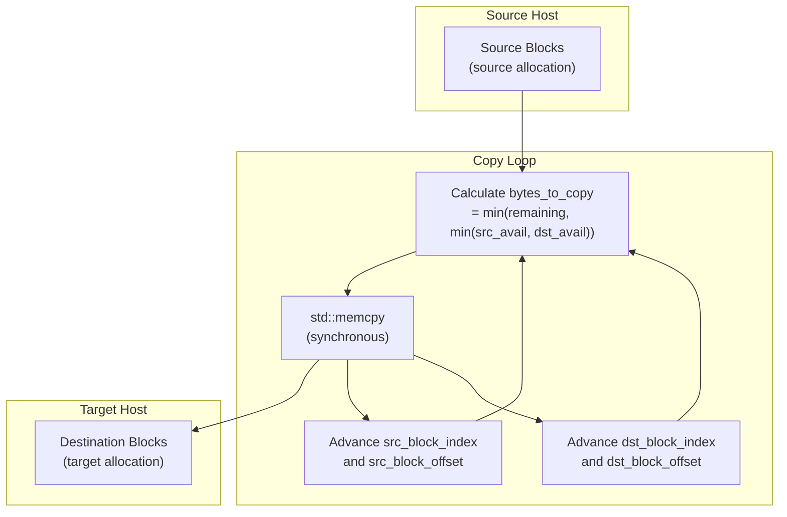
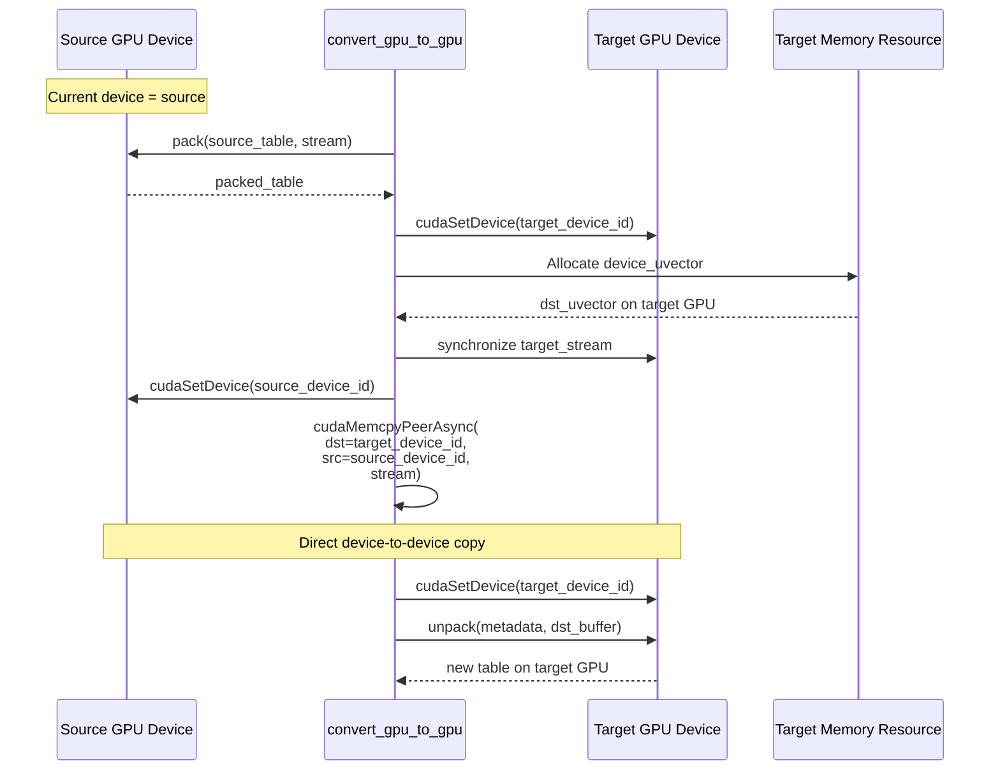
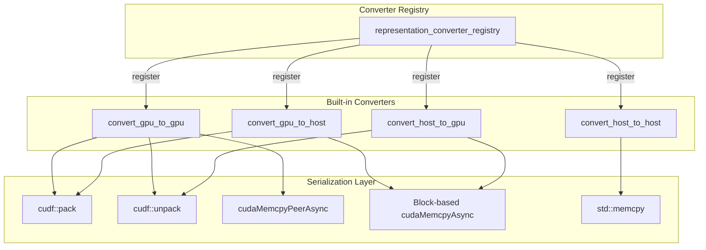

<!-- source: DeepWiki mcp.deepwiki.com · repo NVIDIA/cuCascade · page 5.5 Data Packing and Serialization · fetched 2026-10-26 -->

# Data Packing and Serialization

Relevant source files

The following files were used as context for generating this wiki page:

- [src/data/representation_converter.cpp](src/data/representation_converter.cpp)
- [test/data/test_data_representation.cpp](test/data/test_data_representation.cpp)

This document explains the serialization mechanisms used by cuCascade to move data between memory tiers and devices. It covers cuDF's pack/unpack operations for table serialization, block-based copying strategies for host memory, and peer-to-peer transfers for cross-GPU data movement.

For information about the higher-level conversion API and converter registry, see [Representation Converters](#5.4). For details about the representation types themselves, see [GPU Table Representation](#5.2) and [Host Table Representation](#5.3).

## Overview

cuCascade uses three primary serialization and data movement mechanisms depending on the source and target memory tiers:

| Source Tier | Target Tier | Mechanism | Key Operations |
|-------------|-------------|-----------|----------------|
| GPU | GPU | Peer-to-peer transfer | `cudf::pack()`, `cudaMemcpyPeerAsync()`, `cudf::unpack()` |
| GPU | HOST | Pack and block copy | `cudf::pack()`, `cudaMemcpyAsync()` (D2H), block iteration |
| HOST | GPU | Block copy and unpack | Block iteration, `cudaMemcpyAsync()` (H2D), `cudf::unpack()` |
| HOST | HOST | Block-to-block copy | Block iteration, `std::memcpy()` |

The serialization layer operates below the representation converters, providing the low-level data movement primitives that enable tier transitions.

**Serialization Flow**

*Sources: [src/data/representation_converter.cpp:112-331](), [test/data/test_data_representation.cpp:78-133]()*

## cuDF Pack and Unpack Operations

cuDF's `pack()` and `unpack()` functions provide serialization for `cudf::table` objects, converting between structured table representations and contiguous memory buffers.

### Pack Operation

The `cudf::pack()` function serializes a `cudf::table_view` into a contiguous memory layout:

- **Input**: `cudf::table_view` and `rmm::cuda_stream_view`
- **Output**: `cudf::packed_table` containing:
  - `gpu_data`: `std::unique_ptr<rmm::device_buffer>` with serialized column data
  - `metadata`: `std::unique_ptr<std::vector<uint8_t>>` with structural information

The packed format includes all column data and metadata required to reconstruct the table structure, including column types, null masks, and child column relationships.

**Pack Usage in GPU-to-GPU Conversion**

*Sources: [src/data/representation_converter.cpp:117-123](), [test/data/test_data_representation.cpp:89-93]()*

### Unpack Operation

The `cudf::unpack()` function deserializes packed data back into a `cudf::table`:

- **Input**: Metadata pointer and data buffer pointer
- **Output**: `cudf::table_view` referencing the unpacked data

The unpack operation reconstructs the table structure by interpreting the metadata and creating column views over the data buffer. The returned view does not own the data; ownership is managed by constructing a `cudf::table` from the view.

**Unpack Usage in Host-to-GPU Conversion**

*Sources: [src/data/representation_converter.cpp:249-252](), [src/data/representation_converter.cpp:154-156]()*

### Packed Table Lifecycle

The `cudf::packed_table` structure maintains ownership of both the serialized data and metadata. This structure is temporary and exists only during conversion operations:

1. **Pack**: Create `packed_table` from source table
2. **Transfer**: Move data from packed buffer to destination
3. **Unpack**: Reconstruct table from transferred data
4. **Cleanup**: `packed_table` destructor releases temporary buffers

*Sources: [src/data/representation_converter.cpp:123](), [src/data/representation_converter.cpp:174]()*

## Block-Based Copying for Host Memory

Host memory in cuCascade uses a fixed-size block allocation strategy via `fixed_size_host_memory_resource`. Data is stored across multiple contiguous blocks, requiring special iteration logic for copying.

### Block Allocation Structure

The `host_table_allocation` manages serialized data across multiple fixed-size blocks:

*Sources: [src/data/representation_converter.cpp:176-178](), [test/data/test_data_representation.cpp:98-102]()*

### GPU-to-Host Block Copy

When copying from GPU to host, packed data must be distributed across multiple host blocks:

**Implementation Details** ([src/data/representation_converter.cpp:179-200]()):

1. **Initialization**:
   - `block_index = 0`, `block_offset = 0`, `source_offset = 0`
   - `block_size` from allocation

2. **Iteration**:
   - Calculate `bytes_to_copy = min(remaining_bytes, block_size - block_offset)`
   - Copy chunk with `cudaMemcpyAsync()` to `block_ptr.data() + block_offset`
   - Advance `source_offset` by `bytes_to_copy`
   - Advance `block_offset` by `bytes_to_copy`
   - If `block_offset == block_size`, reset to 0 and increment `block_index`

3. **Completion**:
   - Synchronize stream after all chunks copied

*Sources: [src/data/representation_converter.cpp:176-200](), [test/data/test_data_representation.cpp:98-117]()*

### Host-to-GPU Block Copy

When copying from host to GPU, data must be gathered from multiple host blocks into a contiguous device buffer:

**Implementation Details** ([src/data/representation_converter.cpp:224-245]()):

1. **Allocation**:
   - Create `rmm::device_buffer` of size `data_size` on target GPU

2. **Block Iteration**:
   - Track `src_block_index`, `src_block_offset`, `dst_offset`
   - For each chunk: `bytes_to_copy = min(remaining, src_block_size - src_block_offset)`
   - Copy with `cudaMemcpyAsync(..., cudaMemcpyHostToDevice, stream)`
   - Advance both source block position and destination offset

3. **Unpacking**:
   - After all blocks copied, call `cudf::unpack()` to reconstruct table

*Sources: [src/data/representation_converter.cpp:224-252]()*

### Host-to-Host Block Copy

Cross-NUMA or cross-device host copies also use block-based iteration, but with synchronous `std::memcpy()`:

**Key Difference**: Both source and destination use block-based storage, requiring dual-index tracking ([src/data/representation_converter.cpp:278-304]()):

- `src_block_index`, `src_block_offset` track source position
- `dst_block_index`, `dst_block_offset` track destination position
- Both indices advance independently based on their respective block sizes

*Sources: [src/data/representation_converter.cpp:262-310]()*

## GPU-to-GPU Peer Transfers

Cross-GPU transfers use CUDA's peer-to-peer memory access capabilities to directly copy data between GPU devices without staging through host memory.

### Peer Copy Workflow

*Sources: [src/data/representation_converter.cpp:117-163]()*

### Implementation Details

The GPU-to-GPU converter ([src/data/representation_converter.cpp:117-163]()) performs the following steps:

1. **Pack on Source GPU**:
   - `cudf::pack(gpu_source.get_table(), stream)` creates `packed_table`

2. **Allocate on Target GPU**:
   - Switch device context: `cudaSetDevice(target_device_id)`
   - Allocate: `rmm::device_uvector<uint8_t>(bytes_to_copy, target_stream, mr)`
   - Synchronize target stream before peer copy

3. **Peer Memory Copy**:
   - Switch back to source device: `cudaSetDevice(source_device_id)`
   - Copy with `cudaMemcpyPeerAsync(dst_ptr, target_device_id, src_ptr, source_device_id, bytes, stream)`
   - Synchronize stream to ensure copy completes

4. **Unpack on Target GPU**:
   - Switch to target device: `cudaSetDevice(target_device_id)`
   - Convert `device_uvector` to `device_buffer`: `std::move(dst_uvector).release()`
   - Unpack: `cudf::unpack(metadata, gpu_data_ptr)`
   - Construct owning table: `cudf::table(table_view, target_stream, mr)`
   - Synchronize and restore previous device

### Device Context Management

Device switching is required because:

- **Allocations** must occur on the target device's context
- **Peer copies** must be issued from the source device's context
- **Unpacking** must occur on the target device's context

The implementation carefully restores the previous device context after operations to avoid side effects on the calling code.

*Sources: [src/data/representation_converter.cpp:134-160](), [test/data/test_data_representation.cpp:269-304]()*

## Asynchronous Operations and Stream Management

All GPU-involved operations use CUDA streams to enable asynchronous execution and proper ordering of operations.

### Stream Usage Patterns

| Operation | Stream Source | Synchronization |
|-----------|---------------|-----------------|
| `cudf::pack()` | Provided by caller | None (async) |
| `cudaMemcpyAsync()` | Provided by caller | After all chunks |
| `cudaMemcpyPeerAsync()` | Provided by caller | After transfer |
| `cudf::unpack()` | Same as allocation | None (view only) |
| `cudf::table()` constructor | Target device stream | Before device switch |

**Stream Synchronization** ([src/data/representation_converter.cpp:200](), [src/data/representation_converter.cpp:147](), [src/data/representation_converter.cpp:252]()):

- GPU-to-Host: `stream.synchronize()` after block copy loop
- GPU-to-GPU: `stream.synchronize()` after peer copy, `target_stream.synchronize()` after unpack
- Host-to-GPU: `stream.synchronize()` after unpack and table construction

Synchronization points ensure data consistency before cross-device operations or device context switches.

*Sources: [src/data/representation_converter.cpp:147](), [src/data/representation_converter.cpp:200](), [src/data/representation_converter.cpp:252](), [test/data/test_data_representation.cpp:127-128]()*

## Integration with Representation Converters

The serialization mechanisms described in this page are invoked by the built-in converter functions registered in the `representation_converter_registry`:

The registration occurs in `register_builtin_converters()` ([src/data/representation_converter.cpp:314-331]()), which connects the high-level converter API to these low-level serialization primitives.

For details on the converter registry API and how to invoke conversions, see [Representation Converters](#5.4).

*Sources: [src/data/representation_converter.cpp:314-331](), [src/data/representation_converter.cpp:112-312]()*

---

