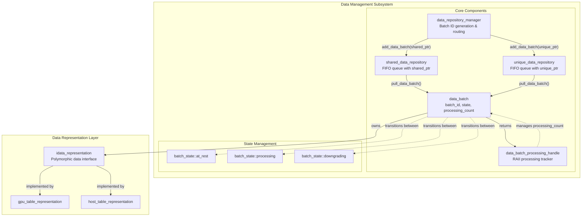
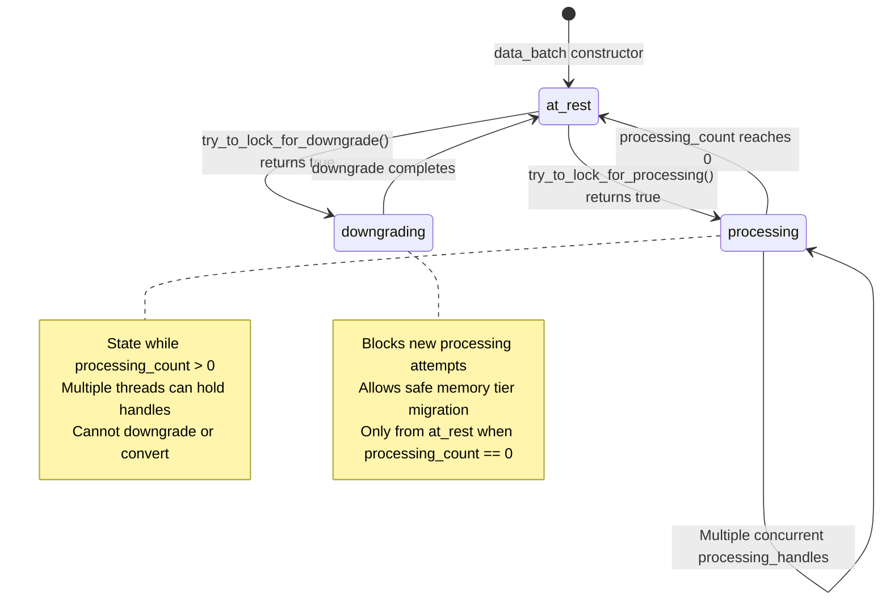
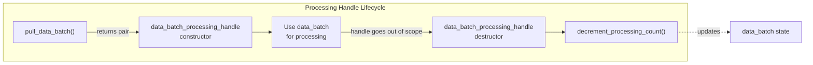
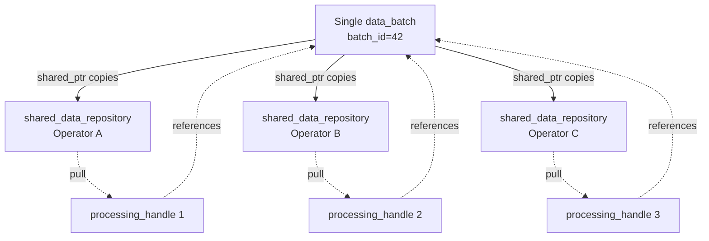
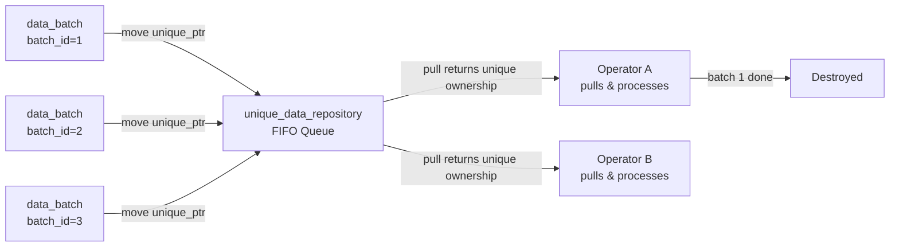
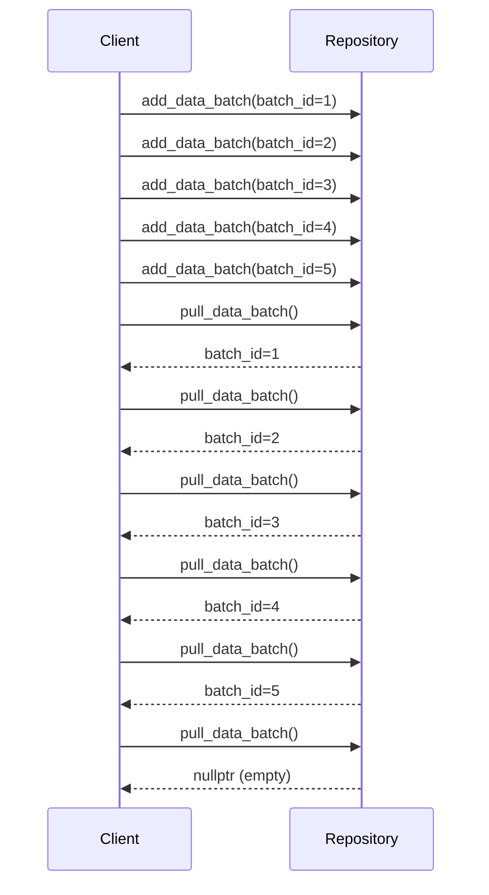
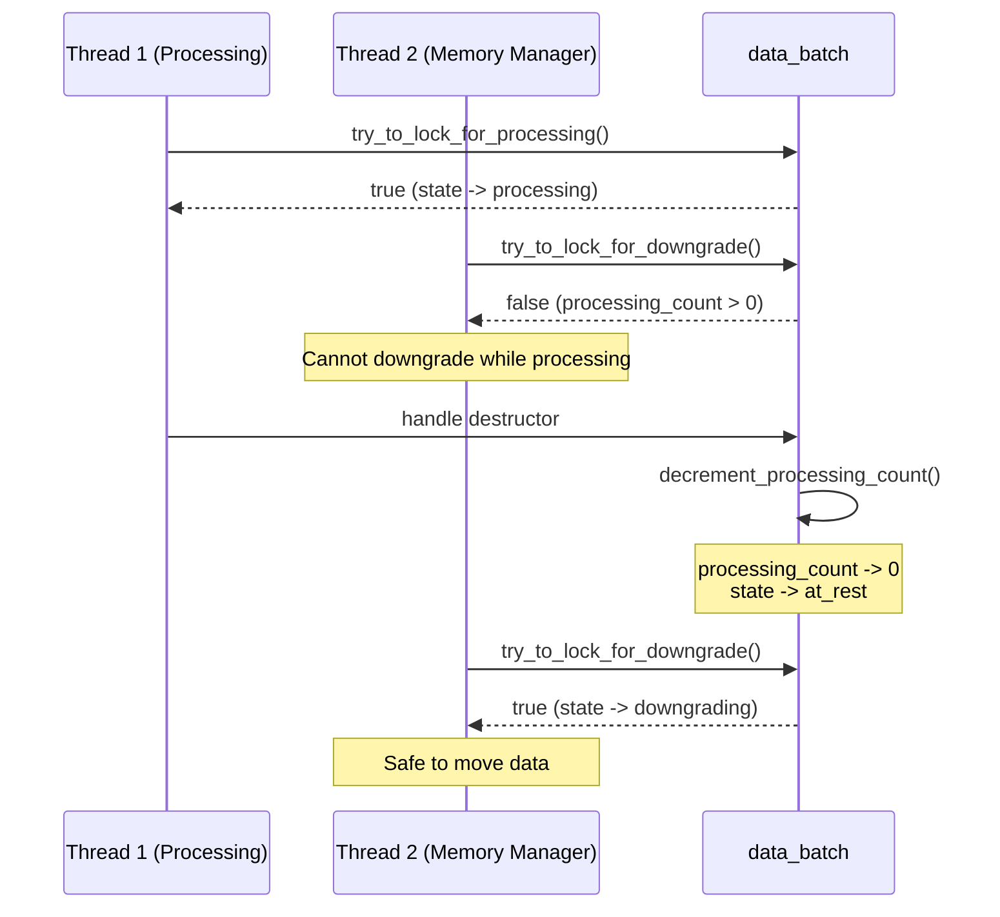
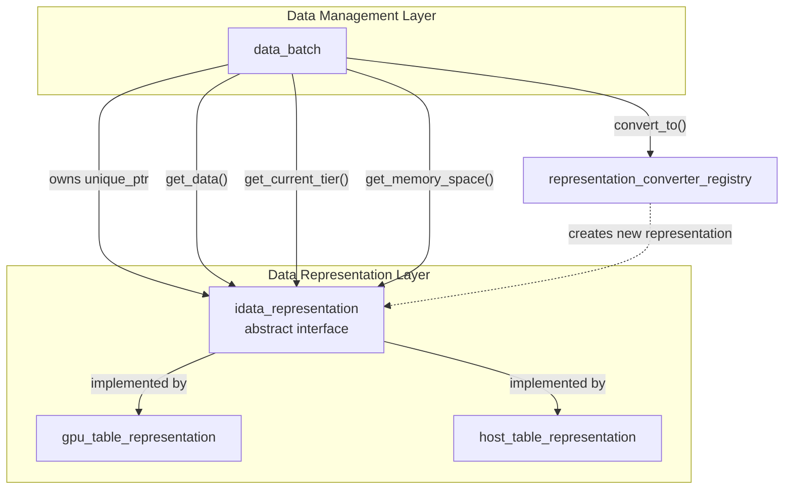

<!-- source: DeepWiki mcp.deepwiki.com · repo NVIDIA/cuCascade · page 6 Data Management Subsystem · fetched 2026-10-26 -->

# Data Management Subsystem

<details>
<summary>Relevant source files</summary>

The following files were used as context for generating this wiki page:

- [include/data/data_batch.hpp](include/data/data_batch.hpp)
- [test/data/test_data_repository.cpp](test/data/test_data_repository.cpp)

</details>


## Purpose and Scope

The Data Management Subsystem provides the core infrastructure for managing data lifecycle, processing state tracking, and multi-operator data routing in cuCascade. This subsystem sits above the Data Representation Layer ([#5]()) and Memory Management Layer ([#4]()), coordinating how batches of data flow through the system, ensuring thread-safe access, and preventing unsafe operations during data transformations.

This document covers the high-level architecture and interactions between the three main components: `data_batch`, data repositories, and the repository manager. For detailed implementation documentation, see:
- [Data Batch](#6.1) - `data_batch` class and processing state management
- [Data Repository](#6.2) - `shared_data_repository` and `unique_data_repository` implementations
- [Data Repository Manager](#6.3) - Multi-operator coordination

## Overview

The Data Management Subsystem consists of three primary components:

| Component | Class(es) | Purpose |
|-----------|-----------|---------|
| **Data Batch** | `data_batch`, `data_batch_processing_handle` | Wraps data representations with lifecycle management, processing state tracking, and unique identification |
| **Data Repository** | `shared_data_repository`, `unique_data_repository` | Thread-safe FIFO queues for storing batches with different ownership semantics |
| **Repository Manager** | `data_repository_manager` | Routes batches to operator-specific repositories, manages batch ID generation, and coordinates multi-operator workflows |

These components work together to enable safe concurrent data access, prevent race conditions during memory tier migrations, and support both broadcast (one-to-many) and transfer (one-to-one) data routing patterns.

**Sources:** [include/data/data_batch.hpp:1-300](), [test/data/test_data_repository.cpp:1-911]()

## Component Architecture

The following diagram shows how the three components relate to each other and to the underlying Data Representation Layer:



**Sources:** [include/data/data_batch.hpp:40-280](), [test/data/test_data_repository.cpp:38-46]()

## Data Batch Lifecycle and State Management

Each `data_batch` progresses through a well-defined lifecycle with three possible states defined in the `batch_state` enum:



The state transitions are protected by an internal mutex within `data_batch` at [include/data/data_batch.hpp:275](). Key methods for state management:

| Method | Effect | Thread-Safe |
|--------|--------|-------------|
| `try_to_lock_for_processing()` | Increments `processing_count`, transitions to `processing` if not `downgrading` | Yes |
| `try_to_lock_for_downgrade()` | Transitions to `downgrading` if `processing_count == 0` and state is `at_rest` | Yes |
| `decrement_processing_count()` | Called by `data_batch_processing_handle` destructor, transitions to `at_rest` when count reaches 0 | Yes |
| `convert_to<T>()` | Requires `processing_count == 0`, throws otherwise | Yes |

**Sources:** [include/data/data_batch.hpp:43-47](), [include/data/data_batch.hpp:246-298](), [test/data/test_data_repository.cpp:538-576]()

## RAII Processing Handle Pattern

The `data_batch_processing_handle` class implements RAII semantics to ensure processing counts are properly managed:



Example usage pattern from tests at [test/data/test_data_repository.cpp:60-69]():

```cpp
{
    auto [pulled_batch, handle] = repository.pull_data_batch();
    // pulled_batch->get_processing_count() == 1
    // pulled_batch->get_state() == batch_state::processing
    
    // Use the batch for processing...
}  // handle goes out of scope here

// Now: batch->get_processing_count() == 0
// Now: batch->get_state() == batch_state::at_rest
```

The handle is move-only (no copy constructor/assignment) to enforce single ownership semantics. Multiple handles can exist for the same batch (via `shared_data_repository`), each contributing to the `processing_count`.

**Sources:** [include/data/data_batch.hpp:61-118](), [test/data/test_data_repository.cpp:538-556]()

## Ownership Models: Shared vs Unique Repositories

The subsystem provides two repository variants with different ownership semantics:

### shared_data_repository

Stores `std::shared_ptr<data_batch>`, enabling **broadcast patterns** where the same batch is sent to multiple operators:



Test demonstrating shared ownership at [test/data/test_data_repository.cpp:97-132]():
- Same batch added to three repositories
- All three `pull_data_batch()` calls return pointers to the same batch object
- `processing_count` increments to 3 (one per active handle)

### unique_data_repository

Stores `std::unique_ptr<data_batch>`, enabling **transfer patterns** where ownership moves from one operator to the next:



**Sources:** [test/data/test_data_repository.cpp:38-145](), [test/data/test_data_repository.cpp:238-291]()

## FIFO Queue Behavior

Both repository types implement strict FIFO (First-In-First-Out) ordering, verified by tests at [test/data/test_data_repository.cpp:72-94]():



When a repository is empty, `pull_data_batch()` returns a pair with `nullptr` and an invalid handle. The `size()` method (tested at [test/data/test_data_repository.cpp:583-860]()) provides the current number of available batches.

**Sources:** [test/data/test_data_repository.cpp:72-94](), [test/data/test_data_repository.cpp:269-291]()

## Thread Safety Guarantees

All components in the Data Management Subsystem are designed for concurrent access:

### data_batch Thread Safety

- State transitions protected by internal mutex at [include/data/data_batch.hpp:275]()
- `get_processing_count()` is mutex-protected at [include/data/data_batch.hpp:199]()
- `try_to_lock_for_processing()` and `try_to_lock_for_downgrade()` are atomic operations
- `convert_to<T>()` checks for active processing under lock

### Repository Thread Safety

Both `shared_data_repository` and `unique_data_repository` support:

1. **Concurrent Additions**: Multiple threads can call `add_data_batch()` simultaneously (tested with 10 threads × 50 batches at [test/data/test_data_repository.cpp:146-183]())

2. **Concurrent Pulls**: Multiple threads can call `pull_data_batch()` simultaneously without data races (tested with 10 threads pulling 500 batches at [test/data/test_data_repository.cpp:186-231]())

3. **Concurrent Add + Pull**: Threads can add and pull simultaneously (tested at [test/data/test_data_repository.cpp:436-486]())

4. **High Contention**: 20 threads performing 50 mixed add/pull operations each without corruption (tested at [test/data/test_data_repository.cpp:489-535]())

### Preventing Unsafe Operations

The state management system prevents race conditions during memory tier migrations:



Test demonstrating downgrade blocking at [test/data/test_data_repository.cpp:559-576](): a batch in `downgrading` state returns `nullptr` when pulled, preventing concurrent access during tier migration.

**Sources:** [test/data/test_data_repository.cpp:146-231](), [test/data/test_data_repository.cpp:436-535](), [test/data/test_data_repository.cpp:559-576]()

## Integration with Data Representation Layer

The `data_batch` class serves as a wrapper around `idata_representation` ([#5.1]()), providing lifecycle management on top of the polymorphic data storage:



Key delegation methods at [include/data/data_batch.hpp:178-219]():

- `get_current_tier()`: Returns the tier where data currently resides (GPU, HOST, or DISK)
- `get_data()`: Returns raw pointer to the `idata_representation`
- `get_memory_space()`: Returns the `memory_space` where data is allocated
- `set_data()`: Replaces the underlying representation (requires `processing_count == 0`)
- `convert_to<T>()`: Uses the converter registry to transform data between representation types

The `convert_to<T>()` method at [include/data/data_batch.hpp:283-297]() demonstrates the safety guarantees:

```cpp
template <typename TargetRepresentation>
void data_batch::convert_to(representation_converter_registry& registry,
                            const cucascade::memory::memory_space* target_memory_space,
                            rmm::cuda_stream_view stream)
{
  std::lock_guard<std::mutex> lock(_mutex);
  
  if (_processing_count != 0) {
    throw std::runtime_error("Cannot convert while processing");
  }
  
  auto new_representation = registry.convert<TargetRepresentation>(*_data, target_memory_space, stream);
  _data = std::move(new_representation);
}
```

**Sources:** [include/data/data_batch.hpp:178-244](), [include/data/data_batch.hpp:283-297]()

## Summary

The Data Management Subsystem provides three tightly integrated components for safe, concurrent data lifecycle management:

1. **data_batch**: Wraps data representations with unique IDs, state tracking, and processing counts to prevent unsafe operations
2. **Repositories**: Thread-safe FIFO queues with two ownership models (shared for broadcast, unique for transfer)
3. **Repository Manager**: Coordinates batch routing across multiple operators (detailed in [#6.3]())

This design enables:
- Safe concurrent access to data batches across multiple threads
- Prevention of race conditions during memory tier migrations
- Flexible routing patterns (broadcast vs. transfer) for different workflow needs
- Clear lifecycle management through RAII handles

For detailed documentation on each component, see the child pages: [Data Batch](#6.1), [Data Repository](#6.2), and [Data Repository Manager](#6.3).

**Sources:** [include/data/data_batch.hpp:1-300](), [test/data/test_data_repository.cpp:1-911]()

---

