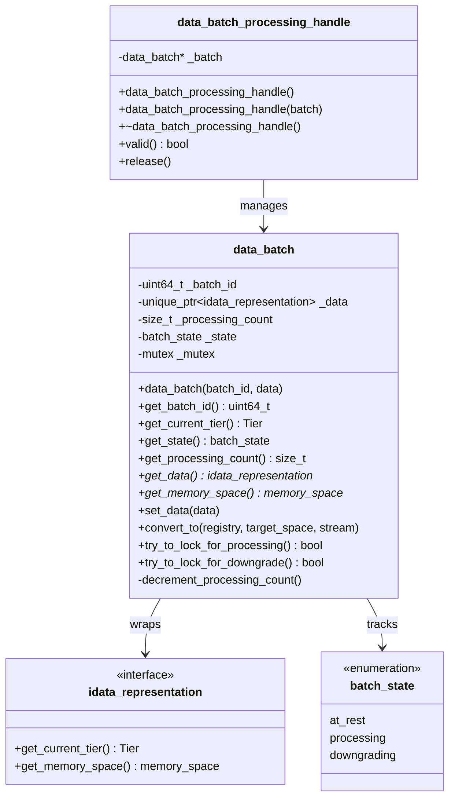
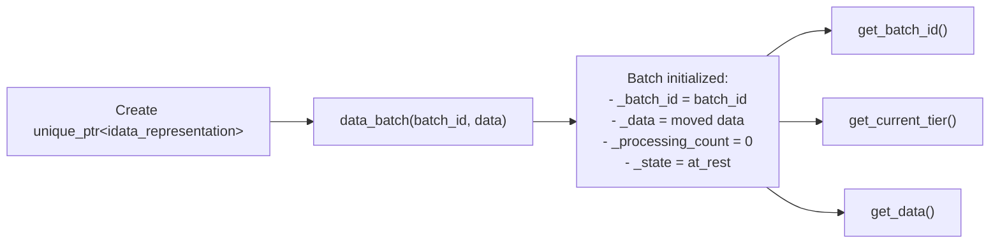
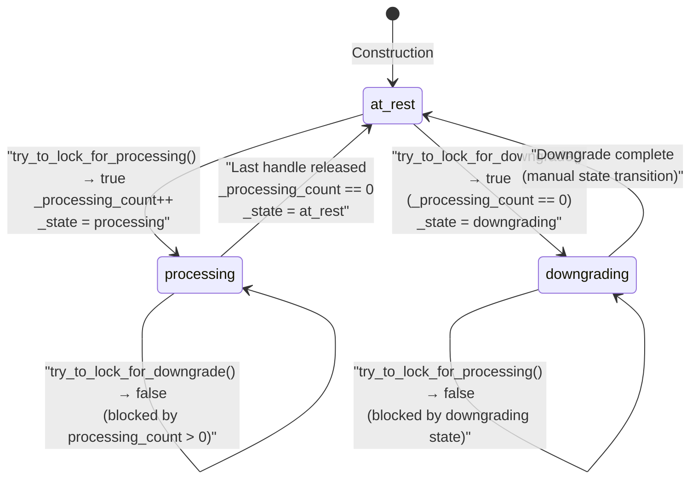
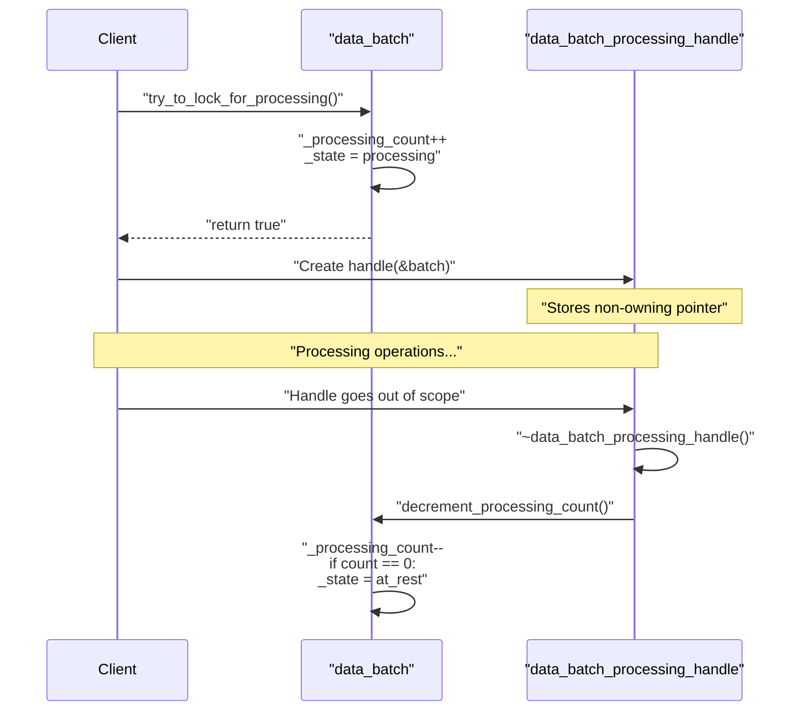
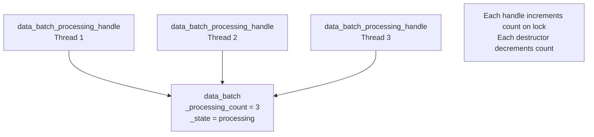
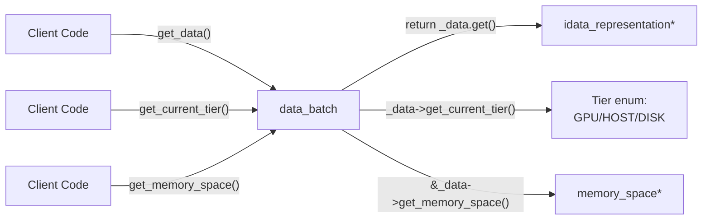
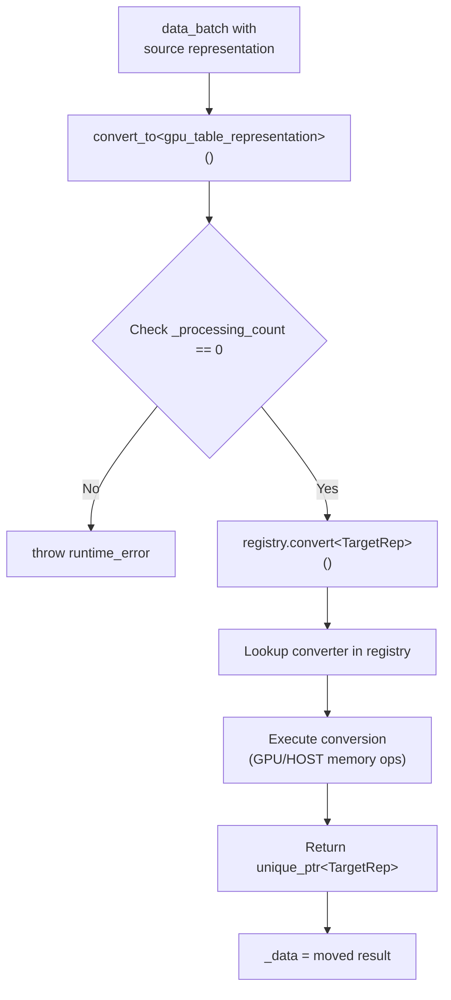
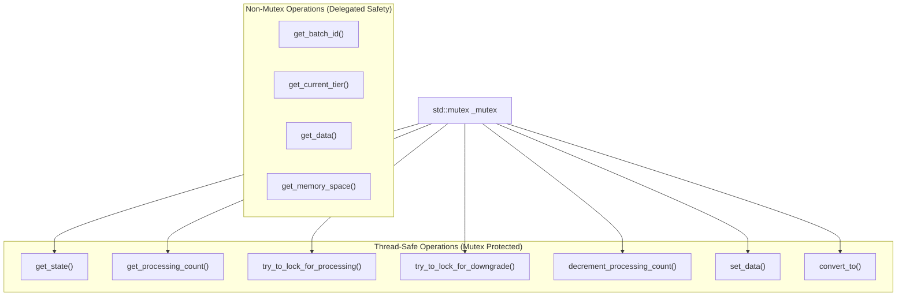
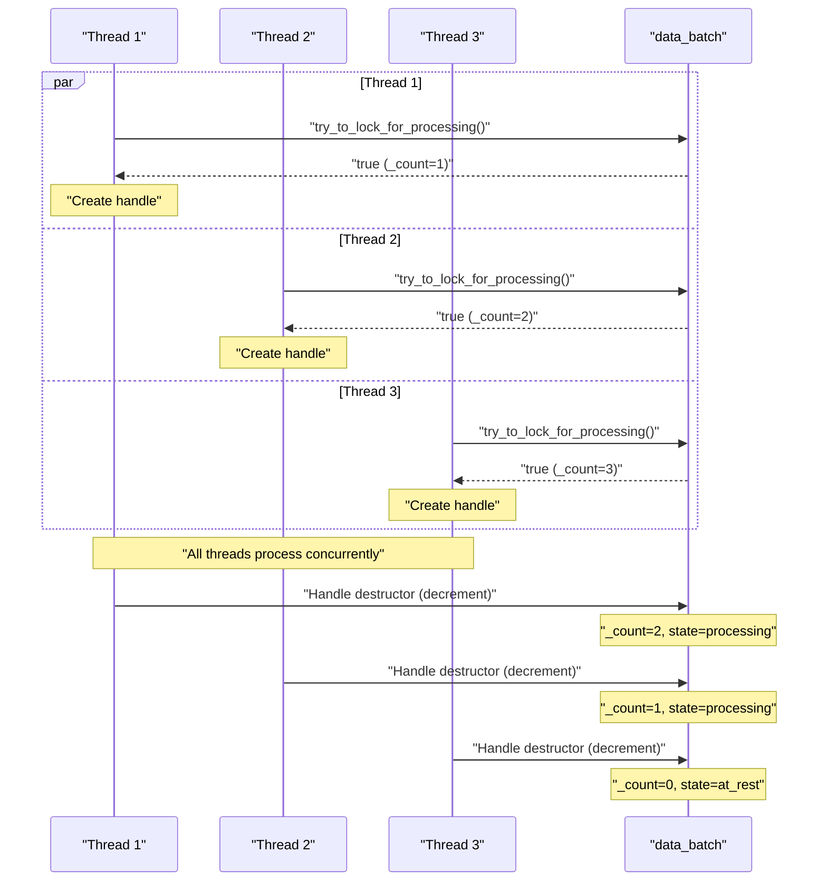
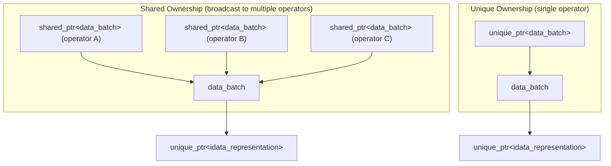

<!-- source: DeepWiki mcp.deepwiki.com · repo NVIDIA/cuCascade · page 6.1 Data Batch · fetched 2026-10-26 -->

# Data Batch

<details>
<summary>Relevant source files</summary>

The following files were used as context for generating this wiki page:

- [include/data/data_batch.hpp](include/data/data_batch.hpp)
- [src/data/data_batch.cpp](src/data/data_batch.cpp)
- [test/data/test_data_batch.cpp](test/data/test_data_batch.cpp)

</details>


## Purpose and Scope

This document describes the `data_batch` class and its associated `data_batch_processing_handle` RAII wrapper, which together form the core unit of data management in cuCascade. A `data_batch` wraps an `idata_representation` (see [Data Representation Interface](#5.1)) and provides processing state tracking to enable safe concurrent access and memory tier management. This document covers batch lifecycle, state management, processing counting, and thread-safe operations.

For information about how batches are stored and retrieved in FIFO queues, see [Data Repository](#6.2). For information about multi-operator batch routing, see [Data Repository Manager](#6.3).

**Sources:** [include/data/data_batch.hpp:120-139]()

---

## Class Architecture

The data batch subsystem consists of two cooperating classes that implement a RAII-based processing state management pattern:



**Key Design Principles:**

| Class | Ownership | Thread Safety | Purpose |
|-------|-----------|---------------|---------|
| `data_batch` | Owns `idata_representation` via `std::unique_ptr` | Mutex-protected state/count | Core data container with lifecycle tracking |
| `data_batch_processing_handle` | Non-owning pointer to `data_batch` | RAII ensures correct decrement | Automatic processing count management |

**Sources:** [include/data/data_batch.hpp:40-280](), [src/data/data_batch.cpp:38-71]()

---

## Batch Construction and Identification

Each `data_batch` is constructed with a unique 64-bit identifier and takes ownership of an `idata_representation`:



**Constructor Signature:**
```cpp
data_batch(uint64_t batch_id, std::unique_ptr<idata_representation> data)
```

The batch ID is typically generated by the `data_repository_manager` (see [Data Repository Manager](#6.3)) but can be any 64-bit value, including edge cases like `0` or `UINT64_MAX`.

**Move Semantics:**

The `data_batch` is move-only and requires zero processing count for move operations:

| Operation | Precondition | Postcondition (source) | Postcondition (destination) |
|-----------|--------------|------------------------|----------------------------|
| Move constructor | `processing_count == 0` | `_batch_id = 0`, `_data = nullptr` | Owns batch ID and data |
| Move assignment | `processing_count == 0` | `_batch_id = 0`, `_data = nullptr` | Owns batch ID and data |

**Sources:** [include/data/data_batch.hpp:141-171](), [src/data/data_batch.cpp:38-71](), [test/data/test_data_batch.cpp:44-93]()

---

## Batch State Management

The `data_batch` maintains a state machine to coordinate processing and memory tier transitions:



### State Definitions

The `batch_state` enum defines three states:

| State | Description | Can Lock for Processing? | Can Lock for Downgrade? |
|-------|-------------|--------------------------|-------------------------|
| `at_rest` | Idle, no active operations | ✓ Yes | ✓ Yes (if count = 0) |
| `processing` | One or more processing handles active | ✓ Yes (increments count) | ✗ No |
| `downgrading` | Memory tier transition in progress | ✗ No | N/A (already locked) |

### State Transition Implementation

**Lock for Processing:**
```cpp
bool try_to_lock_for_processing()
{
  std::lock_guard<std::mutex> lock(_mutex);
  if (_state == batch_state::at_rest || _state == batch_state::processing) {
    _processing_count += 1;
    _state = batch_state::processing;
    return true;
  }
  return false;
}
```
[src/data/data_batch.cpp:106-115]()

**Lock for Downgrade:**
```cpp
bool try_to_lock_for_downgrade()
{
  std::lock_guard<std::mutex> lock(_mutex);
  if (_processing_count == 0 && _state == batch_state::at_rest) {
    _state = batch_state::downgrading;
    return true;
  }
  return false;
}
```
[src/data/data_batch.cpp:117-125]()

**Sources:** [include/data/data_batch.hpp:40-47](), [src/data/data_batch.cpp:106-138](), [test/data/test_data_batch.cpp:94-182]()

---

## Processing State Tracking with RAII

The `data_batch_processing_handle` provides automatic processing count management through RAII:



### Handle Lifecycle

| Operation | Effect | Processing Count | Batch State |
|-----------|--------|------------------|-------------|
| `data_batch_processing_handle(batch)` | Store pointer | No change (manual lock required) | No change |
| Handle destructor | Call `decrement_processing_count()` | Decrement | May transition to `at_rest` |
| `handle.release()` | Explicitly decrement and clear pointer | Decrement | May transition to `at_rest` |
| Move constructor | Transfer ownership | No change | No change |
| Move assignment | Release old, transfer new | Decrement old batch | May transition old to `at_rest` |

### Typical Usage Pattern

```cpp
// Lock the batch for processing
if (batch.try_to_lock_for_processing()) {
    // Create RAII handle
    data_batch_processing_handle handle(&batch);
    
    // Processing operations...
    auto* data = batch.get_data();
    // Use data...
    
}   // Handle destructor automatically decrements count
```

**Multiple Concurrent Handles:**

The system allows multiple handles to exist simultaneously for the same batch:



**Sources:** [include/data/data_batch.hpp:53-118](), [src/data/data_batch.cpp:24-34](), [test/data/test_data_batch.cpp:117-148](), [test/data/test_data_batch.cpp:422-467]()

---

## Data Access and Manipulation

### Accessing Underlying Data

The `data_batch` provides several methods to access the wrapped `idata_representation`:

| Method | Return Type | Description | Thread-Safe |
|--------|-------------|-------------|-------------|
| `get_data()` | `idata_representation*` | Returns non-owning pointer to data | Yes (read-only) |
| `get_current_tier()` | `memory::Tier` | Delegates to `_data->get_current_tier()` | Yes (delegates) |
| `get_memory_space()` | `memory_space*` | Delegates to `_data->get_memory_space()` | Yes (delegates) |



**Sources:** [src/data/data_batch.cpp:73-95](), [test/data/test_data_batch.cpp:203-226]()

### Replacing Data Representation

The `set_data()` method replaces the underlying `idata_representation`:

```cpp
void set_data(std::unique_ptr<idata_representation> data)
{
  std::lock_guard<std::mutex> lock(_mutex);
  if (_processing_count != 0) {
    throw std::runtime_error("Cannot set data while there is active processing");
  }
  _data = std::move(data);
}
```

**Preconditions:**
- `_processing_count == 0` (enforced by exception)
- Mutex held during operation

**Sources:** [src/data/data_batch.cpp:97-104]()

### Converting Between Representations

The `convert_to()` template method converts data to a different representation type using the `representation_converter_registry`:

```cpp
template <typename TargetRepresentation>
void convert_to(representation_converter_registry& registry,
                const memory_space* target_memory_space,
                rmm::cuda_stream_view stream)
{
  std::lock_guard<std::mutex> lock(_mutex);
  
  if (_processing_count != 0) {
    throw std::runtime_error("Cannot convert representation while there is active processing");
  }
  
  auto new_representation = registry.convert<TargetRepresentation>(
    *_data, target_memory_space, stream);
  _data = std::move(new_representation);
}
```

**Conversion Flow:**



For details on conversion operations, see [Representation Converters](#5.4).

**Sources:** [include/data/data_batch.hpp:226-297](), [include/data/data_batch.hpp:283-297]()

---

## Thread Safety Model

The `data_batch` class implements fine-grained locking for state management while delegating data access thread-safety to the underlying `idata_representation`.

### Mutex Protection

The `_mutex` member variable protects:
- `_processing_count` (read and write)
- `_state` (read and write)
- Operations that check/modify both atomically



### Concurrent Access Patterns

**Typical Concurrent Scenario:**



### Thread Safety Test Coverage

The test suite validates thread-safe operations with high concurrency:

| Test Scenario | Thread Count | Operations per Thread | Validation |
|---------------|--------------|----------------------|------------|
| Concurrent processing locks | 10 | 100 | Final count = 1000 |
| Rapid lock/unlock cycles | 1 | 100 cycles × 10 locks | Final count = 0, state = at_rest |

**Sources:** [include/data/data_batch.hpp:275](), [src/data/data_batch.cpp:77-87](), [test/data/test_data_batch.cpp:229-265]()

---

## Lifecycle and Ownership Patterns

The `data_batch` class is designed to work with standard C++ smart pointers for lifecycle management.

### Smart Pointer Integration



### Ownership Transfer Example

```cpp
// Create batch with unique ownership
auto batch = std::make_unique<data_batch>(
    batch_id,
    std::make_unique<gpu_table_representation>(table, memory_space, stream)
);

// Transfer to shared ownership (for multi-operator broadcast)
std::shared_ptr<data_batch> shared_batch = std::move(batch);

// Or keep unique ownership (for single-operator transfer)
repository.add_data_batch(std::move(batch));  // unique_ptr moved
```

### Processing with Smart Pointers

```cpp
// With shared_ptr
std::shared_ptr<data_batch> batch = /* from repository */;
if (batch->try_to_lock_for_processing()) {
    data_batch_processing_handle handle(batch.get());  // Non-owning pointer
    // Process...
}   // Handle releases, batch may still exist via shared_ptr

// With unique_ptr
std::unique_ptr<data_batch> batch = /* from repository */;
if (batch->try_to_lock_for_processing()) {
    data_batch_processing_handle handle(batch.get());  // Non-owning pointer
    // Process...
}   // Handle releases, batch destroyed when unique_ptr goes out of scope
```

**Sources:** [test/data/test_data_batch.cpp:383-420]()

---

## Code Entity Reference

### Primary Classes

| Class | Header | Implementation | Purpose |
|-------|--------|----------------|---------|
| `cucascade::data_batch` | [include/data/data_batch.hpp:140-280]() | [src/data/data_batch.cpp:38-140]() | Core data container with processing state |
| `cucascade::data_batch_processing_handle` | [include/data/data_batch.hpp:61-118]() | [src/data/data_batch.cpp:24-34]() | RAII processing count management |
| `cucascade::batch_state` | [include/data/data_batch.hpp:43-47]() | N/A (enum) | State enumeration |

### Key Methods

| Method | File Location | Description |
|--------|---------------|-------------|
| `data_batch::try_to_lock_for_processing()` | [src/data/data_batch.cpp:106-115]() | Attempt to acquire processing lock |
| `data_batch::try_to_lock_for_downgrade()` | [src/data/data_batch.cpp:117-125]() | Attempt to acquire downgrade lock |
| `data_batch::decrement_processing_count()` | [src/data/data_batch.cpp:127-138]() | Decrement count and transition state |
| `data_batch::convert_to()` | [include/data/data_batch.hpp:283-297]() | Convert to target representation type |
| `data_batch_processing_handle::release()` | [src/data/data_batch.cpp:28-34]() | Explicitly release handle |

### Test Coverage

| Test File | Test Cases | Focus Area |
|-----------|------------|------------|
| [test/data/test_data_batch.cpp]() | 20+ test cases | Construction, state management, thread safety, RAII |

**Sources:** Complete file structure documented above.

---

