<!-- source: DeepWiki mcp.deepwiki.com · repo NVIDIA/cuCascade · page 6.2 Data Repository · fetched 2026-10-26 -->

# Data Repository

<details>
<summary>Relevant source files</summary>

The following files were used as context for generating this wiki page:

- [include/data/data_repository.hpp](include/data/data_repository.hpp)
- [pixi.toml](pixi.toml)
- [test/data/test_data_repository.cpp](test/data/test_data_repository.cpp)

</details>


## Purpose and Scope

The Data Repository subsystem provides thread-safe, FIFO-ordered storage for `data_batch` objects within operator-specific queues. It implements two ownership models—shared and unique—to support different data distribution patterns in multi-operator pipelines. The repository manages batch lifecycle, enforces processing state transitions, and prevents unsafe operations during concurrent access.

For information about the `data_batch` objects stored in repositories, see [Data Batch](#6.1). For multi-operator coordination and routing, see [Data Repository Manager](#6.3).

**Sources:** [include/data/data_repository.hpp:29-50]()

---

## Architecture Overview

The repository system is built on a template-based interface `idata_repository<PtrType>` that supports two smart pointer types for different ownership semantics. The template is instantiated as `shared_data_repository` for broadcast scenarios and `unique_data_repository` for exclusive ownership.

### Repository Class Hierarchy

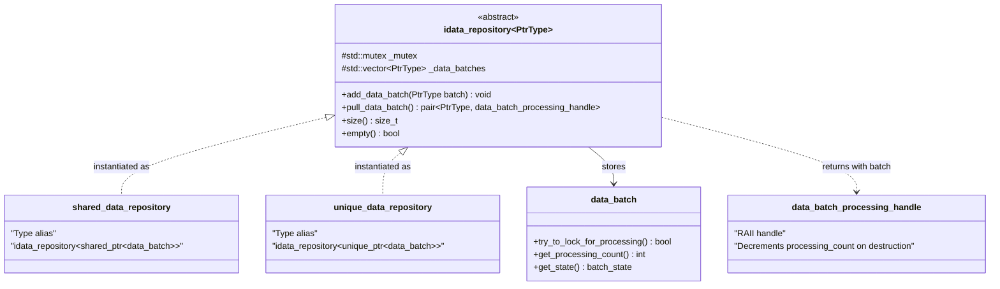

**Sources:** [include/data/data_repository.hpp:51-148]()

---

## Core Interface

### Template Design

The `idata_repository<PtrType>` template class provides a polymorphic interface for managing data batches with different ownership semantics:

| Component | Type | Purpose |
|-----------|------|---------|
| `PtrType` | Template parameter | `std::shared_ptr<data_batch>` or `std::unique_ptr<data_batch>` |
| `_mutex` | `std::mutex` | Protects concurrent access to `_data_batches` |
| `_data_batches` | `std::vector<PtrType>` | FIFO queue storing batch pointers |

**Sources:** [include/data/data_repository.hpp:51-143]()

### Type Aliases

Two concrete repository types are defined via type aliases:

```cpp
using shared_data_repository = idata_repository<std::shared_ptr<data_batch>>;
using unique_data_repository = idata_repository<std::unique_ptr<data_batch>>;
```

These aliases provide semantic clarity for the two ownership models used throughout the system.

**Sources:** [include/data/data_repository.hpp:145-146]()

---

## Core Operations

### Adding Batches: `add_data_batch()`

The `add_data_batch()` method accepts a smart pointer to a `data_batch` and appends it to the internal FIFO queue. The operation is thread-safe via mutex protection.

**Method Signature:**
```cpp
virtual void add_data_batch(PtrType batch)
```

**Implementation Details:**
- Acquires exclusive lock on `_mutex` ([include/data/data_repository.hpp:72]())
- Moves the batch pointer into `_data_batches` vector ([include/data/data_repository.hpp:73]())
- For `shared_data_repository`, shares ownership with caller
- For `unique_data_repository`, transfers ownership from caller

**Sources:** [include/data/data_repository.hpp:70-74](), [test/data/test_data_repository.cpp:58](), [test/data/test_data_repository.cpp:257]()

### Pulling Batches: `pull_data_batch()`

The `pull_data_batch()` method removes the oldest batch from the queue and attempts to lock it for processing. It returns both the batch pointer and an RAII processing handle.

**Method Signature:**
```cpp
virtual std::pair<PtrType, data_batch_processing_handle> pull_data_batch()
```

**Processing Flow:**

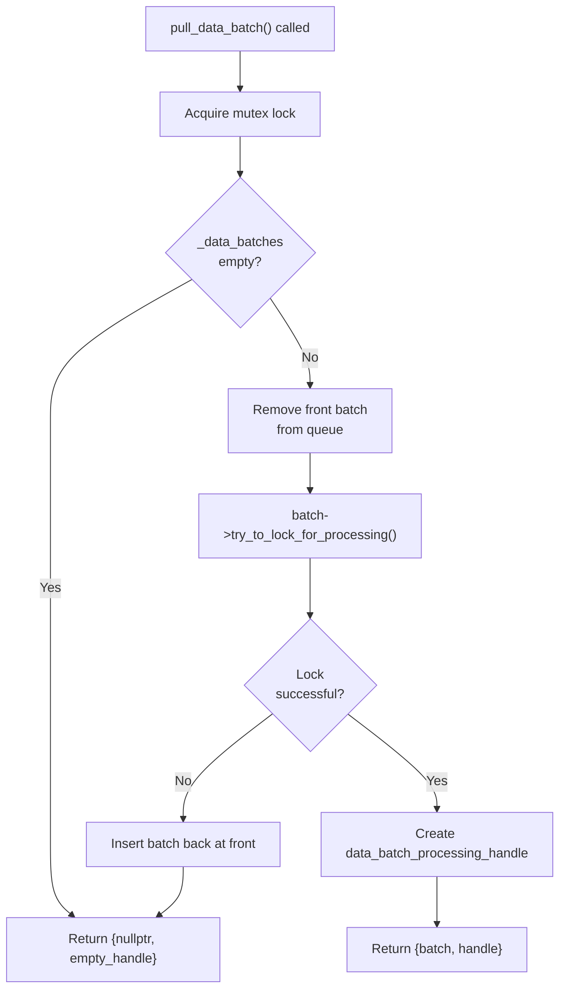

**Key Behaviors:**
- FIFO ordering: always removes from front ([include/data/data_repository.hpp:99-100]())
- State validation: only returns batch if it can be locked for processing ([include/data/data_repository.hpp:106]())
- Safe failure: re-inserts batch if locking fails, typically because batch is in `downgrading` state ([include/data/data_repository.hpp:111]())

**Sources:** [include/data/data_repository.hpp:94-113](), [test/data/test_data_repository.cpp:559-576]()

### Query Operations: `size()` and `empty()`

Both methods provide thread-safe queries about repository state:

| Method | Return Type | Description |
|--------|-------------|-------------|
| `size()` | `std::size_t` | Number of batches currently in queue |
| `empty()` | `bool` | `true` if queue has no batches |

Both operations acquire `_mutex` to ensure consistent reads during concurrent modifications.

**Sources:** [include/data/data_repository.hpp:122-138]()

---

## Ownership Models

### Shared Ownership Model

The `shared_data_repository` uses `std::shared_ptr<data_batch>` to enable multiple repositories to reference the same batch. This supports broadcast patterns where one batch is distributed to multiple operators.

**Use Case Example:**

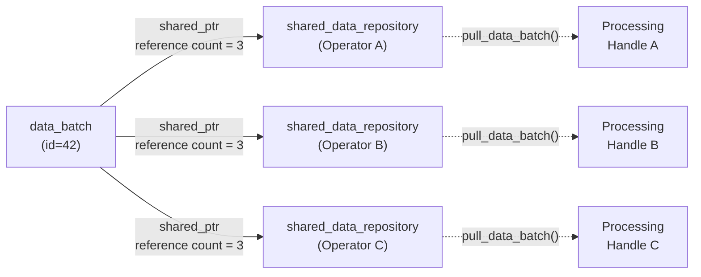

**Test Verification:**
The test case at [test/data/test_data_repository.cpp:97-132]() demonstrates that:
- Same batch can be added to multiple repositories
- Each repository returns the same pointer (`pulled1.get() == pulled2.get()`)
- Processing count increments for each active processing handle

**Sources:** [include/data/data_repository.hpp:145](), [test/data/test_data_repository.cpp:97-132]()

### Unique Ownership Model

The `unique_data_repository` uses `std::unique_ptr<data_batch>` to enforce exclusive ownership. Once a batch is added, ownership transfers to the repository, and pulling transfers ownership to the caller.

**Use Case Example:**

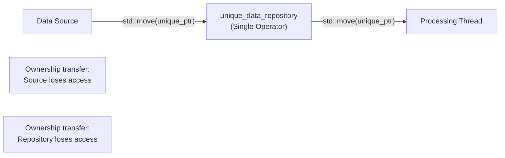

**Characteristics:**
- Single-repository ownership only
- Move semantics prevent accidental copies
- Lower overhead than `shared_ptr` (no reference counting)

**Sources:** [include/data/data_repository.hpp:146](), [test/data/test_data_repository.cpp:248-267]()

---

## Thread Safety and Concurrency

### Mutex Protection

All public methods acquire `_mutex` via `std::lock_guard` before accessing `_data_batches`:

| Operation | Lock Scope | Protected Section |
|-----------|------------|-------------------|
| `add_data_batch()` | Method body | Vector push_back |
| `pull_data_batch()` | Method body | Vector front access, erase, conditional insert |
| `size()` | Method body | Vector size query |
| `empty()` | Delegates to `size()` | Indirect protection |

**Sources:** [include/data/data_repository.hpp:72](), [include/data/data_repository.hpp:96](), [include/data/data_repository.hpp:124]()

### Concurrent Access Patterns

The repository supports high-concurrency scenarios validated by stress tests:

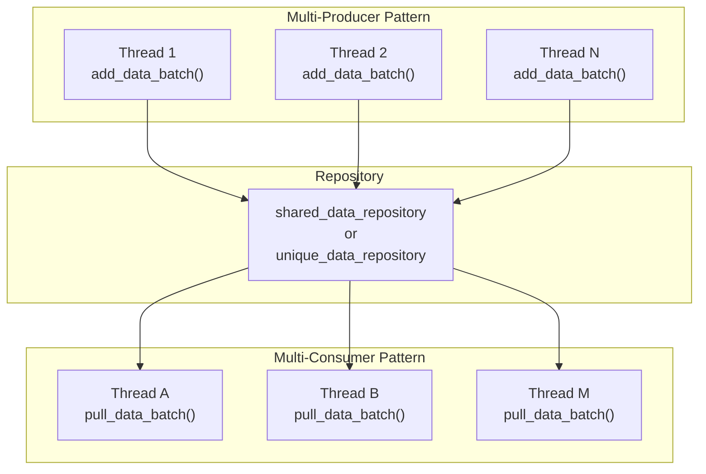

**Test Coverage:**
- **Thread-safe adding:** 10 threads × 50 batches = 500 total ([test/data/test_data_repository.cpp:147-183]())
- **Thread-safe pulling:** 10 threads pulling 500 batches ([test/data/test_data_repository.cpp:186-231]())
- **Concurrent add/pull:** 5 producer + 5 consumer threads ([test/data/test_data_repository.cpp:436-486]())
- **High contention:** 20 threads × 50 operations = 1000 operations ([test/data/test_data_repository.cpp:489-535]())

**Sources:** [test/data/test_data_repository.cpp:147-535]()

---

## FIFO Ordering Semantics

The repository implements strict first-in-first-out (FIFO) ordering using `std::vector` operations:

| Operation | Vector Method | Effect |
|-----------|---------------|--------|
| Add | `push_back()` | Append to end |
| Pull | `front()` + `erase(begin())` | Remove from front |

### FIFO Verification

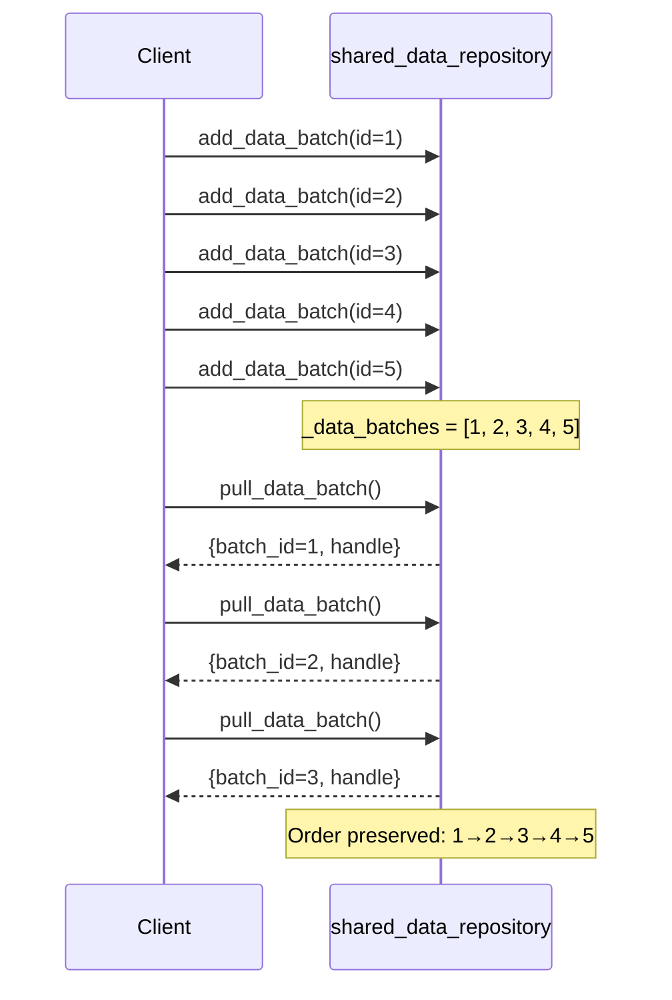

**Test Verification:**
Test cases at [test/data/test_data_repository.cpp:73-94]() and [test/data/test_data_repository.cpp:270-291]() verify that batches are always retrieved in insertion order, regardless of ownership model.

**Sources:** [include/data/data_repository.hpp:99-100](), [test/data/test_data_repository.cpp:73-94]()

---

## Processing State Integration

### Interaction with `data_batch_processing_handle`

The repository integrates with the `data_batch` state machine by creating processing handles that manage the `processing_count` field. This prevents unsafe operations during active processing.

**State Transition on Pull:**

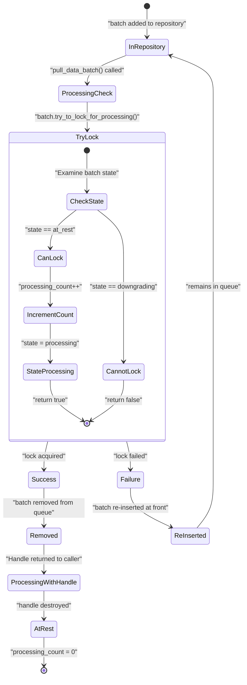

**Key Guarantees:**
1. **Atomicity:** Lock acquisition and handle creation are atomic within mutex ([include/data/data_repository.hpp:106-108]())
2. **RAII cleanup:** Handle destructor decrements `processing_count` automatically
3. **Downgrade protection:** Batches in `downgrading` state cannot be pulled ([test/data/test_data_repository.cpp:559-576]())

**Sources:** [include/data/data_repository.hpp:102-112](), [test/data/test_data_repository.cpp:538-576]()

### Processing Handle Lifecycle

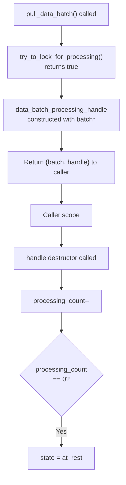

**Test Example:**
The test at [test/data/test_data_repository.cpp:538-556]() demonstrates that:
- While handle exists, `processing_count == 1` and `state == processing`
- When handle goes out of scope, `processing_count == 0` and `state == at_rest`

**Sources:** [test/data/test_data_repository.cpp:538-556]()

---

## Empty Repository Behavior

When `pull_data_batch()` is called on an empty repository, it returns a pair of default-constructed objects:

```cpp
{PtrType{}, data_batch_processing_handle{}}
```

This translates to:
- **Batch pointer:** `nullptr` (both `shared_ptr` and `unique_ptr`)
- **Handle:** Invalid handle (no batch to manage)

**Safe Usage Pattern:**
```cpp
auto [batch, handle] = repository.pull_data_batch();
if (batch) {
    // Process batch - handle automatically manages processing_count
} else {
    // Repository is empty or batch cannot be locked
}
```

**Test Coverage:**
Tests verify that pulling from empty repositories never crashes and always returns `nullptr`:
- [test/data/test_data_repository.cpp:135-144]() for shared repositories
- [test/data/test_data_repository.cpp:238-245]() for unique repositories

**Sources:** [include/data/data_repository.hpp:97](), [test/data/test_data_repository.cpp:135-144]()

---

## Usage Patterns

### Pattern 1: Producer-Consumer Queue

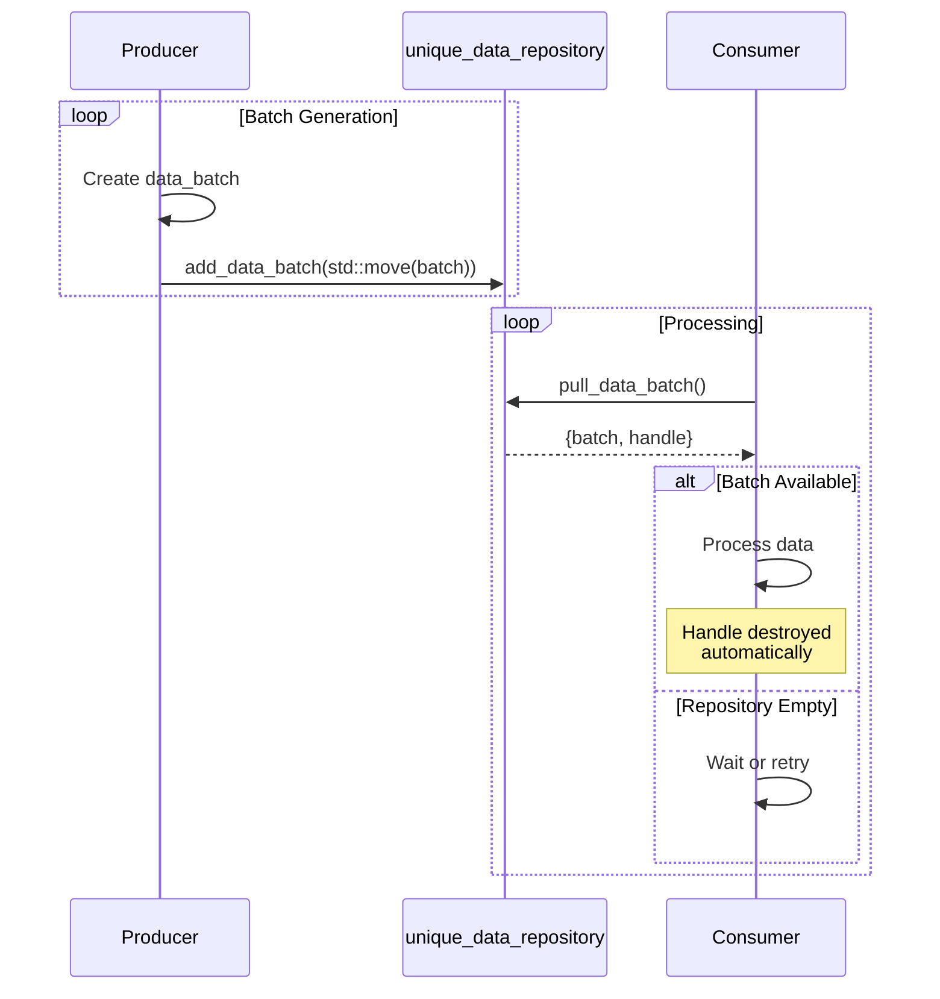

**Sources:** [test/data/test_data_repository.cpp:436-486]()

### Pattern 2: Broadcast to Multiple Operators

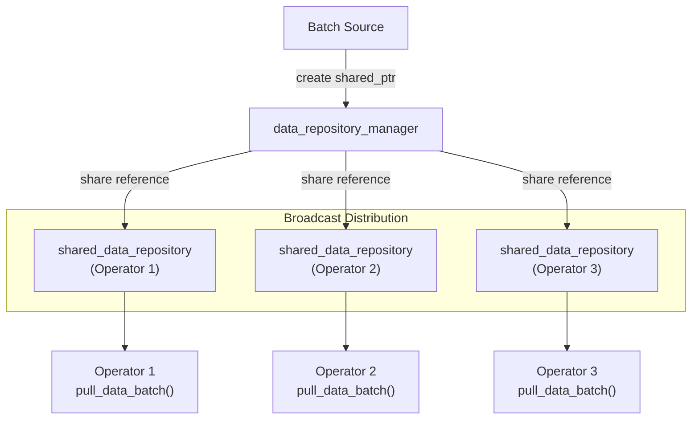

**Sources:** [test/data/test_data_repository.cpp:97-132]()

---

## Size and Availability Checking

The `size()` method provides thread-safe query of repository occupancy:

**Thread-Safe Size Query:**
- Acquires mutex lock ([include/data/data_repository.hpp:124]())
- Returns current vector size ([include/data/data_repository.hpp:125]())
- Consistent with concurrent `add_data_batch()` and `pull_data_batch()` operations

**Use Cases:**
1. **Monitoring:** Track queue depth for performance metrics
2. **Backpressure:** Throttle producers when queue grows too large
3. **Load balancing:** Distribute work based on queue occupancy

**Stress Test:**
The test at [test/data/test_data_repository.cpp:863-910]() validates that `size()` remains accurate under concurrent add/pull operations from 10 threads.

**Sources:** [include/data/data_repository.hpp:122-138](), [test/data/test_data_repository.cpp:583-860]()

---

## Testing and Validation

The test suite at [test/data/test_data_repository.cpp]() provides comprehensive coverage:

### Test Categories

| Category | Test Cases | Coverage |
|----------|------------|----------|
| Basic Operations | Construction, add/pull single batch | Functional correctness |
| FIFO Ordering | Multiple batch sequences | Order preservation |
| Ownership Models | Shared vs. unique semantics | Pointer type behavior |
| Thread Safety | 10-20 threads, 50-100 operations each | Concurrent access |
| Edge Cases | Empty pulls, downgrade blocking | Error handling |
| Size/Availability | Concurrent size queries | State consistency |

### Concurrency Test Parameters

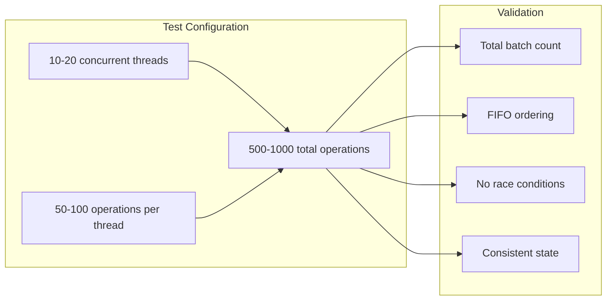

**Key Test Files:**
- [test/data/test_data_repository.cpp:39-910]() - Complete test suite

**Sources:** [test/data/test_data_repository.cpp:1-911]()

---

## Related Components

The Data Repository integrates with other cuCascade subsystems:

| Component | Relationship | Reference |
|-----------|--------------|-----------|
| `data_batch` | Stored object type | [Data Batch](#6.1) |
| `data_batch_processing_handle` | RAII state management | [Data Batch](#6.1) |
| `data_repository_manager` | Multi-operator coordination | [Data Repository Manager](#6.3) |
| `idata_representation` | Batch payload | [Data Representation Interface](#5.1) |

**Sources:** [include/data/data_repository.hpp:20]()

---

