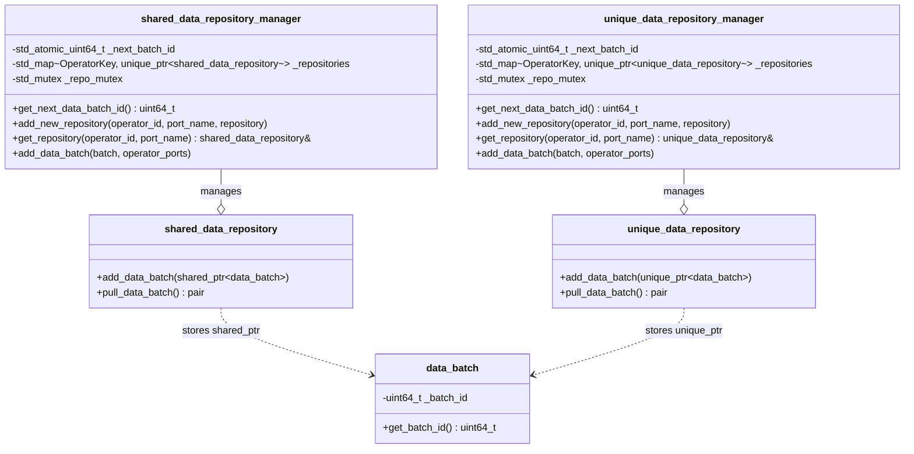
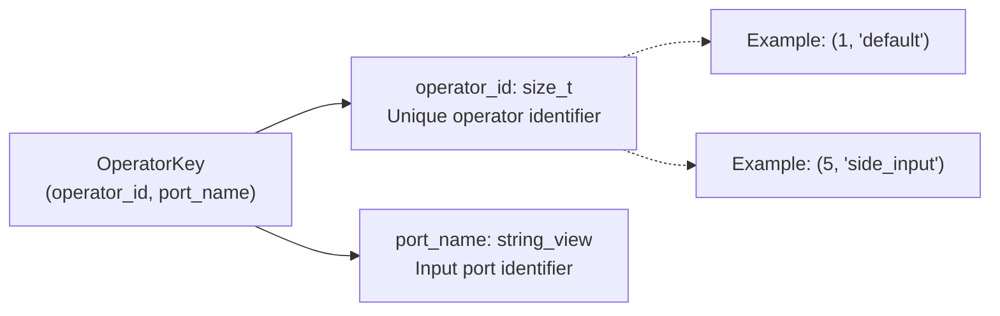
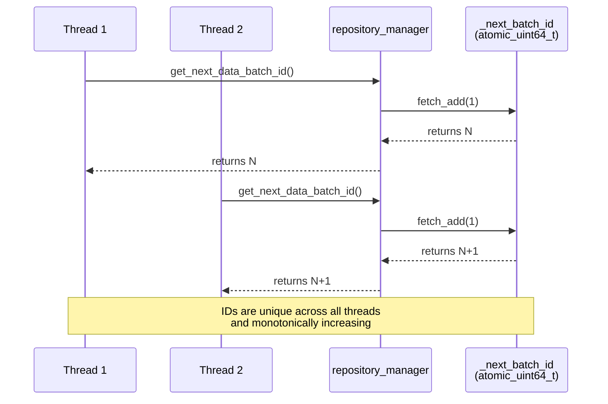
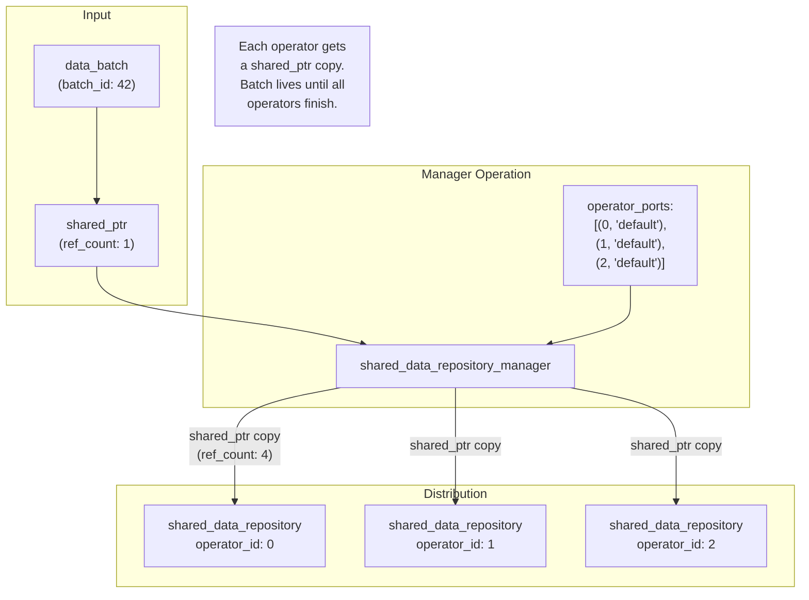
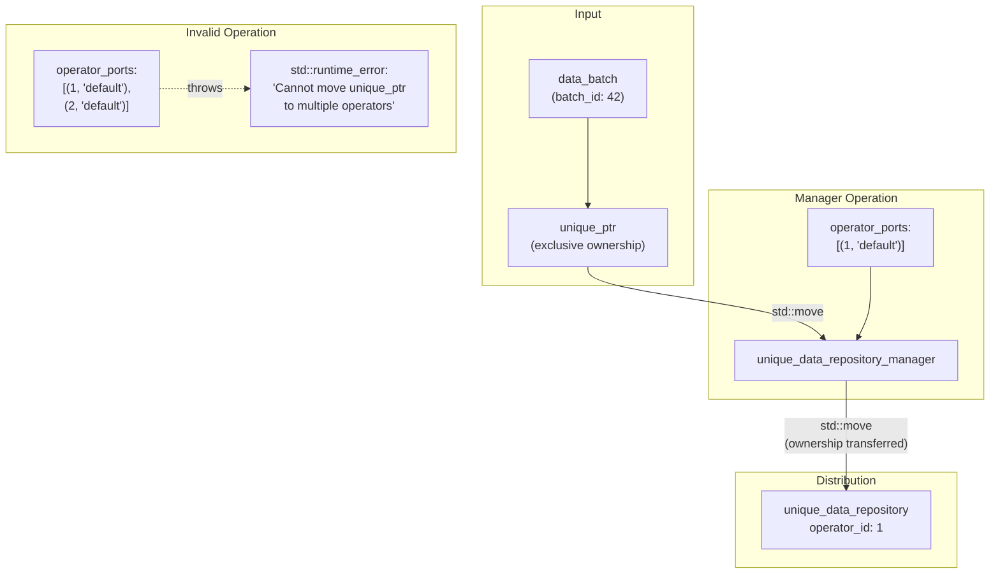
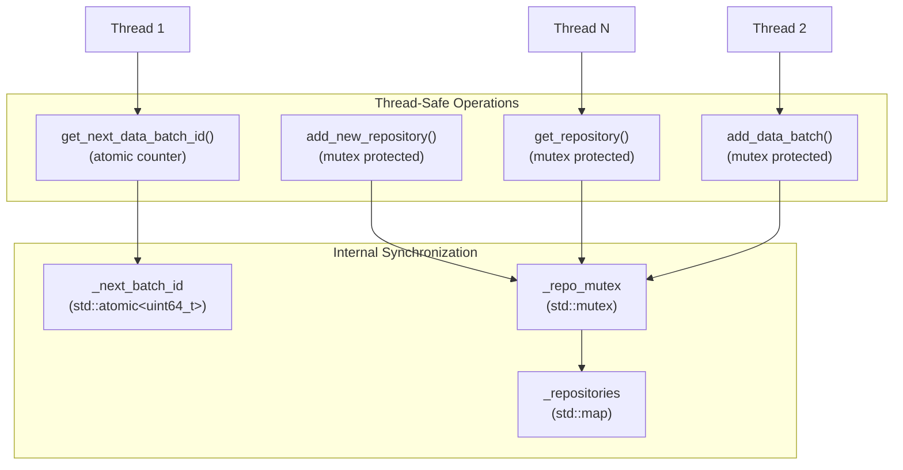
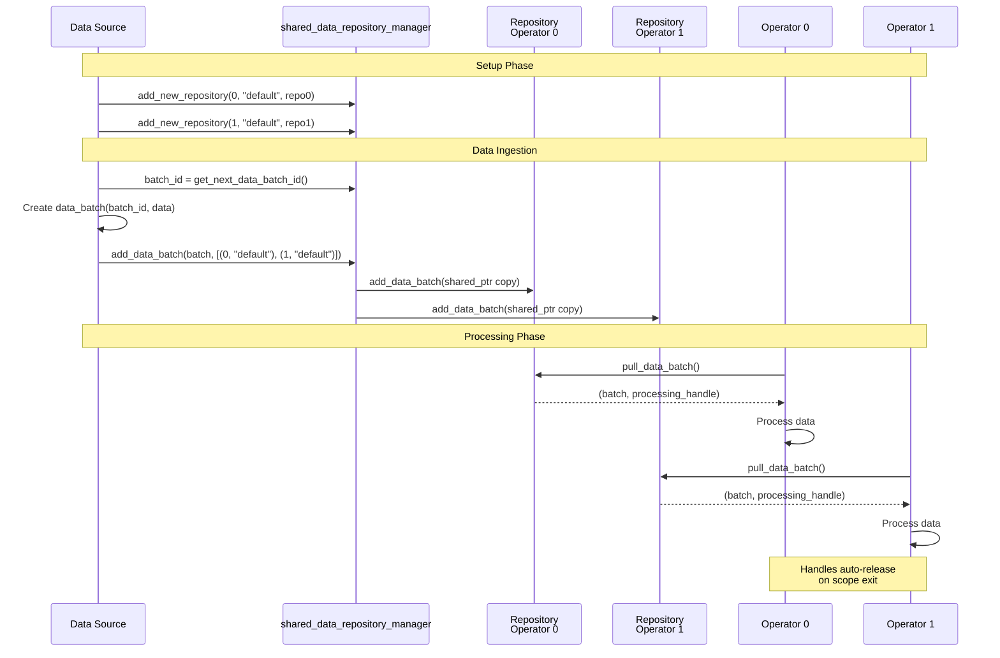

<!-- source: DeepWiki mcp.deepwiki.com · repo NVIDIA/cuCascade · page 6.3 Data Repository Manager · fetched 2026-10-26 -->

# Data Repository Manager

<details>
<summary>Relevant source files</summary>

The following files were used as context for generating this wiki page:

- [include/data/data_repository.hpp](include/data/data_repository.hpp)
- [pixi.toml](pixi.toml)
- [test/data/test_data_repository_manager.cpp](test/data/test_data_repository_manager.cpp)

</details>


## Purpose and Scope

The Data Repository Manager provides centralized coordination for distributing data batches across multiple operators in a data processing pipeline. This document describes the `shared_data_repository_manager` and `unique_data_repository_manager` classes, which manage operator-specific repositories, generate unique batch identifiers, and implement different ownership semantics for batch distribution.

For information about the individual repositories managed by these classes, see [Data Repository](#6.2). For information about the data batches being distributed, see [Data Batch](#6.1).

---

## Overview

The repository manager layer sits above individual data repositories and provides:
- **Multi-operator coordination**: Route batches to one or more operator-specific repositories
- **Batch ID generation**: Thread-safe assignment of unique identifiers for all batches
- **Ownership management**: Support for both shared and exclusive ownership patterns
- **Repository lifecycle**: Create and manage operator-specific repository instances

Two manager variants support different distribution patterns:

| Manager Type | Pointer Type | Distribution Pattern |
|--------------|-------------|---------------------|
| `shared_data_repository_manager` | `std::shared_ptr<data_batch>` | Broadcast to multiple operators |
| `unique_data_repository_manager` | `std::unique_ptr<data_batch>` | Transfer to single operator only |

**Sources:** [test/data/test_data_repository_manager.cpp:1-1149]()

---

## Architecture

### Class Structure



**Sources:** [test/data/test_data_repository_manager.cpp:40-47](), [test/data/test_data_repository_manager.cpp:258-265]()

---

### Operator Key Structure

Each repository is identified by a composite key consisting of an operator ID and a port name:



This structure allows operators to have multiple input ports, each with its own repository instance.

**Sources:** [test/data/test_data_repository_manager.cpp:50-61](), [test/data/test_data_repository_manager.cpp:122]()

---

## Batch ID Generation

Both manager types provide thread-safe generation of monotonically increasing batch identifiers through the `get_next_data_batch_id()` method.

### ID Generation Mechanism



### Characteristics

- **Thread-safe**: Uses atomic operations for lock-free ID generation
- **Unique**: Each call returns a distinct identifier
- **Monotonic**: IDs increase sequentially (gaps may occur with concurrent access)
- **64-bit range**: Supports up to `UINT64_MAX` batches (18+ quintillion)

**Sources:** [test/data/test_data_repository_manager.cpp:84-112](), [test/data/test_data_repository_manager.cpp:172-208]()

---

## Repository Management

### Adding Repositories

Repositories must be registered before batches can be added to them:

```cpp
// Create manager
shared_data_repository_manager manager;

// Register repository for operator 1, default port
auto repository = std::make_unique<shared_data_repository>();
manager.add_new_repository(1, "default", std::move(repository));
```

**Key points:**
- Repositories are uniquely identified by `(operator_id, port_name)` pairs
- Repository ownership transfers to the manager
- Multiple ports per operator are supported
- Registration is thread-safe

**Sources:** [test/data/test_data_repository_manager.cpp:50-61](), [test/data/test_data_repository_manager.cpp:64-81]()

### Accessing Repositories

Retrieve repository references for direct interaction:

```cpp
// Get repository by operator ID and port name
auto& repo = manager.get_repository(1, "default");

// Pull batch directly from repository
auto [batch, handle] = repo->pull_data_batch();
```

Attempting to access non-existent repositories throws `std::out_of_range`.

**Sources:** [test/data/test_data_repository_manager.cpp:59-60](), [test/data/test_data_repository_manager.cpp:46]()

---

## Batch Distribution Patterns

### Shared Ownership Distribution

The `shared_data_repository_manager` broadcasts batches to multiple operators using `std::shared_ptr`:



#### Usage Example

```cpp
shared_data_repository_manager manager;

// Register multiple operators
manager.add_new_repository(0, "default", std::make_unique<shared_data_repository>());
manager.add_new_repository(1, "default", std::make_unique<shared_data_repository>());
manager.add_new_repository(2, "default", std::make_unique<shared_data_repository>());

// Create batch
auto data = std::make_unique<mock_data_representation>(memory::Tier::GPU, 1024);
uint64_t batch_id = manager.get_next_data_batch_id();
auto batch = std::make_shared<data_batch>(batch_id, std::move(data));

// Broadcast to all operators
std::vector<std::pair<size_t, std::string_view>> operator_ports = {
    {0, "default"},
    {1, "default"},
    {2, "default"}
};
manager.add_data_batch(batch, operator_ports);

// All three operators can now pull the same batch
```

**Sources:** [test/data/test_data_repository_manager.cpp:140-169](), [test/data/test_data_repository_manager.cpp:363-440]()

### Unique Ownership Transfer

The `unique_data_repository_manager` transfers exclusive ownership to a single operator using `std::unique_ptr`:



#### Usage Example

```cpp
unique_data_repository_manager manager;

// Register single operator
manager.add_new_repository(1, "default", std::make_unique<unique_data_repository>());

// Create batch
auto data = std::make_unique<mock_data_representation>(memory::Tier::GPU, 1024);
uint64_t batch_id = manager.get_next_data_batch_id();
auto batch = std::make_unique<data_batch>(batch_id, std::move(data));

// Transfer to single operator only
std::vector<std::pair<size_t, std::string_view>> operator_ports = {{1, "default"}};
manager.add_data_batch(std::move(batch), operator_ports);

// Attempting multiple operators throws std::runtime_error
```

**Sources:** [test/data/test_data_repository_manager.cpp:282-304](), [test/data/test_data_repository_manager.cpp:307-325]()

---

## Thread Safety

Both manager implementations provide thread-safe operations for concurrent pipeline execution.

### Concurrent Operations Support



### Concurrency Characteristics

| Operation | Mechanism | Contention Level |
|-----------|-----------|------------------|
| `get_next_data_batch_id()` | Lock-free atomic | Low |
| `add_new_repository()` | Mutex-protected map insertion | Low (setup phase only) |
| `get_repository()` | Mutex-protected map lookup | Medium |
| `add_data_batch()` | Mutex-protected distribution | Medium-High |

**Test Coverage:**
- 10 threads × 100 operations: All IDs unique and accounted for
- 10 threads × 50 batches: All batches successfully added and retrieved
- High contention (20 threads, single operator): No data loss or corruption

**Sources:** [test/data/test_data_repository_manager.cpp:172-208](), [test/data/test_data_repository_manager.cpp:211-251](), [test/data/test_data_repository_manager.cpp:682-736]()

---

## Usage Patterns

### Full Pipeline Workflow



**Sources:** [test/data/test_data_repository_manager.cpp:363-440]()

### Selective Distribution

Batches can be routed to specific operator subsets:

```cpp
shared_data_repository_manager manager;

// Setup 5 operators
for (int i = 0; i < 5; ++i) {
    manager.add_new_repository(i, "default", std::make_unique<shared_data_repository>());
}

// Batch 1: All operators
std::vector<std::pair<size_t, std::string_view>> all_ports = {
    {0, "default"}, {1, "default"}, {2, "default"}, {3, "default"}, {4, "default"}
};
manager.add_data_batch(batch1, all_ports);

// Batch 2: Only operators 2 and 3
std::vector<std::pair<size_t, std::string_view>> subset_ports = {
    {2, "default"}, {3, "default"}
};
manager.add_data_batch(batch2, subset_ports);

// Batch 3: Single operator
std::vector<std::pair<size_t, std::string_view>> single_port = {{4, "default"}};
manager.add_data_batch(batch3, single_port);
```

**Sources:** [test/data/test_data_repository_manager.cpp:363-440]()

---

## API Reference

### `shared_data_repository_manager`

#### Constructor
```cpp
shared_data_repository_manager();
```
Creates an empty manager with no registered repositories. Batch ID counter initialized to 0.

#### `get_next_data_batch_id()`
```cpp
uint64_t get_next_data_batch_id();
```
- **Returns:** Unique, monotonically increasing batch identifier
- **Thread-safe:** Lock-free atomic increment
- **Complexity:** O(1)

#### `add_new_repository()`
```cpp
void add_new_repository(
    size_t operator_id,
    std::string_view port_name,
    std::unique_ptr<shared_data_repository> repository
);
```
- **Parameters:**
  - `operator_id`: Numeric identifier for the operator
  - `port_name`: Name of the input port (e.g., "default", "side_input")
  - `repository`: Repository instance (ownership transferred)
- **Thread-safe:** Yes (mutex-protected)
- **Throws:** May throw on memory allocation failures

#### `get_repository()`
```cpp
std::unique_ptr<shared_data_repository>& get_repository(
    size_t operator_id,
    std::string_view port_name
);
```
- **Returns:** Reference to the repository for the specified operator and port
- **Thread-safe:** Yes (mutex-protected)
- **Throws:** `std::out_of_range` if repository not found
- **Complexity:** O(log N) where N is the number of repositories

#### `add_data_batch()`
```cpp
void add_data_batch(
    std::shared_ptr<data_batch> batch,
    const std::vector<std::pair<size_t, std::string_view>>& operator_ports
);
```
- **Parameters:**
  - `batch`: Shared pointer to the batch (copied to each repository)
  - `operator_ports`: List of (operator_id, port_name) pairs to distribute to
- **Thread-safe:** Yes (mutex-protected)
- **Behavior:** Creates a shared_ptr copy for each target repository
- **Throws:** May throw if operator/port not found

**Sources:** [test/data/test_data_repository_manager.cpp:40-251]()

---

### `unique_data_repository_manager`

The API is identical to `shared_data_repository_manager` with the following differences:

#### `add_new_repository()`
```cpp
void add_new_repository(
    size_t operator_id,
    std::string_view port_name,
    std::unique_ptr<unique_data_repository> repository
);
```
Accepts `unique_data_repository` instead of `shared_data_repository`.

#### `get_repository()`
```cpp
std::unique_ptr<unique_data_repository>& get_repository(
    size_t operator_id,
    std::string_view port_name
);
```
Returns reference to `unique_data_repository` instead of `shared_data_repository`.

#### `add_data_batch()`
```cpp
void add_data_batch(
    std::unique_ptr<data_batch> batch,
    const std::vector<std::pair<size_t, std::string_view>>& operator_ports
);
```
- **Parameters:**
  - `batch`: Unique pointer to the batch (ownership transferred)
  - `operator_ports`: Must contain exactly one element
- **Throws:** `std::runtime_error` if `operator_ports.size() != 1`
- **Behavior:** Moves batch ownership to the single target repository

**Sources:** [test/data/test_data_repository_manager.cpp:258-325](), [test/data/test_data_repository_manager.cpp:843-883]()

---

## Edge Cases and Limits

### Large-Scale Scalability

Both managers support:
- **Operator IDs:** Any `size_t` value including 0, `SIZE_MAX`
- **Number of operators:** Tested with 1,000+ operators
- **Batches per operator:** Tested with 1,000+ batches
- **Concurrent threads:** Tested with 20 threads under high contention

**Sources:** [test/data/test_data_repository_manager.cpp:443-459](), [test/data/test_data_repository_manager.cpp:462-490](), [test/data/test_data_repository_manager.cpp:1027-1055]()

### Error Conditions

| Condition | Exception Type | When |
|-----------|---------------|------|
| Repository not found | `std::out_of_range` | `get_repository()` with invalid key |
| Multiple operators (unique_ptr) | `std::runtime_error` | `add_data_batch()` with size != 1 |
| Memory allocation failure | `std::bad_alloc` | Any operation allocating memory |

**Sources:** [test/data/test_data_repository_manager.cpp:46](), [test/data/test_data_repository_manager.cpp:324]()

---

