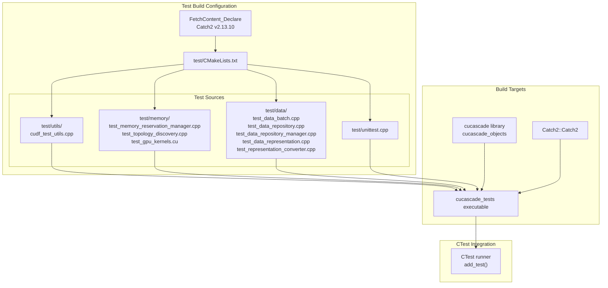
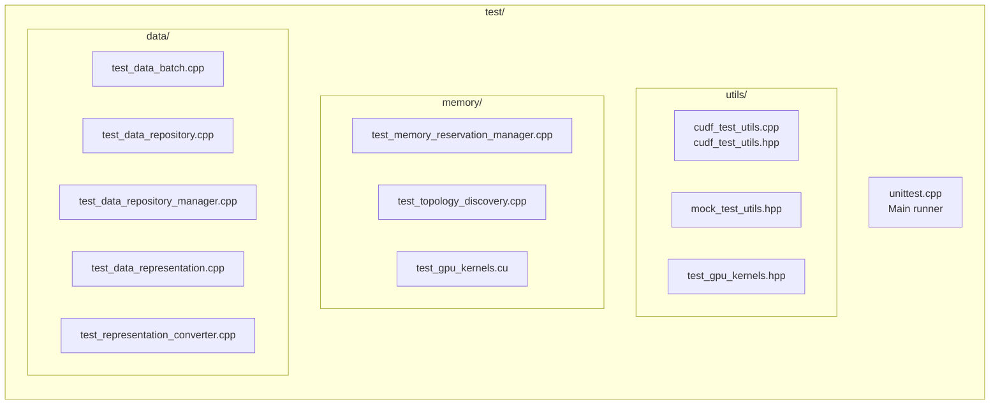
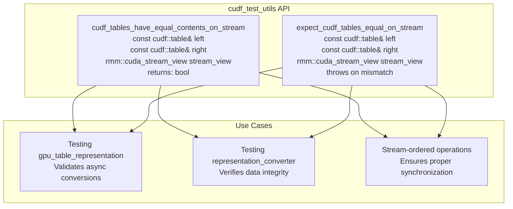
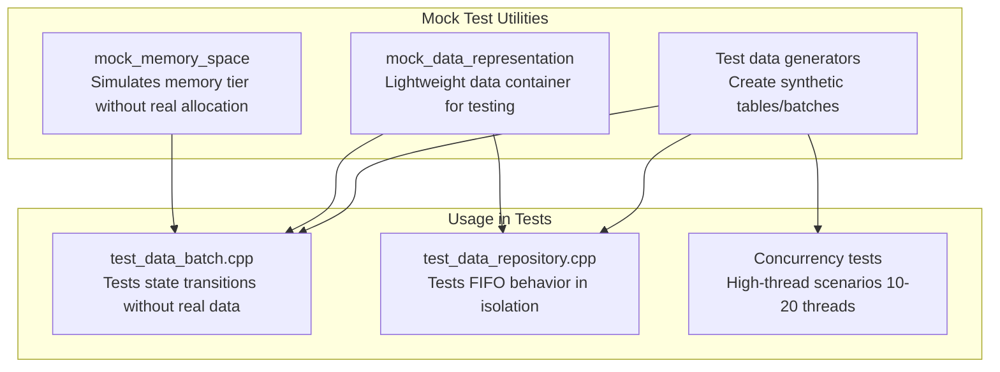
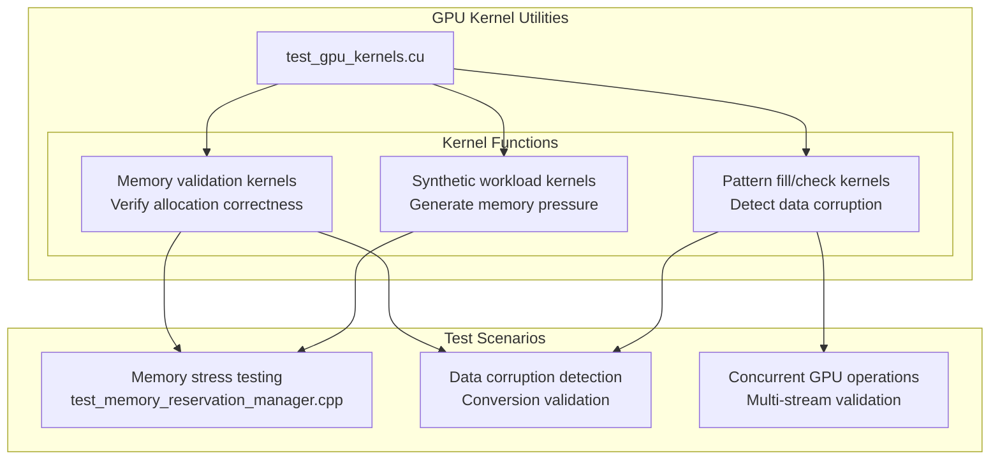
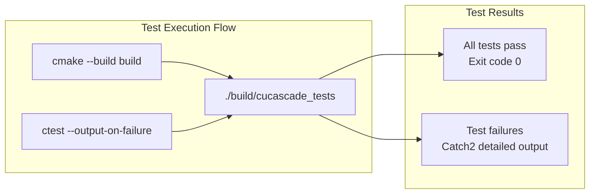

<!-- source: DeepWiki mcp.deepwiki.com · repo NVIDIA/cuCascade · page 7 Testing and Development · fetched 2026-10-26 -->

# Testing and Development

<details>
<summary>Relevant source files</summary>

The following files were used as context for generating this wiki page:

- [src/data/CMakeLists.txt](src/data/CMakeLists.txt)
- [test/CMakeLists.txt](test/CMakeLists.txt)
- [test/memory/CMakeLists.txt](test/memory/CMakeLists.txt)
- [test/unittest.cpp](test/unittest.cpp)
- [test/utils/CMakeLists.txt](test/utils/CMakeLists.txt)
- [test/utils/cudf_test_utils.hpp](test/utils/cudf_test_utils.hpp)

</details>


## Purpose and Scope

This page provides comprehensive documentation for developers working on cuCascade's test infrastructure. It covers the test framework architecture, test organization, available test utilities, and best practices for testing GPU-accelerated memory management code.

For information about the production components being tested, see:
- Memory management: [Memory Management Subsystem](#4)
- Data representation: [Data Representation Subsystem](#5)
- Data lifecycle: [Data Management Subsystem](#6)

For runtime considerations like thread safety and stream management in production code, see [Advanced Topics](#8).

---

## Test Framework Architecture

cuCascade uses **Catch2 v2.13.10** as its testing framework, integrated via CMake's FetchContent mechanism. The test infrastructure is organized into a single executable that contains all unit tests across memory management, data representation, and data lifecycle components.

### Build System Integration

The test build system follows this structure:



**Sources:** [test/CMakeLists.txt:18-61]()

The test executable `cucascade_tests` links against:
- `cucascade` library (the system under test)
- `Catch2::Catch2` (test framework)
- `CUDA::cudart` (for GPU operations)

### Test Runner Implementation

The main test runner is minimal and delegates to Catch2's session manager:

| Component | File | Responsibility |
|-----------|------|----------------|
| Main runner | [test/unittest.cpp:18-31]() | Configures Catch2 session, runs all tests |
| Test framework | Catch2 v2.13.10 | Provides `CATCH_CONFIG_RUNNER`, test discovery, assertion macros |

The runner implementation uses `CATCH_CONFIG_RUNNER` to allow custom initialization before test execution.

**Sources:** [test/unittest.cpp:1-31]()

---

## Test Organization

Tests are organized by subsystem, mirroring the production code structure:

### Test Directory Structure



**Sources:** [test/CMakeLists.txt:31-45]()

### Test File Naming Convention

All test files follow the pattern `test_<component>.cpp` or `test_<component>.cu` for CUDA tests. This convention makes test files easily identifiable and maintains consistency with the component they test.

| Test Category | Files | Tests What |
|---------------|-------|------------|
| **Memory Management** | `test_memory_reservation_manager.cpp` | Memory reservation strategies, allocation across tiers |
| | `test_topology_discovery.cpp` | Hardware topology detection, NUMA node discovery |
| | `test_gpu_kernels.cu` | GPU memory validation, synthetic workloads |
| **Data Representation** | `test_data_representation.cpp` | `gpu_table_representation`, `host_table_representation` |
| | `test_representation_converter.cpp` | Cross-tier conversions, format transformations |
| **Data Lifecycle** | `test_data_batch.cpp` | `data_batch` state management, processing handles |
| | `test_data_repository.cpp` | `shared_data_repository`, `unique_data_repository` FIFO behavior |
| | `test_data_repository_manager.cpp` | Multi-operator routing, batch ID generation |
| **Utilities** | `cudf_test_utils.cpp` | Stream-aware table comparison |

**Sources:** [test/CMakeLists.txt:31-45]()

---

## Test Utilities

cuCascade provides specialized test utilities to handle the complexity of testing GPU-accelerated code with asynchronous operations and multi-tier memory management.

### cuDF Test Utilities

The `cudf_test_utils` namespace provides stream-aware comparison functions critical for testing asynchronous GPU operations:



**Key Functions:**

| Function | Signature | Purpose |
|----------|-----------|---------|
| `cudf_tables_have_equal_contents_on_stream` | `(const cudf::table&, const cudf::table&, rmm::cuda_stream_view)` | Returns boolean indicating table equality, respecting stream ordering |
| `expect_cudf_tables_equal_on_stream` | `(const cudf::table&, const cudf::table&, rmm::cuda_stream_view)` | Asserts table equality with detailed error messages on mismatch |

**Critical Design Feature:** Stream awareness is essential because cuDF operations and RMM allocations are asynchronous. Comparing tables without proper stream synchronization leads to race conditions and false test failures.

**Sources:** [test/utils/cudf_test_utils.hpp:24-36]()

### Mock Test Utilities

Mock implementations provide isolated testing of individual components without dependencies on the full system:



**Mock Implementations:**
- **`mock_memory_space`**: Simulates memory space behavior without actual GPU/host allocations
- **`mock_data_representation`**: Lightweight representation for testing batch lifecycle without cuDF overhead
- **Test data generators**: Create deterministic batches for reproducible testing

**Sources:** Referenced in high-level diagram analysis, implementation in test/utils/mock_test_utils.hpp (not provided but referenced)

### GPU Kernel Test Utilities

GPU kernel utilities enable validation of memory operations and generation of synthetic workloads:



**Purpose:**
- **Memory validation**: Ensure allocated memory is accessible and correctly sized
- **Synthetic workloads**: Generate controlled memory pressure for testing downgrade policies
- **Pattern checking**: Detect data corruption during transfers and conversions

**Sources:** [test/CMakeLists.txt:37](), [test/memory/CMakeLists.txt:22]()

---

## Running Tests

### Building the Test Suite

Tests are built as part of the standard CMake workflow:

```bash
# Configure with tests enabled
cmake -S . -B build -DBUILD_TESTS=ON

# Build the test executable
cmake --build build --target cucascade_tests

# Run tests via CTest
cd build
ctest --output-on-failure
```

### CTest Integration

The test suite integrates with CTest for standardized test execution:



**Sources:** [test/CMakeLists.txt:60-61]()

### Direct Execution

The test executable can be run directly with Catch2 command-line options:

```bash
# Run all tests
./build/cucascade_tests

# Run specific test cases
./build/cucascade_tests "[data_batch]"

# List all test cases
./build/cucascade_tests --list-tests

# Run with verbose output
./build/cucascade_tests -s
```

| Option | Purpose |
|--------|---------|
| `--list-tests` | Display all available test cases |
| `-s` | Show successful assertions (verbose mode) |
| `[tag]` | Run only tests matching the tag |
| `--output-on-failure` | Display output only for failing tests |

---

## Best Practices for GPU Testing

### Stream Management

GPU operations in cuCascade are asynchronous and stream-ordered. Tests must respect this:

**Critical Pattern:**
```
1. Obtain stream from memory resource or create test stream
2. Perform GPU operations on that stream
3. Use stream-aware comparison utilities
4. Synchronize stream before assertions that check CPU-visible state
```

**Why it matters:** Comparing GPU data without stream synchronization leads to race conditions. The stream-aware utilities in `cudf_test_utils` handle synchronization correctly.

**Sources:** [test/utils/cudf_test_utils.hpp:27-33]()

### Thread Safety Testing

cuCascade components are designed for concurrent access. Tests validate this with high-concurrency scenarios:

| Test Pattern | Implementation | Validates |
|--------------|----------------|-----------|
| **Multi-threaded batch processing** | 10-20 threads, 50-100 operations each | `data_batch` processing_count correctness |
| **Concurrent repository operations** | Multiple threads calling `pull_data_batch` | FIFO ordering under contention |
| **Simultaneous conversions** | Multiple threads triggering `convert_to` | Representation converter thread safety |

**Recommended approach:**
1. Create worker threads
2. Perform identical operations concurrently
3. Join threads
4. Validate final state consistency

### Memory Validation

When testing memory management:

**GPU Memory:**
- Use validation kernels from `test_gpu_kernels.cu` to verify memory accessibility
- Check allocation sizes match requests
- Verify alignment requirements

**Host Memory:**
- Validate block-based allocations are contiguous
- Check NUMA affinity for multi-socket systems
- Verify proper cleanup on deallocation

**Cross-Tier Operations:**
- Test all conversion paths (GPU↔HOST, GPU↔GPU, HOST↔HOST)
- Validate data integrity after conversion using stream-aware comparison
- Test conversion under memory pressure

### Test Data Generation

**Deterministic data:** Use fixed seeds for random number generators to ensure reproducibility.

**Representative sizes:** Test with various data sizes:
- Small batches (< 1MB) - fast iteration
- Medium batches (10-100MB) - realistic workloads  
- Large batches (> 1GB) - stress testing memory limits

**Edge cases:**
- Empty tables
- Single-row tables
- Tables with null values
- Tables at memory tier boundaries

---

## Test Coverage Matrix

The following table summarizes test coverage across subsystems:

| Component | Test File | Key Scenarios Covered |
|-----------|-----------|----------------------|
| **memory_reservation_manager** | `test_memory_reservation_manager.cpp` | Multi-tier allocation, reservation strategies, memory pressure |
| **topology_discovery** | `test_topology_discovery.cpp` | Hardware detection, NUMA node mapping, GPU enumeration |
| **data_batch** | `test_data_batch.cpp` | State transitions, processing_handle lifecycle, concurrent access |
| **data_repository** | `test_data_repository.cpp` | FIFO ordering, shared vs unique ownership, processing_handle acquisition |
| **data_repository_manager** | `test_data_repository_manager.cpp` | Batch routing, ID generation, multi-operator coordination |
| **gpu_table_representation** | `test_data_representation.cpp` | cuDF integration, GPU memory management, stream-aware operations |
| **host_table_representation** | `test_data_representation.cpp` | Block-based allocation, host memory management |
| **representation_converter** | `test_representation_converter.cpp` | All conversion paths, data integrity, error handling |

**Sources:** [test/CMakeLists.txt:31-45]()

---

## Debugging Test Failures

### Common Issues and Solutions

**Issue: Stream synchronization errors**
- **Symptom:** Intermittent test failures, incorrect comparison results
- **Solution:** Ensure all GPU operations complete before assertions using stream-aware utilities

**Issue: Memory access violations in GPU kernels**
- **Symptom:** CUDA errors, segmentation faults
- **Solution:** Use `cuda-memcheck` or `compute-sanitizer` to identify invalid memory accesses

**Issue: Deadlocks in concurrent tests**
- **Symptom:** Tests hang indefinitely
- **Solution:** Review locking order, ensure all locks are released, use RAII handles

**Issue: False positives in table comparison**
- **Symptom:** Tests fail despite correct results
- **Solution:** Verify stream parameter is correct, check for floating-point precision issues

### Debugging Tools

| Tool | Purpose | Usage |
|------|---------|-------|
| `cuda-gdb` | GPU debugger | Breakpoints in CUDA kernels |
| `cuda-memcheck` | Memory error detection | Detect out-of-bounds access, race conditions |
| `compute-sanitizer` | Modern CUDA sanitizer | Successor to cuda-memcheck, more comprehensive |
| `nsys` | NVIDIA Nsight Systems | Profile test execution, identify bottlenecks |

---

## Adding New Tests

### Checklist for New Test Files

1. **File location:** Place in appropriate subdirectory (`memory/` or `data/`)
2. **File naming:** Follow `test_<component>.cpp` convention
3. **CMake registration:** Add to `TEST_SOURCES` in [test/CMakeLists.txt:31-45]()
4. **Test organization:** Use Catch2 sections for logical grouping
5. **Resource cleanup:** Ensure proper CUDA stream and memory cleanup
6. **Concurrency testing:** Include multi-threaded scenarios where applicable
7. **Documentation:** Add comments explaining non-obvious test logic

### Template Structure

```
// Include necessary headers
#include <catch2/catch.hpp>
#include <component_under_test.hpp>
#include "cudf_test_utils.hpp"

TEST_CASE("Component description", "[component_tag]") {
  // Setup: Create resources, streams, test data
  
  SECTION("Specific scenario") {
    // Arrange: Prepare test conditions
    // Act: Perform operation
    // Assert: Verify results using REQUIRE/CHECK
  }
  
  // Cleanup: Ensure resources released
}
```

**Sources:** Catch2 documentation patterns, existing test files in [test/memory/]() and [test/data/]()

---

