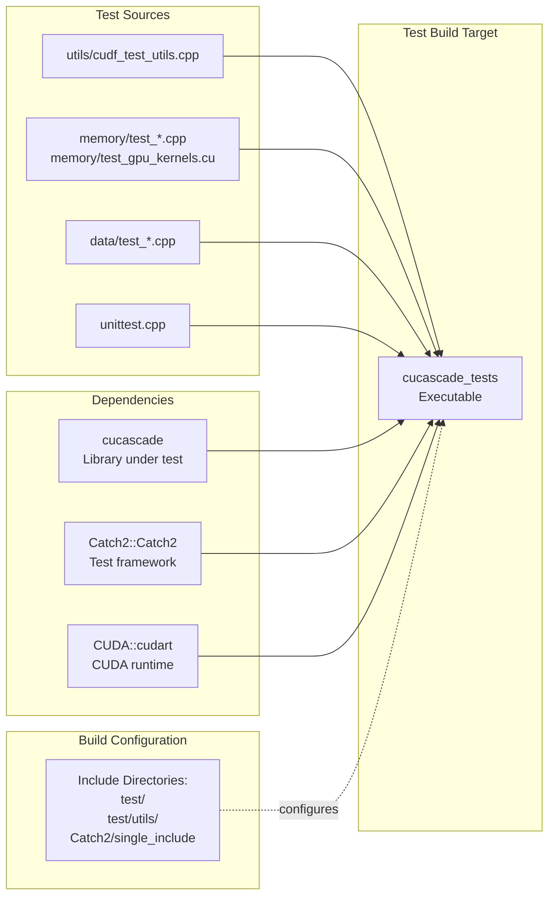

<!-- source: DeepWiki mcp.deepwiki.com · repo NVIDIA/cuCascade · page 7.1 Test Infrastructure · fetched 2026-10-26 -->

# Test Infrastructure

<details>
<summary>Relevant source files</summary>

The following files were used as context for generating this wiki page:

- [src/data/CMakeLists.txt](src/data/CMakeLists.txt)
- [test/CMakeLists.txt](test/CMakeLists.txt)
- [test/memory/CMakeLists.txt](test/memory/CMakeLists.txt)
- [test/unittest.cpp](test/unittest.cpp)
- [test/utils/CMakeLists.txt](test/utils/CMakeLists.txt)
- [test/utils/cudf_test_utils.hpp](test/utils/cudf_test_utils.hpp)

</details>


## Purpose and Scope

This page documents the test infrastructure for cuCascade, including the Catch2 framework integration, test organization, build configuration, and execution. The test infrastructure provides a foundation for comprehensive testing across memory management, data representation, and data lifecycle components.

For documentation of specific test utilities, see:
- cuDF test utilities: [cuDF Test Utilities](#7.2)
- Mock implementations: [Mock Test Utilities](#7.3)
- GPU kernel testing: [GPU Kernel Testing](#7.4)

For thread safety and concurrency testing patterns, see [Thread Safety and Concurrency](#8.1).

## Test Framework: Catch2 Integration

cuCascade uses **Catch2 v2.13.10** as its test framework. Catch2 is automatically fetched during the CMake configuration phase using `FetchContent`.

### Framework Configuration

The test framework is configured in [test/CMakeLists.txt:18-24]():

```
FetchContent_Declare(
  Catch2
  GIT_REPOSITORY https://github.com/catchorg/Catch2.git
  GIT_TAG v2.13.10)
FetchContent_MakeAvailable(Catch2)
```

### Test Runner

The main test runner is implemented in [test/unittest.cpp:24-31](), which defines a custom `main()` function using Catch2's `CATCH_CONFIG_RUNNER` macro. This allows cuCascade to initialize any required resources before running tests and ensures proper cleanup:

```cpp
int main(int argc, char* argv[])
{
  int code = Catch::Session().run(argc, argv);
  std::fflush(stdout);
  std::fflush(stderr);
  return code;
}
```

The explicit flush operations ensure all output is captured before the process terminates, which is critical for CI/CD environments.

**Sources:** [test/CMakeLists.txt:18-24](), [test/unittest.cpp:1-32]()

## Test Organization

### Directory Structure

Tests are organized into a hierarchical directory structure that mirrors the source code organization:

```mermaid
graph TB
    TEST_ROOT["test/"]
    
    UTILS["utils/<br/>Test utility implementations"]
    MEMORY["memory/<br/>Memory subsystem tests"]
    DATA["data/<br/>Data subsystem tests"]
    RUNNER["unittest.cpp<br/>Main test runner"]
    
    CUDF_UTILS["cudf_test_utils.hpp/.cpp<br/>Stream-aware comparison"]
    MOCK_UTILS["mock_test_utils.hpp<br/>Mock implementations"]
    
    MEM_RES_TEST["test_memory_reservation_manager.cpp"]
    TOPO_TEST["test_topology_discovery.cpp"]
    GPU_KERN["test_gpu_kernels.cu"]
    
    BATCH_TEST["test_data_batch.cpp"]
    REPO_TEST["test_data_repository.cpp"]
    REPO_MGR_TEST["test_data_repository_manager.cpp"]
    REP_TEST["test_data_representation.cpp"]
    CONV_TEST["test_representation_converter.cpp"]
    
    TEST_ROOT --> UTILS
    TEST_ROOT --> MEMORY
    TEST_ROOT --> DATA
    TEST_ROOT --> RUNNER
    
    UTILS --> CUDF_UTILS
    UTILS --> MOCK_UTILS
    
    MEMORY --> MEM_RES_TEST
    MEMORY --> TOPO_TEST
    MEMORY --> GPU_KERN
    
    DATA --> BATCH_TEST
    DATA --> REPO_TEST
    DATA --> REPO_MGR_TEST
    DATA --> REP_TEST
    DATA --> CONV_TEST
```



**Sources:** [test/CMakeLists.txt:31-45]()

### Test Categories

Tests are organized into two primary categories:

| Category | Directory | Purpose | Test Files |
|----------|-----------|---------|------------|
| **Memory Tests** | `test/memory/` | Validate memory reservation, topology discovery, and NUMA support | `test_memory_reservation_manager.cpp`<br/>`test_topology_discovery.cpp`<br/>`test_gpu_kernels.cu` |
| **Data Tests** | `test/data/` | Validate data representations, conversions, batches, and repositories | `test_data_batch.cpp`<br/>`test_data_repository.cpp`<br/>`test_data_repository_manager.cpp`<br/>`test_data_representation.cpp`<br/>`test_representation_converter.cpp` |
| **Test Utilities** | `test/utils/` | Provide reusable utilities for test implementation | `cudf_test_utils.hpp/.cpp`<br/>`mock_test_utils.hpp` |

**Sources:** [test/CMakeLists.txt:31-45]()

## Build Configuration

### Test Target Architecture

The test build uses modern CMake practices to create a single test executable that links against the cuCascade library:



**Sources:** [test/CMakeLists.txt:26-58]()

### CMake Test Configuration

The test executable is configured with the following CMake directives:

**Test Source Collection** [test/CMakeLists.txt:31-45]():
```cmake
set(TEST_SOURCES
    # Utils
    ${CMAKE_CURRENT_SOURCE_DIR}/utils/cudf_test_utils.cpp
    # Memory tests
    ${CMAKE_CURRENT_SOURCE_DIR}/memory/test_memory_reservation_manager.cpp
    ${CMAKE_CURRENT_SOURCE_DIR}/memory/test_topology_discovery.cpp
    ${CMAKE_CURRENT_SOURCE_DIR}/memory/test_gpu_kernels.cu
    # Data tests
    ${CMAKE_CURRENT_SOURCE_DIR}/data/test_data_batch.cpp
    ${CMAKE_CURRENT_SOURCE_DIR}/data/test_data_repository.cpp
    ${CMAKE_CURRENT_SOURCE_DIR}/data/test_data_repository_manager.cpp
    ${CMAKE_CURRENT_SOURCE_DIR}/data/test_data_representation.cpp
    ${CMAKE_CURRENT_SOURCE_DIR}/data/test_representation_converter.cpp
    # Main test runner
    ${CMAKE_CURRENT_SOURCE_DIR}/unittest.cpp)
```

**Test Executable Creation** [test/CMakeLists.txt:48]():
```cmake
add_executable(cucascade_tests ${TEST_SOURCES})
```

**Include Directories** [test/CMakeLists.txt:51-54]():
```cmake
target_include_directories(
  cucascade_tests
  PRIVATE ${CMAKE_CURRENT_SOURCE_DIR}
          ${CMAKE_CURRENT_SOURCE_DIR}/utils
          ${Catch2_SOURCE_DIR}/single_include)
```

**Library Dependencies** [test/CMakeLists.txt:57-58]():
```cmake
target_link_libraries(cucascade_tests PRIVATE cucascade Catch2::Catch2 CUDA::cudart)
```

**CTest Registration** [test/CMakeLists.txt:61]():
```cmake
add_test(NAME cucascade_tests COMMAND cucascade_tests)
```

**Sources:** [test/CMakeLists.txt:26-61]()

### Build Dependencies

The test infrastructure requires the following dependencies:

| Dependency | Purpose | Integration Method |
|------------|---------|-------------------|
| **Catch2** | Test framework | FetchContent (v2.13.10) |
| **cucascade** | Library under test | CMake target link |
| **CUDA::cudart** | CUDA runtime for GPU tests | CMake CUDA package |
| **cuDF** (transitive) | Through cucascade library | Inherited from cucascade target |
| **RMM** (transitive) | Through cucascade library | Inherited from cucascade target |

**Sources:** [test/CMakeLists.txt:18-58]()

## Test Execution

### Running Tests

Tests are integrated with CTest and can be executed in multiple ways:

**Standard CTest Execution:**
```bash
# Run all tests
ctest

# Run with verbose output
ctest -V

# Run tests matching a pattern
ctest -R memory
```

**Direct Executable Execution:**
```bash
# Run all tests
./cucascade_tests

# Run specific test cases
./cucascade_tests "test case name"

# Run tests matching a tag
./cucascade_tests [tag]

# List all available tests
./cucascade_tests --list-tests
```

**Catch2 Command-Line Options:**

The test executable supports all standard Catch2 command-line arguments:

| Option | Description |
|--------|-------------|
| `-l, --list-tests` | List all test cases |
| `-t, --list-tags` | List all tags |
| `-s, --success` | Show successful assertions |
| `-b, --break` | Break into debugger on failure |
| `-d, --durations <yes\|no>` | Show test durations |
| `-r, --reporter <name>` | Use specific reporter (xml, junit, console) |

### Test Output and Reporting

The test runner ensures proper output flushing [test/unittest.cpp:28-29](), making it reliable for:
- **Interactive Development:** Immediate feedback during development
- **CI/CD Pipelines:** Proper output capture in automated builds
- **Debugging:** Clear error messages and stack traces

**Sources:** [test/unittest.cpp:1-32]()

## Test Coverage Architecture

### Component Coverage Map

The following diagram illustrates how test files map to production code components:

```mermaid
graph TB
    subgraph "Test Files"
        T_MRM["test_memory_reservation_manager.cpp"]
        T_TOPO["test_topology_discovery.cpp"]
        T_KERN["test_gpu_kernels.cu"]
        T_BATCH["test_data_batch.cpp"]
        T_REPO["test_data_repository.cpp"]
        T_REPO_MGR["test_data_repository_manager.cpp"]
        T_REP["test_data_representation.cpp"]
        T_CONV["test_representation_converter.cpp"]
    end
    
    subgraph "Production Code (src/)"
        subgraph "Memory Management"
            P_MRM["memory_reservation_manager.cpp"]
            P_TOPO["topology_discovery.cpp"]
        end
        
        subgraph "Data Management"
            P_BATCH["data_batch.cpp"]
            P_REPO["data_repository.cpp"]
            P_REPO_MGR["data_repository_manager.cpp"]
            P_CPU_REP["cpu_data_representation.cpp"]
            P_GPU_REP["gpu_data_representation.cpp"]
            P_CONV["representation_converter.cpp"]
        end
    end
    
    T_MRM -.tests.-> P_MRM
    T_TOPO -.tests.-> P_TOPO
    T_KERN -.validates.-> P_MRM
    
    T_BATCH -.tests.-> P_BATCH
    T_REPO -.tests.-> P_REPO
    T_REPO_MGR -.tests.-> P_REPO_MGR
    T_REP -.tests.-> P_CPU_REP
    T_REP -.tests.-> P_GPU_REP
    T_CONV -.tests.-> P_CONV
```



**Sources:** [test/CMakeLists.txt:31-45](), [src/data/CMakeLists.txt:18-25]()

### Test Coverage Summary

| Production Component | Test Coverage | Test Files | Key Test Areas |
|---------------------|---------------|------------|----------------|
| **memory_reservation_manager** | Comprehensive | `test_memory_reservation_manager.cpp`<br/>`test_gpu_kernels.cu` | Allocation strategies, multi-tier management, memory pressure scenarios |
| **topology_discovery** | Comprehensive | `test_topology_discovery.cpp` | Hardware detection, NUMA awareness, device enumeration |
| **data_batch** | Comprehensive | `test_data_batch.cpp` | Lifecycle management, processing state, RAII handles, thread safety |
| **data_repository** | Comprehensive | `test_data_repository.cpp` | FIFO behavior, concurrency (10-20 threads), shared/unique variants |
| **data_repository_manager** | Comprehensive | `test_data_repository_manager.cpp` | Multi-operator routing, batch ID generation, distribution patterns |
| **data_representation** | Comprehensive | `test_data_representation.cpp` | GPU/HOST representations, polymorphic interface, memory management |
| **representation_converter** | Comprehensive | `test_representation_converter.cpp` | GPU↔HOST conversions, cross-device transfers, correctness validation |

**Sources:** [test/CMakeLists.txt:31-45]()

## Integration with CTest

The test executable is registered with CTest [test/CMakeLists.txt:61](), enabling integration with CMake's testing infrastructure. This provides:

- **Automated Test Discovery:** CTest automatically discovers the test executable
- **Parallel Execution:** CTest can run multiple test executables in parallel (though cuCascade has a single test executable)
- **Result Reporting:** Standardized pass/fail reporting
- **CI/CD Integration:** Easy integration with continuous integration systems

The test is registered with the name `cucascade_tests`, matching the executable name, which provides clear identification in test results.

**Sources:** [test/CMakeLists.txt:61]()

## Stream-Aware Testing

cuCascade's test infrastructure is designed to handle CUDA stream semantics correctly. The [test/utils/cudf_test_utils.hpp:28-33]() header declares stream-aware comparison functions:

```cpp
bool cudf_tables_have_equal_contents_on_stream(const cudf::table& left,
                                               const cudf::table& right,
                                               rmm::cuda_stream_view stream_view);
void expect_cudf_tables_equal_on_stream(const cudf::table& left,
                                        const cudf::table& right,
                                        rmm::cuda_stream_view stream_view);
```

These utilities ensure proper synchronization with async GPU operations, critical for testing asynchronous memory allocations and data transfers. For detailed documentation of these utilities, see [cuDF Test Utilities](#7.2).

**Sources:** [test/utils/cudf_test_utils.hpp:28-33]()

---

