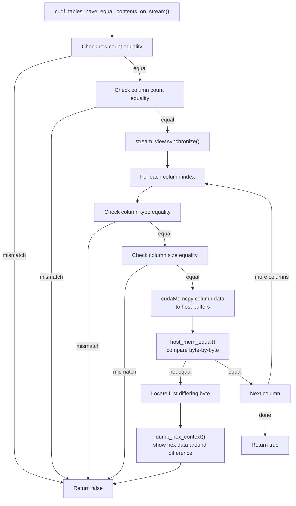
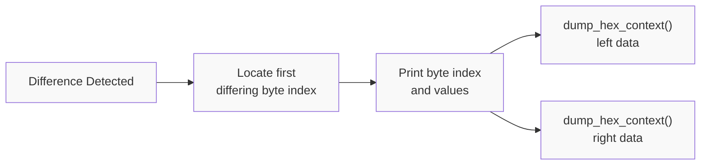
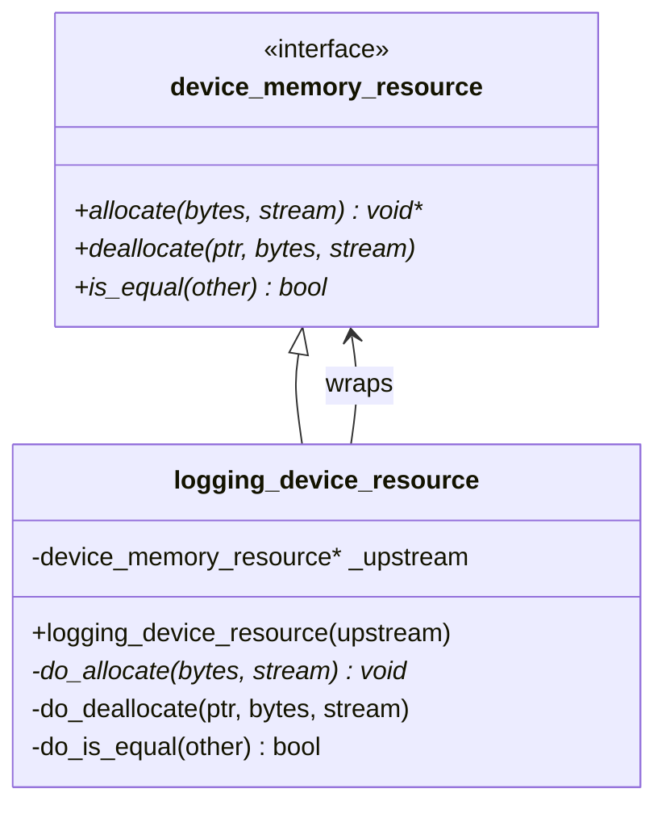
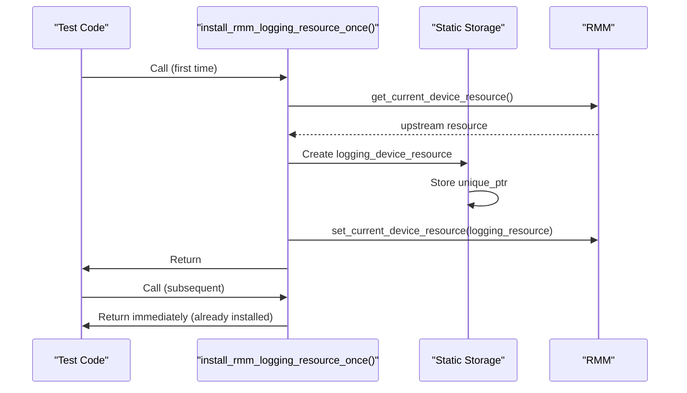

<!-- source: DeepWiki mcp.deepwiki.com · repo NVIDIA/cuCascade · page 7.2 cuDF Test Utilities · fetched 2026-10-26 -->

# cuDF Test Utilities

<details>
<summary>Relevant source files</summary>

The following files were used as context for generating this wiki page:

- [test/memory/test_gpu_kernels.cu](test/memory/test_gpu_kernels.cu)
- [test/utils/cudf_test_utils.cpp](test/utils/cudf_test_utils.cpp)

</details>


## Purpose and Scope

This document covers the test utilities provided for validating cuDF table operations in cuCascade's test suite. These utilities are located in [test/utils/cudf_test_utils.cpp]() and provide:

- **Stream-aware table comparison functions** that correctly handle asynchronous GPU operations
- **RMM allocation logging** through a diagnostic memory resource wrapper
- **Detailed diagnostic output** when table comparisons fail

These utilities are critical for testing data representation conversions and GPU operations throughout cuCascade. For general test infrastructure and Catch2 integration, see [Test Infrastructure](#7.1). For mock implementations used in unit tests, see [Mock Test Utilities](#7.3).

**Sources:** [test/utils/cudf_test_utils.cpp:1-213]()

---

## Stream-Aware Table Comparison

### Overview

cuCascade's test utilities provide stream-aware functions for comparing cuDF tables. Stream awareness is critical because GPU operations in cuDF are asynchronous—data may still be in flight when a comparison is initiated. Naive comparisons that don't synchronize on the correct stream will produce race conditions and non-deterministic test failures.

The primary comparison functions are:

| Function | Purpose | Return Type |
|----------|---------|-------------|
| `cudf_tables_have_equal_contents_on_stream()` | Compares two tables on a specific stream | `bool` |
| `expect_cudf_tables_equal_on_stream()` | Wraps comparison with Catch2 `REQUIRE` | `void` |

**Sources:** [test/utils/cudf_test_utils.cpp:66-149]()

### Comparison Workflow



**Diagram: Table Comparison Workflow**

The comparison process synchronizes the provided stream before copying data to the host, ensuring all pending GPU operations complete before validation begins. When differences are detected, diagnostic output includes hex dumps showing context around the first differing byte.

**Sources:** [test/utils/cudf_test_utils.cpp:66-142]()

---

### Column-Level Comparison

The comparison operates at the column level, validating:

1. **Column count** - Both tables must have the same number of columns [test/utils/cudf_test_utils.cpp:76-81]()
2. **Row count** - Both tables must have the same number of rows [test/utils/cudf_test_utils.cpp:70-75]()
3. **Column type** - Each corresponding column pair must have matching `cudf::type_id` [test/utils/cudf_test_utils.cpp:92-98]()
4. **Column size** - Each column must contain the same number of elements [test/utils/cudf_test_utils.cpp:101-106]()
5. **Column data** - Raw bytes of column data must be identical [test/utils/cudf_test_utils.cpp:109-138]()

The comparison examines **actual column data**, not the packed representation used for serialization. This is important because `cudf::pack()` includes padding that is not part of the logical data. The comparison copies only the logical data bytes:

```
data_bytes = column.size() * cudf::size_of(column.type())
```

**Sources:** [test/utils/cudf_test_utils.cpp:66-142]()

---

### Diagnostic Output

When differences are detected, the utilities provide detailed diagnostic information:



**Diagram: Diagnostic Output Flow**

The `dump_hex_context()` helper function displays 64 bytes of hex data centered around the difference location, formatted in 16-byte rows for readability. This allows test developers to quickly identify the nature of data corruption or conversion errors.

**Example output format:**
```
[cudf-equal] col[0] data differs at byte 42 left=DE right=CA
[cudf-equal] col[0] left data context:
  hex@16 (64B): 00 01 02 ... DE BE EF ...
[cudf-equal] col[0] right data context:
  hex@16 (64B): 00 01 02 ... CA FE BA ...
```

**Sources:** [test/utils/cudf_test_utils.cpp:46-63](), [test/utils/cudf_test_utils.cpp:119-137]()

---

## Logging Device Resource

### Purpose

The `logging_device_resource` class is a diagnostic wrapper around RMM's `device_memory_resource` interface. It logs all GPU memory allocations and deallocations with detailed information including:

- Memory pointer address
- Allocation size in bytes
- CUDA stream handle
- Thread ID of the calling thread

This is invaluable for debugging memory-related issues, understanding allocation patterns, and detecting memory leaks in tests.

**Sources:** [test/utils/cudf_test_utils.cpp:152-186]()

---

### Class Structure



**Diagram: Logging Device Resource Class Hierarchy**

The `logging_device_resource` implements the decorator pattern, wrapping an existing `device_memory_resource` and forwarding all operations to it while logging the details to standard output.

**Sources:** [test/utils/cudf_test_utils.cpp:152-186]()

---

### Implementation Details

#### Allocation Logging

The `do_allocate()` override logs each allocation before returning:

```
[rmm-alloc] ptr=0x7f1234567890 size=4096 stream=0x0 tid=140123456789
```

The implementation [test/utils/cudf_test_utils.cpp:161-169]():
1. Forwards allocation to upstream resource
2. Builds formatted log message with pointer, size, stream, and thread ID
3. Writes to `std::cout` with flush for immediate visibility
4. Returns the allocated pointer

#### Deallocation Logging

The `do_deallocate()` override logs each deallocation:

```
[rmm-free ] ptr=0x7f1234567890 size=4096 stream=0x0 tid=140123456789
```

Note that deallocation is marked `noexcept`, so error handling must be carefully managed. The implementation [test/utils/cudf_test_utils.cpp:171-178]() logs before forwarding to upstream to ensure diagnostics are captured even if deallocation fails.

**Sources:** [test/utils/cudf_test_utils.cpp:152-186]()

---

### Installation Mechanism

The logging resource is installed globally via `install_rmm_logging_resource_once()`:



**Diagram: Logging Resource Installation Sequence**

The function uses static variables to ensure the resource is installed exactly once per process [test/utils/cudf_test_utils.cpp:189-200]():

| Static Variable | Type | Purpose |
|----------------|------|---------|
| `installed` | `bool` | Guards against multiple installation |
| `logging_resource` | `unique_ptr<logging_device_resource>` | Keeps resource alive for process lifetime |

The function wraps the current device resource at installation time, meaning it captures whatever resource was set by RMM initialization. This allows the logging layer to sit on top of any RMM configuration (pool allocators, managed memory, etc.).

**Sources:** [test/utils/cudf_test_utils.cpp:189-200]()

---

## Helper Utilities

### hex Context Dumping

The `dump_hex_context()` function provides formatted hex dumps for debugging memory differences [test/utils/cudf_test_utils.cpp:46-63]():

**Parameters:**

| Parameter | Type | Description |
|-----------|------|-------------|
| `data` | `const uint8_t*` | Pointer to data buffer |
| `size` | `size_t` | Total buffer size |
| `center` | `size_t` | Byte index to center the display around |
| `context_len` | `size_t` | Number of bytes to display (default: 64) |

**Output format:**
- Hex bytes in groups of 16, separated by ` | `
- Each byte formatted as two hex digits with leading zeros
- Includes start offset and byte count in decimal

**Example:**
```
hex@240 (64B): DE AD BE EF | CA FE BA BE | 01 02 03 04 | ...
```

**Sources:** [test/utils/cudf_test_utils.cpp:46-63]()

---

### Host Memory Comparison

The `host_mem_equal()` function provides a safe memory comparison utility [test/utils/cudf_test_utils.cpp:202-207]():

**Safety checks:**
1. Returns `true` if both pointers are identical (same address)
2. Returns `false` if either pointer is `nullptr`
3. Uses `std::memcmp()` for byte-wise comparison

This function is used internally by the table comparison utilities to compare column data after it has been copied from GPU to host memory.

**Sources:** [test/utils/cudf_test_utils.cpp:202-207]()

---

## Usage Patterns

### Stream-Aware Testing

Tests should always use the stream-aware comparison functions when validating cuDF tables:

```cpp
// Create stream for async operations
rmm::cuda_stream stream;

// Perform GPU operations on the stream
auto table1 = create_table_on_stream(stream.view());
auto table2 = process_table_on_stream(table1, stream.view());

// Compare using stream-aware utility
expect_cudf_tables_equal_on_stream(*table1, *table2, stream.view());
```

The stream view must be passed to ensure proper synchronization before comparison begins.

**Sources:** [test/utils/cudf_test_utils.cpp:144-149]()

---

### Enabling Allocation Logging

To enable RMM allocation logging in tests (useful for debugging memory leaks):

```cpp
// Call once at test start
cucascade::test::install_rmm_logging_resource_once();

// All subsequent RMM allocations will be logged
auto buffer = rmm::device_buffer(1024, stream);
// Output: [rmm-alloc] ptr=... size=1024 stream=...

// Deallocations also logged
// Output: [rmm-free ] ptr=... size=1024 stream=...
```

The logging remains active for the entire process lifetime and cannot be disabled once installed.

**Sources:** [test/utils/cudf_test_utils.cpp:189-200]()

---

## Integration with Test Infrastructure

These utilities integrate with the Catch2 test framework through the `REQUIRE` macro:

```mermaid
graph LR
    TestCase["Test Case"]
    ExpectEqual["expect_cudf_tables_equal_on_stream()"]
    Compare["cudf_tables_have_equal_contents_on_stream()"]
    Require["REQUIRE macro"]
    CatchFail["Catch2 failure reporting"]
    
    TestCase --> ExpectEqual
    ExpectEqual --> Compare
    Compare -->|returns bool| Require
    Require -->|false| CatchFail
    
    style TestCase fill:#f9f9f9
    style ExpectEqual fill:#f9f9f9
    style Compare fill:#f9f9f9
    style Require fill:#f9f9f9
    style CatchFail fill:#f9f9f9
```



**Diagram: Integration with Catch2 Framework**

The `expect_cudf_tables_equal_on_stream()` wrapper [test/utils/cudf_test_utils.cpp:144-149]() uses Catch2's `REQUIRE` macro to fail the test if tables don't match. The detailed diagnostic output from the comparison function appears in the test output, making failures easy to debug.

For more information on the overall test framework setup, see [Test Infrastructure](#7.1).

**Sources:** [test/utils/cudf_test_utils.cpp:144-149]()

---

