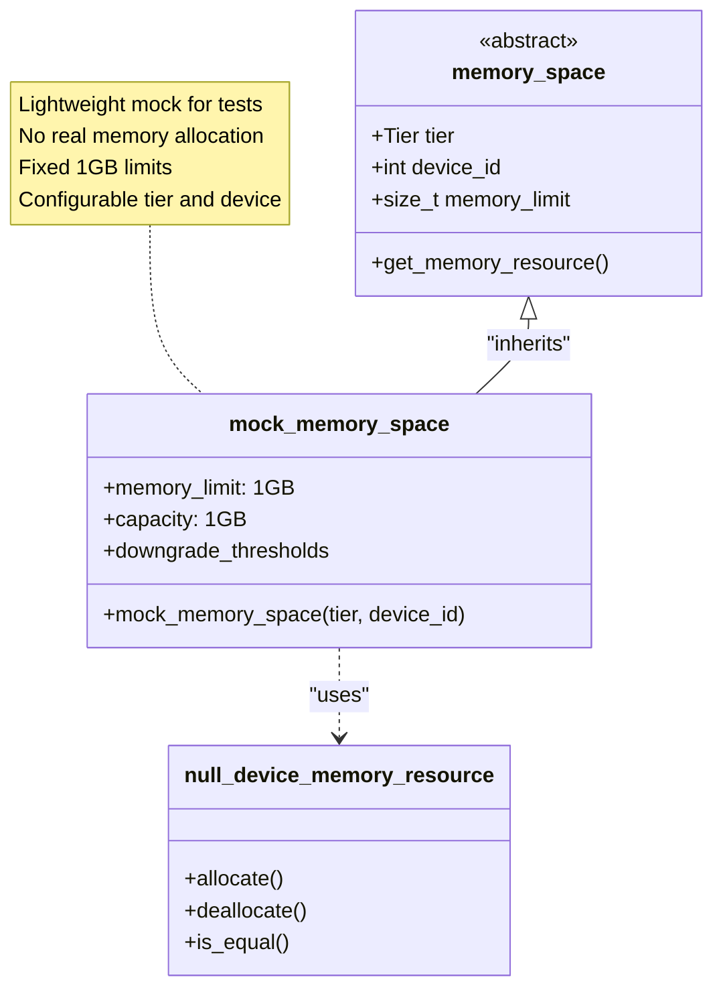
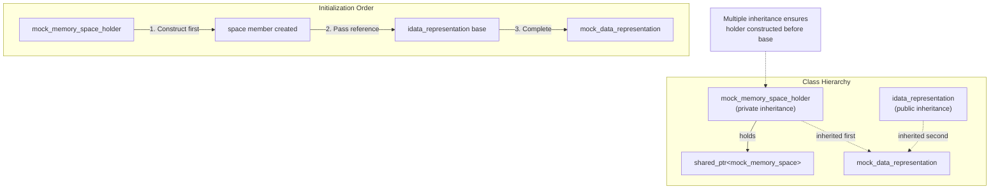
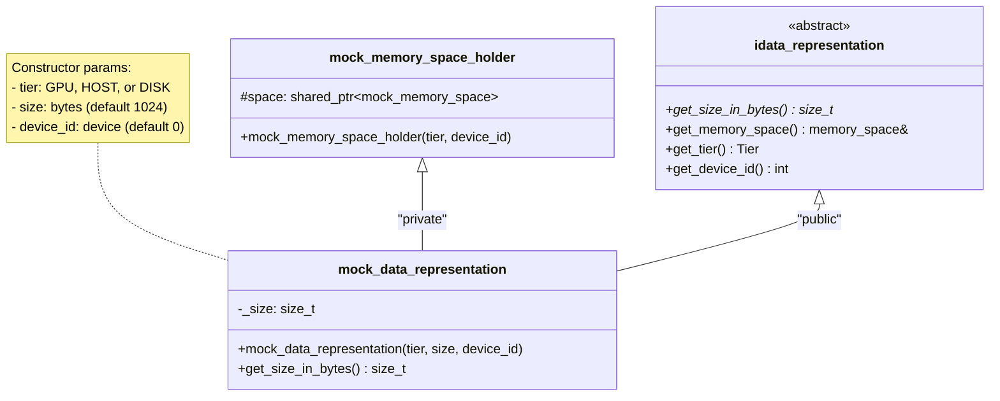
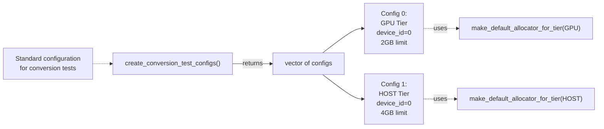
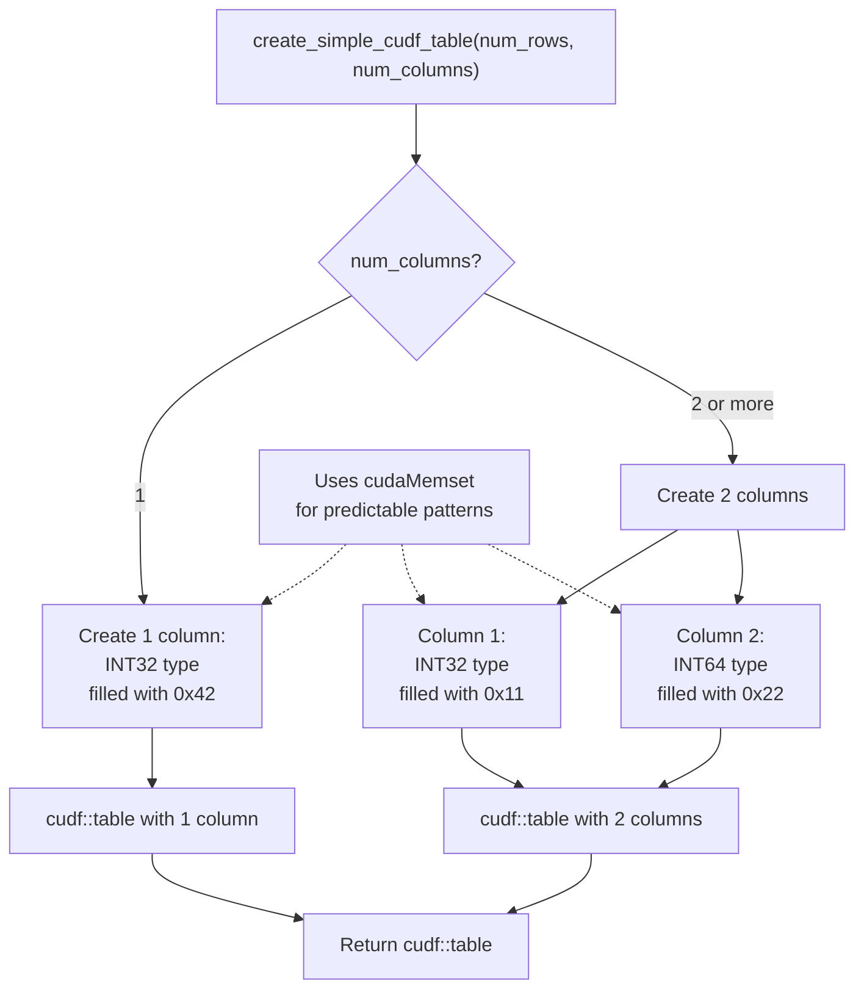
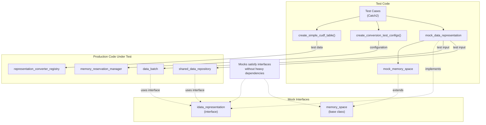
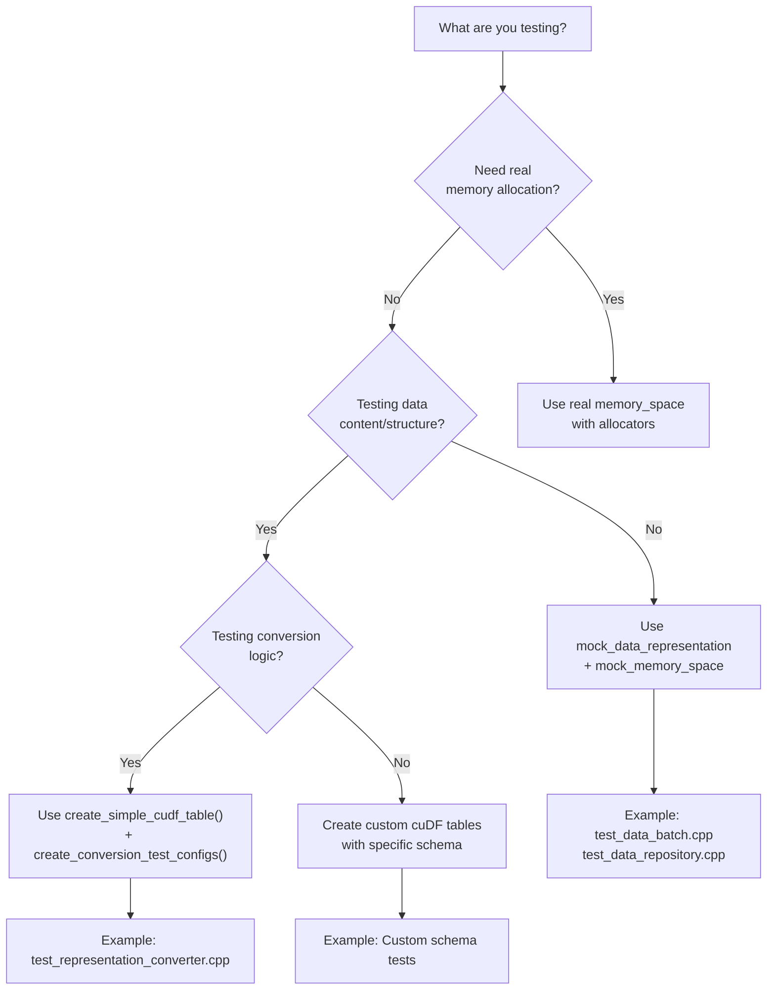

<!-- source: DeepWiki mcp.deepwiki.com · repo NVIDIA/cuCascade · page 7.3 Mock Test Utilities · fetched 2026-10-26 -->

# Mock Test Utilities

<details>
<summary>Relevant source files</summary>

The following files were used as context for generating this wiki page:

- [test/utils/mock_test_utils.hpp](test/utils/mock_test_utils.hpp)

</details>


## Purpose and Scope

This document describes the mock implementations and test data generation utilities provided by cuCascade for unit testing. These utilities enable isolated testing of data management and representation conversion logic without requiring actual memory allocation or complex memory management setup.

For information about the actual memory management classes being mocked, see [Memory Management Subsystem](#4). For cuDF-specific test utilities, see [cuDF Test Utilities](#7.2). For the overall test infrastructure, see [Test Infrastructure](#7.1).

## Overview

The mock test utilities in [test/utils/mock_test_utils.hpp]() provide lightweight implementations of key cuCascade interfaces that can be used in unit tests without the overhead of real memory allocation or GPU operations. These mocks are designed for:

- **Isolated unit testing** - Testing data batch lifecycle and repository behavior without memory allocation
- **Conversion testing** - Testing representation conversion logic with configurable memory spaces
- **Test data generation** - Creating simple cuDF tables with predictable content for validation

The utilities are organized into three categories:

| Category | Classes/Functions | Purpose |
|----------|------------------|---------|
| Mock Memory | `mock_memory_space`, `mock_memory_space_holder` | Lightweight memory space without real allocators |
| Mock Representations | `mock_data_representation` | Simple representation implementation for testing |
| Data Generation | `create_simple_cudf_table()`, `create_conversion_test_configs()` | Generate test data and configurations |

**Sources:** [test/utils/mock_test_utils.hpp:1-158]()

## Mock Memory Space Implementation

### mock_memory_space Class

The `mock_memory_space` class provides a minimal implementation of `memory::memory_space` that does not allocate real memory. It uses `null_device_memory_resource` internally, which provides the memory resource interface without actual allocation.



**Sources:** [test/utils/mock_test_utils.hpp:47-59]()

### Configuration Parameters

The `mock_memory_space` constructor initializes fixed memory parameters suitable for testing:

| Parameter | Value | Purpose |
|-----------|-------|---------|
| `memory_limit` | 1 GB | Maximum memory capacity |
| `start_downgrading_threshold` | 800 MB (80%) | When to begin downgrading |
| `stop_downgrading_threshold` | 512 MB (50%) | When to stop downgrading |
| `capacity` | 1 GB | Total capacity |

These values are hardcoded in [test/utils/mock_test_utils.hpp:52-55]() and are sufficient for unit tests that focus on logic rather than memory pressure scenarios.

**Sources:** [test/utils/mock_test_utils.hpp:49-58]()

## Mock Data Representation

### Initialization Order Problem

The `mock_data_representation` class faces a C++ initialization order challenge: `idata_representation` requires a reference to a `memory_space` in its constructor, but we want to create the mock memory space as part of the mock representation. The solution uses multiple inheritance with a holder pattern.



**Sources:** [test/utils/mock_test_utils.hpp:67-74](), [test/utils/mock_test_utils.hpp:82-91]()

### mock_data_representation Class

The `mock_data_representation` provides a minimal implementation of `idata_representation` with configurable size and tier:



The class stores only the size in bytes and returns it from `get_size_in_bytes()`. Other interface methods are inherited from `idata_representation` and delegate to the held `mock_memory_space`.

**Sources:** [test/utils/mock_test_utils.hpp:82-97]()

### Usage Example Pattern

The mock representation is typically used in tests that need to validate data batch state or repository behavior without actual data:

| Test Scenario | Mock Configuration | Purpose |
|---------------|-------------------|---------|
| Batch lifecycle | `Tier::GPU, size=1024` | Test state transitions |
| Repository FIFO | `Tier::HOST, size=2048` | Test queue ordering |
| Multi-tier | Multiple instances with different tiers | Test tier-specific logic |

**Sources:** [test/utils/mock_test_utils.hpp:82-97]()

## Test Data Generation Utilities

### create_conversion_test_configs Function

The `create_conversion_test_configs()` function creates a standard configuration for testing representation conversion logic. It returns a vector of two memory space configurations: one GPU space and one HOST space.



Configuration details returned by [test/utils/mock_test_utils.hpp:104-114]():

| Tier | Device ID | Memory Limit | Allocator |
|------|-----------|--------------|-----------|
| GPU | 0 | 2048 MB | Default GPU allocator |
| HOST | 0 | 4096 MB | Default HOST allocator |

**Sources:** [test/utils/mock_test_utils.hpp:100-114]()

### create_simple_cudf_table Function

The `create_simple_cudf_table()` function generates cuDF tables with predictable content for validation in conversion and representation tests. It supports creating tables with 1 or 2 columns.



**Column specifications:**

| Column | Data Type | Fill Pattern | Purpose |
|--------|-----------|--------------|---------|
| 0 | INT32 | `0x42` (1 col) or `0x11` (2+ cols) | Primary data column |
| 1 | INT64 | `0x22` | Secondary column for multi-column tests |

The function implementation in [test/utils/mock_test_utils.hpp:126-154]() uses:
- `cudf::make_numeric_column()` for column creation
- `cudaMemset()` to fill with predictable byte patterns
- `cudf::mask_state::UNALLOCATED` (no null masks)

**Sources:** [test/utils/mock_test_utils.hpp:116-154]()

## Integration with Test Framework

The mock utilities integrate with the actual cuCascade system to enable targeted unit tests:



**Sources:** [test/utils/mock_test_utils.hpp:1-158]()

## Usage Patterns

### Pattern 1: Isolated Data Batch Testing

Use `mock_data_representation` when testing `data_batch` lifecycle without memory allocation:

```
Purpose: Test batch state transitions, processing handles, conversion blocking
Mock Used: mock_data_representation
Why: No need for actual data or memory allocation
```

### Pattern 2: Repository Ordering Tests

Use `mock_data_representation` when testing repository FIFO behavior:

```
Purpose: Verify batch ordering, multi-threaded access, handle acquisition
Mock Used: mock_data_representation with varying sizes
Why: Focus on queue semantics, not data content
```

### Pattern 3: Conversion Validation Tests

Use `create_simple_cudf_table()` and `create_conversion_test_configs()` when testing representation converters:

```
Purpose: Validate GPU↔HOST conversion correctness
Data Generator: create_simple_cudf_table()
Config Generator: create_conversion_test_configs()
Why: Need real cuDF data and memory manager setup
```

### Selection Decision Tree



**Sources:** [test/utils/mock_test_utils.hpp:1-158]()

## Summary

The mock test utilities in `test/utils/mock_test_utils.hpp` provide three key capabilities:

1. **Mock Memory Infrastructure** - `mock_memory_space` and `mock_memory_space_holder` enable testing without real memory allocation
2. **Mock Representations** - `mock_data_representation` implements `idata_representation` interface for isolated testing
3. **Test Data Generation** - `create_simple_cudf_table()` and `create_conversion_test_configs()` create predictable test inputs

These utilities separate concerns in the test suite: use mocks for testing logic and state management, use real data generators for testing data transformations and conversions. This separation enables fast, focused unit tests that validate specific behaviors without the overhead of full system initialization.

**Sources:** [test/utils/mock_test_utils.hpp:1-158]()

---

