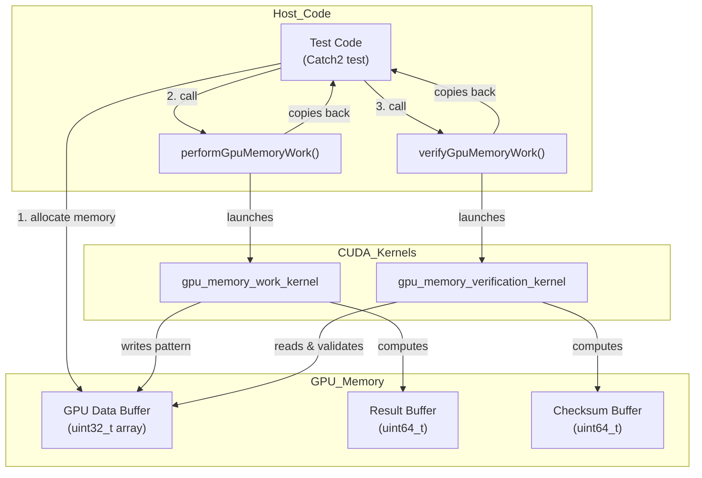
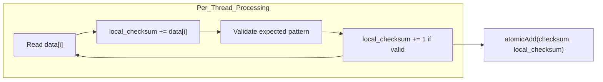
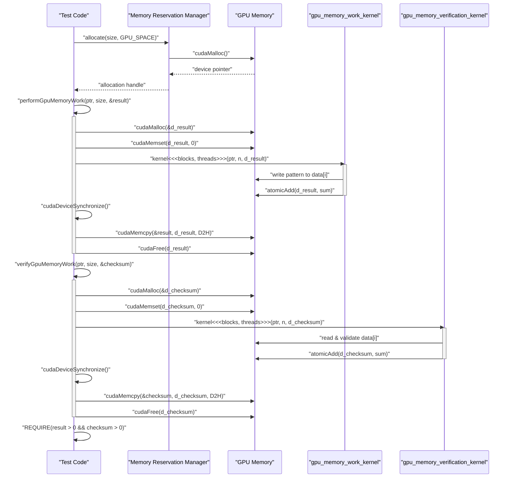
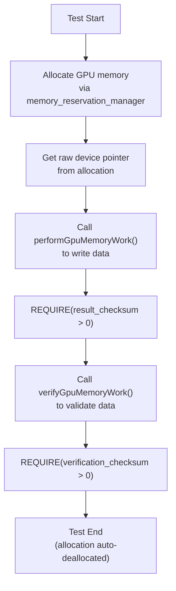
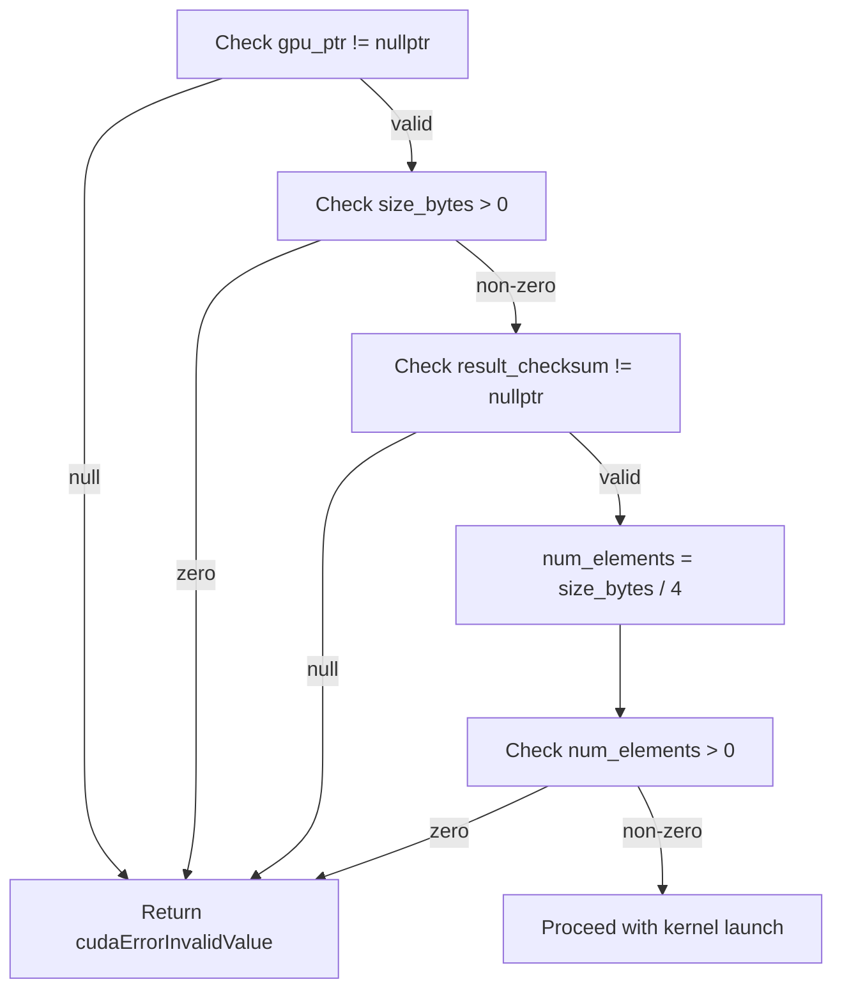

<!-- source: DeepWiki mcp.deepwiki.com · repo NVIDIA/cuCascade · page 7.4 GPU Kernel Testing · fetched 2026-10-26 -->

# GPU Kernel Testing

<details>
<summary>Relevant source files</summary>

The following files were used as context for generating this wiki page:

- [test/memory/test_gpu_kernels.cu](test/memory/test_gpu_kernels.cu)
- [test/utils/cudf_test_utils.cpp](test/utils/cudf_test_utils.cpp)

</details>


## Purpose and Scope

This page documents the GPU kernel testing infrastructure used in cuCascade to validate memory allocation and data integrity. These utilities provide synthetic GPU workloads that perform actual GPU memory operations, enabling stress testing of the memory management subsystem under realistic conditions.

For information about cuDF table comparison utilities, see [cuDF Test Utilities](#7.2). For mock implementations that don't perform actual GPU work, see [Mock Test Utilities](#7.3). For the overall testing framework, see [Test Infrastructure](#7.1).

---

## Overview

GPU kernel testing utilities generate synthetic computational workloads that interact with GPU memory allocations. Unlike mock objects, these kernels execute actual CUDA operations, making them essential for validating:

- **Memory allocation correctness**: Verify that allocated GPU memory is accessible and writable
- **Data integrity**: Confirm that values written to GPU memory persist correctly
- **Concurrency behavior**: Test memory operations under multi-threaded access patterns
- **Memory pressure scenarios**: Generate realistic memory usage for testing eviction policies

The test kernels are implemented in CUDA and exposed through C-linkage functions for integration with the Catch2 test framework.

**Sources:** [test/memory/test_gpu_kernels.cu:1-189]()

---

## Kernel Architecture

The GPU kernel testing infrastructure consists of two complementary CUDA kernels and their C-language wrapper functions:



**Sources:** [test/memory/test_gpu_kernels.cu:24-79](), [test/memory/test_gpu_kernels.cu:83-186]()

---

## GPU Memory Work Kernel

### Kernel Implementation

The `gpu_memory_work_kernel` performs synthetic memory operations to stress test GPU allocations. The kernel uses a grid-stride loop pattern to distribute work across CUDA threads.

**Function Signature:**
```
__global__ void gpu_memory_work_kernel(uint32_t* data, size_t num_elements, uint64_t* result)
```

**Kernel Behavior:**

| Phase | Operation | Purpose |
|-------|-----------|---------|
| Write Pattern | `data[i] = i ^ 0xDEADBEEF ^ threadIdx.x` | Write unique values based on index and thread ID |
| Read Back | `local_sum += data[i]` | Force memory read to prevent compiler optimization |
| Conditional Modify | Branch on `data[i] % 2` | Perform additional writes with divergent control flow |
| Accumulate | `atomicAdd(result, local_sum)` | Aggregate results from all threads using atomics |

**Grid-Stride Loop Pattern:**

The kernel uses the standard CUDA pattern where each thread processes multiple elements:

```
int idx = blockIdx.x * blockDim.x + threadIdx.x
int stride = blockDim.x * gridDim.x

for (size_t i = idx; i < num_elements; i += stride) {
    // Process element at index i
}
```

This pattern ensures efficient memory access and allows the kernel to process arrays larger than the number of threads.

**Sources:** [test/memory/test_gpu_kernels.cu:24-52]()

### C Wrapper Function

The `performGpuMemoryWork` function provides a C-linkage interface for launching the kernel:

**Function Signature:**
```c
cudaError_t performGpuMemoryWork(void* gpu_ptr, size_t size_bytes, uint64_t* result_checksum)
```

**Parameters:**

| Parameter | Type | Description |
|-----------|------|-------------|
| `gpu_ptr` | `void*` | Pointer to GPU memory buffer to operate on |
| `size_bytes` | `size_t` | Size of the buffer in bytes (must be multiple of 4) |
| `result_checksum` | `uint64_t*` | Output parameter for computed checksum |

**Error Handling:**

The function performs comprehensive validation:
- Null pointer checks for all parameters
- Size validation (must allow at least one `uint32_t` element)
- CUDA error checking after memory allocation, memset, kernel launch, and synchronization
- Proper cleanup of temporary device allocations on error paths

**Kernel Launch Configuration:**

```
block_size = 256
num_blocks = min((num_elements + 255) / 256, 65535)
```

The block size of 256 threads is a common choice for memory-bound kernels, and the grid size is capped at 65,535 blocks to respect CUDA device limits.

**Sources:** [test/memory/test_gpu_kernels.cu:83-134]()

---

## GPU Memory Verification Kernel

### Kernel Implementation

The `gpu_memory_verification_kernel` validates that the memory work kernel correctly modified the data and computes an independent checksum.

**Function Signature:**
```
__global__ void gpu_memory_verification_kernel(uint32_t* data, size_t num_elements, uint64_t* checksum)
```

**Verification Strategy:**

The kernel performs two levels of validation:

1. **Simple Checksum**: Sum all data values to create a checksum
2. **Pattern Validation**: Check if values match expected patterns from the work kernel



**Expected Pattern Logic:**

The kernel reconstructs what values should look like after the work kernel:
- Even values should have bits from `0xCAFEBABE` pattern
- Odd values should be greater than the base pattern `i ^ 0xDEADBEEF ^ (i % 32)`

This validation ensures the work kernel's conditional branches executed correctly.

**Sources:** [test/memory/test_gpu_kernels.cu:54-79]()

### C Wrapper Function

The `verifyGpuMemoryWork` function launches the verification kernel with the same error handling strategy as `performGpuMemoryWork`.

**Function Signature:**
```c
cudaError_t verifyGpuMemoryWork(void* gpu_ptr, size_t size_bytes, uint64_t* verification_checksum)
```

**Parameters:**

| Parameter | Type | Description |
|-----------|------|-------------|
| `gpu_ptr` | `void*` | Pointer to GPU memory buffer to verify |
| `size_bytes` | `size_t` | Size of the buffer in bytes |
| `verification_checksum` | `uint64_t*` | Output parameter for computed verification checksum |

The function uses identical launch configuration and error handling patterns to `performGpuMemoryWork`.

**Sources:** [test/memory/test_gpu_kernels.cu:136-186]()

---

## Memory Operation Flow

The following diagram shows the complete flow of GPU memory operations during a typical test:



**Sources:** [test/memory/test_gpu_kernels.cu:83-186]()

---

## Integration with Memory Tests

### Usage in Memory Reservation Manager Tests

The GPU kernels are primarily used in tests for the memory reservation manager to validate that allocated GPU memory is functional. A typical test pattern:



**Test Validation Strategy:**

The tests use a two-phase validation approach:

1. **Work Phase**: Execute GPU operations and capture a result checksum
2. **Verification Phase**: Independently compute a checksum by reading the modified data

Both checksums must be non-zero and typically should be large values (proportional to buffer size). This confirms:
- Memory was successfully allocated on the GPU
- The allocation is writable
- Written values persist in GPU memory
- Data can be read back and validated

**Sources:** [test/memory/test_gpu_kernels.cu:83-186]()

---

## Data Processing Details

### Memory Access Pattern

The kernels use a coalesced memory access pattern that aligns with GPU hardware architecture:

| Aspect | Implementation |
|--------|----------------|
| **Element Type** | `uint32_t` (4-byte aligned) |
| **Access Pattern** | Sequential with stride equal to total thread count |
| **Coalescing** | Threads in same warp access consecutive addresses |
| **Bank Conflicts** | Avoided by using stride-based indexing |

### Atomic Operations

Both kernels use atomic operations to aggregate per-thread results into a single output value:

```
atomicAdd(reinterpret_cast<unsigned long long*>(result), 
          static_cast<unsigned long long>(local_sum))
```

**Atomic Operation Characteristics:**

- **Type**: 64-bit atomic add on unsigned long long
- **Scope**: Device-wide (all threads contribute)
- **Performance**: Minimal contention since each thread accumulates locally before single atomic
- **Purpose**: Enables validation that all threads executed and produced non-zero results

**Sources:** [test/memory/test_gpu_kernels.cu:50-51](), [test/memory/test_gpu_kernels.cu:77-78]()

---

## Usage Guidelines

### When to Use GPU Kernels vs. Mock Objects

| Use GPU Kernels When | Use Mock Objects When |
|-----------------------|------------------------|
| Testing actual GPU memory allocation | Testing data batch lifecycle |
| Validating memory space correctness | Testing repository routing logic |
| Stress testing under memory pressure | Unit testing without GPU hardware |
| Verifying data persistence | Testing conversion logic structure |

For mock testing patterns, see [Mock Test Utilities](#7.3).

### Typical Test Pattern

A complete test using GPU kernels follows this structure:

1. **Setup**: Initialize memory reservation manager for GPU space
2. **Allocate**: Request GPU memory allocation of specific size
3. **Work**: Call `performGpuMemoryWork()` to exercise the allocation
4. **Validate Work**: Check that result checksum is non-zero and reasonable
5. **Verify**: Call `verifyGpuMemoryWork()` to independently validate
6. **Validate Verification**: Check that verification checksum is non-zero
7. **Cleanup**: Allow RAII cleanup to deallocate memory

**Error Checking Best Practices:**

- Always check return values from both wrapper functions
- Use `REQUIRE` macro for critical validation
- Synchronize GPU operations before checking results
- Print checksums on failure for debugging

### Buffer Size Considerations

The kernels require buffers sized in multiples of 4 bytes (`sizeof(uint32_t)`):

| Buffer Size | Elements Processed | Typical Use Case |
|-------------|-------------------|------------------|
| 4 KB | 1,024 | Minimal functionality test |
| 1 MB | 262,144 | Standard allocation test |
| 100 MB | 26,214,400 | Memory pressure test |
| 1 GB | 268,435,456 | Large allocation stress test |

**Sources:** [test/memory/test_gpu_kernels.cu:88-89](), [test/memory/test_gpu_kernels.cu:140-141]()

---

## Error Handling and Robustness

### Input Validation

Both wrapper functions perform comprehensive input validation:



**Sources:** [test/memory/test_gpu_kernels.cu:85-89](), [test/memory/test_gpu_kernels.cu:138-141]()

### CUDA Error Propagation

The wrapper functions implement robust error handling that:

1. **Checks errors** after every CUDA API call
2. **Cleans up** temporary allocations on error paths
3. **Preserves** the first error encountered if multiple operations fail
4. **Returns** detailed `cudaError_t` codes to caller

**Critical Error Points:**

| Operation | Error Check Location |
|-----------|---------------------|
| `cudaMalloc` | After allocation |
| `cudaMemset` | After initialization |
| Kernel launch | `cudaGetLastError()` |
| Kernel execution | `cudaDeviceSynchronize()` |
| `cudaMemcpy` | After device-to-host copy |
| `cudaFree` | During cleanup (non-overwriting) |

**Sources:** [test/memory/test_gpu_kernels.cu:95-133](), [test/memory/test_gpu_kernels.cu:147-185]()

---

## Performance Characteristics

### Computational Complexity

**Work Kernel:**
- Time complexity: O(n) where n is number of elements
- Memory operations per element: 2 writes + 2 reads
- Arithmetic operations per element: ~6-8 operations
- Atomic operations: 1 per thread (not per element)

**Verification Kernel:**
- Time complexity: O(n)
- Memory operations per element: 1 read
- Arithmetic operations per element: ~4-6 operations
- Atomic operations: 1 per thread

### Launch Configuration Trade-offs

The fixed configuration (256 threads per block) represents a balance:

| Aspect | Impact |
|--------|--------|
| **Thread count** | 256 threads provides good occupancy on most GPUs |
| **Block limit** | Cap at 65,535 blocks supports very large buffers |
| **Memory coalescing** | 256-thread blocks align well with warp size (32) |
| **Register usage** | Moderate thread count reduces register pressure |

**Sources:** [test/memory/test_gpu_kernels.cu:106-110](), [test/memory/test_gpu_kernels.cu:158-162]()

---

