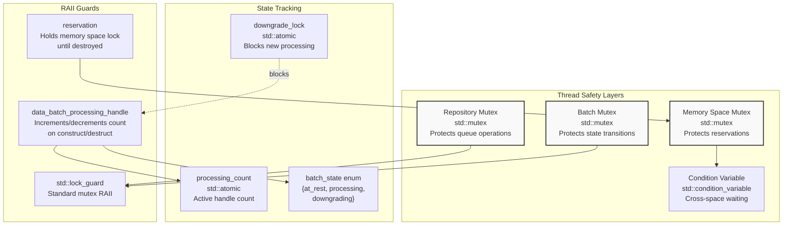
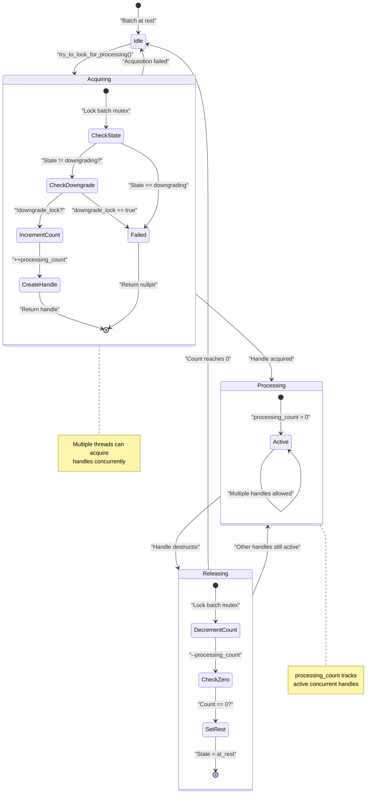
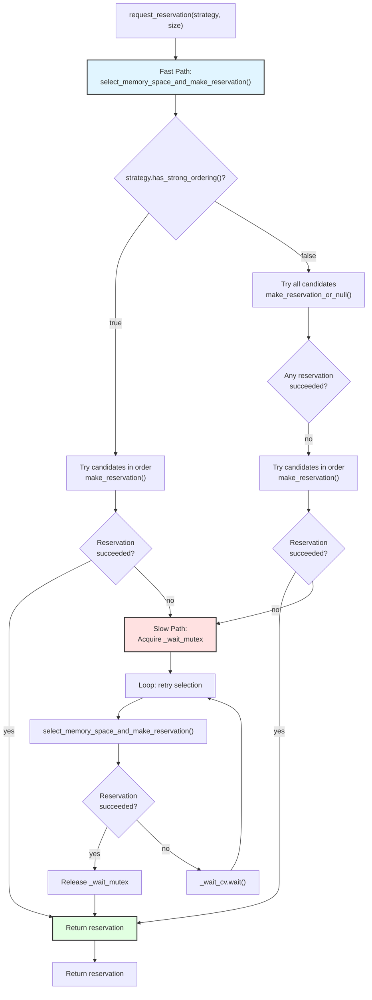
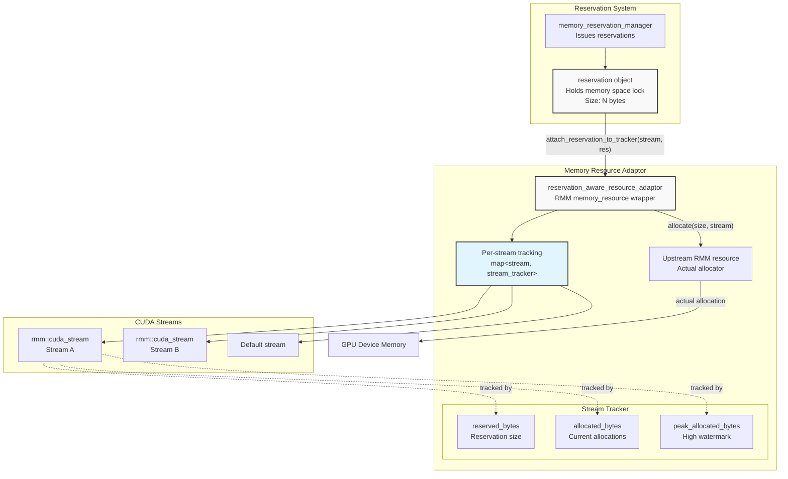
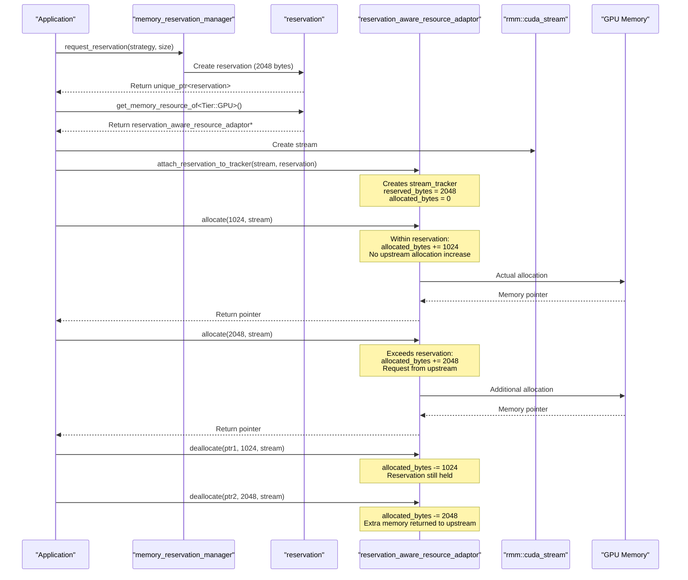
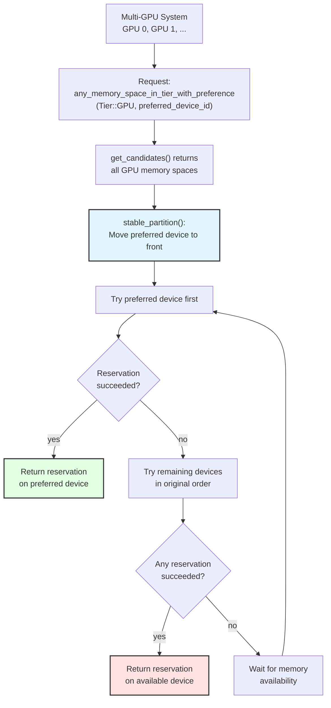

<!-- source: DeepWiki mcp.deepwiki.com · repo NVIDIA/cuCascade · page 8 Advanced Topics · fetched 2026-10-26 -->

# Advanced Topics

<details>
<summary>Relevant source files</summary>

The following files were used as context for generating this wiki page:

- [include/memory/memory_reservation_manager.hpp](include/memory/memory_reservation_manager.hpp)
- [src/memory/memory_reservation_manager.cpp](src/memory/memory_reservation_manager.cpp)
- [test/data/test_data_repository.cpp](test/data/test_data_repository.cpp)
- [test/memory/test_memory_reservation_manager.cpp](test/memory/test_memory_reservation_manager.cpp)

</details>


This section covers advanced usage patterns, performance considerations, and implementation details for sophisticated use cases of cuCascade. Topics include thread-safe concurrent access patterns, memory pressure handling strategies, CUDA stream management, and performance optimization techniques.

For basic usage and architecture concepts, see [Overview](#1) and [Architecture Overview](#3). For specific subsystem details, refer to the Memory Management ([section 4](#4)), Data Representation ([section 5](#5)), and Data Management ([section 6](#6)) sections.

## Purpose and Scope

This document provides guidance on:

- **Concurrent Access Patterns**: Thread-safe operations across repositories and batches
- **Memory Pressure Management**: Reservation strategies and downgrade triggers
- **Asynchronous Operations**: Stream-aware memory allocation and data transfers
- **Performance Optimization**: Best practices for minimizing overhead and maximizing throughput

Each subsection (8.1-8.4) explores these topics in detail. This overview establishes the conceptual framework and cross-cutting concerns.

---

## Concurrency Control Architecture

cuCascade provides thread-safe operations at multiple levels through coordinated locking mechanisms and RAII-based state management.

### Concurrency Control Mechanisms



**Sources**: [test/data/test_data_repository.cpp:146-231](), [include/memory/memory_reservation_manager.hpp:301-302](), [src/memory/memory_reservation_manager.cpp:181-190]()

### Thread-Safe Operations

| Operation | Synchronization Mechanism | Safe Concurrent Access |
|-----------|---------------------------|------------------------|
| `repository.add_data_batch()` | Repository-level mutex | ✓ Multiple threads can add |
| `repository.pull_data_batch()` | Repository-level mutex | ✓ Multiple threads can pull |
| `batch.try_to_lock_for_processing()` | Batch-level mutex + atomic state | ✓ Returns handle or nullptr |
| `batch.try_to_lock_for_downgrade()` | Batch-level mutex + atomic flag | ✓ Blocks if processing active |
| `memory_space.make_reservation()` | Space-level mutex + condition variable | ✓ Blocks until available |

**Sources**: [test/data/test_data_repository.cpp:146-183](), [test/data/test_data_repository.cpp:186-231]()

### Processing Handle Lifecycle

The `data_batch_processing_handle` implements RAII semantics for safe concurrent batch access:



**Sources**: [test/data/test_data_repository.cpp:538-556](), [test/data/test_data_repository.cpp:96-132]()

The RAII pattern ensures that:
- `processing_count` is atomically incremented when a handle is acquired
- `processing_count` is atomically decremented when the handle is destroyed (even on exception)
- The batch returns to `batch_state::at_rest` when the last handle is released
- Downgrade operations cannot proceed while any processing handle exists

For detailed concurrency patterns and testing strategies, see [Thread Safety and Concurrency](#8.1).

---

## Memory Reservation Strategies

cuCascade provides flexible reservation request strategies through a strategy pattern implementation. These strategies control how memory is allocated across tiers and devices under various conditions.

### Reservation Strategy Class Hierarchy

```mermaid
classDiagram
    class reservation_request_strategy {
        <<abstract>>
        -bool _strong_ordering
        +has_strong_ordering() bool
        +get_candidates(manager) vector~memory_space*~*
    }
    
    class any_memory_space_in_tier_with_preference {
        +Tier tier
        +optional~size_t~ preferred_device_id
        +get_candidates(manager) vector~memory_space*~
    }
    
    class any_memory_space_in_tier {
        +Tier tier
        +get_candidates(manager) vector~memory_space*~
    }
    
    class any_memory_space_in_tiers {
        +vector~Tier~ tiers
        +get_candidates(manager) vector~memory_space*~
    }
    
    class specific_memory_space {
        +memory_space_id target_id
        +get_candidates(manager) vector~memory_space*~
    }
    
    class any_memory_space_to_downgrade {
        +memory_space_id src_id
        +vector~Tier~ target_tiers
        +get_candidates(manager) vector~memory_space*~
    }
    
    class any_memory_space_to_upgrade {
        +memory_space_id src_id
        +Tier target_tier
        +get_candidates(manager) vector~memory_space*~
    }
    
    reservation_request_strategy <|-- any_memory_space_in_tier_with_preference
    reservation_request_strategy <|-- any_memory_space_in_tier
    reservation_request_strategy <|-- any_memory_space_in_tiers
    reservation_request_strategy <|-- specific_memory_space
    reservation_request_strategy <|-- any_memory_space_to_downgrade
    reservation_request_strategy <|-- any_memory_space_to_upgrade
```



**Sources**: [include/memory/memory_reservation_manager.hpp:55-167](), [src/memory/memory_reservation_manager.cpp:64-116]()

### Strategy Selection Algorithm

The `memory_reservation_manager::request_reservation()` method uses a two-phase selection algorithm:



**Sources**: [src/memory/memory_reservation_manager.cpp:172-191](), [src/memory/memory_reservation_manager.cpp:308-335]()

### Strong vs. Weak Ordering

| Ordering Type | Strategy Classes | Behavior |
|---------------|------------------|----------|
| **Strong Ordering** (`_strong_ordering = true`) | `any_memory_space_in_tier_with_preference`<br/>`specific_memory_space`<br/>`any_memory_space_to_downgrade`<br/>`any_memory_space_to_upgrade` | Tries candidates in exact order, waits if necessary. Used when placement is critical (e.g., GPU affinity, downgrade target). |
| **Weak Ordering** (`_strong_ordering = false`) | `any_memory_space_in_tier`<br/>`any_memory_space_in_tiers` | First tries all candidates without waiting (`make_reservation_or_null()`), then falls back to ordered waiting. Maximizes availability. |

**Sources**: [include/memory/memory_reservation_manager.hpp:56-74](), [src/memory/memory_reservation_manager.cpp:325-334]()

### Waiting and Notification

When no memory space can satisfy a reservation request:

1. The requesting thread acquires `_wait_mutex` ([memory_reservation_manager.hpp:301]())
2. Thread blocks on `_wait_cv.wait()` ([memory_reservation_manager.cpp:189]())
3. When any `reservation` is destroyed, it notifies `_wait_cv`
4. All waiting threads wake up and retry their reservation strategies

This cross-space coordination enables efficient memory sharing across tiers and devices without busy-waiting.

For memory pressure triggers and downgrade policies, see [Memory Pressure and Downgrade Policies](#8.2).

---

## Stream-Aware Memory Management

cuCascade integrates with CUDA streams through the `reservation_aware_resource_adaptor`, enabling per-stream memory accounting and reservation tracking.

### Stream Reservation Architecture



**Sources**: [test/memory/test_memory_reservation_manager.cpp:256-330](), [test/memory/test_memory_reservation_manager.cpp:332-394]()

### Stream Reservation Workflow



**Sources**: [test/memory/test_memory_reservation_manager.cpp:273-328]()

### Overflow Policies

The `reservation_aware_resource_adaptor` supports multiple overflow policies when allocations exceed reservations:

| Policy Class | Behavior on Overflow | Use Case |
|--------------|---------------------|----------|
| `ignore_reservation_limit_policy` | Allocate from upstream, no error | Default behavior for flexible memory usage |
| `fail_reservation_limit_policy` | Throw `rmm::bad_alloc` | Strict memory budgets, fail-fast scenarios |
| `increase_reservation_limit_policy` | Grow reservation by factor | Dynamic workloads with growing memory needs |

**Sources**: [test/memory/test_memory_reservation_manager.cpp:396-468]()

Example usage:

```cpp
// Strict reservation enforcement
auto reservation = manager->request_reservation(
    specific_memory_space{Tier::GPU, 0}, 
    reservation_size);
auto* mr = reservation->get_memory_resource_of<Tier::GPU>();

rmm::cuda_stream stream;
mr->attach_reservation_to_tracker(
    stream, 
    std::move(reservation),
    std::make_unique<fail_reservation_limit_policy>());

// This will throw if allocation exceeds reservation
void* ptr = mr->allocate(too_large_size, stream);  // Throws rmm::bad_alloc
```

**Sources**: [test/memory/test_memory_reservation_manager.cpp:425-443]()

For detailed stream management patterns, see [Stream Management and Async Operations](#8.3).

---

## Multi-Device Considerations

When operating in multi-GPU environments, cuCascade provides automatic device selection and affinity management.

### Device Selection with Preferences



**Sources**: [src/memory/memory_reservation_manager.cpp:64-76](), [test/memory/test_memory_reservation_manager.cpp:470-514]()

### Cross-Device Scenarios

**Scenario 1: Load Balancing Across GPUs**

```
Initial state:
  GPU 0: 1.5 GB used / 2 GB limit
  GPU 1: 0.5 GB used / 2 GB limit

Request: any_memory_space_in_tier(Tier::GPU), 600 MB
Result: Allocated on GPU 1 (more available)
```

**Scenario 2: Device Affinity for P2P**

```
Initial state:
  GPU 0: Processing batch X
  GPU 1: Available

Request: any_memory_space_in_tier_with_preference(Tier::GPU, 0), 500 MB
Result: Waits for GPU 0 (strong ordering), avoids P2P transfer
```

**Sources**: [test/memory/test_memory_reservation_manager.cpp:496-513]()

For performance optimization strategies across devices, see [Performance Optimization](#8.4).

---

## High-Contention Scenarios

cuCascade is designed to handle high-concurrency workloads with minimal lock contention.

### Stress Test Results

The test suite validates performance under extreme concurrency:

| Test Scenario | Configuration | Result |
|---------------|---------------|--------|
| Concurrent Add | 10 threads × 50 batches each | All 500 batches added correctly |
| Concurrent Pull | 500 pre-added batches, 10 pulling threads | All batches pulled exactly once |
| Concurrent Add & Pull | 5 adders + 5 pullers × 100 ops | All operations complete successfully |
| High Contention Mix | 20 threads × 50 add+pull ops each | 1000 batches added and pulled correctly |

**Sources**: [test/data/test_data_repository.cpp:146-183](), [test/data/test_data_repository.cpp:186-231](), [test/data/test_data_repository.cpp:436-486](), [test/data/test_data_repository.cpp:489-535]()

### Lock-Free Operations

The following operations use atomic primitives without locks:

- `batch.get_processing_count()`: Reads atomic counter
- `batch.get_state()`: Reads atomic state enum
- Downgrade flag checks: Reads atomic boolean
- Repository size queries: Reads queue size under short lock

This enables high-frequency polling without blocking.

---

## Performance Monitoring

cuCascade provides extensive metrics for monitoring system behavior:

### Memory Space Metrics

```cpp
// Per-space queries
size_t available = space->get_available_memory();
size_t reserved = space->get_total_reserved_memory();
size_t count = space->get_active_reservation_count();

// Tier-level aggregations
size_t tier_available = manager->get_available_memory_for_tier(Tier::GPU);
size_t tier_reserved = manager->get_total_reserved_memory_for_tier(Tier::GPU);

// System-wide aggregations
size_t total_available = manager->get_total_available_memory();
size_t total_reserved = manager->get_total_reserved_memory();
```

**Sources**: [include/memory/memory_reservation_manager.hpp:266-273]()

### Stream-Level Metrics

```cpp
auto* mr = reservation->get_memory_resource_of<Tier::GPU>();

// Per-stream accounting
size_t allocated = mr->get_allocated_bytes(stream);
size_t available = mr->get_available_memory(stream);
size_t peak = mr->get_peak_allocated_bytes(stream);

// Upstream totals
size_t total_allocated = mr->get_total_allocated_bytes();
size_t peak_total = mr->get_peak_total_allocated_bytes();
```

**Sources**: [test/memory/test_memory_reservation_manager.cpp:276-280](), [test/memory/test_memory_reservation_manager.cpp:288-305]()

### Repository Metrics

```cpp
// Non-blocking size query
size_t pending_batches = repository.size();

// Check if work is available
if (repository.size() > 0) {
    auto [batch, handle] = repository.pull_data_batch();
    // Process batch...
}
```

**Sources**: [test/data/test_data_repository.cpp:583-860]()

---

## Summary

This section introduced the advanced features of cuCascade:

- **Concurrency Control**: RAII-based processing handles, multi-level locking, state machines
- **Memory Strategies**: Flexible reservation strategies with strong/weak ordering semantics
- **Stream Integration**: Per-stream reservation tracking, overflow policies, peak monitoring
- **Multi-Device Support**: Automatic device selection, affinity preferences, load balancing
- **High Performance**: Lock-free reads, efficient contention handling, comprehensive metrics

For detailed coverage of each topic:
- [Thread Safety and Concurrency](#8.1)
- [Memory Pressure and Downgrade Policies](#8.2)
- [Stream Management and Async Operations](#8.3)
- [Performance Optimization](#8.4)

---

