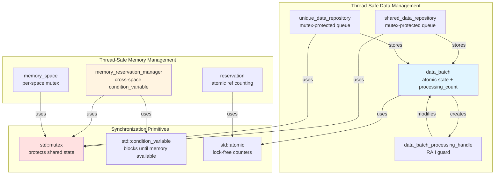
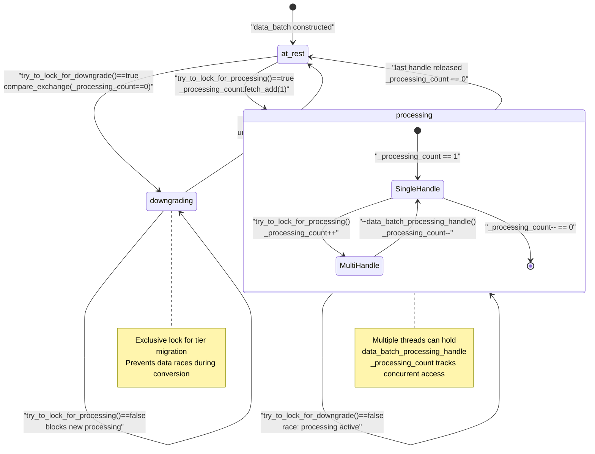
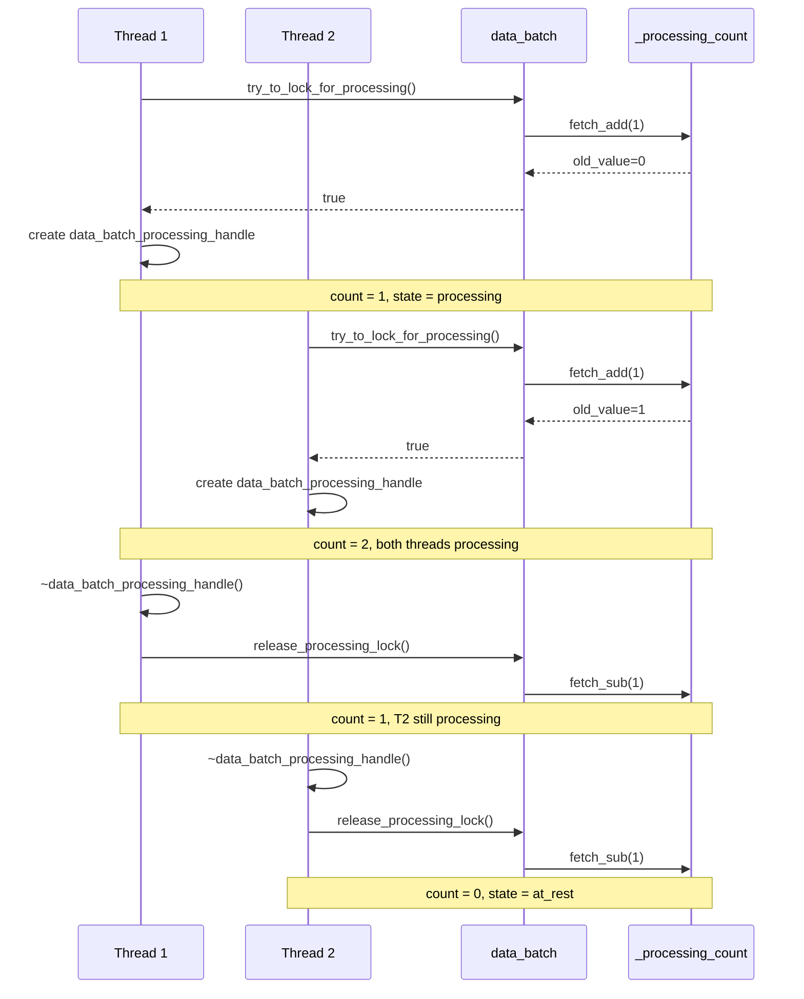
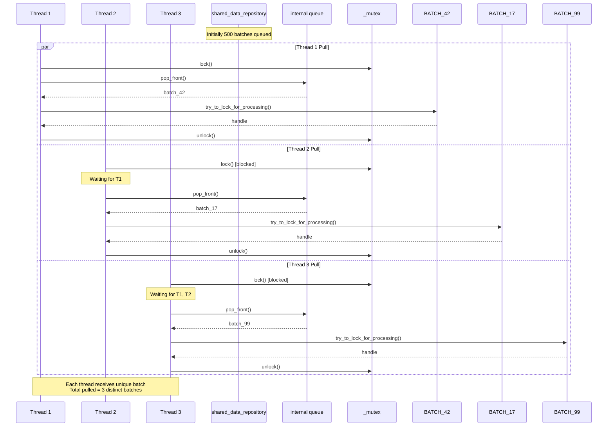
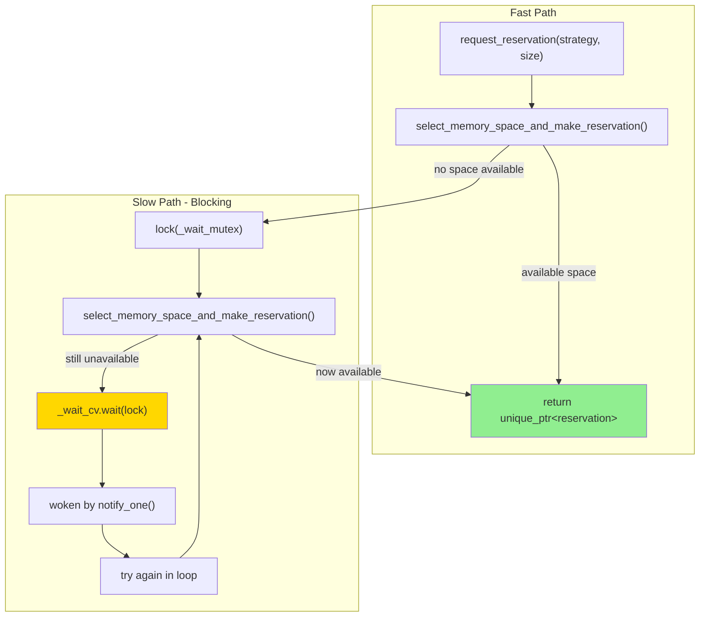
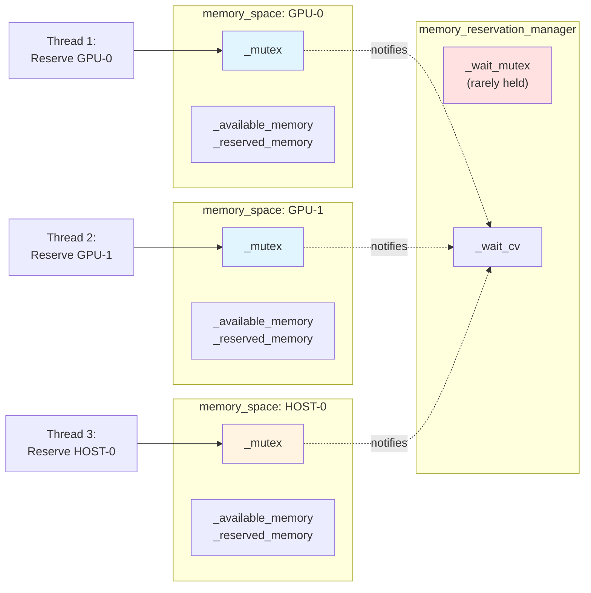

<!-- source: DeepWiki mcp.deepwiki.com · repo NVIDIA/cuCascade · page 8.1 Thread Safety and Concurrency · fetched 2026-10-26 -->

# Thread Safety and Concurrency

<details>
<summary>Relevant source files</summary>

The following files were used as context for generating this wiki page:

- [include/memory/memory_reservation_manager.hpp](include/memory/memory_reservation_manager.hpp)
- [src/memory/memory_reservation_manager.cpp](src/memory/memory_reservation_manager.cpp)
- [test/data/test_data_batch.cpp](test/data/test_data_batch.cpp)
- [test/data/test_data_repository.cpp](test/data/test_data_repository.cpp)
- [test/memory/test_memory_reservation_manager.cpp](test/memory/test_memory_reservation_manager.cpp)

</details>


This page documents cuCascade's thread-safety mechanisms, concurrency patterns, and synchronization primitives. It explains how the library ensures safe concurrent access across its major components: data batches, repositories, and memory reservation management.

For information about batch lifecycle and state transitions, see [Data Batch](#6.1). For repository behavior and processing semantics, see [Data Repository](#6.2). For memory allocation strategies, see [Memory Reservation Manager](#4.1).

## Overview of Thread-Safety Model

cuCascade is designed for multi-threaded environments where multiple threads may simultaneously:
- Add and pull data batches from repositories
- Process the same batch concurrently (read-only operations)
- Request memory reservations across different memory spaces
- Convert data representations between memory tiers

The library provides **fine-grained locking** at the component level rather than global locks, enabling high concurrency. Critical sections are minimized, and RAII patterns ensure automatic cleanup even in exception scenarios.

**Key Design Principles:**
- **Reference-counted processing**: Multiple threads can hold processing handles to the same batch
- **State-based synchronization**: Batch state transitions prevent conflicting operations
- **Per-component mutexes**: Repositories and memory spaces use independent locks
- **Condition variables**: Blocking wait for memory availability across multiple spaces
- **Lock-free reads**: Many query operations (e.g., `get_batch_id()`, `get_state()`) use atomic variables

Sources: [test/data/test_data_repository.cpp:146-183](), [test/data/test_data_batch.cpp:229-265](), [include/memory/memory_reservation_manager.hpp:301-302]()

## Thread-Safe Components Overview



**Diagram: Thread-Safe Component Architecture**

Sources: [include/memory/memory_reservation_manager.hpp:301-303](), [test/data/test_data_batch.cpp:229-265](), [test/data/test_data_repository.cpp:146-183]()

## Data Batch Concurrency Model

### Processing State Management

The `data_batch` class uses atomic operations to manage concurrent processing. The core mechanism is the `_processing_count` atomic counter that tracks how many threads currently hold processing handles.

| State | Can Process? | Can Downgrade? | Description |
|-------|-------------|----------------|-------------|
| `at_rest` | ✓ | ✓ | No active processing, available for any operation |
| `processing` | ✓ | ✗ | One or more threads processing, new handles can be acquired |
| `downgrading` | ✗ | N/A | Tier migration in progress, blocks all processing |

**Thread-Safe Operations:**
- `try_to_lock_for_processing()` - Atomically increments processing count if state allows
- `try_to_lock_for_downgrade()` - Atomically transitions to downgrading if count is zero
- `get_processing_count()` - Lock-free atomic read
- `get_state()` - Lock-free state query based on atomic variables

Sources: [test/data/test_data_batch.cpp:95-115](), [test/data/test_data_batch.cpp:150-165]()

### State Transition Diagram



**Diagram: Batch State Machine with Atomic Operations**

Sources: [test/data/test_data_batch.cpp:95-148](), [test/data/test_data_batch.cpp:150-182]()

### RAII Processing Handle

The `data_batch_processing_handle` class provides RAII semantics for processing locks. It automatically decrements the processing count when destroyed, preventing leaks even if exceptions occur.



**Diagram: Concurrent Processing Handle Lifecycle**

Sources: [test/data/test_data_batch.cpp:118-148](), [test/data/test_data_batch.cpp:229-265]()

### Concurrent Processing Test Pattern

The test suite validates thread-safety with high-contention scenarios:

```
10 threads × 100 locks each = 1000 concurrent processing handles
```

All handles are stored and released simultaneously, verifying that:
1. All `try_to_lock_for_processing()` calls succeed
2. `_processing_count` reaches exactly 1000
3. Releasing all handles returns count to 0
4. Final state is `at_rest`

Sources: [test/data/test_data_batch.cpp:229-265]()

## Repository Thread Safety

### Shared and Unique Repository Locking

Both `shared_data_repository` and `unique_data_repository` use a single `std::mutex` to protect their internal FIFO queues. Operations are coarse-grained locks over the entire queue structure.

| Operation | Lock Scope | Thread-Safe? | Blocking? |
|-----------|-----------|--------------|-----------|
| `add_data_batch()` | Full queue modification | ✓ | No |
| `pull_data_batch()` | Full queue modification | ✓ | No (returns nullptr if empty) |
| `size()` | Read queue size | ✓ | No |

**Implementation Pattern:**
```
std::lock_guard<std::mutex> lock(_mutex);
// Entire operation protected
```

Sources: [test/data/test_data_repository.cpp:146-183](), [test/data/test_data_repository.cpp:186-231]()

### Concurrent Add Operations

Multiple threads can add batches concurrently. The repository ensures all batches are eventually stored, though the exact order is non-deterministic when adding from multiple threads.

**Test Pattern:**
```
10 threads × 50 batches = 500 total batches
All threads add concurrently
Result: All 500 batches successfully stored
```

Sources: [test/data/test_data_repository.cpp:146-183](), [test/data/test_data_repository.cpp:348-385]()

### Concurrent Pull Operations

Multiple threads pulling from the same repository receive different batches. Each batch is pulled exactly once (FIFO ordering preserved per mutex acquisition).



**Diagram: Concurrent Pull with Mutex Serialization**

Sources: [test/data/test_data_repository.cpp:186-231](), [test/data/test_data_repository.cpp:388-433]()

### Shared Batch Across Repositories

When using `shared_data_repository`, the same batch can be added to multiple repositories. Multiple threads can pull and process the same batch simultaneously via different repositories.

**Processing Count Tracking:**
```
Repository A pulls batch → processing_count = 1
Repository B pulls batch → processing_count = 2
Repository C pulls batch → processing_count = 3
```

The batch remains valid until all handles are released. This enables broadcast patterns where multiple operators process the same data.

Sources: [test/data/test_data_repository.cpp:97-132]()

### Concurrent Add and Pull

The repository supports simultaneous add and pull operations from different threads. The mutex ensures consistency, but threads may temporarily observe an empty repository if pullers outpace adders.

**High-Contention Test:**
```
20 threads × 50 operations each = 1000 total operations
Each thread alternates: add_batch() → pull_batch()
Result: All adds eventually matched by pulls, no data loss
```

Sources: [test/data/test_data_repository.cpp:436-486](), [test/data/test_data_repository.cpp:489-535]()

## Memory Reservation Manager Concurrency

### Cross-Space Blocking Strategy

The `memory_reservation_manager` coordinates reservations across multiple independent `memory_space` objects. When no space can satisfy a reservation request, the manager uses a condition variable to block until memory becomes available.

**Synchronization Primitives:**
- `_wait_mutex` - Protects waiting logic and prevents lost wakeups
- `_wait_cv` - Blocks threads until any space releases memory



**Diagram: Memory Reservation Wait Loop**

Sources: [include/memory/memory_reservation_manager.hpp:301-303](), [src/memory/memory_reservation_manager.cpp:172-191]()

### Reservation Wait Implementation

The blocking reservation logic in `memory_reservation_manager::request_reservation()`:

1. **Fast Path**: Try to make reservation immediately without locking [src/memory/memory_reservation_manager.cpp:176-178]()
2. **Slow Path**: If fast path fails, acquire `_wait_mutex` and enter wait loop [src/memory/memory_reservation_manager.cpp:181]()
3. **Wait Loop**: Repeatedly check all candidate spaces and wait on `_wait_cv` if none available [src/memory/memory_reservation_manager.cpp:182-190]()
4. **Wakeup**: Any space releasing memory calls `notify_one()` on `_wait_cv`
5. **Release Lock**: Release `_wait_mutex` before returning reservation to minimize lock hold time [src/memory/memory_reservation_manager.cpp:185]()

Sources: [src/memory/memory_reservation_manager.cpp:172-191]()

### Per-Space Independence

Each `memory_space` maintains its own mutex, allowing concurrent reservations on different spaces without contention. The manager-level lock is only held when waiting for memory, not during successful reservations.



**Diagram: Independent Per-Space Locking**

Sources: [src/memory/memory_reservation_manager.cpp:172-191](), [include/memory/memory_reservation_manager.hpp:283-291]()

## Testing Thread Safety

### Test Infrastructure

cuCascade uses Catch2 with parameterized concurrent tests to validate thread-safety. Common test patterns:

**High-Contention Tests:**
- 10-20 threads performing 50-100 operations each
- Mix of add, pull, allocate, deallocate operations
- Atomic counters to verify total operation counts

**Race Condition Detection:**
- Interleaved operations (add while pulling)
- State transitions under concurrent load
- Processing count verification with many handles

Sources: [test/data/test_data_repository.cpp:146-183](), [test/data/test_data_batch.cpp:229-265](), [test/memory/test_memory_reservation_manager.cpp:1-601]()

### Thread-Safety Test Coverage

| Component | Test Scenarios | Thread Count | Operations |
|-----------|---------------|--------------|------------|
| `data_batch` | Concurrent processing lock acquisition | 10 | 100 locks/thread |
| `shared_data_repository` | Add operations | 10 | 50 batches/thread |
| `shared_data_repository` | Pull operations | 10 | Pull until empty |
| `unique_data_repository` | Add operations | 10 | 50 batches/thread |
| `unique_data_repository` | Pull operations | 10 | Pull until empty |
| `unique_data_repository` | Mixed add/pull | 20 | 50 operations/thread |
| `unique_data_repository` | High contention | 20 | 50 mixed ops/thread |

Sources: [test/data/test_data_batch.cpp:229-265](), [test/data/test_data_repository.cpp:146-910]()

### Validation Patterns

**Processing Count Validation:**
```
Create batch with processing_count = 0
Launch N threads, each acquiring M handles
Verify processing_count == N × M
Release all handles
Verify processing_count == 0, state == at_rest
```

**Repository Ordering Validation:**
```
Add 500 batches sequentially
Launch 10 threads pulling concurrently
Collect all pulled batches
Verify: total_pulled == 500, no duplicates
```

**Memory Reservation Validation:**
```
Fill memory space to limit
Launch threads requesting more reservations
Verify threads block on condition variable
Release existing reservations
Verify blocked threads wake and succeed
```

Sources: [test/data/test_data_batch.cpp:229-265](), [test/data/test_data_repository.cpp:186-231]()

## Concurrency Best Practices

### Safe Patterns

**1. Always Use RAII Handles**
```
auto [batch, handle] = repository.pull_data_batch();
// handle automatically releases on scope exit
// Even if exceptions occur
```

**2. Check Lock Success**
```
if (batch->try_to_lock_for_processing()) {
    data_batch_processing_handle handle(batch.get());
    // Safe to process
} else {
    // Batch is downgrading, skip or retry
}
```

**3. Release Locks Early**
```
{
    auto [batch, handle] = repo.pull_data_batch();
    // Process batch
}  // handle released here
// Batch available for downgrade or other operations
```

Sources: [test/data/test_data_repository.cpp:538-556](), [test/data/test_data_batch.cpp:118-148]()

### Anti-Patterns to Avoid

**❌ Manual Lock Management**
```
// DON'T: Manual increment/decrement
batch->try_to_lock_for_processing();
// ... process ...
batch->release_processing_lock();  // ERROR: No such method
```

**❌ Holding Handles Across Async Operations**
```
// DON'T: Keep handle during long async operation
auto [batch, handle] = repo.pull_data_batch();
std::async([batch, handle]() {  // Extends lifetime unnecessarily
    // Long operation blocks downgrade
});
```

**✓ Correct Pattern:**
```
auto [batch, handle] = repo.pull_data_batch();
// Extract data needed for processing
auto data = batch->get_representation();
handle.release();  // Release early

std::async([data]() {
    // Process without holding lock
});
```

Sources: [test/data/test_data_batch.cpp:447-467]()

### Lock Ordering

cuCascade uses **per-component** locking without cross-component lock dependencies, preventing deadlocks. The hierarchy is:

1. **Memory Reservation Manager** - Blocks waiting for any space
2. **Memory Space** - Individual space locks (independent)
3. **Repository** - Repository queue locks (independent)
4. **Data Batch** - Lock-free atomic state management

No component locks another component's mutex while holding its own, eliminating classic deadlock scenarios.

Sources: [include/memory/memory_reservation_manager.hpp:301-303](), [src/memory/memory_reservation_manager.cpp:172-191]()

## Summary

cuCascade's concurrency model prioritizes:
- **Fine-grained locking** for high parallelism
- **Atomic operations** for lock-free reads
- **RAII patterns** for automatic cleanup
- **Independent component locks** to prevent deadlocks
- **Condition variables** for efficient cross-component waiting

The design enables multiple threads to safely operate on different batches, memory spaces, and repositories concurrently, while preventing data races during state transitions like downgrading or tier migration.

Sources: [test/data/test_data_repository.cpp:1-910](), [test/data/test_data_batch.cpp:1-481](), [include/memory/memory_reservation_manager.hpp:178-303](), [src/memory/memory_reservation_manager.cpp:118-191]()

---

