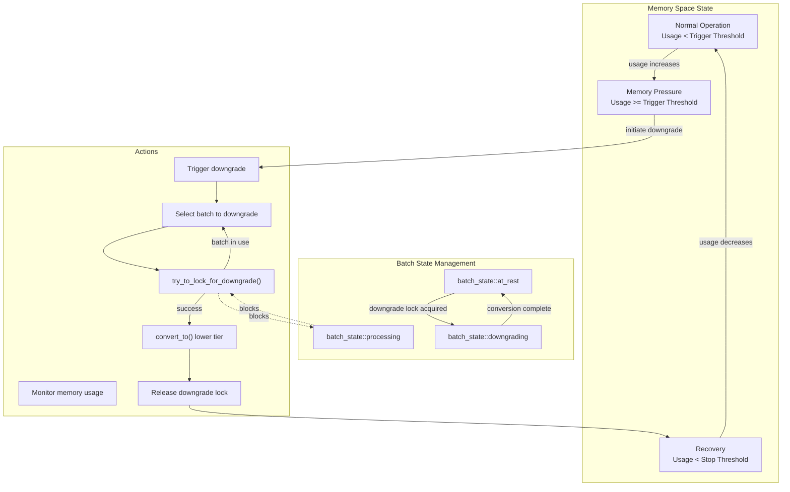
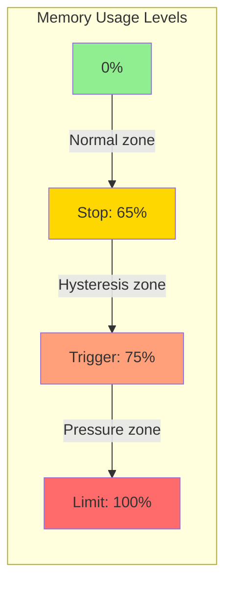
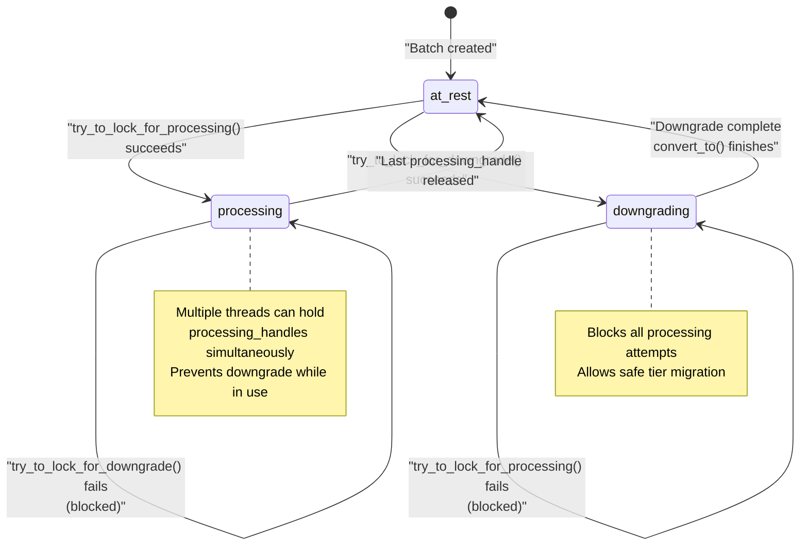
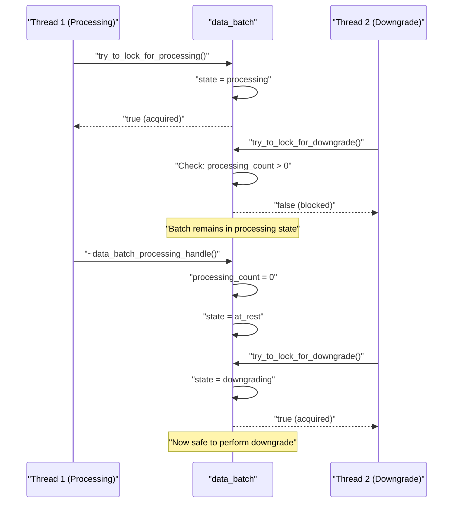
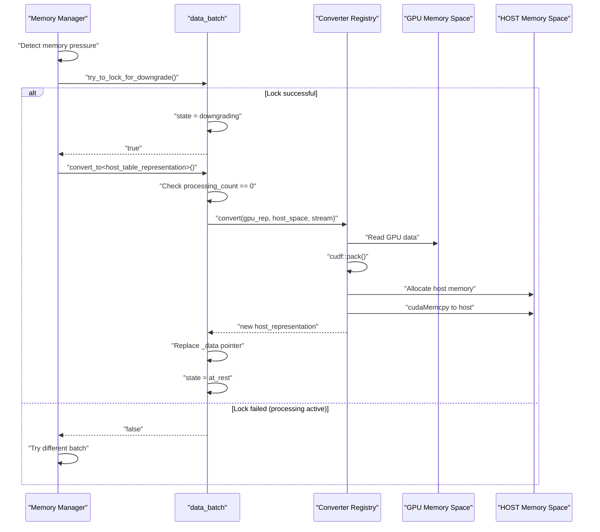
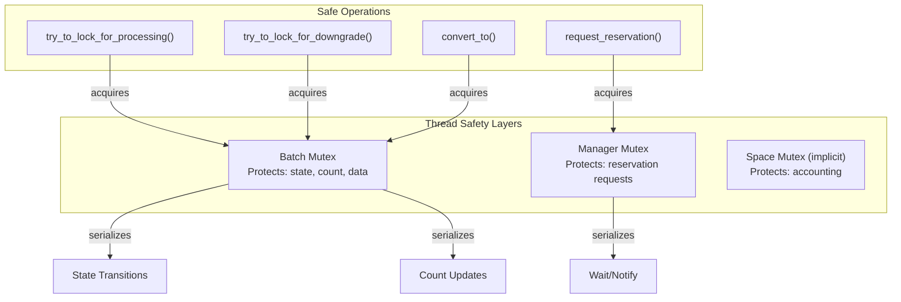
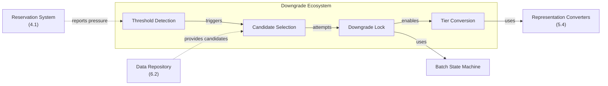

<!-- source: DeepWiki mcp.deepwiki.com · repo NVIDIA/cuCascade · page 8.2 Memory Pressure and Downgrade Policies · fetched 2026-10-26 -->

# Memory Pressure and Downgrade Policies

<details>
<summary>Relevant source files</summary>

The following files were used as context for generating this wiki page:

- [include/data/data_batch.hpp](include/data/data_batch.hpp)
- [include/memory/memory_reservation_manager.hpp](include/memory/memory_reservation_manager.hpp)
- [src/memory/memory_reservation_manager.cpp](src/memory/memory_reservation_manager.cpp)
- [test/data/test_data_batch.cpp](test/data/test_data_batch.cpp)
- [test/memory/test_memory_reservation_manager.cpp](test/memory/test_memory_reservation_manager.cpp)

</details>


**Purpose**: This document explains how cuCascade detects and responds to memory pressure through downgrade policies. It covers the mechanisms for triggering data movement from higher-performance memory tiers (GPU) to lower-performance tiers (HOST, DISK) when memory becomes scarce, the state management system that prevents unsafe concurrent operations during downgrades, and the configuration of downgrade thresholds.

For information about the memory tier hierarchy and data movement between tiers, see [Memory Tier Hierarchy](#3.2). For details on data representation conversion during tier changes, see [Representation Converters](#5.4). For general thread safety patterns, see [Thread Safety and Concurrency](#8.1).

---

## Overview

Memory pressure occurs when the available memory in a memory space approaches its configured limits. cuCascade implements a proactive downgrade system that automatically moves data from higher-performance tiers to lower-performance tiers before memory exhaustion occurs. This system operates through:

1. **Threshold-based triggers** that detect memory pressure
2. **Batch state management** that coordinates safe downgrade operations
3. **Locking mechanisms** that prevent concurrent processing during downgrades
4. **Configurable policies** that control when downgrade starts and stops



**Diagram: Memory Pressure Response Flow**

Sources: [include/data/data_batch.hpp:43-47](), [include/memory/memory_reservation_manager.hpp:191-197]()

---

## Memory Pressure Detection

Memory pressure is detected through configurable thresholds defined in `memory_space_config`. Each `memory_space` maintains two critical thresholds that control downgrade behavior:

| Threshold | Field | Purpose | Default Value |
|-----------|-------|---------|---------------|
| **Trigger Threshold** | `downgrade_tigger_threshold` | Usage ratio that triggers downgrade | 0.75 (75%) |
| **Stop Threshold** | `downgrade_stop_threshold` | Usage ratio at which downgrade stops | 0.65 (65%) |

### Threshold Configuration

The thresholds are configured when creating a `memory_reservation_manager`:

```cpp
struct memory_space_config {
    Tier tier;
    int device_id;
    size_t memory_limit;
    float downgrade_tigger_threshold{0.75};  // Trigger at 75% capacity
    float downgrade_stop_threshold{0.65f};   // Stop at 65% capacity
    std::size_t memory_capacity;
    DeviceMemoryResourceFactoryFn mr_factory_fn;
    // ...
};
```

During initialization, these ratios are converted to absolute byte thresholds:

```cpp
auto mem_space = std::make_unique<memory_space>(
    config.tier,
    config.device_id,
    config.memory_limit,
    static_cast<std::size_t>(config.downgrade_tigger_threshold * 
                             static_cast<float>(config.memory_capacity)),
    static_cast<std::size_t>(config.downgrade_stop_threshold * 
                             static_cast<float>(config.memory_capacity)),
    config.memory_capacity,
    config.mr_factory_fn(/*...*/));
```

### Threshold Behavior

- **Below Stop Threshold**: Normal operation, no downgrade needed
- **Between Stop and Trigger**: Recovery zone, downgrade may cease
- **Above Trigger Threshold**: Memory pressure detected, downgrade initiated
- **Hysteresis**: The gap between thresholds prevents oscillation



**Diagram: Memory Threshold Zones**

Sources: [include/memory/memory_reservation_manager.hpp:195-196](), [src/memory/memory_reservation_manager.cpp:135-138]()

---

## Batch State Management During Downgrade

The `data_batch` class implements a three-state machine to coordinate downgrade operations safely:

```cpp
enum class batch_state {
  at_rest,     // Batch is idle, not being processed or downgraded
  processing,  // Batch is currently being processed
  downgrading  // Batch is currently being downgraded to a lower memory tier
};
```

### State Transitions



**Diagram: Batch State Machine with Downgrade Support**

### Locking for Downgrade

The `try_to_lock_for_downgrade()` method attempts to acquire exclusive access for downgrade operations:

**Method signature:**
```cpp
bool try_to_lock_for_downgrade();
```

**Lock acquisition rules:**
- Returns `true` if `processing_count == 0` and state is `at_rest`
- Returns `false` if the batch is currently being processed
- Transitions state from `at_rest` to `downgrading` upon success

**Example usage pattern:**
```cpp
data_batch* candidate = find_batch_to_downgrade();

if (candidate->try_to_lock_for_downgrade()) {
    // Exclusive access acquired, safe to downgrade
    candidate->convert_to<host_table_representation>(
        registry, 
        target_memory_space, 
        stream);
    
    // State automatically transitions back to at_rest
} else {
    // Batch is being processed, cannot downgrade
    // Try different batch
}
```

Sources: [include/data/data_batch.hpp:43-47](), [include/data/data_batch.hpp:256-262](), [test/data/test_data_batch.cpp:150-182]()

---

## Downgrade Lock Behavior

### Processing Blocked During Downgrade

When a batch enters the `downgrading` state, all processing attempts are blocked:

```cpp
bool try_to_lock_for_processing() {
    std::lock_guard<std::mutex> lock(_mutex);
    
    // Reject if batch is being downgraded
    if (_state == batch_state::downgrading) {
        return false;
    }
    
    // Allow if at_rest or already processing
    if (_state == batch_state::at_rest) {
        _state = batch_state::processing;
    }
    
    _processing_count++;
    return true;
}
```

### Downgrade Blocked During Processing

Conversely, downgrade is prevented while any processing is active:

```cpp
bool try_to_lock_for_downgrade() {
    std::lock_guard<std::mutex> lock(_mutex);
    
    // Can only downgrade if not being processed
    if (_processing_count == 0 && _state == batch_state::at_rest) {
        _state = batch_state::downgrading;
        return true;
    }
    
    return false;
}
```

### Test Verification

The test suite validates these mutual exclusion properties:

| Test Case | File Location | Validates |
|-----------|---------------|-----------|
| Downgrade Blocks Processing | [test/data/test_data_batch.cpp:151-165]() | Processing fails when `downgrading` |
| Cannot Downgrade While Processing | [test/data/test_data_batch.cpp:168-182]() | Downgrade fails when `processing` |
| Thread-Safe Processing Count | [test/data/test_data_batch.cpp:229-265]() | Concurrent operations are safe |



**Diagram: Processing and Downgrade Mutual Exclusion**

Sources: [include/data/data_batch.hpp:246-254](), [include/data/data_batch.hpp:256-262](), [test/data/test_data_batch.cpp:150-182]()

---

## Conversion Operations During Downgrade

Once a batch is successfully locked for downgrade, tier conversion can proceed safely. The `convert_to()` method performs the actual data movement:

```cpp
template <typename TargetRepresentation>
void convert_to(representation_converter_registry& registry,
                const cucascade::memory::memory_space* target_memory_space,
                rmm::cuda_stream_view stream)
{
    std::lock_guard<std::mutex> lock(_mutex);
    
    // Double-check no processing started during lock acquisition
    if (_processing_count != 0) {
        throw std::runtime_error(
            "Cannot convert representation while there is active processing");
    }
    
    // Perform conversion
    auto new_representation = 
        registry.convert<TargetRepresentation>(*_data, target_memory_space, stream);
    _data = std::move(new_representation);
}
```

### Conversion Protection

The `convert_to()` method provides additional safety:

1. **Mutex-protected**: Entire operation is under lock
2. **Processing check**: Validates no concurrent processing
3. **Exception safety**: Throws if invariants violated
4. **Atomic replacement**: Data pointer replaced in single operation

### Typical Downgrade Sequence



**Diagram: Complete Downgrade Operation Sequence**

Sources: [include/data/data_batch.hpp:283-297](), [include/data/data_batch.hpp:222-224]()

---

## Reservation Strategy Integration

Memory pressure detection integrates with the reservation system to guide downgrade decisions:

### Downgrade Request Strategies

The `memory_reservation_manager` provides strategies for downgrade-aware reservations:

```cpp
struct any_memory_space_to_downgrade : public reservation_request_strategy {
    memory_space_id src_id;
    std::vector<Tier> target_tiers;
    
    explicit any_memory_space_to_downgrade(memory_space_id src, Tier target)
        : reservation_request_strategy(true), src_id(src), target_tiers({target})
    {}
};
```

This strategy indicates:
- **Source space**: The memory space experiencing pressure
- **Target tiers**: Acceptable tiers for downgrade destination
- **Strong ordering**: Requests are processed in specific order

### Memory Space Query Integration

Query methods help identify when downgrade is needed:

| Method | Purpose |
|--------|---------|
| `get_available_memory_for_tier(Tier)` | Check available space in tier |
| `get_total_reserved_memory_for_tier(Tier)` | Check committed allocations |
| `get_active_reservation_count_for_tier(Tier)` | Count active reservations |

### Example: Proactive Downgrade

```cpp
// Check if GPU tier is under pressure
auto gpu_spaces = manager->get_memory_spaces_for_tier(Tier::GPU);
for (const auto* space : gpu_spaces) {
    size_t available = space->get_available_memory();
    size_t capacity = space->get_memory_capacity();
    float usage_ratio = 1.0f - (static_cast<float>(available) / capacity);
    
    if (usage_ratio >= space->get_downgrade_trigger_threshold()) {
        // Memory pressure detected
        // Select batches for downgrade
        std::vector<data_batch*> candidates = find_downgrade_candidates();
        
        for (auto* batch : candidates) {
            if (batch->try_to_lock_for_downgrade()) {
                // Downgrade to HOST
                batch->convert_to<host_table_representation>(
                    registry,
                    host_memory_space,
                    stream);
                break;  // Check if pressure relieved
            }
        }
    }
}
```

Sources: [include/memory/memory_reservation_manager.hpp:137-152](), [src/memory/memory_reservation_manager.cpp:245-279]()

---

## Thread Safety Guarantees

All downgrade-related operations are thread-safe through multiple layers of protection:

### Batch-Level Synchronization

```cpp
class data_batch {
private:
    mutable std::mutex _mutex;              // Protects state and count
    uint64_t _batch_id;
    std::unique_ptr<idata_representation> _data;
    size_t _processing_count = 0;
    batch_state _state = batch_state::at_rest;
};
```

**Protected operations:**
- State transitions (`at_rest` ↔ `processing` ↔ `downgrading`)
- Processing count increments/decrements
- Data pointer replacement during conversion

### Manager-Level Synchronization

```cpp
class memory_reservation_manager {
private:
    mutable std::mutex _wait_mutex;
    std::condition_variable _wait_cv;
};
```

**Protected operations:**
- Reservation requests across memory spaces
- Cross-space coordination when memory unavailable
- Notification when memory becomes available

### Concurrency Test Coverage

| Test Scenario | Thread Count | Operations | File |
|---------------|-------------|------------|------|
| Concurrent Processing Locks | 10 | 1000 locks | [test/data/test_data_batch.cpp:229-265]() |
| Rapid Lock/Unlock Cycles | 1 | 1000 cycles | [test/data/test_data_batch.cpp:356-380]() |
| Smart Pointer Lifecycle | N/A | Shared/unique ptr | [test/data/test_data_batch.cpp:383-420]() |



**Diagram: Thread Safety Architecture**

Sources: [include/data/data_batch.hpp:275-279](), [include/memory/memory_reservation_manager.hpp:301-302](), [test/data/test_data_batch.cpp:229-265]()

---

## Configuration Best Practices

### Choosing Trigger Thresholds

**Recommendations:**

| Memory Tier | Trigger Threshold | Stop Threshold | Rationale |
|-------------|------------------|----------------|-----------|
| GPU | 0.70 - 0.80 | 0.60 - 0.70 | Fast tier, aggressive downgrade |
| HOST | 0.75 - 0.85 | 0.65 - 0.75 | Larger capacity, moderate policy |
| DISK | 0.85 - 0.95 | 0.75 - 0.85 | Largest tier, minimal downgrade |

**Key considerations:**
- **Hysteresis gap**: Maintain 10-15% gap to prevent oscillation
- **Workload patterns**: Adjust based on batch sizes and access frequency
- **Tier capacity ratio**: Higher-capacity tiers tolerate higher thresholds

### Example Configuration

```cpp
// Conservative GPU configuration (early downgrade)
memory_space_config gpu_config(
    Tier::GPU,
    0,                      // device_id
    2ULL << 30,            // 2GB limit
    2ULL << 30,            // 2GB capacity
    make_default_allocator_for_tier(Tier::GPU)
);
gpu_config.downgrade_tigger_threshold = 0.70f;  // Trigger at 70%
gpu_config.downgrade_stop_threshold = 0.55f;    // Stop at 55%

// Relaxed HOST configuration (delayed downgrade)
memory_space_config host_config(
    Tier::HOST,
    0,                      // NUMA node
    8ULL << 30,            // 8GB limit
    8ULL << 30,            // 8GB capacity
    make_default_allocator_for_tier(Tier::HOST)
);
host_config.downgrade_tigger_threshold = 0.85f;  // Trigger at 85%
host_config.downgrade_stop_threshold = 0.75f;    // Stop at 75%
```

### Monitoring and Debugging

**Key metrics to track:**

```cpp
// Per-space monitoring
auto* gpu_space = manager->get_memory_space(Tier::GPU, 0);
size_t available = gpu_space->get_available_memory();
size_t reserved = gpu_space->get_total_reserved_memory();
size_t count = gpu_space->get_active_reservation_count();

float usage_ratio = static_cast<float>(reserved) / 
                   static_cast<float>(gpu_space->get_memory_capacity());

// Log when approaching thresholds
if (usage_ratio > 0.70f) {
    LOG_WARNING("GPU memory usage at " << (usage_ratio * 100) << "%");
}
```

Sources: [include/memory/memory_reservation_manager.hpp:191-211](), [src/memory/memory_reservation_manager.cpp:150-170](), [test/memory/test_memory_reservation_manager.cpp:84-112]()

---

## Relationship to Other Systems

### Memory Reservation System

Downgrade policies work in conjunction with the reservation system:
- Reservations block memory from being available
- High reservation load triggers downgrade
- Downgrade frees reservations in higher tiers
- See [Memory Reservation Manager](#4.1) for reservation details

### Data Repository

Repositories provide batch candidates for downgrade:
- FIFO ordering suggests downgrade candidates (oldest first)
- Repositories track which batches are in use (processing)
- See [Data Repository](#6.2) for batch queuing

### Representation Converters

Downgrade operations rely on converters:
- Convert GPU representations to HOST representations
- Handle serialization and memory copying
- See [Representation Converters](#5.4) for conversion details



**Diagram: Downgrade System Integration**

Sources: [include/data/data_batch.hpp:1-300](), [include/memory/memory_reservation_manager.hpp:1-307]()

---

## Summary

cuCascade's downgrade policies provide automatic memory management through:

1. **Threshold-based detection**: Configurable trigger and stop thresholds detect memory pressure
2. **State-based coordination**: `batch_state` enum prevents unsafe concurrent operations
3. **Lock-based exclusion**: `try_to_lock_for_downgrade()` ensures exclusive access during tier changes
4. **Thread-safe operations**: Multiple mutex layers protect state transitions
5. **Flexible configuration**: Per-tier threshold customization for different workload patterns

The system balances proactive memory management with performance by:
- Preventing memory exhaustion through early downgrade
- Maintaining data availability during processing
- Minimizing conversion overhead through selective downgrade
- Providing hysteresis to prevent thrashing

For implementation details of the state machine, see [include/data/data_batch.hpp:43-297](). For threshold configuration, see [include/memory/memory_reservation_manager.hpp:191-211]().

---

