<!-- source: DeepWiki mcp.deepwiki.com · repo NVIDIA/cuCascade · page 8.3 Stream Management and Async Operations · fetched 2026-10-26 -->

# Stream Management and Async Operations

<details>
<summary>Relevant source files</summary>

The following files were used as context for generating this wiki page:

- [src/data/representation_converter.cpp](src/data/representation_converter.cpp)
- [test/data/test_data_representation.cpp](test/data/test_data_representation.cpp)
- [test/memory/test_gpu_kernels.cu](test/memory/test_gpu_kernels.cu)
- [test/utils/cudf_test_utils.cpp](test/utils/cudf_test_utils.cpp)

</details>


## Purpose and Scope

This document describes cuCascade's integration with CUDA streams for asynchronous GPU operations and memory transfers. It covers stream acquisition from memory spaces, stream-aware data representation conversions, asynchronous memory copy operations, and synchronization strategies. For information about memory tier management, see [Memory Tier Hierarchy](#3.2). For details on data representation converters, see [Representation Converters](#5.4).

## Overview

cuCascade leverages CUDA streams throughout its architecture to enable asynchronous GPU operations, overlapped computation and data transfer, and proper ordering of dependent operations. All GPU-related operations in cuCascade are stream-aware, accepting `rmm::cuda_stream_view` parameters to integrate with user-managed execution contexts.

**Key Design Principles:**
- All conversion operations accept explicit stream parameters
- Memory spaces manage stream pools for their associated devices
- Stream synchronization is explicit and minimal
- Asynchronous memory copies are used for all GPU↔HOST and GPU↔GPU transfers
- Stream ordering enables safe multi-step operation chains

## Stream Acquisition and Management

### Stream Pools in memory_space

The `memory::memory_space` class provides stream acquisition through its `acquire_stream()` method. Each memory space maintains a pool of CUDA streams tied to its device context.

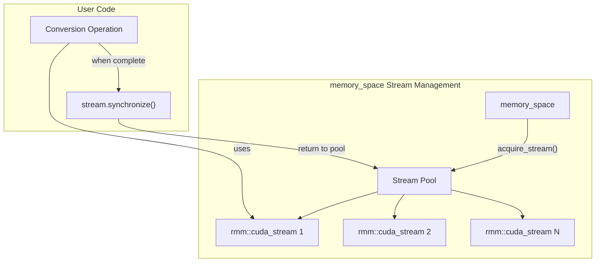

**Stream Acquisition Pattern:**

[src/data/representation_converter.cpp:132]() demonstrates stream acquisition:
```cpp
auto target_stream = target_memory_space->acquire_stream();
```

The acquired stream is an RAII-managed `rmm::cuda_stream` object that automatically handles cleanup. Streams remain valid for the lifetime of the memory space.

Sources: [src/data/representation_converter.cpp:132](), [test/data/test_data_representation.cpp:126](), [test/data/test_data_representation.cpp:245]()

### Stream Views vs Owning Streams

cuCascade distinguishes between owning streams and stream views:

| Type | Ownership | Use Case | Example |
|------|-----------|----------|---------|
| `rmm::cuda_stream` | Owns the CUDA stream resource | Created by memory spaces, managed lifetime | `auto stream = gpu_space->acquire_stream();` |
| `rmm::cuda_stream_view` | Non-owning reference | Passed to operations, enables flexible composition | `rmm::cuda_stream_view stream_view = stream.view();` |

All converter functions accept `rmm::cuda_stream_view` parameters [src/data/representation_converter.cpp:66](), allowing callers to provide either owning streams or views.

Sources: [src/data/representation_converter.cpp:66](), [test/utils/cudf_test_utils.cpp:68]()

## Asynchronous Conversion Operations

### Converter Stream Semantics

All built-in data representation converters are stream-aware and execute asynchronously where possible.

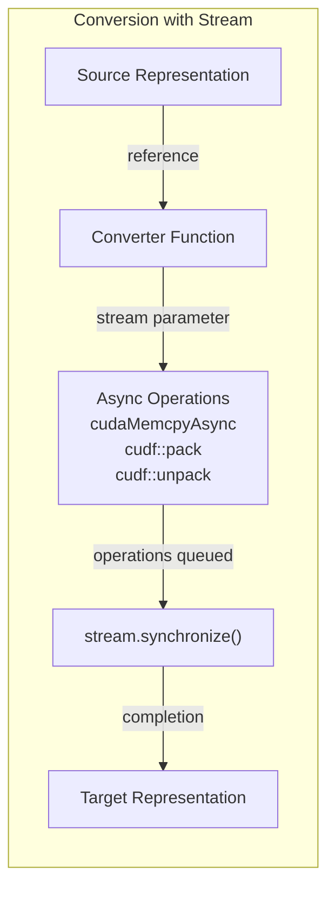

**Converter Function Signature:**

[src/data/representation_converter.cpp:62-66]() shows the standard converter signature:
```cpp
std::unique_ptr<idata_representation> convert_impl(
  const converter_key& key,
  idata_representation& source,
  const memory::memory_space* target_memory_space,
  rmm::cuda_stream_view stream) const
```

All GPU operations within the converter are enqueued on the provided stream.

Sources: [src/data/representation_converter.cpp:62-66]()

### GPU-to-HOST Conversion

The `convert_gpu_to_host` operation [src/data/representation_converter.cpp:168-205]() demonstrates asynchronous memory transfer from GPU to HOST tier:

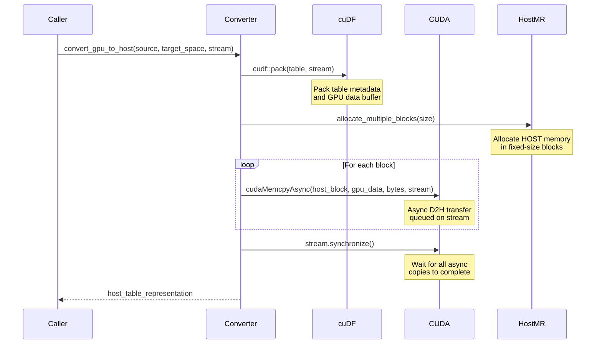

**Key Implementation Details:**

1. **Pack Operation** [src/data/representation_converter.cpp:174](): `cudf::pack()` serializes the GPU table structure on the provided stream
2. **Block-based Copying** [src/data/representation_converter.cpp:179-199](): Data is copied to multiple fixed-size HOST memory blocks using `cudaMemcpyAsync`
3. **Synchronization** [src/data/representation_converter.cpp:200](): `stream.synchronize()` ensures all async copies complete before constructing the result

Sources: [src/data/representation_converter.cpp:168-205]()

### HOST-to-GPU Conversion

The `convert_host_to_gpu` operation [src/data/representation_converter.cpp:210-257]() transfers data from HOST to GPU memory:

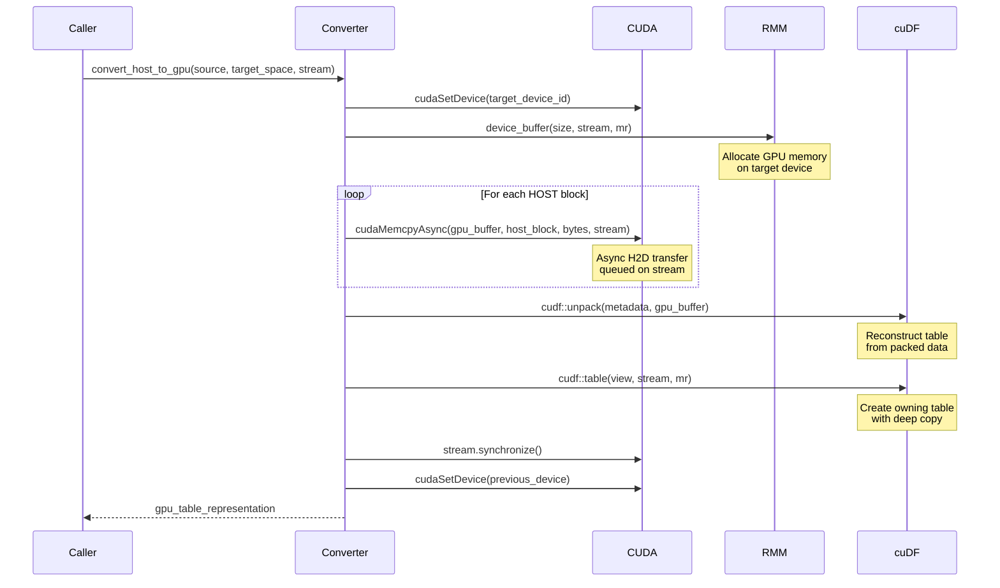

**Key Implementation Details:**

1. **Device Context Management** [src/data/representation_converter.cpp:221-222](): The current device is saved and set to the target device before allocation
2. **Async H2D Transfers** [src/data/representation_converter.cpp:234-238](): Each HOST block is asynchronously copied to the GPU buffer
3. **Stream-ordered Unpack** [src/data/representation_converter.cpp:249-251](): `cudf::unpack()` and `cudf::table` construction use the stream to maintain ordering
4. **Device Restoration** [src/data/representation_converter.cpp:254](): The previous device context is restored after synchronization

Sources: [src/data/representation_converter.cpp:210-257]()

### Cross-GPU Peer Copy

The `convert_gpu_to_gpu` operation [src/data/representation_converter.cpp:117-163]() handles peer-to-peer transfers between different GPUs:

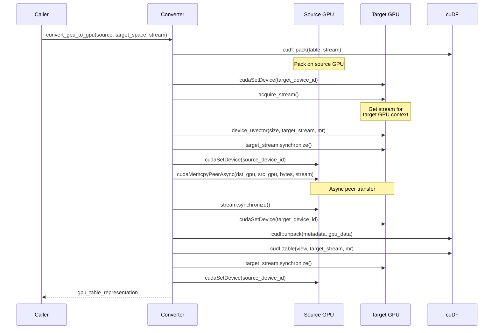

**Key Implementation Details:**

1. **Dual Stream Usage** [src/data/representation_converter.cpp:132](): A separate stream is acquired for the target device to handle allocation
2. **Peer Transfer** [src/data/representation_converter.cpp:141-146](): `cudaMemcpyPeerAsync` enables direct GPU-to-GPU copy without HOST staging
3. **Multi-Device Synchronization** [src/data/representation_converter.cpp:136](), [147](), [158](): Careful synchronization on both source and target streams ensures correct ordering

Sources: [src/data/representation_converter.cpp:117-163]()

## Stream-Ordered Operation Chains

### Single-Stream Chaining

Using a single stream for multiple dependent operations ensures correct execution order without additional synchronization:

[test/data/test_data_representation.cpp:245-252]() demonstrates chained conversions:
```cpp
auto chain_stream = gpu_space->acquire_stream();
auto cpu_any = registry.convert<host_table_representation>(repr, host_space, chain_stream);
auto gpu_any = registry.convert<gpu_table_representation>(*cpu_any, gpu_space, chain_stream);
chain_stream.synchronize();
```

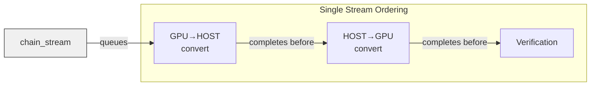

All operations enqueued on the same stream execute in order. The final synchronization ensures all operations complete before accessing results.

Sources: [test/data/test_data_representation.cpp:245-252]()

### Multi-Stream Coordination

Some operations require coordination across multiple streams, particularly in cross-device scenarios:

[src/data/representation_converter.cpp:132-159]() shows multi-stream coordination in peer copy:

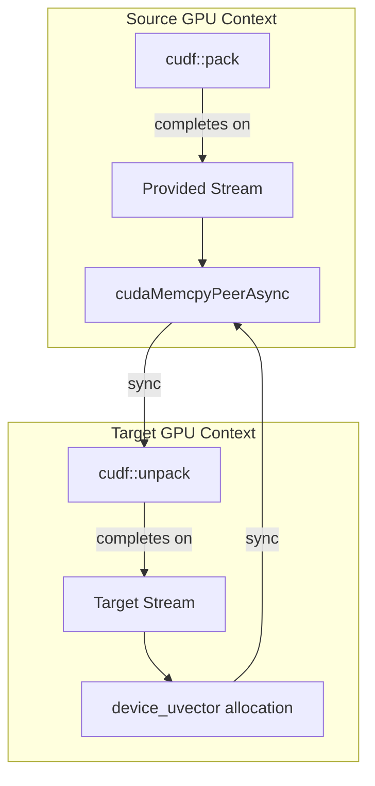

**Synchronization Points:**
1. **Target allocation sync** [src/data/representation_converter.cpp:136](): `target_stream.synchronize()` ensures buffer is allocated before peer copy
2. **Peer copy sync** [src/data/representation_converter.cpp:147](): `stream.synchronize()` ensures transfer completes before unpacking
3. **Unpack sync** [src/data/representation_converter.cpp:158](): `target_stream.synchronize()` ensures table is constructed before device switch

Sources: [src/data/representation_converter.cpp:132-159]()

## Synchronization Strategies

### Explicit Synchronization Points

cuCascade uses explicit synchronization at specific points to ensure correctness while minimizing performance impact:

| Synchronization Point | Location | Reason |
|----------------------|----------|--------|
| After pack | [src/data/representation_converter.cpp:200]() | Ensure GPU data is ready before HOST copy |
| After async copies | [src/data/representation_converter.cpp:200]() | Ensure all D2H transfers complete |
| After unpack | [src/data/representation_converter.cpp:252]() | Ensure table construction completes |
| Before device switch | [src/data/representation_converter.cpp:136](), [158]() | Prevent race conditions across devices |
| Before result verification | [test/utils/cudf_test_utils.cpp:84]() | Ensure data is accessible for comparison |

Sources: [src/data/representation_converter.cpp:200](), [src/data/representation_converter.cpp:252](), [test/utils/cudf_test_utils.cpp:84]()

### Stream-Aware Testing

Test utilities ensure correct stream semantics during verification:

[test/utils/cudf_test_utils.cpp:66-149]() implements stream-aware table comparison:

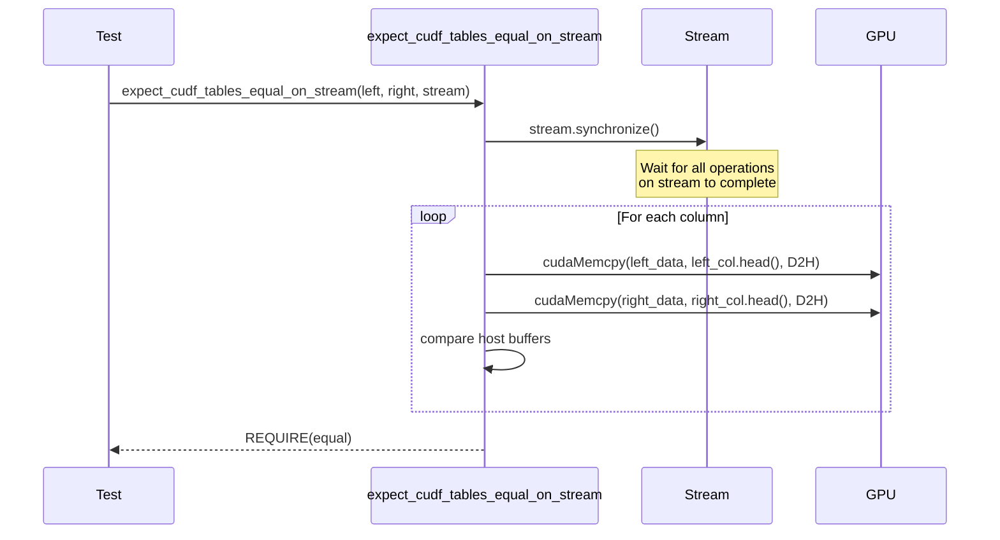

The synchronization [test/utils/cudf_test_utils.cpp:84]() ensures all GPU operations complete before reading column data for comparison.

Sources: [test/utils/cudf_test_utils.cpp:66-149]()

## Device Context Management

### Device Switching Protocol

Operations involving multiple GPUs must carefully manage the active CUDA device:

[src/data/representation_converter.cpp:220-254]() demonstrates the device switching protocol:

```cpp
int previous_device = -1;
RMM_CUDA_TRY(cudaGetDevice(&previous_device));
RMM_CUDA_TRY(cudaSetDevice(target_memory_space->get_device_id()));

// ... perform operations on target device ...

stream.synchronize();
RMM_CUDA_TRY(cudaSetDevice(previous_device));
```

**Device Switch Pattern:**

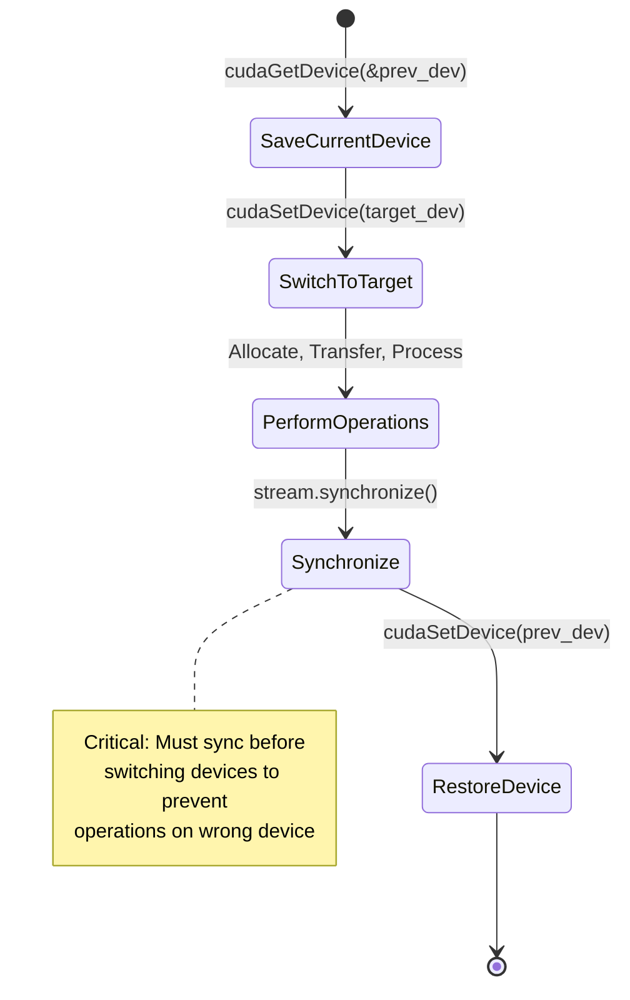

This protocol ensures:
- Operations execute on the correct device
- No pending operations remain when switching devices
- The caller's device context is preserved

Sources: [src/data/representation_converter.cpp:220-254](), [src/data/representation_converter.cpp:134-159]()

## Integration with cuDF and RMM

### Stream Parameters in cuDF Operations

cuCascade passes streams to all cuDF operations that support them:

| cuDF Operation | Stream Usage | Location |
|----------------|--------------|----------|
| `cudf::pack()` | Serialization on stream | [src/data/representation_converter.cpp:123](), [174]() |
| `cudf::unpack()` | Metadata deserialization | [src/data/representation_converter.cpp:154](), [249]() |
| `cudf::table()` | Deep copy construction | [src/data/representation_converter.cpp:156](), [251]() |

All operations maintain stream ordering for correct dependency chains.

Sources: [src/data/representation_converter.cpp:123](), [src/data/representation_converter.cpp:174](), [src/data/representation_converter.cpp:156](), [src/data/representation_converter.cpp:251]()

### RMM Stream-Aware Allocations

RMM allocations use the provided stream to ensure proper synchronization:

[src/data/representation_converter.cpp:135]() shows stream-aware allocation:
```cpp
rmm::device_uvector<uint8_t> dst_uvector(bytes_to_copy, target_stream, mr);
```

[src/data/representation_converter.cpp:224]() shows another allocation pattern:
```cpp
rmm::device_buffer dst_buffer(data_size, stream, mr);
```

The stream parameter ensures the allocation completes before subsequent operations on the same stream access the memory.

Sources: [src/data/representation_converter.cpp:135](), [src/data/representation_converter.cpp:224]()

## Asynchronous Memory Copy Operations

### CUDA Memory Copy Variants

cuCascade uses three CUDA memory copy primitives based on source and destination tiers:

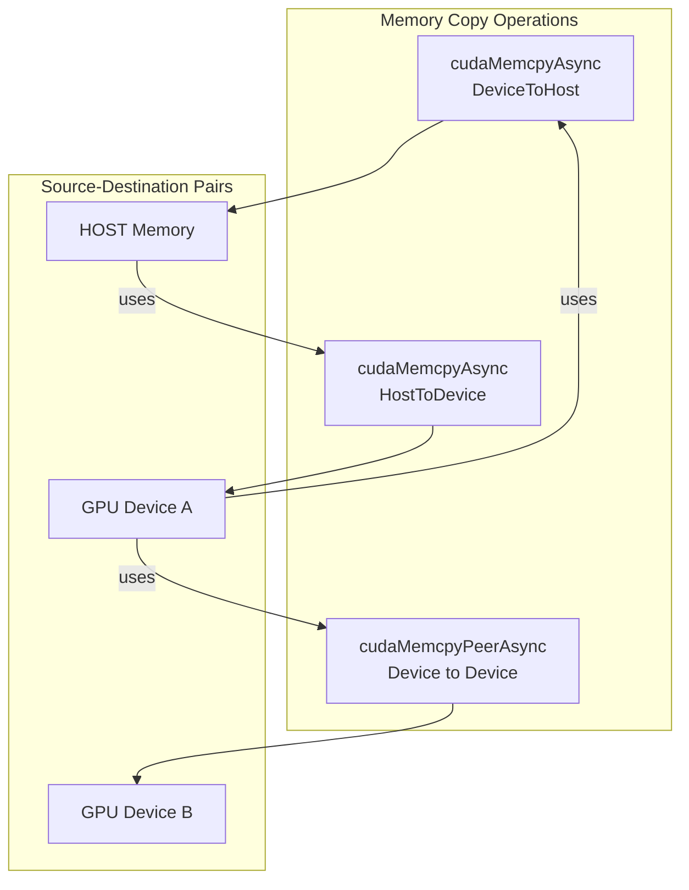

**Implementation Details:**

1. **GPU→HOST** [src/data/representation_converter.cpp:188-192]():
   ```cpp
   cudaMemcpyAsync(block_ptr.data() + block_offset,
                   static_cast<const uint8_t*>(packed_data.gpu_data->data()) + source_offset,
                   bytes_to_copy,
                   cudaMemcpyDeviceToHost,
                   stream.value())
   ```

2. **HOST→GPU** [src/data/representation_converter.cpp:234-238]():
   ```cpp
   cudaMemcpyAsync(static_cast<uint8_t*>(dst_buffer.data()) + dst_offset,
                   src_block.data() + src_block_offset,
                   bytes_to_copy,
                   cudaMemcpyHostToDevice,
                   stream.value())
   ```

3. **GPU→GPU** [src/data/representation_converter.cpp:141-146]():
   ```cpp
   cudaMemcpyPeerAsync(dst_uvector.data(),
                       target_device_id,
                       static_cast<const uint8_t*>(packed_data.gpu_data->data()),
                       source_device_id,
                       bytes_to_copy,
                       stream.value())
   ```

Sources: [src/data/representation_converter.cpp:188-192](), [src/data/representation_converter.cpp:234-238](), [src/data/representation_converter.cpp:141-146]()

### Block-Based Async Transfers

HOST memory allocations use fixed-size blocks [see Host Table Representation](#5.3)], requiring block-aware copy loops:

[src/data/representation_converter.cpp:179-199]() demonstrates block-based GPU→HOST copy:

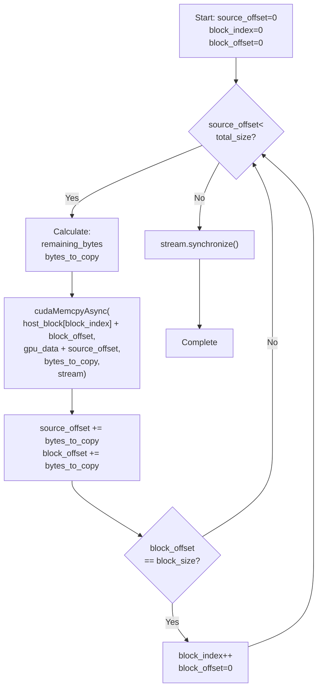

Each iteration copies up to one block's worth of data, advancing block indices as blocks fill. All copies are enqueued asynchronously, with a single synchronization at the end.

Sources: [src/data/representation_converter.cpp:179-199](), [src/data/representation_converter.cpp:225-245]()

## Performance Considerations

### Minimizing Synchronization Overhead

Stream synchronization (`stream.synchronize()`) is a blocking operation that stalls the CPU thread. cuCascade minimizes synchronization by:

1. **Batching async operations**: Multiple `cudaMemcpyAsync` calls are enqueued before synchronizing
2. **Single-stream chaining**: Dependent operations on the same stream avoid explicit syncs between steps
3. **Lazy synchronization**: Synchronization occurs only when results must be accessed or device context must change

### Overlap Opportunities

Asynchronous operations enable overlapping computation and data transfer:

```mermaid
gantt
    title Stream Operation Timeline
    dateFormat X
    axisFormat %L
    
    section Stream A
    cudf::pack GPU Table :a1, 0, 100
    cudaMemcpyAsync D2H :a2, after a1, 200
    
    section Stream B  
    Other Operations :b1, 50, 150
    
    section CPU
    Allocate HOST blocks :c1, 0, 50
    Process Results :c2, 300, 100
```

While Stream A handles GPU→HOST conversion, Stream B can process other data, and the CPU can perform HOST-side allocations concurrently.

## Testing Patterns

### Stream-Aware Test Structure

[test/data/test_data_representation.cpp:78-133]() demonstrates proper test structure:

```cpp
// 1. Create stream for operations
rmm::cuda_stream pack_stream;

// 2. Perform operations on the stream
auto packed = cudf::pack(view, pack_stream.view());
pack_stream.synchronize();

// 3. Convert with the same stream
auto gpu_any = registry.convert<gpu_table_representation>(
    host_repr, gpu_space, pack_stream);
pack_stream.synchronize();

// 4. Verify using the same stream
cucascade::test::expect_cudf_tables_equal_on_stream(
    original, gpu_repr.get_table(), pack_stream.view());
```

**Key Testing Principles:**
- Create explicit streams for test operations
- Use the same stream throughout a test sequence
- Synchronize before verification or assertion
- Use stream-aware comparison utilities

Sources: [test/data/test_data_representation.cpp:78-133](), [test/data/test_data_representation.cpp:232-254]()

### Multi-GPU Testing

[test/data/test_data_representation.cpp:269-304]() shows multi-GPU test patterns:

```cpp
// 1. Check device availability
int device_count = 0;
if (cudaGetDeviceCount(&device_count) != cudaSuccess || device_count < 2) {
    SUCCEED("Single GPU or CUDA not available; skipping cross-device test");
    return;
}

// 2. Create memory spaces for both devices
const memory::memory_space* src_space = mgr->get_memory_space(memory::Tier::GPU, dev_src);
const memory::memory_space* dst_space = mgr->get_memory_space(memory::Tier::GPU, dev_dst);

// 3. Use single stream for peer copy
auto xfer_stream = src_space->acquire_stream();
auto dst_any = registry.convert<gpu_table_representation>(src_repr, dst_space, xfer_stream);

// 4. Compare on same stream
cucascade::test::expect_cudf_tables_equal_on_stream(
    src_repr.get_table(), dst_repr.get_table(), xfer_stream);
```

Tests gracefully handle single-GPU systems and properly coordinate multi-device operations.

Sources: [test/data/test_data_representation.cpp:269-304]()

---

