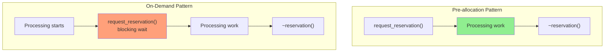
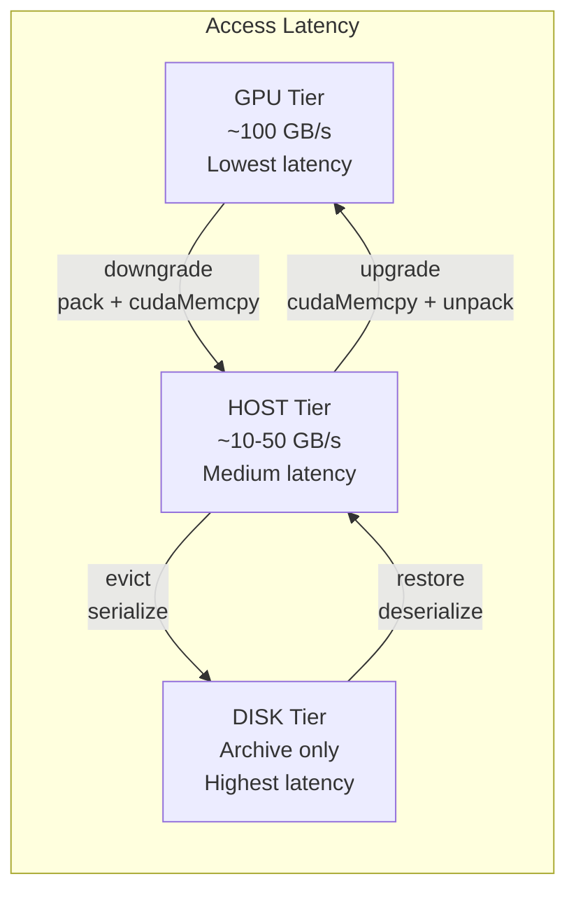
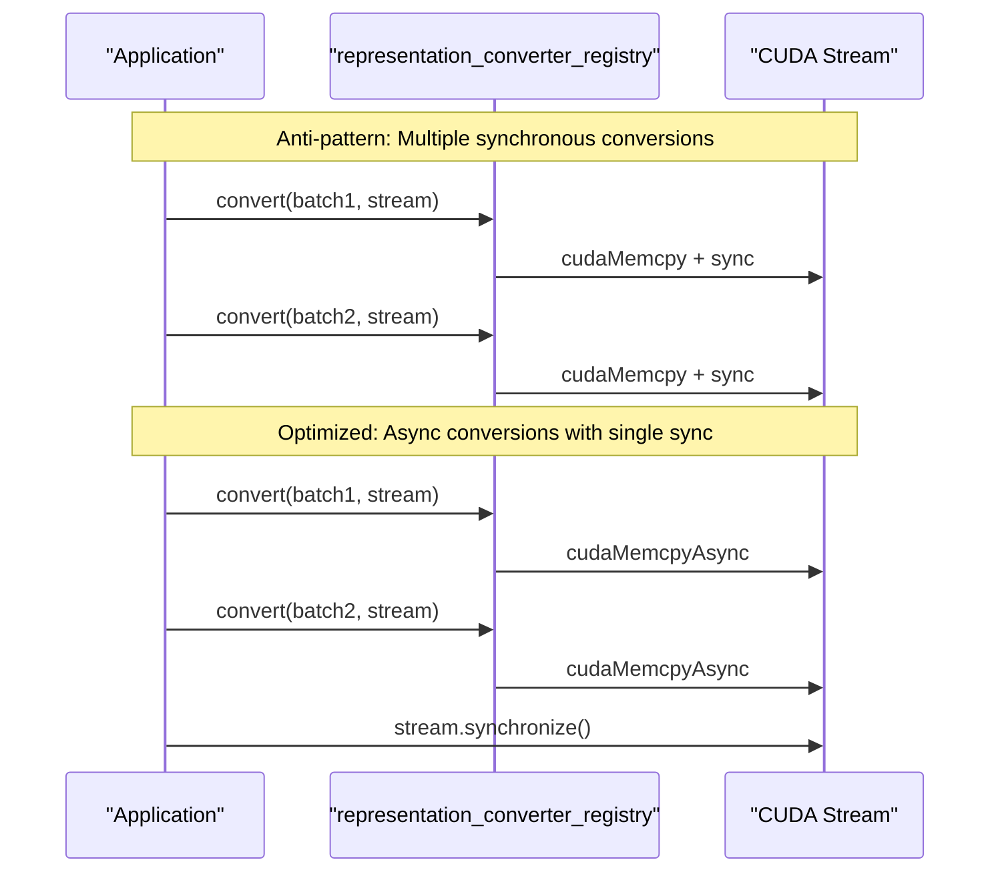
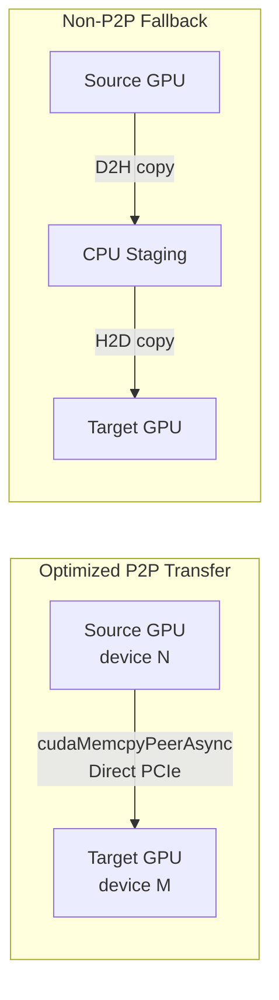
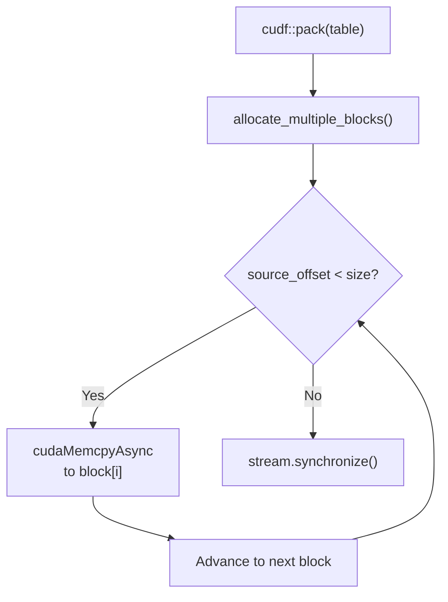
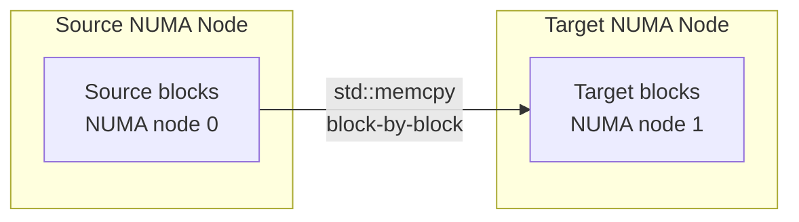
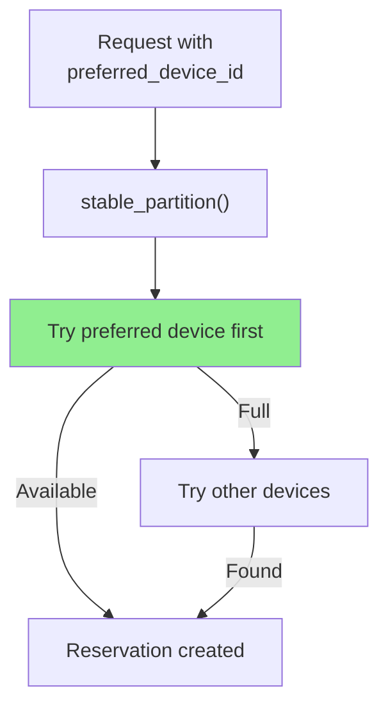
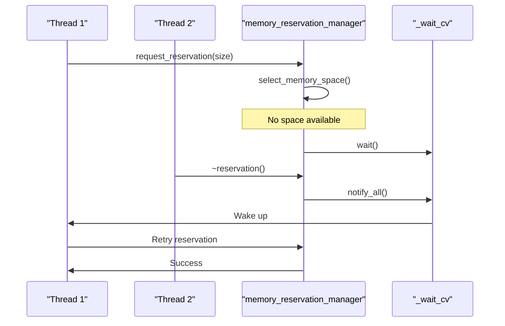
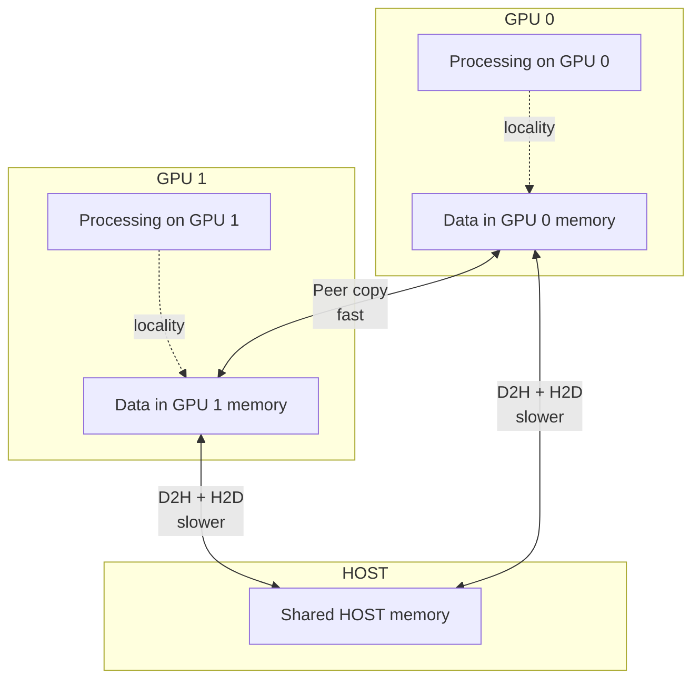
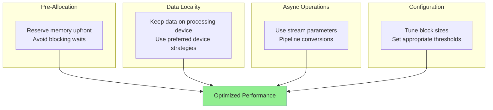

<!-- source: DeepWiki mcp.deepwiki.com · repo NVIDIA/cuCascade · page 8.4 Performance Optimization · fetched 2026-10-26 -->

# Performance Optimization

<details>
<summary>Relevant source files</summary>

The following files were used as context for generating this wiki page:

- [include/memory/memory_reservation_manager.hpp](include/memory/memory_reservation_manager.hpp)
- [src/data/representation_converter.cpp](src/data/representation_converter.cpp)
- [src/memory/memory_reservation_manager.cpp](src/memory/memory_reservation_manager.cpp)
- [test/memory/test_memory_reservation_manager.cpp](test/memory/test_memory_reservation_manager.cpp)

</details>


## Purpose and Scope

This page covers best practices for optimizing performance when using cuCascade's memory management and data representation systems. It focuses on memory allocation patterns, minimizing data movement between tiers, and configuring the system for optimal throughput.

For information about thread safety and concurrent access patterns, see [Thread Safety and Concurrency](#8.1). For details on CUDA stream management and asynchronous operations, see [Stream Management and Async Operations](#8.3). For memory pressure handling and tier downgrades, see [Memory Pressure and Downgrade Policies](#8.2).

---

## Memory Allocation Patterns

### Reservation Sizing Strategy

Proper sizing of memory reservations is critical to avoid repeated allocation overhead and memory fragmentation. The `memory_reservation_manager` supports multiple reservation strategies that impact allocation performance.

**Reservation Strategies:**

| Strategy | Use Case | Performance Impact |
|----------|----------|-------------------|
| `specific_memory_space` | Pinning to exact device | Best locality, no search overhead |
| `any_memory_space_in_tier_with_preference` | Tier with device hint | Fast with locality preference |
| `any_memory_space_in_tier` | Any device in tier | Balanced load distribution |
| `any_memory_space_in_tiers` | Multi-tier fallback | Flexibility with priority order |

**Sources:** [include/memory/memory_reservation_manager.hpp:81-167]()

### Pre-allocation vs. On-Demand

Pre-allocating memory reservations eliminates allocation latency during critical processing paths. The reservation system uses RAII-based lifetime management to ensure deterministic cleanup.



**Performance Considerations:**
- Pre-allocation eliminates wait time in `request_reservation()` if no memory is available
- The manager blocks at [src/memory/memory_reservation_manager.cpp:181-190]() until memory becomes available
- Use pre-allocation for latency-sensitive operations

**Sources:** [src/memory/memory_reservation_manager.cpp:172-191](), [test/memory/test_memory_reservation_manager.cpp:114-166]()

### Reservation Overflow Policies

The `reservation_aware_resource_adaptor` supports multiple overflow policies that control behavior when allocations exceed reservation size:

| Policy | Behavior | Performance Impact |
|--------|----------|-------------------|
| `ignore_reservation_limit_policy` | Allocate from upstream | Minimal overhead, may cause memory pressure |
| `fail_reservation_limit_policy` | Throw `rmm::bad_alloc` | No overflow, predictable memory usage |
| `increase_reservation_limit_policy` | Grow reservation dynamically | Adapts to workload, may fragment memory |

**Sources:** [test/memory/test_memory_reservation_manager.cpp:396-468]()

---

## Minimizing Data Transfers

### Tier Placement Strategy

Keeping data in the appropriate tier minimizes expensive cross-tier transfers. The three-tier hierarchy has distinct performance characteristics:



**Optimization Guidelines:**
1. Keep actively processed data in GPU tier
2. Move data to HOST tier only when GPU memory pressure requires it (see [Memory Pressure and Downgrade Policies](#8.2))
3. Reserve DISK tier for archival storage, not active processing

**Sources:** [Diagram 3 from high-level architecture]

### Batching Conversions

When converting multiple data batches, batch the conversions to amortize synchronization overhead:



The converter registry functions accept `rmm::cuda_stream_view` parameters to enable asynchronous operation. All built-in converters use async CUDA operations internally.

**Sources:** [src/data/representation_converter.cpp:62-94]()

### In-Place Operations

When possible, avoid creating intermediate representations. The `data_batch::convert_to()` method performs in-place conversion that reuses the batch's existing representation slot.

**Sources:** Reference to [Data Batch](#6.1) for conversion methods

---

## Optimizing Conversion Operations

### GPU-to-GPU Cross-Device Transfers

The built-in `convert_gpu_to_gpu` converter uses peer-to-peer memory access when available, avoiding CPU roundtrips:



**Implementation Details:**
- `cudaMemcpyPeerAsync` at [src/data/representation_converter.cpp:141-146]()
- Synchronization after copy at [src/data/representation_converter.cpp:147]()
- Device switching to maintain CUDA context correctness [src/data/representation_converter.cpp:134-159]()

**Performance Tips:**
1. Enable peer-to-peer access with `cudaDeviceEnablePeerAccess()` during initialization
2. Keep source and target devices on the same PCIe root complex when possible
3. The converter acquires a stream from the target device's memory space to ensure proper device context

**Sources:** [src/data/representation_converter.cpp:117-163]()

### GPU-to-HOST Block-Based Copying

HOST memory uses fixed-size blocks due to the `fixed_size_host_memory_resource` allocator. The GPU-to-HOST converter performs iterative block copies:



**Performance Characteristics:**
- Block size determined by `fixed_size_host_memory_resource` configuration
- Each block copy is async: [src/data/representation_converter.cpp:187-199]()
- Single synchronization after all copies complete: [src/data/representation_converter.cpp:200]()

**Optimization Tips:**
1. Configure larger block sizes in `fixed_size_host_memory_resource` to reduce copy iterations
2. Balance block size against memory fragmentation
3. Stream parameter enables pipelining multiple conversions

**Sources:** [src/data/representation_converter.cpp:168-205]()

### HOST-to-GPU Reassembly

The reverse operation (HOST-to-GPU) reads from multiple host blocks and assembles a contiguous GPU buffer:

**Key Operations:**
1. Allocate contiguous `rmm::device_buffer` on target GPU: [src/data/representation_converter.cpp:224]()
2. Iterate through source blocks with async copies: [src/data/representation_converter.cpp:229-245]()
3. Unpack cuDF table from contiguous buffer: [src/data/representation_converter.cpp:249-251]()

**Performance Tip:** The converter maintains the source device as the active CUDA device during host-to-device copies, only switching to the target device for unpacking operations.

**Sources:** [src/data/representation_converter.cpp:210-257]()

### HOST-to-HOST Cross-NUMA Copies

For HOST-to-HOST conversions across NUMA nodes, the system uses `std::memcpy` with block iteration:



**Implementation:** The converter handles different block sizes between source and target allocations by tracking offsets in both: [src/data/representation_converter.cpp:278-304]()

**Performance Note:** This path does not involve CUDA operations and runs entirely on the CPU. Consider NUMA topology when configuring HOST memory spaces (see [Topology Discovery and NUMA Support](#4.3)).

**Sources:** [src/data/representation_converter.cpp:262-310]()

---

## Memory Reservation Strategies

### Preferred Device Selection

The `any_memory_space_in_tier_with_preference` strategy enables device affinity while maintaining fallback capability:



The implementation uses `std::stable_partition` to prioritize the preferred device without requiring separate code paths: [src/memory/memory_reservation_manager.cpp:64-76]()

**Use Cases:**
- Data locality: prefer the GPU where data currently resides
- Load balancing: distribute work across devices with soft preferences
- NUMA awareness: prefer HOST memory on the same NUMA node as the processing GPU

**Sources:** [src/memory/memory_reservation_manager.cpp:64-76](), [include/memory/memory_reservation_manager.hpp:81-92]()

### Strong vs. Weak Ordering

Reservation strategies have an `_strong_ordering` flag that controls allocation behavior:

| Ordering | Behavior | Use Case |
|----------|----------|----------|
| Strong (`true`) | Try candidates sequentially, block if first fails | Deterministic placement, data locality requirements |
| Weak (`false`) | Try all candidates with `make_reservation_or_null()`, then sequential | Load balancing, maximize throughput |

**Implementation Logic:** [src/memory/memory_reservation_manager.cpp:308-335]()

The weak ordering path first attempts non-blocking reservations on all candidates, falling back to blocking only if none succeed. This reduces contention in multi-threaded scenarios.

**Sources:** [src/memory/memory_reservation_manager.cpp:308-335](), [include/memory/memory_reservation_manager.hpp:56-75]()

### Avoiding Reservation Contention

In multi-threaded workloads, reservation requests can block at the manager's condition variable:



**Optimization Strategies:**
1. **Pre-allocate reservations** during initialization to avoid runtime contention
2. **Use weak ordering** strategies to increase the chance of finding available space
3. **Size reservations conservatively** to leave headroom for other threads
4. **Leverage overflow policies** to allow dynamic growth when needed

**Sources:** [src/memory/memory_reservation_manager.cpp:172-191]()

---

## Configuration for Performance

### Memory Space Configuration Parameters

The `memory_space_config` struct controls performance-critical parameters:

```cpp
struct memory_space_config {
    Tier tier;
    int device_id;
    size_t memory_limit;              // Maximum reservation size
    float downgrade_trigger_threshold; // Trigger downgrade at 75% usage
    float downgrade_stop_threshold;    // Stop downgrade at 65% usage
    std::size_t memory_capacity;       // Total physical capacity
    DeviceMemoryResourceFactoryFn mr_factory_fn;
};
```

**Key Performance Parameters:**

| Parameter | Impact | Tuning Guidelines |
|-----------|--------|-------------------|
| `memory_limit` | Max reservable memory | Set to 75-90% of capacity to leave headroom |
| `downgrade_trigger_threshold` | When to start tier downgrades | Lower = more proactive, higher = more GPU time |
| `downgrade_stop_threshold` | When to stop downgrades | Gap between trigger and stop prevents oscillation |
| `memory_capacity` | Total device memory | Should match physical capacity for accurate tracking |

**Sources:** [include/memory/memory_reservation_manager.hpp:191-212]()

### Memory Resource Factory Functions

The `mr_factory_fn` parameter allows custom memory resource implementations. Default factories are provided per tier:

**GPU Tier:** Uses RMM pool allocator or CUDA async allocator
**HOST Tier:** Uses `fixed_size_host_memory_resource` with block-based allocation
**DISK Tier:** Placeholder for future disk-based backing store

**Custom Resource Example:**
```cpp
DeviceMemoryResourceFactoryFn custom_factory = 
    [](int device_id, size_t limit, size_t capacity) {
        // Return custom memory resource with specific pooling strategy
    };

memory_space_config gpu_config(
    Tier::GPU, 
    device_id, 
    memory_limit,
    capacity,
    custom_factory
);
```

**Sources:** [include/memory/memory_reservation_manager.hpp:198-211](), [src/memory/memory_reservation_manager.cpp:150-170]()

### Fixed-Size Block Configuration for HOST

The `fixed_size_host_memory_resource` uses a fixed block size for all allocations. This trades memory efficiency for allocation speed and simplicity:

**Block Size Trade-offs:**

| Block Size | Pros | Cons |
|------------|------|------|
| Small (1-4 MB) | Less waste, more granular control | More copy iterations in conversions |
| Medium (16-64 MB) | Balanced performance | Moderate waste for small data |
| Large (256+ MB) | Fewer copy iterations | Significant waste, fragmentation |

**Recommendation:** Configure block size based on typical data batch sizes. For example, if most batches are 10-50 MB, use 16-32 MB blocks.

**Sources:** [src/data/representation_converter.cpp:176-182]()

---

## Multi-GPU Optimization

### Device Placement Strategies

For multi-GPU systems, data placement significantly impacts performance:



**Optimization Guidelines:**

1. **Pin data to processing GPU:** Use `specific_memory_space` or `any_memory_space_in_tier_with_preference` to co-locate data with processing
2. **Enable peer access:** Ensure P2P is enabled between GPUs with high data exchange
3. **Use HOST as staging area:** For GPU-to-GPU transfers without P2P, HOST memory is more efficient than multiple hops
4. **Balance load explicitly:** Use `any_memory_space_in_tier` with weak ordering to distribute work evenly

**Sources:** [include/memory/memory_reservation_manager.hpp:81-92](), [test/memory/test_memory_reservation_manager.cpp:470-514]()

### Reservation Strategies for Multi-Device

Test scenarios demonstrate effective multi-device patterns:

**Pattern 1: Spillover to Secondary GPU**
```cpp
// Exhaust primary GPU
auto res1 = manager->request_reservation(
    specific_memory_space{Tier::GPU, 0}, 
    large_size);

// Automatically places on GPU 1
auto res2 = manager->request_reservation(
    any_memory_space_in_tier{Tier::GPU}, 
    large_size);
```

**Pattern 2: Preferred Device with Fallback**
```cpp
// Try GPU 0 first, fall back to GPU 1
auto res = manager->request_reservation(
    any_memory_space_in_tier_with_preference{Tier::GPU, 0}, 
    size);
```

**Sources:** [test/memory/test_memory_reservation_manager.cpp:470-514]()

---

## Performance Measurement

### Built-in Metrics

The `reservation_aware_resource_adaptor` tracks several performance-relevant metrics:

**Per-Stream Metrics:**
- `get_allocated_bytes(stream)`: Current allocation on stream
- `get_peak_allocated_bytes(stream)`: Peak allocation on stream
- `get_available_memory(stream)`: Available memory accounting for stream's reservation

**Upstream Metrics:**
- `get_total_allocated_bytes()`: Total allocated across all streams
- `get_peak_total_allocated_bytes()`: Peak total allocation
- `get_total_reserved_bytes()`: Total memory reserved (not yet allocated)

**Usage Example:**
```cpp
auto* mr = reservation->get_memory_resource_of<Tier::GPU>();
auto initial_free = mr->get_available_memory(stream);

// ... perform operations ...

auto peak_usage = mr->get_peak_allocated_bytes(stream);
auto current_free = mr->get_available_memory(stream);

std::cout << "Peak allocation: " << peak_usage << " bytes\n";
std::cout << "Memory consumed: " << (initial_free - current_free) << " bytes\n";
```

**Sources:** [test/memory/test_memory_reservation_manager.cpp:256-330]()

### Conversion Performance Profiling

To profile conversion operations, use CUDA events or NSight Systems:

```cpp
cudaEvent_t start, stop;
cudaEventCreate(&start);
cudaEventCreate(&stop);

cudaEventRecord(start, stream.value());
auto converted = registry.convert(
    source_rep, 
    target_type, 
    target_space, 
    stream);
cudaEventRecord(stop, stream.value());

cudaEventSynchronize(stop);
float milliseconds = 0;
cudaEventElapsedTime(&milliseconds, start, stop);
```

**Sources:** General CUDA profiling best practices

---

## Summary of Key Optimizations



**Critical Performance Factors:**

1. **Pre-allocate reservations** to eliminate allocation latency
2. **Minimize cross-tier transfers** by keeping data in the appropriate tier
3. **Enable peer-to-peer access** for multi-GPU systems
4. **Use async CUDA operations** with streams for pipelining
5. **Configure block sizes** appropriate to data batch sizes
6. **Leverage device preferences** in reservation strategies
7. **Monitor metrics** to identify bottlenecks

**Sources:** All sections above