# Page: Overview

# Overview

<details>
<summary>Relevant source files</summary>

The following files were used as context for generating this wiki page:

- [CMakeLists.txt](CMakeLists.txt)
- [cmake/cuCascadeConfig.cmake.in](cmake/cuCascadeConfig.cmake.in)
- [src/data/CMakeLists.txt](src/data/CMakeLists.txt)
- [test/CMakeLists.txt](test/CMakeLists.txt)

</details>


This document provides a high-level introduction to cuCascade, its architecture, and core concepts. For detailed information about building and configuring cuCascade, see [Getting Started](#2). For in-depth documentation of individual subsystems, see [Architecture Overview](#3), [Memory Management Subsystem](#4), [Data Representation Subsystem](#5), and [Data Management Subsystem](#6).

## Purpose and Scope

cuCascade is a GPU memory management and data representation library designed to enable efficient multi-tier data processing across heterogeneous memory spaces (GPU, HOST, and DISK). The library provides abstractions for managing data lifecycle, coordinating access across multiple operators, and automatically converting data between different memory representations based on access patterns and memory pressure.

**Sources:** [CMakeLists.txt:21-25]()

## What cuCascade Provides

cuCascade delivers three core capabilities:

| Capability | Description | Key Components |
|------------|-------------|----------------|
| **Heterogeneous Memory Management** | Orchestrate allocations across GPU, HOST (with NUMA awareness), and DISK tiers | `memory_reservation_manager`, `memory_space` |
| **Data Representation Abstraction** | Polymorphic data storage with automatic conversion between GPU tables (cuDF) and HOST tables | `idata_representation`, `gpu_table_representation`, `host_table_representation`, `representation_converter_registry` |
| **Batch Lifecycle Management** | Thread-safe data batch processing with FIFO queues, multi-operator routing, and RAII-based state management | `data_batch`, `data_repository`, `data_repository_manager`, `data_batch_processing_handle` |

The library integrates with the RAPIDS ecosystem, wrapping cuDF for GPU dataframes and RMM for GPU memory allocation, while adding support for HOST and DISK storage tiers with automatic conversion capabilities.

**Sources:** [CMakeLists.txt:48-56](), [src/data/CMakeLists.txt:18-25]()

## System Architecture

cuCascade is organized into three architectural layers, each building on the layer below:

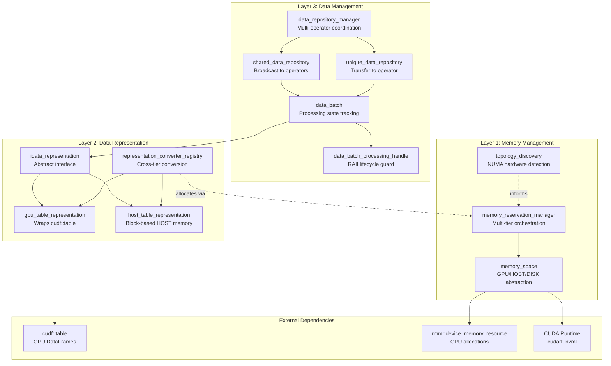

**Diagram: Three-Layer Architecture with Key Classes**

Each layer provides a distinct abstraction:

- **Layer 1 (Memory Management)**: Manages heterogeneous memory resources across GPU, HOST, and DISK tiers with NUMA-aware allocation strategies
- **Layer 2 (Data Representation)**: Provides polymorphic data storage with transparent conversion between memory tiers
- **Layer 3 (Data Management)**: Coordinates data batch lifecycle, operator routing, and concurrent access control

**Sources:** [CMakeLists.txt:105-107](), [src/data/CMakeLists.txt:18-25]()

## Core Concepts

### Memory Tier Hierarchy

cuCascade operates on a three-tier memory model where data can reside in different storage locations with varying access performance:

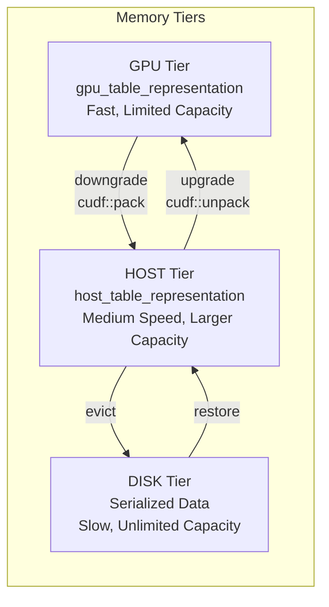

**Diagram: Memory Tier Transitions**

Data moves between tiers based on:
- **Memory pressure**: When a tier runs low on space, data is downgraded to the next tier
- **Access patterns**: Data is upgraded to faster tiers when needed for processing
- **Explicit conversion**: Applications can request specific tier placement via `convert_to()` operations

**Sources:** [CMakeLists.txt:49-56]()

### Data Batch Lifecycle

The `data_batch` class tracks data through its lifecycle with concurrent access support:

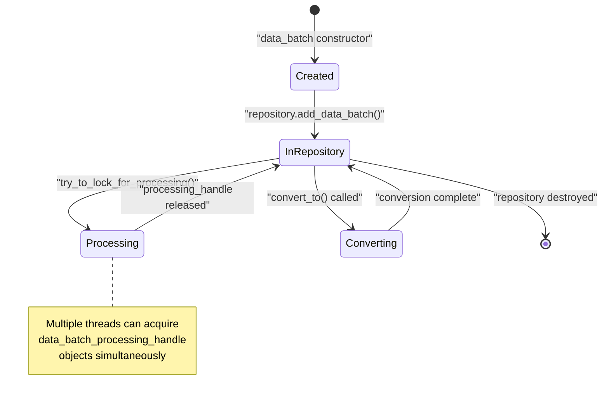

**Diagram: Data Batch State Machine**

The `data_batch_processing_handle` RAII class ensures safe concurrent access: multiple threads can process the same batch simultaneously, but conversions are blocked while processing is active.

**Sources:** [src/data/CMakeLists.txt:21]()

## Key Components and Their Relationships

The following diagram maps cuCascade's major components to their implementation classes and shows data flow through the system:

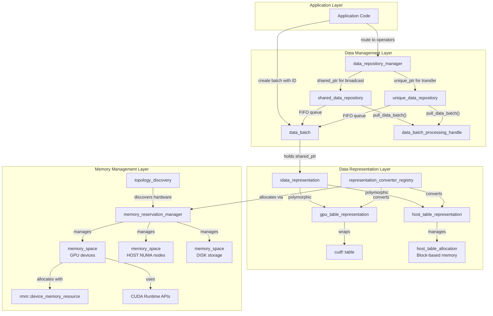

**Diagram: Component Relationships and Data Flow**

This architecture enables:
- **Decoupled processing**: Operators process batches independently via their own repositories
- **Flexible ownership**: Batches can be broadcast (shared) or transferred (unique) between operators
- **Transparent tier migration**: Data representations handle memory tier transitions without application intervention
- **Concurrent access**: RAII handles coordinate safe multi-threaded batch access

**Sources:** [src/data/CMakeLists.txt:18-25](), [CMakeLists.txt:116-117]()

## Build System Organization

cuCascade uses a modern CMake build system with an object library pattern for efficient compilation:

| Target | Type | Purpose |
|--------|------|---------|
| `cucascade_objects` | OBJECT | Compiles all sources once, shared by static and shared libraries |
| `cucascade_static` | STATIC | Static library variant |
| `cucascade_shared` | SHARED | Shared library variant with versioning |
| `cuCascade::cucascade` | ALIAS | Convenience alias pointing to preferred library variant |
| `cucascade_tests` | EXECUTABLE | Test suite using Catch2 framework |

The build system requires:
- **CMake 3.26.4+**
- **C++20** compiler with full standard library support
- **CUDA Toolkit** with CUDA 20 support
- **RAPIDS ecosystem**: RMM and cuDF libraries
- **System libraries**: NUMA, pthreads

**Sources:** [CMakeLists.txt:18-46](), [CMakeLists.txt:94-120](), [test/CMakeLists.txt:18-24]()

## Integration with RAPIDS Ecosystem

cuCascade extends the RAPIDS ecosystem by adding multi-tier memory management capabilities:

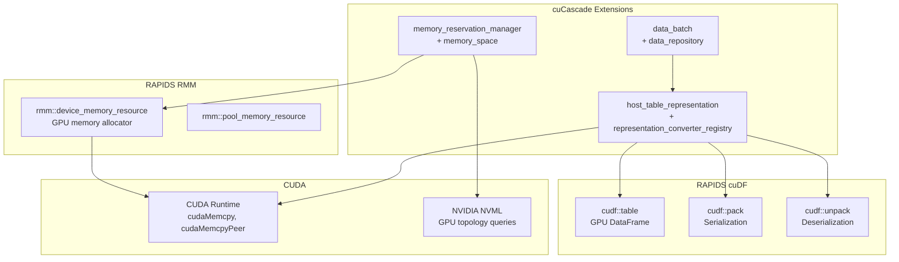

**Diagram: cuCascade Integration with RAPIDS and CUDA**

cuCascade wraps `cudf::table` in `gpu_table_representation`, uses `rmm::device_memory_resource` for GPU allocations, and leverages cuDF's pack/unpack operations for serialization during tier migrations.

**Sources:** [CMakeLists.txt:49-56](), [CMakeLists.txt:116-117](), [cmake/cuCascadeConfig.cmake.in:5-9]()

## Thread Safety and Concurrency Model

cuCascade is designed for high-concurrency workloads with the following guarantees:

- **Concurrent reads**: Multiple threads can hold `data_batch_processing_handle` objects for the same batch simultaneously
- **Exclusive conversions**: Tier conversions (via `convert_to()`) and batch state changes acquire locks and block processing
- **Lock-free batch addition**: Adding batches to repositories uses atomic operations where possible
- **RAII-based resource management**: All resource lifetimes are tied to scoped handle objects

For detailed concurrency patterns and best practices, see [Thread Safety and Concurrency](#8.1).

**Sources:** [src/data/CMakeLists.txt:21]()

## Next Steps

To get started with cuCascade:

1. **Build and Install**: Follow the instructions in [Building and Installation](#2.1)
2. **Understand the Architecture**: Read [Architecture Overview](#3) for detailed layer descriptions
3. **Explore Components**: Review subsystem documentation:
   - [Memory Management Subsystem](#4) for heterogeneous memory management
   - [Data Representation Subsystem](#5) for data format abstractions
   - [Data Management Subsystem](#6) for batch lifecycle coordination
4. **Review Examples**: See test cases in [Testing and Development](#7) for usage patterns

**Sources:** [CMakeLists.txt:1-242](), [test/CMakeLists.txt:1-62]()

---

# Page: Getting Started

# Getting Started

<details>
<summary>Relevant source files</summary>

The following files were used as context for generating this wiki page:

- [CMakeLists.txt](CMakeLists.txt)
- [cmake/cuCascadeConfig.cmake.in](cmake/cuCascadeConfig.cmake.in)
- [include/data/data_repository.hpp](include/data/data_repository.hpp)
- [pixi.toml](pixi.toml)

</details>


This page provides an overview of how to build, install, and configure cuCascade. It covers the prerequisites, basic build workflow, and environment setup needed to start developing with or integrating cuCascade into your application.

For detailed build instructions and CMake options, see [Building and Installation](#2.1). For comprehensive dependency information and environment configuration, see [Dependencies and Environment Setup](#2.2).

## Prerequisites

cuCascade requires the following minimum versions and components:

| Component | Minimum Version | Purpose |
|-----------|----------------|---------|
| CMake | 3.26.4 | Build system generator |
| C++ Standard | C++20 | Language features |
| CUDA Standard | C++20 | Device code compilation |
| CUDA Toolkit | 11.x or 13.x | GPU runtime and development tools |
| cuDF | 25.10.* | GPU DataFrame operations |
| RMM | (via cuDF) | GPU memory management |
| NUMA libraries | system | NUMA-aware memory allocation |

Sources: [CMakeLists.txt:18-34](), [CMakeLists.txt:49-56](), [pixi.toml:8-30]()

## Quick Start Workflow

The basic workflow to build and test cuCascade follows these steps:


**Minimum Command Sequence:**

Using pixi (recommended):
```bash
# Install dependencies and build
pixi run build

# Run tests
pixi run test
```

Manual workflow:
```bash
# Configure with preset
cmake --preset release

# Build
cmake --build build/release

# Test
cd build/release && ctest --output-on-failure

# Install
cmake --install build/release --prefix /path/to/install
```

Sources: [pixi.toml:32-35](), [CMakeLists.txt:1-241]()

## Build System Architecture

cuCascade uses a modern CMake build system that compiles sources once into an object library, then links them into both static and shared library variants. This architecture minimizes compilation time while providing flexibility in how consumers link against cuCascade.

**CMake Target Structure:**

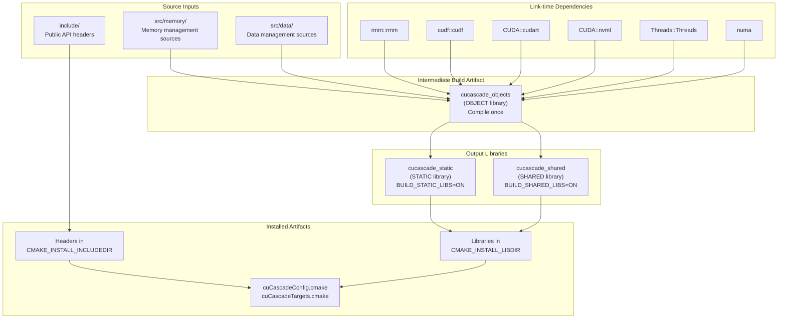

**Key Build Targets:**

| Target Name | Type | Description |
|------------|------|-------------|
| `cucascade_objects` | OBJECT | Compiled object files (internal) |
| `cucascade_static` | STATIC | Static library (libcucascade.a) |
| `cucascade_shared` | SHARED | Shared library (libcucascade.so) |
| `cuCascade::cucascade` | ALIAS | Default target (prefers shared) |
| `cuCascade::cucascade_static` | ALIAS | Explicit static target |
| `cuCascade::cucascade_shared` | ALIAS | Explicit shared target |

Sources: [CMakeLists.txt:94-176](), [CMakeLists.txt:178-233]()

## Build Configuration Options

cuCascade provides several CMake options to customize the build:

| Option | Default | Description |
|--------|---------|-------------|
| `BUILD_TESTS` | ON | Build the test suite with Catch2 |
| `BUILD_SHARED_LIBS` | ON | Build shared library variant |
| `BUILD_STATIC_LIBS` | ON | Build static library variant |
| `WARNINGS_AS_ERRORS` | ON | Treat compiler warnings as errors |
| `CMAKE_CUDA_ARCHITECTURES` | 75;80;86;90 | Target GPU architectures |

**Note:** At least one of `BUILD_SHARED_LIBS` or `BUILD_STATIC_LIBS` must be enabled. The build will fail if both are disabled.

Sources: [CMakeLists.txt:36-61](), [CMakeLists.txt:66-84]()

## Environment Setup with Pixi

cuCascade provides a `pixi.toml` configuration file for reproducible environment management. Pixi is a package manager that simplifies dependency installation across different platforms.

**Pixi Environment Configuration:**

```mermaid
graph TB
    subgraph "Pixi Workspace Configuration"
        TOML["pixi.toml"]
    end
    
    subgraph "Channel Sources"
        RAPIDS["rapidsai channel"]
        CONDA["conda-forge channel"]
        NVIDIA["nvidia channel"]
    end
    
    subgraph "System Requirements"
        CUDA_REQ["CUDA >= 13"]
    end
    
    subgraph "Build Dependencies"
        CMAKE["cmake 4.1.*"]
        NVCC["cuda-nvcc"]
        NVML["cuda-nvml-dev"]
        CUDA_VER["cuda-version 13.*"]
        CXX["cxx-compiler"]
        NINJA["ninja"]
        SCCACHE["sccache"]
    end
    
    subgraph "Library Dependencies"
        LIBCUDF["libcudf 25.10.*"]
        LIBCURAND["libcurand-dev"]
        FMT["fmt"]
        NUMA_PKG["numactl-devel-cos7-x86_64"]
    end
    
    subgraph "Development Tools"
        PRECOMMIT["pre-commit"]
    end
    
    subgraph "Environment Variables"
        LIBCUDF_PREFIX["LIBCUDF_ENV_PREFIX=$CONDA_PREFIX"]
        CUDAARCHS["CUDAARCHS=75-real;80-real;..."]
    end
    
    TOML --> RAPIDS
    TOML --> CONDA
    TOML --> NVIDIA
    
    TOML --> CUDA_REQ
    
    RAPIDS --> LIBCUDF
    NVIDIA --> NVCC
    NVIDIA --> NVML
    NVIDIA --> CUDA_VER
    NVIDIA --> LIBCURAND
    CONDA --> CMAKE
    CONDA --> CXX
    CONDA --> NINJA
    CONDA --> SCCACHE
    CONDA --> FMT
    CONDA --> NUMA_PKG
    CONDA --> PRECOMMIT
    
    TOML --> LIBCUDF_PREFIX
    TOML --> CUDAARCHS
```

**Pixi Tasks:**

The `pixi.toml` file defines several convenience tasks:

| Task | Command | Description |
|------|---------|-------------|
| `build` | `cmake --preset release && cmake --build build/release` | Configure and build cuCascade |
| `test` | `cd build/release && ctest --output-on-failure` | Run test suite |
| `lint` | `pre-commit run -a` | Run code linting |
| `lint-install` | `pre-commit install` | Install pre-commit hooks |

Sources: [pixi.toml:1-37]()

## Consuming cuCascade in Downstream Projects

Once installed, cuCascade can be consumed by downstream CMake projects using the standard `find_package()` mechanism. The installation creates a CMake package configuration that automatically resolves all transitive dependencies.

**CMake Integration Example:**

```cmake
# In your project's CMakeLists.txt
find_package(cuCascade REQUIRED)

# Link against cuCascade
target_link_libraries(my_application
  PRIVATE
    cuCascade::cucascade        # Default (prefers shared)
    # OR
    cuCascade::cucascade_shared  # Explicit shared
    # OR
    cuCascade::cucascade_static  # Explicit static
)
```

**Package Configuration Structure:**

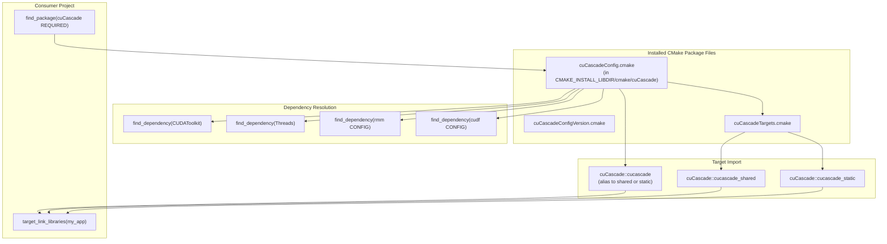

Sources: [cmake/cuCascadeConfig.cmake.in:1-27](), [CMakeLists.txt:178-233]()

## Compiler Requirements

cuCascade enforces strict compiler warnings to ensure code quality. The following warning flags are enabled by default:

**C/C++ Warning Flags:**
- `-Wall`, `-Wextra`, `-Wpedantic`: Standard warning sets
- `-Wcast-align`: Alignment issues in casts
- `-Wunused`: Unused variables/functions
- `-Wconversion`, `-Wsign-conversion`: Type conversion warnings
- `-Wnull-dereference`: Potential null pointer dereferences
- `-Wdouble-promotion`: Float to double promotions
- `-Wformat=2`: Format string vulnerabilities
- `-Wimplicit-fallthrough`: Missing break statements

**CUDA Compilation:**
Warning flags are passed to the host compiler via `-Xcompiler` when compiling CUDA sources.

When `WARNINGS_AS_ERRORS=ON` (default), all warnings are treated as compilation errors.

Sources: [CMakeLists.txt:64-103]()

## Verification

After building cuCascade, verify the installation by running the test suite:

```bash
# If using pixi
pixi run test

# If using manual build
cd build/release
ctest --output-on-failure
```

The test suite uses the Catch2 framework and validates:
- Memory management operations across GPU/HOST/DISK tiers
- Data representation conversions
- Data batch lifecycle and state management
- Repository operations and concurrency
- Topology discovery and NUMA awareness

For details on the testing infrastructure, see [Testing and Development](#7).

Sources: [pixi.toml:34](), [CMakeLists.txt:236-241]()

## Next Steps

After successfully building and verifying cuCascade:

1. **Explore the architecture**: See [Architecture Overview](#3) for the three-layer design
2. **Understand memory management**: See [Memory Management Subsystem](#4) for heterogeneous memory orchestration
3. **Learn data representations**: See [Data Representation Subsystem](#5) for GPU/HOST table abstractions
4. **Integrate into your application**: Use the CMake package configuration shown above
5. **Review examples**: Examine the test suite in `test/` for usage patterns

For detailed API documentation, refer to the public headers in the `include/` directory.

Sources: [CMakeLists.txt:106-107]()

---

# Page: Building and Installation

# Building and Installation

<details>
<summary>Relevant source files</summary>

The following files were used as context for generating this wiki page:

- [CMakeLists.txt](CMakeLists.txt)
- [cmake/cuCascadeConfig.cmake.in](cmake/cuCascadeConfig.cmake.in)

</details>


## Purpose and Scope

This page provides detailed instructions for building and installing cuCascade from source using CMake. It covers compiler requirements, build configuration options, the CMake target structure, and the installation process. For information about setting up dependencies and environment configuration, see [Dependencies and Environment Setup](#2.2).

---

## Prerequisites

cuCascade requires the following tools and environment:

| Requirement | Minimum Version | Notes |
|-------------|----------------|-------|
| CMake | 3.26.4 | Build system |
| C++ Compiler | C++20 support | GCC 11+, Clang 14+, or MSVC 2019+ |
| CUDA Toolkit | CUDA 20 support | nvcc compiler with C++20 support |
| NVIDIA GPU | Compute capability 7.5+ | Architectures: 75, 80, 86, 90 |

**Sources:** [CMakeLists.txt:18-34]()

### Dependency Libraries

cuCascade depends on the RAPIDS ecosystem and system libraries:

- **cuDF**: GPU DataFrame library for data representation
- **RMM**: RAPIDS Memory Manager for GPU memory allocation
- **CUDA Runtime** (`cudart`): CUDA runtime library
- **CUDA NVML** (`nvml`): NVIDIA Management Library for topology discovery
- **libnuma**: NUMA memory allocation support
- **Threads**: POSIX threads library

Refer to [Dependencies and Environment Setup](#2.2) for detailed installation instructions for these dependencies.

**Sources:** [CMakeLists.txt:49-56, 116-117]()

---

## Build System Architecture

cuCascade uses a modern CMake build system with an **object library** pattern to optimize compilation. The system compiles source files once into an intermediate object library, then links these objects into both static and shared library variants.

### CMake Target Structure

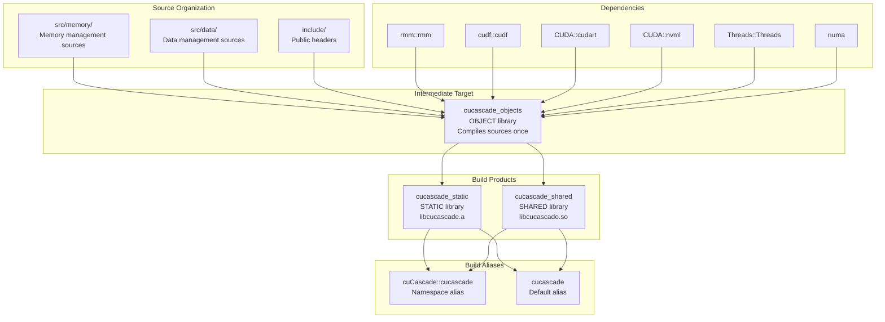

**Diagram: CMake Target Dependency Graph**

The `cucascade_objects` target is an `OBJECT` library that compiles all source files. Both `cucascade_static` and `cucascade_shared` link against `$<TARGET_OBJECTS:cucascade_objects>`, avoiding duplicate compilation. The default `cuCascade::cucascade` alias points to the shared library if enabled, otherwise to the static library.

**Sources:** [CMakeLists.txt:94-176]()

---

## Building cuCascade

### Basic Build Steps

```bash
# 1. Clone the repository
git clone https://github.com/NVIDIA/cuCascade.git
cd cuCascade

# 2. Create build directory
mkdir build
cd build

# 3. Configure with CMake
cmake ..

# 4. Build the library
cmake --build . --parallel

# 5. Run tests (optional)
ctest --output-on-failure
```

### CMake Configuration Options

The following CMake options control the build configuration:

| Option | Type | Default | Description |
|--------|------|---------|-------------|
| `BUILD_SHARED_LIBS` | BOOL | ON | Build shared library (`libcucascade.so`) |
| `BUILD_STATIC_LIBS` | BOOL | ON | Build static library (`libcucascade.a`) |
| `BUILD_TESTS` | BOOL | ON | Build test suite |
| `WARNINGS_AS_ERRORS` | BOOL | ON | Treat compiler warnings as errors |
| `CMAKE_CUDA_ARCHITECTURES` | LIST | "75;80;86;90" | Target CUDA compute capabilities |

**Sources:** [CMakeLists.txt:36-66]()

### Configuration Examples

**Build shared library only:**
```bash
cmake -DBUILD_STATIC_LIBS=OFF ..
```

**Build static library only:**
```bash
cmake -DBUILD_SHARED_LIBS=OFF ..
```

**Custom CUDA architectures (e.g., for A100 and H100 only):**
```bash
cmake -DCMAKE_CUDA_ARCHITECTURES="80;90" ..
```

**Disable tests for faster builds:**
```bash
cmake -DBUILD_TESTS=OFF ..
```

**Development build with lenient warnings:**
```bash
cmake -DWARNINGS_AS_ERRORS=OFF ..
```

**Note:** At least one of `BUILD_SHARED_LIBS` or `BUILD_STATIC_LIBS` must be `ON`. The configuration will fail otherwise.

**Sources:** [CMakeLists.txt:42-46, 59-61, 66]()

---

## Compiler Flags and Standards

### Language Standards

cuCascade enforces modern C++ and CUDA standards:

- **C++20** standard required for host code (no compiler extensions)
- **CUDA 20** standard required for device code

**Sources:** [CMakeLists.txt:27-34]()

### Warning Flags

The build system enables comprehensive compiler warnings for code quality:

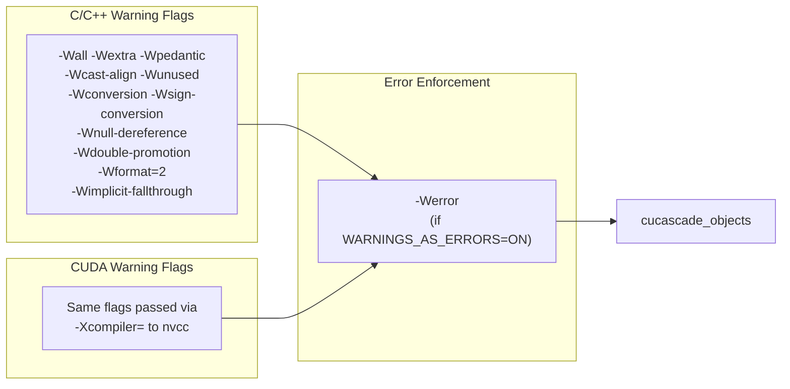

**Diagram: Compiler Warning Configuration Flow**

CUDA warning flags are passed to the host compiler using `-Xcompiler=` prefix, ensuring consistent warning behavior across compilation units.

**Sources:** [CMakeLists.txt:64-103]()

---

## Installation

### Installation Targets

The installation process installs the following components:

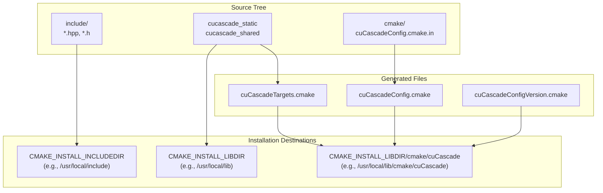

**Diagram: Installation Directory Structure**

**Sources:** [CMakeLists.txt:179-233]()

### Installation Commands

**Standard installation (requires root/sudo):**
```bash
cd build
cmake --install .
```

**Custom installation prefix:**
```bash
cmake --install . --prefix /custom/install/path
```

**Installation to a staging directory:**
```bash
cmake --install . --prefix /tmp/staging
```

### Installed Files

After installation, the following structure is created:

```
<install-prefix>/
├── include/
│   └── cucascade/           # Public headers
│       ├── memory/
│       ├── data/
│       └── ...
├── lib/
│   ├── libcucascade.so      # Shared library (if BUILD_SHARED_LIBS=ON)
│   ├── libcucascade.a       # Static library (if BUILD_STATIC_LIBS=ON)
│   └── cmake/
│       └── cuCascade/
│           ├── cuCascadeTargets.cmake
│           ├── cuCascadeConfig.cmake
│           └── cuCascadeConfigVersion.cmake
```

**Sources:** [CMakeLists.txt:184-233]()

---

## Using cuCascade in Downstream Projects

### CMake Integration

After installation, downstream projects can consume cuCascade using `find_package()`:

```cmake
# Find cuCascade package
find_package(cuCascade REQUIRED CONFIG)

# Link your target to cuCascade
add_executable(my_app main.cpp)
target_link_libraries(my_app PRIVATE cuCascade::cucascade)
```

### Available CMake Targets

The package exports the following targets:

| Target | Description |
|--------|-------------|
| `cuCascade::cucascade` | Default target (shared if available, else static) |
| `cuCascade::cucascade_shared` | Shared library variant (if installed) |
| `cuCascade::cucascade_static` | Static library variant (if installed) |

**Example: Force linking to static library:**
```cmake
target_link_libraries(my_app PRIVATE cuCascade::cucascade_static)
```

**Sources:** [cmake/cuCascadeConfig.cmake.in:1-27]()

### Package Configuration

The `cuCascadeConfig.cmake` file automatically finds and links all transitive dependencies:

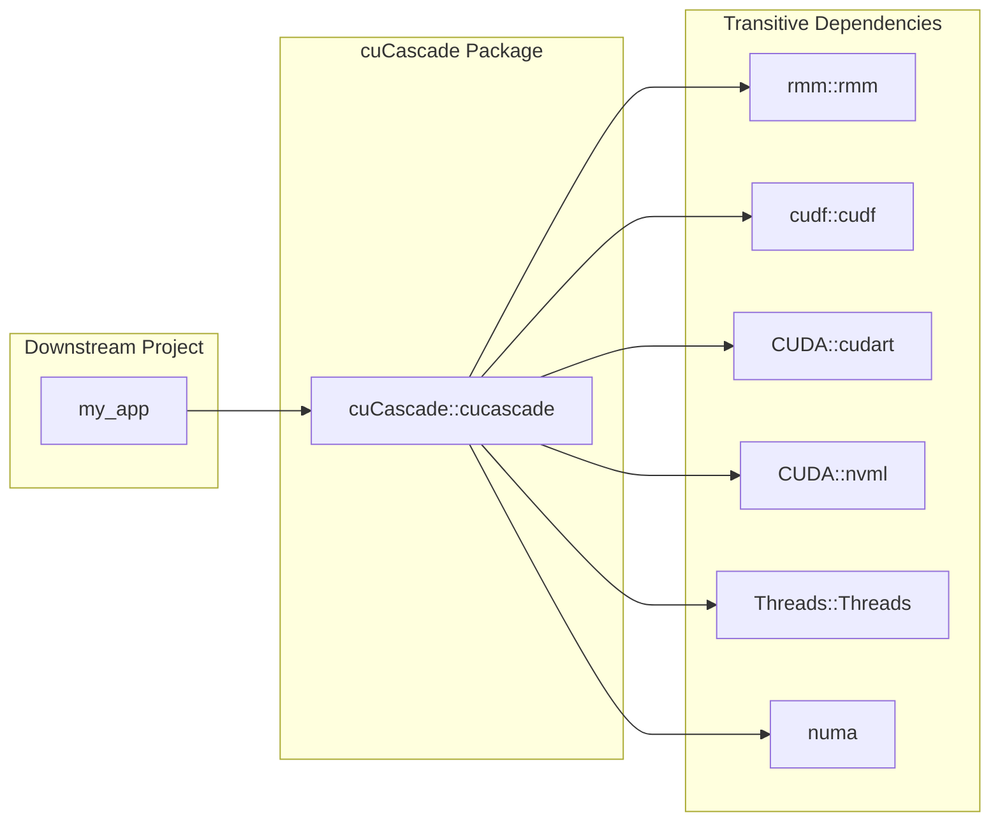

**Diagram: Automatic Dependency Resolution**

The configuration file uses `find_dependency()` to locate all required packages. Downstream projects do not need to explicitly find `rmm`, `cudf`, or CUDA components—these are resolved automatically.

**Sources:** [cmake/cuCascadeConfig.cmake.in:3-12]()

### Version Compatibility

The package configuration supports **same major version** compatibility:

- cuCascade 0.1.x is compatible with cuCascade 0.1.y
- cuCascade 1.2.x is compatible with cuCascade 1.3.y
- cuCascade 2.0.x is **not** compatible with cuCascade 1.x.y

Specify version requirements in `find_package()`:

```cmake
# Require minimum version
find_package(cuCascade 0.1.0 REQUIRED)

# Require exact version
find_package(cuCascade 0.1.0 EXACT REQUIRED)
```

**Sources:** [CMakeLists.txt:225-228]()

---

## Build System Details

### Object Library Pattern

The build uses an **OBJECT** library to optimize compilation:

1. `cucascade_objects` compiles all source files once with position-independent code (PIC)
2. Both static and shared libraries link against `$<TARGET_OBJECTS:cucascade_objects>`
3. Avoids recompiling sources for each library variant

**Sources:** [CMakeLists.txt:94-120]()

### Include Directory Management

The build system uses **generator expressions** for proper include directory handling:

- **Build interface**: `$<BUILD_INTERFACE:${CMAKE_CURRENT_SOURCE_DIR}/include>`
  - Used during build, points to source tree
- **Install interface**: `$<INSTALL_INTERFACE:include>`
  - Used after installation, points to install prefix

This ensures headers are found correctly both during development and after installation.

**Sources:** [CMakeLists.txt:110-113, 129-132, 150-153]()

### Library Versioning

The shared library is versioned using the project version:

- `VERSION`: Full semantic version (e.g., `0.1.0`)
- `SOVERSION`: Major version only (e.g., `0`)

This enables multiple major versions to coexist on the same system.

**Sources:** [CMakeLists.txt:159-163]()

---

## Troubleshooting

### Common Build Issues

**Issue: CMake cannot find cuDF or RMM**
```
CMake Error: Could not find a package configuration file provided by "cudf"
```

**Solution:** Ensure cuDF and RMM are installed and their installation directories are in `CMAKE_PREFIX_PATH`. See [Dependencies and Environment Setup](#2.2).

**Issue: CUDA architecture not supported**
```
nvcc fatal: Unsupported gpu architecture 'compute_75'
```

**Solution:** Your GPU or CUDA toolkit may not support the default architectures. Override with:
```bash
cmake -DCMAKE_CUDA_ARCHITECTURES="80" ..
```

**Issue: Missing libnuma**
```
/usr/bin/ld: cannot find -lnuma
```

**Solution:** Install the NUMA library:
```bash
# Ubuntu/Debian
sudo apt-get install libnuma-dev

# RHEL/CentOS
sudo yum install numactl-devel
```

**Issue: C++20 compiler required**
```
error: #error This file requires compiler and library support for the ISO C++ 2020 standard.
```

**Solution:** Use a compiler with C++20 support (GCC 11+, Clang 14+) or upgrade your CUDA toolkit.

---

**Sources:** [CMakeLists.txt:1-242](), [cmake/cuCascadeConfig.cmake.in:1-27]()

---

# Page: Dependencies and Environment Setup

# Dependencies and Environment Setup

<details>
<summary>Relevant source files</summary>

The following files were used as context for generating this wiki page:

- [CMakeLists.txt](CMakeLists.txt)
- [cmake/cuCascadeConfig.cmake.in](cmake/cuCascadeConfig.cmake.in)
- [include/data/data_repository.hpp](include/data/data_repository.hpp)
- [pixi.toml](pixi.toml)

</details>


## Purpose and Scope

This page documents the external dependencies required by cuCascade and the environment configuration process. It covers dependency versions, package management using pixi, environment variables, and CMake integration patterns.

For build instructions and CMake configuration options, see [Building and Installation](#2.1). For system architecture and how these dependencies integrate into cuCascade's subsystems, see [Architecture Overview](#3).

---

## Overview

cuCascade requires a specific set of dependencies from the RAPIDS ecosystem, CUDA platform, and system libraries. The project provides two environment setup methods:

1. **Pixi-based setup** (recommended): Automated dependency resolution using the pixi package manager
2. **Manual setup**: Direct installation of dependencies for custom environments

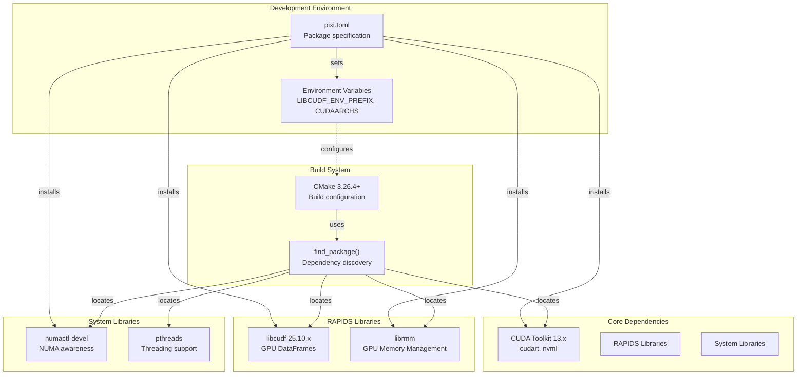

**Diagram: Dependency Resolution and Build Integration**

Sources: [pixi.toml:1-37](), [CMakeLists.txt:48-57](), [cmake/cuCascadeConfig.cmake.in:1-27]()

---

## Required Dependencies

### Dependency Version Matrix

| Dependency | Minimum Version | Pixi Version | Purpose |
|------------|----------------|--------------|---------|
| CMake | 3.26.4 | 4.1.* | Build system configuration |
| C++ Compiler | C++20 support | - | Code compilation (host code) |
| CUDA Toolkit | 11.3+ | 13.* | GPU runtime and compiler |
| libcudf | - | 25.10.* | GPU DataFrame operations |
| RMM | - | (via libcudf) | GPU memory management |
| NUMA libraries | - | numactl-devel | NUMA-aware host memory |
| pthreads | - | (system) | Thread synchronization |

Sources: [CMakeLists.txt:18-34](), [pixi.toml:15-30]()

### CUDA Requirements

cuCascade requires CUDA 11.3 or later with support for:
- **CUDA Runtime API** (`cudart`): Asynchronous memory operations, stream management
- **CUDA NVML** (`nvml`): GPU topology discovery and memory queries
- **CUDA Standard**: C++20 device code compilation

**Default CUDA Architectures**:
```
75  (Turing: T4)
80  (Ampere: A100)
86  (Ampere: RTX 30xx)
90  (Hopper: H100)
```

Sources: [CMakeLists.txt:32-61](), [pixi.toml:8-19]()

### RAPIDS Ecosystem Integration

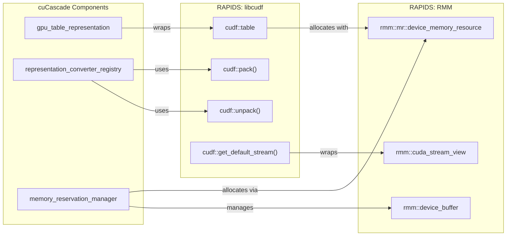

**Diagram: RAPIDS Integration Points**

- **libcudf**: Provides `cudf::table` for columnar GPU data storage, used by [gpu_table_representation](#5.2)
- **RMM**: Manages GPU memory allocation through `rmm::mr::device_memory_resource`, integrated with [memory_reservation_manager](#4.1)

Sources: [CMakeLists.txt:52-56](), [include/data/data_repository.hpp:1-149]()

---

## Environment Setup with Pixi

### Pixi Configuration File

The [pixi.toml:1-37]() file defines the complete development environment:

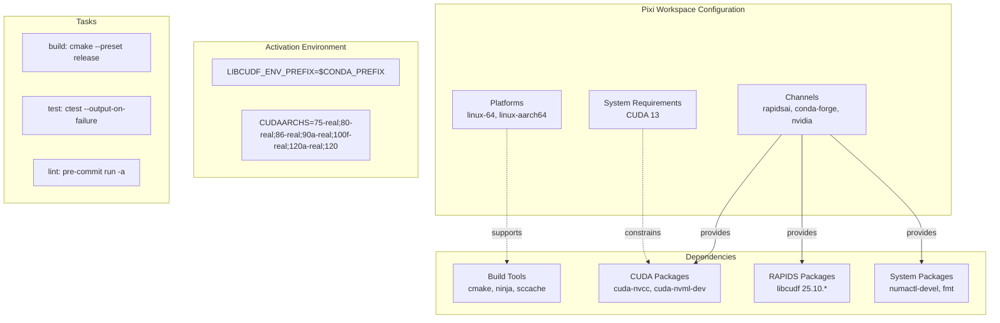

**Diagram: Pixi Environment Structure**

Sources: [pixi.toml:1-37]()

### Installation Steps

1. **Install Pixi** (if not already installed):
   ```bash
   curl -fsSL https://pixi.sh/install.sh | bash
   ```

2. **Initialize Environment**:
   ```bash
   pixi install
   ```
   This resolves and installs all dependencies from the configured channels.

3. **Activate Environment**:
   ```bash
   pixi shell
   ```
   Sets all environment variables defined in [pixi.toml:10-13]().

Sources: [pixi.toml:1-37]()

---

## Environment Variables

### Critical Environment Variables

| Variable | Value | Purpose |
|----------|-------|---------|
| `LIBCUDF_ENV_PREFIX` | `$CONDA_PREFIX` | Points cuDF to the conda environment for library loading |
| `CUDAARCHS` | See below | Specifies target GPU architectures for CUDA compilation |

**CUDAARCHS Format**:
```
75-real;80-real;86-real;90a-real;100f-real;120a-real;120
```

- `75-real`: Turing (compute capability 7.5)
- `80-real`: Ampere (8.0)
- `86-real`: Ampere (8.6)
- `90a-real`: Hopper (9.0a)
- `100f-real`: Future architecture (10.0f)
- `120a-real`: Future architecture (12.0a)
- `120`: Virtual architecture for forward compatibility

The `-real` suffix generates native GPU code for the specified architecture, while the final `120` generates PTX intermediate code for future GPU compatibility.

Sources: [pixi.toml:10-13]()

### Additional Build Variables

These are typically auto-detected by CMake but can be overridden:

| Variable | Default | Description |
|----------|---------|-------------|
| `CMAKE_CUDA_ARCHITECTURES` | `75;80;86;90` | CMake-specific architecture list |
| `CMAKE_BUILD_TYPE` | `Release` | Build configuration |
| `BUILD_TESTS` | `ON` | Enable test suite compilation |
| `WARNINGS_AS_ERRORS` | `ON` | Treat warnings as compilation errors |

Sources: [CMakeLists.txt:36-66]()

---

## CMake Dependency Discovery

### Find Package Integration

The build system uses CMake's `find_package()` mechanism to locate dependencies:

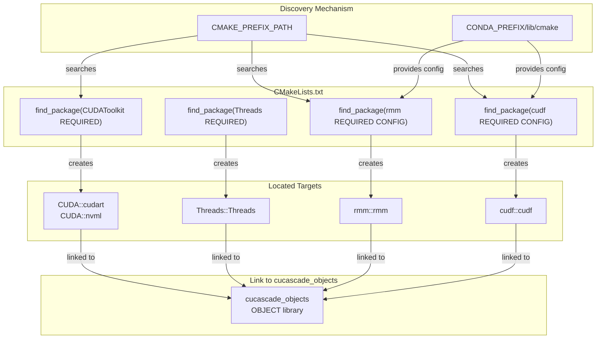

**Diagram: CMake Dependency Resolution Flow**

Sources: [CMakeLists.txt:48-117]()

### Linking Configuration

The [CMakeLists.txt:116-117]() links all dependencies to the `cucascade_objects` OBJECT library:

```cmake
target_link_libraries(cucascade_objects 
    PUBLIC 
        rmm::rmm 
        cudf::cudf 
        CUDA::cudart
        CUDA::nvml 
        Threads::Threads 
        numa
)
```

This configuration ensures:
- Both static and shared libraries inherit dependencies
- Transitive dependencies are automatically resolved
- Include paths are propagated to consuming targets

Sources: [CMakeLists.txt:94-120]()

### Downstream Package Configuration

The [cmake/cuCascadeConfig.cmake.in:1-27]() template enables downstream projects to use cuCascade:

```cmake
find_dependency(CUDAToolkit REQUIRED)
find_dependency(Threads REQUIRED)
find_dependency(rmm REQUIRED CONFIG)
find_dependency(cudf REQUIRED CONFIG)
```

Downstream projects can then use:
```cmake
find_package(cuCascade REQUIRED)
target_link_libraries(my_app PRIVATE cuCascade::cucascade)
```

Sources: [cmake/cuCascadeConfig.cmake.in:1-27]()

---

## System Library Dependencies

### NUMA Support

cuCascade requires **numactl-devel** for NUMA-aware host memory allocation:

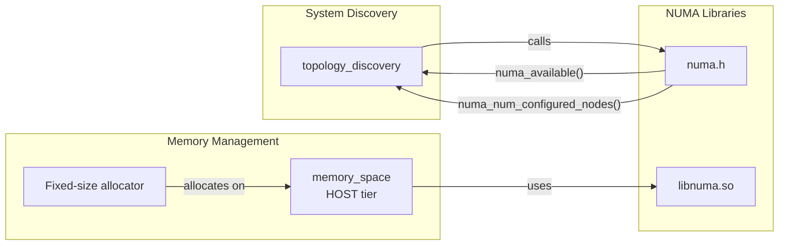

**Diagram: NUMA Integration**

The NUMA library enables:
- NUMA node discovery and topology mapping
- NUMA-local memory allocation for performance
- Cross-NUMA data transfer optimization

For details on NUMA-aware allocation, see [Topology Discovery and NUMA Support](#4.3).

Sources: [CMakeLists.txt:117](), [pixi.toml:30]()

### Threading Support

cuCascade uses **pthreads** (via `Threads::Threads` CMake target) for:
- Thread-safe repository access (mutexes in `idata_repository`)
- Concurrent data batch processing
- Lock-free atomic operations in `data_batch`

Sources: [CMakeLists.txt:50](), [include/data/data_repository.hpp:72-98]()

---

## Verification

### Verifying Pixi Environment

After `pixi install`, verify dependencies:

```bash
# Check CMake version
cmake --version  # Should be >= 3.26.4

# Check CUDA version
nvcc --version   # Should be CUDA 13.x

# Check cuDF installation
python -c "import cudf; print(cudf.__version__)"  # Should be 25.10.x

# Verify environment variables
echo $LIBCUDF_ENV_PREFIX  # Should point to conda prefix
echo $CUDAARCHS           # Should show architecture list
```

### Verifying CMake Configuration

Test dependency discovery without building:

```bash
cmake -S . -B build/test
```

Expected output includes:
```
-- Found CUDAToolkit: ...
-- Found Threads: ...
-- Found rmm: ...
-- Found cudf: ...
```

If dependencies are not found, check:
1. `CMAKE_PREFIX_PATH` includes conda environment
2. `LIBCUDF_ENV_PREFIX` is set correctly
3. RMM and cuDF config files exist in `$CONDA_PREFIX/lib/cmake`

Sources: [CMakeLists.txt:48-57]()

---

## Troubleshooting

### Common Issues

| Issue | Cause | Solution |
|-------|-------|----------|
| `Could not find cudf` | Missing CMAKE_PREFIX_PATH | Ensure pixi environment is activated |
| `undefined reference to numa_*` | Missing libnuma | Install numactl-devel package |
| `CUDA architecture mismatch` | Wrong CUDAARCHS | Set CUDAARCHS or CMAKE_CUDA_ARCHITECTURES |
| `C++20 required but not available` | Old compiler | Use GCC 10+ or Clang 10+ |

### Manual Dependency Installation

For non-pixi environments:

1. **Install CUDA Toolkit** from NVIDIA's repository
2. **Build RMM and cuDF** from source (requires matching CUDA version)
3. **Install NUMA libraries**: 
   ```bash
   # Ubuntu/Debian
   apt-get install libnuma-dev
   
   # RHEL/CentOS
   yum install numactl-devel
   ```
4. **Set CMAKE_PREFIX_PATH** to RMM/cuDF installation directories

Sources: [CMakeLists.txt:48-57]()

---

## Summary

cuCascade's dependency stack integrates:

1. **CUDA Platform**: GPU execution, memory management, topology discovery
2. **RAPIDS Ecosystem**: cuDF for GPU DataFrames, RMM for memory pooling
3. **System Libraries**: NUMA for host memory optimization, pthreads for concurrency

The pixi-based workflow automates this setup, while CMake's package configuration enables flexible integration into existing build systems.

Sources: [pixi.toml:1-37](), [CMakeLists.txt:1-242](), [cmake/cuCascadeConfig.cmake.in:1-27]()

---

# Page: Architecture Overview

# Architecture Overview

<details>
<summary>Relevant source files</summary>

The following files were used as context for generating this wiki page:

- [include/memory/memory_reservation_manager.hpp](include/memory/memory_reservation_manager.hpp)
- [src/data/CMakeLists.txt](src/data/CMakeLists.txt)
- [src/memory/CMakeLists.txt](src/memory/CMakeLists.txt)
- [src/memory/memory_reservation_manager.cpp](src/memory/memory_reservation_manager.cpp)
- [test/CMakeLists.txt](test/CMakeLists.txt)
- [test/memory/test_memory_reservation_manager.cpp](test/memory/test_memory_reservation_manager.cpp)

</details>


This page provides a high-level overview of cuCascade's architecture, describing the three fundamental layers that compose the system: Memory Management, Data Representation, and Data Management. Each layer addresses a specific aspect of heterogeneous memory management and data processing on GPU systems.

For detailed information about specific components within each layer, see [System Components](#3.1). For information about the memory tier hierarchy and data movement patterns, see [Memory Tier Hierarchy](#3.2). For implementation details of individual subsystems, refer to the Memory Management Subsystem ([section 4](#4)), Data Representation Subsystem ([section 5](#5)), and Data Management Subsystem ([section 6](#6)).

## Three-Layer Architecture

cuCascade is organized into three distinct architectural layers, each responsible for a specific domain of functionality:

| Layer | Primary Responsibility | Key Abstractions |
|-------|----------------------|------------------|
| **Memory Management** | Allocate and track memory across heterogeneous memory tiers (GPU, HOST, DISK) | `memory_reservation_manager`, `memory_space`, `reservation` |
| **Data Representation** | Abstract data storage formats and enable cross-tier data movement | `idata_representation`, `gpu_table_representation`, `host_table_representation` |
| **Data Management** | Manage data batch lifecycle and multi-operator routing | `data_batch`, `data_repository`, `data_repository_manager` |

Sources: [include/memory/memory_reservation_manager.hpp:178-303](), [src/data/CMakeLists.txt:18-25](), [src/memory/CMakeLists.txt:18-33]()

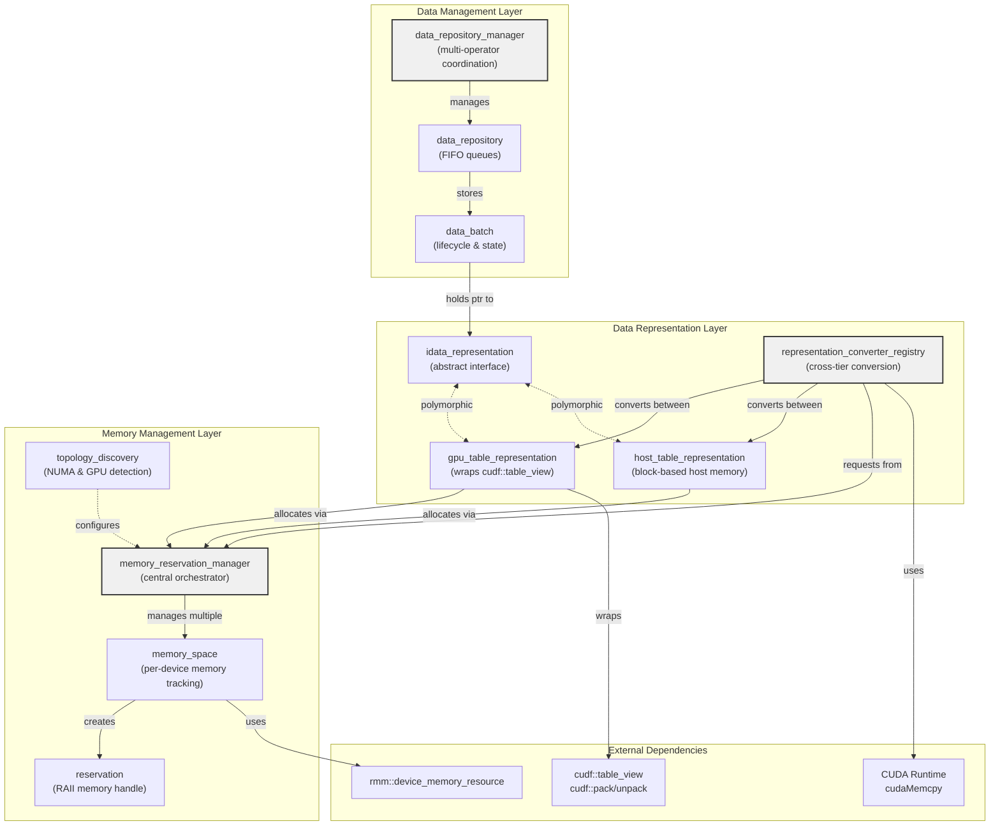

**Diagram: Core Architectural Components and Dependencies**

Sources: [src/data/CMakeLists.txt:18-25](), [src/memory/CMakeLists.txt:18-33](), [include/memory/memory_reservation_manager.hpp:178-303]()

## Memory Management Layer

The Memory Management Layer provides heterogeneous memory allocation and tracking across GPU devices, host memory (with NUMA awareness), and disk storage. This layer is the foundation of cuCascade's multi-tier memory architecture.

### Core Components

- **`memory_reservation_manager`**: Central orchestrator that coordinates memory reservations across all memory spaces. Implements multiple reservation strategies (`any_memory_space_in_tier`, `specific_memory_space`, `any_memory_space_in_tiers`) for flexible allocation policies.

- **`memory_space`**: Represents a single memory space (e.g., GPU device 0, NUMA node 1). Tracks memory capacity, reservations, and enforces limits. Each space owns a `rmm::device_memory_resource` or `fixed_size_host_memory_resource`.

- **`reservation`**: RAII handle for reserved memory. Guarantees memory availability until destroyed. Provides access to the underlying memory resource for actual allocations.

- **`topology_discovery`**: Detects system hardware topology including GPU devices, NUMA nodes, and device-to-NUMA affinity for optimal memory placement.

### Reservation Strategies

The system supports multiple reservation request strategies defined in [include/memory/memory_reservation_manager.hpp:55-167]():

| Strategy Class | Purpose | Use Case |
|---------------|---------|----------|
| `any_memory_space_in_tier_with_preference` | Allocate in a tier, preferring a specific device | GPU allocation with device preference |
| `any_memory_space_in_tier` | Allocate in any device within a tier | Flexible GPU or HOST allocation |
| `any_memory_space_in_tiers` | Allocate across multiple tiers with priority order | Cascading allocation (GPU → HOST → DISK) |
| `specific_memory_space` | Allocate in a specific device | Pinned device allocation |
| `any_memory_space_to_downgrade` | Downgrade from one tier to lower tiers | Memory pressure response |
| `any_memory_space_to_upgrade` | Upgrade from lower tier to higher tier | Performance optimization |

Sources: [include/memory/memory_reservation_manager.hpp:42-306](), [src/memory/memory_reservation_manager.cpp:122-365](), [test/memory/test_memory_reservation_manager.cpp:57-515]()

## Data Representation Layer

The Data Representation Layer abstracts data storage formats and enables seamless conversion between memory tiers. This layer bridges the gap between GPU-native cuDF tables and host memory representations.

### Core Components

- **`idata_representation`**: Abstract interface defining the polymorphic contract for all data representations. Provides methods for memory tier identification, size queries, and conversion operations.

- **`gpu_table_representation`**: Wraps `cudf::table_view` and manages GPU memory. Uses `cudf::pack` for serialization and `cudf::unpack` for deserialization during tier transitions.

- **`host_table_representation`**: Manages data in host memory using a block-based allocation strategy via `host_table_allocation`. Data is stored as serialized contiguous metadata and data blocks.

- **`representation_converter_registry`**: Central registry for conversion operations. Implements conversions for:
  - GPU → HOST (via `cudf::pack` + `cudaMemcpy`)
  - HOST → GPU (via `cudaMemcpy` + `cudf::unpack`)
  - GPU → GPU (via `cudaMemcpyPeer` for peer-to-peer transfer)
  - HOST → HOST (via block-based copy for cross-NUMA transfer)

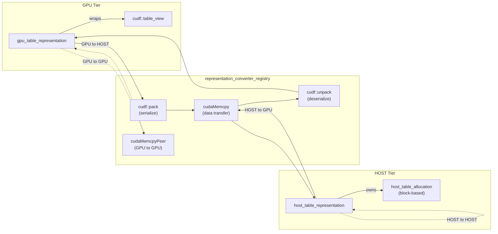

**Diagram: Data Representation Conversion Paths**

Sources: [src/data/CMakeLists.txt:20-25](), [include/memory/memory_reservation_manager.hpp:42-306]()

## Data Management Layer

The Data Management Layer orchestrates the lifecycle of data batches and manages routing to multiple operators. This layer implements the producer-consumer patterns that drive data processing workflows.

### Core Components

- **`data_batch`**: Represents a unit of data with a unique batch ID. Tracks processing state via reference counting (`processing_count`). Holds a polymorphic pointer to `idata_representation` for actual data storage.

- **`data_batch_processing_handle`**: RAII handle acquired when processing a batch. Increments `processing_count` on acquisition, decrements on destruction. Prevents unsafe data movement while processing is active.

- **`data_repository`**: FIFO queue of data batches for a single operator. Two variants:
  - `shared_data_repository`: Holds `std::shared_ptr<data_batch>` for broadcast patterns
  - `unique_data_repository`: Holds `std::unique_ptr<data_batch>` for exclusive ownership

- **`data_repository_manager`**: Routes incoming batches to multiple operator-specific repositories. Generates unique batch IDs and distributes batches according to ownership semantics.

### Batch Lifecycle States

```mermaid
stateDiagram-v2
    [*] --> Created: "new data_batch(id, data)"
    Created --> InRepository: "add_data_batch()"
    
    InRepository --> Processing: "pull_data_batch()<br/>acquire processing_handle"
    
    state Processing {
        [*] --> Active
        Active --> Active: "Additional handles"
        Active --> [*]: "Last handle released"
    }
    
    Processing --> InRepository: "processing_count > 0<br/>batch still in queue"
    Processing --> Available: "processing_count == 0<br/>ready for conversion"
    
    state Available_Choice <<choice>>
    Available --> Available_Choice
    Available_Choice --> Processing: "New processing request"
    Available_Choice --> Converting: "convert_to() called"
    Available_Choice --> Downgrading: "Memory pressure<br/>downgrade triggered"
    
    Converting --> InRepository: "Tier/format changed"
    Downgrading --> InRepository: "Moved to lower tier"
    
    InRepository --> [*]: "Repository destroyed<br/>or batch removed"
    
    note right of Processing
        processing_count tracks
        concurrent processing_handles
        Blocks conversion/downgrade
    end note
```

**Diagram: Data Batch State Machine**

Sources: [src/data/data_batch.cpp](), [src/data/data_repository.cpp](), [src/data/data_repository_manager.cpp]()

## Component Interaction Flow

The following diagram illustrates how the three layers interact during a typical data processing workflow:

```mermaid
sequenceDiagram
    participant App as "Application"
    participant RepoMgr as "data_repository_manager"
    participant Repo as "data_repository"
    participant Batch as "data_batch"
    participant RepReg as "representation_converter_registry"
    participant MemMgr as "memory_reservation_manager"
    participant MemSpace as "memory_space"
    
    App->>MemMgr: "request_reservation(strategy, size)"
    MemMgr->>MemSpace: "make_reservation(size)"
    MemSpace-->>MemMgr: "reservation"
    MemMgr-->>App: "unique_ptr<reservation>"
    
    App->>Batch: "new data_batch(id, gpu_table_representation)"
    App->>RepoMgr: "add_data_batch(batch)"
    RepoMgr->>Repo: "add_data_batch(batch_ptr)"
    
    App->>Repo: "pull_data_batch()"
    Repo->>Batch: "try_to_lock_for_processing()"
    Batch-->>Repo: "processing_handle"
    Repo-->>App: "unique_ptr<processing_handle>"
    
    Note over App,Batch: "Processing occurs..."
    
    App->>Batch: "convert_to(Tier::HOST)"
    Batch->>Batch: "Check processing_count == 0"
    Batch->>RepReg: "convert(from_gpu, to_host)"
    RepReg->>MemMgr: "request_reservation(HOST tier)"
    MemMgr-->>RepReg: "reservation"
    RepReg->>RepReg: "cudf::pack + cudaMemcpy"
    RepReg-->>Batch: "host_table_representation"
    Batch-->>App: "Success"
    
    App->>App: "processing_handle destroyed"
    Note over Batch: "processing_count decremented"
```

**Diagram: Typical Data Flow Sequence**

Sources: [src/data/data_batch.cpp](), [src/data/data_repository_manager.cpp](), [src/data/representation_converter.cpp]()

## Memory Tier Hierarchy

cuCascade organizes memory into three tiers, each with distinct performance and capacity characteristics:

```mermaid
graph TB
    subgraph Tier_GPU["GPU Tier (Tier::GPU)"]
        GPU0["memory_space<br/>device_id=0<br/>rmm::device_memory_resource"]
        GPU1["memory_space<br/>device_id=1<br/>rmm::device_memory_resource"]
        GPU_N["memory_space<br/>device_id=N"]
    end
    
    subgraph Tier_HOST["HOST Tier (Tier::HOST)"]
        HOST0["memory_space<br/>device_id=0 (NUMA 0)<br/>fixed_size_host_memory_resource"]
        HOST1["memory_space<br/>device_id=1 (NUMA 1)<br/>fixed_size_host_memory_resource"]
    end
    
    subgraph Tier_DISK["DISK Tier (Tier::DISK)"]
        DISK["memory_space<br/>device_id=0<br/>File-backed storage"]
    end
    
    subgraph Downgrade["Downgrade Operations"]
        direction LR
        DG1["Memory pressure triggers"]
        DG2["any_memory_space_to_downgrade"]
        DG1 --> DG2
    end
    
    subgraph Upgrade["Upgrade Operations"]
        direction LR
        UP1["Performance optimization"]
        UP2["any_memory_space_to_upgrade"]
        UP1 --> UP2
    end
    
    GPU0 -.->|"Downgrade"| HOST0
    GPU1 -.->|"Downgrade"| HOST1
    HOST0 -.->|"Downgrade"| DISK
    HOST1 -.->|"Downgrade"| DISK
    
    HOST0 -.->|"Upgrade"| GPU0
    HOST1 -.->|"Upgrade"| GPU1
    DISK -.->|"Upgrade"| HOST0
    DISK -.->|"Upgrade"| HOST1
    
    Downgrade -.-> GPU0
    Upgrade -.-> HOST0
```

**Diagram: Memory Tier Hierarchy and Movement**

| Tier | Performance | Capacity | Memory Resource Type | Use Case |
|------|------------|----------|---------------------|----------|
| GPU | Highest (TB/s bandwidth) | Limited (GBs) | `rmm::device_memory_resource` | Active processing |
| HOST | Medium (GB/s bandwidth) | Large (10s-100s GB) | `fixed_size_host_memory_resource` | Staging, overflow |
| DISK | Lowest (MB/s bandwidth) | Very Large (TBs) | File-backed | Archival, cold data |

Sources: [include/memory/memory_reservation_manager.hpp:42-306](), [include/memory/common.hpp](), [test/memory/test_memory_reservation_manager.cpp:52-68]()

## Build and Integration Architecture

cuCascade uses modern CMake practices to integrate with the RAPIDS ecosystem and provide a clean API for downstream consumers:

```mermaid
graph TB
    subgraph Sources["Source Files"]
        mem_src["src/memory/*.cpp<br/>(13 files)"]
        data_src["src/data/*.cpp<br/>(6 files)"]
        headers["include/**/*.hpp<br/>(Public API)"]
    end
    
    subgraph Build["Build Targets"]
        objects["cucascade_objects<br/>(OBJECT library)"]
        static["cucascade_static<br/>(STATIC library)"]
        shared["cucascade_shared<br/>(SHARED library)"]
    end
    
    subgraph Tests["Test Infrastructure"]
        test_src["test/**/*.cpp<br/>test/**/*.cu"]
        test_exe["cucascade_tests<br/>(Catch2 runner)"]
    end
    
    subgraph Dependencies["External Dependencies"]
        rapids["RAPIDS Libraries<br/>cudf::cudf<br/>rmm::rmm"]
        cuda["CUDA Toolkit<br/>CUDA::cudart<br/>CUDA::nvml"]
        system["System Libraries<br/>NUMA<br/>Threads"]
    end
    
    subgraph Install["Installation"]
        pkg_config["cuCascadeConfig.cmake<br/>(Package config)"]
        installed_libs["lib/libcucascade.*"]
        installed_headers["include/cucascade/**"]
    end
    
    mem_src --> objects
    data_src --> objects
    
    objects --> static
    objects --> shared
    objects --> test_exe
    test_src --> test_exe
    
    rapids --> objects
    cuda --> objects
    system --> objects
    
    static --> installed_libs
    shared --> installed_libs
    headers --> installed_headers
    
    installed_libs --> pkg_config
    installed_headers --> pkg_config
    
    pkg_config -->|"find_package(cuCascade)"| Consumer["Downstream Applications"]
```

**Diagram: Build System Architecture**

### Build Configuration

The build system compiles sources once using an `OBJECT` library (`cucascade_objects`), then links into both static and shared library variants. This approach minimizes compilation time while supporting multiple distribution formats.

**Key Build Characteristics:**

- **Language Requirements**: C++20, CUDA 12.0+
- **Build System**: CMake 3.26+
- **Primary Dependencies**: cuDF, RMM (from RAPIDS), CUDA Toolkit
- **Test Framework**: Catch2 v2.13.10
- **Installation**: Produces CMake package config for downstream consumption

Sources: [src/data/CMakeLists.txt:18-25](), [src/memory/CMakeLists.txt:18-33](), [test/CMakeLists.txt:18-61]()

## Thread Safety and Concurrency

cuCascade is designed for concurrent operation with careful synchronization boundaries:

- **`memory_reservation_manager`**: Thread-safe reservation requests with cross-space condition variable for blocking when no space is available
- **`data_batch`**: Thread-safe processing state management via atomic `processing_count` 
- **`data_repository`**: Thread-safe FIFO operations with mutex protection
- **`processing_handle`**: RAII pattern ensures correct reference counting even with exceptions

The system prevents race conditions during tier conversions by blocking `convert_to()` operations when `processing_count > 0`, ensuring data is not moved while being actively processed.

Sources: [test/memory/test_memory_reservation_manager.cpp:210-515](), [src/memory/memory_reservation_manager.cpp:180-191](), [test/data/test_data_batch.cpp]()

---

# Page: System Components

# System Components

<details>
<summary>Relevant source files</summary>

The following files were used as context for generating this wiki page:

- [src/data/CMakeLists.txt](src/data/CMakeLists.txt)
- [src/memory/CMakeLists.txt](src/memory/CMakeLists.txt)
- [test/CMakeLists.txt](test/CMakeLists.txt)

</details>


## Purpose and Scope

This page documents the major subsystems within cuCascade and their core responsibilities. It provides an architectural map of the components that implement cuCascade's three-layer design: **Memory Management**, **Data Representation**, and **Data Management**. 

For detailed implementation of each layer, see:
- Memory Management implementation details: [Memory Management Subsystem](#4)
- Data Representation implementation details: [Data Representation Subsystem](#5)
- Data Management implementation details: [Data Management Subsystem](#6)
- Build system and deployment: [Building and Installation](#2.1)

## Architectural Layers

cuCascade organizes its components into three distinct architectural layers, each with well-defined responsibilities. The layers build upon each other to provide heterogeneous memory management for GPU dataframes.

### Layer Architecture Diagram

```mermaid
graph TB
    subgraph "Layer 3: Data Management"
        BATCH["data_batch<br/>(data_batch.cpp)"]
        REPO["data_repository<br/>(data_repository.cpp)"]
        REPO_MGR["data_repository_manager<br/>(data_repository_manager.cpp)"]
    end
    
    subgraph "Layer 2: Data Representation"
        GPU_REP["gpu_table_representation<br/>(gpu_data_representation.cpp)"]
        HOST_REP["host_table_representation<br/>(cpu_data_representation.cpp)"]
        CONV_REG["representation_converter_registry<br/>(representation_converter.cpp)"]
        IDATA["idata_representation<br/>(abstract interface)"]
    end
    
    subgraph "Layer 1: Memory Management"
        MEM_MGR["memory_reservation_manager<br/>(memory_reservation_manager.cpp)"]
        MEM_SPACE["memory_space<br/>(memory_space.cpp)"]
        TOPO["topology_discovery<br/>(topology_discovery.cpp)"]
        MEM_RES["memory_reservation<br/>(memory_reservation.cpp)"]
    end
    
    subgraph "External Dependencies"
        CUDF["cuDF"]
        RMM["RMM"]
        CUDA["CUDA Runtime"]
    end
    
    BATCH -->|"references data via"| IDATA
    REPO -->|"stores"| BATCH
    REPO_MGR -->|"manages multiple"| REPO
    
    GPU_REP -->|"implements"| IDATA
    HOST_REP -->|"implements"| IDATA
    CONV_REG -->|"transforms between"| IDATA
    
    GPU_REP -->|"allocates via"| MEM_MGR
    HOST_REP -->|"allocates via"| MEM_MGR
    CONV_REG -->|"requests memory from"| MEM_MGR
    
    MEM_MGR -->|"manages"| MEM_SPACE
    MEM_MGR -->|"discovers topology via"| TOPO
    MEM_SPACE -->|"provides"| MEM_RES
    
    GPU_REP -->|"wraps"| CUDF
    MEM_SPACE -->|"integrates with"| RMM
    CONV_REG -->|"uses"| CUDA
```

**Sources:** [src/data/CMakeLists.txt:18-25](), [src/memory/CMakeLists.txt:18-33]()

## Memory Management Layer

The Memory Management Layer provides the foundation for heterogeneous memory allocation across GPU, host, and disk storage tiers. This layer abstracts hardware topology and memory resources, enabling unified memory management across diverse memory types.

### Core Components

| Component | Source File | Primary Responsibility |
|-----------|-------------|------------------------|
| `memory_reservation_manager` | [memory_reservation_manager.cpp]() | Orchestrates multi-tier memory allocation and enforces reservation policies |
| `memory_space` | [memory_space.cpp]() | Represents a distinct memory region (GPU device, NUMA node, disk) |
| `memory_reservation` | [memory_reservation.cpp]() | RAII handle for allocated memory blocks |
| `topology_discovery` | [topology_discovery.cpp]() | Detects GPU devices, NUMA nodes, and hardware topology |

### Supporting Components

| Component | Source File | Purpose |
|-----------|-------------|---------|
| `fixed_size_host_memory_resource` | [fixed_size_host_memory_resource.cpp]() | Block-based allocator for host memory |
| `numa_region_pinned_host_allocator` | [numa_region_pinned_host_allocator.cpp]() | NUMA-aware pinned memory allocation |
| `reservation_aware_resource_adaptor` | [reservation_aware_resource_adaptor.cpp]() | Adapts RMM resources to reservation system |
| `null_device_memory_resource` | [null_device_memory_resource.cpp]() | Placeholder resource for unsupported operations |
| `stream_pool` | [stream_pool.cpp]() | Manages reusable CUDA stream objects |
| `disk_access_limiter` | [disk_access_limiter.cpp]() | Rate-limits disk I/O operations |
| `oom_handling_policy` | [oom_handling_policy.cpp]() | Defines out-of-memory handling strategies |
| `reservation_manager_configurator` | [reservation_manager_configurator.cpp]() | Configuration builder for memory manager |
| `notification_channel` | [notification_channel.cpp]() | Thread-safe event notification system |

**Sources:** [src/memory/CMakeLists.txt:18-33]()

### Memory Management Component Relationships

```mermaid
graph TB
    CONFIG["reservation_manager_configurator"]
    MGR["memory_reservation_manager"]
    SPACE_GPU["memory_space<br/>(GPU)"]
    SPACE_HOST["memory_space<br/>(HOST)"]
    SPACE_DISK["memory_space<br/>(DISK)"]
    TOPO["topology_discovery"]
    
    RES_GPU["memory_reservation<br/>(GPU allocation)"]
    RES_HOST["memory_reservation<br/>(HOST allocation)"]
    
    FIXED_SIZE["fixed_size_host_memory_resource"]
    NUMA_ALLOC["numa_region_pinned_host_allocator"]
    RES_ADAPTOR["reservation_aware_resource_adaptor"]
    
    STREAM["stream_pool"]
    DISK_LIM["disk_access_limiter"]
    OOM["oom_handling_policy"]
    NOTIFY["notification_channel"]
    
    CONFIG -->|"configures"| MGR
    TOPO -->|"provides topology to"| MGR
    
    MGR -->|"creates"| SPACE_GPU
    MGR -->|"creates"| SPACE_HOST
    MGR -->|"creates"| SPACE_DISK
    
    SPACE_GPU -->|"allocates"| RES_GPU
    SPACE_HOST -->|"allocates"| RES_HOST
    
    SPACE_HOST -->|"uses"| FIXED_SIZE
    SPACE_HOST -->|"uses"| NUMA_ALLOC
    SPACE_GPU -->|"wraps with"| RES_ADAPTOR
    
    MGR -->|"manages"| STREAM
    SPACE_DISK -->|"uses"| DISK_LIM
    MGR -->|"applies"| OOM
    MGR -->|"signals via"| NOTIFY
```

**Sources:** [src/memory/CMakeLists.txt:18-33]()

## Data Representation Layer

The Data Representation Layer abstracts data storage formats and enables seamless conversion between memory tiers. This layer provides polymorphic data representations that hide the underlying storage details (GPU vs. host memory, serialized vs. tabular).

### Core Components

| Component | Source File | Primary Responsibility |
|-----------|-------------|------------------------|
| `idata_representation` | (header-only interface) | Abstract interface defining data representation contract |
| `gpu_table_representation` | [gpu_data_representation.cpp]() | GPU-resident cuDF table representation |
| `host_table_representation` | [cpu_data_representation.cpp]() | Host-resident block-allocated table representation |
| `representation_converter_registry` | [representation_converter.cpp]() | Registry of conversion functions between representation types |

### Data Representation Class Hierarchy

```mermaid
graph TB
    IDATA["idata_representation<br/>(abstract interface)"]
    GPU_REP["gpu_table_representation"]
    HOST_REP["host_table_representation"]
    
    CONV_REGISTRY["representation_converter_registry"]
    CONV_GPU_HOST["gpu_to_host_converter"]
    CONV_HOST_GPU["host_to_gpu_converter"]
    CONV_GPU_GPU["gpu_to_gpu_converter"]
    CONV_HOST_HOST["host_to_host_converter"]
    
    CUDF_TABLE["cudf::table"]
    HOST_TABLE_ALLOC["host_table_allocation"]
    
    IDATA -->|"implemented by"| GPU_REP
    IDATA -->|"implemented by"| HOST_REP
    
    GPU_REP -->|"wraps"| CUDF_TABLE
    HOST_REP -->|"references"| HOST_TABLE_ALLOC
    
    CONV_REGISTRY -->|"registers"| CONV_GPU_HOST
    CONV_REGISTRY -->|"registers"| CONV_HOST_GPU
    CONV_REGISTRY -->|"registers"| CONV_GPU_GPU
    CONV_REGISTRY -->|"registers"| CONV_HOST_HOST
    
    CONV_GPU_HOST -->|"converts"| GPU_REP
    CONV_GPU_HOST -->|"to"| HOST_REP
    
    CONV_HOST_GPU -->|"converts"| HOST_REP
    CONV_HOST_GPU -->|"to"| GPU_REP
```

**Sources:** [src/data/CMakeLists.txt:18-25]()

### Key Design Patterns

The Data Representation Layer employs several design patterns:

1. **Polymorphic Representation**: All representations implement `idata_representation`, enabling uniform handling of data regardless of storage location
2. **Strategy Pattern**: The converter registry selects appropriate conversion strategies based on source and target memory spaces
3. **Lazy Conversion**: Data conversions occur only when explicitly requested or required by memory pressure
4. **Type Erasure**: `data_batch` holds representations via type-erased pointers, decoupling batch management from specific representation types

**Sources:** [src/data/CMakeLists.txt:20,24]()

## Data Management Layer

The Data Management Layer orchestrates data batch lifecycle, processing state, and multi-operator routing. This layer sits atop the representation layer and provides thread-safe queuing, RAII-based processing handles, and batch identity management.

### Core Components

| Component | Source File | Primary Responsibility |
|-----------|-------------|------------------------|
| `data_batch` | [data_batch.cpp]() | Container for data with unique batch ID and processing state tracking |
| `data_repository` | [data_repository.cpp]() | FIFO queue for data batches with shared or unique ownership |
| `data_repository_manager` | [data_repository_manager.cpp]() | Routes data batches to operator-specific repositories |

### Data Management Component Interactions

```mermaid
graph TB
    MGR["data_repository_manager"]
    
    REPO1["shared_data_repository<br/>(operator A)"]
    REPO2["shared_data_repository<br/>(operator B)"]
    REPO3["unique_data_repository<br/>(operator C)"]
    
    BATCH1["data_batch<br/>(batch_id=1)"]
    BATCH2["data_batch<br/>(batch_id=2)"]
    
    HANDLE1["data_batch_processing_handle<br/>(RAII guard)"]
    HANDLE2["data_batch_processing_handle<br/>(RAII guard)"]
    
    REP["idata_representation<br/>(gpu/host/disk)"]
    
    MGR -->|"distributes shared_ptr"| REPO1
    MGR -->|"distributes shared_ptr"| REPO2
    MGR -->|"moves unique_ptr"| REPO3
    
    REPO1 -->|"queues"| BATCH1
    REPO2 -->|"queues"| BATCH1
    REPO3 -->|"queues"| BATCH2
    
    BATCH1 -->|"references"| REP
    BATCH2 -->|"references"| REP
    
    REPO1 -->|"pull_data_batch returns"| HANDLE1
    REPO3 -->|"pull_data_batch returns"| HANDLE2
    
    HANDLE1 -->|"locks for processing"| BATCH1
    HANDLE2 -->|"locks for processing"| BATCH2
```

**Sources:** [src/data/CMakeLists.txt:21-23]()

### Processing State Management

The Data Management Layer implements sophisticated state management to ensure thread-safe concurrent access:

1. **Processing Count**: Each `data_batch` tracks how many threads are actively processing it
2. **RAII Handles**: `data_batch_processing_handle` automatically increments/decrements processing count
3. **State Locking**: Downgrade and conversion operations block when processing count > 0
4. **Concurrent Reads**: Multiple threads can hold processing handles simultaneously for read-only operations

**Sources:** [src/data/CMakeLists.txt:21]()

## External Dependencies

cuCascade integrates with several external libraries to provide GPU dataframe and memory management capabilities:

### Dependency Integration Map

```mermaid
graph LR
    subgraph "cuCascade Components"
        GPU_REP["gpu_table_representation"]
        HOST_REP["host_table_representation"]
        CONV["representation_converter_registry"]
        MEM_SPACE["memory_space"]
        STREAM["stream_pool"]
    end
    
    subgraph "RAPIDS Ecosystem"
        CUDF["cuDF<br/>(table, pack, unpack)"]
        RMM["RMM<br/>(device_memory_resource)"]
    end
    
    subgraph "CUDA Ecosystem"
        CUDART["CUDA Runtime<br/>(cudaMemcpy, cudaMemcpyPeer)"]
        NVML["NVML<br/>(device queries)"]
    end
    
    subgraph "System Libraries"
        NUMA["libnuma<br/>(NUMA topology)"]
        PTHREAD["pthreads<br/>(threading)"]
    end
    
    GPU_REP -->|"wraps"| CUDF
    CONV -->|"uses pack/unpack"| CUDF
    MEM_SPACE -->|"integrates with"| RMM
    
    CONV -->|"calls"| CUDART
    STREAM -->|"manages"| CUDART
    MEM_SPACE -->|"queries via"| NVML
    
    HOST_REP -->|"allocates via"| NUMA
    MEM_SPACE -->|"uses"| PTHREAD
```

**Sources:** [src/data/CMakeLists.txt:18-25](), [src/memory/CMakeLists.txt:18-33]()

### Dependency Roles

| Library | Usage | Key Integration Points |
|---------|-------|------------------------|
| **cuDF** | GPU dataframe operations | `gpu_table_representation` wraps `cudf::table`; converters use `cudf::pack`/`cudf::unpack` |
| **RMM** | GPU memory management | `memory_space` integrates with `rmm::mr::device_memory_resource` |
| **CUDA Runtime** | Device operations | Memory copies, stream management, device queries |
| **NVML** | Hardware discovery | GPU device enumeration and capability detection |
| **libnuma** | NUMA topology | Host memory affinity and NUMA node discovery |
| **pthreads** | Thread synchronization | Mutexes, condition variables, thread-safe operations |

**Sources:** [src/data/CMakeLists.txt:18-25](), [src/memory/CMakeLists.txt:18-33]()

## Build System Organization

cuCascade's build system reflects the component architecture through organized source directory structure:

### Build Target Composition

```mermaid
graph TB
    subgraph "Source Directories"
        SRC_MEM["src/memory/<br/>(14 source files)"]
        SRC_DATA["src/data/<br/>(6 source files)"]
    end
    
    subgraph "Build Targets"
        OBJ["cucascade_objects<br/>(OBJECT library)"]
        STATIC["cucascade_static"]
        SHARED["cucascade_shared"]
    end
    
    subgraph "Test Organization"
        TEST_MEM["test/memory/<br/>(memory tests)"]
        TEST_DATA["test/data/<br/>(data tests)"]
        TEST_UTILS["test/utils/<br/>(test utilities)"]
        TEST_EXE["cucascade_tests"]
    end
    
    SRC_MEM -->|"compiled into"| OBJ
    SRC_DATA -->|"compiled into"| OBJ
    
    OBJ -->|"linked into"| STATIC
    OBJ -->|"linked into"| SHARED
    
    TEST_MEM -->|"compiled with"| OBJ
    TEST_DATA -->|"compiled with"| OBJ
    TEST_UTILS -->|"compiled with"| OBJ
    
    TEST_MEM --> TEST_EXE
    TEST_DATA --> TEST_EXE
    TEST_UTILS --> TEST_EXE
```

**Sources:** [src/memory/CMakeLists.txt:18-33](), [src/data/CMakeLists.txt:18-25](), [test/CMakeLists.txt:31-45]()

### Component File Organization

The build system separates concerns through directory structure:

**Memory Management Layer** (`src/memory/`):
- Core: `memory_reservation_manager.cpp`, `memory_space.cpp`, `memory_reservation.cpp`
- Topology: `topology_discovery.cpp`
- Resources: `fixed_size_host_memory_resource.cpp`, `numa_region_pinned_host_allocator.cpp`, `reservation_aware_resource_adaptor.cpp`
- Utilities: `stream_pool.cpp`, `disk_access_limiter.cpp`, `notification_channel.cpp`, `oom_handling_policy.cpp`
- Configuration: `reservation_manager_configurator.cpp`, `common.cpp`

**Data Representation & Management Layer** (`src/data/`):
- Representations: `gpu_data_representation.cpp`, `cpu_data_representation.cpp`
- Conversion: `representation_converter.cpp`
- Management: `data_batch.cpp`, `data_repository.cpp`, `data_repository_manager.cpp`

**Sources:** [src/memory/CMakeLists.txt:18-33](), [src/data/CMakeLists.txt:18-25]()

## Testing Infrastructure

Each component has corresponding test coverage that validates functionality and thread-safety:

### Test Coverage Map

| Component | Test File | Key Test Scenarios |
|-----------|-----------|-------------------|
| `memory_reservation_manager` | [test_memory_reservation_manager.cpp]() | Allocation strategies, tier management, OOM handling |
| `topology_discovery` | [test_topology_discovery.cpp]() | GPU detection, NUMA discovery, topology queries |
| `data_batch` | [test_data_batch.cpp]() | Lifecycle, state transitions, processing handles |
| `data_repository` | [test_data_repository.cpp]() | FIFO behavior, concurrent access, shared/unique ownership |
| `data_repository_manager` | [test_data_repository_manager.cpp]() | Multi-operator routing, batch ID generation |
| `idata_representation` | [test_data_representation.cpp]() | GPU/host representations, memory space queries |
| `representation_converter_registry` | [test_representation_converter.cpp]() | Cross-tier conversions, GPU-to-GPU, host-to-host |

**Test Utilities** (located in `test/utils/`):
- `cudf_test_utils.cpp`: Stream-aware cuDF table comparison
- `mock_test_utils.hpp`: Mock memory spaces and representations for isolated testing
- `test_gpu_kernels.cu`: Synthetic GPU workload generation for stress testing

**Sources:** [test/CMakeLists.txt:31-45]()

## Summary

cuCascade's component architecture cleanly separates concerns across three layers:

1. **Memory Management Layer**: Handles heterogeneous allocation across GPU/HOST/DISK with NUMA awareness
2. **Data Representation Layer**: Provides polymorphic data abstractions and cross-tier conversion
3. **Data Management Layer**: Orchestrates batch lifecycle, processing state, and operator routing

The build system mirrors this architecture through organized source directories (`src/memory/`, `src/data/`) and comprehensive test coverage (`test/memory/`, `test/data/`). Integration with RAPIDS (cuDF, RMM) and CUDA provides the foundational GPU computing infrastructure.

For detailed implementation documentation of each layer, refer to:
- [Memory Management Subsystem](#4)
- [Data Representation Subsystem](#5)
- [Data Management Subsystem](#6)

**Sources:** [src/memory/CMakeLists.txt:18-33](), [src/data/CMakeLists.txt:18-25](), [test/CMakeLists.txt:1-62]()

---

# Page: Memory Tier Hierarchy

# Memory Tier Hierarchy

<details>
<summary>Relevant source files</summary>

The following files were used as context for generating this wiki page:

- [include/memory/memory_reservation_manager.hpp](include/memory/memory_reservation_manager.hpp)
- [src/memory/memory_reservation_manager.cpp](src/memory/memory_reservation_manager.cpp)
- [test/data/test_data_representation.cpp](test/data/test_data_representation.cpp)
- [test/memory/test_memory_reservation_manager.cpp](test/memory/test_memory_reservation_manager.cpp)

</details>


## Purpose and Scope

This document describes cuCascade's three-tier memory hierarchy that enables data to move between GPU, host, and disk storage. It covers the tier model, memory space organization, tier characteristics, and strategies for requesting memory across tiers.

For details on the memory reservation system within each tier, see [Memory Reservation Manager](#4.1). For information on how data representations are converted between tiers, see [Representation Converters](#5.4).

**Sources:** High-level system diagrams (Diagram 3: Memory Tier Hierarchy and Conversion Paths)

---

## The Three-Tier Model

cuCascade organizes memory into three tiers, each with distinct performance and capacity characteristics:

```mermaid
graph TB
    subgraph "Tier Hierarchy"
        GPU["GPU Tier<br/>Tier::GPU<br/>Highest performance<br/>Limited capacity"]
        HOST["HOST Tier<br/>Tier::HOST<br/>Medium performance<br/>Larger capacity"]
        DISK["DISK Tier<br/>Tier::DISK<br/>Lowest performance<br/>Archival storage"]
    end
    
    GPU -->|"downgrade<br/>(pack + copy)"| HOST
    HOST -->|"upgrade<br/>(copy + unpack)"| GPU
    HOST -->|"evict"| DISK
    DISK -->|"restore"| HOST
    
    GPU -.->|"peer copy"| GPU
    HOST -.->|"NUMA copy"| HOST
```

### Tier Enumeration

The `Tier` enum defines the memory hierarchy levels:

| Tier | Purpose | Typical Use Case |
|------|---------|------------------|
| `Tier::GPU` | Active processing on GPU devices | Computation-intensive operations requiring high bandwidth |
| `Tier::HOST` | CPU-accessible pinned memory | Staging area for data transfers, overflow storage |
| `Tier::DISK` | Persistent storage | Long-term archival (not yet fully implemented) |

**Sources:**
- [include/memory/common.hpp]() (Tier enum definition)
- [include/memory/memory_reservation_manager.hpp:42-306]()

---

## Memory Space Organization

Each tier consists of one or more `memory_space` instances, identified by tier and device ID:

```mermaid
graph LR
    subgraph "memory_reservation_manager"
        subgraph "GPU Tier"
            GPU0["memory_space<br/>tier: GPU<br/>device_id: 0"]
            GPU1["memory_space<br/>tier: GPU<br/>device_id: 1"]
        end
        
        subgraph "HOST Tier"
            HOST0["memory_space<br/>tier: HOST<br/>device_id: 0<br/>(NUMA node 0)"]
            HOST1["memory_space<br/>tier: HOST<br/>device_id: 1<br/>(NUMA node 1)"]
        end
        
        subgraph "DISK Tier"
            DISK0["memory_space<br/>tier: DISK<br/>device_id: 0"]
        end
    end
    
    LOOKUP["_memory_space_lookup<br/>unordered_map"]
    TIER_MAP["_tier_to_memory_spaces<br/>unordered_map"]
    
    GPU0 --> LOOKUP
    GPU1 --> LOOKUP
    HOST0 --> LOOKUP
    HOST1 --> LOOKUP
    DISK0 --> LOOKUP
    
    GPU0 --> TIER_MAP
    GPU1 --> TIER_MAP
    HOST0 --> TIER_MAP
    HOST1 --> TIER_MAP
    DISK0 --> TIER_MAP
```

### Memory Space Identification

Each `memory_space` is uniquely identified by a `memory_space_id` struct containing:
- `tier`: The memory tier (GPU, HOST, or DISK)
- `device_id`: Device index within the tier

For GPU tier, `device_id` corresponds to CUDA device numbers. For HOST tier, `device_id` typically corresponds to NUMA node numbers.

### Manager Lookup Tables

The `memory_reservation_manager` maintains fast lookup structures:

```cpp
// Direct lookup by memory_space_id
std::unordered_map<memory_space_id, memory_space*> _memory_space_lookup;

// Group memory spaces by tier
std::unordered_map<Tier, std::vector<memory_space*>> _tier_to_memory_spaces;
```

**Sources:**
- [include/memory/memory_reservation_manager.hpp:178-303]()
- [src/memory/memory_reservation_manager.cpp:337-357]()
- [test/memory/test_memory_reservation_manager.cpp:84-112]()

---

## Tier Characteristics and Configuration

### GPU Tier

GPU tier provides the highest performance but limited capacity:

| Characteristic | Details |
|----------------|---------|
| **Performance** | Highest throughput (100s of GB/s) |
| **Capacity** | Limited (typically 16-80 GB per device) |
| **Access Pattern** | Optimized for parallel computation |
| **Memory Resource** | RMM device memory resources |
| **Data Format** | `gpu_table_representation` wrapping cuDF tables |

### HOST Tier

HOST tier provides larger capacity with moderate performance:

| Characteristic | Details |
|----------------|---------|
| **Performance** | Medium throughput (10-50 GB/s) |
| **Capacity** | Large (typically 128+ GB per NUMA node) |
| **Access Pattern** | Sequential and random CPU access |
| **Memory Resource** | `fixed_size_host_memory_resource` with block allocation |
| **Data Format** | `host_table_representation` with serialized data |

### DISK Tier

DISK tier provides archival storage (currently under development):

| Characteristic | Details |
|----------------|---------|
| **Performance** | Lowest throughput (1-5 GB/s) |
| **Capacity** | Very large (TB scale) |
| **Access Pattern** | Sequential file I/O |
| **Memory Resource** | File system backed |
| **Data Format** | Serialized data on disk |

### Configuration Example

```cpp
// From test configuration
const size_t expected_gpu_capacity  = 2ull << 30;  // 2GB per GPU
const size_t expected_host_capacity = 4ull << 30;  // 4GB per NUMA node
const double limit_ratio            = 0.75;        // Reserve 75% for allocations

reservation_manager_configurator builder;
builder.set_gpu_usage_limit(expected_gpu_capacity);
builder.set_reservation_limit_ratio_per_gpu(limit_ratio);
builder.set_capacity_per_numa_node(expected_host_capacity);
builder.set_reservation_limit_ratio_per_numa_node(limit_ratio);
```

**Sources:**
- [test/memory/test_memory_reservation_manager.cpp:52-68]()
- [include/memory/memory_reservation_manager.hpp:191-212]()

---

## Data Movement Between Tiers

### Tier Transitions

Data moves between tiers through conversion operations:

```mermaid
stateDiagram-v2
    [*] --> GPU: "Initial allocation"
    
    GPU --> HOST: "Downgrade<br/>(memory pressure)"
    HOST --> GPU: "Upgrade<br/>(access needed)"
    
    GPU --> GPU_Other: "Peer copy<br/>(cross-device)"
    HOST --> HOST_Other: "NUMA copy<br/>(cross-node)"
    
    HOST --> DISK: "Evict<br/>(long-term storage)"
    DISK --> HOST: "Restore<br/>(access needed)"
    
    note right of GPU
        cudf::pack() serializes
        GPU table for transfer
    end note
    
    note right of HOST
        Block-based allocation
        via fixed_size_host_memory_resource
    end note
```

### GPU to HOST Downgrade

The downgrade path converts GPU data to HOST storage:

1. **Pack**: `cudf::pack()` serializes the GPU table into contiguous buffers
2. **Copy**: `cudaMemcpy()` transfers data from GPU to HOST (device-to-host)
3. **Block allocation**: Data is distributed across fixed-size HOST memory blocks
4. **Metadata**: Serialized column metadata is stored alongside data

```cpp
// GPU to HOST conversion involves packing
auto view   = gpu_table.view();
auto packed = cudf::pack(view, stream.view());

// Copy to HOST allocation blocks
auto allocation = host_mr->allocate_multiple_blocks(packed.gpu_data->size());
// ... block-by-block copy via cudaMemcpy ...
```

### HOST to GPU Upgrade

The upgrade path converts HOST data back to GPU:

1. **Block copy**: Data is copied from HOST blocks to a contiguous GPU buffer
2. **Unpack**: `cudf::unpack()` deserializes the buffer into a cuDF table
3. **GPU representation**: The table is wrapped in `gpu_table_representation`

### GPU to GPU Peer Copy

Direct GPU-to-GPU transfers use peer memory access when available:

```cpp
// Peer copy via cudaMemcpyPeer
cudaMemcpyPeer(dst_ptr, dst_device, src_ptr, src_device, size, stream);
```

**Sources:**
- [test/data/test_data_representation.cpp:78-133]()
- [test/data/test_data_representation.cpp:232-254]()
- [test/data/test_data_representation.cpp:269-304]()

---

## Reservation Strategies Across Tiers

The `memory_reservation_manager` provides multiple strategies for requesting memory across tiers:

```mermaid
graph TB
    subgraph "Reservation Strategy Classes"
        BASE["reservation_request_strategy<br/>(abstract base)"]
        
        SPECIFIC["specific_memory_space<br/>Target exact tier + device"]
        ANY_TIER["any_memory_space_in_tier<br/>Any device in tier"]
        MULTI_TIER["any_memory_space_in_tiers<br/>Fallback across tiers"]
        PREF["any_memory_space_in_tier_with_preference<br/>Preferred device in tier"]
        UPGRADE["any_memory_space_to_upgrade<br/>Move to higher tier"]
        DOWNGRADE["any_memory_space_to_downgrade<br/>Move to lower tier"]
    end
    
    BASE --> SPECIFIC
    BASE --> ANY_TIER
    BASE --> MULTI_TIER
    BASE --> PREF
    BASE --> UPGRADE
    BASE --> DOWNGRADE
    
    CLIENT["Client Code"] --> BASE
    BASE --> MANAGER["memory_reservation_manager::request_reservation()"]
```

### Strategy Types

#### Specific Memory Space

Target a specific tier and device:

```cpp
// Request reservation on GPU device 0
auto res = manager->request_reservation(
    specific_memory_space(Tier::GPU, 0), 
    size
);
```

#### Any Space in Tier

Request memory from any device in a tier (no ordering preference):

```cpp
// Any GPU device
auto res = manager->request_reservation(
    any_memory_space_in_tier(Tier::GPU), 
    size
);
```

#### Any Space in Tier with Preference

Request memory from a tier with device preference:

```cpp
// Prefer GPU 0, but accept any GPU
auto res = manager->request_reservation(
    any_memory_space_in_tier_with_preference(Tier::GPU, 0), 
    size
);
```

#### Multi-Tier Fallback

Request memory with tier fallback order:

```cpp
// Try GPU first, fall back to HOST, then DISK
std::vector<Tier> tiers = {Tier::GPU, Tier::HOST, Tier::DISK};
auto res = manager->request_reservation(
    any_memory_space_in_tiers(tiers), 
    size
);
```

### Strong vs Weak Ordering

Reservation strategies have ordering semantics:

| Strategy Type | Strong Ordering | Behavior |
|--------------|-----------------|----------|
| `specific_memory_space` | Yes | Only the target space is tried |
| `any_memory_space_in_tier_with_preference` | Yes | Preferred device tried first, then others in order |
| `any_memory_space_in_tier` | No | All devices in tier tried in any order |
| `any_memory_space_in_tiers` | No | Tiers tried in sequence, but devices within tier unordered |

Strong ordering strategies block if the preferred space cannot satisfy the request. Weak ordering strategies try all candidates before blocking.

**Sources:**
- [include/memory/memory_reservation_manager.hpp:52-167]()
- [src/memory/memory_reservation_manager.cpp:64-116]()
- [test/memory/test_memory_reservation_manager.cpp:168-208]()

---

## Tier Access Methods

The `memory_reservation_manager` provides methods to query and access memory spaces by tier:

### Querying Specific Memory Spaces

```cpp
// Get a specific memory space
const memory_space* space = manager->get_memory_space(Tier::GPU, 0);

// Get all spaces for a tier
std::span<const memory_space*> gpu_spaces = 
    manager->get_memory_spaces_for_tier(Tier::GPU);

// Get all memory spaces
std::span<const memory_space*> all_spaces = 
    manager->get_all_memory_spaces();
```

### Aggregated Tier Statistics

```cpp
// Tier-level statistics
size_t gpu_available = manager->get_available_memory_for_tier(Tier::GPU);
size_t gpu_reserved = manager->get_total_reserved_memory_for_tier(Tier::GPU);
size_t gpu_res_count = manager->get_active_reservation_count_for_tier(Tier::GPU);

// System-wide statistics
size_t total_available = manager->get_total_available_memory();
size_t total_reserved = manager->get_total_reserved_memory();
size_t total_count = manager->get_active_reservation_count();
```

**Sources:**
- [include/memory/memory_reservation_manager.hpp:244-273]()
- [src/memory/memory_reservation_manager.cpp:193-306]()
- [test/memory/test_memory_reservation_manager.cpp:84-112]()

---

## Tier-Specific Data Representations

Each tier uses a specific data representation class optimized for that tier's characteristics:

```mermaid
graph TB
    subgraph "Data Representation Hierarchy"
        IFACE["idata_representation<br/>(abstract interface)"]
        
        GPU_REP["gpu_table_representation<br/>Wraps cudf::table<br/>GPU memory"]
        HOST_REP["host_table_representation<br/>Wraps host_table_allocation<br/>HOST pinned memory"]
        DISK_REP["disk_representation<br/>(future)"]
    end
    
    IFACE --> GPU_REP
    IFACE --> HOST_REP
    IFACE --> DISK_REP
    
    GPU_REP -->|"get_current_tier()"| GPU_TIER["returns Tier::GPU"]
    HOST_REP -->|"get_current_tier()"| HOST_TIER["returns Tier::HOST"]
    
    GPU_REP -->|"get_table()"| CUDF["cudf::table"]
    HOST_REP -->|"get_allocation()"| BLOCKS["host_table_allocation<br/>fixed-size blocks"]
```

### Representation-Tier Mapping

| Representation Class | Tier | Underlying Storage |
|---------------------|------|-------------------|
| `gpu_table_representation` | `Tier::GPU` | `cudf::table` (GPU memory) |
| `host_table_representation` | `Tier::HOST` | `host_table_allocation` (pinned HOST memory) |
| (future) disk representation | `Tier::DISK` | File-backed storage |

Each representation implements `get_current_tier()` to identify its tier:

```cpp
// Check which tier holds the data
if (repr->get_current_tier() == Tier::GPU) {
    auto& gpu_repr = repr->cast<gpu_table_representation>();
    // Work with GPU table
}
```

**Sources:**
- [test/data/test_data_representation.cpp:139-230]()
- [test/data/test_data_representation.cpp:78-133]()

---

## Practical Usage Examples

### Single-Tier Allocation

```cpp
// Create manager with single GPU and HOST tier
auto manager = createSingleDeviceMemoryManager();

// Reserve memory on GPU tier
auto gpu_res = manager->request_reservation(
    specific_memory_space(Tier::GPU, 0),
    200 * 1024 * 1024  // 200MB
);

// Reserve memory on HOST tier
auto host_res = manager->request_reservation(
    any_memory_space_in_tier(Tier::HOST),
    500 * 1024 * 1024  // 500MB
);
```

### Multi-Tier Fallback

```cpp
// Try GPU first, fall back to HOST if GPU is full
std::vector<Tier> preferences = {Tier::GPU, Tier::HOST};
auto res = manager->request_reservation(
    any_memory_space_in_tiers(preferences),
    allocation_size
);

// Check where memory was actually allocated
if (res->tier() == Tier::GPU) {
    // Got fast GPU memory
} else if (res->tier() == Tier::HOST) {
    // Fell back to HOST memory
}
```

### Cross-Device Operations

```cpp
// Create data on GPU 0
auto table = create_simple_cudf_table(256);
gpu_table_representation src_repr(std::move(table), *src_space);

// Convert to GPU 1 via representation converter
representation_converter_registry registry;
register_builtin_converters(registry);

auto dst_any = registry.convert<gpu_table_representation>(
    src_repr, 
    dst_space, 
    xfer_stream
);
```

**Sources:**
- [test/memory/test_memory_reservation_manager.cpp:114-166]()
- [test/memory/test_memory_reservation_manager.cpp:168-208]()
- [test/data/test_data_representation.cpp:269-304]()

---

# Page: Memory Management Subsystem

# Memory Management Subsystem

<details>
<summary>Relevant source files</summary>

The following files were used as context for generating this wiki page:

- [include/memory/memory_reservation_manager.hpp](include/memory/memory_reservation_manager.hpp)
- [src/memory/CMakeLists.txt](src/memory/CMakeLists.txt)
- [src/memory/memory_reservation_manager.cpp](src/memory/memory_reservation_manager.cpp)
- [test/memory/test_memory_reservation_manager.cpp](test/memory/test_memory_reservation_manager.cpp)

</details>


## Purpose and Scope

The Memory Management Subsystem provides heterogeneous memory orchestration across GPU, HOST, and DISK tiers in cuCascade. This subsystem is responsible for:

- Allocating and tracking memory reservations across multiple memory tiers
- Managing memory spaces with device-specific allocators (RMM for GPU, pinned memory for HOST)
- Implementing reservation strategies that abstract memory placement decisions
- Supporting NUMA-aware host memory allocation
- Coordinating memory pressure handling and tier transitions

This page provides an architectural overview of the memory management system. For detailed documentation of specific components, see:
- Memory Reservation Manager implementation details: [#4.1](#4.1)
- Memory space abstractions and resource types: [#4.2](#4.2)
- Hardware topology detection and NUMA configuration: [#4.3](#4.3)
- Data representation conversion that uses this subsystem: [#5](#5)

**Sources:** [include/memory/memory_reservation_manager.hpp:1-307](), [src/memory/memory_reservation_manager.cpp:1-368]()

---

## System Overview

The memory management subsystem consists of three primary architectural layers:

1. **Central Coordination Layer**: `memory_reservation_manager` coordinates reservation requests across all available memory spaces
2. **Memory Space Layer**: Individual `memory_space` instances represent specific memory resources (e.g., GPU device 0, HOST NUMA node 1)
3. **Allocation Strategy Layer**: `reservation_request_strategy` implementations define placement policies for memory reservations

```mermaid
graph TB
    subgraph "Application Layer"
        APP["Data Batch / Converter<br/>Requests memory"]
    end
    
    subgraph "Coordination Layer"
        MRM["memory_reservation_manager<br/>Central orchestrator"]
        STRAT["reservation_request_strategy<br/>Strategy pattern"]
    end
    
    subgraph "Memory Space Layer"
        GPU0["memory_space<br/>Tier::GPU, device=0"]
        GPU1["memory_space<br/>Tier::GPU, device=1"]
        HOST0["memory_space<br/>Tier::HOST, device=0"]
        DISK["memory_space<br/>Tier::DISK, device=0"]
    end
    
    subgraph "Resource Layer"
        RMM_RES["reservation_aware_resource_adaptor<br/>GPU allocator"]
        HOST_RES["fixed_size_host_memory_resource<br/>HOST allocator"]
    end
    
    APP -->|"request_reservation(strategy, size)"| MRM
    MRM -->|"get_candidates()"| STRAT
    STRAT -->|"returns memory_space*"| MRM
    MRM -->|"make_reservation()"| GPU0
    MRM -->|"make_reservation()"| GPU1
    MRM -->|"make_reservation()"| HOST0
    MRM -->|"make_reservation()"| DISK
    
    GPU0 -->|"wraps"| RMM_RES
    GPU1 -->|"wraps"| RMM_RES
    HOST0 -->|"wraps"| HOST_RES
    
    MRM -.waits on condition_variable.-> MRM
```

**Diagram: Memory Management Subsystem Architecture**

The `memory_reservation_manager` acts as a centralized coordinator that maintains a collection of `memory_space` instances. When a reservation is requested, a `reservation_request_strategy` determines which memory spaces are candidates. The manager attempts to create a reservation on one of the candidates, blocking if necessary until memory becomes available.

**Sources:** [include/memory/memory_reservation_manager.hpp:178-303](), [src/memory/memory_reservation_manager.cpp:122-148]()

---

## Core Components

### memory_reservation_manager

The `memory_reservation_manager` class is the central entry point for all memory allocation requests in cuCascade. It maintains a registry of all available memory spaces and coordinates reservation requests across them.

| Component | Type | Purpose |
|-----------|------|---------|
| `_memory_spaces` | `std::vector<std::unique_ptr<memory_space>>` | Owned storage of all memory spaces |
| `_memory_space_lookup` | `std::unordered_map<memory_space_id, memory_space*>` | Fast lookup by tier and device ID |
| `_tier_to_memory_spaces` | `std::unordered_map<Tier, std::vector<memory_space*>>` | Grouped by tier for tier-based strategies |
| `_wait_cv` | `std::condition_variable` | Coordination for blocking reservation requests |

```mermaid
classDiagram
    class memory_reservation_manager {
        -vector~unique_ptr~memory_space~~ _memory_spaces
        -unordered_map~memory_space_id, memory_space*~ _memory_space_lookup
        -unordered_map~Tier, vector~memory_space*~~ _tier_to_memory_spaces
        -condition_variable _wait_cv
        +memory_reservation_manager(vector~memory_space_config~)
        +request_reservation(reservation_request_strategy&, size_t) unique_ptr~reservation~
        +get_memory_space(Tier, int32_t) memory_space*
        +get_memory_spaces_for_tier(Tier) span~memory_space*~
        +get_available_memory_for_tier(Tier) size_t
        +get_total_reserved_memory() size_t
    }
    
    class memory_space_config {
        +Tier tier
        +int device_id
        +size_t memory_limit
        +float downgrade_tigger_threshold
        +float downgrade_stop_threshold
        +size_t memory_capacity
        +DeviceMemoryResourceFactoryFn mr_factory_fn
    }
    
    class memory_space {
        +get_tier() Tier
        +get_device_id() int32_t
        +get_available_memory() size_t
        +make_reservation(size_t) unique_ptr~reservation~
        +get_default_allocator() device_memory_resource*
    }
    
    class reservation {
        +tier() Tier
        +device_id() int32_t
        +size() size_t
        +get_memory_resource_of~T~() auto*
    }
    
    memory_reservation_manager "1" *-- "n" memory_space
    memory_reservation_manager ..> memory_space_config : constructs from
    memory_space ..> reservation : creates
```

**Diagram: Core Memory Management Classes**

**Sources:** [include/memory/memory_reservation_manager.hpp:178-303](), [src/memory/memory_reservation_manager.cpp:122-148]()

### memory_space

Each `memory_space` instance represents a single memory resource with a specific tier and device ID. It encapsulates:
- A device memory resource (e.g., `reservation_aware_resource_adaptor` for GPU, `fixed_size_host_memory_resource` for HOST)
- Memory accounting: available memory, reserved memory, active reservation count
- Reservation lifecycle management

Memory spaces are created during `memory_reservation_manager` initialization from `memory_space_config` objects.

**Sources:** [include/memory/memory_reservation_manager.hpp:191-212](), [src/memory/memory_reservation_manager.cpp:128-146]()

### reservation

A `reservation` represents an allocated chunk of memory within a specific `memory_space`. It provides:
- RAII semantics: memory is returned to the space when the reservation is destroyed
- Access to the underlying device memory resource for actual allocations
- Metadata: tier, device ID, and size

Reservations are returned as `std::unique_ptr<reservation>` to enforce single ownership.

**Sources:** [include/memory/memory_reservation_manager.hpp:237-238](), [test/memory/test_memory_reservation_manager.cpp:128-138]()

---

## Memory Tier Hierarchy

cuCascade organizes memory into three tiers, each with different performance and capacity characteristics:

```mermaid
graph LR
    subgraph "Tier::GPU - Highest Performance"
        GPU0["memory_space<br/>tier=GPU, device=0<br/>reservation_aware_resource_adaptor"]
        GPU1["memory_space<br/>tier=GPU, device=1<br/>reservation_aware_resource_adaptor"]
    end
    
    subgraph "Tier::HOST - Medium Performance"
        HOST0["memory_space<br/>tier=HOST, device=0<br/>fixed_size_host_memory_resource"]
        HOST1["memory_space<br/>tier=HOST, device=1<br/>NUMA node 1"]
    end
    
    subgraph "Tier::DISK - Archive Storage"
        DISK0["memory_space<br/>tier=DISK, device=0<br/>Serialized storage"]
    end
    
    GPU0 -.downgrade.-> HOST0
    GPU1 -.downgrade.-> HOST1
    HOST0 -.downgrade.-> DISK0
    HOST1 -.downgrade.-> DISK0
    
    HOST0 -.upgrade.-> GPU0
    HOST1 -.upgrade.-> GPU1
```

**Diagram: Three-Tier Memory Hierarchy**

| Tier | Characteristics | Typical Capacity | Allocator Type |
|------|----------------|------------------|----------------|
| `Tier::GPU` | Fastest access, limited capacity, one per GPU device | 2-80 GB per device | `reservation_aware_resource_adaptor` wrapping RMM |
| `Tier::HOST` | Medium speed, larger capacity, one per NUMA node | 4-512 GB per node | `fixed_size_host_memory_resource` with pinned memory |
| `Tier::DISK` | Slowest access, effectively unlimited | Terabytes | Serialization to filesystem |

Each tier consists of one or more `memory_space` instances identified by `(Tier, device_id)` pairs. The `device_id` represents:
- For `Tier::GPU`: CUDA device ID
- For `Tier::HOST`: NUMA node ID
- For `Tier::DISK`: Logical disk partition ID

**Sources:** [include/memory/common.hpp]() (implied from Tier enum usage), [test/memory/test_memory_reservation_manager.cpp:52-56]()

---

## Reservation Strategies

The subsystem uses the Strategy pattern to decouple reservation requests from memory placement decisions. All strategies inherit from `reservation_request_strategy`:

```mermaid
classDiagram
    class reservation_request_strategy {
        <<abstract>>
        #bool _strong_ordering
        +get_candidates(memory_reservation_manager&)* vector~memory_space*~
        +has_strong_ordering() bool
    }
    
    class any_memory_space_in_tier {
        +Tier tier
        +get_candidates() vector~memory_space*~
    }
    
    class any_memory_space_in_tier_with_preference {
        +Tier tier
        +optional~size_t~ preferred_device_id
        +get_candidates() vector~memory_space*~
    }
    
    class any_memory_space_in_tiers {
        +vector~Tier~ tiers
        +get_candidates() vector~memory_space*~
    }
    
    class specific_memory_space {
        +memory_space_id target_id
        +get_candidates() vector~memory_space*~
    }
    
    class any_memory_space_to_downgrade {
        +memory_space_id src_id
        +vector~Tier~ target_tiers
        +get_candidates() vector~memory_space*~
    }
    
    class any_memory_space_to_upgrade {
        +memory_space_id src_id
        +Tier target_tier
        +get_candidates() vector~memory_space*~
    }
    
    reservation_request_strategy <|-- any_memory_space_in_tier
    reservation_request_strategy <|-- any_memory_space_in_tier_with_preference
    reservation_request_strategy <|-- any_memory_space_in_tiers
    reservation_request_strategy <|-- specific_memory_space
    reservation_request_strategy <|-- any_memory_space_to_downgrade
    reservation_request_strategy <|-- any_memory_space_to_upgrade
```

**Diagram: Reservation Strategy Class Hierarchy**

### Strategy Types

| Strategy | Purpose | Strong Ordering | Example Usage |
|----------|---------|-----------------|---------------|
| `specific_memory_space` | Allocate on exact tier and device | Yes | Pin data to specific GPU |
| `any_memory_space_in_tier` | Any device within a tier | No | "Any GPU will do" |
| `any_memory_space_in_tier_with_preference` | Prefer specific device, fallback to others | Yes | Prefer local GPU, accept remote |
| `any_memory_space_in_tiers` | Try tiers in preference order | No | Try GPU first, fallback to HOST |
| `any_memory_space_to_downgrade` | Move data to lower tier | Yes | Free GPU memory under pressure |
| `any_memory_space_to_upgrade` | Move data to higher tier | Yes | Promote data to GPU for processing |

**Strong ordering** means the strategy defines a strict preference order that must be respected. When `_strong_ordering = true`, the manager will only try the first successful candidate. When `false`, it tries all candidates non-deterministically first (with `make_reservation_or_null`), then falls back to blocking attempts.

**Sources:** [include/memory/memory_reservation_manager.hpp:55-167](), [src/memory/memory_reservation_manager.cpp:64-116](), [src/memory/memory_reservation_manager.cpp:308-335]()

### Usage Example

```cpp
// Example from test suite
auto manager = createSingleDeviceMemoryManager();

// Strategy 1: Specific GPU device
auto gpu_res = manager->request_reservation(
    specific_memory_space(Tier::GPU, 0), 
    200 * 1024 * 1024  // 200 MB
);

// Strategy 2: Any HOST device
auto host_res = manager->request_reservation(
    any_memory_space_in_tier(Tier::HOST), 
    500 * 1024 * 1024  // 500 MB
);

// Strategy 3: Try multiple tiers with preference
std::vector<Tier> preferences = {Tier::GPU, Tier::HOST, Tier::DISK};
auto flexible_res = manager->request_reservation(
    any_memory_space_in_tiers(preferences),
    100 * 1024 * 1024  // 100 MB
);
```

**Sources:** [test/memory/test_memory_reservation_manager.cpp:114-208]()

---

## Reservation Request Flow

The following diagram shows the complete flow from a reservation request to allocation:

```mermaid
sequenceDiagram
    participant App as "Application"
    participant MRM as "memory_reservation_manager"
    participant Strat as "reservation_request_strategy"
    participant MS as "memory_space"
    participant Res as "reservation"
    
    App->>MRM: request_reservation(strategy, size)
    MRM->>Strat: get_candidates()
    Strat-->>MRM: vector<memory_space*>
    
    MRM->>MRM: select_memory_space_and_make_reservation()
    
    alt Fast Path: Memory Available
        MRM->>MS: make_reservation(size)
        MS->>MS: Check available memory
        MS->>Res: create reservation
        Res-->>MS: unique_ptr<reservation>
        MS-->>MRM: unique_ptr<reservation>
        MRM-->>App: unique_ptr<reservation>
    else Slow Path: Memory Unavailable
        MRM->>MS: make_reservation(size)
        MS-->>MRM: nullptr
        MRM->>MRM: wait on _wait_cv
        Note over MRM: Blocks until memory<br/>becomes available
        MRM->>MS: make_reservation(size) [retry]
        MS->>Res: create reservation
        Res-->>MS: unique_ptr<reservation>
        MS-->>MRM: unique_ptr<reservation>
        MRM-->>App: unique_ptr<reservation>
    end
    
    Note over App: Use reservation for<br/>allocations
    
    App->>Res: destroy reservation
    Res->>MS: release memory
    MS->>MRM: notify_one() on _wait_cv
```

**Diagram: Reservation Request Sequence**

The manager uses a two-phase approach:
1. **Fast path**: Immediately try to make a reservation on candidate spaces using `make_reservation_or_null()` (non-blocking)
2. **Slow path**: If fast path fails, acquire `_wait_mutex` and block on `_wait_cv` until another thread releases memory

When a reservation is destroyed, the underlying `memory_space` notifies the manager's condition variable, potentially waking blocked threads.

**Sources:** [src/memory/memory_reservation_manager.cpp:172-191](), [src/memory/memory_reservation_manager.cpp:308-335]()

---

## Configuration and Initialization

The `memory_reservation_manager` is constructed from a vector of `memory_space_config` objects. The configuration pattern allows fine-grained control over each memory space:

```mermaid
graph TB
    subgraph "Configuration Phase"
        CONFIG["reservation_manager_configurator<br/>Builder pattern"]
        TOPO["topology_discovery<br/>Detect hardware"]
        CONFIGS["vector~memory_space_config~<br/>Tier, device_id, limits"]
    end
    
    subgraph "Construction Phase"
        MRM["memory_reservation_manager<br/>constructor"]
        MS1["memory_space<br/>GPU device 0"]
        MS2["memory_space<br/>HOST NUMA 0"]
        MS3["memory_space<br/>DISK partition 0"]
    end
    
    subgraph "Runtime Phase"
        LOOKUP["_memory_space_lookup<br/>Fast access"]
        TIER_MAP["_tier_to_memory_spaces<br/>Tier-based queries"]
    end
    
    CONFIG -->|"build_with_topology()"| TOPO
    TOPO -->|"generate configs"| CONFIGS
    CONFIGS -->|"constructor arg"| MRM
    MRM -->|"create"| MS1
    MRM -->|"create"| MS2
    MRM -->|"create"| MS3
    MRM -->|"build_lookup_tables()"| LOOKUP
    MRM -->|"build_lookup_tables()"| TIER_MAP
```

**Diagram: Configuration and Initialization Flow**

### memory_space_config

Each configuration specifies:

| Field | Type | Description |
|-------|------|-------------|
| `tier` | `Tier` | Memory tier (GPU, HOST, or DISK) |
| `device_id` | `int` | Device identifier within tier |
| `memory_limit` | `size_t` | Maximum reservable memory |
| `memory_capacity` | `size_t` | Total device memory (defaults to limit) |
| `downgrade_tigger_threshold` | `float` | Usage ratio triggering downgrade (default 0.75) |
| `downgrade_stop_threshold` | `float` | Usage ratio to stop downgrade (default 0.65) |
| `mr_factory_fn` | `DeviceMemoryResourceFactoryFn` | Factory for creating allocators |

The `mr_factory_fn` is a callable that creates the appropriate memory resource type:
- For GPU: Returns `reservation_aware_resource_adaptor` wrapping RMM's CUDA memory resource
- For HOST: Returns `fixed_size_host_memory_resource` with NUMA-aware pinned allocations
- For DISK: Not typically used (disk I/O handles differently)

**Sources:** [include/memory/memory_reservation_manager.hpp:191-212](), [src/memory/memory_reservation_manager.cpp:150-170]()

### Example: Single-Device Configuration

```cpp
// From test suite
reservation_manager_configurator builder;
builder.set_gpu_usage_limit(2ULL << 30);  // 2 GB per GPU
builder.set_reservation_limit_ratio_per_gpu(0.75);
builder.set_capacity_per_numa_node(4ULL << 30);  // 4 GB per NUMA node
builder.set_host_id_to_numa_maps({{0, -1}});  // GPU 0 -> NUMA node -1 (auto)
builder.set_reservation_limit_ratio_per_numa_node(0.75);

auto space_configs = builder.build_with_topology();
auto manager = std::make_unique<memory_reservation_manager>(
    std::move(space_configs)
);
```

**Sources:** [test/memory/test_memory_reservation_manager.cpp:57-68]()

---

## Memory Accounting and Queries

The manager provides comprehensive memory accounting at both tier-level and system-wide granularity:

```mermaid
graph TB
    subgraph "Per-memory_space Queries"
        MS["memory_space"]
        MS_AVAIL["get_available_memory()"]
        MS_RESERVED["get_total_reserved_memory()"]
        MS_COUNT["get_active_reservation_count()"]
    end
    
    subgraph "Tier-Level Aggregations"
        TIER["memory_reservation_manager"]
        TIER_AVAIL["get_available_memory_for_tier(tier)"]
        TIER_RESERVED["get_total_reserved_memory_for_tier(tier)"]
        TIER_COUNT["get_active_reservation_count_for_tier(tier)"]
    end
    
    subgraph "System-Wide Aggregations"
        SYS["memory_reservation_manager"]
        SYS_AVAIL["get_total_available_memory()"]
        SYS_RESERVED["get_total_reserved_memory()"]
        SYS_COUNT["get_active_reservation_count()"]
    end
    
    MS --> MS_AVAIL
    MS --> MS_RESERVED
    MS --> MS_COUNT
    
    MS_AVAIL -.aggregates.-> TIER_AVAIL
    MS_RESERVED -.aggregates.-> TIER_RESERVED
    MS_COUNT -.aggregates.-> TIER_COUNT
    
    TIER_AVAIL -.aggregates.-> SYS_AVAIL
    TIER_RESERVED -.aggregates.-> SYS_RESERVED
    TIER_COUNT -.aggregates.-> SYS_COUNT
```

**Diagram: Memory Accounting Hierarchy**

### Query Methods

| Method | Scope | Returns |
|--------|-------|---------|
| `memory_space::get_available_memory()` | Single device | Free memory in bytes |
| `memory_space::get_total_reserved_memory()` | Single device | Reserved memory in bytes |
| `memory_space::get_active_reservation_count()` | Single device | Number of active reservations |
| `get_available_memory_for_tier(Tier)` | All devices in tier | Sum of available memory |
| `get_total_reserved_memory_for_tier(Tier)` | All devices in tier | Sum of reserved memory |
| `get_active_reservation_count_for_tier(Tier)` | All devices in tier | Sum of reservation counts |
| `get_total_available_memory()` | All devices | System-wide available memory |
| `get_total_reserved_memory()` | All devices | System-wide reserved memory |
| `get_active_reservation_count()` | All devices | System-wide reservation count |

**Sources:** [include/memory/memory_reservation_manager.hpp:244-274](), [src/memory/memory_reservation_manager.cpp:245-306]()

---

## Thread Safety and Concurrency

The memory management subsystem is designed for multi-threaded environments with the following guarantees:

### Reservation Request Synchronization

The `memory_reservation_manager` uses a mutex and condition variable for cross-space coordination:

```mermaid
graph TB
    subgraph "Thread A"
        A1["request_reservation()"]
        A2["Fast path: try immediate"]
        A3["Slow path: acquire _wait_mutex"]
        A4["wait on _wait_cv"]
        A5["Retry reservation"]
    end
    
    subgraph "Thread B"
        B1["request_reservation()"]
        B2["Success: get reservation"]
        B3["Use reservation"]
        B4["~reservation() destructor"]
        B5["Return memory to space"]
        B6["notify_one() on _wait_cv"]
    end
    
    A1 --> A2
    A2 -->|"No space available"| A3
    A3 --> A4
    
    B1 --> B2
    B2 --> B3
    B3 --> B4
    B4 --> B5
    B5 --> B6
    B6 -.wakes.-> A4
    A4 --> A5
```

**Diagram: Concurrent Reservation Coordination**

- **`_wait_mutex`**: Protects the condition variable and ensures only one thread blocks/wakes at a time
- **`_wait_cv`**: Allows threads to wait for memory availability without busy-waiting
- Each `memory_space` has internal synchronization for its reservation count and available memory

### Lock-Free Fast Path

When memory is available, `request_reservation()` completes without acquiring the wait mutex. This optimizes the common case where contention is low.

**Sources:** [include/memory/memory_reservation_manager.hpp:301-302](), [src/memory/memory_reservation_manager.cpp:172-191]()

---

## Integration with Other Subsystems

The Memory Management Subsystem serves as the foundation for higher-level cuCascade components:

```mermaid
graph TB
    subgraph "Data Representation Layer"
        HOST_REP["host_table_representation"]
        GPU_REP["gpu_table_representation"]
        CONV["representation_converter_registry"]
    end
    
    subgraph "Memory Management Layer"
        MRM["memory_reservation_manager"]
        RES["reservation"]
    end
    
    subgraph "Allocator Layer"
        GPU_MR["reservation_aware_resource_adaptor"]
        HOST_MR["fixed_size_host_memory_resource"]
    end
    
    CONV -->|"request_reservation()<br/>for conversions"| MRM
    HOST_REP -->|"allocate_multiple_blocks()"| HOST_MR
    GPU_REP -->|"allocate()<br/>on cuda_stream"| GPU_MR
    
    MRM -->|"returns"| RES
    RES -->|"get_memory_resource_of<Tier>()"| GPU_MR
    RES -->|"get_memory_resource_of<Tier>()"| HOST_MR
```

**Diagram: Integration with Data Representation Layer**

- **Data Representation Converters** ([#5.4](#5.4)): Request reservations when converting data between tiers
- **GPU Table Representation** ([#5.2](#5.2)): Uses GPU memory resources from reservations for cuDF table allocations
- **Host Table Representation** ([#5.3](#5.3)): Uses HOST memory resources for block-based allocations

**Sources:** [include/memory/memory_reservation_manager.hpp:1-307](), test usage patterns throughout [test/memory/test_memory_reservation_manager.cpp]()

---

## Source Files Overview

The Memory Management Subsystem is implemented across multiple source files:

| File | Purpose |
|------|---------|
| `include/memory/memory_reservation_manager.hpp` | Manager and strategy interfaces |
| `src/memory/memory_reservation_manager.cpp` | Manager implementation |
| `include/memory/memory_space.hpp` | Memory space abstraction |
| `src/memory/memory_space.cpp` | Memory space implementation |
| `include/memory/memory_reservation.hpp` | Reservation RAII wrapper |
| `src/memory/memory_reservation.cpp` | Reservation implementation |
| `src/memory/reservation_aware_resource_adaptor.cpp` | GPU allocator with reservation tracking |
| `src/memory/fixed_size_host_memory_resource.cpp` | HOST block-based allocator |
| `src/memory/numa_region_pinned_host_allocator.cpp` | NUMA-aware pinned memory |
| `src/memory/topology_discovery.cpp` | Hardware detection |
| `src/memory/reservation_manager_configurator.cpp` | Configuration builder |
| `src/memory/oom_handling_policy.cpp` | Out-of-memory policies |
| `test/memory/test_memory_reservation_manager.cpp` | Comprehensive test suite |

**Sources:** [src/memory/CMakeLists.txt:18-33]()

---

# Page: Memory Reservation Manager

# Memory Reservation Manager

<details>
<summary>Relevant source files</summary>

The following files were used as context for generating this wiki page:

- [include/memory/memory_reservation_manager.hpp](include/memory/memory_reservation_manager.hpp)
- [src/memory/memory_reservation_manager.cpp](src/memory/memory_reservation_manager.cpp)
- [test/memory/test_memory_reservation_manager.cpp](test/memory/test_memory_reservation_manager.cpp)

</details>


## Purpose and Scope

The `memory_reservation_manager` class is the central coordinator for memory reservations across heterogeneous memory spaces (GPU, HOST, DISK). It implements a strategy-based system for allocating memory across multiple devices and tiers, with automatic fallback and blocking semantics when resources are unavailable.

This document covers the reservation manager's architecture, configuration, and reservation request mechanisms. For details on the underlying memory spaces, see [Memory Spaces and Resources](#4.2). For information on reservation objects themselves, including RAII semantics and memory resource integration, see [Memory Spaces and Resources](#4.2). For NUMA topology detection and device discovery, see [Topology Discovery and NUMA Support](#4.3).

**Sources:** [include/memory/memory_reservation_manager.hpp:1-307]()

---

## Core Concepts

The memory reservation manager operates on three key abstractions:

| Concept | Description | Code Entity |
|---------|-------------|-------------|
| **Memory Space** | An individual memory arena with specific tier and device ID | `memory_space` |
| **Reservation** | A granted allocation slot within a memory space | `reservation` |
| **Strategy** | A policy defining which memory spaces can satisfy a request | `reservation_request_strategy` |

The manager maintains ownership of all `memory_space` instances and coordinates reservation requests using a strategy pattern. When a reservation is requested, the manager:
1. Evaluates candidate memory spaces based on the strategy
2. Attempts to make a reservation in the first available candidate
3. Blocks the caller if no space can currently satisfy the request
4. Wakes the caller when memory becomes available

**Sources:** [include/memory/memory_reservation_manager.hpp:173-303](), [src/memory/memory_reservation_manager.cpp:122-191]()

---

## Architecture Overview

### Class Structure

```mermaid
classDiagram
    class memory_reservation_manager {
        -vector~unique_ptr~memory_space~~ _memory_spaces
        -unordered_map~memory_space_id, memory_space*~ _memory_space_lookup
        -unordered_map~Tier, vector~memory_space*~~ _tier_to_memory_spaces
        -mutex _wait_mutex
        -condition_variable _wait_cv
        +memory_reservation_manager(vector~memory_space_config~)
        +request_reservation(strategy, size) unique_ptr~reservation~
        +get_memory_space(Tier, device_id) memory_space*
        +get_memory_spaces_for_tier(Tier) span~memory_space*~
        +get_all_memory_spaces() span~memory_space*~
        +get_available_memory_for_tier(Tier) size_t
        +get_total_reserved_memory_for_tier(Tier) size_t
        +shutdown()
    }
    
    class reservation_request_strategy {
        <<abstract>>
        #bool _strong_ordering
        +get_candidates(manager) vector~memory_space*~*
        +has_strong_ordering() bool
    }
    
    class memory_space {
        -Tier _tier
        -int _device_id
        -size_t _memory_limit
        +make_reservation(size) unique_ptr~reservation~
        +make_reservation_or_null(size) unique_ptr~reservation~
        +get_available_memory() size_t
    }
    
    class reservation {
        -memory_space* _space
        -size_t _size
        +tier() Tier
        +device_id() int
        +size() size_t
    }
    
    class memory_space_config {
        +Tier tier
        +int device_id
        +size_t memory_limit
        +size_t memory_capacity
        +DeviceMemoryResourceFactoryFn mr_factory_fn
    }
    
    memory_reservation_manager "1" *-- "*" memory_space : owns
    memory_reservation_manager ..> reservation_request_strategy : uses
    memory_reservation_manager ..> memory_space_config : configured by
    memory_space ..> reservation : creates
```

**Diagram: Memory Reservation Manager Class Structure**

The manager owns all `memory_space` instances and uses strategy objects to determine reservation candidates. Each `memory_space` can create `reservation` objects that represent granted memory slots.

**Sources:** [include/memory/memory_reservation_manager.hpp:173-303](), [include/memory/memory_reservation_manager.hpp:55-167]()

### Configuration System

Memory spaces are configured via `memory_space_config` structures passed to the constructor:

```mermaid
graph LR
    CONFIG["memory_space_config"] --> MANAGER["memory_reservation_manager<br/>constructor"]
    MANAGER --> SPACE1["memory_space<br/>(GPU, device 0)"]
    MANAGER --> SPACE2["memory_space<br/>(GPU, device 1)"]
    MANAGER --> SPACE3["memory_space<br/>(HOST, numa 0)"]
    MANAGER --> BUILD["build_lookup_tables()"]
    BUILD --> LOOKUP["_memory_space_lookup<br/>_tier_to_memory_spaces"]
```

**Diagram: Configuration and Initialization Flow**

**Sources:** [include/memory/memory_reservation_manager.hpp:191-212](), [src/memory/memory_reservation_manager.cpp:122-146]()

#### memory_space_config Structure

| Field | Type | Description |
|-------|------|-------------|
| `tier` | `Tier` | Memory tier (GPU, HOST, or DISK) |
| `device_id` | `int` | Device or NUMA node identifier |
| `memory_limit` | `size_t` | Maximum reservable memory |
| `memory_capacity` | `size_t` | Total device capacity (defaults to `memory_limit`) |
| `downgrade_trigger_threshold` | `float` | Threshold ratio to trigger downgrades (default 0.75) |
| `downgrade_stop_threshold` | `float` | Threshold ratio to stop downgrades (default 0.65) |
| `mr_factory_fn` | `DeviceMemoryResourceFactoryFn` | Factory for creating memory resources |

The constructor validates that at least one configuration is provided and that `memory_limit <= memory_capacity`. If no `mr_factory_fn` is specified, a default allocator for the tier is used.

**Sources:** [include/memory/memory_reservation_manager.hpp:191-212](), [src/memory/memory_reservation_manager.cpp:150-171]()

### Lookup Tables

The manager maintains several lookup structures for efficient access:

| Lookup Structure | Type | Purpose |
|------------------|------|---------|
| `_memory_space_lookup` | `unordered_map<memory_space_id, memory_space*>` | Direct lookup by tier and device ID |
| `_tier_to_memory_spaces` | `unordered_map<Tier, vector<memory_space*>>` | All spaces for a given tier |
| `_memory_space_views` | `vector<memory_space*>` | All spaces in a flat vector |

These are built once during construction via `build_lookup_tables()` and provide O(1) or O(k) access patterns for reservation strategies.

**Sources:** [include/memory/memory_reservation_manager.hpp:284-291](), [src/memory/memory_reservation_manager.cpp:337-357]()

---

## Reservation Request Strategies

The manager uses a strategy pattern to determine which memory spaces can satisfy a request. All strategies inherit from `reservation_request_strategy` and implement `get_candidates()`.

```mermaid
classDiagram
    class reservation_request_strategy {
        <<abstract>>
        #bool _strong_ordering
        +get_candidates(manager)* vector~memory_space*~
        +has_strong_ordering() bool
    }
    
    class any_memory_space_in_tier_with_preference {
        +Tier tier
        +optional~size_t~ preferred_device_id
        +get_candidates(manager) vector~memory_space*~
    }
    
    class any_memory_space_in_tier {
        +Tier tier
        +get_candidates(manager) vector~memory_space*~
    }
    
    class any_memory_space_in_tiers {
        +vector~Tier~ tiers
        +get_candidates(manager) vector~memory_space*~
    }
    
    class specific_memory_space {
        +memory_space_id target_id
        +get_candidates(manager) vector~memory_space*~
    }
    
    class any_memory_space_to_downgrade {
        +memory_space_id src_id
        +vector~Tier~ target_tiers
        +get_candidates(manager) vector~memory_space*~
    }
    
    class any_memory_space_to_upgrade {
        +memory_space_id src_id
        +Tier target_tier
        +get_candidates(manager) vector~memory_space*~
    }
    
    reservation_request_strategy <|-- any_memory_space_in_tier_with_preference
    reservation_request_strategy <|-- any_memory_space_in_tier
    reservation_request_strategy <|-- any_memory_space_in_tiers
    reservation_request_strategy <|-- specific_memory_space
    reservation_request_strategy <|-- any_memory_space_to_downgrade
    reservation_request_strategy <|-- any_memory_space_to_upgrade
```

**Diagram: Reservation Strategy Hierarchy**

**Sources:** [include/memory/memory_reservation_manager.hpp:55-167]()

### Strategy Details

#### any_memory_space_in_tier_with_preference

Requests reservation in any memory space within a tier, with optional device preference. If `preferred_device_id` is specified, that device is tried first via `std::stable_partition`.

- **Strong ordering:** Yes
- **Usage:** When you want a specific tier but prefer a particular device
- **Example:** Request GPU memory, preferring device 0

**Sources:** [include/memory/memory_reservation_manager.hpp:81-92](), [src/memory/memory_reservation_manager.cpp:64-76]()

#### any_memory_space_in_tier

Requests reservation in any memory space within a single tier, no preference.

- **Strong ordering:** No
- **Usage:** When you want any device in a tier
- **Example:** Request any GPU memory

**Sources:** [include/memory/memory_reservation_manager.hpp:97-102](), [src/memory/memory_reservation_manager.cpp:78-83]()

#### any_memory_space_in_tiers

Requests reservation across multiple tiers, ordered by preference. The manager tries each tier in sequence.

- **Strong ordering:** No
- **Usage:** Multi-tier fallback (e.g., try GPU first, then HOST, then DISK)
- **Example:** `any_memory_space_in_tiers({Tier::GPU, Tier::HOST, Tier::DISK})`

**Sources:** [include/memory/memory_reservation_manager.hpp:108-117](), [src/memory/memory_reservation_manager.cpp:85-96]()

#### specific_memory_space

Requests reservation in a specific memory space by tier and device ID.

- **Strong ordering:** Yes
- **Usage:** When you must use a specific device
- **Example:** `specific_memory_space(Tier::GPU, 0)` for GPU device 0

**Sources:** [include/memory/memory_reservation_manager.hpp:123-132](), [src/memory/memory_reservation_manager.cpp:98-104]()

#### any_memory_space_to_downgrade

Requests reservation by downgrading from a source memory space to target tiers. Currently returns empty candidates (placeholder for future downgrade logic).

- **Strong ordering:** Yes
- **Usage:** Moving data from higher to lower tier
- **Example:** Downgrade from GPU to HOST

**Sources:** [include/memory/memory_reservation_manager.hpp:137-152](), [src/memory/memory_reservation_manager.cpp:106-110]()

#### any_memory_space_to_upgrade

Requests reservation by upgrading from a source memory space to a target tier. Currently returns empty candidates (placeholder for future upgrade logic).

- **Strong ordering:** Yes
- **Usage:** Moving data from lower to higher tier
- **Example:** Upgrade from HOST to GPU

**Sources:** [include/memory/memory_reservation_manager.hpp:157-167](), [src/memory/memory_reservation_manager.cpp:112-116]()

### Strong vs. Weak Ordering

The `_strong_ordering` flag controls fallback behavior:

| Ordering | Behavior |
|----------|----------|
| **Strong** | Tries candidates in order, blocks if the first candidate cannot satisfy the request |
| **Weak** | Tries all candidates with `make_reservation_or_null()` first (non-blocking), then tries with blocking `make_reservation()` |

This is implemented in `select_memory_space_and_make_reservation()`:

```mermaid
graph TB
    START["select_memory_space_and_make_reservation()"] --> CHECK{"has_strong_ordering?"}
    CHECK -->|Yes| STRONG["Try candidates with<br/>make_reservation()<br/>(blocking)"]
    CHECK -->|No| WEAK1["Try candidates with<br/>make_reservation_or_null()<br/>(non-blocking)"]
    WEAK1 --> FOUND1{"Found?"}
    FOUND1 -->|Yes| RETURN1["Return reservation"]
    FOUND1 -->|No| WEAK2["Try candidates with<br/>make_reservation()<br/>(blocking)"]
    STRONG --> FOUND2{"Found?"}
    WEAK2 --> FOUND2
    FOUND2 -->|Yes| RETURN2["Return reservation"]
    FOUND2 -->|No| NULL["Return nullopt"]
```

**Diagram: Strong vs. Weak Ordering Logic**

**Sources:** [include/memory/memory_reservation_manager.hpp:55-75](), [src/memory/memory_reservation_manager.cpp:308-335]()

---

## Reservation Request Flow

The main interface for requesting memory is `request_reservation()`:

```mermaid
sequenceDiagram
    participant Client
    participant Manager as memory_reservation_manager
    participant Strategy as reservation_request_strategy
    participant Space as memory_space
    
    Client->>Manager: request_reservation(strategy, size)
    Manager->>Strategy: get_candidates(manager)
    Strategy-->>Manager: vector<memory_space*>
    
    Manager->>Manager: select_memory_space_and_make_reservation()
    
    alt Fast Path: Reservation Available
        Manager->>Space: make_reservation(size) or<br/>make_reservation_or_null(size)
        Space-->>Manager: unique_ptr<reservation>
        Manager-->>Client: return reservation
    else Slow Path: No Space Available
        Manager->>Manager: Lock _wait_mutex
        loop Until Success
            Manager->>Manager: select_memory_space_and_make_reservation()
            alt Still Unavailable
                Manager->>Manager: _wait_cv.wait(lock)
            else Now Available
                Manager->>Space: make_reservation(size)
                Space-->>Manager: unique_ptr<reservation>
                Manager->>Manager: Unlock _wait_mutex
                Manager-->>Client: return reservation
            end
        end
    end
```

**Diagram: Reservation Request Sequence**

The flow uses a fast path that attempts immediate reservation, falling back to a blocking wait with condition variables when memory is unavailable. Other threads signal `_wait_cv` when they release reservations.

**Sources:** [src/memory/memory_reservation_manager.cpp:172-191](), [include/memory/memory_reservation_manager.hpp:233-238]()

### Fast Path

The fast path calls `select_memory_space_and_make_reservation()` without holding the wait mutex:

1. Strategy provides candidate memory spaces via `get_candidates()`
2. Manager iterates through candidates
3. For each candidate, calls `make_reservation()` or `make_reservation_or_null()` depending on ordering
4. Returns the first successful reservation

**Sources:** [src/memory/memory_reservation_manager.cpp:176-178](), [src/memory/memory_reservation_manager.cpp:308-335]()

### Blocking Path

When no space can satisfy the request:

1. Acquire `_wait_mutex`
2. Loop indefinitely:
   - Try `select_memory_space_and_make_reservation()` again
   - If successful, unlock and return
   - Otherwise, wait on `_wait_cv`
3. Other threads notify `_wait_cv` when they release memory

**Sources:** [src/memory/memory_reservation_manager.cpp:181-191](), [include/memory/memory_reservation_manager.hpp:301-302]()

---

## Memory Space Access and Queries

### Direct Access Methods

| Method | Return Type | Description |
|--------|-------------|-------------|
| `get_memory_space(tier, device_id)` | `const memory_space*` | Get specific space, returns `nullptr` if not found |
| `get_memory_spaces_for_tier(tier)` | `span<const memory_space*>` | All spaces for a tier |
| `get_all_memory_spaces()` | `span<const memory_space*>` | All managed spaces |

```mermaid
graph LR
    CLIENT["Client Code"] --> GET1["get_memory_space(Tier::GPU, 0)"]
    GET1 --> LOOKUP["_memory_space_lookup<br/>[memory_space_id]"]
    LOOKUP --> SPACE1["memory_space*"]
    
    CLIENT --> GET2["get_memory_spaces_for_tier(Tier::GPU)"]
    GET2 --> TIER["_tier_to_memory_spaces<br/>[Tier::GPU]"]
    TIER --> SPACES["vector<memory_space*>"]
    
    CLIENT --> GET3["get_all_memory_spaces()"]
    GET3 --> ALL["_memory_space_views"]
```

**Diagram: Memory Space Access Patterns**

**Sources:** [include/memory/memory_reservation_manager.hpp:244-259](), [src/memory/memory_reservation_manager.cpp:193-213]()

### Aggregated Queries

The manager provides aggregated statistics across memory spaces:

#### Tier-Level Aggregations

| Method | Description |
|--------|-------------|
| `get_available_memory_for_tier(tier)` | Sum of available memory across all spaces in tier |
| `get_total_reserved_memory_for_tier(tier)` | Sum of reserved memory across all spaces in tier |
| `get_active_reservation_count_for_tier(tier)` | Total number of active reservations in tier |

**Sources:** [include/memory/memory_reservation_manager.hpp:265-268](), [src/memory/memory_reservation_manager.cpp:245-279]()

#### System-Wide Aggregations

| Method | Description |
|--------|-------------|
| `get_total_available_memory()` | Sum of available memory across all spaces |
| `get_total_reserved_memory()` | Sum of reserved memory across all spaces |
| `get_active_reservation_count()` | Total number of active reservations system-wide |

**Sources:** [include/memory/memory_reservation_manager.hpp:270-273](), [src/memory/memory_reservation_manager.cpp:281-306]()

---

## Thread Safety and Lifecycle

### Thread Safety

The `memory_reservation_manager` is thread-safe for concurrent reservation requests:

- The fast path is lock-free (reads only)
- The blocking path uses `_wait_mutex` and `_wait_cv`
- Multiple threads can block waiting for memory
- When a reservation is released, `memory_space` notifies the manager's condition variable

```mermaid
graph TB
    T1["Thread 1<br/>request_reservation()"] --> FAST1["Fast Path"]
    T2["Thread 2<br/>request_reservation()"] --> FAST2["Fast Path"]
    T3["Thread 3<br/>request_reservation()"] --> FAST3["Fast Path"]
    
    FAST1 --> AVAIL1{"Available?"}
    FAST2 --> AVAIL2{"Available?"}
    FAST3 --> AVAIL3{"Available?"}
    
    AVAIL1 -->|Yes| RET1["Return"]
    AVAIL2 -->|Yes| RET2["Return"]
    AVAIL3 -->|No| WAIT["Lock _wait_mutex<br/>_wait_cv.wait()"]
    
    RET1 -.->|Eventually releases| NOTIFY["_wait_cv.notify_one()"]
    RET2 -.->|Eventually releases| NOTIFY
    NOTIFY --> WAKE["Wake Thread 3"]
    WAKE --> RETRY["Retry"]
```

**Diagram: Concurrent Reservation Requests**

The condition variable ensures fair wakeup semantics when memory becomes available. However, note that the manager is **non-movable and non-copyable** due to internal synchronization primitives and owned resources.

**Sources:** [include/memory/memory_reservation_manager.hpp:222-225](), [src/memory/memory_reservation_manager.cpp:181-191]()

### Shutdown

The `shutdown()` method calls `shutdown()` on all owned `memory_space` instances, ensuring proper cleanup. This is also invoked by the destructor.

**Sources:** [include/memory/memory_reservation_manager.hpp:275](), [src/memory/memory_reservation_manager.cpp:148](), [src/memory/memory_reservation_manager.cpp:359-364]()

---

## Usage Examples from Tests

### Single Device Configuration

```cpp
// Create manager with single GPU and HOST memory spaces
reservation_manager_configurator builder;
builder.set_gpu_usage_limit(2ULL << 30);  // 2 GB GPU
builder.set_reservation_limit_ratio_per_gpu(0.75);
builder.set_capacity_per_numa_node(4ULL << 30);  // 4 GB HOST
builder.set_host_id_to_numa_maps({{0, -1}});

auto configs = builder.build_with_topology();
auto manager = std::make_unique<memory_reservation_manager>(std::move(configs));
```

**Sources:** [test/memory/test_memory_reservation_manager.cpp:57-68]()

### Specific Device Reservation

```cpp
// Request 200MB on GPU device 0
auto gpu_reservation = manager->request_reservation(
    specific_memory_space(Tier::GPU, 0), 
    200ULL * 1024 * 1024
);
```

**Sources:** [test/memory/test_memory_reservation_manager.cpp:128-129]()

### Multi-Tier Fallback

```cpp
// Try GPU first, fall back to HOST, then DISK
std::vector<Tier> preferences = {Tier::GPU, Tier::HOST, Tier::DISK};
auto reservation = manager->request_reservation(
    any_memory_space_in_tiers(preferences), 
    allocation_size
);
```

**Sources:** [test/memory/test_memory_reservation_manager.cpp:188-192]()

### Tier-Based Reservation with Preference

```cpp
// Request GPU memory, prefer device 0
auto reservation = manager->request_reservation(
    any_memory_space_in_tier_with_preference(Tier::GPU, 0),
    allocation_size
);
```

**Sources:** [test/memory/test_memory_reservation_manager.cpp:179-182]()

---

## Integration with Memory Resources

Once a reservation is granted, it provides access to memory resources via:

```cpp
// For GPU reservations
auto* gpu_mr = reservation->get_memory_resource_of<Tier::GPU>();

// For HOST reservations  
auto* host_mr = reservation->get_memory_resource_of<Tier::HOST>();

// Type-specific access
auto* adaptor = reservation->get_memory_resource_as<reservation_aware_resource_adaptor>();
```

The reservation can then be attached to CUDA streams (for GPU) or used directly for HOST allocations. See [Memory Spaces and Resources](#4.2) for details on memory resource types and their APIs.

**Sources:** [test/memory/test_memory_reservation_manager.cpp:223-274](), [test/memory/test_memory_reservation_manager.cpp:529-530]()

---

# Page: Memory Spaces and Resources

# Memory Spaces and Resources

<details>
<summary>Relevant source files</summary>

The following files were used as context for generating this wiki page:

- [include/memory/memory_reservation_manager.hpp](include/memory/memory_reservation_manager.hpp)
- [src/memory/memory_reservation_manager.cpp](src/memory/memory_reservation_manager.cpp)
- [test/data/test_data_representation.cpp](test/data/test_data_representation.cpp)
- [test/memory/test_memory_reservation_manager.cpp](test/memory/test_memory_reservation_manager.cpp)

</details>


## Purpose and Scope

This page documents the `memory_space` abstraction, which represents a single memory space within a specific memory tier and device. A `memory_space` encapsulates the memory resources (allocators) and provides access to memory allocation capabilities for a particular location in the memory hierarchy.

This page covers the `memory_space` class, memory resource types, RMM integration for GPU memory, and how memory resources are configured and accessed. For information about coordinating reservations across multiple memory spaces, see [Memory Reservation Manager](#4.1). For information about hardware topology detection and NUMA node mapping, see [Topology Discovery and NUMA Support](#4.3).

---

## Memory Space Abstraction

### Overview

A `memory_space` represents a single allocatable memory region identified by a memory tier (GPU, HOST, or DISK) and a device ID. Each `memory_space` owns a memory resource (allocator) appropriate for its tier and manages reservations within that space.

### Memory Space Identification

Each `memory_space` is uniquely identified by a `memory_space_id`:

```mermaid
classDiagram
    class memory_space_id {
        +Tier tier
        +int32_t device_id
        +memory_space_id(Tier, int32_t)
        +operator==(memory_space_id) bool
        +hash() size_t
    }
    
    class Tier {
        <<enumeration>>
        GPU
        HOST
        DISK
    }
    
    class memory_space {
        -memory_space_id _id
        -size_t _memory_capacity
        -unique_ptr~imemory_resource~ _memory_resource
        +get_id() memory_space_id
        +get_tier() Tier
        +get_device_id() int32_t
        +get_max_memory() size_t
        +get_available_memory() size_t
        +get_default_allocator() imemory_resource*
    }
    
    memory_space --> memory_space_id : identified by
    memory_space_id --> Tier : contains
```

**Sources:** [include/memory/memory_reservation_manager.hpp:191-212](), [src/memory/memory_reservation_manager.cpp:122-146]()

### Memory Space Properties

Each `memory_space` maintains several key properties:

| Property | Type | Description |
|----------|------|-------------|
| `tier` | `Tier` | Memory tier (GPU, HOST, or DISK) |
| `device_id` | `int32_t` | Device identifier (GPU device or NUMA node) |
| `memory_capacity` | `size_t` | Total memory capacity available |
| `memory_limit` | `size_t` | Maximum memory that can be reserved |
| `downgrade_trigger_threshold` | `size_t` | Memory pressure threshold to trigger downgrades |
| `downgrade_stop_threshold` | `size_t` | Memory level to stop downgrading |
| `memory_resource` | `unique_ptr<imemory_resource>` | Underlying allocator |

**Sources:** [include/memory/memory_reservation_manager.hpp:191-212](), [src/memory/memory_reservation_manager.cpp:128-142]()

---

## Memory Resources and Allocators

### Memory Resource Types by Tier

Different memory tiers use different underlying allocator types:

```mermaid
graph TB
    subgraph "Memory Resource Types"
        MS["memory_space"]
        IMR["imemory_resource<br/>(abstract interface)"]
        
        subgraph "GPU Tier Resources"
            RARA["reservation_aware_resource_adaptor<br/>(wraps RMM device_memory_resource)"]
            RMM_CMR["rmm::cuda_memory_resource<br/>(cudaMalloc/cudaFree)"]
            RMM_AMR["rmm::cuda_async_memory_resource<br/>(cudaMallocAsync)"]
        end
        
        subgraph "HOST Tier Resources"
            FSHMR["fixed_size_host_memory_resource<br/>(block-based pinned host memory)"]
        end
        
        subgraph "DISK Tier Resources"
            DISK["(not yet implemented)"]
        end
    end
    
    MS -->|"owns"| IMR
    IMR -->|"GPU tier"| RARA
    RARA -->|"wraps"| RMM_CMR
    RARA -->|"or wraps"| RMM_AMR
    IMR -->|"HOST tier"| FSHMR
    IMR -->|"DISK tier"| DISK
```

**Sources:** [src/memory/memory_reservation_manager.cpp:128-142](), [test/memory/test_memory_reservation_manager.cpp:57-82]()

### RMM Integration for GPU Memory

GPU memory spaces use RMM (RAPIDS Memory Manager) device memory resources wrapped in a `reservation_aware_resource_adaptor`:

```cpp
// Example from test code showing RMM usage
auto gpu_device_0 = manager->get_memory_space(Tier::GPU, 0);
auto* mr = dynamic_cast<reservation_aware_resource_adaptor*>(
    gpu_device_0->get_default_allocator());

// Allocate GPU memory through RMM
void* ptr = mr->allocate(size, stream);
mr->deallocate(ptr, size, stream);
```

The `reservation_aware_resource_adaptor` provides:
- Stream-aware allocation tracking
- Reservation enforcement and overflow policies
- Peak memory usage monitoring
- Integration with cuCascade's reservation system

**Sources:** [test/memory/test_memory_reservation_manager.cpp:220-254](), [test/memory/test_memory_reservation_manager.cpp:332-394]()

### Host Memory Resources

HOST tier memory spaces use `fixed_size_host_memory_resource`, which allocates pinned host memory in fixed-size blocks:

```cpp
// Example from test code showing host memory resource
auto host_space = mgr.get_memory_space(memory::Tier::HOST, 0);
auto host_mr = host_space->get_memory_resource_as<memory::fixed_size_host_memory_resource>();

// Allocate multiple blocks for large data
auto allocation = host_mr->allocate_multiple_blocks(total_size);
```

Block-based allocation is necessary because pinned host memory has OS-imposed limits on individual allocation sizes. The `fixed_size_host_memory_resource` transparently manages multiple blocks to satisfy larger allocation requests.

**Sources:** [test/data/test_data_representation.cpp:94-99](), [test/memory/test_memory_reservation_manager.cpp:516-600]()

### Memory Resource Access Patterns

There are two primary ways to access memory resources from a `memory_space`:

#### 1. Type-Safe Casting

```cpp
// Get specific memory resource type
auto* gpu_mr = memory_space->get_memory_resource_as<reservation_aware_resource_adaptor>();
auto* host_mr = memory_space->get_memory_resource_as<fixed_size_host_memory_resource>();
```

#### 2. Generic Interface

```cpp
// Get generic memory resource interface
imemory_resource* mr = memory_space->get_default_allocator();
```

**Sources:** [test/memory/test_memory_reservation_manager.cpp:345-346](), [test/data/test_data_representation.cpp:94]()

---

## Memory Space Configuration

### Configuration Structure

Memory spaces are configured using `memory_space_config`:

```mermaid
classDiagram
    class memory_space_config {
        +Tier tier
        +int device_id
        +size_t memory_limit
        +float downgrade_trigger_threshold
        +float downgrade_stop_threshold
        +size_t memory_capacity
        +DeviceMemoryResourceFactoryFn mr_factory_fn
        +memory_space_config(Tier, int, size_t)
        +memory_space_config(Tier, int, size_t, size_t)
    }
    
    class DeviceMemoryResourceFactoryFn {
        <<function>>
        unique_ptr~imemory_resource~ operator()(int device_id, size_t limit, size_t capacity)
    }
    
    class memory_reservation_manager {
        +memory_reservation_manager(vector~memory_space_config~)
    }
    
    memory_space_config --> DeviceMemoryResourceFactoryFn : uses
    memory_reservation_manager --> memory_space_config : configured with
```

**Sources:** [include/memory/memory_reservation_manager.hpp:191-212](), [src/memory/memory_reservation_manager.cpp:150-170]()

### Configuration Example

```cpp
// Create configuration for a GPU memory space
memory_reservation_manager::memory_space_config gpu_config(
    Tier::GPU,           // tier
    0,                   // device_id
    2ULL << 30,         // memory_limit (2 GB)
    2ULL << 30,         // memory_capacity
    nullptr              // use default factory function
);

// Create configuration for a HOST memory space
memory_reservation_manager::memory_space_config host_config(
    Tier::HOST,          // tier
    0,                   // NUMA node
    4ULL << 30,         // memory_limit (4 GB)
    4ULL << 30,         // memory_capacity
    nullptr              // use default factory function
);

// Create manager with configurations
std::vector<memory_reservation_manager::memory_space_config> configs;
configs.push_back(std::move(gpu_config));
configs.push_back(std::move(host_config));
auto manager = std::make_unique<memory_reservation_manager>(std::move(configs));
```

**Sources:** [include/memory/memory_reservation_manager.hpp:191-212](), [test/memory/test_memory_reservation_manager.cpp:57-82]()

### Default Memory Resource Factories

When `mr_factory_fn` is `nullptr`, the system uses tier-specific default factories:

| Tier | Default Factory | Creates |
|------|----------------|---------|
| GPU | `make_default_allocator_for_tier(Tier::GPU)` | `reservation_aware_resource_adaptor` wrapping `rmm::cuda_async_memory_resource` |
| HOST | `make_default_allocator_for_tier(Tier::HOST)` | `fixed_size_host_memory_resource` |
| DISK | `make_default_allocator_for_tier(Tier::DISK)` | Not yet implemented |

**Sources:** [src/memory/memory_reservation_manager.cpp:169]()

### Custom Memory Resource Factories

Custom factories can be provided for specialized memory management:

```cpp
// Custom factory function signature
auto custom_factory = [](int device_id, size_t limit, size_t capacity) 
    -> std::unique_ptr<imemory_resource> {
    // Create custom memory resource
    return std::make_unique<custom_memory_resource>(device_id, limit);
};

memory_space_config config(
    Tier::GPU,
    0,
    memory_limit,
    memory_capacity,
    custom_factory  // Use custom factory
);
```

**Sources:** [include/memory/memory_reservation_manager.hpp:198](), [src/memory/memory_reservation_manager.cpp:169]()

---

## Stream Management

### CUDA Stream Acquisition

GPU memory spaces provide stream acquisition for asynchronous operations:

```cpp
auto gpu_space = manager->get_memory_space(Tier::GPU, 0);

// Acquire a CUDA stream for async operations
auto stream = gpu_space->acquire_stream();

// Use the stream for GPU operations
auto packed = cudf::pack(table_view, stream.view());

// Stream is automatically synchronized and returned when destroyed
```

The `acquire_stream()` method returns an RAII handle that:
- Provides a CUDA stream for asynchronous operations
- Automatically synchronizes the stream on destruction
- Manages stream lifetime and pooling

**Sources:** [test/data/test_data_representation.cpp:90-93](), [test/data/test_data_representation.cpp:126-128]()

### Stream-Aware Memory Operations

Memory resources support stream-specific tracking and allocation:

```cpp
auto* mr = gpu_space->get_default_allocator();
rmm::cuda_stream stream1, stream2;

// Attach reservation to specific stream
mr->attach_reservation_to_tracker(stream1, std::move(reservation));

// Query stream-specific metrics
size_t available = mr->get_available_memory(stream1);
size_t allocated = mr->get_allocated_bytes(stream1);
size_t peak = mr->get_peak_allocated_bytes(stream1);
```

This enables:
- Per-stream memory accounting
- Independent memory limits per stream
- Reservation enforcement per stream
- Cross-stream memory isolation

**Sources:** [test/memory/test_memory_reservation_manager.cpp:220-254](), [test/memory/test_memory_reservation_manager.cpp:256-330]()

---

## Memory Space Lookup and Queries

### Accessing Memory Spaces

The `memory_reservation_manager` provides multiple methods to access `memory_space` instances:

```mermaid
graph LR
    MRM["memory_reservation_manager"]
    
    MRM -->|"get_memory_space(tier, device_id)"| MS1["memory_space*"]
    MRM -->|"get_memory_spaces_for_tier(tier)"| MS_LIST["span~memory_space*~"]
    MRM -->|"get_all_memory_spaces()"| MS_ALL["span~memory_space*~"]
    
    MS1 -->|"specific lookup"| EX1["Example: GPU device 0"]
    MS_LIST -->|"tier-based query"| EX2["Example: All HOST spaces"]
    MS_ALL -->|"system-wide query"| EX3["Example: All memory spaces"]
```

**Sources:** [include/memory/memory_reservation_manager.hpp:244-259](), [src/memory/memory_reservation_manager.cpp:193-213]()

### Query Methods

```cpp
// Get specific memory space
const memory_space* gpu0 = manager->get_memory_space(Tier::GPU, 0);
const memory_space* host0 = manager->get_memory_space(Tier::HOST, 0);

// Get all memory spaces in a tier
auto gpu_spaces = manager->get_memory_spaces_for_tier(Tier::GPU);
for (const auto* space : gpu_spaces) {
    // Process each GPU memory space
}

// Get all memory spaces
auto all_spaces = manager->get_all_memory_spaces();
for (const auto* space : all_spaces) {
    // Process each memory space
}
```

**Sources:** [test/memory/test_memory_reservation_manager.cpp:84-112](), [src/memory/memory_reservation_manager.cpp:193-213]()

### Memory Space Metrics

Each `memory_space` provides metrics about its memory usage:

| Method | Returns | Description |
|--------|---------|-------------|
| `get_max_memory()` | `size_t` | Maximum reservable memory (limit) |
| `get_available_memory()` | `size_t` | Currently available memory for new allocations |
| `get_total_reserved_memory()` | `size_t` | Total memory currently reserved |
| `get_active_reservation_count()` | `size_t` | Number of active reservations |

```cpp
auto* space = manager->get_memory_space(Tier::GPU, 0);

// Query space metrics
size_t max = space->get_max_memory();
size_t available = space->get_available_memory();
size_t reserved = space->get_total_reserved_memory();
size_t count = space->get_active_reservation_count();
```

**Sources:** [test/memory/test_memory_reservation_manager.cpp:94-96](), [test/memory/test_memory_reservation_manager.cpp:136-161]()

---

## Memory Space Lifecycle and Ownership

### Creation and Ownership

Memory spaces are owned by the `memory_reservation_manager` and created during manager construction:

```mermaid
sequenceDiagram
    participant User
    participant MRM as memory_reservation_manager
    participant MS as memory_space
    participant MR as imemory_resource
    
    User->>MRM: memory_reservation_manager(configs)
    
    loop For each config
        MRM->>MR: mr_factory_fn(device_id, limit, capacity)
        MR-->>MRM: unique_ptr~imemory_resource~
        MRM->>MS: new memory_space(tier, device_id, ...)
        MS-->>MRM: unique_ptr~memory_space~
        MRM->>MRM: _memory_spaces.push_back(ms)
        MRM->>MRM: build_lookup_tables()
    end
    
    MRM-->>User: memory_reservation_manager*
```

**Sources:** [src/memory/memory_reservation_manager.cpp:122-146](), [src/memory/memory_reservation_manager.cpp:337-357]()

### Lifetime Management

Memory spaces live for the entire lifetime of the `memory_reservation_manager`:

1. **Creation**: Memory spaces are created in `memory_reservation_manager` constructor
2. **Access**: Memory spaces are accessed via const pointers throughout their lifetime
3. **Destruction**: Memory spaces are destroyed when `memory_reservation_manager` is destroyed

```cpp
{
    // Create manager - creates memory spaces
    auto manager = std::make_unique<memory_reservation_manager>(configs);
    
    // Access memory spaces (non-owning pointers)
    const memory_space* space = manager->get_memory_space(Tier::GPU, 0);
    
    // Use space...
    
} // Manager destroyed - memory spaces cleaned up
```

**Sources:** [src/memory/memory_reservation_manager.cpp:148](), [src/memory/memory_reservation_manager.cpp:359-364]()

### Thread Safety

Memory space access is designed for concurrent use:

- **Read operations**: Thread-safe (querying metrics, getting allocators)
- **Reservation operations**: Thread-safe (coordinated by internal locking)
- **Allocation operations**: Thread-safe at the memory resource level

The `memory_reservation_manager` uses a wait condition variable (`_wait_cv`) to coordinate threads when no memory space can satisfy a reservation request.

**Sources:** [include/memory/memory_reservation_manager.hpp:301-302](), [src/memory/memory_reservation_manager.cpp:172-191]()

---

## Integration with Data Representations

### Memory Space Usage in Conversions

Data representations use memory spaces to obtain appropriate memory resources for allocations:

```mermaid
graph TB
    subgraph "Conversion Flow"
        HOST_REP["host_table_representation"]
        GPU_REP["gpu_table_representation"]
        CONV["representation_converter"]
    end
    
    subgraph "Memory Management"
        MRM["memory_reservation_manager"]
        HOST_MS["memory_space<br/>(HOST, 0)"]
        GPU_MS["memory_space<br/>(GPU, 0)"]
        HOST_MR["fixed_size_host_memory_resource"]
        GPU_MR["reservation_aware_resource_adaptor"]
    end
    
    CONV -->|"convert to HOST"| HOST_REP
    CONV -->|"needs HOST memory"| HOST_MS
    HOST_MS -->|"provides"| HOST_MR
    HOST_REP -->|"allocates with"| HOST_MR
    
    CONV -->|"convert to GPU"| GPU_REP
    CONV -->|"needs GPU memory"| GPU_MS
    GPU_MS -->|"provides"| GPU_MR
    GPU_REP -->|"allocates with"| GPU_MR
    
    MRM -->|"owns"| HOST_MS
    MRM -->|"owns"| GPU_MS
```

**Example from test code:**

```cpp
// Get memory spaces for conversion
const memory::memory_space* host_space = mgr.get_memory_space(memory::Tier::HOST, 0);
const memory::memory_space* gpu_space = mgr.get_memory_space(memory::Tier::GPU, 0);

// Get host memory resource for allocation
auto host_mr = host_space->get_memory_resource_as<memory::fixed_size_host_memory_resource>();
auto allocation = host_mr->allocate_multiple_blocks(packed.gpu_data->size());

// Create representation with allocated memory
host_table_representation host_repr(std::move(host_alloc), 
                                   const_cast<memory::memory_space*>(host_space));

// Convert using GPU memory space
auto gpu_stream = gpu_space->acquire_stream();
auto gpu_any = registry.convert<gpu_table_representation>(host_repr, gpu_space, stream);
```

**Sources:** [test/data/test_data_representation.cpp:78-133](), [test/data/test_data_representation.cpp:232-254]()

### Memory Space Reference in Representations

Each data representation stores a reference to its `memory_space`:

- `host_table_representation`: Holds pointer to HOST tier `memory_space`
- `gpu_table_representation`: Holds pointer to GPU tier `memory_space`

This reference is used for:
- Querying memory properties (tier, device_id)
- Obtaining memory resources for operations
- Coordinating memory management operations

**Sources:** [test/data/test_data_representation.cpp:122-123](), [test/data/test_data_representation.cpp:144-148]()

---

# Page: Topology Discovery and NUMA Support

# Topology Discovery and NUMA Support

<details>
<summary>Relevant source files</summary>

The following files were used as context for generating this wiki page:

- [include/memory/memory_reservation_manager.hpp](include/memory/memory_reservation_manager.hpp)
- [src/memory/CMakeLists.txt](src/memory/CMakeLists.txt)
- [src/memory/memory_reservation_manager.cpp](src/memory/memory_reservation_manager.cpp)
- [test/memory/test_memory_reservation_manager.cpp](test/memory/test_memory_reservation_manager.cpp)

</details>


## Purpose and Scope

This page documents cuCascade's hardware topology discovery capabilities and Non-Uniform Memory Access (NUMA) support. The topology discovery subsystem detects the system's hardware configuration (GPU devices, NUMA nodes, device-to-NUMA affinity) and enables NUMA-aware memory allocation strategies that optimize data locality and memory bandwidth.

For information about the memory reservation manager that uses topology information, see [Memory Reservation Manager](#4.1). For details on memory space abstraction and allocation, see [Memory Spaces and Resources](#4.2).

**Sources:** High-level architecture diagrams, [test/memory/test_memory_reservation_manager.cpp:1-601]()

---

## Hardware Topology Concepts

### NUMA Architecture

Non-Uniform Memory Access (NUMA) is a computer memory design where memory access time depends on the memory location relative to the processor. In multi-socket systems, each CPU socket has local memory with lower latency access, while access to memory on remote sockets incurs higher latency.

cuCascade's topology discovery identifies NUMA regions and maps them to HOST tier memory spaces, enabling applications to allocate data close to the CPU cores that will process it.

### GPU-to-NUMA Affinity

Modern systems with multiple GPUs often have each GPU connected to a specific NUMA node via PCIe. Placing data in the NUMA node closest to a GPU minimizes PCIe transfer latency and maximizes bandwidth for GPU↔HOST transfers.

**Sources:** [test/memory/test_memory_reservation_manager.cpp:62-68]()

---

## Topology Discovery Architecture

### Component Overview

```mermaid
graph TB
    subgraph "Topology Discovery Layer"
        TOPO_SRC["topology_discovery.cpp<br/>Hardware query implementation"]
        CONFIG["reservation_manager_configurator<br/>Configuration builder"]
    end
    
    subgraph "System Queries"
        CUDA_API["CUDA Runtime API<br/>cudaGetDeviceCount<br/>cudaDeviceGetAttribute"]
        NVML["NVIDIA Management Library<br/>Device topology queries"]
        NUMA_API["NUMA API<br/>numa_available<br/>numa_num_nodes"]
    end
    
    subgraph "Configuration Output"
        SPACE_CFG["memory_space_config[]<br/>Per-device configuration"]
        MAPS["Device-to-NUMA mappings"]
    end
    
    subgraph "Memory Management"
        MRM["memory_reservation_manager<br/>Uses topology config"]
        SPACES["memory_space instances<br/>GPU/HOST tiers"]
    end
    
    TOPO_SRC -->|queries| CUDA_API
    TOPO_SRC -->|queries| NVML
    TOPO_SRC -->|queries| NUMA_API
    
    TOPO_SRC -->|provides data to| CONFIG
    CONFIG -->|generates| SPACE_CFG
    CONFIG -->|generates| MAPS
    
    SPACE_CFG -->|initializes| MRM
    MAPS -->|configures affinity| SPACES
    
    MRM -->|creates| SPACES
```

**Topology Discovery Flow:**

1. **Hardware Query Phase:** `topology_discovery.cpp` queries CUDA runtime, NVML, and system NUMA APIs to detect available GPUs and NUMA nodes
2. **Configuration Phase:** `reservation_manager_configurator` processes hardware information and builds memory space configurations
3. **Initialization Phase:** `memory_reservation_manager` creates memory spaces based on topology-aware configurations

**Sources:** [src/memory/CMakeLists.txt:33](), [test/memory/test_memory_reservation_manager.cpp:57-82]()

---

## Reservation Manager Configurator

The `reservation_manager_configurator` class provides a builder interface for constructing topology-aware memory reservation managers.

### Configuration Builder Pattern

```mermaid
graph LR
    subgraph "Builder Methods"
        GPU_LIMIT["set_gpu_usage_limit(size_t)<br/>Per-GPU memory limit"]
        GPU_RATIO["set_reservation_limit_ratio_per_gpu(float)<br/>Reservation threshold"]
        HOST_CAP["set_capacity_per_numa_node(size_t)<br/>Per-NUMA node capacity"]
        HOST_RATIO["set_reservation_limit_ratio_per_numa_node(float)<br/>HOST reservation threshold"]
        NUMA_MAP["set_host_id_to_numa_maps(map)<br/>HOST device → NUMA mapping"]
        GPU_MAP["set_device_tier_id_to_gpu_id_map(map)<br/>Tier device → Physical GPU"]
    end
    
    subgraph "Build Phase"
        BUILD["build_with_topology()<br/>Query hardware & create configs"]
    end
    
    subgraph "Output"
        CONFIGS["vector<memory_space_config><br/>Ready for memory_reservation_manager"]
    end
    
    GPU_LIMIT --> BUILD
    GPU_RATIO --> BUILD
    HOST_CAP --> BUILD
    HOST_RATIO --> BUILD
    NUMA_MAP --> BUILD
    GPU_MAP --> BUILD
    
    BUILD --> CONFIGS
```

**Sources:** [test/memory/test_memory_reservation_manager.cpp:57-82]()

### Configuration Example: Single Device System

```cpp
// Configure a single-GPU, single-NUMA system
reservation_manager_configurator builder;
builder.set_gpu_usage_limit(2ULL << 30);           // 2 GB per GPU
builder.set_reservation_limit_ratio_per_gpu(0.75); // 75% utilization threshold
builder.set_capacity_per_numa_node(4ULL << 30);    // 4 GB per NUMA node
builder.set_host_id_to_numa_maps({{0, -1}});       // HOST device 0 → default NUMA
builder.set_reservation_limit_ratio_per_numa_node(0.75);

auto space_configs = builder.build_with_topology();
auto manager = std::make_unique<memory_reservation_manager>(
    std::move(space_configs));
```

| Configuration Method | Purpose | Example Value |
|---------------------|---------|---------------|
| `set_gpu_usage_limit()` | Maximum memory per GPU device | 2 GB |
| `set_reservation_limit_ratio_per_gpu()` | GPU reservation threshold (0.0-1.0) | 0.75 (75%) |
| `set_capacity_per_numa_node()` | HOST memory capacity per NUMA node | 4 GB |
| `set_host_id_to_numa_maps()` | Map HOST device IDs to NUMA nodes | `{{0, -1}}` for default |
| `set_device_tier_id_to_gpu_id_map()` | Map tier device IDs to physical GPUs | `{{0, 0}, {1, 0}}` for dual-tier single GPU |
| `set_reservation_limit_ratio_per_numa_node()` | HOST reservation threshold | 0.75 (75%) |
| `build_with_topology()` | Execute topology discovery and generate configs | Returns `vector<memory_space_config>` |

**Sources:** [test/memory/test_memory_reservation_manager.cpp:57-68]()

### Configuration Example: Multi-GPU System

```cpp
// Configure a dual-GPU system with shared NUMA node
reservation_manager_configurator builder;
builder.set_gpu_usage_limit(2ULL << 30);
builder.set_reservation_limit_ratio_per_gpu(0.75);
builder.set_capacity_per_numa_node(4ULL << 30);
builder.set_host_id_to_numa_maps({{0, -1}});
builder.set_device_tier_id_to_gpu_id_map({{0, 0}, {1, 0}}); // Two tier devices map to GPU 0
builder.set_reservation_limit_ratio_per_numa_node(0.75);

auto space_configs = builder.build_with_topology();
auto manager = std::make_unique<memory_reservation_manager>(
    std::move(space_configs));
```

This configuration creates:
- GPU tier device 0 → Physical GPU 0
- GPU tier device 1 → Physical GPU 0 (can have multiple logical devices per physical GPU)
- HOST tier device 0 → NUMA node -1 (default/any NUMA node)

**Sources:** [test/memory/test_memory_reservation_manager.cpp:70-82]()

---

## NUMA-Aware Memory Allocation

### Memory Space Configuration with Device IDs

The `memory_space_config` structure associates each memory space with a specific device identifier:

```mermaid
classDiagram
    class memory_space_config {
        +Tier tier
        +int device_id
        +size_t memory_limit
        +float downgrade_trigger_threshold
        +float downgrade_stop_threshold
        +size_t memory_capacity
        +DeviceMemoryResourceFactoryFn mr_factory_fn
    }
    
    class memory_space {
        +Tier tier
        +int device_id
        +memory_resource allocator
    }
    
    class memory_reservation_manager {
        +vector~memory_space~ _memory_spaces
        +unordered_map~memory_space_id, memory_space*~ _memory_space_lookup
        +get_memory_space(Tier, int32_t device_id)
    }
    
    memory_space_config --> memory_space : "creates"
    memory_reservation_manager --> memory_space : "owns"
```

**Device ID Semantics:**
- **GPU tier:** `device_id` corresponds to CUDA device ordinal (0, 1, 2, ...)
- **HOST tier:** `device_id` corresponds to NUMA node identifier (0, 1, 2, ... or -1 for default)
- **DISK tier:** `device_id` typically 0 (single disk pool)

**Sources:** [include/memory/memory_reservation_manager.hpp:191-212](), [src/memory/memory_reservation_manager.cpp:122-146]()

### Device-Specific Reservation Strategies

cuCascade provides multiple reservation strategies that leverage topology information:

#### `specific_memory_space`: Target Specific Device

```cpp
// Allocate on specific GPU device
auto reservation = manager->request_reservation(
    specific_memory_space(Tier::GPU, 0),  // GPU 0
    allocation_size);

// Allocate on specific NUMA node
auto host_reservation = manager->request_reservation(
    specific_memory_space(Tier::HOST, 1),  // NUMA node 1
    allocation_size);
```

**Sources:** [include/memory/memory_reservation_manager.hpp:123-132](), [test/memory/test_memory_reservation_manager.cpp:128-132]()

#### `any_memory_space_in_tier_with_preference`: NUMA-Aware with Preference

```cpp
// Prefer GPU 1, but allow fallback to other GPUs in tier
auto reservation = manager->request_reservation(
    any_memory_space_in_tier_with_preference(
        Tier::GPU, 
        std::optional<size_t>(1)),  // Prefer GPU 1
    allocation_size);
```

This strategy uses `std::stable_partition` to prioritize the preferred device while maintaining access to all devices in the tier:

**Sources:** [include/memory/memory_reservation_manager.hpp:81-92](), [src/memory/memory_reservation_manager.cpp:64-76]()

---

## NUMA Region Pinned Host Allocator

### Purpose

The `numa_region_pinned_host_allocator` class provides NUMA-aware host memory allocation with pinned (page-locked) memory for optimal GPU transfer performance.

### Integration with Topology

```mermaid
graph TB
    subgraph "Memory Space Configuration"
        CONFIG["memory_space_config<br/>tier=HOST, device_id=NUMA_NODE"]
        FACTORY["DeviceMemoryResourceFactoryFn<br/>Creates NUMA-aware allocator"]
    end
    
    subgraph "NUMA Allocator"
        NUMA_ALLOC["numa_region_pinned_host_allocator<br/>NUMA node binding"]
        PIN_MEM["Pinned memory allocation<br/>cudaHostAlloc with numa binding"]
    end
    
    subgraph "Fixed Size HOST Resource"
        FIXED["fixed_size_host_memory_resource<br/>Block-based allocation"]
    end
    
    subgraph "Memory Space"
        HOST_SPACE["memory_space<br/>Tier::HOST, device_id=NUMA_NODE"]
    end
    
    CONFIG --> FACTORY
    FACTORY --> NUMA_ALLOC
    NUMA_ALLOC --> PIN_MEM
    NUMA_ALLOC --> FIXED
    CONFIG --> HOST_SPACE
    FIXED --> HOST_SPACE
```

The NUMA allocator ensures:
1. **Memory locality:** Allocations are bound to specific NUMA nodes
2. **Pinned memory:** Host memory is page-locked for DMA transfers
3. **Block-based management:** Fixed-size blocks for HOST tier (see [Host Table Representation](#5.3))

**Sources:** [src/memory/CMakeLists.txt:28](), [src/memory/memory_reservation_manager.cpp:23]()

---

## Topology-Aware Lookup Tables

### Internal Memory Space Organization

The `memory_reservation_manager` maintains multiple lookup structures for efficient topology-aware queries:

```mermaid
graph TB
    subgraph "Storage"
        OWNED["_memory_spaces<br/>vector&lt;unique_ptr&lt;memory_space&gt;&gt;<br/>Owned instances"]
    end
    
    subgraph "Lookup Tables"
        ID_MAP["_memory_space_lookup<br/>unordered_map&lt;memory_space_id, memory_space*&gt;<br/>Direct ID lookup"]
        TIER_MAP["_tier_to_memory_spaces<br/>unordered_map&lt;Tier, vector&lt;memory_space*&gt;&gt;<br/>Group by tier"]
        VIEWS["_memory_space_views<br/>vector&lt;memory_space*&gt;<br/>All spaces flat"]
    end
    
    subgraph "Public API"
        GET_SPACE["get_memory_space(Tier, int32_t device_id)<br/>Query specific device"]
        GET_TIER["get_memory_spaces_for_tier(Tier)<br/>Query all devices in tier"]
        GET_ALL["get_all_memory_spaces()<br/>Query all devices"]
    end
    
    OWNED --> ID_MAP
    OWNED --> TIER_MAP
    OWNED --> VIEWS
    
    ID_MAP --> GET_SPACE
    TIER_MAP --> GET_TIER
    VIEWS --> GET_ALL
```

**Lookup Table Construction:**

The `build_lookup_tables()` method constructs these indices during initialization:

**Sources:** [include/memory/memory_reservation_manager.hpp:286-292](), [src/memory/memory_reservation_manager.cpp:337-357]()

### Query Methods

| Method | Return Type | Purpose |
|--------|------------|---------|
| `get_memory_space(Tier, int32_t)` | `const memory_space*` | Get specific device in tier |
| `get_memory_spaces_for_tier(Tier)` | `span<const memory_space*>` | Get all devices in tier |
| `get_all_memory_spaces()` | `span<const memory_space*>` | Get all memory spaces |

**Sources:** [include/memory/memory_reservation_manager.hpp:244-259](), [src/memory/memory_reservation_manager.cpp:193-213]()

---

## Device Affinity in Conversion Operations

### Cross-Device Memory Movement

Topology information is critical when converting data representations across devices. The system optimizes transfer paths based on device relationships:

```mermaid
graph TB
    subgraph "GPU 0 - NUMA 0 Affinity"
        GPU0["GPU Device 0<br/>memory_space(GPU, 0)"]
        NUMA0["HOST NUMA 0<br/>memory_space(HOST, 0)"]
    end
    
    subgraph "GPU 1 - NUMA 1 Affinity"
        GPU1["GPU Device 1<br/>memory_space(GPU, 1)"]
        NUMA1["HOST NUMA 1<br/>memory_space(HOST, 1)"]
    end
    
    GPU0 -.->|"Fast path<br/>Local NUMA"| NUMA0
    GPU1 -.->|"Fast path<br/>Local NUMA"| NUMA1
    GPU0 -.->|"Slow path<br/>Remote NUMA"| NUMA1
    GPU1 -.->|"Slow path<br/>Remote NUMA"| NUMA0
    GPU0 -.->|"Peer-to-peer<br/>GPUDirect"| GPU1
```

**Optimal Transfer Strategies:**
1. **Local NUMA transfers:** GPU ↔ Local HOST NUMA (lowest latency)
2. **Peer-to-peer transfers:** GPU ↔ GPU via GPUDirect (if available)
3. **Remote NUMA transfers:** GPU ↔ Remote HOST NUMA (highest latency)

**Sources:** High-level architecture diagram (Diagram 3), [test/memory/test_memory_reservation_manager.cpp:88-112]()

---

## Testing Topology Configuration

### Single-Device Test Configuration

The test suite provides helper functions to create topology-aware managers:

**Sources:** [test/memory/test_memory_reservation_manager.cpp:57-68]()

### Multi-Device Test Configuration

**Sources:** [test/memory/test_memory_reservation_manager.cpp:70-82]()

### Test Verification

Tests verify topology-aware behavior:

```cpp
TEST_CASE("Single-Device Memory Space Access", "[memory_space]")
{
  auto manager = createSingleDeviceMemoryManager();

  // Verify GPU device 0 exists with correct topology info
  auto gpu_device_0 = manager->get_memory_space(Tier::GPU, 0);
  REQUIRE(gpu_device_0 != nullptr);
  REQUIRE(gpu_device_0->get_tier() == Tier::GPU);
  REQUIRE(gpu_device_0->get_device_id() == 0);

  // Verify HOST NUMA 0 exists
  auto host_numa_0 = manager->get_memory_space(Tier::HOST, 0);
  REQUIRE(host_numa_0 != nullptr);
  REQUIRE(host_numa_0->get_tier() == Tier::HOST);
  REQUIRE(host_numa_0->get_device_id() == 0);

  // Verify non-existent devices return nullptr
  REQUIRE(manager->get_memory_space(Tier::GPU, 1) == nullptr);
  REQUIRE(manager->get_memory_space(Tier::HOST, 1) == nullptr);
}
```

**Sources:** [test/memory/test_memory_reservation_manager.cpp:84-112]()

---

## Memory Space ID Structure

### `memory_space_id` Composite Key

```mermaid
classDiagram
    class memory_space_id {
        +Tier tier
        +int32_t device_id
        +operator==(const memory_space_id&) bool
        +hash() size_t
    }
    
    class Tier {
        <<enumeration>>
        GPU
        HOST
        DISK
    }
    
    class memory_space {
        +memory_space_id get_id()
        +Tier get_tier()
        +int32_t get_device_id()
    }
    
    memory_space_id --> Tier : "contains"
    memory_space --> memory_space_id : "identified by"
```

The `memory_space_id` is a composite key `(Tier, device_id)` that uniquely identifies each memory space:

- `(GPU, 0)` → First GPU device
- `(GPU, 1)` → Second GPU device
- `(HOST, 0)` → First NUMA node
- `(HOST, 1)` → Second NUMA node
- `(DISK, 0)` → Disk storage

**Sources:** [include/memory/memory_reservation_manager.hpp:68-69](), [src/memory/memory_reservation_manager.cpp:215-220]()

---

## Tier-Level Aggregated Queries

The memory reservation manager provides topology-aware aggregations:

### Per-Tier Queries

```cpp
// Query total available memory across all GPUs
size_t gpu_available = manager->get_available_memory_for_tier(Tier::GPU);

// Query total reserved memory across all NUMA nodes
size_t host_reserved = manager->get_total_reserved_memory_for_tier(Tier::HOST);

// Count active reservations on GPU tier
size_t gpu_reservations = manager->get_active_reservation_count_for_tier(Tier::GPU);
```

### System-Wide Queries

```cpp
// Query across all tiers
size_t total_available = manager->get_total_available_memory();
size_t total_reserved = manager->get_total_reserved_memory();
size_t total_count = manager->get_active_reservation_count();
```

**Implementation:** These methods iterate over topology-aware lookup tables to aggregate statistics:

**Sources:** [include/memory/memory_reservation_manager.hpp:262-273](), [src/memory/memory_reservation_manager.cpp:245-306]()

---

## Summary

The topology discovery and NUMA support subsystem provides:

1. **Hardware Detection:** Automatic discovery of GPU devices, NUMA nodes, and device-to-NUMA affinity
2. **Configuration Builder:** `reservation_manager_configurator` for constructing topology-aware memory managers
3. **NUMA-Aware Allocation:** Strategies to prefer specific devices or NUMA nodes
4. **Device Affinity:** Optimal transfer paths based on physical topology
5. **Topology Lookups:** Fast queries for device-specific and tier-level memory statistics

This enables cuCascade to optimize data placement and minimize transfer latency in heterogeneous multi-GPU, multi-NUMA systems.

**Sources:** [src/memory/CMakeLists.txt:33](), [src/memory/memory_reservation_manager.cpp:1-368](), [test/memory/test_memory_reservation_manager.cpp:1-601]()

---

# Page: Data Representation Subsystem

# Data Representation Subsystem

<details>
<summary>Relevant source files</summary>

The following files were used as context for generating this wiki page:

- [include/data/cpu_data_representation.hpp](include/data/cpu_data_representation.hpp)
- [include/data/gpu_data_representation.hpp](include/data/gpu_data_representation.hpp)
- [src/data/cpu_data_representation.cpp](src/data/cpu_data_representation.cpp)
- [src/data/gpu_data_representation.cpp](src/data/gpu_data_representation.cpp)
- [test/data/test_data_representation.cpp](test/data/test_data_representation.cpp)

</details>


## Purpose and Scope

The Data Representation Subsystem provides an abstraction layer for storing and manipulating tabular data across different memory tiers (GPU, HOST, DISK). This subsystem defines polymorphic interfaces for data representations, concrete implementations for GPU and host memory storage, and a conversion registry for transforming data between representations.

This document provides an overview of the subsystem architecture and the relationships between components. For detailed documentation of specific components, see:
- [Data Representation Interface](#5.1) - The polymorphic `idata_representation` base class
- [GPU Table Representation](#5.2) - GPU memory storage using cuDF tables
- [Host Table Representation](#5.3) - Host memory storage with block-based allocation
- [Representation Converters](#5.4) - The conversion registry and built-in converters
- [Data Packing and Serialization](#5.5) - cuDF pack/unpack and data movement operations

For information about how data representations are managed as batches in processing workflows, see [Data Batch](#6.1). For memory space abstractions, see [Memory Spaces and Resources](#4.2).

**Sources:** [include/data/gpu_data_representation.hpp](), [include/data/cpu_data_representation.hpp](), test files

## System Architecture

The Data Representation Subsystem sits between the Memory Management Layer and the Data Management Layer in the cuCascade architecture. It provides type-safe abstractions for data stored in different memory tiers while maintaining a consistent interface for data access and manipulation.

### Core Components

```mermaid
graph TB
    subgraph "idata_representation Interface"
        IFACE["idata_representation<br/>(abstract base class)"]
        METHODS["+ get_size_in_bytes()<br/>+ get_current_tier()<br/>+ get_device_id()<br/>+ cast&lt;T&gt;()"]
    end
    
    subgraph "Concrete Implementations"
        GPU_REP["gpu_table_representation"]
        HOST_REP["host_table_representation"]
    end
    
    subgraph "Storage Backend"
        CUDF_TABLE["cudf::table<br/>(GPU memory)"]
        HOST_ALLOC["host_table_allocation<br/>(HOST blocks + metadata)"]
    end
    
    subgraph "Memory Management Integration"
        MEM_SPACE["memory::memory_space"]
        GPU_SPACE["GPU memory_space"]
        HOST_SPACE["HOST memory_space"]
    end
    
    subgraph "Conversion Infrastructure"
        CONV_REG["representation_converter_registry"]
        BUILTIN["register_builtin_converters()"]
    end
    
    IFACE --> GPU_REP
    IFACE --> HOST_REP
    
    GPU_REP --> CUDF_TABLE
    HOST_REP --> HOST_ALLOC
    
    GPU_REP --> GPU_SPACE
    HOST_REP --> HOST_SPACE
    GPU_SPACE --> MEM_SPACE
    HOST_SPACE --> MEM_SPACE
    
    CONV_REG --> GPU_REP
    CONV_REG --> HOST_REP
    BUILTIN --> CONV_REG
    
    METHODS -.defines.-> IFACE
```

**Key Components:**

| Component | Purpose | Header File |
|-----------|---------|-------------|
| `idata_representation` | Abstract base interface for all data representations | `include/data/common.hpp` |
| `gpu_table_representation` | GPU memory representation wrapping `cudf::table` | `include/data/gpu_data_representation.hpp` |
| `host_table_representation` | Host memory representation with block-based storage | `include/data/cpu_data_representation.hpp` |
| `representation_converter_registry` | Registry for converting between representation types | `include/data/representation_converter.hpp` |
| `host_table_allocation` | Fixed-size block allocation for host memory | `include/memory/host_table.hpp` |

**Sources:** [include/data/gpu_data_representation.hpp:1-69](), [include/data/cpu_data_representation.hpp:1-70]()

## Data Representation Interface

All data representations in cuCascade inherit from the `idata_representation` abstract base class. This polymorphic design enables:

1. **Uniform access patterns** - Code can operate on representations without knowing the specific memory tier
2. **Type-safe downcasting** - The `cast<T>()` method provides safe conversion to derived types
3. **Memory space association** - Each representation maintains a reference to its `memory_space`

The interface defines the following contract:

| Method | Return Type | Purpose |
|--------|-------------|---------|
| `get_size_in_bytes()` | `std::size_t` | Total bytes consumed by the representation |
| `get_current_tier()` | `memory::Tier` | Memory tier (GPU, HOST, or DISK) |
| `get_device_id()` | `int` | Device ID (relevant for GPU/HOST with NUMA) |
| `cast<T>()` | `T&` | Type-safe downcast to derived representation |

**Sources:** [test/data/test_data_representation.cpp:309-347]()

## Representation Types

### GPU Table Representation

The `gpu_table_representation` class wraps a `cudf::table` object and stores data in GPU memory. This is the primary representation for GPU-accelerated operations.

```mermaid
graph LR
    subgraph "gpu_table_representation"
        GPU_CLASS["gpu_table_representation"]
        TABLE_MEMBER["_table: cudf::table"]
        MEM_SPACE_REF["memory_space&"]
    end
    
    subgraph "cuDF Integration"
        CUDF_TABLE["cudf::table"]
        CUDF_COLS["cudf::column objects"]
        GPU_BUFFERS["RMM-allocated GPU buffers"]
    end
    
    GPU_CLASS --> TABLE_MEMBER
    GPU_CLASS --> MEM_SPACE_REF
    TABLE_MEMBER --> CUDF_TABLE
    CUDF_TABLE --> CUDF_COLS
    CUDF_COLS --> GPU_BUFFERS
```

**Key characteristics:**
- Stores data as native cuDF columns in contiguous GPU memory
- Size calculation traverses all columns: `col.size() * cudf::size_of(col.type())`
- Direct compatibility with cuDF APIs (no copy required)
- Allocated via the RMM memory resource associated with the GPU `memory_space`

**Sources:** [src/data/gpu_data_representation.cpp:24-45](), [include/data/gpu_data_representation.hpp:30-67]()

### Host Table Representation

The `host_table_representation` class stores data in host memory using a block-based allocation strategy. This is necessary because host memory is allocated in fixed-size blocks by `fixed_size_host_memory_resource`.

```mermaid
graph LR
    subgraph "host_table_representation"
        HOST_CLASS["host_table_representation"]
        HOST_ALLOC_PTR["_host_table: unique_ptr"]
    end
    
    subgraph "host_table_allocation"
        ALLOC_OBJ["host_table_allocation"]
        BLOCKS["allocation: multiple_blocks_allocation"]
        META["metadata: vector&lt;uint8_t&gt;"]
        SIZE["data_size: size_t"]
    end
    
    subgraph "Block Structure"
        BLOCK1["Block 1<br/>(fixed size)"]
        BLOCK2["Block 2<br/>(fixed size)"]
        BLOCKN["Block N<br/>(fixed size)"]
    end
    
    HOST_CLASS --> HOST_ALLOC_PTR
    HOST_ALLOC_PTR --> ALLOC_OBJ
    ALLOC_OBJ --> BLOCKS
    ALLOC_OBJ --> META
    ALLOC_OBJ --> SIZE
    BLOCKS --> BLOCK1
    BLOCKS --> BLOCK2
    BLOCKS --> BLOCKN
```

**Key characteristics:**
- Data distributed across multiple fixed-size host memory blocks
- Metadata stored separately for cuDF unpacking
- Block-based copying required for data movement
- Size obtained directly from `host_table_allocation.data_size`

**Sources:** [src/data/cpu_data_representation.cpp:22-37](), [include/data/cpu_data_representation.hpp:30-68]()

## Conversion System

The `representation_converter_registry` manages conversions between different representation types. Converters are registered at startup via `register_builtin_converters()` and provide the following transformations:

### Built-in Conversion Paths

```mermaid
graph TB
    GPU0["gpu_table_representation<br/>(GPU 0)"]
    GPU1["gpu_table_representation<br/>(GPU 1)"]
    HOST["host_table_representation<br/>(HOST)"]
    
    GPU0 -->|"cudf::pack<br/>cudaMemcpy<br/>block copy"| HOST
    HOST -->|"block copy<br/>cudaMemcpy<br/>cudf::unpack"| GPU1
    GPU0 -.->|"cudaMemcpyPeer<br/>(direct P2P)"| GPU1
    HOST -.->|"cross-NUMA<br/>block copy"| HOST
    
    subgraph "Conversion Operations"
        PACK["cudf::pack()"]
        UNPACK["cudf::unpack()"]
        MEMCPY["cudaMemcpy()"]
        PEER["cudaMemcpyPeer()"]
        BLOCKS["block-based copy"]
    end
```

**Conversion Matrix:**

| Source Tier | Target Tier | Converter Function | Operations |
|-------------|-------------|-------------------|------------|
| GPU | HOST | GPU→HOST converter | `cudf::pack()`, `cudaMemcpy()`, block distribution |
| HOST | GPU | HOST→GPU converter | Block consolidation, `cudaMemcpy()`, `cudf::unpack()` |
| GPU | GPU | GPU→GPU converter | `cudaMemcpyPeer()` (peer-to-peer) or via HOST |
| HOST | HOST | HOST→HOST converter | Block-based memory copy (cross-NUMA) |

**Sources:** [test/data/test_data_representation.cpp:78-133](), [test/data/test_data_representation.cpp:232-254]()

## Integration with Memory Management

Each data representation maintains a reference to its associated `memory_space`, establishing a bidirectional relationship between data and memory:

```mermaid
graph TB
    subgraph "Data Representation Layer"
        GPU_REP["gpu_table_representation"]
        HOST_REP["host_table_representation"]
    end
    
    subgraph "Memory Management Layer"
        GPU_SPACE["memory_space<br/>(Tier::GPU, device_id=0)"]
        HOST_SPACE["memory_space<br/>(Tier::HOST, device_id=0)"]
        
        GPU_MR["RMM device_memory_resource"]
        HOST_MR["fixed_size_host_memory_resource"]
    end
    
    GPU_REP -->|"references"| GPU_SPACE
    HOST_REP -->|"references"| HOST_SPACE
    
    GPU_SPACE -->|"owns"| GPU_MR
    HOST_SPACE -->|"owns"| HOST_MR
    
    GPU_MR -.->|"allocates"| GPU_REP
    HOST_MR -.->|"allocates"| HOST_REP
```

**Key relationships:**

1. **Construction**: Representations require a `memory_space` reference at construction time
   - GPU: `gpu_table_representation(cudf::table, memory_space&)` [src/data/gpu_data_representation.cpp:24-28]()
   - Host: `host_table_representation(unique_ptr<host_table_allocation>, memory_space*)` [src/data/cpu_data_representation.cpp:22-27]()

2. **Tier identification**: The `get_current_tier()` method returns the tier from the associated `memory_space`

3. **Device affinity**: The `get_device_id()` method returns the device ID from the associated `memory_space`

4. **Stream management**: `memory_space` provides CUDA streams for asynchronous operations during conversions

**Sources:** [include/data/gpu_data_representation.hpp:43-48](), [include/data/cpu_data_representation.hpp:46-47]()

## Data Flow Through Representations

The following diagram illustrates the typical lifecycle of data as it moves between representations during processing:

```mermaid
sequenceDiagram
    participant APP as Application
    participant GPU_REP as gpu_table_representation
    participant CONV_REG as representation_converter_registry
    participant HOST_REP as host_table_representation
    participant MEM_MGR as memory_reservation_manager
    
    APP->>MEM_MGR: get_memory_space(GPU, 0)
    MEM_MGR-->>APP: gpu_space*
    
    APP->>GPU_REP: construct(cudf::table, gpu_space)
    Note over GPU_REP: Data in GPU memory<br/>as cudf::table
    
    rect rgb(240, 240, 240)
        Note over APP,HOST_REP: Memory Pressure Event
        APP->>MEM_MGR: get_memory_space(HOST, 0)
        MEM_MGR-->>APP: host_space*
        
        APP->>CONV_REG: convert<host_table_representation>(gpu_rep, host_space, stream)
        CONV_REG->>GPU_REP: cudf::pack(table, stream)
        GPU_REP-->>CONV_REG: packed_data
        CONV_REG->>CONV_REG: cudaMemcpy(D2H)
        CONV_REG->>CONV_REG: distribute to blocks
        CONV_REG->>HOST_REP: construct(host_table_allocation)
        CONV_REG-->>APP: unique_ptr<host_table_representation>
    end
    
    rect rgb(240, 240, 240)
        Note over APP,GPU_REP: Data Required for Processing
        APP->>CONV_REG: convert<gpu_table_representation>(host_rep, gpu_space, stream)
        CONV_REG->>HOST_REP: get_host_table()
        HOST_REP-->>CONV_REG: allocation blocks + metadata
        CONV_REG->>CONV_REG: consolidate from blocks
        CONV_REG->>CONV_REG: cudaMemcpy(H2D)
        CONV_REG->>CONV_REG: cudf::unpack(buffer, metadata)
        CONV_REG->>GPU_REP: construct(cudf::table)
        CONV_REG-->>APP: unique_ptr<gpu_table_representation>
    end
```

**Key steps in representation lifecycle:**

1. **Initial creation**: Data typically enters as a `cudf::table` wrapped in `gpu_table_representation`
2. **Downgrade (GPU→HOST)**: When memory pressure occurs, `cudf::pack()` serializes the table, data is copied to host, and distributed across fixed-size blocks
3. **Storage**: Host representation maintains both serialized data blocks and metadata for reconstruction
4. **Upgrade (HOST→GPU)**: When data is needed, blocks are consolidated, copied to GPU, and `cudf::unpack()` reconstructs the `cudf::table`
5. **Cross-device**: GPU-to-GPU conversions use peer-to-peer transfers when available

**Sources:** [test/data/test_data_representation.cpp:78-133](), [test/data/test_data_representation.cpp:232-254](), [test/data/test_data_representation.cpp:269-304]()

## Testing Infrastructure

The data representation subsystem includes comprehensive tests covering construction, size calculation, tier identification, and roundtrip conversions:

**Test categories:**

| Test Category | Test File | Coverage |
|--------------|-----------|----------|
| Basic construction and properties | `test_data_representation.cpp:139-230` | Constructor, size, tier, device_id |
| Interface polymorphism | `test_data_representation.cpp:309-347` | `cast<T>()`, base pointer access |
| GPU→HOST conversion | `test_data_representation.cpp:78-133` | Pack, copy, block distribution |
| Roundtrip preservation | `test_data_representation.cpp:232-254` | GPU→HOST→GPU data integrity |
| Cross-device transfers | `test_data_representation.cpp:269-304` | Multi-GPU peer-to-peer |
| Edge cases | `test_data_representation.cpp:386-437` | Single column, multiple types, empty tables |

**Test utilities:**
- `create_simple_cudf_table(rows)`: Generates test tables with INT32 and INT64 columns
- `expect_cudf_tables_equal_on_stream()`: Stream-aware comparison for async operations
- `create_conversion_test_configs()`: Memory space configurations for conversion tests

**Sources:** [test/data/test_data_representation.cpp:1-447]()

---

# Page: Data Representation Interface

# Data Representation Interface

<details>
<summary>Relevant source files</summary>

The following files were used as context for generating this wiki page:

- [include/data/cpu_data_representation.hpp](include/data/cpu_data_representation.hpp)
- [include/data/gpu_data_representation.hpp](include/data/gpu_data_representation.hpp)
- [src/data/cpu_data_representation.cpp](src/data/cpu_data_representation.cpp)
- [src/data/gpu_data_representation.cpp](src/data/gpu_data_representation.cpp)
- [test/data/test_data_representation.cpp](test/data/test_data_representation.cpp)

</details>


## Purpose and Scope

This document describes the `idata_representation` abstract interface, which defines the polymorphic abstraction for data stored in different memory tiers and formats within cuCascade. This interface enables type-erasure of the underlying storage format while providing unified access to metadata such as memory tier, device ID, and size.

For details on specific implementations, see [GPU Table Representation](#5.2) and [Host Table Representation](#5.3). For information on converting between representations, see [Representation Converters](#5.4).

**Sources:** [include/data/cpu_data_representation.hpp:1-70](), [include/data/gpu_data_representation.hpp:1-69](), [test/data/test_data_representation.cpp:309-347]()

## Interface Architecture

The `idata_representation` interface serves as the abstract base class for all data representation types in cuCascade. It provides a polymorphic abstraction over heterogeneous data storage formats while maintaining association with the memory tier where the data resides.

### Class Hierarchy

```mermaid
classDiagram
    class idata_representation {
        <<abstract>>
        +get_size_in_bytes() size_t
        +get_current_tier() Tier
        +get_device_id() int
        +cast~T~() T&
        #memory_space& _memory_space
    }
    
    class gpu_table_representation {
        -cudf::table _table
        +get_size_in_bytes() size_t
        +get_table() cudf::table&
    }
    
    class host_table_representation {
        -unique_ptr~host_table_allocation~ _host_table
        +get_size_in_bytes() size_t
        +get_host_table() host_table_allocation&
    }
    
    class memory_space {
        +get_tier() Tier
        +get_device_id() int
        +acquire_stream() rmm::cuda_stream
    }
    
    idata_representation <|-- gpu_table_representation
    idata_representation <|-- host_table_representation
    idata_representation --> memory_space : "_memory_space reference"
    
    note for idata_representation "Defined in data/common.hpp\nProvides polymorphic interface\nfor all data representations"
```

**Sources:** [include/data/cpu_data_representation.hpp:37-67](), [include/data/gpu_data_representation.hpp:41-66](), [src/data/cpu_data_representation.cpp:22-27](), [src/data/gpu_data_representation.cpp:24-28]()

## Core Interface Methods

The `idata_representation` interface defines the following essential methods that all concrete implementations must provide:

| Method | Return Type | Purpose |
|--------|-------------|---------|
| `get_size_in_bytes()` | `std::size_t` | Returns the total memory footprint of the representation in bytes |
| `get_current_tier()` | `memory::Tier` | Returns the memory tier (GPU/HOST/DISK) where data resides |
| `get_device_id()` | `int` | Returns the device ID for GPU representations, or NUMA node for HOST |
| `cast<T>()` | `T&` | Type-safe downcast to concrete representation type |

### Size Calculation

Each representation type implements `get_size_in_bytes()` to report its memory footprint:

- **GPU representations** calculate size based on cuDF table column buffers (data, validity, offsets)
- **Host representations** track size via the `host_table_allocation::data_size` field

```mermaid
graph LR
    subgraph "gpu_table_representation"
        GPU_SIZE["get_size_in_bytes()"]
        GPU_CALC["Iterate columns<br/>sum size * type_size"]
    end
    
    subgraph "host_table_representation"
        HOST_SIZE["get_size_in_bytes()"]
        HOST_FIELD["_host_table->data_size"]
    end
    
    GPU_SIZE --> GPU_CALC
    HOST_SIZE --> HOST_FIELD
```

**Sources:** [src/data/gpu_data_representation.cpp:30-41](), [src/data/cpu_data_representation.cpp:29]()

## Memory Space Association

Every `idata_representation` instance maintains a reference to its associated `memory_space`, which determines:

- The memory tier (GPU, HOST, or DISK)
- The device ID or NUMA node
- The memory allocator used for conversions
- Available CUDA streams for asynchronous operations

### Memory Space Binding

```mermaid
graph TB
    subgraph "Construction Pattern"
        CTOR["Concrete representation<br/>constructor"]
        BASE_INIT["idata_representation(memory_space)"]
        MEM_REF["Store _memory_space reference"]
    end
    
    subgraph "Access Pattern"
        GET_TIER["get_current_tier()"]
        GET_DEV["get_device_id()"]
        DELEGATE["Delegate to<br/>_memory_space"]
    end
    
    CTOR --> BASE_INIT
    BASE_INIT --> MEM_REF
    GET_TIER --> DELEGATE
    GET_DEV --> DELEGATE
```

The memory space is provided during construction and remains immutable for the lifetime of the representation:

- **GPU representations**: Pass `memory_space&` by reference
- **Host representations**: Pass `memory_space*` by pointer

**Sources:** [src/data/gpu_data_representation.cpp:24-28](), [src/data/cpu_data_representation.cpp:22-27]()

## Polymorphic Design Pattern

The `idata_representation` interface enables polymorphic handling of data across different memory tiers and formats. This design supports:

1. **Type Erasure**: Store heterogeneous representations in containers using base pointers
2. **Uniform Metadata Access**: Query size, tier, and device without knowing concrete type
3. **Conversion Pipeline**: Pass representations through converters without static type knowledge
4. **Dynamic Dispatch**: Select appropriate processing paths based on runtime tier information

### Polymorphic Usage Example

The following test demonstrates polymorphic usage through base class pointers:

```mermaid
sequenceDiagram
    participant Client
    participant BasePtr as "idata_representation*"
    participant Concrete as "gpu_table_representation"
    
    Client->>Concrete: construct with cudf::table
    Client->>BasePtr: assign base pointer
    Client->>BasePtr: get_current_tier()
    BasePtr->>Concrete: virtual dispatch
    Concrete-->>BasePtr: memory::Tier::GPU
    BasePtr-->>Client: memory::Tier::GPU
    Client->>BasePtr: cast<gpu_table_representation>()
    BasePtr->>Concrete: dynamic_cast
    Concrete-->>Client: gpu_table_representation&
```

**Sources:** [test/data/test_data_representation.cpp:309-327]()

## Type-Safe Downcasting

The `cast<T>()` method provides type-safe downcasting from the base `idata_representation` interface to concrete representation types. This method is used when:

- Converting representations requires access to format-specific data
- Processing operations need the underlying storage (e.g., `cudf::table`)
- Test code validates representation types

### Cast Method Signatures

The interface provides both non-const and const overloads:

```mermaid
graph LR
    subgraph "Non-const Cast"
        NC_BASE["idata_representation*"]
        NC_CAST["cast<gpu_table_representation>()"]
        NC_RESULT["gpu_table_representation&"]
    end
    
    subgraph "Const Cast"
        C_BASE["const idata_representation*"]
        C_CAST["cast<gpu_table_representation>()"]
        C_RESULT["const gpu_table_representation&"]
    end
    
    NC_BASE --> NC_CAST --> NC_RESULT
    C_BASE --> C_CAST --> C_RESULT
```

### Cast Usage Pattern

The cast operation is commonly used in conversion operations and processing handles:

| Scenario | Pattern |
|----------|---------|
| **Converter Access** | `auto& gpu_repr = source.cast<gpu_table_representation>()` |
| **Table Extraction** | `const cudf::table& table = repr.cast<gpu_table_representation>().get_table()` |
| **Host Block Access** | `auto& allocation = repr.cast<host_table_representation>().get_host_table()` |

**Sources:** [test/data/test_data_representation.cpp:319-326](), [test/data/test_data_representation.cpp:340-346]()

## Integration with Data Management Layer

The `idata_representation` interface integrates with the data management subsystem to enable:

- **Data Batches**: Wrap representations with processing state and lifecycle management (see [Data Batch](#6.1))
- **Repositories**: Store batches containing representations in FIFO queues (see [Data Repository](#6.2))
- **Converters**: Transform representations between tiers and formats (see [Representation Converters](#5.4))

### Data Flow Through Abstractions

```mermaid
graph TB
    subgraph "Application Layer"
        APP["Application Code"]
    end
    
    subgraph "Data Management Layer"
        BATCH["data_batch<br/>Lifecycle management"]
        REPO["shared_data_repository<br/>FIFO storage"]
    end
    
    subgraph "Data Representation Layer"
        IFACE["idata_representation<br/>Polymorphic interface"]
        GPU["gpu_table_representation"]
        HOST["host_table_representation"]
    end
    
    subgraph "Memory Management Layer"
        SPACE["memory_space<br/>Tier + Device"]
        MRM["memory_reservation_manager"]
    end
    
    APP --> BATCH
    BATCH --> IFACE
    IFACE -.concrete type.-> GPU
    IFACE -.concrete type.-> HOST
    GPU --> SPACE
    HOST --> SPACE
    SPACE --> MRM
    BATCH --> REPO
```

**Sources:** [test/data/test_data_representation.cpp:78-133](), [test/data/test_data_representation.cpp:232-254]()

## Implementation Requirements

Concrete implementations of `idata_representation` must:

1. **Invoke Base Constructor**: Pass `memory_space` reference to base class during construction
2. **Override get_size_in_bytes()**: Provide accurate memory footprint calculation
3. **Manage Ownership**: Ensure proper lifetime of underlying data (e.g., `cudf::table`, `host_table_allocation`)
4. **Support Const Access**: Enable const operations on immutable representations

### Constructor Pattern

Both concrete representations follow this initialization pattern:

```mermaid
graph LR
    subgraph "gpu_table_representation"
        GPU_CTOR["gpu_table_representation<br/>(cudf::table, memory_space&)"]
        GPU_BASE[": idata_representation(memory_space)"]
        GPU_MEMBER[", _table(std::move(table))"]
    end
    
    subgraph "host_table_representation"
        HOST_CTOR["host_table_representation<br/>(host_table_allocation, memory_space*)"]
        HOST_BASE[": idata_representation(*memory_space)"]
        HOST_MEMBER[", _host_table(std::move(host_table))"]
    end
    
    GPU_CTOR --> GPU_BASE --> GPU_MEMBER
    HOST_CTOR --> HOST_BASE --> HOST_MEMBER
```

**Sources:** [src/data/gpu_data_representation.cpp:24-28](), [src/data/cpu_data_representation.cpp:22-27]()

## Thread Safety Considerations

The `idata_representation` interface itself does not provide thread-safety guarantees. Thread-safe access is managed at higher layers:

- **data_batch**: Provides processing state tracking and prevents concurrent mutations (see [Data Batch](#6.1))
- **processing_handle**: RAII wrapper ensures exclusive access during processing
- **Const Methods**: `get_size_in_bytes()`, `get_current_tier()`, and `get_device_id()` are safe for concurrent reads

Applications should not directly mutate representations held by active data batches. Instead, conversions create new representation instances.

**Sources:** [test/data/test_data_representation.cpp:139-254]()

---

# Page: GPU Table Representation

# GPU Table Representation

<details>
<summary>Relevant source files</summary>

The following files were used as context for generating this wiki page:

- [include/data/cpu_data_representation.hpp](include/data/cpu_data_representation.hpp)
- [include/data/gpu_data_representation.hpp](include/data/gpu_data_representation.hpp)
- [src/data/cpu_data_representation.cpp](src/data/cpu_data_representation.cpp)
- [src/data/gpu_data_representation.cpp](src/data/gpu_data_representation.cpp)
- [test/data/test_data_representation.cpp](test/data/test_data_representation.cpp)

</details>


## Purpose and Scope

This document describes the `gpu_table_representation` class, which provides a concrete implementation of the data representation interface for tabular data stored in GPU memory. This class wraps cuDF tables and integrates them with cuCascade's memory management system.

For information about the abstract interface that this class implements, see [Data Representation Interface](#5.1). For the host memory equivalent, see [Host Table Representation](#5.3). For details on converting between representations, see [Representation Converters](#5.4).

**Sources:** [include/data/gpu_data_representation.hpp:30-40]()

## Class Overview

The `gpu_table_representation` class serves as the primary data container for GPU-resident tabular data in cuCascade. It wraps a `cudf::table` object and associates it with a specific `memory_space`, enabling integration between cuDF's GPU dataframe capabilities and cuCascade's heterogeneous memory management system.

```mermaid
classDiagram
    class idata_representation {
        <<abstract>>
        +get_size_in_bytes() size_t
        +get_current_tier() Tier
        +get_device_id() int
        +cast~T~() T&
    }
    
    class gpu_table_representation {
        -cudf::table _table
        +gpu_table_representation(table, memory_space)
        +get_size_in_bytes() size_t
        +get_table() const cudf::table&
    }
    
    class memory_space {
        +get_tier() Tier
        +get_device_id() int
        +acquire_stream() rmm::cuda_stream
    }
    
    class cudf_table {
        <<cuDF>>
        +num_rows() size_t
        +num_columns() size_t
        +view() table_view
    }
    
    idata_representation <|-- gpu_table_representation
    gpu_table_representation --> memory_space : "references"
    gpu_table_representation *-- cudf_table : "owns"
```

**Diagram: Class Structure of gpu_table_representation**

**Sources:** [include/data/gpu_data_representation.hpp:41-66](), [src/data/gpu_data_representation.cpp:24-28]()

## Construction and Ownership

### Constructor

The `gpu_table_representation` constructor takes ownership of a `cudf::table` by move semantics and associates it with a `memory_space`:

```cpp
gpu_table_representation(cudf::table table, cucascade::memory::memory_space& memory_space);
```

The constructor:
1. Moves the provided `cudf::table` into internal storage
2. Stores a reference to the associated `memory_space`
3. Initializes the base `idata_representation` with the memory space

**Sources:** [include/data/gpu_data_representation.hpp:43-48](), [src/data/gpu_data_representation.cpp:24-28]()

### Ownership Semantics

The `gpu_table_representation` takes full ownership of the cuDF table. The table's underlying GPU memory allocations are managed by the memory resource associated with the `memory_space`. This design ensures that:

- The table's lifetime is tied to the representation object
- Memory is properly tracked by cuCascade's memory management system
- The table can be safely passed to cuDF operations without additional copying

```mermaid
flowchart TB
    subgraph Construction["Construction Flow"]
        A["cudf::table created<br/>(with RMM allocator)"]
        B["std::move(table)"]
        C["gpu_table_representation<br/>constructor"]
        D["_table member<br/>(owns cuDF table)"]
    end
    
    subgraph MemoryLifetime["Memory Lifetime"]
        E["RMM device_memory_resource<br/>(from memory_space)"]
        F["cuDF column buffers<br/>(data, validity, offsets)"]
        G["Destruction releases<br/>GPU memory"]
    end
    
    A --> B
    B --> C
    C --> D
    
    E -.allocates.-> F
    D --> F
    D --> G
    G --> E
```

**Diagram: Construction and Memory Ownership Flow**

**Sources:** [src/data/gpu_data_representation.cpp:24-28](), [test/data/test_data_representation.cpp:139-149]()

## Integration with Memory Spaces

Each `gpu_table_representation` is associated with a specific `memory_space` that identifies:

| Property | Accessor | Description |
|----------|----------|-------------|
| Memory Tier | `get_current_tier()` | Always returns `memory::Tier::GPU` |
| Device ID | `get_device_id()` | GPU device index (0, 1, 2, etc.) |
| Memory Resource | Via `memory_space` | RMM-based allocator for GPU memory |

The memory space association enables:
- Tracking which GPU device owns the data
- Acquiring appropriate CUDA streams for operations
- Allocating new GPU memory from the correct resource
- Converting data between different memory tiers

**Sources:** [test/data/test_data_representation.cpp:199-230]()

## Size Calculation

### Current Implementation

The `get_size_in_bytes()` method calculates the total memory footprint of the table by iterating over all columns and summing their sizes:

```cpp
std::size_t get_size_in_bytes() const {
    std::size_t total_size = 0;
    for (auto const& col : _table.view()) {
        total_size += static_cast<std::size_t>(col.size()) * cudf::size_of(col.type());
    }
    return total_size;
}
```

This calculation:
- Iterates over each column in the table
- Multiplies row count by the size of the column's data type
- Returns zero for empty tables

**Sources:** [src/data/gpu_data_representation.cpp:30-41]()

### Known Limitations

The current implementation provides a rough estimate and does not account for:
- Validity (null) masks
- Offset buffers (for variable-length types like strings)
- Child column buffers (for nested types)
- cuDF's internal metadata structures

The source code contains a TODO comment noting this limitation. Future implementations should use more comprehensive size calculation methods.

**Sources:** [src/data/gpu_data_representation.cpp:32-38]()

### Size Validation Tests

The test suite validates size calculations for various scenarios:

| Test Scenario | Expected Minimum Size | Notes |
|---------------|----------------------|-------|
| 100 rows, 2 columns (INT32, INT64) | 1,200 bytes | 100 × (4 + 8) |
| 1000 rows, 2 columns (INT32, INT64) | 12,000 bytes | 1000 × (4 + 8) |
| Empty table | 0 bytes | No data allocated |
| Single INT32 column, 100 rows | 400 bytes | 100 × 4 |
| Multi-type (INT8, INT16, INT32, INT64) | 1,500 bytes | 100 × (1 + 2 + 4 + 8) |

**Sources:** [test/data/test_data_representation.cpp:151-182](), [test/data/test_data_representation.cpp:386-437]()

## Accessing Table Data

### Direct Table Access

The `get_table()` method provides const access to the underlying cuDF table:

```cpp
const cudf::table& get_table() const;
```

This method returns a const reference, allowing:
- Passing the table directly to cuDF algorithms
- Inspecting table metadata (row count, column count, schema)
- Creating table views for operations
- Zero-copy access to the data

**Sources:** [include/data/gpu_data_representation.hpp:57-62](), [src/data/gpu_data_representation.cpp:43](), [test/data/test_data_representation.cpp:184-197]()

### Usage Pattern

```mermaid
flowchart LR
    A["gpu_table_representation"] -->|"get_table()"| B["const cudf::table&"]
    B -->|".view()"| C["cudf::table_view"]
    C -->|"pass to"| D["cuDF algorithms<br/>(join, filter, etc.)"]
    
    A -->|"get_size_in_bytes()"| E["size_t"]
    A -->|"get_current_tier()"| F["Tier::GPU"]
    A -->|"get_device_id()"| G["int device_id"]
```

**Diagram: Accessing GPU Table Data**

**Sources:** [test/data/test_data_representation.cpp:184-197](), [test/data/test_data_representation.cpp:232-254]()

## Cross-Device Operations

### GPU-to-GPU Conversion

When multiple GPUs are available, `gpu_table_representation` supports peer-to-peer transfers between devices through the converter system. The representation can be converted from one GPU device to another while preserving table contents.

```mermaid
flowchart TB
    subgraph Device0["GPU Device 0"]
        A["gpu_table_representation<br/>device_id=0"]
        B["cudf::table"]
    end
    
    subgraph Converter["Conversion Layer"]
        C["representation_converter_registry"]
        D["GPU-to-GPU converter"]
        E["cudaMemcpyPeer or<br/>cudf::pack/unpack"]
    end
    
    subgraph Device1["GPU Device 1"]
        F["gpu_table_representation<br/>device_id=1"]
        G["cudf::table<br/>(identical content)"]
    end
    
    A --> C
    B -.contains.-> A
    C --> D
    D --> E
    E --> F
    G -.contains.-> F
```

**Diagram: Cross-Device GPU Table Transfer**

The conversion process:
1. Source `gpu_table_representation` on device A provides its table
2. Converter serializes the table (via `cudf::pack`)
3. Data is copied to device B (via peer-to-peer or through host)
4. Table is reconstructed on device B (via `cudf::unpack`)
5. New `gpu_table_representation` is created on device B

**Sources:** [test/data/test_data_representation.cpp:269-304]()

## Round-Trip Conversion Guarantees

The test suite validates that GPU table contents are preserved through conversion cycles:

### GPU → HOST → GPU Round-Trip

A `gpu_table_representation` can be converted to host memory and back to GPU without data loss:

1. Original GPU table on device 0
2. Convert to `host_table_representation` (serialized via `cudf::pack`)
3. Convert back to `gpu_table_representation` on device 0
4. Content comparison confirms identical data

This round-trip guarantee ensures that:
- No precision is lost during serialization
- Null masks are preserved
- Column types and metadata remain intact
- Table structure is maintained

**Sources:** [test/data/test_data_representation.cpp:232-254]()

## Type Support and Column Varieties

### Supported Column Types

The `gpu_table_representation` supports all cuDF column types through its underlying `cudf::table`. Tests validate behavior with:

- **Fixed-width numeric types**: INT8, INT16, INT32, INT64
- **Single-column tables**: Minimal data structures
- **Multi-column tables**: Heterogeneous type combinations
- **Empty tables**: Zero rows, defined schema

**Sources:** [test/data/test_data_representation.cpp:386-437]()

### Column Configuration Examples

| Configuration | Columns | Rows | Characteristics |
|---------------|---------|------|-----------------|
| Simple table | INT32, INT64 | 100-1000 | Basic test case |
| Single column | INT32 | 100 | Minimal structure |
| Multi-type | INT8, INT16, INT32, INT64 | 100 | Type heterogeneity |
| Empty | INT32, INT64 | 0 | Schema without data |

**Sources:** [test/data/test_data_representation.cpp:151-182](), [test/data/test_data_representation.cpp:386-437]()

## Polymorphic Access Patterns

### Type Casting

The `gpu_table_representation` inherits polymorphic casting from `idata_representation`:

```cpp
idata_representation* base_ptr = &gpu_repr;
gpu_table_representation& casted = base_ptr->cast<gpu_table_representation>();
```

This enables:
- Runtime type identification
- Safe downcasting from base interface
- Type-specific method access after casting

Both mutable and const variants are supported:

```cpp
const idata_representation* const_base_ptr = &gpu_repr;
const gpu_table_representation& const_casted = 
    const_base_ptr->cast<gpu_table_representation>();
```

**Sources:** [test/data/test_data_representation.cpp:309-347]()

## Integration with cuDF Ecosystem

### Memory Allocator Integration

GPU tables are allocated using RMM (RAPIDS Memory Manager) memory resources provided by the associated `memory_space`. This integration ensures:

- All GPU allocations are tracked by cuCascade's memory management
- Memory limits can be enforced across the system
- Stream-ordered allocations are properly managed
- Allocations can be attributed to specific memory spaces

### Stream-Aware Operations

When performing conversions or operations on `gpu_table_representation`, CUDA streams are acquired from the associated `memory_space`:

```cpp
auto stream = gpu_space->acquire_stream();
auto packed = cudf::pack(table.view(), stream.view());
```

This ensures:
- Asynchronous operation execution
- Proper synchronization points
- Stream-ordered memory operations
- Efficient GPU utilization

**Sources:** [test/data/test_data_representation.cpp:78-133](), [test/data/test_data_representation.cpp:232-254]()

## Usage Examples from Tests

### Basic Construction and Access

```cpp
// Create GPU table representation with mock memory space
mock_memory_space gpu_space(memory::Tier::GPU, 0);
auto table = create_simple_cudf_table(100);
gpu_table_representation repr(std::move(table), gpu_space);

// Access properties
REQUIRE(repr.get_current_tier() == memory::Tier::GPU);
REQUIRE(repr.get_device_id() == 0);
REQUIRE(repr.get_size_in_bytes() > 0);

// Access underlying table
const cudf::table& retrieved = repr.get_table();
```

**Sources:** [test/data/test_data_representation.cpp:139-149]()

### Multi-Device Scenario

```cpp
// Create manager with multiple GPU spaces
auto mgr = create_multi_gpu_manager(dev_src, dev_dst);
representation_converter_registry registry;
register_builtin_converters(registry);

// Get memory spaces for both devices
const memory::memory_space* src_space = mgr->get_memory_space(memory::Tier::GPU, dev_src);
const memory::memory_space* dst_space = mgr->get_memory_space(memory::Tier::GPU, dev_dst);

// Create representation on source device
auto table = create_simple_cudf_table(256);
gpu_table_representation src_repr(std::move(table), *src_space);

// Convert to destination device
auto xfer_stream = src_space->acquire_stream();
auto dst_any = registry.convert<gpu_table_representation>(src_repr, dst_space, xfer_stream);
```

**Sources:** [test/data/test_data_representation.cpp:269-304]()

## Key Design Considerations

### Memory Ownership

The `gpu_table_representation` owns the cuDF table, which in turn owns its GPU memory allocations. This clear ownership hierarchy prevents:
- Memory leaks through proper RAII semantics
- Use-after-free errors
- Double-free issues
- Unclear allocation responsibilities

### Zero-Copy Philosophy

The class provides direct access to the underlying cuDF table via `get_table()`, enabling zero-copy integration with cuDF operations. Data processing code can:
- Pass the table directly to cuDF algorithms
- Avoid unnecessary memory copies
- Maintain GPU residency throughout operations
- Minimize CPU-GPU transfers

### Type Safety

By wrapping a strongly-typed `cudf::table`, the representation maintains type safety while providing polymorphic access through the `idata_representation` interface. The `cast<>` method enables safe runtime type identification and downcasting.

**Sources:** [include/data/gpu_data_representation.hpp:30-40](), [src/data/gpu_data_representation.cpp:24-28]()

---

# Page: Host Table Representation

# Host Table Representation

<details>
<summary>Relevant source files</summary>

The following files were used as context for generating this wiki page:

- [include/data/cpu_data_representation.hpp](include/data/cpu_data_representation.hpp)
- [include/data/gpu_data_representation.hpp](include/data/gpu_data_representation.hpp)
- [src/data/cpu_data_representation.cpp](src/data/cpu_data_representation.cpp)
- [src/data/gpu_data_representation.cpp](src/data/gpu_data_representation.cpp)
- [test/data/test_data_representation.cpp](test/data/test_data_representation.cpp)

</details>


## Purpose and Scope

This document describes the `host_table_representation` class, which provides CPU memory storage for tabular data within cuCascade's data representation layer. This class enables data to reside in host (CPU) memory using a block-based allocation strategy managed by the fixed-size host memory resource.

For information about the abstract data representation interface, see [Data Representation Interface](#5.1). For GPU memory storage, see [GPU Table Representation](#5.2). For conversion operations between host and GPU representations, see [Representation Converters](#5.4).

**Sources:** [include/data/cpu_data_representation.hpp:1-70]()

## Overview

The `host_table_representation` class wraps a `host_table_allocation` structure that stores serialized cuDF table data in host memory. Unlike GPU tables that maintain cuDF's native column format, host tables store data in a packed, serialized format across multiple fixed-size memory blocks. This design accommodates the host memory allocator's block-based allocation strategy and enables efficient memory management for data residing in CPU memory.

```mermaid
graph TB
    subgraph "Data Representation Layer"
        IDATA["idata_representation<br/>(abstract interface)"]
        HOST_REP["host_table_representation"]
        GPU_REP["gpu_table_representation"]
    end
    
    subgraph "Host Memory Components"
        HOST_TABLE["host_table_allocation"]
        MULTI_BLOCKS["multiple_blocks_allocation"]
        META["metadata vector<uint8_t>"]
    end
    
    subgraph "Memory Management Layer"
        MEM_SPACE["memory_space"]
        HOST_MR["fixed_size_host_memory_resource"]
    end
    
    IDATA --> HOST_REP
    IDATA --> GPU_REP
    HOST_REP --> HOST_TABLE
    HOST_TABLE --> MULTI_BLOCKS
    HOST_TABLE --> META
    HOST_REP --> MEM_SPACE
    MEM_SPACE --> HOST_MR
    HOST_MR --> MULTI_BLOCKS
    
    style HOST_REP fill:#f9f9f9
    style HOST_TABLE fill:#f9f9f9
```

**Diagram: Host Table Representation Architecture**

**Sources:** [include/data/cpu_data_representation.hpp:30-48](), [include/memory/host_table.hpp:1-70]()

## Class Definition

The `host_table_representation` class inherits from `idata_representation` and provides a minimal interface focused on wrapping the underlying host allocation:

| Method | Return Type | Description |
|--------|-------------|-------------|
| Constructor | - | Initializes with `host_table_allocation` and `memory_space` |
| `get_size_in_bytes()` | `std::size_t` | Returns total data size from allocation |
| `get_host_table()` | `const std::unique_ptr<host_table_allocation>&` | Provides access to underlying allocation |

The class does not directly manage memory; instead, it serves as a typed wrapper around the `host_table_allocation` structure that owns the actual data blocks.

**Sources:** [include/data/cpu_data_representation.hpp:37-67](), [src/data/cpu_data_representation.cpp:22-35]()

## Host Table Allocation Structure

The `host_table_allocation` structure encapsulates three components:

1. **Block allocation**: A `multiple_blocks_allocation` containing the serialized table data
2. **Metadata**: A vector of bytes containing cuDF metadata for unpacking
3. **Data size**: Total size of the serialized data in bytes

```mermaid
classDiagram
    class host_table_allocation {
        +unique_ptr~multiple_blocks_allocation~ allocation
        +unique_ptr~vector~uint8_t~~ metadata
        +size_t data_size
    }
    
    class multiple_blocks_allocation {
        +size_t block_size()
        +operator[](size_t idx) block_info
        +size_t num_blocks()
    }
    
    class block_info {
        +void* data()
        +size_t size()
        +int device_id()
    }
    
    host_table_allocation --> multiple_blocks_allocation
    multiple_blocks_allocation --> block_info
```

**Diagram: host_table_allocation Structure**

The `multiple_blocks_allocation` manages a collection of fixed-size memory blocks allocated from the host memory resource. Each block is independently allocated but collectively represents the contiguous serialized table data.

**Sources:** [include/memory/host_table.hpp:1-70](), [test/data/test_data_representation.cpp:98-117]()

## Block-Based Memory Layout

Host table data is distributed across multiple fixed-size blocks due to the allocation strategy of `fixed_size_host_memory_resource`. When a cuDF table is serialized using `cudf::pack()`, the resulting contiguous device buffer must be copied to host memory. This copying occurs block-by-block:

```mermaid
graph LR
    subgraph "Packed GPU Data"
        GPU_BUF["Contiguous GPU buffer<br/>size: N bytes"]
    end
    
    subgraph "Host Memory Blocks"
        BLOCK0["Block 0<br/>size: B bytes"]
        BLOCK1["Block 1<br/>size: B bytes"]
        BLOCKN["Block N<br/>size: remainder"]
    end
    
    GPU_BUF -.copy 0 to B.-> BLOCK0
    GPU_BUF -.copy B to 2B.-> BLOCK1
    GPU_BUF -.copy ... to N.-> BLOCKN
```

**Diagram: Block-Based Copy Process**

The copying algorithm handles the block boundaries:

```
copied = 0
block_idx = 0
block_offset = 0

while copied < total_size:
    remaining = total_size - copied
    bytes_to_copy = min(remaining, block_size - block_offset)
    
    dst_ptr = block[block_idx].data() + block_offset
    cudaMemcpy(dst_ptr, src_ptr + copied, bytes_to_copy, DeviceToHost)
    
    copied += bytes_to_copy
    block_offset += bytes_to_copy
    
    if block_offset == block_size:
        block_offset = 0
        block_idx++
```

**Sources:** [test/data/test_data_representation.cpp:98-117]()

## Construction Process

Creating a `host_table_representation` requires several steps, typically performed during conversion from GPU to host:

```mermaid
sequenceDiagram
    participant GPU as "cudf::table (GPU)"
    participant Pack as "cudf::pack()"
    participant Device as "GPU Device Buffer"
    participant Host as "Host Memory Resource"
    participant Alloc as "host_table_allocation"
    participant Repr as "host_table_representation"
    
    GPU->>Pack: table.view()
    Pack->>Device: packed_columns (gpu_data + metadata)
    Device->>Host: allocate_multiple_blocks(size)
    Host-->>Device: multiple_blocks_allocation
    Device->>Host: cudaMemcpy block-by-block (D2H)
    Note over Device,Host: Copy across block boundaries
    Host->>Alloc: new host_table_allocation(blocks, metadata, size)
    Alloc->>Repr: new host_table_representation(allocation, space)
```

**Diagram: Host Table Representation Construction Flow**

The key steps are:

1. **Packing**: Use `cudf::pack()` to serialize the GPU table into a contiguous format
2. **Allocation**: Request blocks from `fixed_size_host_memory_resource`
3. **Transfer**: Copy data from GPU to host blocks using `cudaMemcpy`
4. **Metadata**: Copy the cuDF metadata vector to host memory
5. **Wrapping**: Construct `host_table_allocation` with blocks, metadata, and size
6. **Representation**: Wrap the allocation in `host_table_representation`

**Sources:** [test/data/test_data_representation.cpp:89-123](), [src/data/representation_converter.cpp:1-200]()

## Memory Size Calculation

The `get_size_in_bytes()` method returns the total data size from the underlying allocation:

```cpp
std::size_t host_table_representation::get_size_in_bytes() const { 
    return _host_table->data_size; 
}
```

This size represents only the serialized table data, not including:
- Metadata overhead
- Block allocation overhead
- Internal pointers or structures

The size matches the original packed GPU buffer size before transfer to host memory.

**Sources:** [src/data/cpu_data_representation.cpp:29](), [include/data/cpu_data_representation.hpp:54]()

## Metadata Storage

The metadata component of `host_table_allocation` contains the serialized schema and structural information required by `cudf::unpack()` to reconstruct the table. This metadata includes:

- Column types and hierarchy
- Null mask information
- String column offsets
- Nested column structure

The metadata is stored as a `std::unique_ptr<std::vector<uint8_t>>` copied from the `packed_columns::metadata` returned by `cudf::pack()`. During conversion back to GPU, this metadata is passed to `cudf::unpack()` along with the reconstructed contiguous device buffer.

**Sources:** [test/data/test_data_representation.cpp:119-121]()

## Integration with Memory Spaces

The `host_table_representation` associates with a `memory_space` object that manages the HOST tier:

```mermaid
graph TB
    subgraph "Memory Tier System"
        MGR["memory_reservation_manager"]
        HOST_SPACE["memory_space (HOST, device_id=0)"]
        GPU_SPACE["memory_space (GPU, device_id=0)"]
    end
    
    subgraph "Memory Resources"
        HOST_MR["fixed_size_host_memory_resource"]
        GPU_MR["RMM memory resource"]
    end
    
    subgraph "Data Representations"
        HOST_REP["host_table_representation"]
        GPU_REP["gpu_table_representation"]
    end
    
    MGR --> HOST_SPACE
    MGR --> GPU_SPACE
    HOST_SPACE --> HOST_MR
    GPU_SPACE --> GPU_MR
    HOST_REP --> HOST_SPACE
    GPU_REP --> GPU_SPACE
    
    HOST_MR -.allocates.-> HOST_REP
```

**Diagram: Memory Space Integration**

The memory space provides:
- Access to the `fixed_size_host_memory_resource` for allocation
- Device ID information (always 0 for HOST tier)
- Tier identification (`memory::Tier::HOST`)

**Sources:** [include/data/cpu_data_representation.hpp:46-47](), [src/data/cpu_data_representation.cpp:22-27]()

## Conversion Operations

Host table representations participate in two primary conversion scenarios:

### Host to GPU Conversion

When converting from host to GPU memory:

1. Reconstruct contiguous device buffer from blocks
2. Transfer data from host blocks to GPU memory
3. Use `cudf::unpack()` with metadata to create `cudf::table`
4. Wrap result in `gpu_table_representation`

### GPU to Host Conversion  

The reverse operation (shown in construction process):

1. Use `cudf::pack()` on GPU table
2. Allocate host blocks
3. Transfer packed data to blocks
4. Create `host_table_allocation` with blocks and metadata
5. Wrap in `host_table_representation`

**Sources:** [test/data/test_data_representation.cpp:78-133](), [test/data/test_data_representation.cpp:232-254]()

## Example: Creating a Host Representation

The following test demonstrates the complete process:

```cpp
// Start with cuDF table on GPU
auto original = create_simple_cudf_table(128);
auto packed = cudf::pack(original.view(), stream);

// Allocate host blocks
auto host_mr = host_space->get_memory_resource_as<fixed_size_host_memory_resource>();
auto allocation = host_mr->allocate_multiple_blocks(packed.gpu_data->size());

// Copy GPU data to host blocks
size_t copied = 0;
size_t block_idx = 0;
size_t block_offset = 0;
while (copied < packed.gpu_data->size()) {
    size_t bytes = std::min(remain, block_size - block_offset);
    void* dst = (*allocation)[block_idx].data() + block_offset;
    cudaMemcpy(dst, packed.gpu_data->data() + copied, bytes, cudaMemcpyDeviceToHost);
    // ... update counters ...
}

// Create allocation wrapper
auto meta_copy = std::make_unique<std::vector<uint8_t>>(*packed.metadata);
auto host_alloc = std::make_unique<host_table_allocation>(
    std::move(allocation), std::move(meta_copy), packed.gpu_data->size());

// Wrap in representation
host_table_representation repr(std::move(host_alloc), host_space);
```

**Sources:** [test/data/test_data_representation.cpp:89-123]()

## Thread Safety Considerations

The `host_table_representation` itself is not thread-safe. Concurrent access must be coordinated through the `data_batch` processing state mechanism, which prevents simultaneous modification during active processing. The underlying memory blocks are immutable once allocated, but the representation should not be accessed from multiple threads without synchronization.

For concurrent access patterns and locking mechanisms, see [Thread Safety and Concurrency](#8.1).

**Sources:** [include/data/cpu_data_representation.hpp:30-67]()

---

# Page: Representation Converters

# Representation Converters

<details>
<summary>Relevant source files</summary>

The following files were used as context for generating this wiki page:

- [src/data/representation_converter.cpp](src/data/representation_converter.cpp)
- [test/data/test_representation_converter.cpp](test/data/test_representation_converter.cpp)

</details>


## Purpose and Scope

This document describes the **representation converter system** in cuCascade, which enables data movement between different memory tiers (GPU ↔ HOST) and across different devices (GPU-to-GPU, HOST-to-HOST). The converter system provides a registry-based architecture for registering, discovering, and invoking conversion functions that transform data between different representation types.

For information about the representation types themselves, see [Data Representation Interface](#5.1), [GPU Table Representation](#5.2), and [Host Table Representation](#5.3). For details on the serialization mechanisms used during conversions, see [Data Packing and Serialization](#5.5).

---

## Architecture Overview

The representation converter system is built around a **registry pattern** that maps pairs of source and target representation types to conversion functions. The system provides both compile-time type safety through templates and runtime flexibility through type erasure using `std::type_index`.

### Converter Registry Architecture

```mermaid
graph TB
    subgraph "Registry Management"
        REG["representation_converter_registry"]
        MAP["_converters<br/>std::map&lt;converter_key, representation_converter_fn&gt;"]
        MUTEX["_mutex<br/>std::mutex"]
    end
    
    subgraph "Type System"
        KEY["converter_key<br/>{source_type, target_type}"]
        TIDX1["std::type_index<br/>source"]
        TIDX2["std::type_index<br/>target"]
    end
    
    subgraph "Conversion Function"
        CONV_FN["representation_converter_fn<br/>std::function"]
        PARAMS["Parameters:<br/>- idata_representation& source<br/>- memory_space* target_space<br/>- cuda_stream_view stream"]
        RESULT["Returns:<br/>unique_ptr&lt;idata_representation&gt;"]
    end
    
    subgraph "Built-in Converters"
        GPU_GPU["convert_gpu_to_gpu<br/>cudaMemcpyPeerAsync"]
        GPU_HOST["convert_gpu_to_host<br/>pack + D2H copy"]
        HOST_GPU["convert_host_to_gpu<br/>H2D copy + unpack"]
        HOST_HOST["convert_host_to_host<br/>memcpy"]
    end
    
    REG --> MAP
    REG --> MUTEX
    MAP --> KEY
    KEY --> TIDX1
    KEY --> TIDX2
    MAP --> CONV_FN
    CONV_FN --> PARAMS
    CONV_FN --> RESULT
    
    REG -.registers.-> GPU_GPU
    REG -.registers.-> GPU_HOST
    REG -.registers.-> HOST_GPU
    REG -.registers.-> HOST_HOST
```

**Sources:** [src/data/representation_converter.cpp:37-106](), [test/data/test_representation_converter.cpp:77-118]()

### Conversion Flow

```mermaid
sequenceDiagram
    participant Client
    participant Registry as representation_converter_registry
    participant Converter as representation_converter_fn
    participant Source as idata_representation
    participant Target as memory_space
    
    Client->>Registry: convert<TargetType>(source, target_space, stream)
    Registry->>Registry: Build converter_key from types
    Registry->>Registry: Lock mutex
    Registry->>Registry: Lookup converter in _converters map
    alt Converter found
        Registry->>Registry: Copy converter function
        Registry->>Registry: Unlock mutex
        Registry->>Converter: Invoke converter(source, target_space, stream)
        Converter->>Source: Read source data
        Converter->>Target: Allocate target memory
        Converter->>Converter: Perform data copy/transformation
        Converter-->>Registry: Return unique_ptr<idata_representation>
        Registry-->>Client: Return converted representation
    else Converter not found
        Registry->>Registry: Unlock mutex
        Registry-->>Client: Throw std::runtime_error
    end
```

**Sources:** [src/data/representation_converter.cpp:62-94](), [test/data/test_representation_converter.cpp:249-283]()

---

## Registry Interface

The `representation_converter_registry` class provides the central interface for managing and invoking converters.

### Core Methods

| Method | Template Parameters | Description |
|--------|---------------------|-------------|
| `register_converter<Source, Target>()` | Source, Target types | Registers a conversion function for a type pair |
| `has_converter<Source, Target>()` | Source, Target types | Checks if a converter exists (compile-time) |
| `has_converter_for<Target>()` | Target type | Checks if a converter exists for a source instance (runtime) |
| `convert<Target>()` | Target type | Converts a source instance to target type |
| `convert()` | None (runtime) | Converts using `std::type_index` for target type |
| `unregister_converter<Source, Target>()` | Source, Target types | Removes a registered converter |
| `clear()` | None | Removes all registered converters |

**Sources:** [src/data/representation_converter.cpp:41-106](), [test/data/test_representation_converter.cpp:120-162]()

### Thread Safety

All registry operations are protected by an internal `std::mutex` to ensure thread-safe registration, lookup, and conversion operations. The mutex is acquired during:
- Converter registration ([src/data/representation_converter.cpp:44]())
- Converter lookup ([src/data/representation_converter.cpp:58]())
- Converter retrieval for conversion ([src/data/representation_converter.cpp:70]())
- Converter unregistration ([src/data/representation_converter.cpp:98]())

The converter function itself is copied outside the lock to minimize lock contention during the actual conversion operation.

**Sources:** [src/data/representation_converter.cpp:44-80]()

### Registration Example

```cpp
// From test code demonstrating custom converter registration
registry.register_converter<custom_test_representation, another_test_representation>(
  [](idata_representation& source,
     const memory::memory_space* target_space,
     rmm::cuda_stream_view stream) -> std::unique_ptr<idata_representation> {
    auto& src = source.cast<custom_test_representation>();
    return std::make_unique<another_test_representation>(
      static_cast<double>(src.get_value()), 
      *const_cast<memory::memory_space*>(target_space));
  });
```

**Sources:** [test/data/test_representation_converter.cpp:85-93]()

---

## Built-in Converters

cuCascade provides four built-in converters registered via `register_builtin_converters()`:

### Converter Matrix

| Source Type | Target Type | Function | Mechanism |
|-------------|-------------|----------|-----------|
| `gpu_table_representation` | `gpu_table_representation` | `convert_gpu_to_gpu` | Peer-to-peer GPU copy |
| `gpu_table_representation` | `host_table_representation` | `convert_gpu_to_host` | Pack + device-to-host copy |
| `host_table_representation` | `gpu_table_representation` | `convert_host_to_gpu` | Host-to-device copy + unpack |
| `host_table_representation` | `host_table_representation` | `convert_host_to_host` | Host-to-host memcpy |

**Sources:** [src/data/representation_converter.cpp:314-331](), [test/data/test_representation_converter.cpp:323-348]()

### Built-in Converter Architecture

```mermaid
graph LR
    subgraph "GPU Tier"
        GPU0["gpu_table_representation<br/>Device 0"]
        GPU1["gpu_table_representation<br/>Device 1"]
    end
    
    subgraph "HOST Tier"
        HOST0["host_table_representation<br/>NUMA 0"]
        HOST1["host_table_representation<br/>NUMA 1"]
    end
    
    GPU0 -->|"convert_gpu_to_gpu<br/>cudaMemcpyPeerAsync"| GPU1
    GPU0 -->|"convert_gpu_to_host<br/>cudf::pack + cudaMemcpyAsync"| HOST0
    HOST0 -->|"convert_host_to_gpu<br/>cudaMemcpyAsync + cudf::unpack"| GPU1
    HOST0 -->|"convert_host_to_host<br/>std::memcpy"| HOST1
```

**Sources:** [src/data/representation_converter.cpp:117-311]()

---

## Conversion Mechanisms

### GPU-to-GPU Conversion

Cross-GPU conversion uses CUDA peer-to-peer memory transfers for efficient direct GPU-to-GPU copies.

**Implementation Steps:**
1. Pack source GPU table using `cudf::pack()` ([src/data/representation_converter.cpp:123]())
2. Acquire target GPU stream ([src/data/representation_converter.cpp:132]())
3. Allocate destination buffer on target GPU ([src/data/representation_converter.cpp:135]())
4. Perform peer copy with `cudaMemcpyPeerAsync()` ([src/data/representation_converter.cpp:141-146]())
5. Unpack on target GPU using `cudf::unpack()` ([src/data/representation_converter.cpp:154-156]())
6. Construct new `gpu_table_representation` ([src/data/representation_converter.cpp:161-162]())

**Key Operations:**
- Device switching: `cudaSetDevice(target_device_id)` ([src/data/representation_converter.cpp:134]())
- Peer transfer: `cudaMemcpyPeerAsync(dst, target_id, src, source_id, bytes, stream)` ([src/data/representation_converter.cpp:141-146]())
- Stream synchronization: `stream.synchronize()` ([src/data/representation_converter.cpp:147]())

**Sources:** [src/data/representation_converter.cpp:117-163]()

### GPU-to-HOST Conversion

GPU-to-HOST conversion serializes GPU data and copies it into fixed-size host memory blocks.

**Implementation Steps:**
1. Pack GPU table using `cudf::pack()` ([src/data/representation_converter.cpp:174]())
2. Allocate multiple host memory blocks ([src/data/representation_converter.cpp:177]())
3. Copy data block-by-block using `cudaMemcpyAsync()` ([src/data/representation_converter.cpp:179-199]())
4. Create `host_table_allocation` with metadata ([src/data/representation_converter.cpp:201-202]())
5. Construct `host_table_representation` ([src/data/representation_converter.cpp:203-204]())

**Block-based Copy Logic:**
```mermaid
graph TB
    START["Start: source_offset = 0<br/>block_index = 0<br/>block_offset = 0"]
    CHECK["source_offset < total_size?"]
    CALC["Calculate bytes_to_copy:<br/>min(remaining, block_size - block_offset)"]
    COPY["cudaMemcpyAsync to<br/>block[block_index] + block_offset"]
    UPDATE["Update offsets:<br/>source_offset += bytes_to_copy<br/>block_offset += bytes_to_copy"]
    NEXT_BLOCK["block_offset == block_size?"]
    INC_BLOCK["block_index++<br/>block_offset = 0"]
    DONE["Done"]
    
    START --> CHECK
    CHECK -->|Yes| CALC
    CHECK -->|No| DONE
    CALC --> COPY
    COPY --> UPDATE
    UPDATE --> NEXT_BLOCK
    NEXT_BLOCK -->|Yes| INC_BLOCK
    NEXT_BLOCK -->|No| CHECK
    INC_BLOCK --> CHECK
```

**Sources:** [src/data/representation_converter.cpp:168-205](), [src/data/representation_converter.cpp:179-199]()

### HOST-to-GPU Conversion

HOST-to-GPU conversion reconstructs GPU tables from host memory blocks.

**Implementation Steps:**
1. Get host table allocation and data size ([src/data/representation_converter.cpp:215-217]())
2. Set target GPU device ([src/data/representation_converter.cpp:222]())
3. Allocate device buffer ([src/data/representation_converter.cpp:224]())
4. Copy from host blocks to device buffer ([src/data/representation_converter.cpp:225-245]())
5. Unpack metadata to reconstruct table ([src/data/representation_converter.cpp:247-251]())
6. Restore previous device ([src/data/representation_converter.cpp:254]())

**Block-to-Buffer Copy:**
- Iterates through source host blocks ([src/data/representation_converter.cpp:229]())
- Tracks position within each block using `src_block_offset` ([src/data/representation_converter.cpp:226]())
- Advances to next block when current block exhausted ([src/data/representation_converter.cpp:241-244]())
- Uses `cudaMemcpyAsync(..., cudaMemcpyHostToDevice, ...)` ([src/data/representation_converter.cpp:234-238]())

**Sources:** [src/data/representation_converter.cpp:210-257]()

### HOST-to-HOST Conversion

HOST-to-HOST conversion performs pure CPU memory copies between NUMA domains.

**Implementation Steps:**
1. Get source host table and data size ([src/data/representation_converter.cpp:267-269]())
2. Allocate target host memory blocks ([src/data/representation_converter.cpp:277]())
3. Perform block-to-block copy using `std::memcpy()` ([src/data/representation_converter.cpp:278-304]())
4. Copy metadata ([src/data/representation_converter.cpp:305]())
5. Construct target `host_table_representation` ([src/data/representation_converter.cpp:306-309]())

**Block-to-Block Copy Logic:**
- Handles potentially different block sizes in source and target ([src/data/representation_converter.cpp:282-283]())
- Copies smallest available chunk per iteration ([src/data/representation_converter.cpp:289]())
- Advances both source and destination block indices independently ([src/data/representation_converter.cpp:296-303]())
- Pure CPU operation, no CUDA calls required ([src/data/representation_converter.cpp:265]())

**Sources:** [src/data/representation_converter.cpp:262-310]()

---

## Custom Converters

Users can register custom converters for their own representation types.

### Converter Function Signature

```cpp
// Type alias from the codebase
using representation_converter_fn = std::function<std::unique_ptr<idata_representation>(
  idata_representation& source,
  const memory::memory_space* target_memory_space,
  rmm::cuda_stream_view stream)>;
```

### Registration Pattern

```mermaid
graph TB
    USER["User Code"]
    REG["representation_converter_registry"]
    
    subgraph "Custom Types"
        SRC["CustomSourceType<br/>extends idata_representation"]
        TGT["CustomTargetType<br/>extends idata_representation"]
    end
    
    subgraph "Converter Function"
        LAMBDA["Lambda/Function:<br/>1. Cast source to CustomSourceType<br/>2. Extract data<br/>3. Create CustomTargetType<br/>4. Return unique_ptr"]
    end
    
    USER -->|"register_converter<br/>&lt;CustomSourceType, CustomTargetType&gt;"| REG
    USER --> LAMBDA
    LAMBDA --> SRC
    LAMBDA --> TGT
    REG -.stores.-> LAMBDA
```

**Sources:** [test/data/test_representation_converter.cpp:77-118]()

### Custom Converter Example

From the test suite, a custom converter that transforms integer values to doubles:

```cpp
// Custom representation types
class custom_test_representation : public idata_representation {
  int _value;
  // ... implementation ...
};

class another_test_representation : public idata_representation {
  double _value;
  // ... implementation ...
};

// Register custom converter
registry.register_converter<custom_test_representation, another_test_representation>(
  [](idata_representation& source,
     const memory::memory_space* target_space,
     rmm::cuda_stream_view /*stream*/) -> std::unique_ptr<idata_representation> {
    auto& src = source.cast<custom_test_representation>();
    return std::make_unique<another_test_representation>(
      static_cast<double>(src.get_value() * 2), 
      *const_cast<memory::memory_space*>(target_space));
  });
```

**Sources:** [test/data/test_representation_converter.cpp:42-71](), [test/data/test_representation_converter.cpp:256-263]()

### Bidirectional Converters

Converters are unidirectional. To support bidirectional conversion, register both directions:

```cpp
// Forward: A -> B
registry.register_converter<TypeA, TypeB>(converter_a_to_b);

// Reverse: B -> A
registry.register_converter<TypeB, TypeA>(converter_b_to_a);
```

**Sources:** [test/data/test_representation_converter.cpp:464-504]()

---

## Error Handling

### Converter Not Found

When a converter is not registered for a requested type pair, `convert()` throws `std::runtime_error` with a descriptive message including type names:

```
No converter registered for source type '<source_type_name>' to target type '<target_type_name>'
```

**Sources:** [src/data/representation_converter.cpp:74-77](), [test/data/test_representation_converter.cpp:506-520]()

### Duplicate Registration

Attempting to register a converter that already exists throws `std::runtime_error`:

```
Converter already registered for source type '<source_type_name>' to target type '<target_type_name>'
```

**Sources:** [src/data/representation_converter.cpp:46-50](), [test/data/test_representation_converter.cpp:522-543]()

### Converter Unregistration

The `unregister_converter()` method returns a boolean:
- `true` if the converter was found and removed
- `false` if no converter existed for that type pair

**Sources:** [src/data/representation_converter.cpp:96-100](), [test/data/test_representation_converter.cpp:192-237]()

---

## Usage Patterns

### Compile-time Type Conversion

When target type is known at compile time, use the templated `convert()` method:

```cpp
// Type-safe conversion
auto host_repr = registry.convert<host_table_representation>(
  gpu_repr, host_space, stream);
```

**Sources:** [test/data/test_representation_converter.cpp:369]()

### Runtime Type Conversion

When target type is only known at runtime, use `std::type_index`:

```cpp
std::type_index target_type = typeid(host_table_representation);
auto result = registry.convert(source, target_type, target_space, stream);
```

**Sources:** [src/data/representation_converter.cpp:86-94](), [test/data/test_representation_converter.cpp:285-317]()

### Roundtrip Conversion

Converters preserve data integrity across roundtrip conversions (GPU→HOST→GPU):

```cpp
// Original GPU data
gpu_table_representation original_repr(table, gpu_space);

// Convert to host
auto host_repr = registry.convert<host_table_representation>(
  original_repr, host_space, stream);

// Convert back to GPU
auto result_repr = registry.convert<gpu_table_representation>(
  *host_repr, gpu_space, stream);

// Verify data integrity
expect_cudf_tables_equal_on_stream(
  original_repr.get_table(), 
  result_repr->get_table(), 
  stream);
```

**Sources:** [test/data/test_representation_converter.cpp:405-433]()

---

## Integration Points

### Memory Management Integration

Converters integrate with the memory management system through `memory_space` objects:
- Target memory allocation uses `target_memory_space->get_default_allocator()` ([src/data/representation_converter.cpp:129]())
- HOST allocations use `target_memory_space->get_memory_resource_as<fixed_size_host_memory_resource>()` ([src/data/representation_converter.cpp:176]())
- Target GPU streams acquired via `target_memory_space->acquire_stream()` ([src/data/representation_converter.cpp:132]())

**Sources:** [src/data/representation_converter.cpp:129-132](), [src/data/representation_converter.cpp:176]()

### Stream Management

All GPU operations are stream-ordered:
- Converters accept `rmm::cuda_stream_view` parameter ([src/data/representation_converter.cpp:66]())
- cuDF operations use provided stream ([src/data/representation_converter.cpp:123]())
- CUDA memory copies are asynchronous on stream ([src/data/representation_converter.cpp:188]())
- Stream synchronization ensures completion ([src/data/representation_converter.cpp:200]())

**Sources:** [src/data/representation_converter.cpp:66](), [src/data/representation_converter.cpp:123](), [src/data/representation_converter.cpp:188-200]()

### Data Representation Integration

Converters operate on the `idata_representation` interface:
- Source cast to concrete type: `source.cast<gpu_table_representation>()` ([src/data/representation_converter.cpp:122]())
- Return type is `std::unique_ptr<idata_representation>` ([src/data/representation_converter.cpp:62]())
- Preserves memory space properties ([test/data/test_representation_converter.cpp:439-462]())

**Sources:** [src/data/representation_converter.cpp:62-84](), [src/data/representation_converter.cpp:122]()

---

# Page: Data Packing and Serialization

# Data Packing and Serialization

<details>
<summary>Relevant source files</summary>

The following files were used as context for generating this wiki page:

- [src/data/representation_converter.cpp](src/data/representation_converter.cpp)
- [test/data/test_data_representation.cpp](test/data/test_data_representation.cpp)

</details>


This document explains the serialization mechanisms used by cuCascade to move data between memory tiers and devices. It covers cuDF's pack/unpack operations for table serialization, block-based copying strategies for host memory, and peer-to-peer transfers for cross-GPU data movement.

For information about the higher-level conversion API and converter registry, see [Representation Converters](#5.4). For details about the representation types themselves, see [GPU Table Representation](#5.2) and [Host Table Representation](#5.3).

## Overview

cuCascade uses three primary serialization and data movement mechanisms depending on the source and target memory tiers:

| Source Tier | Target Tier | Mechanism | Key Operations |
|-------------|-------------|-----------|----------------|
| GPU | GPU | Peer-to-peer transfer | `cudf::pack()`, `cudaMemcpyPeerAsync()`, `cudf::unpack()` |
| GPU | HOST | Pack and block copy | `cudf::pack()`, `cudaMemcpyAsync()` (D2H), block iteration |
| HOST | GPU | Block copy and unpack | Block iteration, `cudaMemcpyAsync()` (H2D), `cudf::unpack()` |
| HOST | HOST | Block-to-block copy | Block iteration, `std::memcpy()` |

The serialization layer operates below the representation converters, providing the low-level data movement primitives that enable tier transitions.

**Serialization Flow**

```mermaid
flowchart TB
    subgraph "GPU Tier"
        GPU_TABLE["cudf::table<br/>(structured GPU data)"]
        PACKED_GPU["cudf::packed_table<br/>(serialized GPU data)"]
    end
    
    subgraph "Serialization Operations"
        PACK["cudf::pack()<br/>Serialize structure"]
        UNPACK["cudf::unpack()<br/>Deserialize structure"]
    end
    
    subgraph "Transfer Operations"
        PEER_COPY["cudaMemcpyPeerAsync()<br/>GPU↔GPU"]
        D2H_COPY["cudaMemcpyAsync<br/>DeviceToHost"]
        H2D_COPY["cudaMemcpyAsync<br/>HostToDevice"]
        HOST_COPY["std::memcpy<br/>HOST↔HOST"]
    end
    
    subgraph "HOST Tier"
        HOST_BLOCKS["host_table_allocation<br/>(block-based storage)"]
    end
    
    GPU_TABLE -->|"serialize"| PACK
    PACK --> PACKED_GPU
    
    PACKED_GPU -->|"GPU→GPU"| PEER_COPY
    PEER_COPY -->|"deserialize"| UNPACK
    UNPACK --> GPU_TABLE
    
    PACKED_GPU -->|"GPU→HOST<br/>block iteration"| D2H_COPY
    D2H_COPY --> HOST_BLOCKS
    
    HOST_BLOCKS -->|"HOST→GPU<br/>block iteration"| H2D_COPY
    H2D_COPY --> PACKED_GPU
    
    HOST_BLOCKS -->|"HOST→HOST<br/>block iteration"| HOST_COPY
    HOST_COPY --> HOST_BLOCKS
```

*Sources: [src/data/representation_converter.cpp:112-331](), [test/data/test_data_representation.cpp:78-133]()*

## cuDF Pack and Unpack Operations

cuDF's `pack()` and `unpack()` functions provide serialization for `cudf::table` objects, converting between structured table representations and contiguous memory buffers.

### Pack Operation

The `cudf::pack()` function serializes a `cudf::table_view` into a contiguous memory layout:

- **Input**: `cudf::table_view` and `rmm::cuda_stream_view`
- **Output**: `cudf::packed_table` containing:
  - `gpu_data`: `std::unique_ptr<rmm::device_buffer>` with serialized column data
  - `metadata`: `std::unique_ptr<std::vector<uint8_t>>` with structural information

The packed format includes all column data and metadata required to reconstruct the table structure, including column types, null masks, and child column relationships.

**Pack Usage in GPU-to-GPU Conversion**

```mermaid
sequenceDiagram
    participant Converter as convert_gpu_to_gpu
    participant Source as gpu_table_representation
    participant Pack as cudf::pack
    participant Buffer as rmm::device_buffer
    
    Converter->>Source: get_table()
    Converter->>Pack: pack(table, stream)
    Pack->>Buffer: serialize to gpu_data
    Pack-->>Converter: packed_table{gpu_data, metadata}
    Note over Converter: Ready for peer copy
```

*Sources: [src/data/representation_converter.cpp:117-123](), [test/data/test_data_representation.cpp:89-93]()*

### Unpack Operation

The `cudf::unpack()` function deserializes packed data back into a `cudf::table`:

- **Input**: Metadata pointer and data buffer pointer
- **Output**: `cudf::table_view` referencing the unpacked data

The unpack operation reconstructs the table structure by interpreting the metadata and creating column views over the data buffer. The returned view does not own the data; ownership is managed by constructing a `cudf::table` from the view.

**Unpack Usage in Host-to-GPU Conversion**

```mermaid
sequenceDiagram
    participant Converter as convert_host_to_gpu
    participant Buffer as rmm::device_buffer
    participant Unpack as cudf::unpack
    participant Table as cudf::table
    
    Note over Converter: Data already copied to device_buffer
    Converter->>Unpack: unpack(metadata, buffer_ptr)
    Unpack-->>Converter: table_view (non-owning)
    Converter->>Table: table(view, stream, mr)
    Note over Table: Deep copy creates owning table
```

*Sources: [src/data/representation_converter.cpp:249-252](), [src/data/representation_converter.cpp:154-156]()*

### Packed Table Lifecycle

The `cudf::packed_table` structure maintains ownership of both the serialized data and metadata. This structure is temporary and exists only during conversion operations:

1. **Pack**: Create `packed_table` from source table
2. **Transfer**: Move data from packed buffer to destination
3. **Unpack**: Reconstruct table from transferred data
4. **Cleanup**: `packed_table` destructor releases temporary buffers

*Sources: [src/data/representation_converter.cpp:123](), [src/data/representation_converter.cpp:174]()*

## Block-Based Copying for Host Memory

Host memory in cuCascade uses a fixed-size block allocation strategy via `fixed_size_host_memory_resource`. Data is stored across multiple contiguous blocks, requiring special iteration logic for copying.

### Block Allocation Structure

The `host_table_allocation` manages serialized data across multiple fixed-size blocks:

```mermaid
classDiagram
    class host_table_allocation {
        +multiple_blocks_allocation allocation
        +vector~uint8_t~ metadata
        +size_t data_size
    }
    
    class multiple_blocks_allocation {
        +span~byte~ at(size_t index)
        +size_t block_size()
        +size_t num_blocks()
    }
    
    class Block {
        +size_t block_size
        +void* data
    }
    
    host_table_allocation *-- multiple_blocks_allocation
    multiple_blocks_allocation *-- "N" Block
    
    note for host_table_allocation "Stores packed cuDF table<br/>across fixed-size blocks"
    note for multiple_blocks_allocation "Provides indexed access<br/>to contiguous blocks"
```

*Sources: [src/data/representation_converter.cpp:176-178](), [test/data/test_data_representation.cpp:98-102]()*

### GPU-to-Host Block Copy

When copying from GPU to host, packed data must be distributed across multiple host blocks:

```mermaid
flowchart LR
    subgraph "GPU Memory"
        GPU_BUF["packed_table.gpu_data<br/>(contiguous buffer)"]
    end
    
    subgraph "Copy Loop"
        CALC["Calculate bytes_to_copy<br/>= min(remaining, block_size - offset)"]
        COPY["cudaMemcpyAsync<br/>DeviceToHost"]
        ADVANCE["Advance offsets<br/>Next block if full"]
    end
    
    subgraph "Host Memory"
        BLOCK0["Host Block 0"]
        BLOCK1["Host Block 1"]
        BLOCKN["Host Block N"]
    end
    
    GPU_BUF --> CALC
    CALC --> COPY
    COPY --> BLOCK0
    COPY --> BLOCK1
    COPY --> BLOCKN
    COPY --> ADVANCE
    ADVANCE -->|loop| CALC
```

**Implementation Details** ([src/data/representation_converter.cpp:179-200]()):

1. **Initialization**:
   - `block_index = 0`, `block_offset = 0`, `source_offset = 0`
   - `block_size` from allocation

2. **Iteration**:
   - Calculate `bytes_to_copy = min(remaining_bytes, block_size - block_offset)`
   - Copy chunk with `cudaMemcpyAsync()` to `block_ptr.data() + block_offset`
   - Advance `source_offset` by `bytes_to_copy`
   - Advance `block_offset` by `bytes_to_copy`
   - If `block_offset == block_size`, reset to 0 and increment `block_index`

3. **Completion**:
   - Synchronize stream after all chunks copied

*Sources: [src/data/representation_converter.cpp:176-200](), [test/data/test_data_representation.cpp:98-117]()*

### Host-to-GPU Block Copy

When copying from host to GPU, data must be gathered from multiple host blocks into a contiguous device buffer:

**Implementation Details** ([src/data/representation_converter.cpp:224-245]()):

1. **Allocation**:
   - Create `rmm::device_buffer` of size `data_size` on target GPU

2. **Block Iteration**:
   - Track `src_block_index`, `src_block_offset`, `dst_offset`
   - For each chunk: `bytes_to_copy = min(remaining, src_block_size - src_block_offset)`
   - Copy with `cudaMemcpyAsync(..., cudaMemcpyHostToDevice, stream)`
   - Advance both source block position and destination offset

3. **Unpacking**:
   - After all blocks copied, call `cudf::unpack()` to reconstruct table

*Sources: [src/data/representation_converter.cpp:224-252]()*

### Host-to-Host Block Copy

Cross-NUMA or cross-device host copies also use block-based iteration, but with synchronous `std::memcpy()`:

```mermaid
flowchart TD
    subgraph "Source Host"
        SRC_BLOCKS["Source Blocks<br/>(source allocation)"]
    end
    
    subgraph "Copy Loop"
        CALC_BYTES["Calculate bytes_to_copy<br/>= min(remaining, min(src_avail, dst_avail))"]
        MEMCPY["std::memcpy<br/>(synchronous)"]
        ADV_SRC["Advance src_block_index<br/>and src_block_offset"]
        ADV_DST["Advance dst_block_index<br/>and dst_block_offset"]
    end
    
    subgraph "Target Host"
        DST_BLOCKS["Destination Blocks<br/>(target allocation)"]
    end
    
    SRC_BLOCKS --> CALC_BYTES
    CALC_BYTES --> MEMCPY
    MEMCPY --> DST_BLOCKS
    MEMCPY --> ADV_SRC
    MEMCPY --> ADV_DST
    ADV_SRC --> CALC_BYTES
    ADV_DST --> CALC_BYTES
```

**Key Difference**: Both source and destination use block-based storage, requiring dual-index tracking ([src/data/representation_converter.cpp:278-304]()):

- `src_block_index`, `src_block_offset` track source position
- `dst_block_index`, `dst_block_offset` track destination position
- Both indices advance independently based on their respective block sizes

*Sources: [src/data/representation_converter.cpp:262-310]()*

## GPU-to-GPU Peer Transfers

Cross-GPU transfers use CUDA's peer-to-peer memory access capabilities to directly copy data between GPU devices without staging through host memory.

### Peer Copy Workflow

```mermaid
sequenceDiagram
    participant SrcGPU as Source GPU Device
    participant Converter as convert_gpu_to_gpu
    participant TgtGPU as Target GPU Device
    participant TgtMR as Target Memory Resource
    
    Note over SrcGPU: Current device = source
    Converter->>SrcGPU: pack(source_table, stream)
    SrcGPU-->>Converter: packed_table
    
    Converter->>TgtGPU: cudaSetDevice(target_device_id)
    Converter->>TgtMR: Allocate device_uvector
    TgtMR-->>Converter: dst_uvector on target GPU
    Converter->>TgtGPU: synchronize target_stream
    
    Converter->>SrcGPU: cudaSetDevice(source_device_id)
    Converter->>Converter: cudaMemcpyPeerAsync(<br/>dst=target_device_id,<br/>src=source_device_id,<br/>stream)
    Note over SrcGPU,TgtGPU: Direct device-to-device copy
    
    Converter->>TgtGPU: cudaSetDevice(target_device_id)
    Converter->>TgtGPU: unpack(metadata, dst_buffer)
    TgtGPU-->>Converter: new table on target GPU
```

*Sources: [src/data/representation_converter.cpp:117-163]()*

### Implementation Details

The GPU-to-GPU converter ([src/data/representation_converter.cpp:117-163]()) performs the following steps:

1. **Pack on Source GPU**:
   - `cudf::pack(gpu_source.get_table(), stream)` creates `packed_table`

2. **Allocate on Target GPU**:
   - Switch device context: `cudaSetDevice(target_device_id)`
   - Allocate: `rmm::device_uvector<uint8_t>(bytes_to_copy, target_stream, mr)`
   - Synchronize target stream before peer copy

3. **Peer Memory Copy**:
   - Switch back to source device: `cudaSetDevice(source_device_id)`
   - Copy with `cudaMemcpyPeerAsync(dst_ptr, target_device_id, src_ptr, source_device_id, bytes, stream)`
   - Synchronize stream to ensure copy completes

4. **Unpack on Target GPU**:
   - Switch to target device: `cudaSetDevice(target_device_id)`
   - Convert `device_uvector` to `device_buffer`: `std::move(dst_uvector).release()`
   - Unpack: `cudf::unpack(metadata, gpu_data_ptr)`
   - Construct owning table: `cudf::table(table_view, target_stream, mr)`
   - Synchronize and restore previous device

### Device Context Management

Device switching is required because:

- **Allocations** must occur on the target device's context
- **Peer copies** must be issued from the source device's context
- **Unpacking** must occur on the target device's context

The implementation carefully restores the previous device context after operations to avoid side effects on the calling code.

*Sources: [src/data/representation_converter.cpp:134-160](), [test/data/test_data_representation.cpp:269-304]()*

## Asynchronous Operations and Stream Management

All GPU-involved operations use CUDA streams to enable asynchronous execution and proper ordering of operations.

### Stream Usage Patterns

| Operation | Stream Source | Synchronization |
|-----------|---------------|-----------------|
| `cudf::pack()` | Provided by caller | None (async) |
| `cudaMemcpyAsync()` | Provided by caller | After all chunks |
| `cudaMemcpyPeerAsync()` | Provided by caller | After transfer |
| `cudf::unpack()` | Same as allocation | None (view only) |
| `cudf::table()` constructor | Target device stream | Before device switch |

**Stream Synchronization** ([src/data/representation_converter.cpp:200](), [src/data/representation_converter.cpp:147](), [src/data/representation_converter.cpp:252]()):

- GPU-to-Host: `stream.synchronize()` after block copy loop
- GPU-to-GPU: `stream.synchronize()` after peer copy, `target_stream.synchronize()` after unpack
- Host-to-GPU: `stream.synchronize()` after unpack and table construction

Synchronization points ensure data consistency before cross-device operations or device context switches.

*Sources: [src/data/representation_converter.cpp:147](), [src/data/representation_converter.cpp:200](), [src/data/representation_converter.cpp:252](), [test/data/test_data_representation.cpp:127-128]()*

## Integration with Representation Converters

The serialization mechanisms described in this page are invoked by the built-in converter functions registered in the `representation_converter_registry`:

```mermaid
graph TB
    subgraph "Converter Registry"
        REGISTRY["representation_converter_registry"]
    end
    
    subgraph "Built-in Converters"
        GPU2GPU["convert_gpu_to_gpu"]
        GPU2HOST["convert_gpu_to_host"]
        HOST2GPU["convert_host_to_gpu"]
        HOST2HOST["convert_host_to_host"]
    end
    
    subgraph "Serialization Layer"
        PACK["cudf::pack"]
        UNPACK["cudf::unpack"]
        PEER["cudaMemcpyPeerAsync"]
        BLOCK_COPY["Block-based cudaMemcpyAsync"]
        MEMCPY["std::memcpy"]
    end
    
    REGISTRY -->|"register"| GPU2GPU
    REGISTRY -->|"register"| GPU2HOST
    REGISTRY -->|"register"| HOST2GPU
    REGISTRY -->|"register"| HOST2HOST
    
    GPU2GPU --> PACK
    GPU2GPU --> PEER
    GPU2GPU --> UNPACK
    
    GPU2HOST --> PACK
    GPU2HOST --> BLOCK_COPY
    
    HOST2GPU --> BLOCK_COPY
    HOST2GPU --> UNPACK
    
    HOST2HOST --> MEMCPY
```

The registration occurs in `register_builtin_converters()` ([src/data/representation_converter.cpp:314-331]()), which connects the high-level converter API to these low-level serialization primitives.

For details on the converter registry API and how to invoke conversions, see [Representation Converters](#5.4).

*Sources: [src/data/representation_converter.cpp:314-331](), [src/data/representation_converter.cpp:112-312]()*

---

# Page: Data Management Subsystem

# Data Management Subsystem

<details>
<summary>Relevant source files</summary>

The following files were used as context for generating this wiki page:

- [include/data/data_batch.hpp](include/data/data_batch.hpp)
- [test/data/test_data_repository.cpp](test/data/test_data_repository.cpp)

</details>


## Purpose and Scope

The Data Management Subsystem provides the core infrastructure for managing data lifecycle, processing state tracking, and multi-operator data routing in cuCascade. This subsystem sits above the Data Representation Layer ([#5]()) and Memory Management Layer ([#4]()), coordinating how batches of data flow through the system, ensuring thread-safe access, and preventing unsafe operations during data transformations.

This document covers the high-level architecture and interactions between the three main components: `data_batch`, data repositories, and the repository manager. For detailed implementation documentation, see:
- [Data Batch](#6.1) - `data_batch` class and processing state management
- [Data Repository](#6.2) - `shared_data_repository` and `unique_data_repository` implementations
- [Data Repository Manager](#6.3) - Multi-operator coordination

## Overview

The Data Management Subsystem consists of three primary components:

| Component | Class(es) | Purpose |
|-----------|-----------|---------|
| **Data Batch** | `data_batch`, `data_batch_processing_handle` | Wraps data representations with lifecycle management, processing state tracking, and unique identification |
| **Data Repository** | `shared_data_repository`, `unique_data_repository` | Thread-safe FIFO queues for storing batches with different ownership semantics |
| **Repository Manager** | `data_repository_manager` | Routes batches to operator-specific repositories, manages batch ID generation, and coordinates multi-operator workflows |

These components work together to enable safe concurrent data access, prevent race conditions during memory tier migrations, and support both broadcast (one-to-many) and transfer (one-to-one) data routing patterns.

**Sources:** [include/data/data_batch.hpp:1-300](), [test/data/test_data_repository.cpp:1-911]()

## Component Architecture

The following diagram shows how the three components relate to each other and to the underlying Data Representation Layer:

```mermaid
graph TB
    subgraph "Data Management Subsystem"
        subgraph "Core Components"
            DB[data_batch<br/>batch_id, state, processing_count]
            HANDLE[data_batch_processing_handle<br/>RAII processing tracker]
            SHARED_REPO[shared_data_repository<br/>FIFO queue with shared_ptr]
            UNIQUE_REPO[unique_data_repository<br/>FIFO queue with unique_ptr]
            REPO_MGR[data_repository_manager<br/>Batch ID generation & routing]
        end
        
        subgraph "State Management"
            STATE_REST[batch_state::at_rest]
            STATE_PROC[batch_state::processing]
            STATE_DOWN[batch_state::downgrading]
        end
    end
    
    subgraph "Data Representation Layer"
        IREP[idata_representation<br/>Polymorphic data interface]
        GPU_REP[gpu_table_representation]
        HOST_REP[host_table_representation]
    end
    
    REPO_MGR -->|"add_data_batch(shared_ptr)"| SHARED_REPO
    REPO_MGR -->|"add_data_batch(unique_ptr)"| UNIQUE_REPO
    
    SHARED_REPO -->|"pull_data_batch()"| DB
    UNIQUE_REPO -->|"pull_data_batch()"| DB
    
    DB -->|returns| HANDLE
    DB -->|owns| IREP
    IREP -->|implemented by| GPU_REP
    IREP -->|implemented by| HOST_REP
    
    DB -.transitions between.-> STATE_REST
    DB -.transitions between.-> STATE_PROC
    DB -.transitions between.-> STATE_DOWN
    
    HANDLE -.manages processing_count.-> DB
```

**Sources:** [include/data/data_batch.hpp:40-280](), [test/data/test_data_repository.cpp:38-46]()

## Data Batch Lifecycle and State Management

Each `data_batch` progresses through a well-defined lifecycle with three possible states defined in the `batch_state` enum:

```mermaid
stateDiagram-v2
    [*] --> at_rest: data_batch constructor
    
    at_rest --> processing: try_to_lock_for_processing() returns true
    processing --> at_rest: processing_count reaches 0
    
    at_rest --> downgrading: try_to_lock_for_downgrade() returns true
    downgrading --> at_rest: downgrade completes
    
    processing --> processing: Multiple concurrent processing_handles
    
    note right of processing
        State while processing_count > 0
        Multiple threads can hold handles
        Cannot downgrade or convert
    end note
    
    note right of downgrading
        Blocks new processing attempts
        Allows safe memory tier migration
        Only from at_rest when processing_count == 0
    end note
```

The state transitions are protected by an internal mutex within `data_batch` at [include/data/data_batch.hpp:275](). Key methods for state management:

| Method | Effect | Thread-Safe |
|--------|--------|-------------|
| `try_to_lock_for_processing()` | Increments `processing_count`, transitions to `processing` if not `downgrading` | Yes |
| `try_to_lock_for_downgrade()` | Transitions to `downgrading` if `processing_count == 0` and state is `at_rest` | Yes |
| `decrement_processing_count()` | Called by `data_batch_processing_handle` destructor, transitions to `at_rest` when count reaches 0 | Yes |
| `convert_to<T>()` | Requires `processing_count == 0`, throws otherwise | Yes |

**Sources:** [include/data/data_batch.hpp:43-47](), [include/data/data_batch.hpp:246-298](), [test/data/test_data_repository.cpp:538-576]()

## RAII Processing Handle Pattern

The `data_batch_processing_handle` class implements RAII semantics to ensure processing counts are properly managed:

```mermaid
graph LR
    subgraph "Processing Handle Lifecycle"
        PULL["pull_data_batch()"]
        CONSTRUCT["data_batch_processing_handle<br/>constructor"]
        USE["Use data_batch<br/>for processing"]
        DESTROY["data_batch_processing_handle<br/>destructor"]
        DECREMENT["decrement_processing_count()"]
    end
    
    PULL -->|"returns pair"| CONSTRUCT
    CONSTRUCT --> USE
    USE -->|"handle goes out of scope"| DESTROY
    DESTROY --> DECREMENT
    DECREMENT -.updates.-> DB[data_batch state]
```

Example usage pattern from tests at [test/data/test_data_repository.cpp:60-69]():

```cpp
{
    auto [pulled_batch, handle] = repository.pull_data_batch();
    // pulled_batch->get_processing_count() == 1
    // pulled_batch->get_state() == batch_state::processing
    
    // Use the batch for processing...
}  // handle goes out of scope here

// Now: batch->get_processing_count() == 0
// Now: batch->get_state() == batch_state::at_rest
```

The handle is move-only (no copy constructor/assignment) to enforce single ownership semantics. Multiple handles can exist for the same batch (via `shared_data_repository`), each contributing to the `processing_count`.

**Sources:** [include/data/data_batch.hpp:61-118](), [test/data/test_data_repository.cpp:538-556]()

## Ownership Models: Shared vs Unique Repositories

The subsystem provides two repository variants with different ownership semantics:

### shared_data_repository

Stores `std::shared_ptr<data_batch>`, enabling **broadcast patterns** where the same batch is sent to multiple operators:

```mermaid
graph TB
    BATCH["Single data_batch<br/>batch_id=42"]
    
    REPO1[shared_data_repository<br/>Operator A]
    REPO2[shared_data_repository<br/>Operator B]
    REPO3[shared_data_repository<br/>Operator C]
    
    BATCH -->|"shared_ptr copies"| REPO1
    BATCH -->|"shared_ptr copies"| REPO2
    BATCH -->|"shared_ptr copies"| REPO3
    
    REPO1 -.pull.-> HANDLE1[processing_handle 1]
    REPO2 -.pull.-> HANDLE2[processing_handle 2]
    REPO3 -.pull.-> HANDLE3[processing_handle 3]
    
    HANDLE1 -.references.-> BATCH
    HANDLE2 -.references.-> BATCH
    HANDLE3 -.references.-> BATCH
```

Test demonstrating shared ownership at [test/data/test_data_repository.cpp:97-132]():
- Same batch added to three repositories
- All three `pull_data_batch()` calls return pointers to the same batch object
- `processing_count` increments to 3 (one per active handle)

### unique_data_repository

Stores `std::unique_ptr<data_batch>`, enabling **transfer patterns** where ownership moves from one operator to the next:

```mermaid
graph LR
    BATCH1["data_batch<br/>batch_id=1"]
    BATCH2["data_batch<br/>batch_id=2"]
    BATCH3["data_batch<br/>batch_id=3"]
    
    REPO[unique_data_repository<br/>FIFO Queue]
    
    OP_A["Operator A<br/>pulls & processes"]
    OP_B["Operator B<br/>pulls & processes"]
    
    BATCH1 -->|"move unique_ptr"| REPO
    BATCH2 -->|"move unique_ptr"| REPO
    BATCH3 -->|"move unique_ptr"| REPO
    
    REPO -->|"pull returns unique ownership"| OP_A
    OP_A -->|"batch 1 done"| DONE1[Destroyed]
    
    REPO -->|"pull returns unique ownership"| OP_B
```

**Sources:** [test/data/test_data_repository.cpp:38-145](), [test/data/test_data_repository.cpp:238-291]()

## FIFO Queue Behavior

Both repository types implement strict FIFO (First-In-First-Out) ordering, verified by tests at [test/data/test_data_repository.cpp:72-94]():

```mermaid
sequenceDiagram
    participant Client
    participant Repository
    
    Client->>Repository: add_data_batch(batch_id=1)
    Client->>Repository: add_data_batch(batch_id=2)
    Client->>Repository: add_data_batch(batch_id=3)
    Client->>Repository: add_data_batch(batch_id=4)
    Client->>Repository: add_data_batch(batch_id=5)
    
    Client->>Repository: pull_data_batch()
    Repository-->>Client: batch_id=1
    
    Client->>Repository: pull_data_batch()
    Repository-->>Client: batch_id=2
    
    Client->>Repository: pull_data_batch()
    Repository-->>Client: batch_id=3
    
    Client->>Repository: pull_data_batch()
    Repository-->>Client: batch_id=4
    
    Client->>Repository: pull_data_batch()
    Repository-->>Client: batch_id=5
    
    Client->>Repository: pull_data_batch()
    Repository-->>Client: nullptr (empty)
```

When a repository is empty, `pull_data_batch()` returns a pair with `nullptr` and an invalid handle. The `size()` method (tested at [test/data/test_data_repository.cpp:583-860]()) provides the current number of available batches.

**Sources:** [test/data/test_data_repository.cpp:72-94](), [test/data/test_data_repository.cpp:269-291]()

## Thread Safety Guarantees

All components in the Data Management Subsystem are designed for concurrent access:

### data_batch Thread Safety

- State transitions protected by internal mutex at [include/data/data_batch.hpp:275]()
- `get_processing_count()` is mutex-protected at [include/data/data_batch.hpp:199]()
- `try_to_lock_for_processing()` and `try_to_lock_for_downgrade()` are atomic operations
- `convert_to<T>()` checks for active processing under lock

### Repository Thread Safety

Both `shared_data_repository` and `unique_data_repository` support:

1. **Concurrent Additions**: Multiple threads can call `add_data_batch()` simultaneously (tested with 10 threads × 50 batches at [test/data/test_data_repository.cpp:146-183]())

2. **Concurrent Pulls**: Multiple threads can call `pull_data_batch()` simultaneously without data races (tested with 10 threads pulling 500 batches at [test/data/test_data_repository.cpp:186-231]())

3. **Concurrent Add + Pull**: Threads can add and pull simultaneously (tested at [test/data/test_data_repository.cpp:436-486]())

4. **High Contention**: 20 threads performing 50 mixed add/pull operations each without corruption (tested at [test/data/test_data_repository.cpp:489-535]())

### Preventing Unsafe Operations

The state management system prevents race conditions during memory tier migrations:

```mermaid
sequenceDiagram
    participant Thread1 as Thread 1 (Processing)
    participant Thread2 as Thread 2 (Memory Manager)
    participant Batch as data_batch
    
    Thread1->>Batch: try_to_lock_for_processing()
    Batch-->>Thread1: true (state -> processing)
    
    Thread2->>Batch: try_to_lock_for_downgrade()
    Batch-->>Thread2: false (processing_count > 0)
    Note over Thread2: Cannot downgrade while processing
    
    Thread1->>Batch: handle destructor
    Batch->>Batch: decrement_processing_count()
    Note over Batch: processing_count -> 0<br/>state -> at_rest
    
    Thread2->>Batch: try_to_lock_for_downgrade()
    Batch-->>Thread2: true (state -> downgrading)
    Note over Thread2: Safe to move data
```

Test demonstrating downgrade blocking at [test/data/test_data_repository.cpp:559-576](): a batch in `downgrading` state returns `nullptr` when pulled, preventing concurrent access during tier migration.

**Sources:** [test/data/test_data_repository.cpp:146-231](), [test/data/test_data_repository.cpp:436-535](), [test/data/test_data_repository.cpp:559-576]()

## Integration with Data Representation Layer

The `data_batch` class serves as a wrapper around `idata_representation` ([#5.1]()), providing lifecycle management on top of the polymorphic data storage:

```mermaid
graph TB
    subgraph "Data Management Layer"
        DB[data_batch]
    end
    
    subgraph "Data Representation Layer"
        IREP[idata_representation<br/>abstract interface]
        GPU[gpu_table_representation]
        HOST[host_table_representation]
    end
    
    DB -->|"owns unique_ptr"| IREP
    IREP -->|"implemented by"| GPU
    IREP -->|"implemented by"| HOST
    
    DB -->|"get_data()"| IREP
    DB -->|"get_current_tier()"| IREP
    DB -->|"get_memory_space()"| IREP
    DB -->|"convert_to<T>()"| REGISTRY[representation_converter_registry]
    
    REGISTRY -.creates new representation.-> IREP
```

Key delegation methods at [include/data/data_batch.hpp:178-219]():

- `get_current_tier()`: Returns the tier where data currently resides (GPU, HOST, or DISK)
- `get_data()`: Returns raw pointer to the `idata_representation`
- `get_memory_space()`: Returns the `memory_space` where data is allocated
- `set_data()`: Replaces the underlying representation (requires `processing_count == 0`)
- `convert_to<T>()`: Uses the converter registry to transform data between representation types

The `convert_to<T>()` method at [include/data/data_batch.hpp:283-297]() demonstrates the safety guarantees:

```cpp
template <typename TargetRepresentation>
void data_batch::convert_to(representation_converter_registry& registry,
                            const cucascade::memory::memory_space* target_memory_space,
                            rmm::cuda_stream_view stream)
{
  std::lock_guard<std::mutex> lock(_mutex);
  
  if (_processing_count != 0) {
    throw std::runtime_error("Cannot convert while processing");
  }
  
  auto new_representation = registry.convert<TargetRepresentation>(*_data, target_memory_space, stream);
  _data = std::move(new_representation);
}
```

**Sources:** [include/data/data_batch.hpp:178-244](), [include/data/data_batch.hpp:283-297]()

## Summary

The Data Management Subsystem provides three tightly integrated components for safe, concurrent data lifecycle management:

1. **data_batch**: Wraps data representations with unique IDs, state tracking, and processing counts to prevent unsafe operations
2. **Repositories**: Thread-safe FIFO queues with two ownership models (shared for broadcast, unique for transfer)
3. **Repository Manager**: Coordinates batch routing across multiple operators (detailed in [#6.3]())

This design enables:
- Safe concurrent access to data batches across multiple threads
- Prevention of race conditions during memory tier migrations
- Flexible routing patterns (broadcast vs. transfer) for different workflow needs
- Clear lifecycle management through RAII handles

For detailed documentation on each component, see the child pages: [Data Batch](#6.1), [Data Repository](#6.2), and [Data Repository Manager](#6.3).

**Sources:** [include/data/data_batch.hpp:1-300](), [test/data/test_data_repository.cpp:1-911]()

---

# Page: Data Batch

# Data Batch

<details>
<summary>Relevant source files</summary>

The following files were used as context for generating this wiki page:

- [include/data/data_batch.hpp](include/data/data_batch.hpp)
- [src/data/data_batch.cpp](src/data/data_batch.cpp)
- [test/data/test_data_batch.cpp](test/data/test_data_batch.cpp)

</details>


## Purpose and Scope

This document describes the `data_batch` class and its associated `data_batch_processing_handle` RAII wrapper, which together form the core unit of data management in cuCascade. A `data_batch` wraps an `idata_representation` (see [Data Representation Interface](#5.1)) and provides processing state tracking to enable safe concurrent access and memory tier management. This document covers batch lifecycle, state management, processing counting, and thread-safe operations.

For information about how batches are stored and retrieved in FIFO queues, see [Data Repository](#6.2). For information about multi-operator batch routing, see [Data Repository Manager](#6.3).

**Sources:** [include/data/data_batch.hpp:120-139]()

---

## Class Architecture

The data batch subsystem consists of two cooperating classes that implement a RAII-based processing state management pattern:

```mermaid
classDiagram
    class data_batch {
        -uint64_t _batch_id
        -unique_ptr~idata_representation~ _data
        -size_t _processing_count
        -batch_state _state
        -mutex _mutex
        +data_batch(batch_id, data)
        +get_batch_id() uint64_t
        +get_current_tier() Tier
        +get_state() batch_state
        +get_processing_count() size_t
        +get_data() idata_representation*
        +get_memory_space() memory_space*
        +set_data(data)
        +convert_to(registry, target_space, stream)
        +try_to_lock_for_processing() bool
        +try_to_lock_for_downgrade() bool
        -decrement_processing_count()
    }
    
    class data_batch_processing_handle {
        -data_batch* _batch
        +data_batch_processing_handle()
        +data_batch_processing_handle(batch)
        +~data_batch_processing_handle()
        +valid() bool
        +release()
    }
    
    class idata_representation {
        <<interface>>
        +get_current_tier() Tier
        +get_memory_space() memory_space
    }
    
    class batch_state {
        <<enumeration>>
        at_rest
        processing
        downgrading
    }
    
    data_batch --> idata_representation : wraps
    data_batch --> batch_state : tracks
    data_batch_processing_handle --> data_batch : manages
```

**Key Design Principles:**

| Class | Ownership | Thread Safety | Purpose |
|-------|-----------|---------------|---------|
| `data_batch` | Owns `idata_representation` via `std::unique_ptr` | Mutex-protected state/count | Core data container with lifecycle tracking |
| `data_batch_processing_handle` | Non-owning pointer to `data_batch` | RAII ensures correct decrement | Automatic processing count management |

**Sources:** [include/data/data_batch.hpp:40-280](), [src/data/data_batch.cpp:38-71]()

---

## Batch Construction and Identification

Each `data_batch` is constructed with a unique 64-bit identifier and takes ownership of an `idata_representation`:

```mermaid
graph LR
    A["Create unique_ptr&lt;idata_representation&gt;"] --> B["data_batch(batch_id, data)"]
    B --> C["Batch initialized:<br/>- _batch_id = batch_id<br/>- _data = moved data<br/>- _processing_count = 0<br/>- _state = at_rest"]
    
    C --> D["get_batch_id()"]
    C --> E["get_current_tier()"]
    C --> F["get_data()"]
```

**Constructor Signature:**
```cpp
data_batch(uint64_t batch_id, std::unique_ptr<idata_representation> data)
```

The batch ID is typically generated by the `data_repository_manager` (see [Data Repository Manager](#6.3)) but can be any 64-bit value, including edge cases like `0` or `UINT64_MAX`.

**Move Semantics:**

The `data_batch` is move-only and requires zero processing count for move operations:

| Operation | Precondition | Postcondition (source) | Postcondition (destination) |
|-----------|--------------|------------------------|----------------------------|
| Move constructor | `processing_count == 0` | `_batch_id = 0`, `_data = nullptr` | Owns batch ID and data |
| Move assignment | `processing_count == 0` | `_batch_id = 0`, `_data = nullptr` | Owns batch ID and data |

**Sources:** [include/data/data_batch.hpp:141-171](), [src/data/data_batch.cpp:38-71](), [test/data/test_data_batch.cpp:44-93]()

---

## Batch State Management

The `data_batch` maintains a state machine to coordinate processing and memory tier transitions:

```mermaid
stateDiagram-v2
    [*] --> at_rest : Construction
    
    at_rest --> processing : "try_to_lock_for_processing() → true<br/>_processing_count++<br/>_state = processing"
    
    at_rest --> downgrading : "try_to_lock_for_downgrade() → true<br/>(_processing_count == 0)<br/>_state = downgrading"
    
    processing --> processing : "try_to_lock_for_processing() → true<br/>_processing_count++"
    
    processing --> at_rest : "Last handle released<br/>_processing_count == 0<br/>_state = at_rest"
    
    processing --> processing : "try_to_lock_for_downgrade() → false<br/>(blocked by processing_count > 0)"
    
    downgrading --> downgrading : "try_to_lock_for_processing() → false<br/>(blocked by downgrading state)"
    
    downgrading --> at_rest : "Downgrade complete<br/>(manual state transition)"
```

### State Definitions

The `batch_state` enum defines three states:

| State | Description | Can Lock for Processing? | Can Lock for Downgrade? |
|-------|-------------|--------------------------|-------------------------|
| `at_rest` | Idle, no active operations | ✓ Yes | ✓ Yes (if count = 0) |
| `processing` | One or more processing handles active | ✓ Yes (increments count) | ✗ No |
| `downgrading` | Memory tier transition in progress | ✗ No | N/A (already locked) |

### State Transition Implementation

**Lock for Processing:**
```cpp
bool try_to_lock_for_processing()
{
  std::lock_guard<std::mutex> lock(_mutex);
  if (_state == batch_state::at_rest || _state == batch_state::processing) {
    _processing_count += 1;
    _state = batch_state::processing;
    return true;
  }
  return false;
}
```
[src/data/data_batch.cpp:106-115]()

**Lock for Downgrade:**
```cpp
bool try_to_lock_for_downgrade()
{
  std::lock_guard<std::mutex> lock(_mutex);
  if (_processing_count == 0 && _state == batch_state::at_rest) {
    _state = batch_state::downgrading;
    return true;
  }
  return false;
}
```
[src/data/data_batch.cpp:117-125]()

**Sources:** [include/data/data_batch.hpp:40-47](), [src/data/data_batch.cpp:106-138](), [test/data/test_data_batch.cpp:94-182]()

---

## Processing State Tracking with RAII

The `data_batch_processing_handle` provides automatic processing count management through RAII:

```mermaid
sequenceDiagram
    participant Client
    participant Batch as "data_batch"
    participant Handle as "data_batch_processing_handle"
    
    Client->>Batch: "try_to_lock_for_processing()"
    Batch->>Batch: "_processing_count++<br/>_state = processing"
    Batch-->>Client: "return true"
    
    Client->>Handle: "Create handle(&batch)"
    Note over Handle: "Stores non-owning pointer"
    
    Note over Client,Handle: "Processing operations..."
    
    Client->>Handle: "Handle goes out of scope"
    Handle->>Handle: "~data_batch_processing_handle()"
    Handle->>Batch: "decrement_processing_count()"
    Batch->>Batch: "_processing_count--<br/>if count == 0:<br/>  _state = at_rest"
```

### Handle Lifecycle

| Operation | Effect | Processing Count | Batch State |
|-----------|--------|------------------|-------------|
| `data_batch_processing_handle(batch)` | Store pointer | No change (manual lock required) | No change |
| Handle destructor | Call `decrement_processing_count()` | Decrement | May transition to `at_rest` |
| `handle.release()` | Explicitly decrement and clear pointer | Decrement | May transition to `at_rest` |
| Move constructor | Transfer ownership | No change | No change |
| Move assignment | Release old, transfer new | Decrement old batch | May transition old to `at_rest` |

### Typical Usage Pattern

```cpp
// Lock the batch for processing
if (batch.try_to_lock_for_processing()) {
    // Create RAII handle
    data_batch_processing_handle handle(&batch);
    
    // Processing operations...
    auto* data = batch.get_data();
    // Use data...
    
}   // Handle destructor automatically decrements count
```

**Multiple Concurrent Handles:**

The system allows multiple handles to exist simultaneously for the same batch:

```mermaid
graph TB
    Batch["data_batch<br/>_processing_count = 3<br/>_state = processing"]
    
    Handle1["data_batch_processing_handle<br/>Thread 1"]
    Handle2["data_batch_processing_handle<br/>Thread 2"]
    Handle3["data_batch_processing_handle<br/>Thread 3"]
    
    Handle1 --> Batch
    Handle2 --> Batch
    Handle3 --> Batch
    
    Note1["Each handle increments count on lock<br/>Each destructor decrements count"]
```

**Sources:** [include/data/data_batch.hpp:53-118](), [src/data/data_batch.cpp:24-34](), [test/data/test_data_batch.cpp:117-148](), [test/data/test_data_batch.cpp:422-467]()

---

## Data Access and Manipulation

### Accessing Underlying Data

The `data_batch` provides several methods to access the wrapped `idata_representation`:

| Method | Return Type | Description | Thread-Safe |
|--------|-------------|-------------|-------------|
| `get_data()` | `idata_representation*` | Returns non-owning pointer to data | Yes (read-only) |
| `get_current_tier()` | `memory::Tier` | Delegates to `_data->get_current_tier()` | Yes (delegates) |
| `get_memory_space()` | `memory_space*` | Delegates to `_data->get_memory_space()` | Yes (delegates) |

```mermaid
graph LR
    Client["Client Code"] --> |"get_data()"| Batch["data_batch"]
    Batch --> |"return _data.get()"| Rep["idata_representation*"]
    
    Client2["Client Code"] --> |"get_current_tier()"| Batch
    Batch --> |"_data->get_current_tier()"| Rep2["Tier enum:<br/>GPU/HOST/DISK"]
    
    Client3["Client Code"] --> |"get_memory_space()"| Batch
    Batch --> |"&_data->get_memory_space()"| Space["memory_space*"]
```

**Sources:** [src/data/data_batch.cpp:73-95](), [test/data/test_data_batch.cpp:203-226]()

### Replacing Data Representation

The `set_data()` method replaces the underlying `idata_representation`:

```cpp
void set_data(std::unique_ptr<idata_representation> data)
{
  std::lock_guard<std::mutex> lock(_mutex);
  if (_processing_count != 0) {
    throw std::runtime_error("Cannot set data while there is active processing");
  }
  _data = std::move(data);
}
```

**Preconditions:**
- `_processing_count == 0` (enforced by exception)
- Mutex held during operation

**Sources:** [src/data/data_batch.cpp:97-104]()

### Converting Between Representations

The `convert_to()` template method converts data to a different representation type using the `representation_converter_registry`:

```cpp
template <typename TargetRepresentation>
void convert_to(representation_converter_registry& registry,
                const memory_space* target_memory_space,
                rmm::cuda_stream_view stream)
{
  std::lock_guard<std::mutex> lock(_mutex);
  
  if (_processing_count != 0) {
    throw std::runtime_error("Cannot convert representation while there is active processing");
  }
  
  auto new_representation = registry.convert<TargetRepresentation>(
    *_data, target_memory_space, stream);
  _data = std::move(new_representation);
}
```

**Conversion Flow:**

```mermaid
graph TD
    A["data_batch with<br/>source representation"] --> B["convert_to&lt;gpu_table_representation&gt;()"]
    B --> C{"Check _processing_count == 0"}
    C -->|"No"| D["throw runtime_error"]
    C -->|"Yes"| E["registry.convert&lt;TargetRep&gt;()"]
    E --> F["Lookup converter in registry"]
    F --> G["Execute conversion<br/>(GPU/HOST memory ops)"]
    G --> H["Return unique_ptr&lt;TargetRep&gt;"]
    H --> I["_data = moved result"]
```

For details on conversion operations, see [Representation Converters](#5.4).

**Sources:** [include/data/data_batch.hpp:226-297](), [include/data/data_batch.hpp:283-297]()

---

## Thread Safety Model

The `data_batch` class implements fine-grained locking for state management while delegating data access thread-safety to the underlying `idata_representation`.

### Mutex Protection

The `_mutex` member variable protects:
- `_processing_count` (read and write)
- `_state` (read and write)
- Operations that check/modify both atomically

```mermaid
graph TB
    subgraph "Thread-Safe Operations (Mutex Protected)"
        A["get_state()"]
        B["get_processing_count()"]
        C["try_to_lock_for_processing()"]
        D["try_to_lock_for_downgrade()"]
        E["decrement_processing_count()"]
        F["set_data()"]
        G["convert_to()"]
    end
    
    subgraph "Non-Mutex Operations (Delegated Safety)"
        H["get_batch_id()"]
        I["get_current_tier()"]
        J["get_data()"]
        K["get_memory_space()"]
    end
    
    Mutex["std::mutex _mutex"] --> A
    Mutex --> B
    Mutex --> C
    Mutex --> D
    Mutex --> E
    Mutex --> F
    Mutex --> G
```

### Concurrent Access Patterns

**Typical Concurrent Scenario:**

```mermaid
sequenceDiagram
    participant T1 as "Thread 1"
    participant T2 as "Thread 2"
    participant T3 as "Thread 3"
    participant Batch as "data_batch"
    
    par Thread 1
        T1->>Batch: "try_to_lock_for_processing()"
        Batch-->>T1: "true (_count=1)"
        Note over T1: "Create handle"
    and Thread 2
        T2->>Batch: "try_to_lock_for_processing()"
        Batch-->>T2: "true (_count=2)"
        Note over T2: "Create handle"
    and Thread 3
        T3->>Batch: "try_to_lock_for_processing()"
        Batch-->>T3: "true (_count=3)"
        Note over T3: "Create handle"
    end
    
    Note over T1,T3: "All threads process concurrently"
    
    T1->>Batch: "Handle destructor (decrement)"
    Note over Batch: "_count=2, state=processing"
    
    T2->>Batch: "Handle destructor (decrement)"
    Note over Batch: "_count=1, state=processing"
    
    T3->>Batch: "Handle destructor (decrement)"
    Note over Batch: "_count=0, state=at_rest"
```

### Thread Safety Test Coverage

The test suite validates thread-safe operations with high concurrency:

| Test Scenario | Thread Count | Operations per Thread | Validation |
|---------------|--------------|----------------------|------------|
| Concurrent processing locks | 10 | 100 | Final count = 1000 |
| Rapid lock/unlock cycles | 1 | 100 cycles × 10 locks | Final count = 0, state = at_rest |

**Sources:** [include/data/data_batch.hpp:275](), [src/data/data_batch.cpp:77-87](), [test/data/test_data_batch.cpp:229-265]()

---

## Lifecycle and Ownership Patterns

The `data_batch` class is designed to work with standard C++ smart pointers for lifecycle management.

### Smart Pointer Integration

```mermaid
graph TB
    subgraph "Shared Ownership (broadcast to multiple operators)"
        SP1["shared_ptr&lt;data_batch&gt; (operator A)"] --> Batch1["data_batch"]
        SP2["shared_ptr&lt;data_batch&gt; (operator B)"] --> Batch1
        SP3["shared_ptr&lt;data_batch&gt; (operator C)"] --> Batch1
    end
    
    subgraph "Unique Ownership (single operator)"
        UP["unique_ptr&lt;data_batch&gt;"] --> Batch2["data_batch"]
    end
    
    Batch1 --> Data1["unique_ptr&lt;idata_representation&gt;"]
    Batch2 --> Data2["unique_ptr&lt;idata_representation&gt;"]
```

### Ownership Transfer Example

```cpp
// Create batch with unique ownership
auto batch = std::make_unique<data_batch>(
    batch_id,
    std::make_unique<gpu_table_representation>(table, memory_space, stream)
);

// Transfer to shared ownership (for multi-operator broadcast)
std::shared_ptr<data_batch> shared_batch = std::move(batch);

// Or keep unique ownership (for single-operator transfer)
repository.add_data_batch(std::move(batch));  // unique_ptr moved
```

### Processing with Smart Pointers

```cpp
// With shared_ptr
std::shared_ptr<data_batch> batch = /* from repository */;
if (batch->try_to_lock_for_processing()) {
    data_batch_processing_handle handle(batch.get());  // Non-owning pointer
    // Process...
}   // Handle releases, batch may still exist via shared_ptr

// With unique_ptr
std::unique_ptr<data_batch> batch = /* from repository */;
if (batch->try_to_lock_for_processing()) {
    data_batch_processing_handle handle(batch.get());  // Non-owning pointer
    // Process...
}   // Handle releases, batch destroyed when unique_ptr goes out of scope
```

**Sources:** [test/data/test_data_batch.cpp:383-420]()

---

## Code Entity Reference

### Primary Classes

| Class | Header | Implementation | Purpose |
|-------|--------|----------------|---------|
| `cucascade::data_batch` | [include/data/data_batch.hpp:140-280]() | [src/data/data_batch.cpp:38-140]() | Core data container with processing state |
| `cucascade::data_batch_processing_handle` | [include/data/data_batch.hpp:61-118]() | [src/data/data_batch.cpp:24-34]() | RAII processing count management |
| `cucascade::batch_state` | [include/data/data_batch.hpp:43-47]() | N/A (enum) | State enumeration |

### Key Methods

| Method | File Location | Description |
|--------|---------------|-------------|
| `data_batch::try_to_lock_for_processing()` | [src/data/data_batch.cpp:106-115]() | Attempt to acquire processing lock |
| `data_batch::try_to_lock_for_downgrade()` | [src/data/data_batch.cpp:117-125]() | Attempt to acquire downgrade lock |
| `data_batch::decrement_processing_count()` | [src/data/data_batch.cpp:127-138]() | Decrement count and transition state |
| `data_batch::convert_to()` | [include/data/data_batch.hpp:283-297]() | Convert to target representation type |
| `data_batch_processing_handle::release()` | [src/data/data_batch.cpp:28-34]() | Explicitly release handle |

### Test Coverage

| Test File | Test Cases | Focus Area |
|-----------|------------|------------|
| [test/data/test_data_batch.cpp]() | 20+ test cases | Construction, state management, thread safety, RAII |

**Sources:** Complete file structure documented above.

---

# Page: Data Repository

# Data Repository

<details>
<summary>Relevant source files</summary>

The following files were used as context for generating this wiki page:

- [include/data/data_repository.hpp](include/data/data_repository.hpp)
- [pixi.toml](pixi.toml)
- [test/data/test_data_repository.cpp](test/data/test_data_repository.cpp)

</details>


## Purpose and Scope

The Data Repository subsystem provides thread-safe, FIFO-ordered storage for `data_batch` objects within operator-specific queues. It implements two ownership models—shared and unique—to support different data distribution patterns in multi-operator pipelines. The repository manages batch lifecycle, enforces processing state transitions, and prevents unsafe operations during concurrent access.

For information about the `data_batch` objects stored in repositories, see [Data Batch](#6.1). For multi-operator coordination and routing, see [Data Repository Manager](#6.3).

**Sources:** [include/data/data_repository.hpp:29-50]()

---

## Architecture Overview

The repository system is built on a template-based interface `idata_repository<PtrType>` that supports two smart pointer types for different ownership semantics. The template is instantiated as `shared_data_repository` for broadcast scenarios and `unique_data_repository` for exclusive ownership.

### Repository Class Hierarchy

```mermaid
classDiagram
    class idata_repository~PtrType~ {
        <<abstract>>
        #std::mutex _mutex
        #std::vector~PtrType~ _data_batches
        +add_data_batch(PtrType batch) void
        +pull_data_batch() pair~PtrType, data_batch_processing_handle~
        +size() size_t
        +empty() bool
    }
    
    class shared_data_repository {
        "Type alias"
        "idata_repository~shared_ptr~data_batch~~"
    }
    
    class unique_data_repository {
        "Type alias"
        "idata_repository~unique_ptr~data_batch~~"
    }
    
    idata_repository~PtrType~ <|.. shared_data_repository : instantiated as
    idata_repository~PtrType~ <|.. unique_data_repository : instantiated as
    
    class data_batch {
        +try_to_lock_for_processing() bool
        +get_processing_count() int
        +get_state() batch_state
    }
    
    class data_batch_processing_handle {
        "RAII handle"
        "Decrements processing_count on destruction"
    }
    
    idata_repository~PtrType~ --> data_batch : stores
    idata_repository~PtrType~ ..> data_batch_processing_handle : returns with batch
```

**Sources:** [include/data/data_repository.hpp:51-148]()

---

## Core Interface

### Template Design

The `idata_repository<PtrType>` template class provides a polymorphic interface for managing data batches with different ownership semantics:

| Component | Type | Purpose |
|-----------|------|---------|
| `PtrType` | Template parameter | `std::shared_ptr<data_batch>` or `std::unique_ptr<data_batch>` |
| `_mutex` | `std::mutex` | Protects concurrent access to `_data_batches` |
| `_data_batches` | `std::vector<PtrType>` | FIFO queue storing batch pointers |

**Sources:** [include/data/data_repository.hpp:51-143]()

### Type Aliases

Two concrete repository types are defined via type aliases:

```cpp
using shared_data_repository = idata_repository<std::shared_ptr<data_batch>>;
using unique_data_repository = idata_repository<std::unique_ptr<data_batch>>;
```

These aliases provide semantic clarity for the two ownership models used throughout the system.

**Sources:** [include/data/data_repository.hpp:145-146]()

---

## Core Operations

### Adding Batches: `add_data_batch()`

The `add_data_batch()` method accepts a smart pointer to a `data_batch` and appends it to the internal FIFO queue. The operation is thread-safe via mutex protection.

**Method Signature:**
```cpp
virtual void add_data_batch(PtrType batch)
```

**Implementation Details:**
- Acquires exclusive lock on `_mutex` ([include/data/data_repository.hpp:72]())
- Moves the batch pointer into `_data_batches` vector ([include/data/data_repository.hpp:73]())
- For `shared_data_repository`, shares ownership with caller
- For `unique_data_repository`, transfers ownership from caller

**Sources:** [include/data/data_repository.hpp:70-74](), [test/data/test_data_repository.cpp:58](), [test/data/test_data_repository.cpp:257]()

### Pulling Batches: `pull_data_batch()`

The `pull_data_batch()` method removes the oldest batch from the queue and attempts to lock it for processing. It returns both the batch pointer and an RAII processing handle.

**Method Signature:**
```cpp
virtual std::pair<PtrType, data_batch_processing_handle> pull_data_batch()
```

**Processing Flow:**

```mermaid
flowchart TD
    Start["pull_data_batch() called"]
    Lock["Acquire mutex lock"]
    Empty{"_data_batches<br/>empty?"}
    Front["Remove front batch<br/>from queue"]
    TryLock["batch->try_to_lock_for_processing()"]
    LockSuccess{"Lock<br/>successful?"}
    CreateHandle["Create data_batch_processing_handle"]
    ReturnBatch["Return {batch, handle}"]
    PutBack["Insert batch back at front"]
    ReturnEmpty["Return {nullptr, empty_handle}"]
    
    Start --> Lock
    Lock --> Empty
    Empty -->|Yes| ReturnEmpty
    Empty -->|No| Front
    Front --> TryLock
    TryLock --> LockSuccess
    LockSuccess -->|Yes| CreateHandle
    CreateHandle --> ReturnBatch
    LockSuccess -->|No| PutBack
    PutBack --> ReturnEmpty
```

**Key Behaviors:**
- FIFO ordering: always removes from front ([include/data/data_repository.hpp:99-100]())
- State validation: only returns batch if it can be locked for processing ([include/data/data_repository.hpp:106]())
- Safe failure: re-inserts batch if locking fails, typically because batch is in `downgrading` state ([include/data/data_repository.hpp:111]())

**Sources:** [include/data/data_repository.hpp:94-113](), [test/data/test_data_repository.cpp:559-576]()

### Query Operations: `size()` and `empty()`

Both methods provide thread-safe queries about repository state:

| Method | Return Type | Description |
|--------|-------------|-------------|
| `size()` | `std::size_t` | Number of batches currently in queue |
| `empty()` | `bool` | `true` if queue has no batches |

Both operations acquire `_mutex` to ensure consistent reads during concurrent modifications.

**Sources:** [include/data/data_repository.hpp:122-138]()

---

## Ownership Models

### Shared Ownership Model

The `shared_data_repository` uses `std::shared_ptr<data_batch>` to enable multiple repositories to reference the same batch. This supports broadcast patterns where one batch is distributed to multiple operators.

**Use Case Example:**

```mermaid
graph LR
    Batch["data_batch<br/>(id=42)"]
    Repo1["shared_data_repository<br/>(Operator A)"]
    Repo2["shared_data_repository<br/>(Operator B)"]
    Repo3["shared_data_repository<br/>(Operator C)"]
    
    Batch -->|"shared_ptr<br/>reference count = 3"| Repo1
    Batch -->|"shared_ptr<br/>reference count = 3"| Repo2
    Batch -->|"shared_ptr<br/>reference count = 3"| Repo3
    
    Repo1 -.->|"pull_data_batch()"| ProcA["Processing<br/>Handle A"]
    Repo2 -.->|"pull_data_batch()"| ProcB["Processing<br/>Handle B"]
    Repo3 -.->|"pull_data_batch()"| ProcC["Processing<br/>Handle C"]
```

**Test Verification:**
The test case at [test/data/test_data_repository.cpp:97-132]() demonstrates that:
- Same batch can be added to multiple repositories
- Each repository returns the same pointer (`pulled1.get() == pulled2.get()`)
- Processing count increments for each active processing handle

**Sources:** [include/data/data_repository.hpp:145](), [test/data/test_data_repository.cpp:97-132]()

### Unique Ownership Model

The `unique_data_repository` uses `std::unique_ptr<data_batch>` to enforce exclusive ownership. Once a batch is added, ownership transfers to the repository, and pulling transfers ownership to the caller.

**Use Case Example:**

```mermaid
graph LR
    Source["Data Source"]
    Repo["unique_data_repository<br/>(Single Operator)"]
    Consumer["Processing Thread"]
    
    Source -->|"std::move(unique_ptr)"| Repo
    Repo -->|"std::move(unique_ptr)"| Consumer
    
    Note1["Ownership transfer:<br/>Source loses access"]
    Note2["Ownership transfer:<br/>Repository loses access"]
```

**Characteristics:**
- Single-repository ownership only
- Move semantics prevent accidental copies
- Lower overhead than `shared_ptr` (no reference counting)

**Sources:** [include/data/data_repository.hpp:146](), [test/data/test_data_repository.cpp:248-267]()

---

## Thread Safety and Concurrency

### Mutex Protection

All public methods acquire `_mutex` via `std::lock_guard` before accessing `_data_batches`:

| Operation | Lock Scope | Protected Section |
|-----------|------------|-------------------|
| `add_data_batch()` | Method body | Vector push_back |
| `pull_data_batch()` | Method body | Vector front access, erase, conditional insert |
| `size()` | Method body | Vector size query |
| `empty()` | Delegates to `size()` | Indirect protection |

**Sources:** [include/data/data_repository.hpp:72](), [include/data/data_repository.hpp:96](), [include/data/data_repository.hpp:124]()

### Concurrent Access Patterns

The repository supports high-concurrency scenarios validated by stress tests:

```mermaid
graph TB
    subgraph "Multi-Producer Pattern"
        T1["Thread 1<br/>add_data_batch()"]
        T2["Thread 2<br/>add_data_batch()"]
        TN["Thread N<br/>add_data_batch()"]
    end
    
    subgraph "Repository"
        Repo["shared_data_repository<br/>or<br/>unique_data_repository"]
    end
    
    subgraph "Multi-Consumer Pattern"
        C1["Thread A<br/>pull_data_batch()"]
        C2["Thread B<br/>pull_data_batch()"]
        CN["Thread M<br/>pull_data_batch()"]
    end
    
    T1 --> Repo
    T2 --> Repo
    TN --> Repo
    
    Repo --> C1
    Repo --> C2
    Repo --> CN
```

**Test Coverage:**
- **Thread-safe adding:** 10 threads × 50 batches = 500 total ([test/data/test_data_repository.cpp:147-183]())
- **Thread-safe pulling:** 10 threads pulling 500 batches ([test/data/test_data_repository.cpp:186-231]())
- **Concurrent add/pull:** 5 producer + 5 consumer threads ([test/data/test_data_repository.cpp:436-486]())
- **High contention:** 20 threads × 50 operations = 1000 operations ([test/data/test_data_repository.cpp:489-535]())

**Sources:** [test/data/test_data_repository.cpp:147-535]()

---

## FIFO Ordering Semantics

The repository implements strict first-in-first-out (FIFO) ordering using `std::vector` operations:

| Operation | Vector Method | Effect |
|-----------|---------------|--------|
| Add | `push_back()` | Append to end |
| Pull | `front()` + `erase(begin())` | Remove from front |

### FIFO Verification

```mermaid
sequenceDiagram
    participant Client
    participant Repository as shared_data_repository
    
    Client->>Repository: add_data_batch(id=1)
    Client->>Repository: add_data_batch(id=2)
    Client->>Repository: add_data_batch(id=3)
    Client->>Repository: add_data_batch(id=4)
    Client->>Repository: add_data_batch(id=5)
    
    Note over Repository: _data_batches = [1, 2, 3, 4, 5]
    
    Client->>Repository: pull_data_batch()
    Repository-->>Client: {batch_id=1, handle}
    
    Client->>Repository: pull_data_batch()
    Repository-->>Client: {batch_id=2, handle}
    
    Client->>Repository: pull_data_batch()
    Repository-->>Client: {batch_id=3, handle}
    
    Note over Repository: Order preserved: 1→2→3→4→5
```

**Test Verification:**
Test cases at [test/data/test_data_repository.cpp:73-94]() and [test/data/test_data_repository.cpp:270-291]() verify that batches are always retrieved in insertion order, regardless of ownership model.

**Sources:** [include/data/data_repository.hpp:99-100](), [test/data/test_data_repository.cpp:73-94]()

---

## Processing State Integration

### Interaction with `data_batch_processing_handle`

The repository integrates with the `data_batch` state machine by creating processing handles that manage the `processing_count` field. This prevents unsafe operations during active processing.

**State Transition on Pull:**

```mermaid
stateDiagram-v2
    [*] --> InRepository: "batch added to repository"
    
    InRepository --> ProcessingCheck: "pull_data_batch() called"
    
    ProcessingCheck --> TryLock: "batch.try_to_lock_for_processing()"
    
    state TryLock {
        [*] --> CheckState: "Examine batch state"
        CheckState --> CanLock: "state == at_rest"
        CheckState --> CannotLock: "state == downgrading"
        
        CanLock --> IncrementCount: "processing_count++"
        IncrementCount --> StateProcessing: "state = processing"
        StateProcessing --> [*]: "return true"
        
        CannotLock --> [*]: "return false"
    }
    
    TryLock --> Success: "lock acquired"
    TryLock --> Failure: "lock failed"
    
    Success --> Removed: "batch removed from queue"
    Removed --> ProcessingWithHandle: "Handle returned to caller"
    
    Failure --> ReInserted: "batch re-inserted at front"
    ReInserted --> InRepository: "remains in queue"
    
    ProcessingWithHandle --> AtRest: "handle destroyed"
    AtRest --> [*]: "processing_count = 0"
```

**Key Guarantees:**
1. **Atomicity:** Lock acquisition and handle creation are atomic within mutex ([include/data/data_repository.hpp:106-108]())
2. **RAII cleanup:** Handle destructor decrements `processing_count` automatically
3. **Downgrade protection:** Batches in `downgrading` state cannot be pulled ([test/data/test_data_repository.cpp:559-576]())

**Sources:** [include/data/data_repository.hpp:102-112](), [test/data/test_data_repository.cpp:538-576]()

### Processing Handle Lifecycle

```mermaid
graph TB
    Pull["pull_data_batch() called"]
    TryLock["try_to_lock_for_processing()<br/>returns true"]
    Create["data_batch_processing_handle<br/>constructed with batch*"]
    Return["Return {batch, handle} to caller"]
    Scope["Caller scope"]
    Destroy["handle destructor called"]
    Decrement["processing_count--"]
    StateCheck{"processing_count<br/>== 0?"}
    StateRest["state = at_rest"]
    
    Pull --> TryLock
    TryLock --> Create
    Create --> Return
    Return --> Scope
    Scope --> Destroy
    Destroy --> Decrement
    Decrement --> StateCheck
    StateCheck -->|Yes| StateRest
```

**Test Example:**
The test at [test/data/test_data_repository.cpp:538-556]() demonstrates that:
- While handle exists, `processing_count == 1` and `state == processing`
- When handle goes out of scope, `processing_count == 0` and `state == at_rest`

**Sources:** [test/data/test_data_repository.cpp:538-556]()

---

## Empty Repository Behavior

When `pull_data_batch()` is called on an empty repository, it returns a pair of default-constructed objects:

```cpp
{PtrType{}, data_batch_processing_handle{}}
```

This translates to:
- **Batch pointer:** `nullptr` (both `shared_ptr` and `unique_ptr`)
- **Handle:** Invalid handle (no batch to manage)

**Safe Usage Pattern:**
```cpp
auto [batch, handle] = repository.pull_data_batch();
if (batch) {
    // Process batch - handle automatically manages processing_count
} else {
    // Repository is empty or batch cannot be locked
}
```

**Test Coverage:**
Tests verify that pulling from empty repositories never crashes and always returns `nullptr`:
- [test/data/test_data_repository.cpp:135-144]() for shared repositories
- [test/data/test_data_repository.cpp:238-245]() for unique repositories

**Sources:** [include/data/data_repository.hpp:97](), [test/data/test_data_repository.cpp:135-144]()

---

## Usage Patterns

### Pattern 1: Producer-Consumer Queue

```mermaid
sequenceDiagram
    participant Producer
    participant Repository as unique_data_repository
    participant Consumer
    
    loop Batch Generation
        Producer->>Producer: Create data_batch
        Producer->>Repository: add_data_batch(std::move(batch))
    end
    
    loop Processing
        Consumer->>Repository: pull_data_batch()
        Repository-->>Consumer: {batch, handle}
        
        alt Batch Available
            Consumer->>Consumer: Process data
            Note over Consumer: Handle destroyed<br/>automatically
        else Repository Empty
            Consumer->>Consumer: Wait or retry
        end
    end
```

**Sources:** [test/data/test_data_repository.cpp:436-486]()

### Pattern 2: Broadcast to Multiple Operators

```mermaid
graph TB
    Source["Batch Source"]
    Manager["data_repository_manager"]
    
    subgraph "Broadcast Distribution"
        Repo1["shared_data_repository<br/>(Operator 1)"]
        Repo2["shared_data_repository<br/>(Operator 2)"]
        Repo3["shared_data_repository<br/>(Operator 3)"]
    end
    
    Op1["Operator 1<br/>pull_data_batch()"]
    Op2["Operator 2<br/>pull_data_batch()"]
    Op3["Operator 3<br/>pull_data_batch()"]
    
    Source -->|"create shared_ptr"| Manager
    Manager -->|"share reference"| Repo1
    Manager -->|"share reference"| Repo2
    Manager -->|"share reference"| Repo3
    
    Repo1 --> Op1
    Repo2 --> Op2
    Repo3 --> Op3
```

**Sources:** [test/data/test_data_repository.cpp:97-132]()

---

## Size and Availability Checking

The `size()` method provides thread-safe query of repository occupancy:

**Thread-Safe Size Query:**
- Acquires mutex lock ([include/data/data_repository.hpp:124]())
- Returns current vector size ([include/data/data_repository.hpp:125]())
- Consistent with concurrent `add_data_batch()` and `pull_data_batch()` operations

**Use Cases:**
1. **Monitoring:** Track queue depth for performance metrics
2. **Backpressure:** Throttle producers when queue grows too large
3. **Load balancing:** Distribute work based on queue occupancy

**Stress Test:**
The test at [test/data/test_data_repository.cpp:863-910]() validates that `size()` remains accurate under concurrent add/pull operations from 10 threads.

**Sources:** [include/data/data_repository.hpp:122-138](), [test/data/test_data_repository.cpp:583-860]()

---

## Testing and Validation

The test suite at [test/data/test_data_repository.cpp]() provides comprehensive coverage:

### Test Categories

| Category | Test Cases | Coverage |
|----------|------------|----------|
| Basic Operations | Construction, add/pull single batch | Functional correctness |
| FIFO Ordering | Multiple batch sequences | Order preservation |
| Ownership Models | Shared vs. unique semantics | Pointer type behavior |
| Thread Safety | 10-20 threads, 50-100 operations each | Concurrent access |
| Edge Cases | Empty pulls, downgrade blocking | Error handling |
| Size/Availability | Concurrent size queries | State consistency |

### Concurrency Test Parameters

```mermaid
graph LR
    subgraph "Test Configuration"
        Threads["10-20 concurrent threads"]
        Ops["50-100 operations per thread"]
        Total["500-1000 total operations"]
    end
    
    subgraph "Validation"
        Count["Total batch count"]
        Order["FIFO ordering"]
        Safety["No race conditions"]
        State["Consistent state"]
    end
    
    Threads --> Total
    Ops --> Total
    
    Total --> Count
    Total --> Order
    Total --> Safety
    Total --> State
```

**Key Test Files:**
- [test/data/test_data_repository.cpp:39-910]() - Complete test suite

**Sources:** [test/data/test_data_repository.cpp:1-911]()

---

## Related Components

The Data Repository integrates with other cuCascade subsystems:

| Component | Relationship | Reference |
|-----------|--------------|-----------|
| `data_batch` | Stored object type | [Data Batch](#6.1) |
| `data_batch_processing_handle` | RAII state management | [Data Batch](#6.1) |
| `data_repository_manager` | Multi-operator coordination | [Data Repository Manager](#6.3) |
| `idata_representation` | Batch payload | [Data Representation Interface](#5.1) |

**Sources:** [include/data/data_repository.hpp:20]()

---

# Page: Data Repository Manager

# Data Repository Manager

<details>
<summary>Relevant source files</summary>

The following files were used as context for generating this wiki page:

- [include/data/data_repository.hpp](include/data/data_repository.hpp)
- [pixi.toml](pixi.toml)
- [test/data/test_data_repository_manager.cpp](test/data/test_data_repository_manager.cpp)

</details>


## Purpose and Scope

The Data Repository Manager provides centralized coordination for distributing data batches across multiple operators in a data processing pipeline. This document describes the `shared_data_repository_manager` and `unique_data_repository_manager` classes, which manage operator-specific repositories, generate unique batch identifiers, and implement different ownership semantics for batch distribution.

For information about the individual repositories managed by these classes, see [Data Repository](#6.2). For information about the data batches being distributed, see [Data Batch](#6.1).

---

## Overview

The repository manager layer sits above individual data repositories and provides:
- **Multi-operator coordination**: Route batches to one or more operator-specific repositories
- **Batch ID generation**: Thread-safe assignment of unique identifiers for all batches
- **Ownership management**: Support for both shared and exclusive ownership patterns
- **Repository lifecycle**: Create and manage operator-specific repository instances

Two manager variants support different distribution patterns:

| Manager Type | Pointer Type | Distribution Pattern |
|--------------|-------------|---------------------|
| `shared_data_repository_manager` | `std::shared_ptr<data_batch>` | Broadcast to multiple operators |
| `unique_data_repository_manager` | `std::unique_ptr<data_batch>` | Transfer to single operator only |

**Sources:** [test/data/test_data_repository_manager.cpp:1-1149]()

---

## Architecture

### Class Structure

```mermaid
classDiagram
    class shared_data_repository_manager {
        -std_atomic_uint64_t _next_batch_id
        -std_map~OperatorKey, unique_ptr~shared_data_repository~~ _repositories
        -std_mutex _repo_mutex
        +get_next_data_batch_id() uint64_t
        +add_new_repository(operator_id, port_name, repository)
        +get_repository(operator_id, port_name) shared_data_repository&
        +add_data_batch(batch, operator_ports)
    }

    class unique_data_repository_manager {
        -std_atomic_uint64_t _next_batch_id
        -std_map~OperatorKey, unique_ptr~unique_data_repository~~ _repositories
        -std_mutex _repo_mutex
        +get_next_data_batch_id() uint64_t
        +add_new_repository(operator_id, port_name, repository)
        +get_repository(operator_id, port_name) unique_data_repository&
        +add_data_batch(batch, operator_ports)
    }

    class shared_data_repository {
        +add_data_batch(shared_ptr~data_batch~)
        +pull_data_batch() pair
    }

    class unique_data_repository {
        +add_data_batch(unique_ptr~data_batch~)
        +pull_data_batch() pair
    }

    class data_batch {
        -uint64_t _batch_id
        +get_batch_id() uint64_t
    }

    shared_data_repository_manager --o shared_data_repository : manages
    unique_data_repository_manager --o unique_data_repository : manages
    shared_data_repository ..> data_batch : stores shared_ptr
    unique_data_repository ..> data_batch : stores unique_ptr
```

**Sources:** [test/data/test_data_repository_manager.cpp:40-47](), [test/data/test_data_repository_manager.cpp:258-265]()

---

### Operator Key Structure

Each repository is identified by a composite key consisting of an operator ID and a port name:

```mermaid
graph LR
    Key["OperatorKey<br/>(operator_id, port_name)"]
    
    OpID["operator_id: size_t<br/>Unique operator identifier"]
    PortName["port_name: string_view<br/>Input port identifier"]
    
    Key --> OpID
    Key --> PortName
    
    Example1["Example: (1, 'default')"]
    Example2["Example: (5, 'side_input')"]
    
    OpID -.-> Example1
    OpID -.-> Example2
```

This structure allows operators to have multiple input ports, each with its own repository instance.

**Sources:** [test/data/test_data_repository_manager.cpp:50-61](), [test/data/test_data_repository_manager.cpp:122]()

---

## Batch ID Generation

Both manager types provide thread-safe generation of monotonically increasing batch identifiers through the `get_next_data_batch_id()` method.

### ID Generation Mechanism

```mermaid
sequenceDiagram
    participant T1 as Thread 1
    participant T2 as Thread 2
    participant Mgr as repository_manager
    participant Counter as _next_batch_id<br/>(atomic_uint64_t)
    
    T1->>Mgr: get_next_data_batch_id()
    Mgr->>Counter: fetch_add(1)
    Counter-->>Mgr: returns N
    Mgr-->>T1: returns N
    
    T2->>Mgr: get_next_data_batch_id()
    Mgr->>Counter: fetch_add(1)
    Counter-->>Mgr: returns N+1
    Mgr-->>T2: returns N+1
    
    Note over T1,Counter: IDs are unique across all threads<br/>and monotonically increasing
```

### Characteristics

- **Thread-safe**: Uses atomic operations for lock-free ID generation
- **Unique**: Each call returns a distinct identifier
- **Monotonic**: IDs increase sequentially (gaps may occur with concurrent access)
- **64-bit range**: Supports up to `UINT64_MAX` batches (18+ quintillion)

**Sources:** [test/data/test_data_repository_manager.cpp:84-112](), [test/data/test_data_repository_manager.cpp:172-208]()

---

## Repository Management

### Adding Repositories

Repositories must be registered before batches can be added to them:

```cpp
// Create manager
shared_data_repository_manager manager;

// Register repository for operator 1, default port
auto repository = std::make_unique<shared_data_repository>();
manager.add_new_repository(1, "default", std::move(repository));
```

**Key points:**
- Repositories are uniquely identified by `(operator_id, port_name)` pairs
- Repository ownership transfers to the manager
- Multiple ports per operator are supported
- Registration is thread-safe

**Sources:** [test/data/test_data_repository_manager.cpp:50-61](), [test/data/test_data_repository_manager.cpp:64-81]()

### Accessing Repositories

Retrieve repository references for direct interaction:

```cpp
// Get repository by operator ID and port name
auto& repo = manager.get_repository(1, "default");

// Pull batch directly from repository
auto [batch, handle] = repo->pull_data_batch();
```

Attempting to access non-existent repositories throws `std::out_of_range`.

**Sources:** [test/data/test_data_repository_manager.cpp:59-60](), [test/data/test_data_repository_manager.cpp:46]()

---

## Batch Distribution Patterns

### Shared Ownership Distribution

The `shared_data_repository_manager` broadcasts batches to multiple operators using `std::shared_ptr`:

```mermaid
graph TB
    subgraph "Input"
        Batch["data_batch<br/>(batch_id: 42)"]
        SharedPtr["shared_ptr<br/>(ref_count: 1)"]
    end
    
    subgraph "Manager Operation"
        Manager["shared_data_repository_manager"]
        PortList["operator_ports:<br/>[(0, 'default'),<br/>(1, 'default'),<br/>(2, 'default')]"]
    end
    
    subgraph "Distribution"
        Repo0["shared_data_repository<br/>operator_id: 0"]
        Repo1["shared_data_repository<br/>operator_id: 1"]
        Repo2["shared_data_repository<br/>operator_id: 2"]
    end
    
    Batch --> SharedPtr
    SharedPtr --> Manager
    PortList --> Manager
    
    Manager -->|"shared_ptr copy<br/>(ref_count: 4)"| Repo0
    Manager -->|"shared_ptr copy"| Repo1
    Manager -->|"shared_ptr copy"| Repo2
    
    Note1["Each operator gets<br/>a shared_ptr copy.<br/>Batch lives until all<br/>operators finish."]
```

#### Usage Example

```cpp
shared_data_repository_manager manager;

// Register multiple operators
manager.add_new_repository(0, "default", std::make_unique<shared_data_repository>());
manager.add_new_repository(1, "default", std::make_unique<shared_data_repository>());
manager.add_new_repository(2, "default", std::make_unique<shared_data_repository>());

// Create batch
auto data = std::make_unique<mock_data_representation>(memory::Tier::GPU, 1024);
uint64_t batch_id = manager.get_next_data_batch_id();
auto batch = std::make_shared<data_batch>(batch_id, std::move(data));

// Broadcast to all operators
std::vector<std::pair<size_t, std::string_view>> operator_ports = {
    {0, "default"},
    {1, "default"},
    {2, "default"}
};
manager.add_data_batch(batch, operator_ports);

// All three operators can now pull the same batch
```

**Sources:** [test/data/test_data_repository_manager.cpp:140-169](), [test/data/test_data_repository_manager.cpp:363-440]()

### Unique Ownership Transfer

The `unique_data_repository_manager` transfers exclusive ownership to a single operator using `std::unique_ptr`:

```mermaid
graph TB
    subgraph "Input"
        Batch["data_batch<br/>(batch_id: 42)"]
        UniquePtr["unique_ptr<br/>(exclusive ownership)"]
    end
    
    subgraph "Manager Operation"
        Manager["unique_data_repository_manager"]
        PortList["operator_ports:<br/>[(1, 'default')]"]
    end
    
    subgraph "Distribution"
        Repo1["unique_data_repository<br/>operator_id: 1"]
    end
    
    subgraph "Invalid Operation"
        MultiPort["operator_ports:<br/>[(1, 'default'),<br/>(2, 'default')]"]
        Error["std::runtime_error:<br/>'Cannot move unique_ptr<br/>to multiple operators'"]
    end
    
    Batch --> UniquePtr
    UniquePtr -->|"std::move"| Manager
    PortList --> Manager
    
    Manager -->|"std::move<br/>(ownership transferred)"| Repo1
    
    MultiPort -.->|"throws"| Error
```

#### Usage Example

```cpp
unique_data_repository_manager manager;

// Register single operator
manager.add_new_repository(1, "default", std::make_unique<unique_data_repository>());

// Create batch
auto data = std::make_unique<mock_data_representation>(memory::Tier::GPU, 1024);
uint64_t batch_id = manager.get_next_data_batch_id();
auto batch = std::make_unique<data_batch>(batch_id, std::move(data));

// Transfer to single operator only
std::vector<std::pair<size_t, std::string_view>> operator_ports = {{1, "default"}};
manager.add_data_batch(std::move(batch), operator_ports);

// Attempting multiple operators throws std::runtime_error
```

**Sources:** [test/data/test_data_repository_manager.cpp:282-304](), [test/data/test_data_repository_manager.cpp:307-325]()

---

## Thread Safety

Both manager implementations provide thread-safe operations for concurrent pipeline execution.

### Concurrent Operations Support

```mermaid
graph TB
    subgraph "Thread-Safe Operations"
        IDGen["get_next_data_batch_id()<br/>(atomic counter)"]
        AddRepo["add_new_repository()<br/>(mutex protected)"]
        GetRepo["get_repository()<br/>(mutex protected)"]
        AddBatch["add_data_batch()<br/>(mutex protected)"]
    end
    
    subgraph "Internal Synchronization"
        AtomicID["_next_batch_id<br/>(std::atomic&lt;uint64_t&gt;)"]
        RepoMutex["_repo_mutex<br/>(std::mutex)"]
        RepoMap["_repositories<br/>(std::map)"]
    end
    
    IDGen --> AtomicID
    AddRepo --> RepoMutex
    GetRepo --> RepoMutex
    AddBatch --> RepoMutex
    
    RepoMutex --> RepoMap
    
    T1["Thread 1"]
    T2["Thread 2"]
    TN["Thread N"]
    
    T1 --> IDGen
    T2 --> AddBatch
    TN --> GetRepo
```

### Concurrency Characteristics

| Operation | Mechanism | Contention Level |
|-----------|-----------|------------------|
| `get_next_data_batch_id()` | Lock-free atomic | Low |
| `add_new_repository()` | Mutex-protected map insertion | Low (setup phase only) |
| `get_repository()` | Mutex-protected map lookup | Medium |
| `add_data_batch()` | Mutex-protected distribution | Medium-High |

**Test Coverage:**
- 10 threads × 100 operations: All IDs unique and accounted for
- 10 threads × 50 batches: All batches successfully added and retrieved
- High contention (20 threads, single operator): No data loss or corruption

**Sources:** [test/data/test_data_repository_manager.cpp:172-208](), [test/data/test_data_repository_manager.cpp:211-251](), [test/data/test_data_repository_manager.cpp:682-736]()

---

## Usage Patterns

### Full Pipeline Workflow

```mermaid
sequenceDiagram
    participant Src as Data Source
    participant Mgr as shared_data_repository_manager
    participant R0 as Repository<br/>Operator 0
    participant R1 as Repository<br/>Operator 1
    participant Op0 as Operator 0
    participant Op1 as Operator 1
    
    Note over Src,Op1: Setup Phase
    Src->>Mgr: add_new_repository(0, "default", repo0)
    Src->>Mgr: add_new_repository(1, "default", repo1)
    
    Note over Src,Op1: Data Ingestion
    Src->>Mgr: batch_id = get_next_data_batch_id()
    Src->>Src: Create data_batch(batch_id, data)
    Src->>Mgr: add_data_batch(batch, [(0, "default"), (1, "default")])
    
    Mgr->>R0: add_data_batch(shared_ptr copy)
    Mgr->>R1: add_data_batch(shared_ptr copy)
    
    Note over Src,Op1: Processing Phase
    Op0->>R0: pull_data_batch()
    R0-->>Op0: (batch, processing_handle)
    Op0->>Op0: Process data
    
    Op1->>R1: pull_data_batch()
    R1-->>Op1: (batch, processing_handle)
    Op1->>Op1: Process data
    
    Note over Op0,Op1: Handles auto-release<br/>on scope exit
```

**Sources:** [test/data/test_data_repository_manager.cpp:363-440]()

### Selective Distribution

Batches can be routed to specific operator subsets:

```cpp
shared_data_repository_manager manager;

// Setup 5 operators
for (int i = 0; i < 5; ++i) {
    manager.add_new_repository(i, "default", std::make_unique<shared_data_repository>());
}

// Batch 1: All operators
std::vector<std::pair<size_t, std::string_view>> all_ports = {
    {0, "default"}, {1, "default"}, {2, "default"}, {3, "default"}, {4, "default"}
};
manager.add_data_batch(batch1, all_ports);

// Batch 2: Only operators 2 and 3
std::vector<std::pair<size_t, std::string_view>> subset_ports = {
    {2, "default"}, {3, "default"}
};
manager.add_data_batch(batch2, subset_ports);

// Batch 3: Single operator
std::vector<std::pair<size_t, std::string_view>> single_port = {{4, "default"}};
manager.add_data_batch(batch3, single_port);
```

**Sources:** [test/data/test_data_repository_manager.cpp:363-440]()

---

## API Reference

### `shared_data_repository_manager`

#### Constructor
```cpp
shared_data_repository_manager();
```
Creates an empty manager with no registered repositories. Batch ID counter initialized to 0.

#### `get_next_data_batch_id()`
```cpp
uint64_t get_next_data_batch_id();
```
- **Returns:** Unique, monotonically increasing batch identifier
- **Thread-safe:** Lock-free atomic increment
- **Complexity:** O(1)

#### `add_new_repository()`
```cpp
void add_new_repository(
    size_t operator_id,
    std::string_view port_name,
    std::unique_ptr<shared_data_repository> repository
);
```
- **Parameters:**
  - `operator_id`: Numeric identifier for the operator
  - `port_name`: Name of the input port (e.g., "default", "side_input")
  - `repository`: Repository instance (ownership transferred)
- **Thread-safe:** Yes (mutex-protected)
- **Throws:** May throw on memory allocation failures

#### `get_repository()`
```cpp
std::unique_ptr<shared_data_repository>& get_repository(
    size_t operator_id,
    std::string_view port_name
);
```
- **Returns:** Reference to the repository for the specified operator and port
- **Thread-safe:** Yes (mutex-protected)
- **Throws:** `std::out_of_range` if repository not found
- **Complexity:** O(log N) where N is the number of repositories

#### `add_data_batch()`
```cpp
void add_data_batch(
    std::shared_ptr<data_batch> batch,
    const std::vector<std::pair<size_t, std::string_view>>& operator_ports
);
```
- **Parameters:**
  - `batch`: Shared pointer to the batch (copied to each repository)
  - `operator_ports`: List of (operator_id, port_name) pairs to distribute to
- **Thread-safe:** Yes (mutex-protected)
- **Behavior:** Creates a shared_ptr copy for each target repository
- **Throws:** May throw if operator/port not found

**Sources:** [test/data/test_data_repository_manager.cpp:40-251]()

---

### `unique_data_repository_manager`

The API is identical to `shared_data_repository_manager` with the following differences:

#### `add_new_repository()`
```cpp
void add_new_repository(
    size_t operator_id,
    std::string_view port_name,
    std::unique_ptr<unique_data_repository> repository
);
```
Accepts `unique_data_repository` instead of `shared_data_repository`.

#### `get_repository()`
```cpp
std::unique_ptr<unique_data_repository>& get_repository(
    size_t operator_id,
    std::string_view port_name
);
```
Returns reference to `unique_data_repository` instead of `shared_data_repository`.

#### `add_data_batch()`
```cpp
void add_data_batch(
    std::unique_ptr<data_batch> batch,
    const std::vector<std::pair<size_t, std::string_view>>& operator_ports
);
```
- **Parameters:**
  - `batch`: Unique pointer to the batch (ownership transferred)
  - `operator_ports`: Must contain exactly one element
- **Throws:** `std::runtime_error` if `operator_ports.size() != 1`
- **Behavior:** Moves batch ownership to the single target repository

**Sources:** [test/data/test_data_repository_manager.cpp:258-325](), [test/data/test_data_repository_manager.cpp:843-883]()

---

## Edge Cases and Limits

### Large-Scale Scalability

Both managers support:
- **Operator IDs:** Any `size_t` value including 0, `SIZE_MAX`
- **Number of operators:** Tested with 1,000+ operators
- **Batches per operator:** Tested with 1,000+ batches
- **Concurrent threads:** Tested with 20 threads under high contention

**Sources:** [test/data/test_data_repository_manager.cpp:443-459](), [test/data/test_data_repository_manager.cpp:462-490](), [test/data/test_data_repository_manager.cpp:1027-1055]()

### Error Conditions

| Condition | Exception Type | When |
|-----------|---------------|------|
| Repository not found | `std::out_of_range` | `get_repository()` with invalid key |
| Multiple operators (unique_ptr) | `std::runtime_error` | `add_data_batch()` with size != 1 |
| Memory allocation failure | `std::bad_alloc` | Any operation allocating memory |

**Sources:** [test/data/test_data_repository_manager.cpp:46](), [test/data/test_data_repository_manager.cpp:324]()

---

# Page: Testing and Development

# Testing and Development

<details>
<summary>Relevant source files</summary>

The following files were used as context for generating this wiki page:

- [src/data/CMakeLists.txt](src/data/CMakeLists.txt)
- [test/CMakeLists.txt](test/CMakeLists.txt)
- [test/memory/CMakeLists.txt](test/memory/CMakeLists.txt)
- [test/unittest.cpp](test/unittest.cpp)
- [test/utils/CMakeLists.txt](test/utils/CMakeLists.txt)
- [test/utils/cudf_test_utils.hpp](test/utils/cudf_test_utils.hpp)

</details>


## Purpose and Scope

This page provides comprehensive documentation for developers working on cuCascade's test infrastructure. It covers the test framework architecture, test organization, available test utilities, and best practices for testing GPU-accelerated memory management code.

For information about the production components being tested, see:
- Memory management: [Memory Management Subsystem](#4)
- Data representation: [Data Representation Subsystem](#5)
- Data lifecycle: [Data Management Subsystem](#6)

For runtime considerations like thread safety and stream management in production code, see [Advanced Topics](#8).

---

## Test Framework Architecture

cuCascade uses **Catch2 v2.13.10** as its testing framework, integrated via CMake's FetchContent mechanism. The test infrastructure is organized into a single executable that contains all unit tests across memory management, data representation, and data lifecycle components.

### Build System Integration

The test build system follows this structure:

```mermaid
graph TB
    subgraph "Test Build Configuration"
        FETCH["FetchContent_Declare<br/>Catch2 v2.13.10"]
        CMAKE["test/CMakeLists.txt"]
        
        subgraph "Test Sources"
            UTILS["test/utils/<br/>cudf_test_utils.cpp"]
            MEM_TESTS["test/memory/<br/>test_memory_reservation_manager.cpp<br/>test_topology_discovery.cpp<br/>test_gpu_kernels.cu"]
            DATA_TESTS["test/data/<br/>test_data_batch.cpp<br/>test_data_repository.cpp<br/>test_data_repository_manager.cpp<br/>test_data_representation.cpp<br/>test_representation_converter.cpp"]
            RUNNER["test/unittest.cpp"]
        end
    end
    
    subgraph "Build Targets"
        CUCASCADE["cucascade library<br/>cucascade_objects"]
        TEST_EXE["cucascade_tests executable"]
        CATCH_LIB["Catch2::Catch2"]
    end
    
    subgraph "CTest Integration"
        CTEST["CTest runner<br/>add_test()"]
    end
    
    FETCH --> CMAKE
    CMAKE --> UTILS
    CMAKE --> MEM_TESTS
    CMAKE --> DATA_TESTS
    CMAKE --> RUNNER
    
    UTILS --> TEST_EXE
    MEM_TESTS --> TEST_EXE
    DATA_TESTS --> TEST_EXE
    RUNNER --> TEST_EXE
    
    CUCASCADE --> TEST_EXE
    CATCH_LIB --> TEST_EXE
    
    TEST_EXE --> CTEST
```

**Sources:** [test/CMakeLists.txt:18-61]()

The test executable `cucascade_tests` links against:
- `cucascade` library (the system under test)
- `Catch2::Catch2` (test framework)
- `CUDA::cudart` (for GPU operations)

### Test Runner Implementation

The main test runner is minimal and delegates to Catch2's session manager:

| Component | File | Responsibility |
|-----------|------|----------------|
| Main runner | [test/unittest.cpp:18-31]() | Configures Catch2 session, runs all tests |
| Test framework | Catch2 v2.13.10 | Provides `CATCH_CONFIG_RUNNER`, test discovery, assertion macros |

The runner implementation uses `CATCH_CONFIG_RUNNER` to allow custom initialization before test execution.

**Sources:** [test/unittest.cpp:1-31]()

---

## Test Organization

Tests are organized by subsystem, mirroring the production code structure:

### Test Directory Structure

```mermaid
graph LR
    subgraph "test/"
        UNITTEST["unittest.cpp<br/>Main runner"]
        
        subgraph "utils/"
            CUDF_UTILS["cudf_test_utils.cpp<br/>cudf_test_utils.hpp"]
            MOCK_UTILS["mock_test_utils.hpp"]
            GPU_KERN["test_gpu_kernels.hpp"]
        end
        
        subgraph "memory/"
            MEM_MGR["test_memory_reservation_manager.cpp"]
            TOPO["test_topology_discovery.cpp"]
            GPU_KU["test_gpu_kernels.cu"]
        end
        
        subgraph "data/"
            BATCH["test_data_batch.cpp"]
            REPO["test_data_repository.cpp"]
            REPO_MGR["test_data_repository_manager.cpp"]
            REP["test_data_representation.cpp"]
            CONV["test_representation_converter.cpp"]
        end
    end
```

**Sources:** [test/CMakeLists.txt:31-45]()

### Test File Naming Convention

All test files follow the pattern `test_<component>.cpp` or `test_<component>.cu` for CUDA tests. This convention makes test files easily identifiable and maintains consistency with the component they test.

| Test Category | Files | Tests What |
|---------------|-------|------------|
| **Memory Management** | `test_memory_reservation_manager.cpp` | Memory reservation strategies, allocation across tiers |
| | `test_topology_discovery.cpp` | Hardware topology detection, NUMA node discovery |
| | `test_gpu_kernels.cu` | GPU memory validation, synthetic workloads |
| **Data Representation** | `test_data_representation.cpp` | `gpu_table_representation`, `host_table_representation` |
| | `test_representation_converter.cpp` | Cross-tier conversions, format transformations |
| **Data Lifecycle** | `test_data_batch.cpp` | `data_batch` state management, processing handles |
| | `test_data_repository.cpp` | `shared_data_repository`, `unique_data_repository` FIFO behavior |
| | `test_data_repository_manager.cpp` | Multi-operator routing, batch ID generation |
| **Utilities** | `cudf_test_utils.cpp` | Stream-aware table comparison |

**Sources:** [test/CMakeLists.txt:31-45]()

---

## Test Utilities

cuCascade provides specialized test utilities to handle the complexity of testing GPU-accelerated code with asynchronous operations and multi-tier memory management.

### cuDF Test Utilities

The `cudf_test_utils` namespace provides stream-aware comparison functions critical for testing asynchronous GPU operations:

```mermaid
graph TB
    subgraph "cudf_test_utils API"
        COMPARE["cudf_tables_have_equal_contents_on_stream<br/>const cudf::table& left<br/>const cudf::table& right<br/>rmm::cuda_stream_view stream_view<br/>returns: bool"]
        EXPECT["expect_cudf_tables_equal_on_stream<br/>const cudf::table& left<br/>const cudf::table& right<br/>rmm::cuda_stream_view stream_view<br/>throws on mismatch"]
    end
    
    subgraph "Use Cases"
        GPU_REP["Testing gpu_table_representation<br/>Validates async conversions"]
        CONV_TEST["Testing representation_converter<br/>Verifies data integrity"]
        STREAM_OPS["Stream-ordered operations<br/>Ensures proper synchronization"]
    end
    
    COMPARE --> GPU_REP
    COMPARE --> CONV_TEST
    EXPECT --> GPU_REP
    EXPECT --> CONV_TEST
    COMPARE --> STREAM_OPS
    EXPECT --> STREAM_OPS
```

**Key Functions:**

| Function | Signature | Purpose |
|----------|-----------|---------|
| `cudf_tables_have_equal_contents_on_stream` | `(const cudf::table&, const cudf::table&, rmm::cuda_stream_view)` | Returns boolean indicating table equality, respecting stream ordering |
| `expect_cudf_tables_equal_on_stream` | `(const cudf::table&, const cudf::table&, rmm::cuda_stream_view)` | Asserts table equality with detailed error messages on mismatch |

**Critical Design Feature:** Stream awareness is essential because cuDF operations and RMM allocations are asynchronous. Comparing tables without proper stream synchronization leads to race conditions and false test failures.

**Sources:** [test/utils/cudf_test_utils.hpp:24-36]()

### Mock Test Utilities

Mock implementations provide isolated testing of individual components without dependencies on the full system:

```mermaid
graph TB
    subgraph "Mock Test Utilities"
        MOCK_SPACE["mock_memory_space<br/>Simulates memory tier without real allocation"]
        MOCK_REP["mock_data_representation<br/>Lightweight data container for testing"]
        GEN_DATA["Test data generators<br/>Create synthetic tables/batches"]
    end
    
    subgraph "Usage in Tests"
        BATCH_TEST["test_data_batch.cpp<br/>Tests state transitions without real data"]
        REPO_TEST["test_data_repository.cpp<br/>Tests FIFO behavior in isolation"]
        CONCURRENT["Concurrency tests<br/>High-thread scenarios 10-20 threads"]
    end
    
    MOCK_SPACE --> BATCH_TEST
    MOCK_REP --> BATCH_TEST
    MOCK_REP --> REPO_TEST
    GEN_DATA --> BATCH_TEST
    GEN_DATA --> REPO_TEST
    GEN_DATA --> CONCURRENT
```

**Mock Implementations:**
- **`mock_memory_space`**: Simulates memory space behavior without actual GPU/host allocations
- **`mock_data_representation`**: Lightweight representation for testing batch lifecycle without cuDF overhead
- **Test data generators**: Create deterministic batches for reproducible testing

**Sources:** Referenced in high-level diagram analysis, implementation in test/utils/mock_test_utils.hpp (not provided but referenced)

### GPU Kernel Test Utilities

GPU kernel utilities enable validation of memory operations and generation of synthetic workloads:

```mermaid
graph TB
    subgraph "GPU Kernel Utilities"
        KERNELS["test_gpu_kernels.cu"]
        
        subgraph "Kernel Functions"
            VALIDATE["Memory validation kernels<br/>Verify allocation correctness"]
            WORKLOAD["Synthetic workload kernels<br/>Generate memory pressure"]
            PATTERN["Pattern fill/check kernels<br/>Detect data corruption"]
        end
    end
    
    subgraph "Test Scenarios"
        MEM_STRESS["Memory stress testing<br/>test_memory_reservation_manager.cpp"]
        CORRUPTION["Data corruption detection<br/>Conversion validation"]
        CONCURRENT_GPU["Concurrent GPU operations<br/>Multi-stream validation"]
    end
    
    KERNELS --> VALIDATE
    KERNELS --> WORKLOAD
    KERNELS --> PATTERN
    
    VALIDATE --> MEM_STRESS
    VALIDATE --> CORRUPTION
    WORKLOAD --> MEM_STRESS
    PATTERN --> CORRUPTION
    PATTERN --> CONCURRENT_GPU
```

**Purpose:**
- **Memory validation**: Ensure allocated memory is accessible and correctly sized
- **Synthetic workloads**: Generate controlled memory pressure for testing downgrade policies
- **Pattern checking**: Detect data corruption during transfers and conversions

**Sources:** [test/CMakeLists.txt:37](), [test/memory/CMakeLists.txt:22]()

---

## Running Tests

### Building the Test Suite

Tests are built as part of the standard CMake workflow:

```bash
# Configure with tests enabled
cmake -S . -B build -DBUILD_TESTS=ON

# Build the test executable
cmake --build build --target cucascade_tests

# Run tests via CTest
cd build
ctest --output-on-failure
```

### CTest Integration

The test suite integrates with CTest for standardized test execution:

```mermaid
graph LR
    subgraph "Test Execution Flow"
        CMAKE["cmake --build build"]
        CTEST["ctest --output-on-failure"]
        TEST_EXE["./build/cucascade_tests"]
    end
    
    CMAKE --> TEST_EXE
    CTEST --> TEST_EXE
    
    subgraph "Test Results"
        PASS["All tests pass<br/>Exit code 0"]
        FAIL["Test failures<br/>Catch2 detailed output"]
    end
    
    TEST_EXE --> PASS
    TEST_EXE --> FAIL
```

**Sources:** [test/CMakeLists.txt:60-61]()

### Direct Execution

The test executable can be run directly with Catch2 command-line options:

```bash
# Run all tests
./build/cucascade_tests

# Run specific test cases
./build/cucascade_tests "[data_batch]"

# List all test cases
./build/cucascade_tests --list-tests

# Run with verbose output
./build/cucascade_tests -s
```

| Option | Purpose |
|--------|---------|
| `--list-tests` | Display all available test cases |
| `-s` | Show successful assertions (verbose mode) |
| `[tag]` | Run only tests matching the tag |
| `--output-on-failure` | Display output only for failing tests |

---

## Best Practices for GPU Testing

### Stream Management

GPU operations in cuCascade are asynchronous and stream-ordered. Tests must respect this:

**Critical Pattern:**
```
1. Obtain stream from memory resource or create test stream
2. Perform GPU operations on that stream
3. Use stream-aware comparison utilities
4. Synchronize stream before assertions that check CPU-visible state
```

**Why it matters:** Comparing GPU data without stream synchronization leads to race conditions. The stream-aware utilities in `cudf_test_utils` handle synchronization correctly.

**Sources:** [test/utils/cudf_test_utils.hpp:27-33]()

### Thread Safety Testing

cuCascade components are designed for concurrent access. Tests validate this with high-concurrency scenarios:

| Test Pattern | Implementation | Validates |
|--------------|----------------|-----------|
| **Multi-threaded batch processing** | 10-20 threads, 50-100 operations each | `data_batch` processing_count correctness |
| **Concurrent repository operations** | Multiple threads calling `pull_data_batch` | FIFO ordering under contention |
| **Simultaneous conversions** | Multiple threads triggering `convert_to` | Representation converter thread safety |

**Recommended approach:**
1. Create worker threads
2. Perform identical operations concurrently
3. Join threads
4. Validate final state consistency

### Memory Validation

When testing memory management:

**GPU Memory:**
- Use validation kernels from `test_gpu_kernels.cu` to verify memory accessibility
- Check allocation sizes match requests
- Verify alignment requirements

**Host Memory:**
- Validate block-based allocations are contiguous
- Check NUMA affinity for multi-socket systems
- Verify proper cleanup on deallocation

**Cross-Tier Operations:**
- Test all conversion paths (GPU↔HOST, GPU↔GPU, HOST↔HOST)
- Validate data integrity after conversion using stream-aware comparison
- Test conversion under memory pressure

### Test Data Generation

**Deterministic data:** Use fixed seeds for random number generators to ensure reproducibility.

**Representative sizes:** Test with various data sizes:
- Small batches (< 1MB) - fast iteration
- Medium batches (10-100MB) - realistic workloads  
- Large batches (> 1GB) - stress testing memory limits

**Edge cases:**
- Empty tables
- Single-row tables
- Tables with null values
- Tables at memory tier boundaries

---

## Test Coverage Matrix

The following table summarizes test coverage across subsystems:

| Component | Test File | Key Scenarios Covered |
|-----------|-----------|----------------------|
| **memory_reservation_manager** | `test_memory_reservation_manager.cpp` | Multi-tier allocation, reservation strategies, memory pressure |
| **topology_discovery** | `test_topology_discovery.cpp` | Hardware detection, NUMA node mapping, GPU enumeration |
| **data_batch** | `test_data_batch.cpp` | State transitions, processing_handle lifecycle, concurrent access |
| **data_repository** | `test_data_repository.cpp` | FIFO ordering, shared vs unique ownership, processing_handle acquisition |
| **data_repository_manager** | `test_data_repository_manager.cpp` | Batch routing, ID generation, multi-operator coordination |
| **gpu_table_representation** | `test_data_representation.cpp` | cuDF integration, GPU memory management, stream-aware operations |
| **host_table_representation** | `test_data_representation.cpp` | Block-based allocation, host memory management |
| **representation_converter** | `test_representation_converter.cpp` | All conversion paths, data integrity, error handling |

**Sources:** [test/CMakeLists.txt:31-45]()

---

## Debugging Test Failures

### Common Issues and Solutions

**Issue: Stream synchronization errors**
- **Symptom:** Intermittent test failures, incorrect comparison results
- **Solution:** Ensure all GPU operations complete before assertions using stream-aware utilities

**Issue: Memory access violations in GPU kernels**
- **Symptom:** CUDA errors, segmentation faults
- **Solution:** Use `cuda-memcheck` or `compute-sanitizer` to identify invalid memory accesses

**Issue: Deadlocks in concurrent tests**
- **Symptom:** Tests hang indefinitely
- **Solution:** Review locking order, ensure all locks are released, use RAII handles

**Issue: False positives in table comparison**
- **Symptom:** Tests fail despite correct results
- **Solution:** Verify stream parameter is correct, check for floating-point precision issues

### Debugging Tools

| Tool | Purpose | Usage |
|------|---------|-------|
| `cuda-gdb` | GPU debugger | Breakpoints in CUDA kernels |
| `cuda-memcheck` | Memory error detection | Detect out-of-bounds access, race conditions |
| `compute-sanitizer` | Modern CUDA sanitizer | Successor to cuda-memcheck, more comprehensive |
| `nsys` | NVIDIA Nsight Systems | Profile test execution, identify bottlenecks |

---

## Adding New Tests

### Checklist for New Test Files

1. **File location:** Place in appropriate subdirectory (`memory/` or `data/`)
2. **File naming:** Follow `test_<component>.cpp` convention
3. **CMake registration:** Add to `TEST_SOURCES` in [test/CMakeLists.txt:31-45]()
4. **Test organization:** Use Catch2 sections for logical grouping
5. **Resource cleanup:** Ensure proper CUDA stream and memory cleanup
6. **Concurrency testing:** Include multi-threaded scenarios where applicable
7. **Documentation:** Add comments explaining non-obvious test logic

### Template Structure

```
// Include necessary headers
#include <catch2/catch.hpp>
#include <component_under_test.hpp>
#include "cudf_test_utils.hpp"

TEST_CASE("Component description", "[component_tag]") {
  // Setup: Create resources, streams, test data
  
  SECTION("Specific scenario") {
    // Arrange: Prepare test conditions
    // Act: Perform operation
    // Assert: Verify results using REQUIRE/CHECK
  }
  
  // Cleanup: Ensure resources released
}
```

**Sources:** Catch2 documentation patterns, existing test files in [test/memory/]() and [test/data/]()

---

# Page: Test Infrastructure

# Test Infrastructure

<details>
<summary>Relevant source files</summary>

The following files were used as context for generating this wiki page:

- [src/data/CMakeLists.txt](src/data/CMakeLists.txt)
- [test/CMakeLists.txt](test/CMakeLists.txt)
- [test/memory/CMakeLists.txt](test/memory/CMakeLists.txt)
- [test/unittest.cpp](test/unittest.cpp)
- [test/utils/CMakeLists.txt](test/utils/CMakeLists.txt)
- [test/utils/cudf_test_utils.hpp](test/utils/cudf_test_utils.hpp)

</details>


## Purpose and Scope

This page documents the test infrastructure for cuCascade, including the Catch2 framework integration, test organization, build configuration, and execution. The test infrastructure provides a foundation for comprehensive testing across memory management, data representation, and data lifecycle components.

For documentation of specific test utilities, see:
- cuDF test utilities: [cuDF Test Utilities](#7.2)
- Mock implementations: [Mock Test Utilities](#7.3)
- GPU kernel testing: [GPU Kernel Testing](#7.4)

For thread safety and concurrency testing patterns, see [Thread Safety and Concurrency](#8.1).

## Test Framework: Catch2 Integration

cuCascade uses **Catch2 v2.13.10** as its test framework. Catch2 is automatically fetched during the CMake configuration phase using `FetchContent`.

### Framework Configuration

The test framework is configured in [test/CMakeLists.txt:18-24]():

```
FetchContent_Declare(
  Catch2
  GIT_REPOSITORY https://github.com/catchorg/Catch2.git
  GIT_TAG v2.13.10)
FetchContent_MakeAvailable(Catch2)
```

### Test Runner

The main test runner is implemented in [test/unittest.cpp:24-31](), which defines a custom `main()` function using Catch2's `CATCH_CONFIG_RUNNER` macro. This allows cuCascade to initialize any required resources before running tests and ensures proper cleanup:

```cpp
int main(int argc, char* argv[])
{
  int code = Catch::Session().run(argc, argv);
  std::fflush(stdout);
  std::fflush(stderr);
  return code;
}
```

The explicit flush operations ensure all output is captured before the process terminates, which is critical for CI/CD environments.

**Sources:** [test/CMakeLists.txt:18-24](), [test/unittest.cpp:1-32]()

## Test Organization

### Directory Structure

Tests are organized into a hierarchical directory structure that mirrors the source code organization:

```mermaid
graph TB
    TEST_ROOT["test/"]
    
    UTILS["utils/<br/>Test utility implementations"]
    MEMORY["memory/<br/>Memory subsystem tests"]
    DATA["data/<br/>Data subsystem tests"]
    RUNNER["unittest.cpp<br/>Main test runner"]
    
    CUDF_UTILS["cudf_test_utils.hpp/.cpp<br/>Stream-aware comparison"]
    MOCK_UTILS["mock_test_utils.hpp<br/>Mock implementations"]
    
    MEM_RES_TEST["test_memory_reservation_manager.cpp"]
    TOPO_TEST["test_topology_discovery.cpp"]
    GPU_KERN["test_gpu_kernels.cu"]
    
    BATCH_TEST["test_data_batch.cpp"]
    REPO_TEST["test_data_repository.cpp"]
    REPO_MGR_TEST["test_data_repository_manager.cpp"]
    REP_TEST["test_data_representation.cpp"]
    CONV_TEST["test_representation_converter.cpp"]
    
    TEST_ROOT --> UTILS
    TEST_ROOT --> MEMORY
    TEST_ROOT --> DATA
    TEST_ROOT --> RUNNER
    
    UTILS --> CUDF_UTILS
    UTILS --> MOCK_UTILS
    
    MEMORY --> MEM_RES_TEST
    MEMORY --> TOPO_TEST
    MEMORY --> GPU_KERN
    
    DATA --> BATCH_TEST
    DATA --> REPO_TEST
    DATA --> REPO_MGR_TEST
    DATA --> REP_TEST
    DATA --> CONV_TEST
```

**Sources:** [test/CMakeLists.txt:31-45]()

### Test Categories

Tests are organized into two primary categories:

| Category | Directory | Purpose | Test Files |
|----------|-----------|---------|------------|
| **Memory Tests** | `test/memory/` | Validate memory reservation, topology discovery, and NUMA support | `test_memory_reservation_manager.cpp`<br/>`test_topology_discovery.cpp`<br/>`test_gpu_kernels.cu` |
| **Data Tests** | `test/data/` | Validate data representations, conversions, batches, and repositories | `test_data_batch.cpp`<br/>`test_data_repository.cpp`<br/>`test_data_repository_manager.cpp`<br/>`test_data_representation.cpp`<br/>`test_representation_converter.cpp` |
| **Test Utilities** | `test/utils/` | Provide reusable utilities for test implementation | `cudf_test_utils.hpp/.cpp`<br/>`mock_test_utils.hpp` |

**Sources:** [test/CMakeLists.txt:31-45]()

## Build Configuration

### Test Target Architecture

The test build uses modern CMake practices to create a single test executable that links against the cuCascade library:

```mermaid
graph LR
    subgraph "Test Sources"
        UTILS_SRC["utils/cudf_test_utils.cpp"]
        MEM_TESTS["memory/test_*.cpp<br/>memory/test_gpu_kernels.cu"]
        DATA_TESTS["data/test_*.cpp"]
        MAIN_SRC["unittest.cpp"]
    end
    
    subgraph "Test Build Target"
        TEST_EXE["cucascade_tests<br/>Executable"]
    end
    
    subgraph "Dependencies"
        CUCASCADE["cucascade<br/>Library under test"]
        CATCH2["Catch2::Catch2<br/>Test framework"]
        CUDART["CUDA::cudart<br/>CUDA runtime"]
    end
    
    subgraph "Build Configuration"
        INCLUDES["Include Directories:<br/>test/<br/>test/utils/<br/>Catch2/single_include"]
    end
    
    UTILS_SRC --> TEST_EXE
    MEM_TESTS --> TEST_EXE
    DATA_TESTS --> TEST_EXE
    MAIN_SRC --> TEST_EXE
    
    CUCASCADE --> TEST_EXE
    CATCH2 --> TEST_EXE
    CUDART --> TEST_EXE
    
    INCLUDES -.configures.-> TEST_EXE
```

**Sources:** [test/CMakeLists.txt:26-58]()

### CMake Test Configuration

The test executable is configured with the following CMake directives:

**Test Source Collection** [test/CMakeLists.txt:31-45]():
```cmake
set(TEST_SOURCES
    # Utils
    ${CMAKE_CURRENT_SOURCE_DIR}/utils/cudf_test_utils.cpp
    # Memory tests
    ${CMAKE_CURRENT_SOURCE_DIR}/memory/test_memory_reservation_manager.cpp
    ${CMAKE_CURRENT_SOURCE_DIR}/memory/test_topology_discovery.cpp
    ${CMAKE_CURRENT_SOURCE_DIR}/memory/test_gpu_kernels.cu
    # Data tests
    ${CMAKE_CURRENT_SOURCE_DIR}/data/test_data_batch.cpp
    ${CMAKE_CURRENT_SOURCE_DIR}/data/test_data_repository.cpp
    ${CMAKE_CURRENT_SOURCE_DIR}/data/test_data_repository_manager.cpp
    ${CMAKE_CURRENT_SOURCE_DIR}/data/test_data_representation.cpp
    ${CMAKE_CURRENT_SOURCE_DIR}/data/test_representation_converter.cpp
    # Main test runner
    ${CMAKE_CURRENT_SOURCE_DIR}/unittest.cpp)
```

**Test Executable Creation** [test/CMakeLists.txt:48]():
```cmake
add_executable(cucascade_tests ${TEST_SOURCES})
```

**Include Directories** [test/CMakeLists.txt:51-54]():
```cmake
target_include_directories(
  cucascade_tests
  PRIVATE ${CMAKE_CURRENT_SOURCE_DIR}
          ${CMAKE_CURRENT_SOURCE_DIR}/utils
          ${Catch2_SOURCE_DIR}/single_include)
```

**Library Dependencies** [test/CMakeLists.txt:57-58]():
```cmake
target_link_libraries(cucascade_tests PRIVATE cucascade Catch2::Catch2 CUDA::cudart)
```

**CTest Registration** [test/CMakeLists.txt:61]():
```cmake
add_test(NAME cucascade_tests COMMAND cucascade_tests)
```

**Sources:** [test/CMakeLists.txt:26-61]()

### Build Dependencies

The test infrastructure requires the following dependencies:

| Dependency | Purpose | Integration Method |
|------------|---------|-------------------|
| **Catch2** | Test framework | FetchContent (v2.13.10) |
| **cucascade** | Library under test | CMake target link |
| **CUDA::cudart** | CUDA runtime for GPU tests | CMake CUDA package |
| **cuDF** (transitive) | Through cucascade library | Inherited from cucascade target |
| **RMM** (transitive) | Through cucascade library | Inherited from cucascade target |

**Sources:** [test/CMakeLists.txt:18-58]()

## Test Execution

### Running Tests

Tests are integrated with CTest and can be executed in multiple ways:

**Standard CTest Execution:**
```bash
# Run all tests
ctest

# Run with verbose output
ctest -V

# Run tests matching a pattern
ctest -R memory
```

**Direct Executable Execution:**
```bash
# Run all tests
./cucascade_tests

# Run specific test cases
./cucascade_tests "test case name"

# Run tests matching a tag
./cucascade_tests [tag]

# List all available tests
./cucascade_tests --list-tests
```

**Catch2 Command-Line Options:**

The test executable supports all standard Catch2 command-line arguments:

| Option | Description |
|--------|-------------|
| `-l, --list-tests` | List all test cases |
| `-t, --list-tags` | List all tags |
| `-s, --success` | Show successful assertions |
| `-b, --break` | Break into debugger on failure |
| `-d, --durations <yes\|no>` | Show test durations |
| `-r, --reporter <name>` | Use specific reporter (xml, junit, console) |

### Test Output and Reporting

The test runner ensures proper output flushing [test/unittest.cpp:28-29](), making it reliable for:
- **Interactive Development:** Immediate feedback during development
- **CI/CD Pipelines:** Proper output capture in automated builds
- **Debugging:** Clear error messages and stack traces

**Sources:** [test/unittest.cpp:1-32]()

## Test Coverage Architecture

### Component Coverage Map

The following diagram illustrates how test files map to production code components:

```mermaid
graph TB
    subgraph "Test Files"
        T_MRM["test_memory_reservation_manager.cpp"]
        T_TOPO["test_topology_discovery.cpp"]
        T_KERN["test_gpu_kernels.cu"]
        T_BATCH["test_data_batch.cpp"]
        T_REPO["test_data_repository.cpp"]
        T_REPO_MGR["test_data_repository_manager.cpp"]
        T_REP["test_data_representation.cpp"]
        T_CONV["test_representation_converter.cpp"]
    end
    
    subgraph "Production Code (src/)"
        subgraph "Memory Management"
            P_MRM["memory_reservation_manager.cpp"]
            P_TOPO["topology_discovery.cpp"]
        end
        
        subgraph "Data Management"
            P_BATCH["data_batch.cpp"]
            P_REPO["data_repository.cpp"]
            P_REPO_MGR["data_repository_manager.cpp"]
            P_CPU_REP["cpu_data_representation.cpp"]
            P_GPU_REP["gpu_data_representation.cpp"]
            P_CONV["representation_converter.cpp"]
        end
    end
    
    T_MRM -.tests.-> P_MRM
    T_TOPO -.tests.-> P_TOPO
    T_KERN -.validates.-> P_MRM
    
    T_BATCH -.tests.-> P_BATCH
    T_REPO -.tests.-> P_REPO
    T_REPO_MGR -.tests.-> P_REPO_MGR
    T_REP -.tests.-> P_CPU_REP
    T_REP -.tests.-> P_GPU_REP
    T_CONV -.tests.-> P_CONV
```

**Sources:** [test/CMakeLists.txt:31-45](), [src/data/CMakeLists.txt:18-25]()

### Test Coverage Summary

| Production Component | Test Coverage | Test Files | Key Test Areas |
|---------------------|---------------|------------|----------------|
| **memory_reservation_manager** | Comprehensive | `test_memory_reservation_manager.cpp`<br/>`test_gpu_kernels.cu` | Allocation strategies, multi-tier management, memory pressure scenarios |
| **topology_discovery** | Comprehensive | `test_topology_discovery.cpp` | Hardware detection, NUMA awareness, device enumeration |
| **data_batch** | Comprehensive | `test_data_batch.cpp` | Lifecycle management, processing state, RAII handles, thread safety |
| **data_repository** | Comprehensive | `test_data_repository.cpp` | FIFO behavior, concurrency (10-20 threads), shared/unique variants |
| **data_repository_manager** | Comprehensive | `test_data_repository_manager.cpp` | Multi-operator routing, batch ID generation, distribution patterns |
| **data_representation** | Comprehensive | `test_data_representation.cpp` | GPU/HOST representations, polymorphic interface, memory management |
| **representation_converter** | Comprehensive | `test_representation_converter.cpp` | GPU↔HOST conversions, cross-device transfers, correctness validation |

**Sources:** [test/CMakeLists.txt:31-45]()

## Integration with CTest

The test executable is registered with CTest [test/CMakeLists.txt:61](), enabling integration with CMake's testing infrastructure. This provides:

- **Automated Test Discovery:** CTest automatically discovers the test executable
- **Parallel Execution:** CTest can run multiple test executables in parallel (though cuCascade has a single test executable)
- **Result Reporting:** Standardized pass/fail reporting
- **CI/CD Integration:** Easy integration with continuous integration systems

The test is registered with the name `cucascade_tests`, matching the executable name, which provides clear identification in test results.

**Sources:** [test/CMakeLists.txt:61]()

## Stream-Aware Testing

cuCascade's test infrastructure is designed to handle CUDA stream semantics correctly. The [test/utils/cudf_test_utils.hpp:28-33]() header declares stream-aware comparison functions:

```cpp
bool cudf_tables_have_equal_contents_on_stream(const cudf::table& left,
                                               const cudf::table& right,
                                               rmm::cuda_stream_view stream_view);
void expect_cudf_tables_equal_on_stream(const cudf::table& left,
                                        const cudf::table& right,
                                        rmm::cuda_stream_view stream_view);
```

These utilities ensure proper synchronization with async GPU operations, critical for testing asynchronous memory allocations and data transfers. For detailed documentation of these utilities, see [cuDF Test Utilities](#7.2).

**Sources:** [test/utils/cudf_test_utils.hpp:28-33]()

---

# Page: cuDF Test Utilities

# cuDF Test Utilities

<details>
<summary>Relevant source files</summary>

The following files were used as context for generating this wiki page:

- [test/memory/test_gpu_kernels.cu](test/memory/test_gpu_kernels.cu)
- [test/utils/cudf_test_utils.cpp](test/utils/cudf_test_utils.cpp)

</details>


## Purpose and Scope

This document covers the test utilities provided for validating cuDF table operations in cuCascade's test suite. These utilities are located in [test/utils/cudf_test_utils.cpp]() and provide:

- **Stream-aware table comparison functions** that correctly handle asynchronous GPU operations
- **RMM allocation logging** through a diagnostic memory resource wrapper
- **Detailed diagnostic output** when table comparisons fail

These utilities are critical for testing data representation conversions and GPU operations throughout cuCascade. For general test infrastructure and Catch2 integration, see [Test Infrastructure](#7.1). For mock implementations used in unit tests, see [Mock Test Utilities](#7.3).

**Sources:** [test/utils/cudf_test_utils.cpp:1-213]()

---

## Stream-Aware Table Comparison

### Overview

cuCascade's test utilities provide stream-aware functions for comparing cuDF tables. Stream awareness is critical because GPU operations in cuDF are asynchronous—data may still be in flight when a comparison is initiated. Naive comparisons that don't synchronize on the correct stream will produce race conditions and non-deterministic test failures.

The primary comparison functions are:

| Function | Purpose | Return Type |
|----------|---------|-------------|
| `cudf_tables_have_equal_contents_on_stream()` | Compares two tables on a specific stream | `bool` |
| `expect_cudf_tables_equal_on_stream()` | Wraps comparison with Catch2 `REQUIRE` | `void` |

**Sources:** [test/utils/cudf_test_utils.cpp:66-149]()

### Comparison Workflow

```mermaid
flowchart TD
    Start["cudf_tables_have_equal_contents_on_stream()"]
    CheckRows["Check row count equality"]
    CheckCols["Check column count equality"]
    SyncStream["stream_view.synchronize()"]
    IterCols["For each column index"]
    CheckType["Check column type equality"]
    CheckSize["Check column size equality"]
    CopyData["cudaMemcpy column data<br/>to host buffers"]
    CompareBytes["host_mem_equal()<br/>compare byte-by-byte"]
    FindDiff["Locate first differing byte"]
    DumpContext["dump_hex_context()<br/>show hex data around difference"]
    ReturnFalse["Return false"]
    NextCol["Next column"]
    ReturnTrue["Return true"]
    
    Start --> CheckRows
    CheckRows -->|mismatch| ReturnFalse
    CheckRows -->|equal| CheckCols
    CheckCols -->|mismatch| ReturnFalse
    CheckCols -->|equal| SyncStream
    SyncStream --> IterCols
    IterCols --> CheckType
    CheckType -->|mismatch| ReturnFalse
    CheckType -->|equal| CheckSize
    CheckSize -->|mismatch| ReturnFalse
    CheckSize -->|equal| CopyData
    CopyData --> CompareBytes
    CompareBytes -->|not equal| FindDiff
    FindDiff --> DumpContext
    DumpContext --> ReturnFalse
    CompareBytes -->|equal| NextCol
    NextCol -->|more columns| IterCols
    NextCol -->|done| ReturnTrue
```

**Diagram: Table Comparison Workflow**

The comparison process synchronizes the provided stream before copying data to the host, ensuring all pending GPU operations complete before validation begins. When differences are detected, diagnostic output includes hex dumps showing context around the first differing byte.

**Sources:** [test/utils/cudf_test_utils.cpp:66-142]()

---

### Column-Level Comparison

The comparison operates at the column level, validating:

1. **Column count** - Both tables must have the same number of columns [test/utils/cudf_test_utils.cpp:76-81]()
2. **Row count** - Both tables must have the same number of rows [test/utils/cudf_test_utils.cpp:70-75]()
3. **Column type** - Each corresponding column pair must have matching `cudf::type_id` [test/utils/cudf_test_utils.cpp:92-98]()
4. **Column size** - Each column must contain the same number of elements [test/utils/cudf_test_utils.cpp:101-106]()
5. **Column data** - Raw bytes of column data must be identical [test/utils/cudf_test_utils.cpp:109-138]()

The comparison examines **actual column data**, not the packed representation used for serialization. This is important because `cudf::pack()` includes padding that is not part of the logical data. The comparison copies only the logical data bytes:

```
data_bytes = column.size() * cudf::size_of(column.type())
```

**Sources:** [test/utils/cudf_test_utils.cpp:66-142]()

---

### Diagnostic Output

When differences are detected, the utilities provide detailed diagnostic information:

```mermaid
graph LR
    Diff["Difference Detected"]
    FindByte["Locate first<br/>differing byte index"]
    ShowIndex["Print byte index<br/>and values"]
    LeftContext["dump_hex_context()<br/>left data"]
    RightContext["dump_hex_context()<br/>right data"]
    
    Diff --> FindByte
    FindByte --> ShowIndex
    ShowIndex --> LeftContext
    ShowIndex --> RightContext
    
    style Diff fill:#f9f9f9
    style FindByte fill:#f9f9f9
    style ShowIndex fill:#f9f9f9
    style LeftContext fill:#f9f9f9
    style RightContext fill:#f9f9f9
```

**Diagram: Diagnostic Output Flow**

The `dump_hex_context()` helper function displays 64 bytes of hex data centered around the difference location, formatted in 16-byte rows for readability. This allows test developers to quickly identify the nature of data corruption or conversion errors.

**Example output format:**
```
[cudf-equal] col[0] data differs at byte 42 left=DE right=CA
[cudf-equal] col[0] left data context:
  hex@16 (64B): 00 01 02 ... DE BE EF ...
[cudf-equal] col[0] right data context:
  hex@16 (64B): 00 01 02 ... CA FE BA ...
```

**Sources:** [test/utils/cudf_test_utils.cpp:46-63](), [test/utils/cudf_test_utils.cpp:119-137]()

---

## Logging Device Resource

### Purpose

The `logging_device_resource` class is a diagnostic wrapper around RMM's `device_memory_resource` interface. It logs all GPU memory allocations and deallocations with detailed information including:

- Memory pointer address
- Allocation size in bytes
- CUDA stream handle
- Thread ID of the calling thread

This is invaluable for debugging memory-related issues, understanding allocation patterns, and detecting memory leaks in tests.

**Sources:** [test/utils/cudf_test_utils.cpp:152-186]()

---

### Class Structure

```mermaid
classDiagram
    class device_memory_resource {
        <<interface>>
        +allocate(bytes, stream)* void*
        +deallocate(ptr, bytes, stream)*
        +is_equal(other)* bool
    }
    
    class logging_device_resource {
        -device_memory_resource* _upstream
        +logging_device_resource(upstream)
        -do_allocate(bytes, stream) void*
        -do_deallocate(ptr, bytes, stream)
        -do_is_equal(other) bool
    }
    
    device_memory_resource <|-- logging_device_resource
    logging_device_resource --> device_memory_resource : wraps
```

**Diagram: Logging Device Resource Class Hierarchy**

The `logging_device_resource` implements the decorator pattern, wrapping an existing `device_memory_resource` and forwarding all operations to it while logging the details to standard output.

**Sources:** [test/utils/cudf_test_utils.cpp:152-186]()

---

### Implementation Details

#### Allocation Logging

The `do_allocate()` override logs each allocation before returning:

```
[rmm-alloc] ptr=0x7f1234567890 size=4096 stream=0x0 tid=140123456789
```

The implementation [test/utils/cudf_test_utils.cpp:161-169]():
1. Forwards allocation to upstream resource
2. Builds formatted log message with pointer, size, stream, and thread ID
3. Writes to `std::cout` with flush for immediate visibility
4. Returns the allocated pointer

#### Deallocation Logging

The `do_deallocate()` override logs each deallocation:

```
[rmm-free ] ptr=0x7f1234567890 size=4096 stream=0x0 tid=140123456789
```

Note that deallocation is marked `noexcept`, so error handling must be carefully managed. The implementation [test/utils/cudf_test_utils.cpp:171-178]() logs before forwarding to upstream to ensure diagnostics are captured even if deallocation fails.

**Sources:** [test/utils/cudf_test_utils.cpp:152-186]()

---

### Installation Mechanism

The logging resource is installed globally via `install_rmm_logging_resource_once()`:

```mermaid
sequenceDiagram
    participant Test as "Test Code"
    participant Installer as "install_rmm_logging_resource_once()"
    participant Static as "Static Storage"
    participant RMM as "RMM"
    
    Test->>Installer: Call (first time)
    Installer->>RMM: get_current_device_resource()
    RMM-->>Installer: upstream resource
    Installer->>Static: Create logging_device_resource
    Static->>Static: Store unique_ptr
    Installer->>RMM: set_current_device_resource(logging_resource)
    Installer->>Test: Return
    
    Test->>Installer: Call (subsequent)
    Installer->>Test: Return immediately (already installed)
```

**Diagram: Logging Resource Installation Sequence**

The function uses static variables to ensure the resource is installed exactly once per process [test/utils/cudf_test_utils.cpp:189-200]():

| Static Variable | Type | Purpose |
|----------------|------|---------|
| `installed` | `bool` | Guards against multiple installation |
| `logging_resource` | `unique_ptr<logging_device_resource>` | Keeps resource alive for process lifetime |

The function wraps the current device resource at installation time, meaning it captures whatever resource was set by RMM initialization. This allows the logging layer to sit on top of any RMM configuration (pool allocators, managed memory, etc.).

**Sources:** [test/utils/cudf_test_utils.cpp:189-200]()

---

## Helper Utilities

### hex Context Dumping

The `dump_hex_context()` function provides formatted hex dumps for debugging memory differences [test/utils/cudf_test_utils.cpp:46-63]():

**Parameters:**

| Parameter | Type | Description |
|-----------|------|-------------|
| `data` | `const uint8_t*` | Pointer to data buffer |
| `size` | `size_t` | Total buffer size |
| `center` | `size_t` | Byte index to center the display around |
| `context_len` | `size_t` | Number of bytes to display (default: 64) |

**Output format:**
- Hex bytes in groups of 16, separated by ` | `
- Each byte formatted as two hex digits with leading zeros
- Includes start offset and byte count in decimal

**Example:**
```
hex@240 (64B): DE AD BE EF | CA FE BA BE | 01 02 03 04 | ...
```

**Sources:** [test/utils/cudf_test_utils.cpp:46-63]()

---

### Host Memory Comparison

The `host_mem_equal()` function provides a safe memory comparison utility [test/utils/cudf_test_utils.cpp:202-207]():

**Safety checks:**
1. Returns `true` if both pointers are identical (same address)
2. Returns `false` if either pointer is `nullptr`
3. Uses `std::memcmp()` for byte-wise comparison

This function is used internally by the table comparison utilities to compare column data after it has been copied from GPU to host memory.

**Sources:** [test/utils/cudf_test_utils.cpp:202-207]()

---

## Usage Patterns

### Stream-Aware Testing

Tests should always use the stream-aware comparison functions when validating cuDF tables:

```cpp
// Create stream for async operations
rmm::cuda_stream stream;

// Perform GPU operations on the stream
auto table1 = create_table_on_stream(stream.view());
auto table2 = process_table_on_stream(table1, stream.view());

// Compare using stream-aware utility
expect_cudf_tables_equal_on_stream(*table1, *table2, stream.view());
```

The stream view must be passed to ensure proper synchronization before comparison begins.

**Sources:** [test/utils/cudf_test_utils.cpp:144-149]()

---

### Enabling Allocation Logging

To enable RMM allocation logging in tests (useful for debugging memory leaks):

```cpp
// Call once at test start
cucascade::test::install_rmm_logging_resource_once();

// All subsequent RMM allocations will be logged
auto buffer = rmm::device_buffer(1024, stream);
// Output: [rmm-alloc] ptr=... size=1024 stream=...

// Deallocations also logged
// Output: [rmm-free ] ptr=... size=1024 stream=...
```

The logging remains active for the entire process lifetime and cannot be disabled once installed.

**Sources:** [test/utils/cudf_test_utils.cpp:189-200]()

---

## Integration with Test Infrastructure

These utilities integrate with the Catch2 test framework through the `REQUIRE` macro:

```mermaid
graph LR
    TestCase["Test Case"]
    ExpectEqual["expect_cudf_tables_equal_on_stream()"]
    Compare["cudf_tables_have_equal_contents_on_stream()"]
    Require["REQUIRE macro"]
    CatchFail["Catch2 failure reporting"]
    
    TestCase --> ExpectEqual
    ExpectEqual --> Compare
    Compare -->|returns bool| Require
    Require -->|false| CatchFail
    
    style TestCase fill:#f9f9f9
    style ExpectEqual fill:#f9f9f9
    style Compare fill:#f9f9f9
    style Require fill:#f9f9f9
    style CatchFail fill:#f9f9f9
```

**Diagram: Integration with Catch2 Framework**

The `expect_cudf_tables_equal_on_stream()` wrapper [test/utils/cudf_test_utils.cpp:144-149]() uses Catch2's `REQUIRE` macro to fail the test if tables don't match. The detailed diagnostic output from the comparison function appears in the test output, making failures easy to debug.

For more information on the overall test framework setup, see [Test Infrastructure](#7.1).

**Sources:** [test/utils/cudf_test_utils.cpp:144-149]()

---

# Page: Mock Test Utilities

# Mock Test Utilities

<details>
<summary>Relevant source files</summary>

The following files were used as context for generating this wiki page:

- [test/utils/mock_test_utils.hpp](test/utils/mock_test_utils.hpp)

</details>


## Purpose and Scope

This document describes the mock implementations and test data generation utilities provided by cuCascade for unit testing. These utilities enable isolated testing of data management and representation conversion logic without requiring actual memory allocation or complex memory management setup.

For information about the actual memory management classes being mocked, see [Memory Management Subsystem](#4). For cuDF-specific test utilities, see [cuDF Test Utilities](#7.2). For the overall test infrastructure, see [Test Infrastructure](#7.1).

## Overview

The mock test utilities in [test/utils/mock_test_utils.hpp]() provide lightweight implementations of key cuCascade interfaces that can be used in unit tests without the overhead of real memory allocation or GPU operations. These mocks are designed for:

- **Isolated unit testing** - Testing data batch lifecycle and repository behavior without memory allocation
- **Conversion testing** - Testing representation conversion logic with configurable memory spaces
- **Test data generation** - Creating simple cuDF tables with predictable content for validation

The utilities are organized into three categories:

| Category | Classes/Functions | Purpose |
|----------|------------------|---------|
| Mock Memory | `mock_memory_space`, `mock_memory_space_holder` | Lightweight memory space without real allocators |
| Mock Representations | `mock_data_representation` | Simple representation implementation for testing |
| Data Generation | `create_simple_cudf_table()`, `create_conversion_test_configs()` | Generate test data and configurations |

**Sources:** [test/utils/mock_test_utils.hpp:1-158]()

## Mock Memory Space Implementation

### mock_memory_space Class

The `mock_memory_space` class provides a minimal implementation of `memory::memory_space` that does not allocate real memory. It uses `null_device_memory_resource` internally, which provides the memory resource interface without actual allocation.

```mermaid
classDiagram
    class memory_space {
        <<abstract>>
        +Tier tier
        +int device_id
        +size_t memory_limit
        +get_memory_resource()
    }
    
    class null_device_memory_resource {
        +allocate()
        +deallocate()
        +is_equal()
    }
    
    class mock_memory_space {
        +mock_memory_space(tier, device_id)
        +memory_limit: 1GB
        +capacity: 1GB
        +downgrade_thresholds
    }
    
    memory_space <|-- mock_memory_space : "inherits"
    mock_memory_space ..> null_device_memory_resource : "uses"
    
    note for mock_memory_space "Lightweight mock for tests
    No real memory allocation
    Fixed 1GB limits
    Configurable tier and device"
```

**Sources:** [test/utils/mock_test_utils.hpp:47-59]()

### Configuration Parameters

The `mock_memory_space` constructor initializes fixed memory parameters suitable for testing:

| Parameter | Value | Purpose |
|-----------|-------|---------|
| `memory_limit` | 1 GB | Maximum memory capacity |
| `start_downgrading_threshold` | 800 MB (80%) | When to begin downgrading |
| `stop_downgrading_threshold` | 512 MB (50%) | When to stop downgrading |
| `capacity` | 1 GB | Total capacity |

These values are hardcoded in [test/utils/mock_test_utils.hpp:52-55]() and are sufficient for unit tests that focus on logic rather than memory pressure scenarios.

**Sources:** [test/utils/mock_test_utils.hpp:49-58]()

## Mock Data Representation

### Initialization Order Problem

The `mock_data_representation` class faces a C++ initialization order challenge: `idata_representation` requires a reference to a `memory_space` in its constructor, but we want to create the mock memory space as part of the mock representation. The solution uses multiple inheritance with a holder pattern.

```mermaid
graph TB
    subgraph "Initialization Order"
        A["mock_memory_space_holder"] -->|"1. Construct first"| B["space member created"]
        B -->|"2. Pass reference"| C["idata_representation base"]
        C -->|"3. Complete"| D["mock_data_representation"]
    end
    
    subgraph "Class Hierarchy"
        E["mock_memory_space_holder<br/>(private inheritance)"]
        F["idata_representation<br/>(public inheritance)"]
        G["mock_data_representation"]
        
        E -->|"holds"| H["shared_ptr&lt;mock_memory_space&gt;"]
        E -.->|"inherited first"| G
        F -.->|"inherited second"| G
    end
    
    note1["Multiple inheritance ensures<br/>holder constructed before base"]
    note1 -.-> E
```

**Sources:** [test/utils/mock_test_utils.hpp:67-74](), [test/utils/mock_test_utils.hpp:82-91]()

### mock_data_representation Class

The `mock_data_representation` provides a minimal implementation of `idata_representation` with configurable size and tier:

```mermaid
classDiagram
    class idata_representation {
        <<abstract>>
        +get_size_in_bytes()* size_t
        +get_memory_space() memory_space&
        +get_tier() Tier
        +get_device_id() int
    }
    
    class mock_memory_space_holder {
        #space: shared_ptr~mock_memory_space~
        +mock_memory_space_holder(tier, device_id)
    }
    
    class mock_data_representation {
        -_size: size_t
        +mock_data_representation(tier, size, device_id)
        +get_size_in_bytes() size_t
    }
    
    mock_memory_space_holder <|-- mock_data_representation : "private"
    idata_representation <|-- mock_data_representation : "public"
    
    note for mock_data_representation "Constructor params:
    - tier: GPU, HOST, or DISK
    - size: bytes (default 1024)
    - device_id: device (default 0)"
```

The class stores only the size in bytes and returns it from `get_size_in_bytes()`. Other interface methods are inherited from `idata_representation` and delegate to the held `mock_memory_space`.

**Sources:** [test/utils/mock_test_utils.hpp:82-97]()

### Usage Example Pattern

The mock representation is typically used in tests that need to validate data batch state or repository behavior without actual data:

| Test Scenario | Mock Configuration | Purpose |
|---------------|-------------------|---------|
| Batch lifecycle | `Tier::GPU, size=1024` | Test state transitions |
| Repository FIFO | `Tier::HOST, size=2048` | Test queue ordering |
| Multi-tier | Multiple instances with different tiers | Test tier-specific logic |

**Sources:** [test/utils/mock_test_utils.hpp:82-97]()

## Test Data Generation Utilities

### create_conversion_test_configs Function

The `create_conversion_test_configs()` function creates a standard configuration for testing representation conversion logic. It returns a vector of two memory space configurations: one GPU space and one HOST space.

```mermaid
graph LR
    A["create_conversion_test_configs()"] -->|"returns"| B["vector of configs"]
    
    B --> C["Config 0:<br/>GPU Tier<br/>device_id=0<br/>2GB limit"]
    B --> D["Config 1:<br/>HOST Tier<br/>device_id=0<br/>4GB limit"]
    
    C -.->|"uses"| E["make_default_allocator_for_tier(GPU)"]
    D -.->|"uses"| F["make_default_allocator_for_tier(HOST)"]
    
    note1["Standard configuration<br/>for conversion tests"]
    note1 -.-> A
```

Configuration details returned by [test/utils/mock_test_utils.hpp:104-114]():

| Tier | Device ID | Memory Limit | Allocator |
|------|-----------|--------------|-----------|
| GPU | 0 | 2048 MB | Default GPU allocator |
| HOST | 0 | 4096 MB | Default HOST allocator |

**Sources:** [test/utils/mock_test_utils.hpp:100-114]()

### create_simple_cudf_table Function

The `create_simple_cudf_table()` function generates cuDF tables with predictable content for validation in conversion and representation tests. It supports creating tables with 1 or 2 columns.

```mermaid
flowchart TD
    Start["create_simple_cudf_table(num_rows, num_columns)"] --> Check{"num_columns?"}
    
    Check -->|"1"| Single["Create 1 column:<br/>INT32 type<br/>filled with 0x42"]
    Check -->|"2 or more"| Multiple["Create 2 columns"]
    
    Multiple --> Col1["Column 1:<br/>INT32 type<br/>filled with 0x11"]
    Multiple --> Col2["Column 2:<br/>INT64 type<br/>filled with 0x22"]
    
    Single --> Build1["cudf::table with 1 column"]
    Col1 --> Build2["cudf::table with 2 columns"]
    Col2 --> Build2
    
    Build1 --> Return["Return cudf::table"]
    Build2 --> Return
    
    Note1["Uses cudaMemset<br/>for predictable patterns"]
    Note1 -.-> Single
    Note1 -.-> Col1
    Note1 -.-> Col2
```

**Column specifications:**

| Column | Data Type | Fill Pattern | Purpose |
|--------|-----------|--------------|---------|
| 0 | INT32 | `0x42` (1 col) or `0x11` (2+ cols) | Primary data column |
| 1 | INT64 | `0x22` | Secondary column for multi-column tests |

The function implementation in [test/utils/mock_test_utils.hpp:126-154]() uses:
- `cudf::make_numeric_column()` for column creation
- `cudaMemset()` to fill with predictable byte patterns
- `cudf::mask_state::UNALLOCATED` (no null masks)

**Sources:** [test/utils/mock_test_utils.hpp:116-154]()

## Integration with Test Framework

The mock utilities integrate with the actual cuCascade system to enable targeted unit tests:

```mermaid
graph TB
    subgraph "Test Code"
        T1["Test Cases<br/>(Catch2)"]
        T2["create_simple_cudf_table()"]
        T3["create_conversion_test_configs()"]
        T4["mock_data_representation"]
        T5["mock_memory_space"]
    end
    
    subgraph "Production Code Under Test"
        P1["data_batch"]
        P2["shared_data_repository"]
        P3["representation_converter_registry"]
        P4["memory_reservation_manager"]
    end
    
    subgraph "Mock Interfaces"
        I1["idata_representation<br/>(interface)"]
        I2["memory_space<br/>(base class)"]
    end
    
    T1 --> T2
    T1 --> T3
    T1 --> T4
    T4 --> T5
    
    T4 -.->|"implements"| I1
    T5 -.->|"extends"| I2
    
    T4 -->|"test input"| P1
    T4 -->|"test input"| P2
    T2 -->|"test data"| P3
    T3 -->|"configuration"| P4
    
    P1 -.->|"uses interface"| I1
    P2 -.->|"uses interface"| I1
    
    note1["Mocks satisfy interfaces<br/>without heavy dependencies"]
    note1 -.-> I1
    note1 -.-> I2
```

**Sources:** [test/utils/mock_test_utils.hpp:1-158]()

## Usage Patterns

### Pattern 1: Isolated Data Batch Testing

Use `mock_data_representation` when testing `data_batch` lifecycle without memory allocation:

```
Purpose: Test batch state transitions, processing handles, conversion blocking
Mock Used: mock_data_representation
Why: No need for actual data or memory allocation
```

### Pattern 2: Repository Ordering Tests

Use `mock_data_representation` when testing repository FIFO behavior:

```
Purpose: Verify batch ordering, multi-threaded access, handle acquisition
Mock Used: mock_data_representation with varying sizes
Why: Focus on queue semantics, not data content
```

### Pattern 3: Conversion Validation Tests

Use `create_simple_cudf_table()` and `create_conversion_test_configs()` when testing representation converters:

```
Purpose: Validate GPU↔HOST conversion correctness
Data Generator: create_simple_cudf_table()
Config Generator: create_conversion_test_configs()
Why: Need real cuDF data and memory manager setup
```

### Selection Decision Tree

```mermaid
flowchart TD
    Start["What are you testing?"] --> Q1{"Need real<br/>memory allocation?"}
    
    Q1 -->|"No"| Q2{"Testing data<br/>content/structure?"}
    Q1 -->|"Yes"| RealMem["Use real memory_space<br/>with allocators"]
    
    Q2 -->|"No"| UseMock["Use mock_data_representation<br/>+ mock_memory_space"]
    Q2 -->|"Yes"| Q3{"Testing conversion<br/>logic?"}
    
    Q3 -->|"Yes"| UseGen["Use create_simple_cudf_table()<br/>+ create_conversion_test_configs()"]
    Q3 -->|"No"| Custom["Create custom cuDF tables<br/>with specific schema"]
    
    UseMock --> Ex1["Example: test_data_batch.cpp<br/>test_data_repository.cpp"]
    UseGen --> Ex2["Example: test_representation_converter.cpp"]
    Custom --> Ex3["Example: Custom schema tests"]
```

**Sources:** [test/utils/mock_test_utils.hpp:1-158]()

## Summary

The mock test utilities in `test/utils/mock_test_utils.hpp` provide three key capabilities:

1. **Mock Memory Infrastructure** - `mock_memory_space` and `mock_memory_space_holder` enable testing without real memory allocation
2. **Mock Representations** - `mock_data_representation` implements `idata_representation` interface for isolated testing
3. **Test Data Generation** - `create_simple_cudf_table()` and `create_conversion_test_configs()` create predictable test inputs

These utilities separate concerns in the test suite: use mocks for testing logic and state management, use real data generators for testing data transformations and conversions. This separation enables fast, focused unit tests that validate specific behaviors without the overhead of full system initialization.

**Sources:** [test/utils/mock_test_utils.hpp:1-158]()

---

# Page: GPU Kernel Testing

# GPU Kernel Testing

<details>
<summary>Relevant source files</summary>

The following files were used as context for generating this wiki page:

- [test/memory/test_gpu_kernels.cu](test/memory/test_gpu_kernels.cu)
- [test/utils/cudf_test_utils.cpp](test/utils/cudf_test_utils.cpp)

</details>


## Purpose and Scope

This page documents the GPU kernel testing infrastructure used in cuCascade to validate memory allocation and data integrity. These utilities provide synthetic GPU workloads that perform actual GPU memory operations, enabling stress testing of the memory management subsystem under realistic conditions.

For information about cuDF table comparison utilities, see [cuDF Test Utilities](#7.2). For mock implementations that don't perform actual GPU work, see [Mock Test Utilities](#7.3). For the overall testing framework, see [Test Infrastructure](#7.1).

---

## Overview

GPU kernel testing utilities generate synthetic computational workloads that interact with GPU memory allocations. Unlike mock objects, these kernels execute actual CUDA operations, making them essential for validating:

- **Memory allocation correctness**: Verify that allocated GPU memory is accessible and writable
- **Data integrity**: Confirm that values written to GPU memory persist correctly
- **Concurrency behavior**: Test memory operations under multi-threaded access patterns
- **Memory pressure scenarios**: Generate realistic memory usage for testing eviction policies

The test kernels are implemented in CUDA and exposed through C-linkage functions for integration with the Catch2 test framework.

**Sources:** [test/memory/test_gpu_kernels.cu:1-189]()

---

## Kernel Architecture

The GPU kernel testing infrastructure consists of two complementary CUDA kernels and their C-language wrapper functions:

```mermaid
graph TB
    subgraph "Host_Code"
        HostTest["Test Code<br/>(Catch2 test)"]
        PerformWork["performGpuMemoryWork()"]
        VerifyWork["verifyGpuMemoryWork()"]
    end
    
    subgraph "CUDA_Kernels"
        WorkKernel["gpu_memory_work_kernel"]
        VerifyKernel["gpu_memory_verification_kernel"]
    end
    
    subgraph "GPU_Memory"
        DataBuffer["GPU Data Buffer<br/>(uint32_t array)"]
        ResultBuffer["Result Buffer<br/>(uint64_t)"]
        ChecksumBuffer["Checksum Buffer<br/>(uint64_t)"]
    end
    
    HostTest -->|"1. allocate memory"| DataBuffer
    HostTest -->|"2. call"| PerformWork
    PerformWork -->|"launches"| WorkKernel
    WorkKernel -->|"writes pattern"| DataBuffer
    WorkKernel -->|"computes"| ResultBuffer
    PerformWork -->|"copies back"| HostTest
    
    HostTest -->|"3. call"| VerifyWork
    VerifyWork -->|"launches"| VerifyKernel
    VerifyKernel -->|"reads & validates"| DataBuffer
    VerifyKernel -->|"computes"| ChecksumBuffer
    VerifyWork -->|"copies back"| HostTest
```

**Sources:** [test/memory/test_gpu_kernels.cu:24-79](), [test/memory/test_gpu_kernels.cu:83-186]()

---

## GPU Memory Work Kernel

### Kernel Implementation

The `gpu_memory_work_kernel` performs synthetic memory operations to stress test GPU allocations. The kernel uses a grid-stride loop pattern to distribute work across CUDA threads.

**Function Signature:**
```
__global__ void gpu_memory_work_kernel(uint32_t* data, size_t num_elements, uint64_t* result)
```

**Kernel Behavior:**

| Phase | Operation | Purpose |
|-------|-----------|---------|
| Write Pattern | `data[i] = i ^ 0xDEADBEEF ^ threadIdx.x` | Write unique values based on index and thread ID |
| Read Back | `local_sum += data[i]` | Force memory read to prevent compiler optimization |
| Conditional Modify | Branch on `data[i] % 2` | Perform additional writes with divergent control flow |
| Accumulate | `atomicAdd(result, local_sum)` | Aggregate results from all threads using atomics |

**Grid-Stride Loop Pattern:**

The kernel uses the standard CUDA pattern where each thread processes multiple elements:

```
int idx = blockIdx.x * blockDim.x + threadIdx.x
int stride = blockDim.x * gridDim.x

for (size_t i = idx; i < num_elements; i += stride) {
    // Process element at index i
}
```

This pattern ensures efficient memory access and allows the kernel to process arrays larger than the number of threads.

**Sources:** [test/memory/test_gpu_kernels.cu:24-52]()

### C Wrapper Function

The `performGpuMemoryWork` function provides a C-linkage interface for launching the kernel:

**Function Signature:**
```c
cudaError_t performGpuMemoryWork(void* gpu_ptr, size_t size_bytes, uint64_t* result_checksum)
```

**Parameters:**

| Parameter | Type | Description |
|-----------|------|-------------|
| `gpu_ptr` | `void*` | Pointer to GPU memory buffer to operate on |
| `size_bytes` | `size_t` | Size of the buffer in bytes (must be multiple of 4) |
| `result_checksum` | `uint64_t*` | Output parameter for computed checksum |

**Error Handling:**

The function performs comprehensive validation:
- Null pointer checks for all parameters
- Size validation (must allow at least one `uint32_t` element)
- CUDA error checking after memory allocation, memset, kernel launch, and synchronization
- Proper cleanup of temporary device allocations on error paths

**Kernel Launch Configuration:**

```
block_size = 256
num_blocks = min((num_elements + 255) / 256, 65535)
```

The block size of 256 threads is a common choice for memory-bound kernels, and the grid size is capped at 65,535 blocks to respect CUDA device limits.

**Sources:** [test/memory/test_gpu_kernels.cu:83-134]()

---

## GPU Memory Verification Kernel

### Kernel Implementation

The `gpu_memory_verification_kernel` validates that the memory work kernel correctly modified the data and computes an independent checksum.

**Function Signature:**
```
__global__ void gpu_memory_verification_kernel(uint32_t* data, size_t num_elements, uint64_t* checksum)
```

**Verification Strategy:**

The kernel performs two levels of validation:

1. **Simple Checksum**: Sum all data values to create a checksum
2. **Pattern Validation**: Check if values match expected patterns from the work kernel

```mermaid
flowchart LR
    subgraph "Per_Thread_Processing"
        ReadData["Read data[i]"]
        AddToSum["local_checksum += data[i]"]
        CheckPattern["Validate expected pattern"]
        IncrementIfValid["local_checksum += 1 if valid"]
    end
    
    ReadData --> AddToSum
    AddToSum --> CheckPattern
    CheckPattern --> IncrementIfValid
    IncrementIfValid --> ReadData
    
    IncrementIfValid --> AtomicAgg["atomicAdd(checksum, local_checksum)"]
```

**Expected Pattern Logic:**

The kernel reconstructs what values should look like after the work kernel:
- Even values should have bits from `0xCAFEBABE` pattern
- Odd values should be greater than the base pattern `i ^ 0xDEADBEEF ^ (i % 32)`

This validation ensures the work kernel's conditional branches executed correctly.

**Sources:** [test/memory/test_gpu_kernels.cu:54-79]()

### C Wrapper Function

The `verifyGpuMemoryWork` function launches the verification kernel with the same error handling strategy as `performGpuMemoryWork`.

**Function Signature:**
```c
cudaError_t verifyGpuMemoryWork(void* gpu_ptr, size_t size_bytes, uint64_t* verification_checksum)
```

**Parameters:**

| Parameter | Type | Description |
|-----------|------|-------------|
| `gpu_ptr` | `void*` | Pointer to GPU memory buffer to verify |
| `size_bytes` | `size_t` | Size of the buffer in bytes |
| `verification_checksum` | `uint64_t*` | Output parameter for computed verification checksum |

The function uses identical launch configuration and error handling patterns to `performGpuMemoryWork`.

**Sources:** [test/memory/test_gpu_kernels.cu:136-186]()

---

## Memory Operation Flow

The following diagram shows the complete flow of GPU memory operations during a typical test:

```mermaid
sequenceDiagram
    participant Test as "Test Code"
    participant MRM as "Memory Reservation Manager"
    participant GPU as "GPU Memory"
    participant WorkKernel as "gpu_memory_work_kernel"
    participant VerifyKernel as "gpu_memory_verification_kernel"
    
    Test->>MRM: "allocate(size, GPU_SPACE)"
    MRM->>GPU: "cudaMalloc()"
    GPU-->>MRM: "device pointer"
    MRM-->>Test: "allocation handle"
    
    Test->>Test: "performGpuMemoryWork(ptr, size, &result)"
    activate Test
    Test->>GPU: "cudaMalloc(&d_result)"
    Test->>GPU: "cudaMemset(d_result, 0)"
    Test->>WorkKernel: "kernel<<<blocks, threads>>>(ptr, n, d_result)"
    activate WorkKernel
    WorkKernel->>GPU: "write pattern to data[i]"
    WorkKernel->>GPU: "atomicAdd(d_result, sum)"
    deactivate WorkKernel
    Test->>Test: "cudaDeviceSynchronize()"
    Test->>GPU: "cudaMemcpy(&result, d_result, D2H)"
    Test->>GPU: "cudaFree(d_result)"
    deactivate Test
    
    Test->>Test: "verifyGpuMemoryWork(ptr, size, &checksum)"
    activate Test
    Test->>GPU: "cudaMalloc(&d_checksum)"
    Test->>GPU: "cudaMemset(d_checksum, 0)"
    Test->>VerifyKernel: "kernel<<<blocks, threads>>>(ptr, n, d_checksum)"
    activate VerifyKernel
    VerifyKernel->>GPU: "read & validate data[i]"
    VerifyKernel->>GPU: "atomicAdd(d_checksum, sum)"
    deactivate VerifyKernel
    Test->>Test: "cudaDeviceSynchronize()"
    Test->>GPU: "cudaMemcpy(&checksum, d_checksum, D2H)"
    Test->>GPU: "cudaFree(d_checksum)"
    deactivate Test
    
    Test->>Test: "REQUIRE(result > 0 && checksum > 0)"
```

**Sources:** [test/memory/test_gpu_kernels.cu:83-186]()

---

## Integration with Memory Tests

### Usage in Memory Reservation Manager Tests

The GPU kernels are primarily used in tests for the memory reservation manager to validate that allocated GPU memory is functional. A typical test pattern:

```mermaid
graph TB
    TestStart["Test Start"]
    AllocMem["Allocate GPU memory<br/>via memory_reservation_manager"]
    GetPtr["Get raw device pointer<br/>from allocation"]
    PerformWork["Call performGpuMemoryWork()<br/>to write data"]
    CheckResult["REQUIRE(result_checksum > 0)"]
    VerifyWork["Call verifyGpuMemoryWork()<br/>to validate data"]
    CheckVerify["REQUIRE(verification_checksum > 0)"]
    TestEnd["Test End<br/>(allocation auto-deallocated)"]
    
    TestStart --> AllocMem
    AllocMem --> GetPtr
    GetPtr --> PerformWork
    PerformWork --> CheckResult
    CheckResult --> VerifyWork
    VerifyWork --> CheckVerify
    CheckVerify --> TestEnd
```

**Test Validation Strategy:**

The tests use a two-phase validation approach:

1. **Work Phase**: Execute GPU operations and capture a result checksum
2. **Verification Phase**: Independently compute a checksum by reading the modified data

Both checksums must be non-zero and typically should be large values (proportional to buffer size). This confirms:
- Memory was successfully allocated on the GPU
- The allocation is writable
- Written values persist in GPU memory
- Data can be read back and validated

**Sources:** [test/memory/test_gpu_kernels.cu:83-186]()

---

## Data Processing Details

### Memory Access Pattern

The kernels use a coalesced memory access pattern that aligns with GPU hardware architecture:

| Aspect | Implementation |
|--------|----------------|
| **Element Type** | `uint32_t` (4-byte aligned) |
| **Access Pattern** | Sequential with stride equal to total thread count |
| **Coalescing** | Threads in same warp access consecutive addresses |
| **Bank Conflicts** | Avoided by using stride-based indexing |

### Atomic Operations

Both kernels use atomic operations to aggregate per-thread results into a single output value:

```
atomicAdd(reinterpret_cast<unsigned long long*>(result), 
          static_cast<unsigned long long>(local_sum))
```

**Atomic Operation Characteristics:**

- **Type**: 64-bit atomic add on unsigned long long
- **Scope**: Device-wide (all threads contribute)
- **Performance**: Minimal contention since each thread accumulates locally before single atomic
- **Purpose**: Enables validation that all threads executed and produced non-zero results

**Sources:** [test/memory/test_gpu_kernels.cu:50-51](), [test/memory/test_gpu_kernels.cu:77-78]()

---

## Usage Guidelines

### When to Use GPU Kernels vs. Mock Objects

| Use GPU Kernels When | Use Mock Objects When |
|-----------------------|------------------------|
| Testing actual GPU memory allocation | Testing data batch lifecycle |
| Validating memory space correctness | Testing repository routing logic |
| Stress testing under memory pressure | Unit testing without GPU hardware |
| Verifying data persistence | Testing conversion logic structure |

For mock testing patterns, see [Mock Test Utilities](#7.3).

### Typical Test Pattern

A complete test using GPU kernels follows this structure:

1. **Setup**: Initialize memory reservation manager for GPU space
2. **Allocate**: Request GPU memory allocation of specific size
3. **Work**: Call `performGpuMemoryWork()` to exercise the allocation
4. **Validate Work**: Check that result checksum is non-zero and reasonable
5. **Verify**: Call `verifyGpuMemoryWork()` to independently validate
6. **Validate Verification**: Check that verification checksum is non-zero
7. **Cleanup**: Allow RAII cleanup to deallocate memory

**Error Checking Best Practices:**

- Always check return values from both wrapper functions
- Use `REQUIRE` macro for critical validation
- Synchronize GPU operations before checking results
- Print checksums on failure for debugging

### Buffer Size Considerations

The kernels require buffers sized in multiples of 4 bytes (`sizeof(uint32_t)`):

| Buffer Size | Elements Processed | Typical Use Case |
|-------------|-------------------|------------------|
| 4 KB | 1,024 | Minimal functionality test |
| 1 MB | 262,144 | Standard allocation test |
| 100 MB | 26,214,400 | Memory pressure test |
| 1 GB | 268,435,456 | Large allocation stress test |

**Sources:** [test/memory/test_gpu_kernels.cu:88-89](), [test/memory/test_gpu_kernels.cu:140-141]()

---

## Error Handling and Robustness

### Input Validation

Both wrapper functions perform comprehensive input validation:

```mermaid
flowchart TD
    CheckNull["Check gpu_ptr != nullptr"]
    CheckSize["Check size_bytes > 0"]
    CheckResult["Check result_checksum != nullptr"]
    CalcElements["num_elements = size_bytes / 4"]
    CheckElements["Check num_elements > 0"]
    Proceed["Proceed with kernel launch"]
    ReturnError["Return cudaErrorInvalidValue"]
    
    CheckNull -->|"null"| ReturnError
    CheckNull -->|"valid"| CheckSize
    CheckSize -->|"zero"| ReturnError
    CheckSize -->|"non-zero"| CheckResult
    CheckResult -->|"null"| ReturnError
    CheckResult -->|"valid"| CalcElements
    CalcElements --> CheckElements
    CheckElements -->|"zero"| ReturnError
    CheckElements -->|"non-zero"| Proceed
```

**Sources:** [test/memory/test_gpu_kernels.cu:85-89](), [test/memory/test_gpu_kernels.cu:138-141]()

### CUDA Error Propagation

The wrapper functions implement robust error handling that:

1. **Checks errors** after every CUDA API call
2. **Cleans up** temporary allocations on error paths
3. **Preserves** the first error encountered if multiple operations fail
4. **Returns** detailed `cudaError_t` codes to caller

**Critical Error Points:**

| Operation | Error Check Location |
|-----------|---------------------|
| `cudaMalloc` | After allocation |
| `cudaMemset` | After initialization |
| Kernel launch | `cudaGetLastError()` |
| Kernel execution | `cudaDeviceSynchronize()` |
| `cudaMemcpy` | After device-to-host copy |
| `cudaFree` | During cleanup (non-overwriting) |

**Sources:** [test/memory/test_gpu_kernels.cu:95-133](), [test/memory/test_gpu_kernels.cu:147-185]()

---

## Performance Characteristics

### Computational Complexity

**Work Kernel:**
- Time complexity: O(n) where n is number of elements
- Memory operations per element: 2 writes + 2 reads
- Arithmetic operations per element: ~6-8 operations
- Atomic operations: 1 per thread (not per element)

**Verification Kernel:**
- Time complexity: O(n)
- Memory operations per element: 1 read
- Arithmetic operations per element: ~4-6 operations
- Atomic operations: 1 per thread

### Launch Configuration Trade-offs

The fixed configuration (256 threads per block) represents a balance:

| Aspect | Impact |
|--------|--------|
| **Thread count** | 256 threads provides good occupancy on most GPUs |
| **Block limit** | Cap at 65,535 blocks supports very large buffers |
| **Memory coalescing** | 256-thread blocks align well with warp size (32) |
| **Register usage** | Moderate thread count reduces register pressure |

**Sources:** [test/memory/test_gpu_kernels.cu:106-110](), [test/memory/test_gpu_kernels.cu:158-162]()

---

# Page: Advanced Topics

# Advanced Topics

<details>
<summary>Relevant source files</summary>

The following files were used as context for generating this wiki page:

- [include/memory/memory_reservation_manager.hpp](include/memory/memory_reservation_manager.hpp)
- [src/memory/memory_reservation_manager.cpp](src/memory/memory_reservation_manager.cpp)
- [test/data/test_data_repository.cpp](test/data/test_data_repository.cpp)
- [test/memory/test_memory_reservation_manager.cpp](test/memory/test_memory_reservation_manager.cpp)

</details>


This section covers advanced usage patterns, performance considerations, and implementation details for sophisticated use cases of cuCascade. Topics include thread-safe concurrent access patterns, memory pressure handling strategies, CUDA stream management, and performance optimization techniques.

For basic usage and architecture concepts, see [Overview](#1) and [Architecture Overview](#3). For specific subsystem details, refer to the Memory Management ([section 4](#4)), Data Representation ([section 5](#5)), and Data Management ([section 6](#6)) sections.

## Purpose and Scope

This document provides guidance on:

- **Concurrent Access Patterns**: Thread-safe operations across repositories and batches
- **Memory Pressure Management**: Reservation strategies and downgrade triggers
- **Asynchronous Operations**: Stream-aware memory allocation and data transfers
- **Performance Optimization**: Best practices for minimizing overhead and maximizing throughput

Each subsection (8.1-8.4) explores these topics in detail. This overview establishes the conceptual framework and cross-cutting concerns.

---

## Concurrency Control Architecture

cuCascade provides thread-safe operations at multiple levels through coordinated locking mechanisms and RAII-based state management.

### Concurrency Control Mechanisms

```mermaid
graph TB
    subgraph "Thread Safety Layers"
        REPO_MUTEX["Repository Mutex<br/>std::mutex<br/>Protects queue operations"]
        BATCH_MUTEX["Batch Mutex<br/>std::mutex<br/>Protects state transitions"]
        SPACE_MUTEX["Memory Space Mutex<br/>std::mutex<br/>Protects reservations"]
        WAIT_CV["Condition Variable<br/>std::condition_variable<br/>Cross-space waiting"]
    end
    
    subgraph "State Tracking"
        PROCESSING_COUNT["processing_count<br/>std::atomic<int><br/>Active handle count"]
        BATCH_STATE["batch_state enum<br/>{at_rest, processing,<br/>downgrading}"]
        DOWNGRADE_FLAG["downgrade_lock<br/>std::atomic<bool><br/>Blocks new processing"]
    end
    
    subgraph "RAII Guards"
        PROC_HANDLE["data_batch_processing_handle<br/>Increments/decrements count<br/>on construct/destruct"]
        RESERVATION["reservation<br/>Holds memory space lock<br/>until destroyed"]
        LOCK_GUARD["std::lock_guard<br/>Standard mutex RAII"]
    end
    
    REPO_MUTEX --> LOCK_GUARD
    BATCH_MUTEX --> LOCK_GUARD
    SPACE_MUTEX --> WAIT_CV
    
    PROC_HANDLE --> PROCESSING_COUNT
    PROC_HANDLE --> BATCH_STATE
    
    DOWNGRADE_FLAG -.blocks.-> PROC_HANDLE
    RESERVATION --> SPACE_MUTEX
    
    style REPO_MUTEX fill:#f9f9f9,stroke:#333,stroke-width:2px
    style BATCH_MUTEX fill:#f9f9f9,stroke:#333,stroke-width:2px
    style SPACE_MUTEX fill:#f9f9f9,stroke:#333,stroke-width:2px
```

**Sources**: [test/data/test_data_repository.cpp:146-231](), [include/memory/memory_reservation_manager.hpp:301-302](), [src/memory/memory_reservation_manager.cpp:181-190]()

### Thread-Safe Operations

| Operation | Synchronization Mechanism | Safe Concurrent Access |
|-----------|---------------------------|------------------------|
| `repository.add_data_batch()` | Repository-level mutex | ✓ Multiple threads can add |
| `repository.pull_data_batch()` | Repository-level mutex | ✓ Multiple threads can pull |
| `batch.try_to_lock_for_processing()` | Batch-level mutex + atomic state | ✓ Returns handle or nullptr |
| `batch.try_to_lock_for_downgrade()` | Batch-level mutex + atomic flag | ✓ Blocks if processing active |
| `memory_space.make_reservation()` | Space-level mutex + condition variable | ✓ Blocks until available |

**Sources**: [test/data/test_data_repository.cpp:146-183](), [test/data/test_data_repository.cpp:186-231]()

### Processing Handle Lifecycle

The `data_batch_processing_handle` implements RAII semantics for safe concurrent batch access:

```mermaid
stateDiagram-v2
    [*] --> Idle: "Batch at rest"
    
    Idle --> Acquiring: "try_to_lock_for_processing()"
    
    state Acquiring {
        [*] --> CheckState: "Lock batch mutex"
        CheckState --> CheckDowngrade: "State != downgrading?"
        CheckDowngrade --> IncrementCount: "!downgrade_lock?"
        IncrementCount --> CreateHandle: "++processing_count"
        CreateHandle --> [*]: "Return handle"
        
        CheckState --> Failed: "State == downgrading"
        CheckDowngrade --> Failed: "downgrade_lock == true"
        Failed --> [*]: "Return nullptr"
    }
    
    Acquiring --> Processing: "Handle acquired"
    Acquiring --> Idle: "Acquisition failed"
    
    state Processing {
        [*] --> Active: "processing_count > 0"
        Active --> Active: "Multiple handles allowed"
    }
    
    Processing --> Releasing: "Handle destructor"
    
    state Releasing {
        [*] --> DecrementCount: "Lock batch mutex"
        DecrementCount --> CheckZero: "--processing_count"
        CheckZero --> SetRest: "Count == 0?"
        SetRest --> [*]: "State = at_rest"
    }
    
    Releasing --> Idle: "Count reaches 0"
    Releasing --> Processing: "Other handles still active"
    
    note right of Acquiring
        Multiple threads can acquire
        handles concurrently
    end note
    
    note right of Processing
        processing_count tracks
        active concurrent handles
    end note
```

**Sources**: [test/data/test_data_repository.cpp:538-556](), [test/data/test_data_repository.cpp:96-132]()

The RAII pattern ensures that:
- `processing_count` is atomically incremented when a handle is acquired
- `processing_count` is atomically decremented when the handle is destroyed (even on exception)
- The batch returns to `batch_state::at_rest` when the last handle is released
- Downgrade operations cannot proceed while any processing handle exists

For detailed concurrency patterns and testing strategies, see [Thread Safety and Concurrency](#8.1).

---

## Memory Reservation Strategies

cuCascade provides flexible reservation request strategies through a strategy pattern implementation. These strategies control how memory is allocated across tiers and devices under various conditions.

### Reservation Strategy Class Hierarchy

```mermaid
classDiagram
    class reservation_request_strategy {
        <<abstract>>
        -bool _strong_ordering
        +has_strong_ordering() bool
        +get_candidates(manager) vector~memory_space*~*
    }
    
    class any_memory_space_in_tier_with_preference {
        +Tier tier
        +optional~size_t~ preferred_device_id
        +get_candidates(manager) vector~memory_space*~
    }
    
    class any_memory_space_in_tier {
        +Tier tier
        +get_candidates(manager) vector~memory_space*~
    }
    
    class any_memory_space_in_tiers {
        +vector~Tier~ tiers
        +get_candidates(manager) vector~memory_space*~
    }
    
    class specific_memory_space {
        +memory_space_id target_id
        +get_candidates(manager) vector~memory_space*~
    }
    
    class any_memory_space_to_downgrade {
        +memory_space_id src_id
        +vector~Tier~ target_tiers
        +get_candidates(manager) vector~memory_space*~
    }
    
    class any_memory_space_to_upgrade {
        +memory_space_id src_id
        +Tier target_tier
        +get_candidates(manager) vector~memory_space*~
    }
    
    reservation_request_strategy <|-- any_memory_space_in_tier_with_preference
    reservation_request_strategy <|-- any_memory_space_in_tier
    reservation_request_strategy <|-- any_memory_space_in_tiers
    reservation_request_strategy <|-- specific_memory_space
    reservation_request_strategy <|-- any_memory_space_to_downgrade
    reservation_request_strategy <|-- any_memory_space_to_upgrade
```

**Sources**: [include/memory/memory_reservation_manager.hpp:55-167](), [src/memory/memory_reservation_manager.cpp:64-116]()

### Strategy Selection Algorithm

The `memory_reservation_manager::request_reservation()` method uses a two-phase selection algorithm:

```mermaid
flowchart TD
    START["request_reservation(strategy, size)"]
    
    START --> FAST_PATH["Fast Path:<br/>select_memory_space_and_make_reservation()"]
    
    FAST_PATH --> CHECK_ORDERING{"strategy.has_strong_ordering()?"}
    
    CHECK_ORDERING -->|true| STRONG["Try candidates in order<br/>make_reservation()"]
    CHECK_ORDERING -->|false| WEAK_TRY["Try all candidates<br/>make_reservation_or_null()"]
    
    STRONG --> SUCCESS_CHECK1{"Reservation<br/>succeeded?"}
    WEAK_TRY --> SUCCESS_CHECK2{"Any reservation<br/>succeeded?"}
    
    SUCCESS_CHECK2 -->|no| WEAK_WAIT["Try candidates in order<br/>make_reservation()"]
    WEAK_WAIT --> SUCCESS_CHECK3{"Reservation<br/>succeeded?"}
    
    SUCCESS_CHECK1 -->|yes| RETURN_SUCCESS["Return reservation"]
    SUCCESS_CHECK3 -->|yes| RETURN_SUCCESS
    
    SUCCESS_CHECK1 -->|no| WAIT_PATH["Slow Path:<br/>Acquire _wait_mutex"]
    SUCCESS_CHECK3 -->|no| WAIT_PATH
    
    WAIT_PATH --> LOOP_START["Loop: retry selection"]
    LOOP_START --> RETRY["select_memory_space_and_make_reservation()"]
    
    RETRY --> RETRY_SUCCESS{"Reservation<br/>succeeded?"}
    RETRY_SUCCESS -->|yes| UNLOCK["Release _wait_mutex"]
    UNLOCK --> RETURN_SUCCESS
    
    RETRY_SUCCESS -->|no| WAIT_CV["_wait_cv.wait()"]
    WAIT_CV --> LOOP_START
    
    RETURN_SUCCESS --> END["Return reservation"]
    
    style FAST_PATH fill:#e1f5ff,stroke:#333,stroke-width:2px
    style WAIT_PATH fill:#ffe1e1,stroke:#333,stroke-width:2px
    style RETURN_SUCCESS fill:#e1ffe1,stroke:#333,stroke-width:2px
```

**Sources**: [src/memory/memory_reservation_manager.cpp:172-191](), [src/memory/memory_reservation_manager.cpp:308-335]()

### Strong vs. Weak Ordering

| Ordering Type | Strategy Classes | Behavior |
|---------------|------------------|----------|
| **Strong Ordering** (`_strong_ordering = true`) | `any_memory_space_in_tier_with_preference`<br/>`specific_memory_space`<br/>`any_memory_space_to_downgrade`<br/>`any_memory_space_to_upgrade` | Tries candidates in exact order, waits if necessary. Used when placement is critical (e.g., GPU affinity, downgrade target). |
| **Weak Ordering** (`_strong_ordering = false`) | `any_memory_space_in_tier`<br/>`any_memory_space_in_tiers` | First tries all candidates without waiting (`make_reservation_or_null()`), then falls back to ordered waiting. Maximizes availability. |

**Sources**: [include/memory/memory_reservation_manager.hpp:56-74](), [src/memory/memory_reservation_manager.cpp:325-334]()

### Waiting and Notification

When no memory space can satisfy a reservation request:

1. The requesting thread acquires `_wait_mutex` ([memory_reservation_manager.hpp:301]())
2. Thread blocks on `_wait_cv.wait()` ([memory_reservation_manager.cpp:189]())
3. When any `reservation` is destroyed, it notifies `_wait_cv`
4. All waiting threads wake up and retry their reservation strategies

This cross-space coordination enables efficient memory sharing across tiers and devices without busy-waiting.

For memory pressure triggers and downgrade policies, see [Memory Pressure and Downgrade Policies](#8.2).

---

## Stream-Aware Memory Management

cuCascade integrates with CUDA streams through the `reservation_aware_resource_adaptor`, enabling per-stream memory accounting and reservation tracking.

### Stream Reservation Architecture

```mermaid
graph TB
    subgraph "Reservation System"
        RES["reservation object<br/>Holds memory space lock<br/>Size: N bytes"]
        MGR["memory_reservation_manager<br/>Issues reservations"]
    end
    
    subgraph "Memory Resource Adaptor"
        ADAPTOR["reservation_aware_resource_adaptor<br/>RMM memory_resource wrapper"]
        UPSTREAM["Upstream RMM resource<br/>Actual allocator"]
        
        STREAM_MAP["Per-stream tracking<br/>map&lt;stream, stream_tracker&gt;"]
        
        subgraph "Stream Tracker"
            RESERVED["reserved_bytes<br/>Reservation size"]
            ALLOCATED["allocated_bytes<br/>Current allocations"]
            PEAK["peak_allocated_bytes<br/>High watermark"]
        end
    end
    
    subgraph "CUDA Streams"
        STREAM1["rmm::cuda_stream<br/>Stream A"]
        STREAM2["rmm::cuda_stream<br/>Stream B"]
        DEFAULT["Default stream"]
    end
    
    MGR --> RES
    RES -->|"attach_reservation_to_tracker(stream, res)"| ADAPTOR
    
    ADAPTOR --> STREAM_MAP
    STREAM_MAP --> STREAM1
    STREAM_MAP --> STREAM2
    STREAM_MAP --> DEFAULT
    
    STREAM1 -.tracked by.-> RESERVED
    STREAM1 -.tracked by.-> ALLOCATED
    STREAM1 -.tracked by.-> PEAK
    
    ADAPTOR -->|"allocate(size, stream)"| UPSTREAM
    UPSTREAM -->|actual allocation| DEVICE_MEM["GPU Device Memory"]
    
    style RES fill:#f9f9f9,stroke:#333,stroke-width:2px
    style ADAPTOR fill:#f9f9f9,stroke:#333,stroke-width:2px
    style STREAM_MAP fill:#e1f5ff,stroke:#333,stroke-width:2px
```

**Sources**: [test/memory/test_memory_reservation_manager.cpp:256-330](), [test/memory/test_memory_reservation_manager.cpp:332-394]()

### Stream Reservation Workflow

```mermaid
sequenceDiagram
    participant App as "Application"
    participant Mgr as "memory_reservation_manager"
    participant Res as "reservation"
    participant Adaptor as "reservation_aware_resource_adaptor"
    participant Stream as "rmm::cuda_stream"
    participant GPU as "GPU Memory"
    
    App->>Mgr: request_reservation(strategy, size)
    Mgr->>Res: Create reservation (2048 bytes)
    Res-->>App: Return unique_ptr<reservation>
    
    App->>Res: get_memory_resource_of<Tier::GPU>()
    Res-->>App: Return reservation_aware_resource_adaptor*
    
    App->>Stream: Create stream
    App->>Adaptor: attach_reservation_to_tracker(stream, reservation)
    Note over Adaptor: Creates stream_tracker<br/>reserved_bytes = 2048<br/>allocated_bytes = 0
    
    App->>Adaptor: allocate(1024, stream)
    Note over Adaptor: Within reservation:<br/>allocated_bytes += 1024<br/>No upstream allocation increase
    Adaptor->>GPU: Actual allocation
    GPU-->>Adaptor: Memory pointer
    Adaptor-->>App: Return pointer
    
    App->>Adaptor: allocate(2048, stream)
    Note over Adaptor: Exceeds reservation:<br/>allocated_bytes += 2048<br/>Request from upstream
    Adaptor->>GPU: Additional allocation
    GPU-->>Adaptor: Memory pointer
    Adaptor-->>App: Return pointer
    
    App->>Adaptor: deallocate(ptr1, 1024, stream)
    Note over Adaptor: allocated_bytes -= 1024<br/>Reservation still held
    
    App->>Adaptor: deallocate(ptr2, 2048, stream)
    Note over Adaptor: allocated_bytes -= 2048<br/>Extra memory returned to upstream
```

**Sources**: [test/memory/test_memory_reservation_manager.cpp:273-328]()

### Overflow Policies

The `reservation_aware_resource_adaptor` supports multiple overflow policies when allocations exceed reservations:

| Policy Class | Behavior on Overflow | Use Case |
|--------------|---------------------|----------|
| `ignore_reservation_limit_policy` | Allocate from upstream, no error | Default behavior for flexible memory usage |
| `fail_reservation_limit_policy` | Throw `rmm::bad_alloc` | Strict memory budgets, fail-fast scenarios |
| `increase_reservation_limit_policy` | Grow reservation by factor | Dynamic workloads with growing memory needs |

**Sources**: [test/memory/test_memory_reservation_manager.cpp:396-468]()

Example usage:

```cpp
// Strict reservation enforcement
auto reservation = manager->request_reservation(
    specific_memory_space{Tier::GPU, 0}, 
    reservation_size);
auto* mr = reservation->get_memory_resource_of<Tier::GPU>();

rmm::cuda_stream stream;
mr->attach_reservation_to_tracker(
    stream, 
    std::move(reservation),
    std::make_unique<fail_reservation_limit_policy>());

// This will throw if allocation exceeds reservation
void* ptr = mr->allocate(too_large_size, stream);  // Throws rmm::bad_alloc
```

**Sources**: [test/memory/test_memory_reservation_manager.cpp:425-443]()

For detailed stream management patterns, see [Stream Management and Async Operations](#8.3).

---

## Multi-Device Considerations

When operating in multi-GPU environments, cuCascade provides automatic device selection and affinity management.

### Device Selection with Preferences

```mermaid
flowchart TD
    START["Multi-GPU System<br/>GPU 0, GPU 1, ..."]
    
    REQUEST["Request:<br/>any_memory_space_in_tier_with_preference<br/>(Tier::GPU, preferred_device_id)"]
    
    START --> REQUEST
    
    REQUEST --> GET_CANDIDATES["get_candidates() returns<br/>all GPU memory spaces"]
    
    GET_CANDIDATES --> PARTITION["stable_partition():<br/>Move preferred device to front"]
    
    PARTITION --> TRY_PREFERRED["Try preferred device first"]
    
    TRY_PREFERRED --> PREF_SUCCESS{"Reservation<br/>succeeded?"}
    
    PREF_SUCCESS -->|yes| RETURN_PREF["Return reservation<br/>on preferred device"]
    
    PREF_SUCCESS -->|no| TRY_OTHERS["Try remaining devices<br/>in original order"]
    
    TRY_OTHERS --> OTHER_SUCCESS{"Any reservation<br/>succeeded?"}
    
    OTHER_SUCCESS -->|yes| RETURN_OTHER["Return reservation<br/>on available device"]
    
    OTHER_SUCCESS -->|no| WAIT["Wait for memory<br/>availability"]
    
    WAIT --> TRY_PREFERRED
    
    style PARTITION fill:#e1f5ff,stroke:#333,stroke-width:2px
    style RETURN_PREF fill:#e1ffe1,stroke:#333,stroke-width:2px
    style RETURN_OTHER fill:#ffe1e1,stroke:#333,stroke-width:2px
```

**Sources**: [src/memory/memory_reservation_manager.cpp:64-76](), [test/memory/test_memory_reservation_manager.cpp:470-514]()

### Cross-Device Scenarios

**Scenario 1: Load Balancing Across GPUs**

```
Initial state:
  GPU 0: 1.5 GB used / 2 GB limit
  GPU 1: 0.5 GB used / 2 GB limit

Request: any_memory_space_in_tier(Tier::GPU), 600 MB
Result: Allocated on GPU 1 (more available)
```

**Scenario 2: Device Affinity for P2P**

```
Initial state:
  GPU 0: Processing batch X
  GPU 1: Available

Request: any_memory_space_in_tier_with_preference(Tier::GPU, 0), 500 MB
Result: Waits for GPU 0 (strong ordering), avoids P2P transfer
```

**Sources**: [test/memory/test_memory_reservation_manager.cpp:496-513]()

For performance optimization strategies across devices, see [Performance Optimization](#8.4).

---

## High-Contention Scenarios

cuCascade is designed to handle high-concurrency workloads with minimal lock contention.

### Stress Test Results

The test suite validates performance under extreme concurrency:

| Test Scenario | Configuration | Result |
|---------------|---------------|--------|
| Concurrent Add | 10 threads × 50 batches each | All 500 batches added correctly |
| Concurrent Pull | 500 pre-added batches, 10 pulling threads | All batches pulled exactly once |
| Concurrent Add & Pull | 5 adders + 5 pullers × 100 ops | All operations complete successfully |
| High Contention Mix | 20 threads × 50 add+pull ops each | 1000 batches added and pulled correctly |

**Sources**: [test/data/test_data_repository.cpp:146-183](), [test/data/test_data_repository.cpp:186-231](), [test/data/test_data_repository.cpp:436-486](), [test/data/test_data_repository.cpp:489-535]()

### Lock-Free Operations

The following operations use atomic primitives without locks:

- `batch.get_processing_count()`: Reads atomic counter
- `batch.get_state()`: Reads atomic state enum
- Downgrade flag checks: Reads atomic boolean
- Repository size queries: Reads queue size under short lock

This enables high-frequency polling without blocking.

---

## Performance Monitoring

cuCascade provides extensive metrics for monitoring system behavior:

### Memory Space Metrics

```cpp
// Per-space queries
size_t available = space->get_available_memory();
size_t reserved = space->get_total_reserved_memory();
size_t count = space->get_active_reservation_count();

// Tier-level aggregations
size_t tier_available = manager->get_available_memory_for_tier(Tier::GPU);
size_t tier_reserved = manager->get_total_reserved_memory_for_tier(Tier::GPU);

// System-wide aggregations
size_t total_available = manager->get_total_available_memory();
size_t total_reserved = manager->get_total_reserved_memory();
```

**Sources**: [include/memory/memory_reservation_manager.hpp:266-273]()

### Stream-Level Metrics

```cpp
auto* mr = reservation->get_memory_resource_of<Tier::GPU>();

// Per-stream accounting
size_t allocated = mr->get_allocated_bytes(stream);
size_t available = mr->get_available_memory(stream);
size_t peak = mr->get_peak_allocated_bytes(stream);

// Upstream totals
size_t total_allocated = mr->get_total_allocated_bytes();
size_t peak_total = mr->get_peak_total_allocated_bytes();
```

**Sources**: [test/memory/test_memory_reservation_manager.cpp:276-280](), [test/memory/test_memory_reservation_manager.cpp:288-305]()

### Repository Metrics

```cpp
// Non-blocking size query
size_t pending_batches = repository.size();

// Check if work is available
if (repository.size() > 0) {
    auto [batch, handle] = repository.pull_data_batch();
    // Process batch...
}
```

**Sources**: [test/data/test_data_repository.cpp:583-860]()

---

## Summary

This section introduced the advanced features of cuCascade:

- **Concurrency Control**: RAII-based processing handles, multi-level locking, state machines
- **Memory Strategies**: Flexible reservation strategies with strong/weak ordering semantics
- **Stream Integration**: Per-stream reservation tracking, overflow policies, peak monitoring
- **Multi-Device Support**: Automatic device selection, affinity preferences, load balancing
- **High Performance**: Lock-free reads, efficient contention handling, comprehensive metrics

For detailed coverage of each topic:
- [Thread Safety and Concurrency](#8.1)
- [Memory Pressure and Downgrade Policies](#8.2)
- [Stream Management and Async Operations](#8.3)
- [Performance Optimization](#8.4)

---

# Page: Thread Safety and Concurrency

# Thread Safety and Concurrency

<details>
<summary>Relevant source files</summary>

The following files were used as context for generating this wiki page:

- [include/memory/memory_reservation_manager.hpp](include/memory/memory_reservation_manager.hpp)
- [src/memory/memory_reservation_manager.cpp](src/memory/memory_reservation_manager.cpp)
- [test/data/test_data_batch.cpp](test/data/test_data_batch.cpp)
- [test/data/test_data_repository.cpp](test/data/test_data_repository.cpp)
- [test/memory/test_memory_reservation_manager.cpp](test/memory/test_memory_reservation_manager.cpp)

</details>


This page documents cuCascade's thread-safety mechanisms, concurrency patterns, and synchronization primitives. It explains how the library ensures safe concurrent access across its major components: data batches, repositories, and memory reservation management.

For information about batch lifecycle and state transitions, see [Data Batch](#6.1). For repository behavior and processing semantics, see [Data Repository](#6.2). For memory allocation strategies, see [Memory Reservation Manager](#4.1).

## Overview of Thread-Safety Model

cuCascade is designed for multi-threaded environments where multiple threads may simultaneously:
- Add and pull data batches from repositories
- Process the same batch concurrently (read-only operations)
- Request memory reservations across different memory spaces
- Convert data representations between memory tiers

The library provides **fine-grained locking** at the component level rather than global locks, enabling high concurrency. Critical sections are minimized, and RAII patterns ensure automatic cleanup even in exception scenarios.

**Key Design Principles:**
- **Reference-counted processing**: Multiple threads can hold processing handles to the same batch
- **State-based synchronization**: Batch state transitions prevent conflicting operations
- **Per-component mutexes**: Repositories and memory spaces use independent locks
- **Condition variables**: Blocking wait for memory availability across multiple spaces
- **Lock-free reads**: Many query operations (e.g., `get_batch_id()`, `get_state()`) use atomic variables

Sources: [test/data/test_data_repository.cpp:146-183](), [test/data/test_data_batch.cpp:229-265](), [include/memory/memory_reservation_manager.hpp:301-302]()

## Thread-Safe Components Overview

```mermaid
graph TB
    subgraph "Thread-Safe Data Management"
        BATCH[data_batch<br/>atomic state + processing_count]
        HANDLE[data_batch_processing_handle<br/>RAII guard]
        REPO_S[shared_data_repository<br/>mutex-protected queue]
        REPO_U[unique_data_repository<br/>mutex-protected queue]
    end
    
    subgraph "Thread-Safe Memory Management"
        MRM[memory_reservation_manager<br/>cross-space condition_variable]
        MS[memory_space<br/>per-space mutex]
        RES[reservation<br/>atomic ref counting]
    end
    
    subgraph "Synchronization Primitives"
        MUTEX["std::mutex<br/>protects shared state"]
        CV["std::condition_variable<br/>blocks until memory available"]
        ATOMIC["std::atomic<br/>lock-free counters"]
    end
    
    BATCH -->|uses| ATOMIC
    BATCH -->|creates| HANDLE
    REPO_S -->|uses| MUTEX
    REPO_U -->|uses| MUTEX
    
    MRM -->|uses| CV
    MRM -->|uses| MUTEX
    MS -->|uses| MUTEX
    RES -->|uses| ATOMIC
    
    HANDLE -->|modifies| BATCH
    REPO_S -->|stores| BATCH
    REPO_U -->|stores| BATCH
    
    style BATCH fill:#e1f5ff
    style MRM fill:#fff4e1
    style MUTEX fill:#ffe1e1
```

**Diagram: Thread-Safe Component Architecture**

Sources: [include/memory/memory_reservation_manager.hpp:301-303](), [test/data/test_data_batch.cpp:229-265](), [test/data/test_data_repository.cpp:146-183]()

## Data Batch Concurrency Model

### Processing State Management

The `data_batch` class uses atomic operations to manage concurrent processing. The core mechanism is the `_processing_count` atomic counter that tracks how many threads currently hold processing handles.

| State | Can Process? | Can Downgrade? | Description |
|-------|-------------|----------------|-------------|
| `at_rest` | ✓ | ✓ | No active processing, available for any operation |
| `processing` | ✓ | ✗ | One or more threads processing, new handles can be acquired |
| `downgrading` | ✗ | N/A | Tier migration in progress, blocks all processing |

**Thread-Safe Operations:**
- `try_to_lock_for_processing()` - Atomically increments processing count if state allows
- `try_to_lock_for_downgrade()` - Atomically transitions to downgrading if count is zero
- `get_processing_count()` - Lock-free atomic read
- `get_state()` - Lock-free state query based on atomic variables

Sources: [test/data/test_data_batch.cpp:95-115](), [test/data/test_data_batch.cpp:150-165]()

### State Transition Diagram

```mermaid
stateDiagram-v2
    [*] --> at_rest: "data_batch constructed"
    
    at_rest --> processing: "try_to_lock_for_processing()==true<br/>_processing_count.fetch_add(1)"
    
    state processing {
        [*] --> SingleHandle: "_processing_count == 1"
        SingleHandle --> MultiHandle: "try_to_lock_for_processing()<br/>_processing_count++"
        MultiHandle --> SingleHandle: "~data_batch_processing_handle()<br/>_processing_count--"
        SingleHandle --> [*]: "_processing_count-- == 0"
    }
    
    processing --> at_rest: "last handle released<br/>_processing_count == 0"
    
    at_rest --> downgrading: "try_to_lock_for_downgrade()==true<br/>compare_exchange(_processing_count==0)"
    
    downgrading --> at_rest: "downgrade complete<br/>unlock_after_downgrade()"
    
    processing --> processing: "try_to_lock_for_downgrade()==false<br/>race: processing active"
    
    downgrading --> downgrading: "try_to_lock_for_processing()==false<br/>blocks new processing"
    
    note right of processing
        Multiple threads can hold
        data_batch_processing_handle
        _processing_count tracks concurrent access
    end note
    
    note right of downgrading
        Exclusive lock for tier migration
        Prevents data races during conversion
    end note
```

**Diagram: Batch State Machine with Atomic Operations**

Sources: [test/data/test_data_batch.cpp:95-148](), [test/data/test_data_batch.cpp:150-182]()

### RAII Processing Handle

The `data_batch_processing_handle` class provides RAII semantics for processing locks. It automatically decrements the processing count when destroyed, preventing leaks even if exceptions occur.

```mermaid
sequenceDiagram
    participant T1 as Thread 1
    participant T2 as Thread 2
    participant BATCH as data_batch
    participant COUNT as _processing_count
    
    T1->>BATCH: try_to_lock_for_processing()
    BATCH->>COUNT: fetch_add(1)
    COUNT-->>BATCH: old_value=0
    BATCH-->>T1: true
    T1->>T1: create data_batch_processing_handle
    
    Note over T1,COUNT: count = 1, state = processing
    
    T2->>BATCH: try_to_lock_for_processing()
    BATCH->>COUNT: fetch_add(1)
    COUNT-->>BATCH: old_value=1
    BATCH-->>T2: true
    T2->>T2: create data_batch_processing_handle
    
    Note over T1,COUNT: count = 2, both threads processing
    
    T1->>T1: ~data_batch_processing_handle()
    T1->>BATCH: release_processing_lock()
    BATCH->>COUNT: fetch_sub(1)
    
    Note over T1,COUNT: count = 1, T2 still processing
    
    T2->>T2: ~data_batch_processing_handle()
    T2->>BATCH: release_processing_lock()
    BATCH->>COUNT: fetch_sub(1)
    
    Note over T2,COUNT: count = 0, state = at_rest
```

**Diagram: Concurrent Processing Handle Lifecycle**

Sources: [test/data/test_data_batch.cpp:118-148](), [test/data/test_data_batch.cpp:229-265]()

### Concurrent Processing Test Pattern

The test suite validates thread-safety with high-contention scenarios:

```
10 threads × 100 locks each = 1000 concurrent processing handles
```

All handles are stored and released simultaneously, verifying that:
1. All `try_to_lock_for_processing()` calls succeed
2. `_processing_count` reaches exactly 1000
3. Releasing all handles returns count to 0
4. Final state is `at_rest`

Sources: [test/data/test_data_batch.cpp:229-265]()

## Repository Thread Safety

### Shared and Unique Repository Locking

Both `shared_data_repository` and `unique_data_repository` use a single `std::mutex` to protect their internal FIFO queues. Operations are coarse-grained locks over the entire queue structure.

| Operation | Lock Scope | Thread-Safe? | Blocking? |
|-----------|-----------|--------------|-----------|
| `add_data_batch()` | Full queue modification | ✓ | No |
| `pull_data_batch()` | Full queue modification | ✓ | No (returns nullptr if empty) |
| `size()` | Read queue size | ✓ | No |

**Implementation Pattern:**
```
std::lock_guard<std::mutex> lock(_mutex);
// Entire operation protected
```

Sources: [test/data/test_data_repository.cpp:146-183](), [test/data/test_data_repository.cpp:186-231]()

### Concurrent Add Operations

Multiple threads can add batches concurrently. The repository ensures all batches are eventually stored, though the exact order is non-deterministic when adding from multiple threads.

**Test Pattern:**
```
10 threads × 50 batches = 500 total batches
All threads add concurrently
Result: All 500 batches successfully stored
```

Sources: [test/data/test_data_repository.cpp:146-183](), [test/data/test_data_repository.cpp:348-385]()

### Concurrent Pull Operations

Multiple threads pulling from the same repository receive different batches. Each batch is pulled exactly once (FIFO ordering preserved per mutex acquisition).

```mermaid
sequenceDiagram
    participant T1 as Thread 1
    participant T2 as Thread 2
    participant T3 as Thread 3
    participant REPO as shared_data_repository
    participant QUEUE as internal queue
    participant MUTEX as _mutex
    
    Note over REPO: Initially 500 batches queued
    
    par Thread 1 Pull
        T1->>MUTEX: lock()
        T1->>QUEUE: pop_front()
        QUEUE-->>T1: batch_42
        T1->>BATCH_42: try_to_lock_for_processing()
        BATCH_42-->>T1: handle
        T1->>MUTEX: unlock()
    and Thread 2 Pull
        T2->>MUTEX: lock() [blocked]
        Note over T2: Waiting for T1
        T2->>QUEUE: pop_front()
        QUEUE-->>T2: batch_17
        T2->>BATCH_17: try_to_lock_for_processing()
        BATCH_17-->>T2: handle
        T2->>MUTEX: unlock()
    and Thread 3 Pull
        T3->>MUTEX: lock() [blocked]
        Note over T3: Waiting for T1, T2
        T3->>QUEUE: pop_front()
        QUEUE-->>T3: batch_99
        T3->>BATCH_99: try_to_lock_for_processing()
        BATCH_99-->>T3: handle
        T3->>MUTEX: unlock()
    end
    
    Note over T1,T3: Each thread receives unique batch<br/>Total pulled = 3 distinct batches
```

**Diagram: Concurrent Pull with Mutex Serialization**

Sources: [test/data/test_data_repository.cpp:186-231](), [test/data/test_data_repository.cpp:388-433]()

### Shared Batch Across Repositories

When using `shared_data_repository`, the same batch can be added to multiple repositories. Multiple threads can pull and process the same batch simultaneously via different repositories.

**Processing Count Tracking:**
```
Repository A pulls batch → processing_count = 1
Repository B pulls batch → processing_count = 2
Repository C pulls batch → processing_count = 3
```

The batch remains valid until all handles are released. This enables broadcast patterns where multiple operators process the same data.

Sources: [test/data/test_data_repository.cpp:97-132]()

### Concurrent Add and Pull

The repository supports simultaneous add and pull operations from different threads. The mutex ensures consistency, but threads may temporarily observe an empty repository if pullers outpace adders.

**High-Contention Test:**
```
20 threads × 50 operations each = 1000 total operations
Each thread alternates: add_batch() → pull_batch()
Result: All adds eventually matched by pulls, no data loss
```

Sources: [test/data/test_data_repository.cpp:436-486](), [test/data/test_data_repository.cpp:489-535]()

## Memory Reservation Manager Concurrency

### Cross-Space Blocking Strategy

The `memory_reservation_manager` coordinates reservations across multiple independent `memory_space` objects. When no space can satisfy a reservation request, the manager uses a condition variable to block until memory becomes available.

**Synchronization Primitives:**
- `_wait_mutex` - Protects waiting logic and prevents lost wakeups
- `_wait_cv` - Blocks threads until any space releases memory

```mermaid
flowchart TB
    subgraph "Fast Path"
        REQ["request_reservation(strategy, size)"]
        TRY["select_memory_space_and_make_reservation()"]
        SUCCESS["return unique_ptr&lt;reservation&gt;"]
    end
    
    subgraph "Slow Path - Blocking"
        LOCK["lock(_wait_mutex)"]
        LOOP_CHECK["select_memory_space_and_make_reservation()"]
        WAIT["_wait_cv.wait(lock)"]
        WAKEUP["woken by notify_one()"]
        RECHECK["try again in loop"]
    end
    
    REQ --> TRY
    TRY -->|"available space"| SUCCESS
    TRY -->|"no space available"| LOCK
    LOCK --> LOOP_CHECK
    LOOP_CHECK -->|"now available"| SUCCESS
    LOOP_CHECK -->|"still unavailable"| WAIT
    WAIT --> WAKEUP
    WAKEUP --> RECHECK
    RECHECK --> LOOP_CHECK
    
    style SUCCESS fill:#90EE90
    style WAIT fill:#FFD700
```

**Diagram: Memory Reservation Wait Loop**

Sources: [include/memory/memory_reservation_manager.hpp:301-303](), [src/memory/memory_reservation_manager.cpp:172-191]()

### Reservation Wait Implementation

The blocking reservation logic in `memory_reservation_manager::request_reservation()`:

1. **Fast Path**: Try to make reservation immediately without locking [src/memory/memory_reservation_manager.cpp:176-178]()
2. **Slow Path**: If fast path fails, acquire `_wait_mutex` and enter wait loop [src/memory/memory_reservation_manager.cpp:181]()
3. **Wait Loop**: Repeatedly check all candidate spaces and wait on `_wait_cv` if none available [src/memory/memory_reservation_manager.cpp:182-190]()
4. **Wakeup**: Any space releasing memory calls `notify_one()` on `_wait_cv`
5. **Release Lock**: Release `_wait_mutex` before returning reservation to minimize lock hold time [src/memory/memory_reservation_manager.cpp:185]()

Sources: [src/memory/memory_reservation_manager.cpp:172-191]()

### Per-Space Independence

Each `memory_space` maintains its own mutex, allowing concurrent reservations on different spaces without contention. The manager-level lock is only held when waiting for memory, not during successful reservations.

```mermaid
graph LR
    subgraph "memory_reservation_manager"
        MGR_LOCK["_wait_mutex<br/>(rarely held)"]
        MGR_CV["_wait_cv"]
    end
    
    subgraph "memory_space: GPU-0"
        GPU0_LOCK["_mutex"]
        GPU0_STATE["_available_memory<br/>_reserved_memory"]
    end
    
    subgraph "memory_space: GPU-1"
        GPU1_LOCK["_mutex"]
        GPU1_STATE["_available_memory<br/>_reserved_memory"]
    end
    
    subgraph "memory_space: HOST-0"
        HOST_LOCK["_mutex"]
        HOST_STATE["_available_memory<br/>_reserved_memory"]
    end
    
    T1["Thread 1:<br/>Reserve GPU-0"]
    T2["Thread 2:<br/>Reserve GPU-1"]
    T3["Thread 3:<br/>Reserve HOST-0"]
    
    T1 --> GPU0_LOCK
    T2 --> GPU1_LOCK
    T3 --> HOST_LOCK
    
    GPU0_LOCK -.notifies.-> MGR_CV
    GPU1_LOCK -.notifies.-> MGR_CV
    HOST_LOCK -.notifies.-> MGR_CV
    
    style GPU0_LOCK fill:#e1f5ff
    style GPU1_LOCK fill:#e1f5ff
    style HOST_LOCK fill:#fff4e1
    style MGR_LOCK fill:#ffe1e1
```

**Diagram: Independent Per-Space Locking**

Sources: [src/memory/memory_reservation_manager.cpp:172-191](), [include/memory/memory_reservation_manager.hpp:283-291]()

## Testing Thread Safety

### Test Infrastructure

cuCascade uses Catch2 with parameterized concurrent tests to validate thread-safety. Common test patterns:

**High-Contention Tests:**
- 10-20 threads performing 50-100 operations each
- Mix of add, pull, allocate, deallocate operations
- Atomic counters to verify total operation counts

**Race Condition Detection:**
- Interleaved operations (add while pulling)
- State transitions under concurrent load
- Processing count verification with many handles

Sources: [test/data/test_data_repository.cpp:146-183](), [test/data/test_data_batch.cpp:229-265](), [test/memory/test_memory_reservation_manager.cpp:1-601]()

### Thread-Safety Test Coverage

| Component | Test Scenarios | Thread Count | Operations |
|-----------|---------------|--------------|------------|
| `data_batch` | Concurrent processing lock acquisition | 10 | 100 locks/thread |
| `shared_data_repository` | Add operations | 10 | 50 batches/thread |
| `shared_data_repository` | Pull operations | 10 | Pull until empty |
| `unique_data_repository` | Add operations | 10 | 50 batches/thread |
| `unique_data_repository` | Pull operations | 10 | Pull until empty |
| `unique_data_repository` | Mixed add/pull | 20 | 50 operations/thread |
| `unique_data_repository` | High contention | 20 | 50 mixed ops/thread |

Sources: [test/data/test_data_batch.cpp:229-265](), [test/data/test_data_repository.cpp:146-910]()

### Validation Patterns

**Processing Count Validation:**
```
Create batch with processing_count = 0
Launch N threads, each acquiring M handles
Verify processing_count == N × M
Release all handles
Verify processing_count == 0, state == at_rest
```

**Repository Ordering Validation:**
```
Add 500 batches sequentially
Launch 10 threads pulling concurrently
Collect all pulled batches
Verify: total_pulled == 500, no duplicates
```

**Memory Reservation Validation:**
```
Fill memory space to limit
Launch threads requesting more reservations
Verify threads block on condition variable
Release existing reservations
Verify blocked threads wake and succeed
```

Sources: [test/data/test_data_batch.cpp:229-265](), [test/data/test_data_repository.cpp:186-231]()

## Concurrency Best Practices

### Safe Patterns

**1. Always Use RAII Handles**
```
auto [batch, handle] = repository.pull_data_batch();
// handle automatically releases on scope exit
// Even if exceptions occur
```

**2. Check Lock Success**
```
if (batch->try_to_lock_for_processing()) {
    data_batch_processing_handle handle(batch.get());
    // Safe to process
} else {
    // Batch is downgrading, skip or retry
}
```

**3. Release Locks Early**
```
{
    auto [batch, handle] = repo.pull_data_batch();
    // Process batch
}  // handle released here
// Batch available for downgrade or other operations
```

Sources: [test/data/test_data_repository.cpp:538-556](), [test/data/test_data_batch.cpp:118-148]()

### Anti-Patterns to Avoid

**❌ Manual Lock Management**
```
// DON'T: Manual increment/decrement
batch->try_to_lock_for_processing();
// ... process ...
batch->release_processing_lock();  // ERROR: No such method
```

**❌ Holding Handles Across Async Operations**
```
// DON'T: Keep handle during long async operation
auto [batch, handle] = repo.pull_data_batch();
std::async([batch, handle]() {  // Extends lifetime unnecessarily
    // Long operation blocks downgrade
});
```

**✓ Correct Pattern:**
```
auto [batch, handle] = repo.pull_data_batch();
// Extract data needed for processing
auto data = batch->get_representation();
handle.release();  // Release early

std::async([data]() {
    // Process without holding lock
});
```

Sources: [test/data/test_data_batch.cpp:447-467]()

### Lock Ordering

cuCascade uses **per-component** locking without cross-component lock dependencies, preventing deadlocks. The hierarchy is:

1. **Memory Reservation Manager** - Blocks waiting for any space
2. **Memory Space** - Individual space locks (independent)
3. **Repository** - Repository queue locks (independent)
4. **Data Batch** - Lock-free atomic state management

No component locks another component's mutex while holding its own, eliminating classic deadlock scenarios.

Sources: [include/memory/memory_reservation_manager.hpp:301-303](), [src/memory/memory_reservation_manager.cpp:172-191]()

## Summary

cuCascade's concurrency model prioritizes:
- **Fine-grained locking** for high parallelism
- **Atomic operations** for lock-free reads
- **RAII patterns** for automatic cleanup
- **Independent component locks** to prevent deadlocks
- **Condition variables** for efficient cross-component waiting

The design enables multiple threads to safely operate on different batches, memory spaces, and repositories concurrently, while preventing data races during state transitions like downgrading or tier migration.

Sources: [test/data/test_data_repository.cpp:1-910](), [test/data/test_data_batch.cpp:1-481](), [include/memory/memory_reservation_manager.hpp:178-303](), [src/memory/memory_reservation_manager.cpp:118-191]()

---

# Page: Memory Pressure and Downgrade Policies

# Memory Pressure and Downgrade Policies

<details>
<summary>Relevant source files</summary>

The following files were used as context for generating this wiki page:

- [include/data/data_batch.hpp](include/data/data_batch.hpp)
- [include/memory/memory_reservation_manager.hpp](include/memory/memory_reservation_manager.hpp)
- [src/memory/memory_reservation_manager.cpp](src/memory/memory_reservation_manager.cpp)
- [test/data/test_data_batch.cpp](test/data/test_data_batch.cpp)
- [test/memory/test_memory_reservation_manager.cpp](test/memory/test_memory_reservation_manager.cpp)

</details>


**Purpose**: This document explains how cuCascade detects and responds to memory pressure through downgrade policies. It covers the mechanisms for triggering data movement from higher-performance memory tiers (GPU) to lower-performance tiers (HOST, DISK) when memory becomes scarce, the state management system that prevents unsafe concurrent operations during downgrades, and the configuration of downgrade thresholds.

For information about the memory tier hierarchy and data movement between tiers, see [Memory Tier Hierarchy](#3.2). For details on data representation conversion during tier changes, see [Representation Converters](#5.4). For general thread safety patterns, see [Thread Safety and Concurrency](#8.1).

---

## Overview

Memory pressure occurs when the available memory in a memory space approaches its configured limits. cuCascade implements a proactive downgrade system that automatically moves data from higher-performance tiers to lower-performance tiers before memory exhaustion occurs. This system operates through:

1. **Threshold-based triggers** that detect memory pressure
2. **Batch state management** that coordinates safe downgrade operations
3. **Locking mechanisms** that prevent concurrent processing during downgrades
4. **Configurable policies** that control when downgrade starts and stops

```mermaid
graph TB
    subgraph "Memory Space State"
        NORMAL["Normal Operation<br/>Usage < Trigger Threshold"]
        PRESSURE["Memory Pressure<br/>Usage >= Trigger Threshold"]
        RECOVERING["Recovery<br/>Usage < Stop Threshold"]
    end
    
    subgraph "Batch State Management"
        AT_REST["batch_state::at_rest"]
        PROCESSING["batch_state::processing"]
        DOWNGRADING["batch_state::downgrading"]
    end
    
    subgraph "Actions"
        MONITOR["Monitor memory usage"]
        TRIGGER["Trigger downgrade"]
        SELECT["Select batch to downgrade"]
        LOCK["try_to_lock_for_downgrade()"]
        CONVERT["convert_to() lower tier"]
        RELEASE["Release downgrade lock"]
    end
    
    NORMAL -->|"usage increases"| PRESSURE
    PRESSURE -->|"initiate downgrade"| TRIGGER
    TRIGGER --> SELECT
    SELECT --> LOCK
    
    AT_REST -->|"downgrade lock acquired"| DOWNGRADING
    DOWNGRADING -->|"conversion complete"| AT_REST
    
    LOCK -->|"success"| CONVERT
    LOCK -->|"batch in use"| SELECT
    CONVERT --> RELEASE
    RELEASE --> RECOVERING
    RECOVERING -->|"usage decreases"| NORMAL
    
    PROCESSING -.->|"blocks"| LOCK
    LOCK -.->|"blocks"| PROCESSING
```

**Diagram: Memory Pressure Response Flow**

Sources: [include/data/data_batch.hpp:43-47](), [include/memory/memory_reservation_manager.hpp:191-197]()

---

## Memory Pressure Detection

Memory pressure is detected through configurable thresholds defined in `memory_space_config`. Each `memory_space` maintains two critical thresholds that control downgrade behavior:

| Threshold | Field | Purpose | Default Value |
|-----------|-------|---------|---------------|
| **Trigger Threshold** | `downgrade_tigger_threshold` | Usage ratio that triggers downgrade | 0.75 (75%) |
| **Stop Threshold** | `downgrade_stop_threshold` | Usage ratio at which downgrade stops | 0.65 (65%) |

### Threshold Configuration

The thresholds are configured when creating a `memory_reservation_manager`:

```cpp
struct memory_space_config {
    Tier tier;
    int device_id;
    size_t memory_limit;
    float downgrade_tigger_threshold{0.75};  // Trigger at 75% capacity
    float downgrade_stop_threshold{0.65f};   // Stop at 65% capacity
    std::size_t memory_capacity;
    DeviceMemoryResourceFactoryFn mr_factory_fn;
    // ...
};
```

During initialization, these ratios are converted to absolute byte thresholds:

```cpp
auto mem_space = std::make_unique<memory_space>(
    config.tier,
    config.device_id,
    config.memory_limit,
    static_cast<std::size_t>(config.downgrade_tigger_threshold * 
                             static_cast<float>(config.memory_capacity)),
    static_cast<std::size_t>(config.downgrade_stop_threshold * 
                             static_cast<float>(config.memory_capacity)),
    config.memory_capacity,
    config.mr_factory_fn(/*...*/));
```

### Threshold Behavior

- **Below Stop Threshold**: Normal operation, no downgrade needed
- **Between Stop and Trigger**: Recovery zone, downgrade may cease
- **Above Trigger Threshold**: Memory pressure detected, downgrade initiated
- **Hysteresis**: The gap between thresholds prevents oscillation

```mermaid
graph LR
    subgraph "Memory Usage Levels"
        ZERO["0%"]
        STOP["Stop: 65%"]
        TRIGGER["Trigger: 75%"]
        LIMIT["Limit: 100%"]
    end
    
    ZERO -->|"Normal zone"| STOP
    STOP -->|"Hysteresis zone"| TRIGGER
    TRIGGER -->|"Pressure zone"| LIMIT
    
    style ZERO fill:#90EE90
    style STOP fill:#FFD700
    style TRIGGER fill:#FFA07A
    style LIMIT fill:#FF6B6B
```

**Diagram: Memory Threshold Zones**

Sources: [include/memory/memory_reservation_manager.hpp:195-196](), [src/memory/memory_reservation_manager.cpp:135-138]()

---

## Batch State Management During Downgrade

The `data_batch` class implements a three-state machine to coordinate downgrade operations safely:

```cpp
enum class batch_state {
  at_rest,     // Batch is idle, not being processed or downgraded
  processing,  // Batch is currently being processed
  downgrading  // Batch is currently being downgraded to a lower memory tier
};
```

### State Transitions

```mermaid
stateDiagram-v2
    [*] --> at_rest: "Batch created"
    
    at_rest --> processing: "try_to_lock_for_processing() succeeds"
    at_rest --> downgrading: "try_to_lock_for_downgrade() succeeds"
    
    processing --> processing: "Additional processing handles acquired"
    processing --> at_rest: "Last processing_handle released"
    
    downgrading --> at_rest: "Downgrade complete<br/>convert_to() finishes"
    
    processing --> processing: "try_to_lock_for_downgrade() fails<br/>(blocked)"
    downgrading --> downgrading: "try_to_lock_for_processing() fails<br/>(blocked)"
    
    note right of processing
        Multiple threads can hold
        processing_handles simultaneously
        Prevents downgrade while in use
    end note
    
    note right of downgrading
        Blocks all processing attempts
        Allows safe tier migration
    end note
```

**Diagram: Batch State Machine with Downgrade Support**

### Locking for Downgrade

The `try_to_lock_for_downgrade()` method attempts to acquire exclusive access for downgrade operations:

**Method signature:**
```cpp
bool try_to_lock_for_downgrade();
```

**Lock acquisition rules:**
- Returns `true` if `processing_count == 0` and state is `at_rest`
- Returns `false` if the batch is currently being processed
- Transitions state from `at_rest` to `downgrading` upon success

**Example usage pattern:**
```cpp
data_batch* candidate = find_batch_to_downgrade();

if (candidate->try_to_lock_for_downgrade()) {
    // Exclusive access acquired, safe to downgrade
    candidate->convert_to<host_table_representation>(
        registry, 
        target_memory_space, 
        stream);
    
    // State automatically transitions back to at_rest
} else {
    // Batch is being processed, cannot downgrade
    // Try different batch
}
```

Sources: [include/data/data_batch.hpp:43-47](), [include/data/data_batch.hpp:256-262](), [test/data/test_data_batch.cpp:150-182]()

---

## Downgrade Lock Behavior

### Processing Blocked During Downgrade

When a batch enters the `downgrading` state, all processing attempts are blocked:

```cpp
bool try_to_lock_for_processing() {
    std::lock_guard<std::mutex> lock(_mutex);
    
    // Reject if batch is being downgraded
    if (_state == batch_state::downgrading) {
        return false;
    }
    
    // Allow if at_rest or already processing
    if (_state == batch_state::at_rest) {
        _state = batch_state::processing;
    }
    
    _processing_count++;
    return true;
}
```

### Downgrade Blocked During Processing

Conversely, downgrade is prevented while any processing is active:

```cpp
bool try_to_lock_for_downgrade() {
    std::lock_guard<std::mutex> lock(_mutex);
    
    // Can only downgrade if not being processed
    if (_processing_count == 0 && _state == batch_state::at_rest) {
        _state = batch_state::downgrading;
        return true;
    }
    
    return false;
}
```

### Test Verification

The test suite validates these mutual exclusion properties:

| Test Case | File Location | Validates |
|-----------|---------------|-----------|
| Downgrade Blocks Processing | [test/data/test_data_batch.cpp:151-165]() | Processing fails when `downgrading` |
| Cannot Downgrade While Processing | [test/data/test_data_batch.cpp:168-182]() | Downgrade fails when `processing` |
| Thread-Safe Processing Count | [test/data/test_data_batch.cpp:229-265]() | Concurrent operations are safe |

```mermaid
sequenceDiagram
    participant T1 as "Thread 1 (Processing)"
    participant Batch as "data_batch"
    participant T2 as "Thread 2 (Downgrade)"
    
    T1->>Batch: "try_to_lock_for_processing()"
    Batch->>Batch: "state = processing"
    Batch-->>T1: "true (acquired)"
    
    T2->>Batch: "try_to_lock_for_downgrade()"
    Batch->>Batch: "Check: processing_count > 0"
    Batch-->>T2: "false (blocked)"
    
    Note over Batch: "Batch remains in processing state"
    
    T1->>Batch: "~data_batch_processing_handle()"
    Batch->>Batch: "processing_count = 0"
    Batch->>Batch: "state = at_rest"
    
    T2->>Batch: "try_to_lock_for_downgrade()"
    Batch->>Batch: "state = downgrading"
    Batch-->>T2: "true (acquired)"
    
    Note over Batch: "Now safe to perform downgrade"
```

**Diagram: Processing and Downgrade Mutual Exclusion**

Sources: [include/data/data_batch.hpp:246-254](), [include/data/data_batch.hpp:256-262](), [test/data/test_data_batch.cpp:150-182]()

---

## Conversion Operations During Downgrade

Once a batch is successfully locked for downgrade, tier conversion can proceed safely. The `convert_to()` method performs the actual data movement:

```cpp
template <typename TargetRepresentation>
void convert_to(representation_converter_registry& registry,
                const cucascade::memory::memory_space* target_memory_space,
                rmm::cuda_stream_view stream)
{
    std::lock_guard<std::mutex> lock(_mutex);
    
    // Double-check no processing started during lock acquisition
    if (_processing_count != 0) {
        throw std::runtime_error(
            "Cannot convert representation while there is active processing");
    }
    
    // Perform conversion
    auto new_representation = 
        registry.convert<TargetRepresentation>(*_data, target_memory_space, stream);
    _data = std::move(new_representation);
}
```

### Conversion Protection

The `convert_to()` method provides additional safety:

1. **Mutex-protected**: Entire operation is under lock
2. **Processing check**: Validates no concurrent processing
3. **Exception safety**: Throws if invariants violated
4. **Atomic replacement**: Data pointer replaced in single operation

### Typical Downgrade Sequence

```mermaid
sequenceDiagram
    participant MR as "Memory Manager"
    participant Batch as "data_batch"
    participant Conv as "Converter Registry"
    participant GPU as "GPU Memory Space"
    participant HOST as "HOST Memory Space"
    
    MR->>MR: "Detect memory pressure"
    MR->>Batch: "try_to_lock_for_downgrade()"
    
    alt Lock successful
        Batch->>Batch: "state = downgrading"
        Batch-->>MR: "true"
        
        MR->>Batch: "convert_to<host_table_representation>()"
        Batch->>Batch: "Check processing_count == 0"
        Batch->>Conv: "convert(gpu_rep, host_space, stream)"
        Conv->>GPU: "Read GPU data"
        Conv->>Conv: "cudf::pack()"
        Conv->>HOST: "Allocate host memory"
        Conv->>HOST: "cudaMemcpy to host"
        Conv-->>Batch: "new host_representation"
        Batch->>Batch: "Replace _data pointer"
        Batch->>Batch: "state = at_rest"
        
    else Lock failed (processing active)
        Batch-->>MR: "false"
        MR->>MR: "Try different batch"
    end
```

**Diagram: Complete Downgrade Operation Sequence**

Sources: [include/data/data_batch.hpp:283-297](), [include/data/data_batch.hpp:222-224]()

---

## Reservation Strategy Integration

Memory pressure detection integrates with the reservation system to guide downgrade decisions:

### Downgrade Request Strategies

The `memory_reservation_manager` provides strategies for downgrade-aware reservations:

```cpp
struct any_memory_space_to_downgrade : public reservation_request_strategy {
    memory_space_id src_id;
    std::vector<Tier> target_tiers;
    
    explicit any_memory_space_to_downgrade(memory_space_id src, Tier target)
        : reservation_request_strategy(true), src_id(src), target_tiers({target})
    {}
};
```

This strategy indicates:
- **Source space**: The memory space experiencing pressure
- **Target tiers**: Acceptable tiers for downgrade destination
- **Strong ordering**: Requests are processed in specific order

### Memory Space Query Integration

Query methods help identify when downgrade is needed:

| Method | Purpose |
|--------|---------|
| `get_available_memory_for_tier(Tier)` | Check available space in tier |
| `get_total_reserved_memory_for_tier(Tier)` | Check committed allocations |
| `get_active_reservation_count_for_tier(Tier)` | Count active reservations |

### Example: Proactive Downgrade

```cpp
// Check if GPU tier is under pressure
auto gpu_spaces = manager->get_memory_spaces_for_tier(Tier::GPU);
for (const auto* space : gpu_spaces) {
    size_t available = space->get_available_memory();
    size_t capacity = space->get_memory_capacity();
    float usage_ratio = 1.0f - (static_cast<float>(available) / capacity);
    
    if (usage_ratio >= space->get_downgrade_trigger_threshold()) {
        // Memory pressure detected
        // Select batches for downgrade
        std::vector<data_batch*> candidates = find_downgrade_candidates();
        
        for (auto* batch : candidates) {
            if (batch->try_to_lock_for_downgrade()) {
                // Downgrade to HOST
                batch->convert_to<host_table_representation>(
                    registry,
                    host_memory_space,
                    stream);
                break;  // Check if pressure relieved
            }
        }
    }
}
```

Sources: [include/memory/memory_reservation_manager.hpp:137-152](), [src/memory/memory_reservation_manager.cpp:245-279]()

---

## Thread Safety Guarantees

All downgrade-related operations are thread-safe through multiple layers of protection:

### Batch-Level Synchronization

```cpp
class data_batch {
private:
    mutable std::mutex _mutex;              // Protects state and count
    uint64_t _batch_id;
    std::unique_ptr<idata_representation> _data;
    size_t _processing_count = 0;
    batch_state _state = batch_state::at_rest;
};
```

**Protected operations:**
- State transitions (`at_rest` ↔ `processing` ↔ `downgrading`)
- Processing count increments/decrements
- Data pointer replacement during conversion

### Manager-Level Synchronization

```cpp
class memory_reservation_manager {
private:
    mutable std::mutex _wait_mutex;
    std::condition_variable _wait_cv;
};
```

**Protected operations:**
- Reservation requests across memory spaces
- Cross-space coordination when memory unavailable
- Notification when memory becomes available

### Concurrency Test Coverage

| Test Scenario | Thread Count | Operations | File |
|---------------|-------------|------------|------|
| Concurrent Processing Locks | 10 | 1000 locks | [test/data/test_data_batch.cpp:229-265]() |
| Rapid Lock/Unlock Cycles | 1 | 1000 cycles | [test/data/test_data_batch.cpp:356-380]() |
| Smart Pointer Lifecycle | N/A | Shared/unique ptr | [test/data/test_data_batch.cpp:383-420]() |

```mermaid
graph TB
    subgraph "Thread Safety Layers"
        BATCH_MUTEX["Batch Mutex<br/>Protects: state, count, data"]
        MANAGER_MUTEX["Manager Mutex<br/>Protects: reservation requests"]
        SPACE_MUTEX["Space Mutex (implicit)<br/>Protects: accounting"]
    end
    
    subgraph "Safe Operations"
        TRY_PROC["try_to_lock_for_processing()"]
        TRY_DOWN["try_to_lock_for_downgrade()"]
        CONVERT["convert_to()"]
        REQUEST["request_reservation()"]
    end
    
    TRY_PROC -->|"acquires"| BATCH_MUTEX
    TRY_DOWN -->|"acquires"| BATCH_MUTEX
    CONVERT -->|"acquires"| BATCH_MUTEX
    REQUEST -->|"acquires"| MANAGER_MUTEX
    
    BATCH_MUTEX -->|"serializes"| STATE["State Transitions"]
    BATCH_MUTEX -->|"serializes"| COUNT["Count Updates"]
    MANAGER_MUTEX -->|"serializes"| WAIT["Wait/Notify"]
```

**Diagram: Thread Safety Architecture**

Sources: [include/data/data_batch.hpp:275-279](), [include/memory/memory_reservation_manager.hpp:301-302](), [test/data/test_data_batch.cpp:229-265]()

---

## Configuration Best Practices

### Choosing Trigger Thresholds

**Recommendations:**

| Memory Tier | Trigger Threshold | Stop Threshold | Rationale |
|-------------|------------------|----------------|-----------|
| GPU | 0.70 - 0.80 | 0.60 - 0.70 | Fast tier, aggressive downgrade |
| HOST | 0.75 - 0.85 | 0.65 - 0.75 | Larger capacity, moderate policy |
| DISK | 0.85 - 0.95 | 0.75 - 0.85 | Largest tier, minimal downgrade |

**Key considerations:**
- **Hysteresis gap**: Maintain 10-15% gap to prevent oscillation
- **Workload patterns**: Adjust based on batch sizes and access frequency
- **Tier capacity ratio**: Higher-capacity tiers tolerate higher thresholds

### Example Configuration

```cpp
// Conservative GPU configuration (early downgrade)
memory_space_config gpu_config(
    Tier::GPU,
    0,                      // device_id
    2ULL << 30,            // 2GB limit
    2ULL << 30,            // 2GB capacity
    make_default_allocator_for_tier(Tier::GPU)
);
gpu_config.downgrade_tigger_threshold = 0.70f;  // Trigger at 70%
gpu_config.downgrade_stop_threshold = 0.55f;    // Stop at 55%

// Relaxed HOST configuration (delayed downgrade)
memory_space_config host_config(
    Tier::HOST,
    0,                      // NUMA node
    8ULL << 30,            // 8GB limit
    8ULL << 30,            // 8GB capacity
    make_default_allocator_for_tier(Tier::HOST)
);
host_config.downgrade_tigger_threshold = 0.85f;  // Trigger at 85%
host_config.downgrade_stop_threshold = 0.75f;    // Stop at 75%
```

### Monitoring and Debugging

**Key metrics to track:**

```cpp
// Per-space monitoring
auto* gpu_space = manager->get_memory_space(Tier::GPU, 0);
size_t available = gpu_space->get_available_memory();
size_t reserved = gpu_space->get_total_reserved_memory();
size_t count = gpu_space->get_active_reservation_count();

float usage_ratio = static_cast<float>(reserved) / 
                   static_cast<float>(gpu_space->get_memory_capacity());

// Log when approaching thresholds
if (usage_ratio > 0.70f) {
    LOG_WARNING("GPU memory usage at " << (usage_ratio * 100) << "%");
}
```

Sources: [include/memory/memory_reservation_manager.hpp:191-211](), [src/memory/memory_reservation_manager.cpp:150-170](), [test/memory/test_memory_reservation_manager.cpp:84-112]()

---

## Relationship to Other Systems

### Memory Reservation System

Downgrade policies work in conjunction with the reservation system:
- Reservations block memory from being available
- High reservation load triggers downgrade
- Downgrade frees reservations in higher tiers
- See [Memory Reservation Manager](#4.1) for reservation details

### Data Repository

Repositories provide batch candidates for downgrade:
- FIFO ordering suggests downgrade candidates (oldest first)
- Repositories track which batches are in use (processing)
- See [Data Repository](#6.2) for batch queuing

### Representation Converters

Downgrade operations rely on converters:
- Convert GPU representations to HOST representations
- Handle serialization and memory copying
- See [Representation Converters](#5.4) for conversion details

```mermaid
graph LR
    subgraph "Downgrade Ecosystem"
        THRESHOLD["Threshold Detection"]
        CANDIDATE["Candidate Selection"]
        LOCK["Downgrade Lock"]
        CONVERT["Tier Conversion"]
    end
    
    THRESHOLD -->|"triggers"| CANDIDATE
    CANDIDATE -->|"attempts"| LOCK
    LOCK -->|"enables"| CONVERT
    
    RESERVATION["Reservation System<br/>(4.1)"] -.->|"reports pressure"| THRESHOLD
    REPOSITORY["Data Repository<br/>(6.2)"] -.->|"provides candidates"| CANDIDATE
    LOCK -->|"uses"| STATE["Batch State Machine"]
    CONVERT -->|"uses"| CONVERTERS["Representation Converters<br/>(5.4)"]
```

**Diagram: Downgrade System Integration**

Sources: [include/data/data_batch.hpp:1-300](), [include/memory/memory_reservation_manager.hpp:1-307]()

---

## Summary

cuCascade's downgrade policies provide automatic memory management through:

1. **Threshold-based detection**: Configurable trigger and stop thresholds detect memory pressure
2. **State-based coordination**: `batch_state` enum prevents unsafe concurrent operations
3. **Lock-based exclusion**: `try_to_lock_for_downgrade()` ensures exclusive access during tier changes
4. **Thread-safe operations**: Multiple mutex layers protect state transitions
5. **Flexible configuration**: Per-tier threshold customization for different workload patterns

The system balances proactive memory management with performance by:
- Preventing memory exhaustion through early downgrade
- Maintaining data availability during processing
- Minimizing conversion overhead through selective downgrade
- Providing hysteresis to prevent thrashing

For implementation details of the state machine, see [include/data/data_batch.hpp:43-297](). For threshold configuration, see [include/memory/memory_reservation_manager.hpp:191-211]().

---

# Page: Stream Management and Async Operations

# Stream Management and Async Operations

<details>
<summary>Relevant source files</summary>

The following files were used as context for generating this wiki page:

- [src/data/representation_converter.cpp](src/data/representation_converter.cpp)
- [test/data/test_data_representation.cpp](test/data/test_data_representation.cpp)
- [test/memory/test_gpu_kernels.cu](test/memory/test_gpu_kernels.cu)
- [test/utils/cudf_test_utils.cpp](test/utils/cudf_test_utils.cpp)

</details>


## Purpose and Scope

This document describes cuCascade's integration with CUDA streams for asynchronous GPU operations and memory transfers. It covers stream acquisition from memory spaces, stream-aware data representation conversions, asynchronous memory copy operations, and synchronization strategies. For information about memory tier management, see [Memory Tier Hierarchy](#3.2). For details on data representation converters, see [Representation Converters](#5.4).

## Overview

cuCascade leverages CUDA streams throughout its architecture to enable asynchronous GPU operations, overlapped computation and data transfer, and proper ordering of dependent operations. All GPU-related operations in cuCascade are stream-aware, accepting `rmm::cuda_stream_view` parameters to integrate with user-managed execution contexts.

**Key Design Principles:**
- All conversion operations accept explicit stream parameters
- Memory spaces manage stream pools for their associated devices
- Stream synchronization is explicit and minimal
- Asynchronous memory copies are used for all GPU↔HOST and GPU↔GPU transfers
- Stream ordering enables safe multi-step operation chains

## Stream Acquisition and Management

### Stream Pools in memory_space

The `memory::memory_space` class provides stream acquisition through its `acquire_stream()` method. Each memory space maintains a pool of CUDA streams tied to its device context.

```mermaid
graph TB
    subgraph "memory_space Stream Management"
        MS["memory_space"]
        SP["Stream Pool"]
        S1["rmm::cuda_stream 1"]
        S2["rmm::cuda_stream 2"]
        SN["rmm::cuda_stream N"]
    end
    
    subgraph "User Code"
        UC["Conversion Operation"]
        SYNC["stream.synchronize()"]
    end
    
    MS -->|"acquire_stream()"| SP
    SP --> S1
    SP --> S2
    SP --> SN
    UC -->|"uses"| S1
    UC -->|"when complete"| SYNC
    SYNC -->|"return to pool"| SP
```

**Stream Acquisition Pattern:**

[src/data/representation_converter.cpp:132]() demonstrates stream acquisition:
```cpp
auto target_stream = target_memory_space->acquire_stream();
```

The acquired stream is an RAII-managed `rmm::cuda_stream` object that automatically handles cleanup. Streams remain valid for the lifetime of the memory space.

Sources: [src/data/representation_converter.cpp:132](), [test/data/test_data_representation.cpp:126](), [test/data/test_data_representation.cpp:245]()

### Stream Views vs Owning Streams

cuCascade distinguishes between owning streams and stream views:

| Type | Ownership | Use Case | Example |
|------|-----------|----------|---------|
| `rmm::cuda_stream` | Owns the CUDA stream resource | Created by memory spaces, managed lifetime | `auto stream = gpu_space->acquire_stream();` |
| `rmm::cuda_stream_view` | Non-owning reference | Passed to operations, enables flexible composition | `rmm::cuda_stream_view stream_view = stream.view();` |

All converter functions accept `rmm::cuda_stream_view` parameters [src/data/representation_converter.cpp:66](), allowing callers to provide either owning streams or views.

Sources: [src/data/representation_converter.cpp:66](), [test/utils/cudf_test_utils.cpp:68]()

## Asynchronous Conversion Operations

### Converter Stream Semantics

All built-in data representation converters are stream-aware and execute asynchronously where possible.

```mermaid
flowchart LR
    subgraph "Conversion with Stream"
        SRC["Source Representation"]
        CONV["Converter Function"]
        ASYNC["Async Operations<br/>cudaMemcpyAsync<br/>cudf::pack<br/>cudf::unpack"]
        SYNC["stream.synchronize()"]
        DST["Target Representation"]
    end
    
    SRC -->|"reference"| CONV
    CONV -->|"stream parameter"| ASYNC
    ASYNC -->|"operations queued"| SYNC
    SYNC -->|"completion"| DST
```

**Converter Function Signature:**

[src/data/representation_converter.cpp:62-66]() shows the standard converter signature:
```cpp
std::unique_ptr<idata_representation> convert_impl(
  const converter_key& key,
  idata_representation& source,
  const memory::memory_space* target_memory_space,
  rmm::cuda_stream_view stream) const
```

All GPU operations within the converter are enqueued on the provided stream.

Sources: [src/data/representation_converter.cpp:62-66]()

### GPU-to-HOST Conversion

The `convert_gpu_to_host` operation [src/data/representation_converter.cpp:168-205]() demonstrates asynchronous memory transfer from GPU to HOST tier:

```mermaid
sequenceDiagram
    participant Caller
    participant Converter
    participant cuDF
    participant CUDA
    participant HostMR
    
    Caller->>Converter: convert_gpu_to_host(source, target_space, stream)
    Converter->>cuDF: cudf::pack(table, stream)
    Note over cuDF: Pack table metadata<br/>and GPU data buffer
    Converter->>HostMR: allocate_multiple_blocks(size)
    Note over HostMR: Allocate HOST memory<br/>in fixed-size blocks
    
    loop For each block
        Converter->>CUDA: cudaMemcpyAsync(host_block, gpu_data, bytes, stream)
        Note over CUDA: Async D2H transfer<br/>queued on stream
    end
    
    Converter->>CUDA: stream.synchronize()
    Note over CUDA: Wait for all async<br/>copies to complete
    Converter-->>Caller: host_table_representation
```

**Key Implementation Details:**

1. **Pack Operation** [src/data/representation_converter.cpp:174](): `cudf::pack()` serializes the GPU table structure on the provided stream
2. **Block-based Copying** [src/data/representation_converter.cpp:179-199](): Data is copied to multiple fixed-size HOST memory blocks using `cudaMemcpyAsync`
3. **Synchronization** [src/data/representation_converter.cpp:200](): `stream.synchronize()` ensures all async copies complete before constructing the result

Sources: [src/data/representation_converter.cpp:168-205]()

### HOST-to-GPU Conversion

The `convert_host_to_gpu` operation [src/data/representation_converter.cpp:210-257]() transfers data from HOST to GPU memory:

```mermaid
sequenceDiagram
    participant Caller
    participant Converter
    participant CUDA
    participant RMM
    participant cuDF
    
    Caller->>Converter: convert_host_to_gpu(source, target_space, stream)
    Converter->>CUDA: cudaSetDevice(target_device_id)
    Converter->>RMM: device_buffer(size, stream, mr)
    Note over RMM: Allocate GPU memory<br/>on target device
    
    loop For each HOST block
        Converter->>CUDA: cudaMemcpyAsync(gpu_buffer, host_block, bytes, stream)
        Note over CUDA: Async H2D transfer<br/>queued on stream
    end
    
    Converter->>cuDF: cudf::unpack(metadata, gpu_buffer)
    Note over cuDF: Reconstruct table<br/>from packed data
    Converter->>cuDF: cudf::table(view, stream, mr)
    Note over cuDF: Create owning table<br/>with deep copy
    Converter->>CUDA: stream.synchronize()
    Converter->>CUDA: cudaSetDevice(previous_device)
    Converter-->>Caller: gpu_table_representation
```

**Key Implementation Details:**

1. **Device Context Management** [src/data/representation_converter.cpp:221-222](): The current device is saved and set to the target device before allocation
2. **Async H2D Transfers** [src/data/representation_converter.cpp:234-238](): Each HOST block is asynchronously copied to the GPU buffer
3. **Stream-ordered Unpack** [src/data/representation_converter.cpp:249-251](): `cudf::unpack()` and `cudf::table` construction use the stream to maintain ordering
4. **Device Restoration** [src/data/representation_converter.cpp:254](): The previous device context is restored after synchronization

Sources: [src/data/representation_converter.cpp:210-257]()

### Cross-GPU Peer Copy

The `convert_gpu_to_gpu` operation [src/data/representation_converter.cpp:117-163]() handles peer-to-peer transfers between different GPUs:

```mermaid
sequenceDiagram
    participant Caller
    participant Converter
    participant SourceGPU as Source GPU
    participant TargetGPU as Target GPU
    participant cuDF
    
    Caller->>Converter: convert_gpu_to_gpu(source, target_space, stream)
    Converter->>cuDF: cudf::pack(table, stream)
    Note over SourceGPU: Pack on source GPU
    
    Converter->>TargetGPU: cudaSetDevice(target_device_id)
    Converter->>TargetGPU: acquire_stream()
    Note over TargetGPU: Get stream for<br/>target GPU context
    Converter->>TargetGPU: device_uvector(size, target_stream, mr)
    Converter->>TargetGPU: target_stream.synchronize()
    
    Converter->>SourceGPU: cudaSetDevice(source_device_id)
    Converter->>SourceGPU: cudaMemcpyPeerAsync(dst_gpu, src_gpu, bytes, stream)
    Note over SourceGPU,TargetGPU: Async peer transfer
    Converter->>SourceGPU: stream.synchronize()
    
    Converter->>TargetGPU: cudaSetDevice(target_device_id)
    Converter->>cuDF: cudf::unpack(metadata, gpu_data)
    Converter->>cuDF: cudf::table(view, target_stream, mr)
    Converter->>TargetGPU: target_stream.synchronize()
    Converter->>SourceGPU: cudaSetDevice(source_device_id)
    
    Converter-->>Caller: gpu_table_representation
```

**Key Implementation Details:**

1. **Dual Stream Usage** [src/data/representation_converter.cpp:132](): A separate stream is acquired for the target device to handle allocation
2. **Peer Transfer** [src/data/representation_converter.cpp:141-146](): `cudaMemcpyPeerAsync` enables direct GPU-to-GPU copy without HOST staging
3. **Multi-Device Synchronization** [src/data/representation_converter.cpp:136](), [147](), [158](): Careful synchronization on both source and target streams ensures correct ordering

Sources: [src/data/representation_converter.cpp:117-163]()

## Stream-Ordered Operation Chains

### Single-Stream Chaining

Using a single stream for multiple dependent operations ensures correct execution order without additional synchronization:

[test/data/test_data_representation.cpp:245-252]() demonstrates chained conversions:
```cpp
auto chain_stream = gpu_space->acquire_stream();
auto cpu_any = registry.convert<host_table_representation>(repr, host_space, chain_stream);
auto gpu_any = registry.convert<gpu_table_representation>(*cpu_any, gpu_space, chain_stream);
chain_stream.synchronize();
```

```mermaid
flowchart LR
    subgraph "Single Stream Ordering"
        OP1["GPU→HOST<br/>convert"]
        OP2["HOST→GPU<br/>convert"]
        OP3["Verification"]
    end
    
    STREAM["chain_stream"]
    
    STREAM -->|"queues"| OP1
    OP1 -->|"completes before"| OP2
    OP2 -->|"completes before"| OP3
    
    style STREAM fill:#f0f0f0,stroke:#333
```

All operations enqueued on the same stream execute in order. The final synchronization ensures all operations complete before accessing results.

Sources: [test/data/test_data_representation.cpp:245-252]()

### Multi-Stream Coordination

Some operations require coordination across multiple streams, particularly in cross-device scenarios:

[src/data/representation_converter.cpp:132-159]() shows multi-stream coordination in peer copy:

```mermaid
graph TB
    subgraph "Source GPU Context"
        SRC_STREAM["Provided Stream"]
        PACK["cudf::pack"]
        PEER["cudaMemcpyPeerAsync"]
    end
    
    subgraph "Target GPU Context"
        TGT_STREAM["Target Stream"]
        ALLOC["device_uvector allocation"]
        UNPACK["cudf::unpack"]
    end
    
    PACK -->|"completes on"| SRC_STREAM
    TGT_STREAM --> ALLOC
    ALLOC -->|"sync"| PEER
    SRC_STREAM --> PEER
    PEER -->|"sync"| UNPACK
    UNPACK -->|"completes on"| TGT_STREAM
```

**Synchronization Points:**
1. **Target allocation sync** [src/data/representation_converter.cpp:136](): `target_stream.synchronize()` ensures buffer is allocated before peer copy
2. **Peer copy sync** [src/data/representation_converter.cpp:147](): `stream.synchronize()` ensures transfer completes before unpacking
3. **Unpack sync** [src/data/representation_converter.cpp:158](): `target_stream.synchronize()` ensures table is constructed before device switch

Sources: [src/data/representation_converter.cpp:132-159]()

## Synchronization Strategies

### Explicit Synchronization Points

cuCascade uses explicit synchronization at specific points to ensure correctness while minimizing performance impact:

| Synchronization Point | Location | Reason |
|----------------------|----------|--------|
| After pack | [src/data/representation_converter.cpp:200]() | Ensure GPU data is ready before HOST copy |
| After async copies | [src/data/representation_converter.cpp:200]() | Ensure all D2H transfers complete |
| After unpack | [src/data/representation_converter.cpp:252]() | Ensure table construction completes |
| Before device switch | [src/data/representation_converter.cpp:136](), [158]() | Prevent race conditions across devices |
| Before result verification | [test/utils/cudf_test_utils.cpp:84]() | Ensure data is accessible for comparison |

Sources: [src/data/representation_converter.cpp:200](), [src/data/representation_converter.cpp:252](), [test/utils/cudf_test_utils.cpp:84]()

### Stream-Aware Testing

Test utilities ensure correct stream semantics during verification:

[test/utils/cudf_test_utils.cpp:66-149]() implements stream-aware table comparison:

```mermaid
sequenceDiagram
    participant Test
    participant Util as expect_cudf_tables_equal_on_stream
    participant Stream
    participant GPU
    
    Test->>Util: expect_cudf_tables_equal_on_stream(left, right, stream)
    Util->>Stream: stream.synchronize()
    Note over Stream: Wait for all operations<br/>on stream to complete
    
    loop For each column
        Util->>GPU: cudaMemcpy(left_data, left_col.head(), D2H)
        Util->>GPU: cudaMemcpy(right_data, right_col.head(), D2H)
        Util->>Util: compare host buffers
    end
    
    Util-->>Test: REQUIRE(equal)
```

The synchronization [test/utils/cudf_test_utils.cpp:84]() ensures all GPU operations complete before reading column data for comparison.

Sources: [test/utils/cudf_test_utils.cpp:66-149]()

## Device Context Management

### Device Switching Protocol

Operations involving multiple GPUs must carefully manage the active CUDA device:

[src/data/representation_converter.cpp:220-254]() demonstrates the device switching protocol:

```cpp
int previous_device = -1;
RMM_CUDA_TRY(cudaGetDevice(&previous_device));
RMM_CUDA_TRY(cudaSetDevice(target_memory_space->get_device_id()));

// ... perform operations on target device ...

stream.synchronize();
RMM_CUDA_TRY(cudaSetDevice(previous_device));
```

**Device Switch Pattern:**

```mermaid
stateDiagram-v2
    [*] --> SaveCurrentDevice: cudaGetDevice(&prev_dev)
    SaveCurrentDevice --> SwitchToTarget: cudaSetDevice(target_dev)
    SwitchToTarget --> PerformOperations: Allocate, Transfer, Process
    PerformOperations --> Synchronize: stream.synchronize()
    Synchronize --> RestoreDevice: cudaSetDevice(prev_dev)
    RestoreDevice --> [*]
    
    note right of Synchronize
        Critical: Must sync before
        switching devices to prevent
        operations on wrong device
    end note
```

This protocol ensures:
- Operations execute on the correct device
- No pending operations remain when switching devices
- The caller's device context is preserved

Sources: [src/data/representation_converter.cpp:220-254](), [src/data/representation_converter.cpp:134-159]()

## Integration with cuDF and RMM

### Stream Parameters in cuDF Operations

cuCascade passes streams to all cuDF operations that support them:

| cuDF Operation | Stream Usage | Location |
|----------------|--------------|----------|
| `cudf::pack()` | Serialization on stream | [src/data/representation_converter.cpp:123](), [174]() |
| `cudf::unpack()` | Metadata deserialization | [src/data/representation_converter.cpp:154](), [249]() |
| `cudf::table()` | Deep copy construction | [src/data/representation_converter.cpp:156](), [251]() |

All operations maintain stream ordering for correct dependency chains.

Sources: [src/data/representation_converter.cpp:123](), [src/data/representation_converter.cpp:174](), [src/data/representation_converter.cpp:156](), [src/data/representation_converter.cpp:251]()

### RMM Stream-Aware Allocations

RMM allocations use the provided stream to ensure proper synchronization:

[src/data/representation_converter.cpp:135]() shows stream-aware allocation:
```cpp
rmm::device_uvector<uint8_t> dst_uvector(bytes_to_copy, target_stream, mr);
```

[src/data/representation_converter.cpp:224]() shows another allocation pattern:
```cpp
rmm::device_buffer dst_buffer(data_size, stream, mr);
```

The stream parameter ensures the allocation completes before subsequent operations on the same stream access the memory.

Sources: [src/data/representation_converter.cpp:135](), [src/data/representation_converter.cpp:224]()

## Asynchronous Memory Copy Operations

### CUDA Memory Copy Variants

cuCascade uses three CUDA memory copy primitives based on source and destination tiers:

```mermaid
graph TB
    subgraph "Memory Copy Operations"
        D2H["cudaMemcpyAsync<br/>DeviceToHost"]
        H2D["cudaMemcpyAsync<br/>HostToDevice"]
        PEER["cudaMemcpyPeerAsync<br/>Device to Device"]
    end
    
    subgraph "Source-Destination Pairs"
        GPU1["GPU Device A"]
        GPU2["GPU Device B"]
        HOST["HOST Memory"]
    end
    
    GPU1 -->|"uses"| D2H
    D2H --> HOST
    HOST -->|"uses"| H2D
    H2D --> GPU1
    GPU1 -->|"uses"| PEER
    PEER --> GPU2
```

**Implementation Details:**

1. **GPU→HOST** [src/data/representation_converter.cpp:188-192]():
   ```cpp
   cudaMemcpyAsync(block_ptr.data() + block_offset,
                   static_cast<const uint8_t*>(packed_data.gpu_data->data()) + source_offset,
                   bytes_to_copy,
                   cudaMemcpyDeviceToHost,
                   stream.value())
   ```

2. **HOST→GPU** [src/data/representation_converter.cpp:234-238]():
   ```cpp
   cudaMemcpyAsync(static_cast<uint8_t*>(dst_buffer.data()) + dst_offset,
                   src_block.data() + src_block_offset,
                   bytes_to_copy,
                   cudaMemcpyHostToDevice,
                   stream.value())
   ```

3. **GPU→GPU** [src/data/representation_converter.cpp:141-146]():
   ```cpp
   cudaMemcpyPeerAsync(dst_uvector.data(),
                       target_device_id,
                       static_cast<const uint8_t*>(packed_data.gpu_data->data()),
                       source_device_id,
                       bytes_to_copy,
                       stream.value())
   ```

Sources: [src/data/representation_converter.cpp:188-192](), [src/data/representation_converter.cpp:234-238](), [src/data/representation_converter.cpp:141-146]()

### Block-Based Async Transfers

HOST memory allocations use fixed-size blocks [see Host Table Representation](#5.3)], requiring block-aware copy loops:

[src/data/representation_converter.cpp:179-199]() demonstrates block-based GPU→HOST copy:

```mermaid
flowchart TB
    START["Start: source_offset=0<br/>block_index=0<br/>block_offset=0"]
    
    LOOP{"source_offset<<br/>total_size?"}
    
    CALC["Calculate:<br/>remaining_bytes<br/>bytes_to_copy"]
    
    COPY["cudaMemcpyAsync(<br/>host_block[block_index] + block_offset,<br/>gpu_data + source_offset,<br/>bytes_to_copy,<br/>stream)"]
    
    UPDATE["source_offset += bytes_to_copy<br/>block_offset += bytes_to_copy"]
    
    CHECK{"block_offset<br/>== block_size?"}
    
    ADVANCE["block_index++<br/>block_offset=0"]
    
    SYNC["stream.synchronize()"]
    
    END["Complete"]
    
    START --> LOOP
    LOOP -->|"Yes"| CALC
    CALC --> COPY
    COPY --> UPDATE
    UPDATE --> CHECK
    CHECK -->|"Yes"| ADVANCE
    CHECK -->|"No"| LOOP
    ADVANCE --> LOOP
    LOOP -->|"No"| SYNC
    SYNC --> END
```

Each iteration copies up to one block's worth of data, advancing block indices as blocks fill. All copies are enqueued asynchronously, with a single synchronization at the end.

Sources: [src/data/representation_converter.cpp:179-199](), [src/data/representation_converter.cpp:225-245]()

## Performance Considerations

### Minimizing Synchronization Overhead

Stream synchronization (`stream.synchronize()`) is a blocking operation that stalls the CPU thread. cuCascade minimizes synchronization by:

1. **Batching async operations**: Multiple `cudaMemcpyAsync` calls are enqueued before synchronizing
2. **Single-stream chaining**: Dependent operations on the same stream avoid explicit syncs between steps
3. **Lazy synchronization**: Synchronization occurs only when results must be accessed or device context must change

### Overlap Opportunities

Asynchronous operations enable overlapping computation and data transfer:

```mermaid
gantt
    title Stream Operation Timeline
    dateFormat X
    axisFormat %L
    
    section Stream A
    cudf::pack GPU Table :a1, 0, 100
    cudaMemcpyAsync D2H :a2, after a1, 200
    
    section Stream B  
    Other Operations :b1, 50, 150
    
    section CPU
    Allocate HOST blocks :c1, 0, 50
    Process Results :c2, 300, 100
```

While Stream A handles GPU→HOST conversion, Stream B can process other data, and the CPU can perform HOST-side allocations concurrently.

## Testing Patterns

### Stream-Aware Test Structure

[test/data/test_data_representation.cpp:78-133]() demonstrates proper test structure:

```cpp
// 1. Create stream for operations
rmm::cuda_stream pack_stream;

// 2. Perform operations on the stream
auto packed = cudf::pack(view, pack_stream.view());
pack_stream.synchronize();

// 3. Convert with the same stream
auto gpu_any = registry.convert<gpu_table_representation>(
    host_repr, gpu_space, pack_stream);
pack_stream.synchronize();

// 4. Verify using the same stream
cucascade::test::expect_cudf_tables_equal_on_stream(
    original, gpu_repr.get_table(), pack_stream.view());
```

**Key Testing Principles:**
- Create explicit streams for test operations
- Use the same stream throughout a test sequence
- Synchronize before verification or assertion
- Use stream-aware comparison utilities

Sources: [test/data/test_data_representation.cpp:78-133](), [test/data/test_data_representation.cpp:232-254]()

### Multi-GPU Testing

[test/data/test_data_representation.cpp:269-304]() shows multi-GPU test patterns:

```cpp
// 1. Check device availability
int device_count = 0;
if (cudaGetDeviceCount(&device_count) != cudaSuccess || device_count < 2) {
    SUCCEED("Single GPU or CUDA not available; skipping cross-device test");
    return;
}

// 2. Create memory spaces for both devices
const memory::memory_space* src_space = mgr->get_memory_space(memory::Tier::GPU, dev_src);
const memory::memory_space* dst_space = mgr->get_memory_space(memory::Tier::GPU, dev_dst);

// 3. Use single stream for peer copy
auto xfer_stream = src_space->acquire_stream();
auto dst_any = registry.convert<gpu_table_representation>(src_repr, dst_space, xfer_stream);

// 4. Compare on same stream
cucascade::test::expect_cudf_tables_equal_on_stream(
    src_repr.get_table(), dst_repr.get_table(), xfer_stream);
```

Tests gracefully handle single-GPU systems and properly coordinate multi-device operations.

Sources: [test/data/test_data_representation.cpp:269-304]()

---

# Page: Performance Optimization

# Performance Optimization

<details>
<summary>Relevant source files</summary>

The following files were used as context for generating this wiki page:

- [include/memory/memory_reservation_manager.hpp](include/memory/memory_reservation_manager.hpp)
- [src/data/representation_converter.cpp](src/data/representation_converter.cpp)
- [src/memory/memory_reservation_manager.cpp](src/memory/memory_reservation_manager.cpp)
- [test/memory/test_memory_reservation_manager.cpp](test/memory/test_memory_reservation_manager.cpp)

</details>


## Purpose and Scope

This page covers best practices for optimizing performance when using cuCascade's memory management and data representation systems. It focuses on memory allocation patterns, minimizing data movement between tiers, and configuring the system for optimal throughput.

For information about thread safety and concurrent access patterns, see [Thread Safety and Concurrency](#8.1). For details on CUDA stream management and asynchronous operations, see [Stream Management and Async Operations](#8.3). For memory pressure handling and tier downgrades, see [Memory Pressure and Downgrade Policies](#8.2).

---

## Memory Allocation Patterns

### Reservation Sizing Strategy

Proper sizing of memory reservations is critical to avoid repeated allocation overhead and memory fragmentation. The `memory_reservation_manager` supports multiple reservation strategies that impact allocation performance.

**Reservation Strategies:**

| Strategy | Use Case | Performance Impact |
|----------|----------|-------------------|
| `specific_memory_space` | Pinning to exact device | Best locality, no search overhead |
| `any_memory_space_in_tier_with_preference` | Tier with device hint | Fast with locality preference |
| `any_memory_space_in_tier` | Any device in tier | Balanced load distribution |
| `any_memory_space_in_tiers` | Multi-tier fallback | Flexibility with priority order |

**Sources:** [include/memory/memory_reservation_manager.hpp:81-167]()

### Pre-allocation vs. On-Demand

Pre-allocating memory reservations eliminates allocation latency during critical processing paths. The reservation system uses RAII-based lifetime management to ensure deterministic cleanup.

```mermaid
flowchart TB
    subgraph "Pre-allocation Pattern"
        PA1["request_reservation()"]
        PA2["Processing work"]
        PA3["~reservation()"]
        PA1 --> PA2 --> PA3
    end
    
    subgraph "On-Demand Pattern"
        OD1["Processing starts"]
        OD2["request_reservation()<br/>blocking wait"]
        OD3["Processing work"]
        OD4["~reservation()"]
        OD1 --> OD2 --> OD3 --> OD4
    end
    
    style PA2 fill:#90EE90
    style OD2 fill:#FFA07A
```

**Performance Considerations:**
- Pre-allocation eliminates wait time in `request_reservation()` if no memory is available
- The manager blocks at [src/memory/memory_reservation_manager.cpp:181-190]() until memory becomes available
- Use pre-allocation for latency-sensitive operations

**Sources:** [src/memory/memory_reservation_manager.cpp:172-191](), [test/memory/test_memory_reservation_manager.cpp:114-166]()

### Reservation Overflow Policies

The `reservation_aware_resource_adaptor` supports multiple overflow policies that control behavior when allocations exceed reservation size:

| Policy | Behavior | Performance Impact |
|--------|----------|-------------------|
| `ignore_reservation_limit_policy` | Allocate from upstream | Minimal overhead, may cause memory pressure |
| `fail_reservation_limit_policy` | Throw `rmm::bad_alloc` | No overflow, predictable memory usage |
| `increase_reservation_limit_policy` | Grow reservation dynamically | Adapts to workload, may fragment memory |

**Sources:** [test/memory/test_memory_reservation_manager.cpp:396-468]()

---

## Minimizing Data Transfers

### Tier Placement Strategy

Keeping data in the appropriate tier minimizes expensive cross-tier transfers. The three-tier hierarchy has distinct performance characteristics:

```mermaid
graph LR
    subgraph "Access Latency"
        GPU["GPU Tier<br/>~100 GB/s<br/>Lowest latency"]
        HOST["HOST Tier<br/>~10-50 GB/s<br/>Medium latency"]
        DISK["DISK Tier<br/>Archive only<br/>Highest latency"]
    end
    
    GPU -->|"downgrade<br/>pack + cudaMemcpy"| HOST
    HOST -->|"upgrade<br/>cudaMemcpy + unpack"| GPU
    HOST -->|"evict<br/>serialize"| DISK
    DISK -->|"restore<br/>deserialize"| HOST
```

**Optimization Guidelines:**
1. Keep actively processed data in GPU tier
2. Move data to HOST tier only when GPU memory pressure requires it (see [Memory Pressure and Downgrade Policies](#8.2))
3. Reserve DISK tier for archival storage, not active processing

**Sources:** [Diagram 3 from high-level architecture]

### Batching Conversions

When converting multiple data batches, batch the conversions to amortize synchronization overhead:

```mermaid
sequenceDiagram
    participant App as "Application"
    participant Conv as "representation_converter_registry"
    participant Stream as "CUDA Stream"
    
    Note over App,Stream: Anti-pattern: Multiple synchronous conversions
    App->>Conv: convert(batch1, stream)
    Conv->>Stream: cudaMemcpy + sync
    App->>Conv: convert(batch2, stream)
    Conv->>Stream: cudaMemcpy + sync
    
    Note over App,Stream: Optimized: Async conversions with single sync
    App->>Conv: convert(batch1, stream)
    Conv->>Stream: cudaMemcpyAsync
    App->>Conv: convert(batch2, stream)
    Conv->>Stream: cudaMemcpyAsync
    App->>Stream: stream.synchronize()
```

The converter registry functions accept `rmm::cuda_stream_view` parameters to enable asynchronous operation. All built-in converters use async CUDA operations internally.

**Sources:** [src/data/representation_converter.cpp:62-94]()

### In-Place Operations

When possible, avoid creating intermediate representations. The `data_batch::convert_to()` method performs in-place conversion that reuses the batch's existing representation slot.

**Sources:** Reference to [Data Batch](#6.1) for conversion methods

---

## Optimizing Conversion Operations

### GPU-to-GPU Cross-Device Transfers

The built-in `convert_gpu_to_gpu` converter uses peer-to-peer memory access when available, avoiding CPU roundtrips:

```mermaid
flowchart LR
    subgraph "Optimized P2P Transfer"
        SRC["Source GPU<br/>device N"]
        DST["Target GPU<br/>device M"]
        SRC -->|"cudaMemcpyPeerAsync<br/>Direct PCIe"| DST
    end
    
    subgraph "Non-P2P Fallback"
        SRC2["Source GPU"]
        CPU["CPU Staging"]
        DST2["Target GPU"]
        SRC2 -->|"D2H copy"| CPU
        CPU -->|"H2D copy"| DST2
    end
```

**Implementation Details:**
- `cudaMemcpyPeerAsync` at [src/data/representation_converter.cpp:141-146]()
- Synchronization after copy at [src/data/representation_converter.cpp:147]()
- Device switching to maintain CUDA context correctness [src/data/representation_converter.cpp:134-159]()

**Performance Tips:**
1. Enable peer-to-peer access with `cudaDeviceEnablePeerAccess()` during initialization
2. Keep source and target devices on the same PCIe root complex when possible
3. The converter acquires a stream from the target device's memory space to ensure proper device context

**Sources:** [src/data/representation_converter.cpp:117-163]()

### GPU-to-HOST Block-Based Copying

HOST memory uses fixed-size blocks due to the `fixed_size_host_memory_resource` allocator. The GPU-to-HOST converter performs iterative block copies:

```mermaid
flowchart TD
    START["cudf::pack(table)"]
    ALLOC["allocate_multiple_blocks()"]
    LOOP{"source_offset < size?"}
    COPY["cudaMemcpyAsync<br/>to block[i]"]
    NEXT["Advance to next block"]
    SYNC["stream.synchronize()"]
    
    START --> ALLOC
    ALLOC --> LOOP
    LOOP -->|"Yes"| COPY
    COPY --> NEXT
    NEXT --> LOOP
    LOOP -->|"No"| SYNC
```

**Performance Characteristics:**
- Block size determined by `fixed_size_host_memory_resource` configuration
- Each block copy is async: [src/data/representation_converter.cpp:187-199]()
- Single synchronization after all copies complete: [src/data/representation_converter.cpp:200]()

**Optimization Tips:**
1. Configure larger block sizes in `fixed_size_host_memory_resource` to reduce copy iterations
2. Balance block size against memory fragmentation
3. Stream parameter enables pipelining multiple conversions

**Sources:** [src/data/representation_converter.cpp:168-205]()

### HOST-to-GPU Reassembly

The reverse operation (HOST-to-GPU) reads from multiple host blocks and assembles a contiguous GPU buffer:

**Key Operations:**
1. Allocate contiguous `rmm::device_buffer` on target GPU: [src/data/representation_converter.cpp:224]()
2. Iterate through source blocks with async copies: [src/data/representation_converter.cpp:229-245]()
3. Unpack cuDF table from contiguous buffer: [src/data/representation_converter.cpp:249-251]()

**Performance Tip:** The converter maintains the source device as the active CUDA device during host-to-device copies, only switching to the target device for unpacking operations.

**Sources:** [src/data/representation_converter.cpp:210-257]()

### HOST-to-HOST Cross-NUMA Copies

For HOST-to-HOST conversions across NUMA nodes, the system uses `std::memcpy` with block iteration:

```mermaid
flowchart LR
    subgraph "Source NUMA Node"
        SRC_BLK["Source blocks<br/>NUMA node 0"]
    end
    
    subgraph "Target NUMA Node"
        DST_BLK["Target blocks<br/>NUMA node 1"]
    end
    
    SRC_BLK -->|"std::memcpy<br/>block-by-block"| DST_BLK
```

**Implementation:** The converter handles different block sizes between source and target allocations by tracking offsets in both: [src/data/representation_converter.cpp:278-304]()

**Performance Note:** This path does not involve CUDA operations and runs entirely on the CPU. Consider NUMA topology when configuring HOST memory spaces (see [Topology Discovery and NUMA Support](#4.3)).

**Sources:** [src/data/representation_converter.cpp:262-310]()

---

## Memory Reservation Strategies

### Preferred Device Selection

The `any_memory_space_in_tier_with_preference` strategy enables device affinity while maintaining fallback capability:

```mermaid
graph TB
    REQ["Request with<br/>preferred_device_id"]
    PART["stable_partition()"]
    PREF["Try preferred device first"]
    OTHER["Try other devices"]
    SUCCESS["Reservation created"]
    
    REQ --> PART
    PART --> PREF
    PREF -->|"Available"| SUCCESS
    PREF -->|"Full"| OTHER
    OTHER -->|"Found"| SUCCESS
    
    style PREF fill:#90EE90
```

The implementation uses `std::stable_partition` to prioritize the preferred device without requiring separate code paths: [src/memory/memory_reservation_manager.cpp:64-76]()

**Use Cases:**
- Data locality: prefer the GPU where data currently resides
- Load balancing: distribute work across devices with soft preferences
- NUMA awareness: prefer HOST memory on the same NUMA node as the processing GPU

**Sources:** [src/memory/memory_reservation_manager.cpp:64-76](), [include/memory/memory_reservation_manager.hpp:81-92]()

### Strong vs. Weak Ordering

Reservation strategies have an `_strong_ordering` flag that controls allocation behavior:

| Ordering | Behavior | Use Case |
|----------|----------|----------|
| Strong (`true`) | Try candidates sequentially, block if first fails | Deterministic placement, data locality requirements |
| Weak (`false`) | Try all candidates with `make_reservation_or_null()`, then sequential | Load balancing, maximize throughput |

**Implementation Logic:** [src/memory/memory_reservation_manager.cpp:308-335]()

The weak ordering path first attempts non-blocking reservations on all candidates, falling back to blocking only if none succeed. This reduces contention in multi-threaded scenarios.

**Sources:** [src/memory/memory_reservation_manager.cpp:308-335](), [include/memory/memory_reservation_manager.hpp:56-75]()

### Avoiding Reservation Contention

In multi-threaded workloads, reservation requests can block at the manager's condition variable:

```mermaid
sequenceDiagram
    participant T1 as "Thread 1"
    participant T2 as "Thread 2"
    participant MGR as "memory_reservation_manager"
    participant CV as "_wait_cv"
    
    T1->>MGR: request_reservation(size)
    MGR->>MGR: select_memory_space()
    Note over MGR: No space available
    MGR->>CV: wait()
    
    T2->>MGR: ~reservation()
    MGR->>CV: notify_all()
    
    CV->>T1: Wake up
    T1->>MGR: Retry reservation
    MGR->>T1: Success
```

**Optimization Strategies:**
1. **Pre-allocate reservations** during initialization to avoid runtime contention
2. **Use weak ordering** strategies to increase the chance of finding available space
3. **Size reservations conservatively** to leave headroom for other threads
4. **Leverage overflow policies** to allow dynamic growth when needed

**Sources:** [src/memory/memory_reservation_manager.cpp:172-191]()

---

## Configuration for Performance

### Memory Space Configuration Parameters

The `memory_space_config` struct controls performance-critical parameters:

```cpp
struct memory_space_config {
    Tier tier;
    int device_id;
    size_t memory_limit;              // Maximum reservation size
    float downgrade_trigger_threshold; // Trigger downgrade at 75% usage
    float downgrade_stop_threshold;    // Stop downgrade at 65% usage
    std::size_t memory_capacity;       // Total physical capacity
    DeviceMemoryResourceFactoryFn mr_factory_fn;
};
```

**Key Performance Parameters:**

| Parameter | Impact | Tuning Guidelines |
|-----------|--------|-------------------|
| `memory_limit` | Max reservable memory | Set to 75-90% of capacity to leave headroom |
| `downgrade_trigger_threshold` | When to start tier downgrades | Lower = more proactive, higher = more GPU time |
| `downgrade_stop_threshold` | When to stop downgrades | Gap between trigger and stop prevents oscillation |
| `memory_capacity` | Total device memory | Should match physical capacity for accurate tracking |

**Sources:** [include/memory/memory_reservation_manager.hpp:191-212]()

### Memory Resource Factory Functions

The `mr_factory_fn` parameter allows custom memory resource implementations. Default factories are provided per tier:

**GPU Tier:** Uses RMM pool allocator or CUDA async allocator
**HOST Tier:** Uses `fixed_size_host_memory_resource` with block-based allocation
**DISK Tier:** Placeholder for future disk-based backing store

**Custom Resource Example:**
```cpp
DeviceMemoryResourceFactoryFn custom_factory = 
    [](int device_id, size_t limit, size_t capacity) {
        // Return custom memory resource with specific pooling strategy
    };

memory_space_config gpu_config(
    Tier::GPU, 
    device_id, 
    memory_limit,
    capacity,
    custom_factory
);
```

**Sources:** [include/memory/memory_reservation_manager.hpp:198-211](), [src/memory/memory_reservation_manager.cpp:150-170]()

### Fixed-Size Block Configuration for HOST

The `fixed_size_host_memory_resource` uses a fixed block size for all allocations. This trades memory efficiency for allocation speed and simplicity:

**Block Size Trade-offs:**

| Block Size | Pros | Cons |
|------------|------|------|
| Small (1-4 MB) | Less waste, more granular control | More copy iterations in conversions |
| Medium (16-64 MB) | Balanced performance | Moderate waste for small data |
| Large (256+ MB) | Fewer copy iterations | Significant waste, fragmentation |

**Recommendation:** Configure block size based on typical data batch sizes. For example, if most batches are 10-50 MB, use 16-32 MB blocks.

**Sources:** [src/data/representation_converter.cpp:176-182]()

---

## Multi-GPU Optimization

### Device Placement Strategies

For multi-GPU systems, data placement significantly impacts performance:

```mermaid
graph TB
    subgraph "GPU 0"
        D0["Processing on GPU 0"]
        M0["Data in GPU 0 memory"]
        D0 -.locality.-> M0
    end
    
    subgraph "GPU 1"
        D1["Processing on GPU 1"]
        M1["Data in GPU 1 memory"]
        D1 -.locality.-> M1
    end
    
    subgraph "HOST"
        H["Shared HOST memory"]
    end
    
    M0 <-->|"Peer copy<br/>fast"| M1
    M0 <-->|"D2H + H2D<br/>slower"| H
    M1 <-->|"D2H + H2D<br/>slower"| H
```

**Optimization Guidelines:**

1. **Pin data to processing GPU:** Use `specific_memory_space` or `any_memory_space_in_tier_with_preference` to co-locate data with processing
2. **Enable peer access:** Ensure P2P is enabled between GPUs with high data exchange
3. **Use HOST as staging area:** For GPU-to-GPU transfers without P2P, HOST memory is more efficient than multiple hops
4. **Balance load explicitly:** Use `any_memory_space_in_tier` with weak ordering to distribute work evenly

**Sources:** [include/memory/memory_reservation_manager.hpp:81-92](), [test/memory/test_memory_reservation_manager.cpp:470-514]()

### Reservation Strategies for Multi-Device

Test scenarios demonstrate effective multi-device patterns:

**Pattern 1: Spillover to Secondary GPU**
```cpp
// Exhaust primary GPU
auto res1 = manager->request_reservation(
    specific_memory_space{Tier::GPU, 0}, 
    large_size);

// Automatically places on GPU 1
auto res2 = manager->request_reservation(
    any_memory_space_in_tier{Tier::GPU}, 
    large_size);
```

**Pattern 2: Preferred Device with Fallback**
```cpp
// Try GPU 0 first, fall back to GPU 1
auto res = manager->request_reservation(
    any_memory_space_in_tier_with_preference{Tier::GPU, 0}, 
    size);
```

**Sources:** [test/memory/test_memory_reservation_manager.cpp:470-514]()

---

## Performance Measurement

### Built-in Metrics

The `reservation_aware_resource_adaptor` tracks several performance-relevant metrics:

**Per-Stream Metrics:**
- `get_allocated_bytes(stream)`: Current allocation on stream
- `get_peak_allocated_bytes(stream)`: Peak allocation on stream
- `get_available_memory(stream)`: Available memory accounting for stream's reservation

**Upstream Metrics:**
- `get_total_allocated_bytes()`: Total allocated across all streams
- `get_peak_total_allocated_bytes()`: Peak total allocation
- `get_total_reserved_bytes()`: Total memory reserved (not yet allocated)

**Usage Example:**
```cpp
auto* mr = reservation->get_memory_resource_of<Tier::GPU>();
auto initial_free = mr->get_available_memory(stream);

// ... perform operations ...

auto peak_usage = mr->get_peak_allocated_bytes(stream);
auto current_free = mr->get_available_memory(stream);

std::cout << "Peak allocation: " << peak_usage << " bytes\n";
std::cout << "Memory consumed: " << (initial_free - current_free) << " bytes\n";
```

**Sources:** [test/memory/test_memory_reservation_manager.cpp:256-330]()

### Conversion Performance Profiling

To profile conversion operations, use CUDA events or NSight Systems:

```cpp
cudaEvent_t start, stop;
cudaEventCreate(&start);
cudaEventCreate(&stop);

cudaEventRecord(start, stream.value());
auto converted = registry.convert(
    source_rep, 
    target_type, 
    target_space, 
    stream);
cudaEventRecord(stop, stream.value());

cudaEventSynchronize(stop);
float milliseconds = 0;
cudaEventElapsedTime(&milliseconds, start, stop);
```

**Sources:** General CUDA profiling best practices

---

## Summary of Key Optimizations

```mermaid
graph TB
    subgraph "Pre-Allocation"
        PA["Reserve memory upfront<br/>Avoid blocking waits"]
    end
    
    subgraph "Data Locality"
        DL["Keep data on processing device<br/>Use preferred device strategies"]
    end
    
    subgraph "Async Operations"
        AO["Use stream parameters<br/>Pipeline conversions"]
    end
    
    subgraph "Configuration"
        CF["Tune block sizes<br/>Set appropriate thresholds"]
    end
    
    PA --> PERF["Optimized Performance"]
    DL --> PERF
    AO --> PERF
    CF --> PERF
    
    style PERF fill:#90EE90
```

**Critical Performance Factors:**

1. **Pre-allocate reservations** to eliminate allocation latency
2. **Minimize cross-tier transfers** by keeping data in the appropriate tier
3. **Enable peer-to-peer access** for multi-GPU systems
4. **Use async CUDA operations** with streams for pipelining
5. **Configure block sizes** appropriate to data batch sizes
6. **Leverage device preferences** in reservation strategies
7. **Monitor metrics** to identify bottlenecks

**Sources:** All sections above