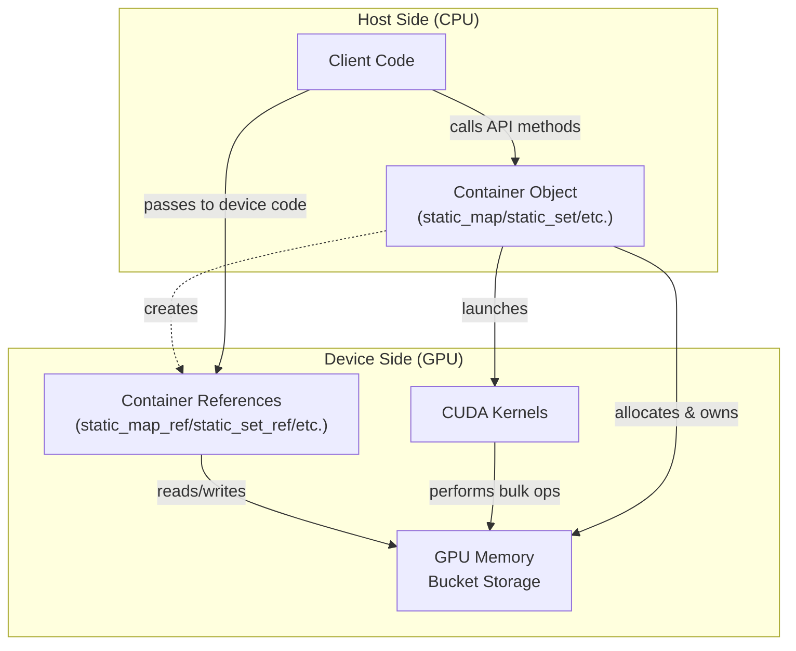
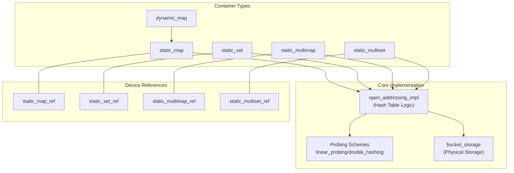
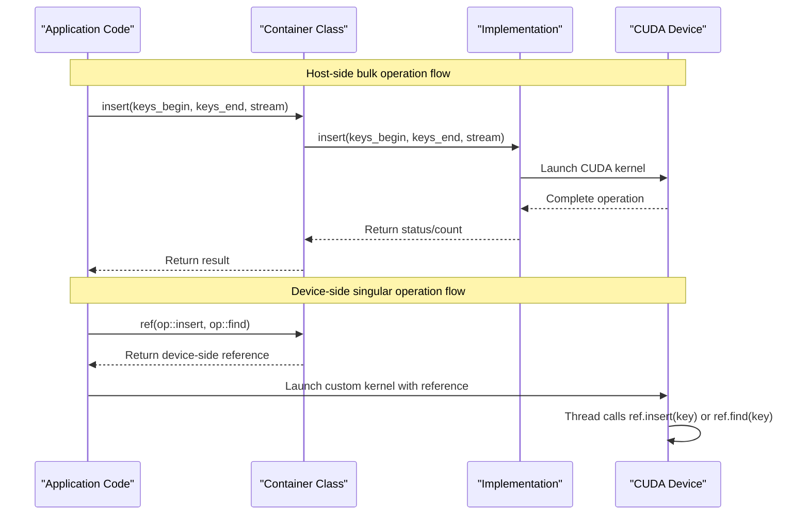
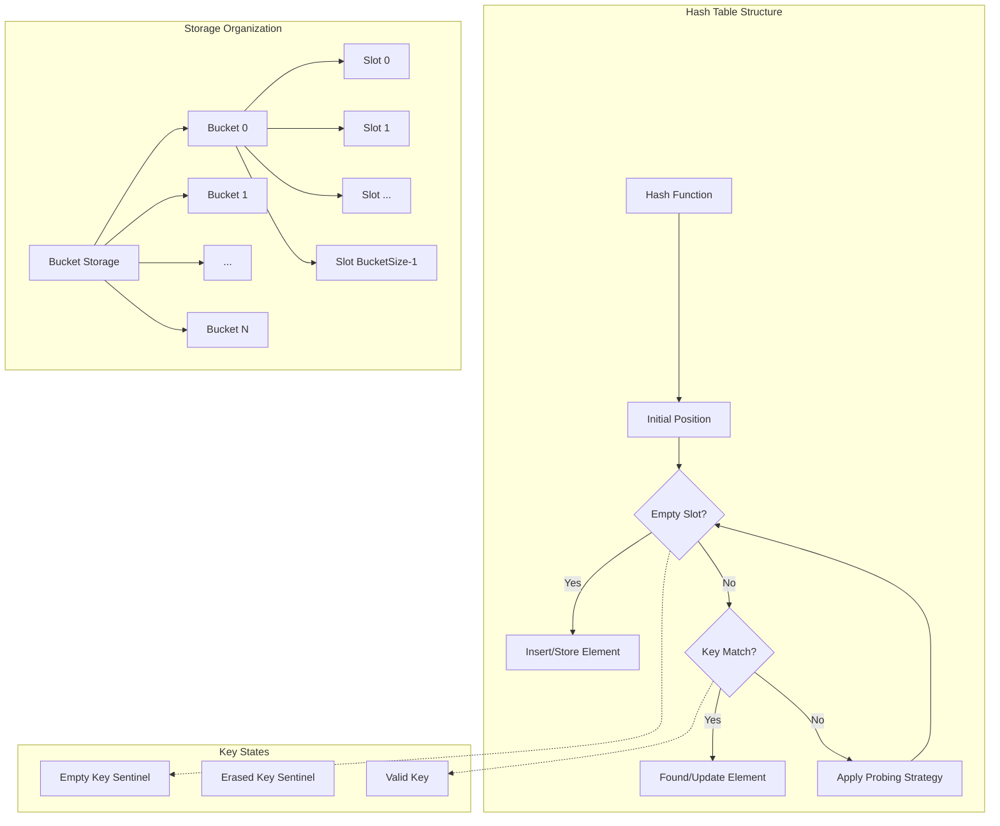
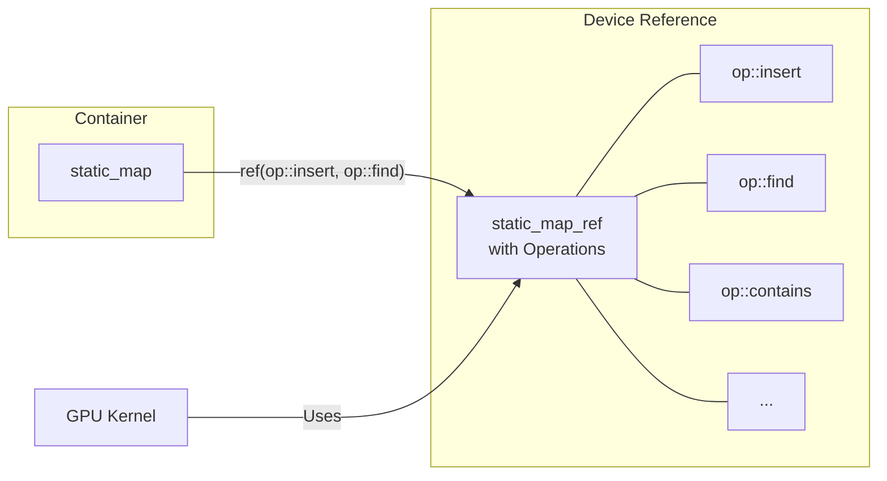

<!-- source: DeepWiki mcp.deepwiki.com · repo NVIDIA/cuCollections · page 1 Overview · fetched 2026-10-26 -->

# Overview

Relevant source files

The following files were used as context for generating this wiki page:

- [CMakeLists.txt](CMakeLists.txt)
- [README.md](README.md)
- [benchmarks/CMakeLists.txt](benchmarks/CMakeLists.txt)
- [examples/CMakeLists.txt](examples/CMakeLists.txt)
- [examples/static_map/count_by_key_example.cu](examples/static_map/count_by_key_example.cu)
- [examples/static_map/custom_type_example.cu](examples/static_map/custom_type_example.cu)
- [examples/static_set/device_subsets_example.cu](examples/static_set/device_subsets_example.cu)
- [examples/static_set/shared_memory_example.cu](examples/static_set/shared_memory_example.cu)
- [include/cuco/bucket_storage.cuh](include/cuco/bucket_storage.cuh)
- [include/cuco/detail/static_map.inl](include/cuco/detail/static_map.inl)
- [include/cuco/detail/static_map_kernels.cuh](include/cuco/detail/static_map_kernels.cuh)
- [include/cuco/static_map.cuh](include/cuco/static_map.cuh)
- [include/cuco/static_multimap.cuh](include/cuco/static_multimap.cuh)
- [tests/CMakeLists.txt](tests/CMakeLists.txt)
- [tests/static_map/erase_test.cu](tests/static_map/erase_test.cu)
- [tests/static_map/shared_memory_test.cu](tests/static_map/shared_memory_test.cu)
- [tests/static_set/shared_memory_test.cu](tests/static_set/shared_memory_test.cu)

cuCollections (cuco) is a header-only library providing GPU-accelerated, concurrent data structures for NVIDIA GPUs. Similar to how Thrust and CUB provide GPU-accelerated algorithms and primitives, cuCollections offers STL-like concurrent data structures designed specifically for efficient GPU usage. The library primarily implements hash-based containers optimized for parallel access.

This page provides a high-level introduction to cuCollections, explaining its architecture, main components, and core design patterns. For more detailed information about specific components, refer to their respective documentation pages.

## Core Features

- **GPU-accelerated containers** - Optimized for NVIDIA CUDA architectures (Volta+ with partial Pascal support)
- **Concurrent data access** - Designed for massively parallel operations
- **Dual interface pattern** - Both host-side bulk operations and device-side individual operations
- **Customizable behavior** - Configurable hash functions, probing schemes, and memory management

Sources: [README.md:8-10](), [CMakeLists.txt:122-133]()

## Architecture

cuCollections follows a consistent architecture across its containers that leverages the inherent parallelism of GPUs while allowing both bulk and fine-grained operations.

The architecture establishes a clear separation between:

1. **Host-side containers** - Manage memory and provide bulk operation APIs
2. **Device-side references** - Enable fine-grained access within CUDA kernels
3. **Storage buckets** - Organize data efficiently for GPU access patterns

This separation allows both "bulk" operations initiated from the host and fine-grained access from device code.

Sources: [include/cuco/static_map.cuh:45-72](), [include/cuco/bucket_storage.cuh:17-31]()

### Data Structures Hierarchy

The codebase uses a layered design with shared implementation components. Each container type reuses the same core hash table implementation while providing specialized interfaces. The device references offer customizable operations through a tag-based composition pattern.

Sources: [include/cuco/static_map.cuh:108-115](), [include/cuco/static_multimap.cuh:110-117]()

## Main Components

cuCollections provides several container types, each designed for specific use cases:

| Container | Description | Allows Duplicate Keys | Has Associated Values | Fixed Size |
|-----------|-------------|----------------------|---------------------|------------|
| `static_map` | Maps unique keys to values | No | Yes | Yes |
| `static_set` | Stores unique keys | No | No | Yes |
| `static_multimap` | Maps keys to values with duplicates allowed | Yes | Yes | Yes |
| `static_multiset` | Stores keys with duplicates allowed | Yes | No | Yes |
| `dynamic_map` | Growable map that links multiple static maps | No | Yes | No |

### Common Characteristics

All containers in cuCollections share these key features:

1. **Open addressing** with configurable probing schemes
2. **Atomic operations** for thread-safe concurrent access
3. **Customizable hash functions** to optimize for specific key types
4. **Sentinel values** for empty and erased slots
5. **Dual API pattern** with host bulk operations and device individual operations

Sources: [include/cuco/static_map.cuh:46-78](), [include/cuco/static_multimap.cuh:47-81]()

## Operation Flow

The containers support two distinct operation flows:

This dual approach provides flexibility for different access patterns:

1. **Host Bulk Operations**: Efficient for batch processing of large datasets
2. **Device Individual Operations**: Enables fine-grained control within custom kernels

Sources: [include/cuco/static_map.cuh:297-317](), [include/cuco/detail/static_map_kernels.cuh:81-108]()

## Storage Structure

cuCollections organizes data in a bucket-based storage model for efficient GPU memory access:

This storage model provides:

- **Bucket-based organization** for coalesced memory access
- **Open addressing** with configurable probing for collision resolution
- **Sentinel values** to mark empty and erased slots
- **Atomic operations** for thread-safe concurrent access

Sources: [include/cuco/bucket_storage.cuh:130-154](), [include/cuco/detail/static_map.inl:29-49]()

## Device References

One of the unique features of cuCollections is its device reference system, which enables fine-grained operations directly from device code:

Key aspects of the device reference system:

1. **Composition-based design**: References are composed with specific operations
2. **Non-owning and lightweight**: Easily passed to device code
3. **Thread scope specification**: Controls visibility of atomic operations
4. **Shared memory support**: References can wrap shared memory for faster access

Sources: [include/cuco/static_map.cuh:134-141](), [examples/static_set/device_ref_example.cu:77-82]()

## Memory Usage Patterns

cuCollections offers several ways to manage memory:

1. **Global memory with device allocator**: Default approach for most use cases
2. **Shared memory**: For high-performance thread block-local operations
3. **Single storage with multiple references**: For creating multiple logical containers with shared storage

These patterns allow developers to optimize memory usage based on their specific requirements.

Sources: [examples/static_set/shared_memory_example.cu:30-48](), [examples/static_set/device_subsets_example.cu:140-173]()

## Requirements and Limitations

- **CUDA Requirements**: CUDA 11.5+, C++17, Volta+ architecture (Pascal partial support)
- **Key/Value Size Limits**: Limited to 8 bytes each for optimal performance
- **Type Requirements**: Key/Value types must have unique object representations (`cuco::is_bitwise_comparable_v<T>`)
- **Sentinel Values**: Must provide unique sentinel values for empty (and optionally erased) states

Sources: [README.md:61-66](), [include/cuco/static_map.cuh:73-106]()

## Integration with Applications

cuCollections is designed to integrate smoothly with CUDA applications through:

1. **CMake integration**: Simple to include in CMake projects
2. **Header-only design**: No separate compilation required
3. **Compatible with standard CUDA patterns**: Works with CUDA streams, cooperative groups, etc.

For detailed information on building and installation, see [Building and Installation](#1.2).

Sources: [README.md:25-59](), [CMakeLists.txt:81-89]()

---

