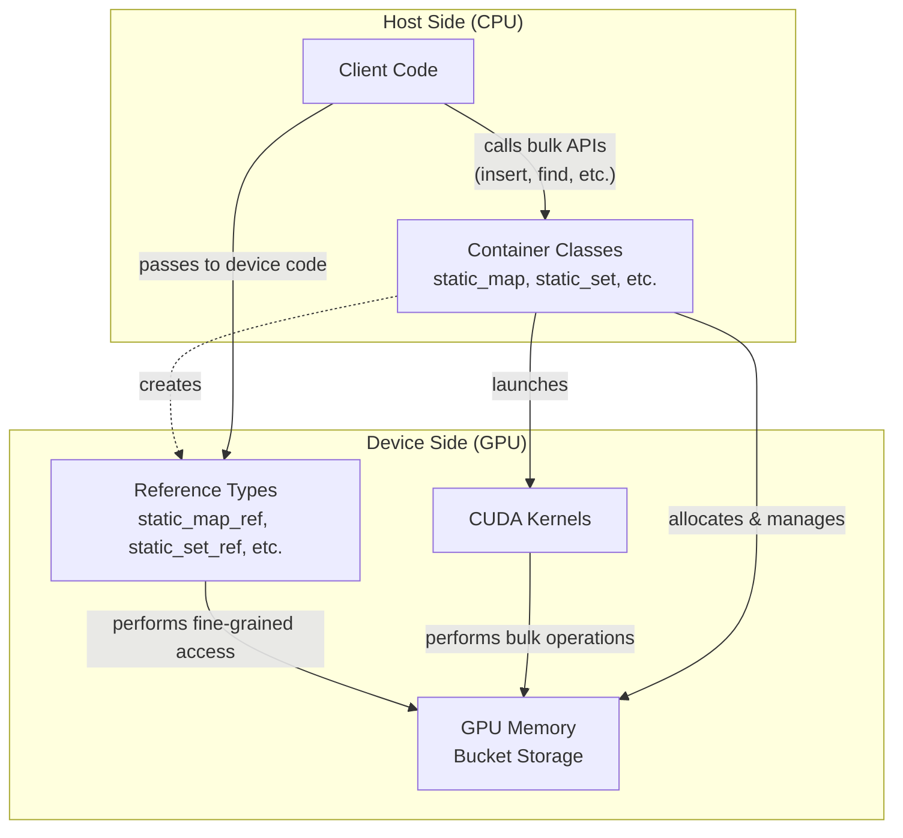
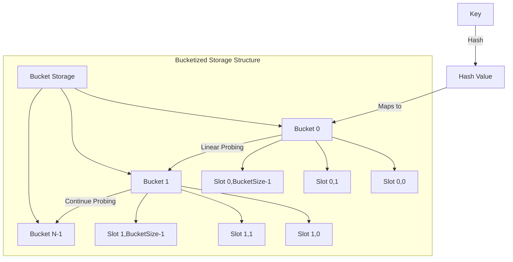
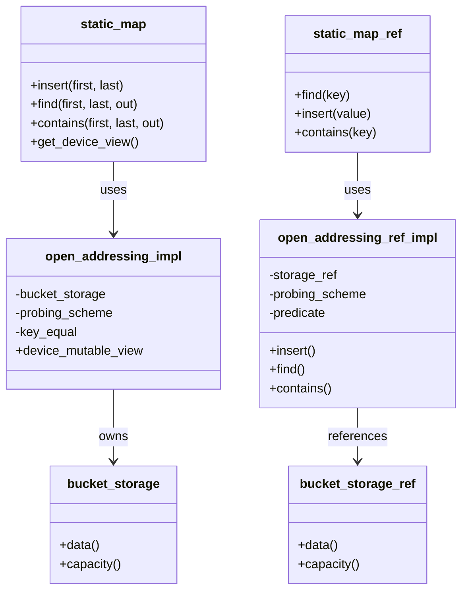
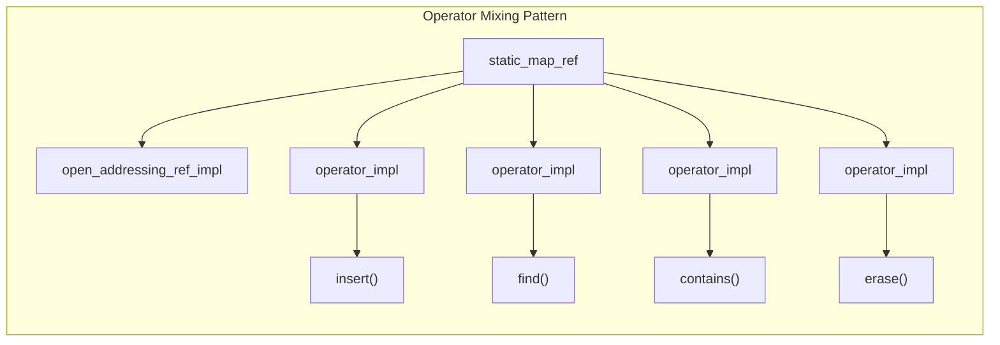
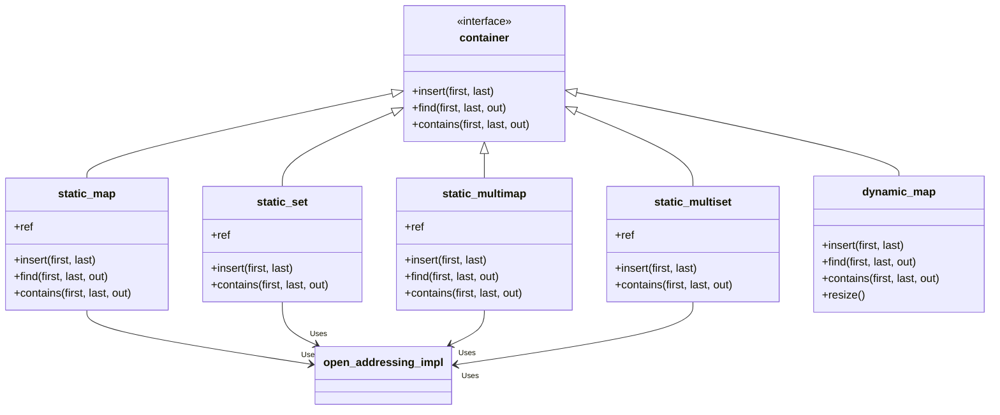
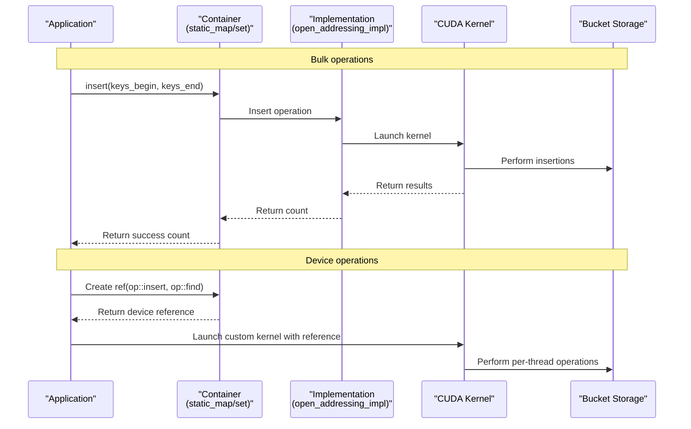
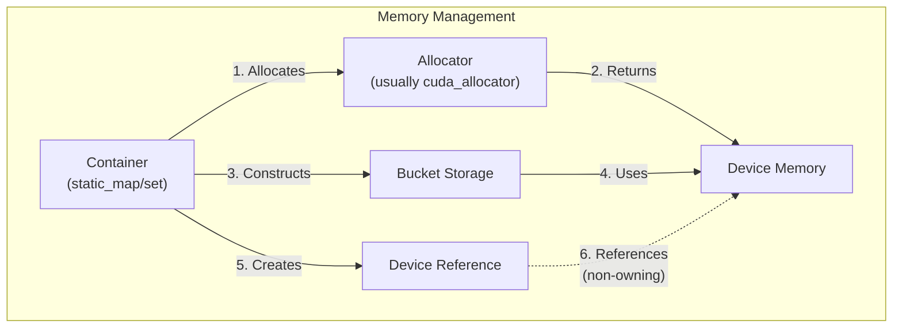
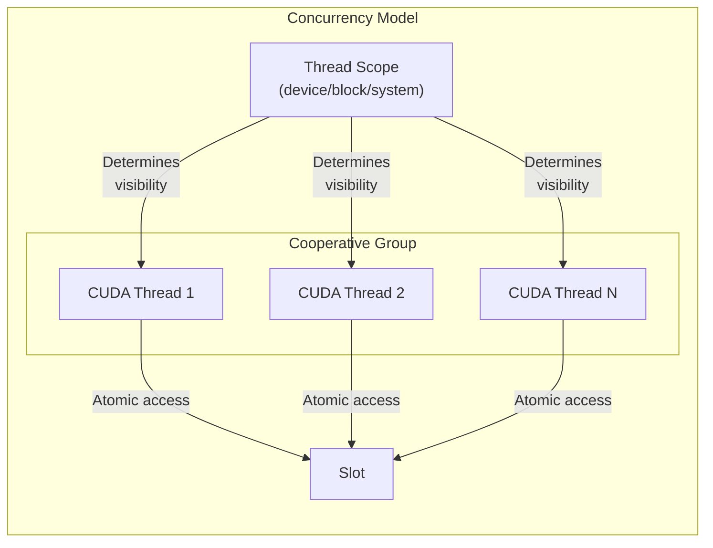

<!-- source: DeepWiki mcp.deepwiki.com · repo NVIDIA/cuCollections · page 1.1 Architecture · fetched 2026-10-26 -->

# Architecture

Relevant source files

The following files were used as context for generating this wiki page:

- [README.md](README.md)
- [examples/static_set/device_subsets_example.cu](examples/static_set/device_subsets_example.cu)
- [examples/static_set/shared_memory_example.cu](examples/static_set/shared_memory_example.cu)
- [include/cuco/bucket_storage.cuh](include/cuco/bucket_storage.cuh)
- [include/cuco/detail/open_addressing/open_addressing_ref_impl.cuh](include/cuco/detail/open_addressing/open_addressing_ref_impl.cuh)
- [include/cuco/detail/static_map.inl](include/cuco/detail/static_map.inl)
- [include/cuco/detail/static_map/static_map_ref.inl](include/cuco/detail/static_map/static_map_ref.inl)
- [include/cuco/detail/static_map_kernels.cuh](include/cuco/detail/static_map_kernels.cuh)
- [include/cuco/detail/static_multimap/static_multimap_ref.inl](include/cuco/detail/static_multimap/static_multimap_ref.inl)
- [include/cuco/detail/static_multiset/static_multiset_ref.inl](include/cuco/detail/static_multiset/static_multiset_ref.inl)
- [include/cuco/detail/static_set/static_set_ref.inl](include/cuco/detail/static_set/static_set_ref.inl)
- [include/cuco/static_map.cuh](include/cuco/static_map.cuh)
- [include/cuco/static_map_ref.cuh](include/cuco/static_map_ref.cuh)
- [include/cuco/static_multimap_ref.cuh](include/cuco/static_multimap_ref.cuh)
- [include/cuco/static_multiset_ref.cuh](include/cuco/static_multiset_ref.cuh)
- [include/cuco/static_set_ref.cuh](include/cuco/static_set_ref.cuh)
- [tests/static_map/erase_test.cu](tests/static_map/erase_test.cu)
- [tests/static_map/shared_memory_test.cu](tests/static_map/shared_memory_test.cu)
- [tests/static_set/shared_memory_test.cu](tests/static_set/shared_memory_test.cu)

This page describes the high-level architecture of cuCollections (cuco), explaining how the different components fit together to provide GPU-accelerated data structures. It covers the foundational design patterns, core components, and interactions that enable efficient, concurrent data structures on NVIDIA GPUs.

## Overview

cuCollections follows a unique architecture designed specifically for GPU-based data structures, with a clear separation between:

1. Host-side container objects that provide bulk operations
2. Device-side reference objects that enable fine-grained access

This design allows developers to use cuCollections efficiently in both bulk processing scenarios (processing millions of elements at once) and in custom CUDA kernels requiring individual element operations.

## Core Architecture Patterns

### Host-Device Interface Pattern

The foundational pattern in cuCollections is the separation between host-side containers and device-side references.

**Host-side containers**:
- Own and manage memory
- Provide bulk operations (insert, find, contains, etc.)
- Launch CUDA kernels for these operations
- Create device-side references

**Device-side references**:
- Non-owning, lightweight, trivially-copyable
- Enable fine-grained access in CUDA kernels
- Support various operations through template operator tags

Sources: [include/cuco/static_map.cuh:46-65](). [include/cuco/static_map_ref.cuh:32-58]()

### Storage Architecture

cuCollections uses a bucket-based storage design for efficient memory access patterns on GPUs.

Key features:
- Buckets contain multiple slots
- Slots store elements (keys or key-value pairs)
- Bucketized design enables vectorized memory access
- Probing schemes determine collision resolution strategy

Sources: [include/cuco/bucket_storage.cuh:35-42](). [include/cuco/detail/open_addressing/open_addressing_ref_impl.cuh:66-108]()

## Container Implementation

### Open Addressing Implementation

All containers in cuCollections use open addressing with configurable probing schemes. This is implemented through a common template class: `open_addressing_impl` and `open_addressing_ref_impl`.

This implementation provides:
- Element storage in buckets
- Hash-based lookup
- Collision resolution through configured probing schemes
- Thread-safe operations via atomic operations

Sources: [include/cuco/detail/open_addressing/open_addressing_impl.cuh](). [include/cuco/detail/open_addressing/open_addressing_ref_impl.cuh:83-104]()

### Operator Composition Pattern

Device references use a template parameter pack of operator tags to determine their functionality. This enables compile-time composition of operations.

Key aspects:
- References inherit functionality from multiple operator implementations
- Operators can be composed at compile time
- Allows for minimal reference objects with only required functionality
- Enables rebinding to create references with different operations

Sources: [include/cuco/static_map_ref.cuh:63-71](). [include/cuco/operator.hpp]()

## Container Types and Relationships

cuCollections provides several container types, all built on the same architectural foundation but with different characteristics.

Container characteristics:
- **static_map**: Fixed-size hash table for unique key-value pairs
- **static_set**: Fixed-size container for unique keys
- **static_multimap**: Fixed-size hash table allowing duplicate keys
- **static_multiset**: Fixed-size container allowing duplicate keys
- **dynamic_map**: Resizable hash table for unique key-value pairs

Sources: [include/cuco/static_map.cuh:46-88](). [include/cuco/static_set.cuh](). [include/cuco/static_multimap.cuh](). [include/cuco/static_multiset.cuh](). [include/cuco/dynamic_map.cuh]()

## Operation Flow

The following diagram illustrates how operations flow through the system:

Key points:
- Bulk operations launch CUDA kernels from the host
- Device-side operations use reference objects passed to custom kernels
- Both paths interact with the same underlying storage

Sources: [include/cuco/detail/static_map_kernels.cuh:81-108](). [include/cuco/detail/open_addressing/open_addressing_ref_impl.cuh:374-417]()

## Memory Management

cuCollections containers handle memory management through allocators. The storage is structured as an array of buckets, each containing a fixed number of slots.

Key aspects:
- Containers own and manage memory allocation/deallocation
- References are non-owning and don't manage memory
- Storage is organized into buckets for efficient access
- Custom allocators can be provided

Sources: [include/cuco/static_map.cuh:87-96](). [include/cuco/utility/allocator.hpp]()

## Concurrency and Synchronization

cuCollections provides thread-safe concurrent access through atomic operations and cooperative groups.

Features:
- Thread scope parameter controls synchronization scope (device, block, or system)
- Atomic operations ensure thread-safe modifications
- Cooperative groups can be used for collaborative operations
- Probing scheme's CG size parameter configures thread cooperation

Sources: [include/cuco/detail/open_addressing/open_addressing_ref_impl.cuh:387-415](). [include/cuco/detail/open_addressing/open_addressing_ref_impl.cuh:428-466]()

## Summary

The cuCollections architecture is designed for efficient GPU-accelerated data structures through:

1. **Separation of host and device interfaces** for both bulk and fine-grained operations
2. **Bucket-based storage** optimized for GPU memory access patterns
3. **Atomic operations** for thread-safe concurrent modifications
4. **Composable operations** through the operator tag system
5. **Flexible probing schemes** for collision resolution
6. **Cooperative threading model** for efficient parallel execution

This architecture enables high-performance, concurrent hash tables and sets optimized for NVIDIA GPUs while providing a flexible, STL-like interface.

---

