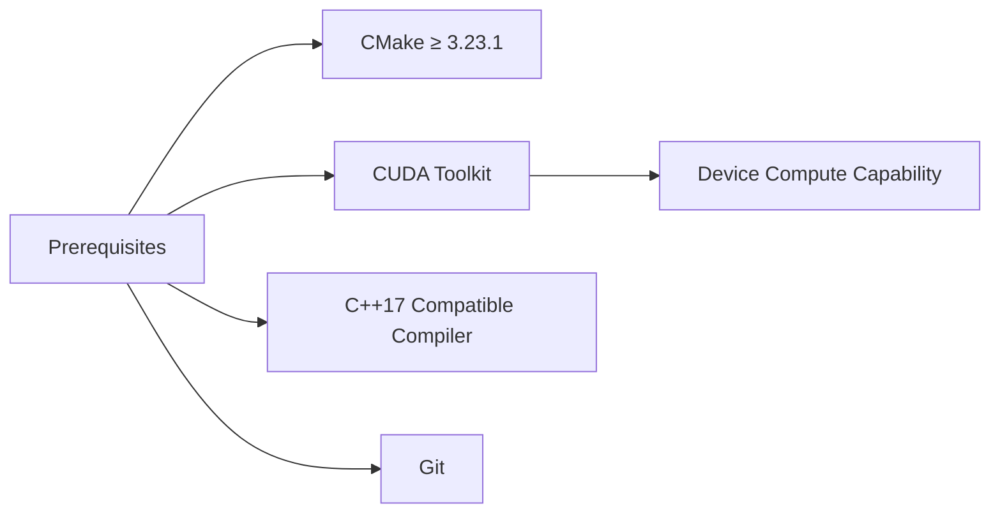
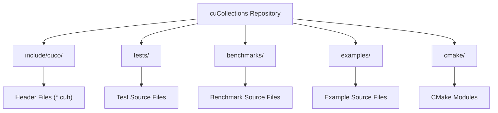
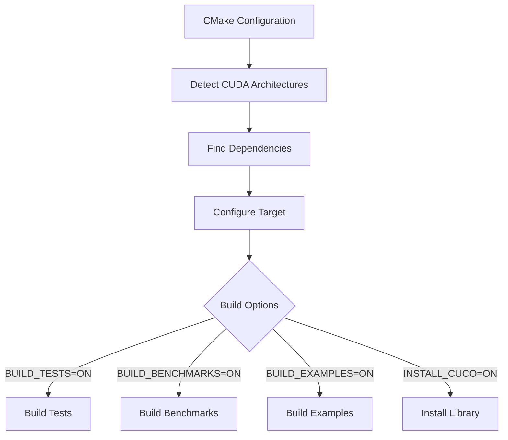
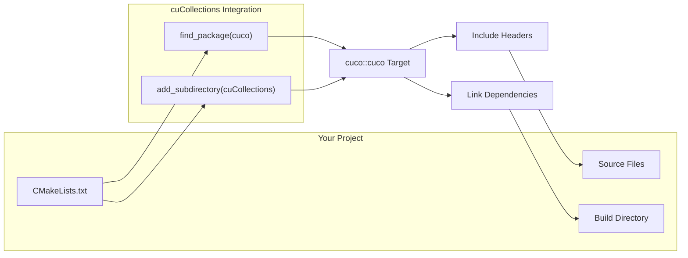

<!-- source: DeepWiki mcp.deepwiki.com · repo NVIDIA/cuCollections · page 1.2 Building and Installation · fetched 2026-10-26 -->

# Building and Installation

<details>
<summary>Relevant source files</summary>

The following files were used as context for generating this wiki page:

- [.gitignore](.gitignore)
- [.pre-commit-config.yaml](.pre-commit-config.yaml)
- [CMakeLists.txt](CMakeLists.txt)
- [benchmarks/CMakeLists.txt](benchmarks/CMakeLists.txt)
- [ci/pre-commit/example_links.py](ci/pre-commit/example_links.py)
- [cmake/thirdparty/get_cccl.cmake](cmake/thirdparty/get_cccl.cmake)
- [doxygen/Doxyfile](doxygen/Doxyfile)
- [examples/CMakeLists.txt](examples/CMakeLists.txt)
- [examples/static_map/count_by_key_example.cu](examples/static_map/count_by_key_example.cu)
- [examples/static_map/custom_type_example.cu](examples/static_map/custom_type_example.cu)
- [tests/CMakeLists.txt](tests/CMakeLists.txt)

</details>


This document provides detailed instructions for building, installing, and integrating the cuCollections (cuco) library into your projects. cuCollections is a header-only library, but it requires proper setup to ensure compatibility with your CUDA environment.

## Prerequisites

Before building cuCollections, ensure you have the following prerequisites installed on your system:

- **CMake** (minimum version 3.23.1)
- **CUDA Toolkit** (supported versions align with the NVIDIA CCCL library)
- **C++ Compiler** supporting C++17
- **Git** (for cloning the repository)



Sources: [CMakeLists.txt:16-17](), [CMakeLists.txt:34-36]()

## Repository Structure

cuCollections is organized with a clear separation between library header files, tests, benchmarks, and examples:



Sources: [CMakeLists.txt:83-88](), [tests/CMakeLists.txt](), [benchmarks/CMakeLists.txt](), [examples/CMakeLists.txt]()

## Building from Source

### Clone the Repository

First, clone the repository from GitHub:

```bash
git clone https://github.com/NVIDIA/cuCollections.git
cd cuCollections
```

### Configure and Build

cuCollections uses CMake for its build system. The basic build commands are:

```bash
mkdir build
cd build
cmake ..
cmake --build .
```

### CMake Build Options

cuCollections provides several build options that can be enabled or disabled:

| Option | Description | Default |
|--------|-------------|---------|
| `BUILD_TESTS` | Build test suite | ON when building directly, OFF as subproject |
| `BUILD_BENCHMARKS` | Build benchmark suite | ON when building directly, OFF as subproject |
| `BUILD_EXAMPLES` | Build example programs | ON when building directly, OFF as subproject |
| `INSTALL_CUCO` | Enable CMake install rules | ON when building directly, OFF as subproject |

To enable or disable these options, add them to your CMake command:

```bash
cmake .. -DBUILD_TESTS=ON -DBUILD_BENCHMARKS=OFF
```

Sources: [CMakeLists.txt:39-49]()

## Build Process

The build process for cuCollections follows this workflow:



Sources: [CMakeLists.txt:34-114]()

## Dependencies

cuCollections primarily depends on:

1. **CUDA Toolkit**: For CUDA compiler and runtime
2. **CCCL (CUDA C++ Core Libraries)**: A collection of CUDA C++ libraries that provide foundational functionality

The build system automatically downloads and configures CCCL using CPM (CMake Package Manager) if it's not already available.

Sources: [CMakeLists.txt:66-72](), [cmake/thirdparty/get_cccl.cmake]()

## Installation

When `INSTALL_CUCO=ON`, the build will generate installation targets. To install the library:

```bash
cmake --build . --target install
```

By default, this will install:
- Header files to `<install-prefix>/include/cuco/`
- CMake configuration files to `<install-prefix>/lib/cmake/cuco/`

You can customize the installation directory by setting `CMAKE_INSTALL_PREFIX`:

```bash
cmake .. -DCMAKE_INSTALL_PREFIX=/custom/install/path
```

Sources: [CMakeLists.txt:144-154]()

## Using cuCollections in Your Projects

### CMake Integration

cuCollections provides CMake targets that can be used in your projects. There are two primary ways to integrate it:

#### 1. Using with `find_package`

If cuCollections is installed on your system:

```cmake
find_package(cuco REQUIRED)
target_link_libraries(your_target PRIVATE cuco::cuco)
```

#### 2. As a Subdirectory

You can include cuCollections as a subdirectory in your project:

```cmake
add_subdirectory(path/to/cuCollections)
target_link_libraries(your_target PRIVATE cuco::cuco)
```



Sources: [CMakeLists.txt:83-88](), [CMakeLists.txt:119-154]()

## Example Usage

After building and installing, you can compile and run the example applications to understand how to use the library:

```bash
cd build/examples
./STATIC_MAP_HOST_BULK_EXAMPLE
```

The example programs demonstrate various features of cuCollections, such as static maps, multimaps, device references, and custom types.

Sources: [examples/CMakeLists.txt:21-49]()

## Test Suite

If you've built the test suite (`BUILD_TESTS=ON`), you can run the tests to verify that cuCollections works correctly on your system:

```bash
cd build
ctest
```

The test suite uses Catch2 and includes tests for all major components of the library.

Sources: [tests/CMakeLists.txt:18-32](), [tests/CMakeLists.txt:35-44]()

## Performance Benchmarks

If you've built the benchmarks (`BUILD_BENCHMARKS=ON`), you can run them to measure the performance of cuCollections on your system:

```bash
cd build/benchmarks
./STATIC_MAP_BENCH
./STATIC_SET_BENCH
```

The benchmarks use NVBench to measure performance metrics such as throughput and latency.

Sources: [benchmarks/CMakeLists.txt:23-35](), [benchmarks/CMakeLists.txt:42-101]()

## Compiler Settings and Requirements

cuCollections requires:
- CUDA compiler with C++17 support
- Host compiler with C++17 support

The library uses various CUDA features like:
- Lambda expressions (`--expt-extended-lambda`)
- Extensions for atomic operations

The tests and examples are compiled with warnings enabled (`-Wall -Wextra`).

Sources: [CMakeLists.txt:88](), [tests/CMakeLists.txt:41-42](), [examples/CMakeLists.txt:27-28](), [benchmarks/CMakeLists.txt:30]()

## Troubleshooting

### Common Build Issues

1. **CMake Version**:
   If you encounter errors about CMake policy or unsupported commands, ensure you're using CMake 3.23.1 or newer.

2. **CUDA Toolkit Not Found**:
   Ensure CUDA is properly installed and that the CUDA_HOME or CUDA_PATH environment variable is set.

3. **Header-Only Limitations**:
   Remember that while cuCollections is header-only, it still needs to be compiled with CUDA support to function.

4. **Custom CUDA Architecture**:
   The build system detects CUDA architectures automatically, but you can specify them manually with `CMAKE_CUDA_ARCHITECTURES`.

### CUDA Compatibility

cuCollections is tested with recent CUDA versions. If you encounter issues with older CUDA versions, you may need to update your CUDA toolkit or modify the code to remove newer CUDA features.

---

