<!-- source: DeepWiki mcp.deepwiki.com · repo NVIDIA/cuCollections · page 10 Memory Management · fetched 2026-10-26 -->

# Memory Management

Relevant source files

The following files were used as context for generating this wiki page:

- [CMakeLists.txt](CMakeLists.txt)
- [README.md](README.md)
- [benchmarks/CMakeLists.txt](benchmarks/CMakeLists.txt)
- [examples/CMakeLists.txt](examples/CMakeLists.txt)
- [examples/static_map/count_by_key_example.cu](examples/static_map/count_by_key_example.cu)
- [examples/static_map/custom_type_example.cu](examples/static_map/custom_type_example.cu)
- [examples/static_set/device_subsets_example.cu](examples/static_set/device_subsets_example.cu)
- [examples/static_set/shared_memory_example.cu](examples/static_set/shared_memory_example.cu)
- [include/cuco/bucket_storage.cuh](include/cuco/bucket_storage.cuh)
- [include/cuco/detail/open_addressing/functors.cuh](include/cuco/detail/open_addressing/functors.cuh)
- [include/cuco/detail/utility/strong_type.cuh](include/cuco/detail/utility/strong_type.cuh)
- [include/cuco/detail/utils.cuh](include/cuco/detail/utils.cuh)
- [include/cuco/utility/key_generator.cuh](include/cuco/utility/key_generator.cuh)
- [tests/CMakeLists.txt](tests/CMakeLists.txt)
- [tests/static_map/shared_memory_test.cu](tests/static_map/shared_memory_test.cu)
- [tests/static_set/shared_memory_test.cu](tests/static_set/shared_memory_test.cu)

This page explains the memory management systems in the cuCollections library, covering memory organization, allocation strategies, and optimizations for GPU-accelerated data structures. It focuses on how memory is allocated, organized, and shared among different containers to maximize performance and efficiency.

## Memory Organization

At the core of cuCollections' memory management is the concept of bucket storage, which provides a structured approach to organizing data for efficient GPU access.

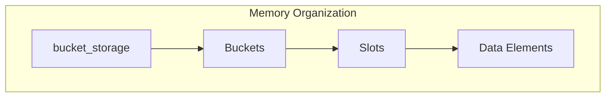

The bucket storage approach organizes memory into a collection of buckets, with each bucket containing one or more slots that store the actual data elements (keys and values). This organization facilitates efficient memory access patterns and vectorized loads on GPU hardware.

Sources: [include/cuco/bucket_storage.cuh:134-222](), [include/cuco/detail/storage/bucket_storage_base.cuh]()

### Owning vs. Non-owning Storage Types

cuCollections provides two primary storage classes:

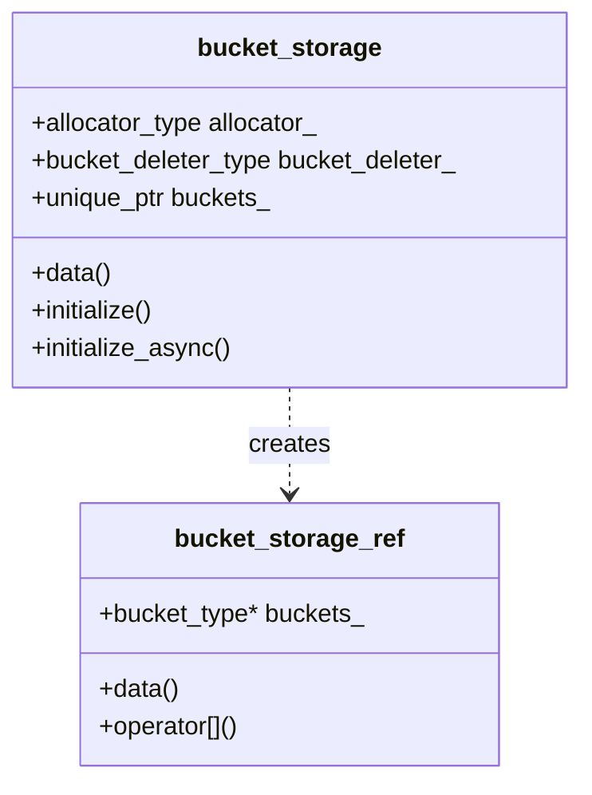

- **`bucket_storage`** - An owning container that handles memory allocation, initialization, and deallocation
- **`bucket_storage_ref`** - A lightweight, non-owning reference type primarily used for passing to device code

This separation of concerns allows for efficient management of GPU memory, where owning containers live on the host while non-owning references can be passed efficiently to device code.

Sources: [include/cuco/bucket_storage.cuh:43-120](), [include/cuco/bucket_storage.cuh:134-222]()

## Memory Types

### Host vs. Device Memory

cuCollections manages memory across both the host (CPU) and device (GPU):

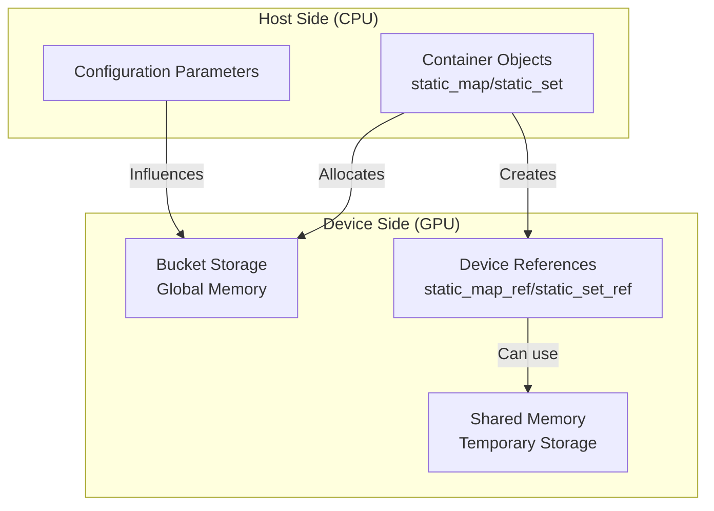

The host side contains the primary container objects and configuration parameters, while the device side stores the actual data in either global memory (for persistent storage) or shared memory (for high-performance temporary operations).

Sources: [tests/static_map/shared_memory_test.cu:33-66](), [tests/static_set/shared_memory_test.cu:33-64]()

### Global vs. Shared Memory

cuCollections supports both global device memory and shared memory:

- **Global Memory**: Used for persistent storage that lives across kernel launches
- **Shared Memory**: Used for high-performance temporary storage within a thread block

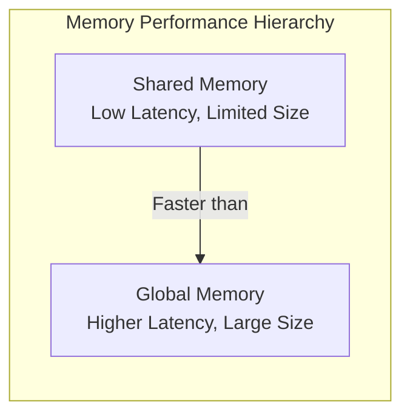

The library provides mechanisms to use both types efficiently based on the specific use case requirements.

Sources: [examples/static_set/shared_memory_example.cu:30-111](), [tests/static_map/shared_memory_test.cu:168-224]()

## Memory Allocation Strategies

### Static Allocation

Static containers (`static_map`, `static_set`, etc.) allocate memory upfront with a fixed capacity that doesn't change during the container's lifetime:

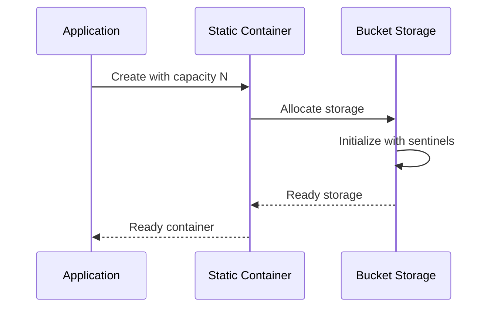

This approach provides predictable memory usage and avoids the overhead of dynamic resizing, but requires knowing the maximum capacity in advance.

Sources: [include/cuco/bucket_storage.cuh:166-175](), [include/cuco/static_map.cuh]()

### Dynamic Allocation

Dynamic containers (`dynamic_map`) can grow as needed by allocating additional storage when the current capacity is exhausted:

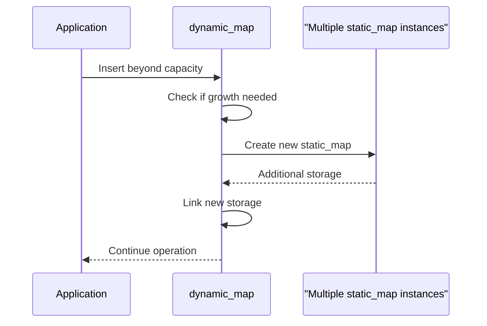

This strategy provides flexibility in situations where the final data size is unknown or may grow over time.

Sources: [tests/dynamic_map/unique_sequence_test.cu](), [tests/dynamic_map/unique_sequence_test_experimental.cu]()

## Memory Initialization and Sentinel Values

### Sentinel Values

cuCollections uses sentinel values to indicate special slot states:

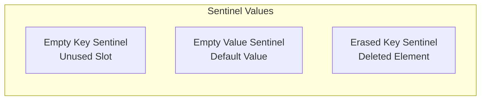

- **Empty key sentinel**: Marks slots that have never been used
- **Empty value sentinel**: The default value associated with empty keys
- **Erased key sentinel**: Marks slots where an element was deleted (used in some containers)

These sentinels must be chosen carefully to avoid conflicts with actual data values.

Sources: [include/cuco/detail/open_addressing/functors.cuh:78-110](), [examples/static_map/custom_type_example.cu:62-63]()

### Storage Initialization

All storage must be initialized with appropriate sentinel values before use:

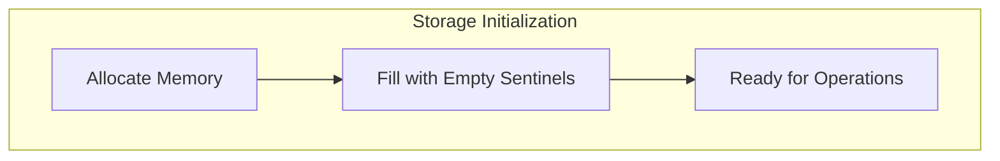

The library provides both synchronous and asynchronous initialization methods to accommodate different usage patterns.

Sources: [include/cuco/bucket_storage.cuh:207-215]()

## Optimized Memory Usage Patterns

### Shared Memory Usage

For performance-critical operations, cuCollections supports using shared memory:

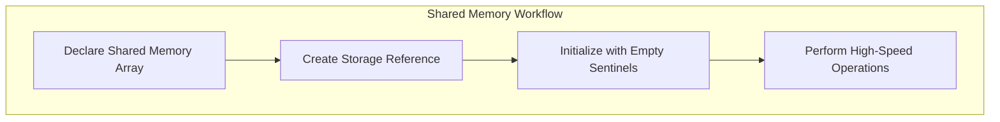

This pattern is especially useful for operations that require multiple lookups or inserts within a single kernel.

Sources: [examples/static_set/shared_memory_example.cu:30-111](), [tests/static_map/shared_memory_test.cu:168-224]()

### Memory Subsets

To optimize memory usage for multiple small containers, cuCollections allows creating subsets within a single storage:

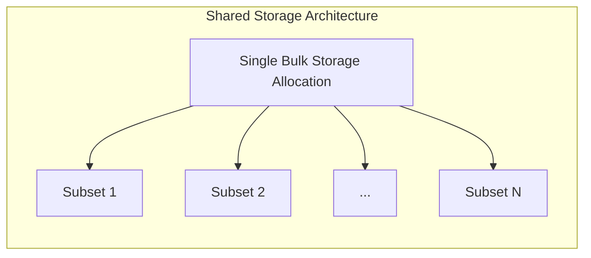

This approach:
- Reduces memory allocation/deallocation overhead
- Enables better management of GPU memory resources
- Reduces memory fragmentation
- Minimizes the pressure on the GPU memory allocator

Sources: [examples/static_set/device_subsets_example.cu:145-184]()

## Memory Layout and Bucket Structure

Understanding the physical memory layout is crucial for optimizing performance:

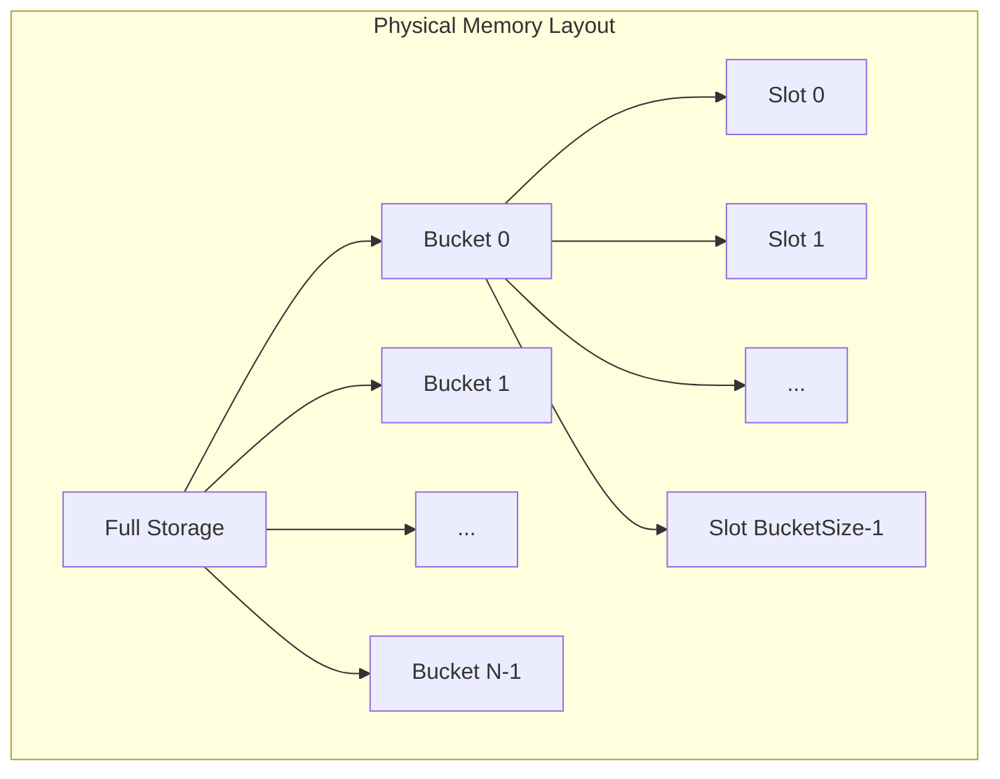

The bucket size parameter determines how many slots are grouped together, affecting memory access patterns and vectorization opportunities.

Sources: [include/cuco/bucket_storage.cuh:33-35](), [examples/static_set/shared_memory_example.cu:35-39]()

## Memory Management Best Practices

### Capacity Planning

For optimal performance:
- Choose appropriate container capacity based on expected data size
- Consider load factor for hash tables (typically 50-80%)
- Account for growth patterns when using dynamic containers

### Memory Usage Optimization

To get the most from cuCollections:
- Use shared memory for performance-critical operations with localized access patterns
- Consider using memory subsets for multiple small containers
- Select the appropriate bucket size for your hardware and access patterns

### Sentinel Value Selection

When choosing sentinels:
- Select values that will never appear in your actual data
- Document sentinel choices to avoid confusion
- Consider using `cuco::empty_key<T>` and `cuco::empty_value<T>` wrappers for type safety

Sources: [examples/static_map/custom_type_example.cu:62-63](), [examples/static_set/shared_memory_example.cu:78-79]()

## Container-Specific Memory Considerations

Different containers have specific memory requirements and characteristics:

| Container | Memory Model | Growth | Recommended Use Case |
|-----------|--------------|--------|---------------------|
| `static_map` | Fixed allocation | No | When size is known in advance |
| `static_set` | Fixed allocation | No | When size is known in advance |
| `static_multimap` | Fixed allocation | No | Multiple values per key, known size |
| `static_multiset` | Fixed allocation | No | Multiple occurrences, known size |
| `dynamic_map` | Growable | Yes | When size may increase over time |

Each container type is optimized for different memory usage patterns and requirements.

Sources: [README.md:8-10](), [tests/CMakeLists.txt:50-149]()

## Performance Impact of Memory Decisions

### Load Factor Effects

The load factor (ratio of filled slots to total slots) affects both memory efficiency and performance:

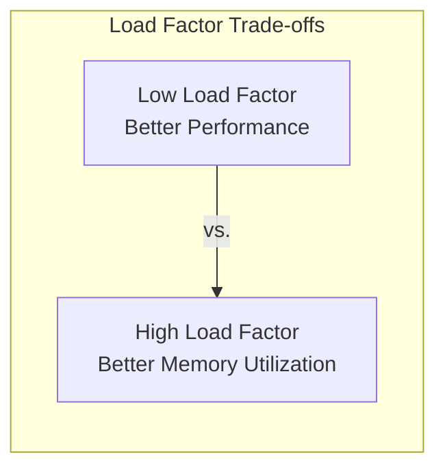

Higher load factors improve memory utilization but may increase collision probability and probe sequence length.

### Memory Access Patterns

The bucket organization helps maintain coalesced memory access patterns, which are crucial for GPU performance:

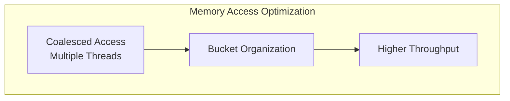

The library is designed to promote efficient memory access patterns through its bucket storage structure.

Sources: [include/cuco/detail/open_addressing/functors.cuh:48-59](), [examples/static_set/shared_memory_example.cu:30-111]()

---

