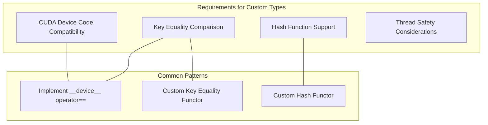
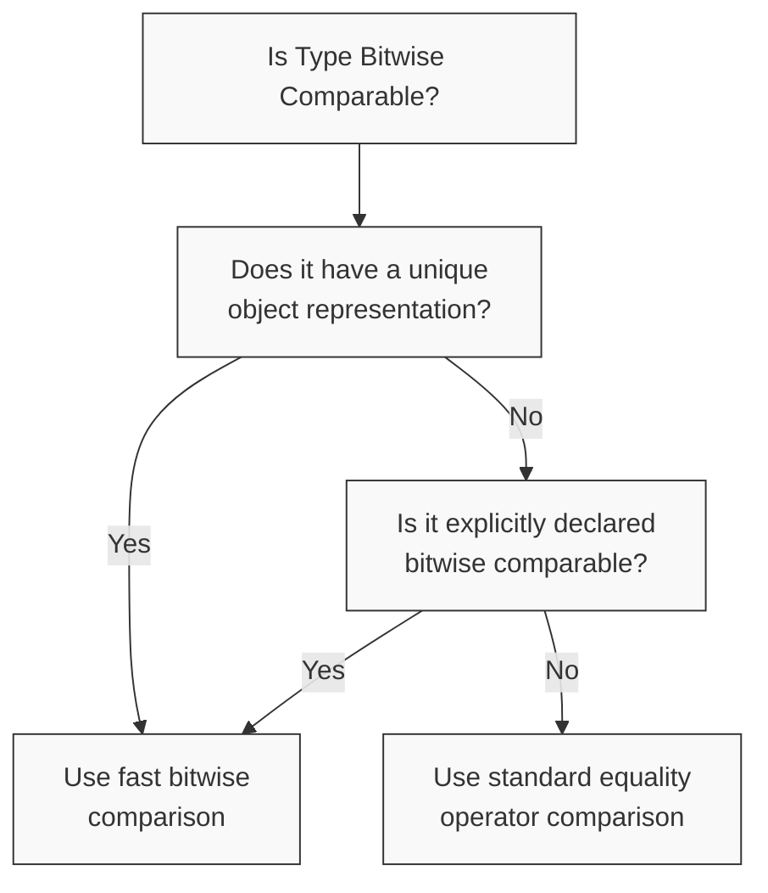
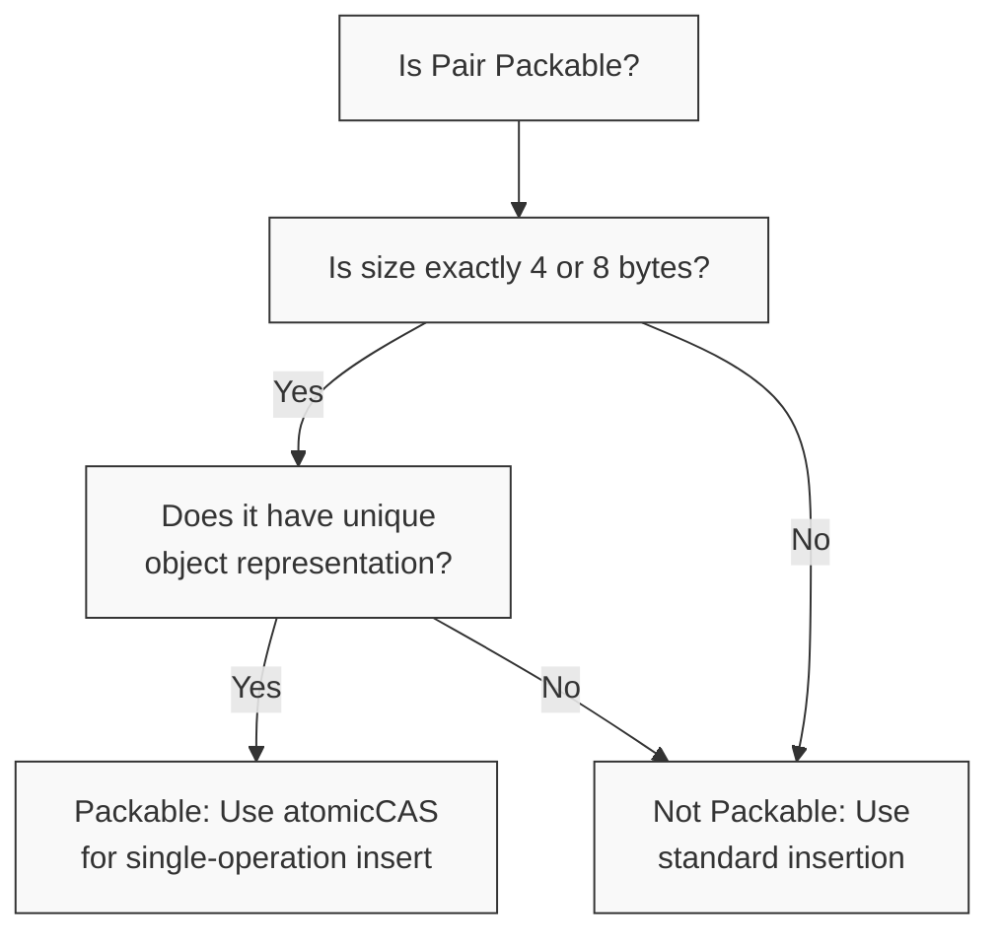
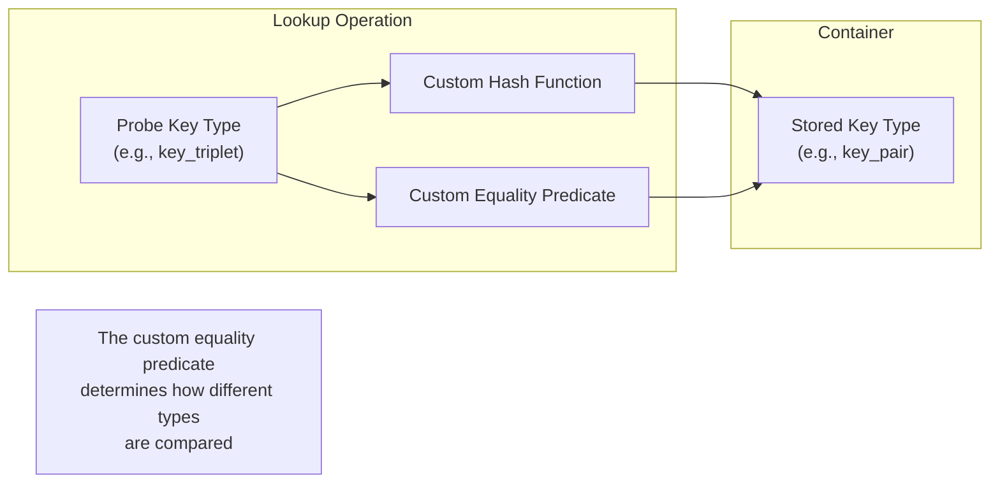
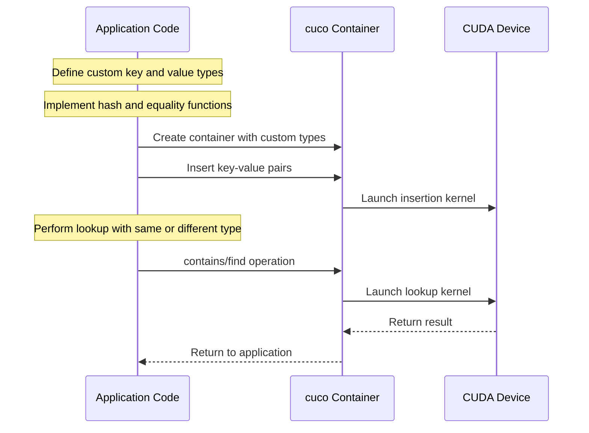

<!-- source: DeepWiki mcp.deepwiki.com · repo NVIDIA/cuCollections · page 11 Custom Types and Key-Value Pairs · fetched 2026-10-26 -->

# Custom Types and Key-Value Pairs

<details>
<summary>Relevant source files</summary>

The following files were used as context for generating this wiki page:

- [include/cuco/detail/bitwise_compare.cuh](include/cuco/detail/bitwise_compare.cuh)
- [include/cuco/detail/pair/helpers.cuh](include/cuco/detail/pair/helpers.cuh)
- [include/cuco/pair.cuh](include/cuco/pair.cuh)
- [include/cuco/utility/traits.hpp](include/cuco/utility/traits.hpp)
- [tests/dynamic_map/unique_sequence_test.cu](tests/dynamic_map/unique_sequence_test.cu)
- [tests/static_map/custom_type_test.cu](tests/static_map/custom_type_test.cu)
- [tests/static_map/duplicate_keys_test.cu](tests/static_map/duplicate_keys_test.cu)
- [tests/static_map/heterogeneous_lookup_test.cu](tests/static_map/heterogeneous_lookup_test.cu)
- [tests/static_map/insert_and_find_test.cu](tests/static_map/insert_and_find_test.cu)
- [tests/static_map/key_sentinel_test.cu](tests/static_map/key_sentinel_test.cu)
- [tests/static_map/stream_test.cu](tests/static_map/stream_test.cu)
- [tests/static_multimap/heterogeneous_lookup_test.cu](tests/static_multimap/heterogeneous_lookup_test.cu)
- [tests/static_set/heterogeneous_lookup_test.cu](tests/static_set/heterogeneous_lookup_test.cu)

</details>


This document explains how to use custom types as keys and values in cuCollections containers, as well as the key-value pair implementation provided by the library. It covers requirements for custom types, optimizations for key comparisons, and techniques for heterogeneous lookups.

## Key-Value Pairs in cuCollections

cuCollections provides its own pair implementation (`cuco::pair`) which is designed specifically for CUDA environments. Unlike `std::pair` or `cuda::std::pair`, the cuCollections pair type ensures proper memory alignment, which is critical for atomic operations on the GPU.

```mermaid
classDiagram
    class "cuco::pair<First, Second>" {
        +First first
        +Second second
        +pair()
        +pair(First f, Second s)
        +template<typename F, typename S> pair(pair<F, S> const& p)
    }
    
    note for "cuco::pair<First, Second>" "Properly aligned for GPU memory access\nEnabled for atomic operations when possible"
    
    class "std::pair" {
        +first_type first
        +second_type second
    }
    
    class "cuda::std::pair" {
        +first_type first
        +second_type second
    }
    
    "cuco::pair<First, Second>" --> "std::pair": "Can construct from"
    "cuco::pair<First, Second>" --> "cuda::std::pair": "Can construct from"
```

The `cuco::pair` type has these important characteristics:

- Proper alignment based on the size of key and value types
- Support for construction from standard pair types
- Used as the foundation for all key-value operations in the library

Sources: [include/cuco/pair.cuh:30-154](), [include/cuco/detail/pair/helpers.cuh:25-97]()

## Requirements for Custom Types

### Basic Requirements

When using custom types as keys or values in cuCollections containers, these types must:

1. Be usable in CUDA device code (with `__device__` functions/operators)
2. Support equality comparison (for key types)
3. Support appropriate hash functions (for key types)



### Example of a Custom Key Type

Custom types used as keys typically need to:
- Implement device equality operators
- Have a way to be hashed effectively
- Support comparison with empty key sentinel values

Sources: [tests/static_map/custom_type_test.cu:33-47](), [tests/static_map/heterogeneous_lookup_test.cu:34-47]()

## Key Type Optimization

### Bitwise Comparability

For performance reasons, cuCollections can use bitwise comparison for keys and values rather than relying on equality operators. A type is bitwise comparable by default if it has unique object representations (i.e., the same bit patterns always represent the same value).



You can declare a custom type as bitwise comparable using the `CUCO_DECLARE_BITWISE_COMPARABLE` macro:

```cpp
// Example usage
CUCO_DECLARE_BITWISE_COMPARABLE(MyCustomType)
```

This is especially important for key types as it can significantly improve performance.

Sources: [include/cuco/utility/traits.hpp:24-60](), [include/cuco/detail/bitwise_compare.cuh:17-97]()

## Packable Pairs

cuCollections implements an optimization for key-value pairs called "packable pairs." A pair is packable when:

1. The combined size of the key and value matches the size of an atomic type (4 or 8 bytes)
2. The pair has a unique object representation (no padding bits)

Packable pairs can be inserted with a single atomic operation, improving performance.



The `pair_converter` union facilitates viewing a pair in its packed representation:

```cpp
template <typename Pair>
union pair_converter {
  using packed_type = packed_t<Pair>;  // uint32_t or uint64_t
  packed_type packed;                  // Packed representation
  Pair pair;                           // Pair representation
  // ...
};
```

Sources: [include/cuco/detail/pair/helpers.cuh:67-120]()

## Heterogeneous Lookup

cuCollections supports heterogeneous lookup, where you can search for keys using a different type than the one stored in the container. This is useful when:

1. The stored key type is complex but can be identified by a simpler type
2. You want to avoid constructing the full key type for lookups



### Implementing Heterogeneous Lookup

To enable heterogeneous lookup:

1. Define a custom equality functor that can compare your probe type with the stored key type
2. Define a custom hash functor that provides the same hash value for equivalent keys of different types
3. Pass these custom functors to the container operations

Example:
```cpp
// Custom equality for heterogeneous lookup
struct custom_key_equal {
  template <typename InputKey, typename SlotKey>
  __device__ bool operator()(InputKey const& lhs, SlotKey const& rhs) const {
    return lhs.a == rhs; // Compare just one field with the stored key
  }
};

// Use in container operations
map.contains(probe_keys, probe_keys + num, contained.begin(), custom_key_equal{});
```

Sources: [tests/static_map/heterogeneous_lookup_test.cu:66-82](), [tests/static_multimap/heterogeneous_lookup_test.cu:64-80](), [tests/static_set/heterogeneous_lookup_test.cu:76-81]()

## Example Usage Pattern

The following diagram illustrates the typical flow for using custom types with cuCollections containers:



Sources: [tests/static_map/custom_type_test.cu:139-158](), [tests/static_map/heterogeneous_lookup_test.cu:123-128]()

## Common Patterns and Best Practices

When working with custom types in cuCollections, consider these best practices:

1. **Make key types bitwise comparable** when possible for performance
2. **Keep key types small** to minimize memory usage and improve hash table efficiency
3. **Design key types with packability in mind** - if possible, make your key-value pair exactly 4 or 8 bytes
4. **For heterogeneous lookup**, ensure hash values match between different types that represent the same key
5. **Always provide device equality operators** for custom types used as keys
6. **Consider thread safety** when designing custom types for concurrent access

Sources: [tests/static_map/custom_type_test.cu:33-65](), [tests/static_map/heterogeneous_lookup_test.cu:34-64]()

## Performance Considerations

The choice of custom types can significantly impact the performance of cuCollections containers:

| Consideration | Recommendation |
|---------------|----------------|
| Key Size | Keep keys as small as possible while maintaining uniqueness |
| Value Size | Consider the tradeoff between value size and memory access patterns |
| Equality Comparison | Use bitwise comparison when possible |
| Hash Function | Choose hash functions with good distribution and low collision rates |
| Packability | Design key-value pairs to be exactly 4 or 8 bytes when possible |

For more detailed performance guidance, see [Performance Considerations](#13).

Sources: [include/cuco/detail/pair/helpers.cuh:67-88](), [include/cuco/detail/bitwise_compare.cuh:85-97]()

---

