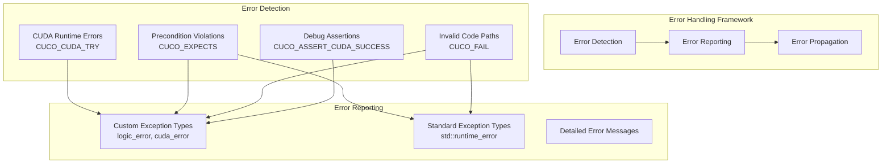
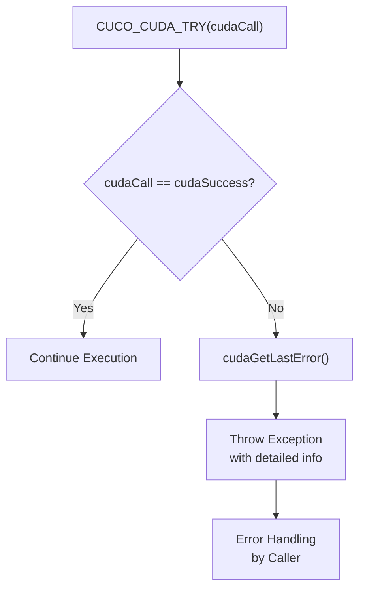
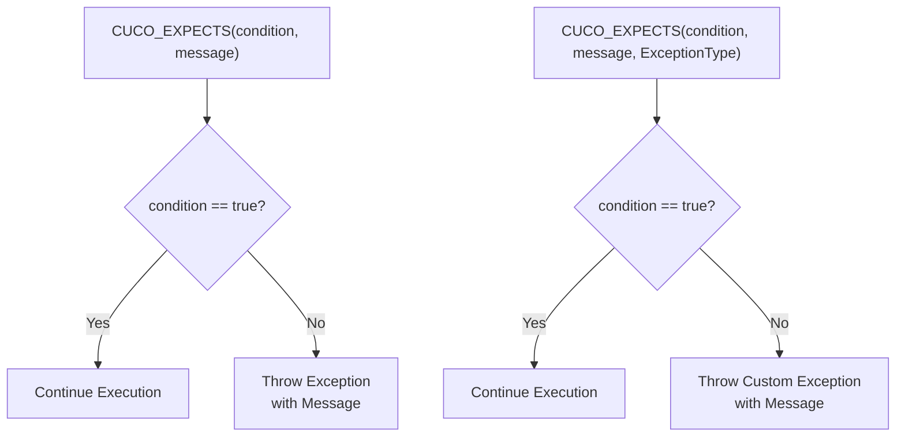
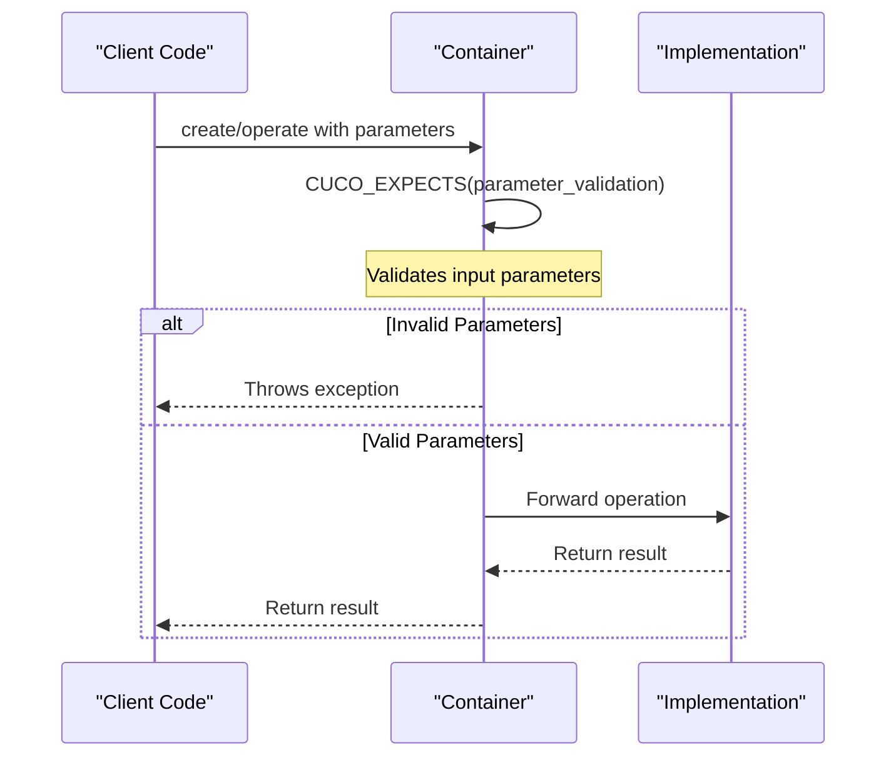

<!-- source: DeepWiki mcp.deepwiki.com · repo NVIDIA/cuCollections · page 12 Error Handling · fetched 2026-10-26 -->

# Error Handling

<details>
<summary>Relevant source files</summary>

The following files were used as context for generating this wiki page:

- [.clang-format](.clang-format)
- [include/cuco/detail/error.hpp](include/cuco/detail/error.hpp)
- [include/cuco/detail/open_addressing/functors.cuh](include/cuco/detail/open_addressing/functors.cuh)
- [include/cuco/detail/utility/strong_type.cuh](include/cuco/detail/utility/strong_type.cuh)
- [include/cuco/detail/utils.cuh](include/cuco/detail/utils.cuh)
- [include/cuco/utility/key_generator.cuh](include/cuco/utility/key_generator.cuh)

</details>


This document describes the error handling mechanisms provided by the cuCollections (cuco) library. It covers the error checking macros, exception types, and usage patterns for handling errors in both host and device code when working with GPU-accelerated data structures.

## Overview

cuCollections employs a consistent error handling strategy using a combination of:
1. Exception-based error handling for host code
2. Macro-based error checking for CUDA operations
3. Precondition validation for function arguments
4. Assertion mechanisms for internal state validation



Sources: [include/cuco/detail/error.hpp:16-142]()

## Exception Types

cuCollections defines custom exception types to differentiate between various error categories:

| Exception Type | Purpose | Used By |
|----------------|---------|---------|
| `cuco::cuda_error` | CUDA-specific errors (implicit in `CUCO_CUDA_TRY`) | `CUCO_CUDA_TRY` |
| `cuco::logic_error` | Logical errors and precondition violations | `CUCO_EXPECTS`, `CUCO_FAIL` |
| Standard exceptions | Can be specified explicitly | Any error macro with custom exception parameter |

Note: The actual exception type definitions are not shown in the provided files but are referenced in the macros.

Sources: [include/cuco/detail/error.hpp:45-63](), [include/cuco/detail/error.hpp:97-111]()

## Error Checking Macros

The library provides several macros for different error checking scenarios:

### CUDA Runtime Error Checking



The `CUCO_CUDA_TRY` macro is used to check for errors in CUDA runtime API calls. It has two forms:
- `CUCO_CUDA_TRY(cudaCall)` - Throws `cuco::cuda_error` on failure
- `CUCO_CUDA_TRY(cudaCall, ExceptionType)` - Throws custom exception type on failure

Example usage:
```cpp
// Throws cuco::cuda_error if allocation fails
CUCO_CUDA_TRY(cudaMalloc(&device_ptr, bytes_needed));

// Throws std::runtime_error if allocation fails
CUCO_CUDA_TRY(cudaMalloc(&device_ptr, bytes_needed), std::runtime_error);
```

Sources: [include/cuco/detail/error.hpp:26-60]()

### Precondition Checking



The `CUCO_EXPECTS` macro checks if a condition is met before proceeding:
- `CUCO_EXPECTS(condition, message)` - Throws `cuco::logic_error` if condition is false
- `CUCO_EXPECTS(condition, message, ExceptionType)` - Throws custom exception type

Example usage from the key generator implementation:
```cpp
CUCO_EXPECTS(multiplicity > 0, "Multiplicity must be greater than 0");
CUCO_EXPECTS(skew > 0, "Skew must be greater than 0");
CUCO_EXPECTS(max_sequence_length > 0, "Maximum sequence lengths cannot be 0");
```

Sources: [include/cuco/detail/error.hpp:73-111](), [include/cuco/utility/key_generator.cuh:64-67](), [include/cuco/utility/key_generator.cuh:76-80](), [include/cuco/utility/key_generator.cuh:459-462]()

### Error Path Handling

The `CUCO_FAIL` macro explicitly indicates an erroneous code path has been taken:
- `CUCO_FAIL(message)` - Throws `cuco::logic_error` with the given message
- `CUCO_FAIL(message, ExceptionType)` - Throws custom exception type

Example usage from the key generator implementation:
```cpp
// In the default case of a switch statement or unexpected condition
CUCO_FAIL("Unexpected distribution type");
```

Sources: [include/cuco/detail/error.hpp:113-142](), [include/cuco/utility/key_generator.cuh:307]()

### Debug Assertions

For debug builds or internal validation, the `CUCO_ASSERT_CUDA_SUCCESS` macro provides assertion-based error checking:
```cpp
CUCO_ASSERT_CUDA_SUCCESS(cudaDeviceSynchronize());
```

This macro uses assertions rather than exceptions, making it suitable for debug-only checks that shouldn't impact release builds.

Sources: [include/cuco/detail/error.hpp:62-71]()

## Error Handling in GPU Code

GPU code has different error handling patterns due to the constraints of CUDA device functions:

1. **Device Functions**: Cannot throw exceptions, so error conditions are typically reported through return values or status flags.

2. **Kernel Launches**: Errors are checked on the host side after kernel execution using `CUCO_CUDA_TRY`.

3. **Sanitization Functions**: Special functions like `sanitize_hash` handle potential error conditions by normalizing values instead of failing.

Example of error handling through sanitization:
```cpp
template <typename SizeType, typename HashType>
__host__ __device__ constexpr SizeType sanitize_hash(HashType hash) noexcept
{
  // Convert hash to positive size_type value safely
  if constexpr (cuda::std::is_signed_v<SizeType>) {
    return cuda::std::abs(static_cast<SizeType>(hash));
  } else {
    return static_cast<SizeType>(hash);
  }
}
```

Sources: [include/cuco/detail/utils.cuh:90-122](), [include/cuco/detail/utils.cuh:133-142]()

## Common Error Handling Patterns

### Handling Invalid Input Values

The library ensures input values are valid using `CUCO_EXPECTS`:



Example validation from the random byte sequence generator:
```cpp
CUCO_EXPECTS(max_sequence_length > 0, "Maximum sequence lengths cannot be 0");
CUCO_EXPECTS(min_sequence_length > 0, "Minimum sequence lengths cannot be 0");
CUCO_EXPECTS(min_sequence_length <= max_sequence_length,
           "Maximum sequence lengths cannot be smaller than minimum sequence length");
```

Sources: [include/cuco/utility/key_generator.cuh:459-462]()

### CUDA Error Propagation

When working with CUDA, errors are checked at multiple levels:
1. Direct CUDA API calls using `CUCO_CUDA_TRY`
2. Kernel execution results
3. Device memory operations

For example, when allocating device memory:
```cpp
// Allocate device memory with error checking
CUCO_CUDA_TRY(cudaMalloc(&d_keys, num_keys * sizeof(key_type)));

// Use the memory
kernel<<<blocks, threads>>>(d_keys, num_keys);

// Check for kernel launch errors
CUCO_CUDA_TRY(cudaGetLastError());

// Wait for completion and check for errors
CUCO_CUDA_TRY(cudaDeviceSynchronize());
```

Sources: [include/cuco/detail/error.hpp:26-60]()

## Best Practices

1. **Use Standard Macros**: Consistently use the provided error handling macros rather than custom error checking.

2. **Check Preconditions Early**: Validate inputs at function boundaries using `CUCO_EXPECTS`.

3. **Provide Clear Messages**: Include descriptive error messages that explain what went wrong and how to fix it.

4. **Consider Exception Safety**: Ensure resources are properly released when exceptions occur.

5. **Context Information**: Include contextual information in error messages to help with debugging.

6. **Appropriate Exception Types**: Use the most specific exception type for the error condition.

Sources: [include/cuco/detail/error.hpp:16-142](), [include/cuco/utility/key_generator.cuh:64-67](), [include/cuco/utility/key_generator.cuh:76-80](), [include/cuco/utility/key_generator.cuh:459-462]()

## Related Topics

For information about performance considerations when handling errors, see [Performance Considerations](#13).

For information about custom types and potential errors that may occur with them, see [Custom Types and Key-Value Pairs](#11).

---

