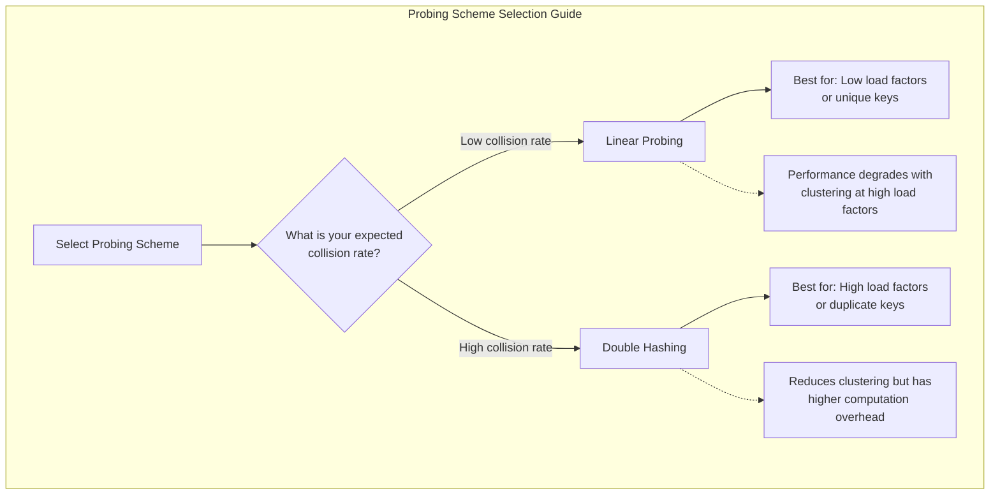
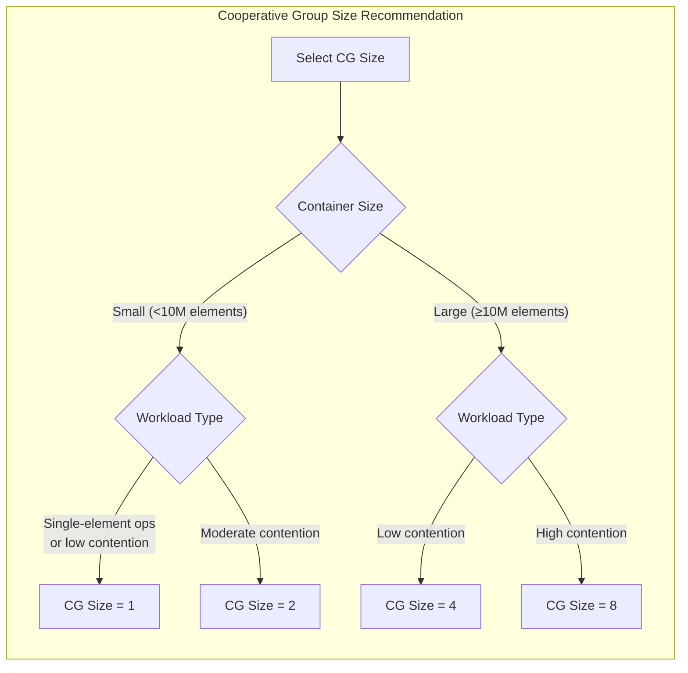
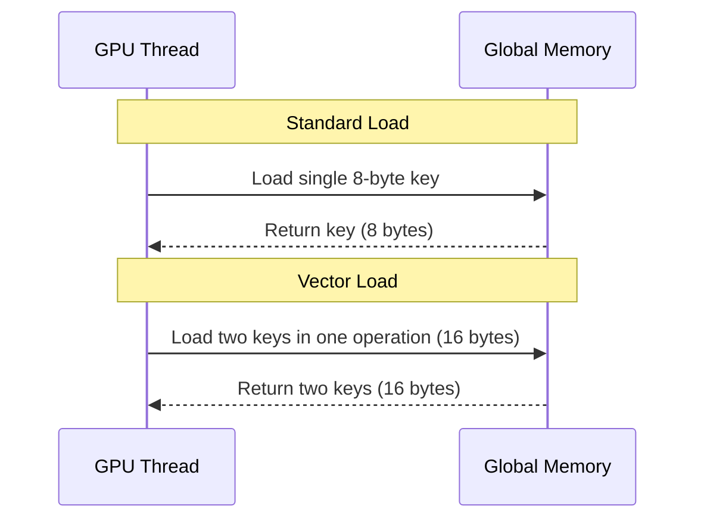
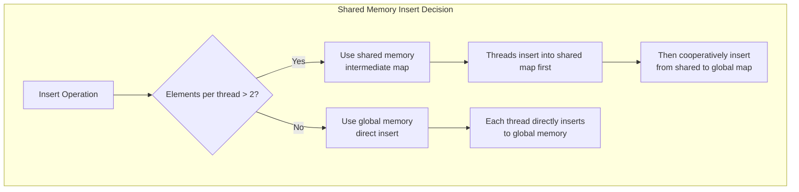
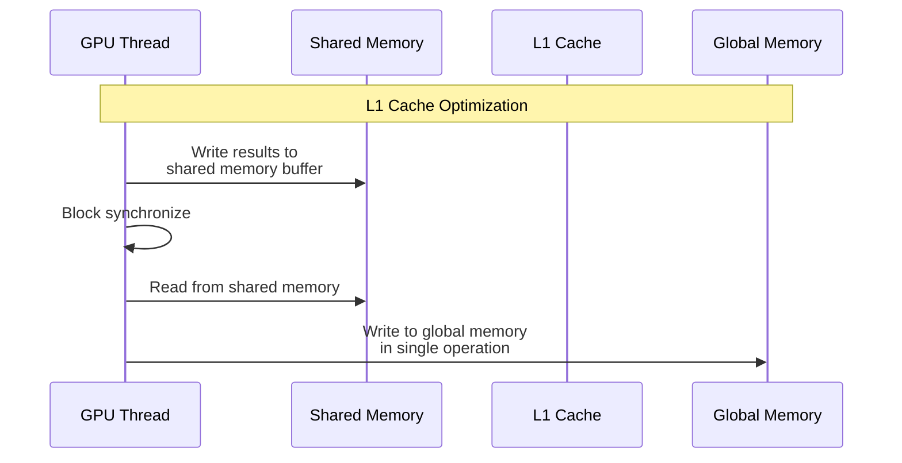
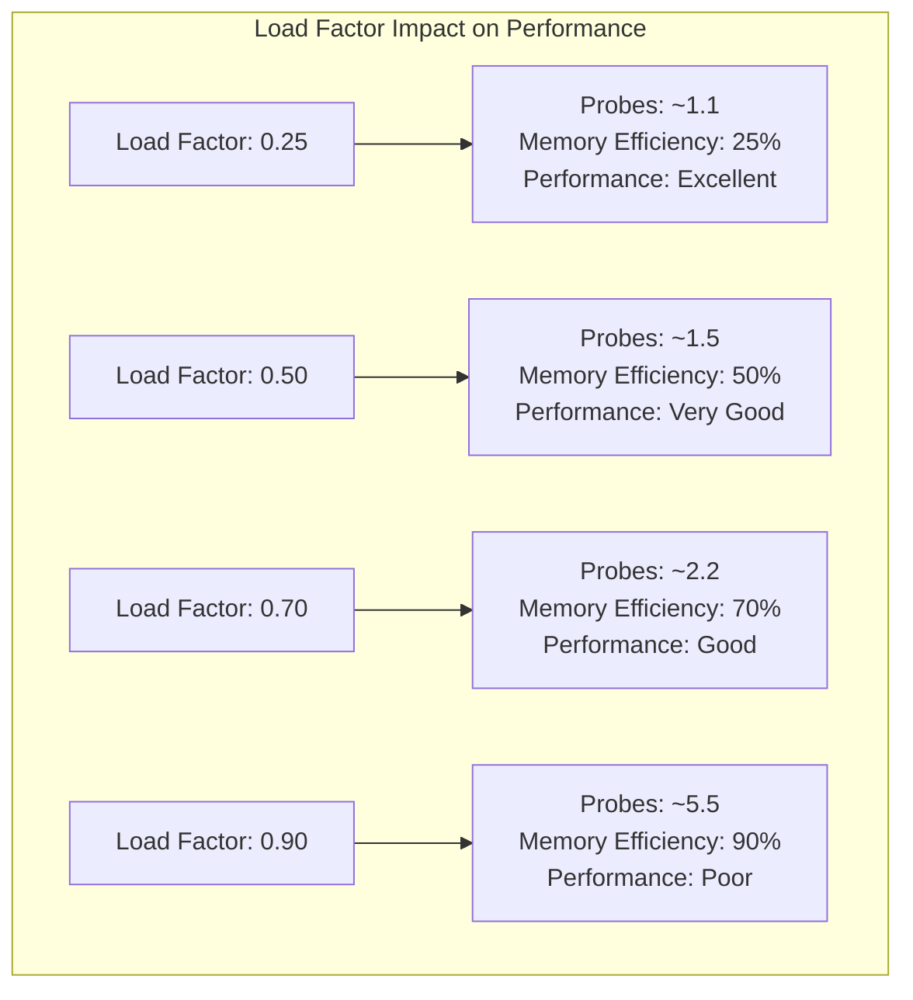
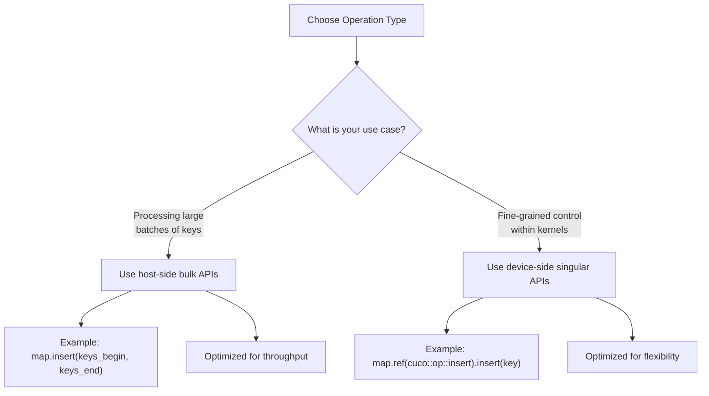
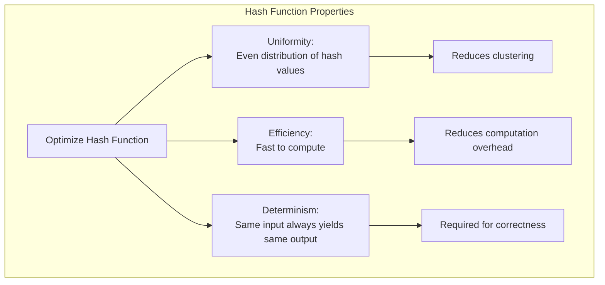

<!-- source: DeepWiki mcp.deepwiki.com · repo NVIDIA/cuCollections · page 13 Performance Considerations · fetched 2026-10-26 -->

# Performance Considerations

<details>
<summary>Relevant source files</summary>

The following files were used as context for generating this wiki page:

- [include/cuco/detail/open_addressing/kernels.cuh](include/cuco/detail/open_addressing/kernels.cuh)
- [include/cuco/detail/probe_sequence_impl.cuh](include/cuco/detail/probe_sequence_impl.cuh)
- [include/cuco/detail/static_map/helpers.cuh](include/cuco/detail/static_map/helpers.cuh)
- [include/cuco/detail/static_map/kernels.cuh](include/cuco/detail/static_map/kernels.cuh)
- [include/cuco/operator.hpp](include/cuco/operator.hpp)
- [include/cuco/probe_sequences.cuh](include/cuco/probe_sequences.cuh)
- [include/cuco/static_multimap.cuh](include/cuco/static_multimap.cuh)
- [tests/static_map/insert_or_apply_test.cu](tests/static_map/insert_or_apply_test.cu)

</details>


This page provides guidance on optimizing performance when using cuCollections data structures. It covers key factors that affect performance including probing schemes, cooperative group sizes, memory access patterns, and container sizing. For specific API details, see the container-specific pages like [Static Map](#2) and [Static Multimap](#4).

## Probing Scheme Selection

cuCollections containers use open addressing hash tables with different probing schemes that significantly impact performance. Choosing the right probing scheme depends on your specific workload characteristics.



### Linear Probing

Linear probing offers excellent performance when collisions are rare (low occupancy or when using containers with unique keys like `static_map` and `static_set`).

When a collision occurs, linear probing checks the next adjacent slot:
- **Pros**: Simple, efficient memory access pattern, good cache locality
- **Cons**: Performance degrades due to clustering at high load factors (>0.7)

```cpp
// Example of specifying linear probing with CG size of 1
using ProbeScheme = cuco::linear_probing<1, cuco::default_hash_function<Key>>;
```

### Double Hashing

Double hashing performs better when dealing with high multiplicity (like in `static_multimap`) and/or high occupancy scenarios:
- **Pros**: Reduces clustering, maintains performance at high load factors
- **Cons**: Higher computational overhead per probe

```cpp
// Example of specifying double hashing with CG size of 8
using ProbeScheme = cuco::double_hashing<8, cuco::default_hash_function<Key>>;
```

Double hashing is the default probing scheme for `static_multimap` because it handles duplicate keys more efficiently.

Sources: [include/cuco/probe_sequences.cuh:22-74](), [include/cuco/detail/probe_sequence_impl.cuh:160-432]()

## Cooperative Group Size Optimization

cuCollections uses CUDA Cooperative Groups for parallel operations. The CG size specifies how many threads cooperate to handle a single operation.



General recommendations:
- **CG Size = 1**: Best for small hash tables or when operations are mostly independent
- **CG Size = 2**: Good for small to medium tables with some contention
- **CG Size = 4 or 8**: Better for large tables or high-contention scenarios

Larger CG sizes:
- Improve throughput for high-contention operations
- More efficiently handle probing on large tables
- Reduce thread divergence in warp-based execution

Note that when using larger CG sizes, each thread in the group performs part of the probing sequence, which can improve performance by reducing the number of iterations needed to find an empty slot.

Sources: [include/cuco/probe_sequences.cuh:35-42](), [include/cuco/detail/probe_sequence_impl.cuh:35-49](), [include/cuco/static_multimap.cuh:96-98]()

## Memory Access Patterns and Optimizations

cuCollections implements several memory access optimizations to maximize throughput.

### Vector Loads

Hash map operations are generally memory-bandwidth bound. cuCollections uses vector loads to improve memory throughput when possible:



Vector loads automatically activate when:
- Key and value types have unique object representations
- The total size of the key-value pair is small enough (≤16 bytes)

This technique improves memory bandwidth utilization by loading two consecutive slots at once, fully utilizing the 16B memory load supported by CUDA hardware.

Sources: [include/cuco/detail/probe_sequence_impl.cuh:67-106]()

### Shared Memory Optimizations

For operations with high data locality, cuCollections uses shared memory to reduce global memory traffic:



The shared memory optimization particularly benefits `insert_or_apply` operations with high key locality:
1. Elements are first inserted into a small map in shared memory
2. Once shared memory map is processed, results are merged into the global map
3. This reduces contention and global memory transactions

The implementation automatically selects shared memory when each thread has more than 2 elements to process, as this indicates potential data locality that can benefit from the optimization.

Sources: [include/cuco/detail/static_map/helpers.cuh:43-114](), [include/cuco/detail/static_map/kernels.cuh:162-263]()

### L1 Cache Optimization

cuCollections employs specific techniques to prevent excessive L1 cache flushing:



This pattern is used in operations like `contains_if_n` and `find_if_n` to prevent the ld.relaxed.gpu instruction from causing excessive L1 flushes, which would result in increased sector stores from L2 to global memory.

Sources: [include/cuco/detail/open_addressing/kernels.cuh:278-288](), [include/cuco/detail/open_addressing/kernels.cuh:395-401]()

## Container Sizing and Load Factors

Properly sizing your containers and choosing appropriate load factors is critical for performance.



### Capacity Planning

When initializing containers, you can either:
1. Specify the exact capacity: `container{capacity, empty_key_sentinel, empty_value_sentinel}`
2. Specify element count and desired load factor: `container{n, desired_load_factor, empty_key_sentinel, empty_value_sentinel}`

The second approach makes it easier to balance performance and memory usage without manual calculations.

The actual capacity will be at least `ceil(n / desired_load_factor)` and may be adjusted to optimize for the probing scheme and bucket organization.

### Load Factor Recommendations

- **0.5 to 0.7**: Good balance between memory usage and performance for most applications
- **<0.5**: Better performance but less memory-efficient
- **>0.7**: Better memory efficiency but degraded performance, especially with linear probing
- **>0.9**: Not recommended due to significant performance degradation

For `static_multimap` with double hashing, higher load factors (up to 0.8) can be used without severe performance penalties.

Sources: [include/cuco/static_multimap.cuh:191-223]()

## Bulk vs. Fine-Grained Operations

cuCollections provides two types of operations:
- Host-side "bulk" operations for processing large batches of keys
- Device-side "singular" operations for fine-grained control



### Bulk Operations Performance Tips

1. **Batch Operations**: Process as many elements as possible in a single call
2. **Stream Management**: 
   - Use the asynchronous variants (`insert_async`, `find_async`) to overlap computation
   - Be aware that non-async variants synchronize the stream by default
3. **Memory Layout**: Ensure input data has good memory coalescing

### Fine-Grained Device Operations

When using device-side operations:

1. **Operator Selection**: Only include the operators you need when creating references:
   ```cpp
   auto ref = map.ref(cuco::op::insert, cuco::op::find);
   ```

2. **Thread Divergence**: Be aware that probing can cause thread divergence, especially with linear probing at high load factors

3. **CG Size Consideration**: Larger CG sizes can help reduce thread divergence but may not be optimal for all workloads

Sources: [include/cuco/static_multimap.cuh:50-66](), [include/cuco/operator.hpp:46-377]()

## Custom Types and Hash Functions

Performance with custom types depends significantly on the quality of hash functions and equality comparison operations.



### Recommendations for Custom Types

1. **Custom Hash Functions**: Provide high-quality hash functions to minimize collisions
2. **Bitwise Comparability**: Ensure your types are bitwise comparable or explicitly mark them as safe using `cuco::is_bitwise_comparable_v<T>`
3. **Size Constraints**: Key and value types should be ≤8 bytes each for optimal performance
4. **Key Equality Predicates**: Use efficient equality comparison functions

When multiple hash functions are needed (for double hashing), use different seeds to ensure they produce different sequences.

Sources: [include/cuco/static_multimap.cuh:100-107]()

## Conclusion

Performance optimization in cuCollections involves balancing multiple factors:

1. **Probing scheme selection** based on expected collision rates
2. **Cooperative Group sizing** based on data size and contention levels
3. **Load factor selection** to balance memory usage and lookup performance
4. **API selection** (bulk vs. singular) based on access patterns
5. **Hash function quality** to minimize collisions

By understanding these considerations, you can tune your data structures for optimal performance based on your specific workload characteristics.