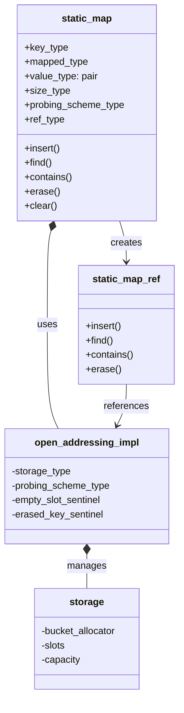
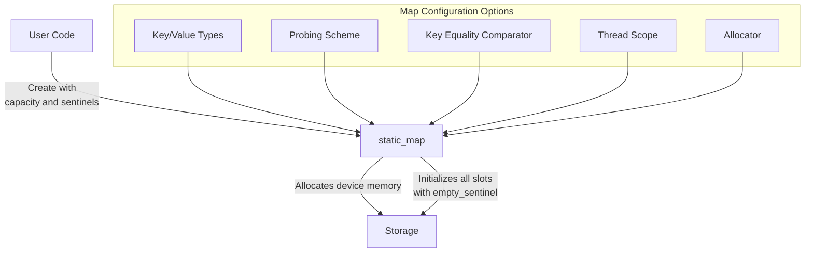
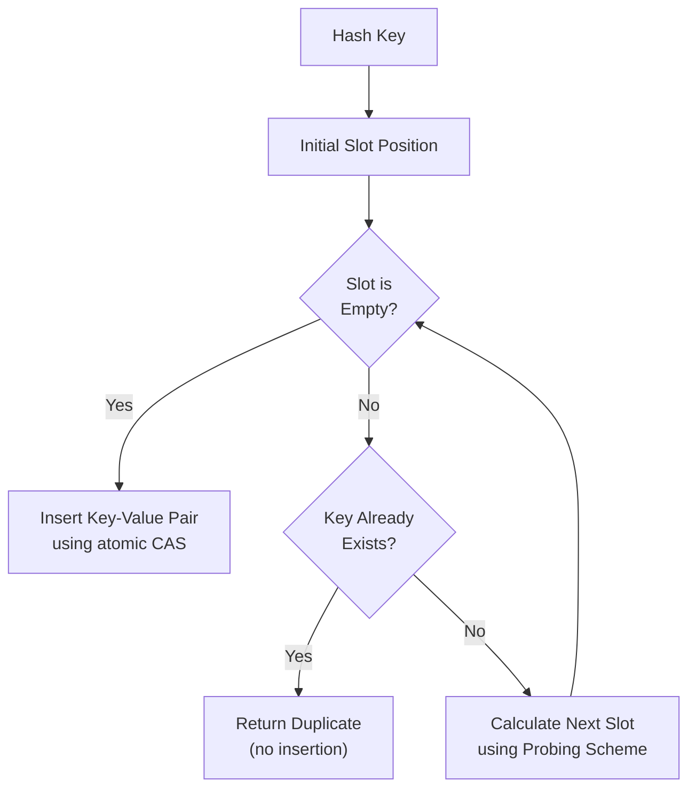
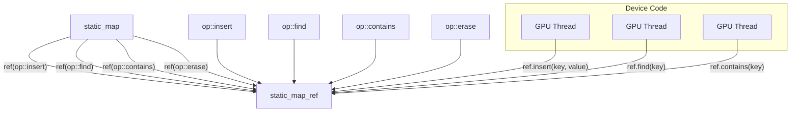
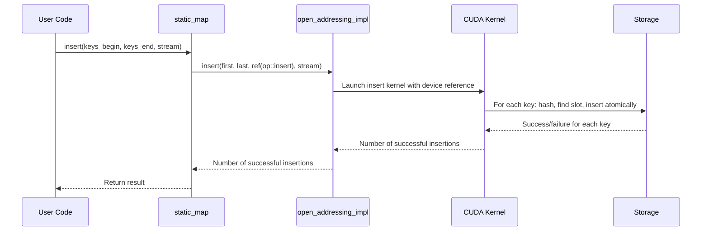
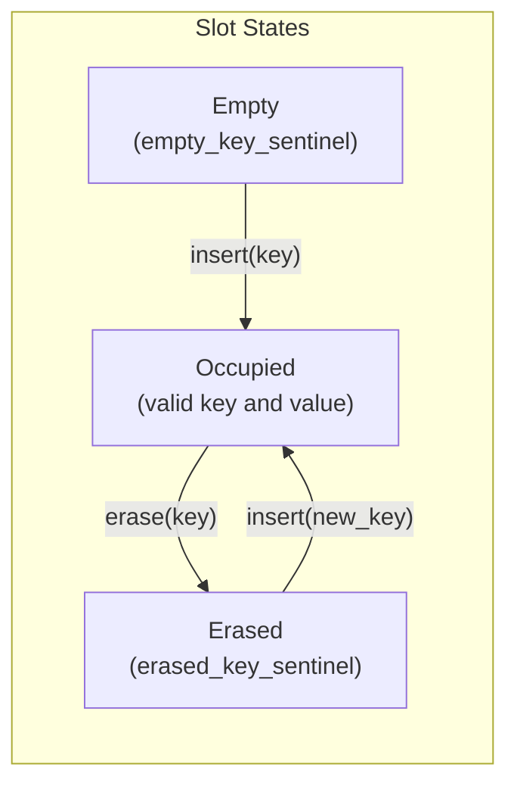

<!-- source: DeepWiki mcp.deepwiki.com · repo NVIDIA/cuCollections · page 2 Static Map · fetched 2026-10-26 -->

# Static Map

Relevant source files

The following files were used as context for generating this wiki page:

- [include/cuco/detail/open_addressing/open_addressing_impl.cuh](include/cuco/detail/open_addressing/open_addressing_impl.cuh)
- [include/cuco/detail/static_map.inl](include/cuco/detail/static_map.inl)
- [include/cuco/detail/static_map/static_map.inl](include/cuco/detail/static_map/static_map.inl)
- [include/cuco/detail/static_map_kernels.cuh](include/cuco/detail/static_map_kernels.cuh)
- [include/cuco/detail/static_set/static_set.inl](include/cuco/detail/static_set/static_set.inl)
- [include/cuco/static_map.cuh](include/cuco/static_map.cuh)
- [include/cuco/static_set.cuh](include/cuco/static_set.cuh)
- [tests/dynamic_map/unique_sequence_test.cu](tests/dynamic_map/unique_sequence_test.cu)
- [tests/static_map/custom_type_test.cu](tests/static_map/custom_type_test.cu)
- [tests/static_map/erase_test.cu](tests/static_map/erase_test.cu)
- [tests/static_map/key_sentinel_test.cu](tests/static_map/key_sentinel_test.cu)
- [tests/static_map/stream_test.cu](tests/static_map/stream_test.cu)

The `static_map` is a GPU-accelerated, unordered, associative container of key-value pairs with unique keys in the cuCollections library. It provides a fixed-capacity hash table implementation optimized for NVIDIA GPUs with concurrent operations. Unlike [Dynamic Map](#6), the `static_map` has a predetermined capacity and will not automatically grow when full.

## Key Features and Design

The `static_map` provides two distinct interfaces for interaction:

1. **Host-side bulk operations**: For efficiently processing large numbers of keys in a single operation
2. **Device-side singular operations**: For individual threads to perform independent operations from device code

The container supports constant-time lookup, insertion, and deletion operations, and is designed for concurrent access in a GPU-parallel environment.

Sources: [include/cuco/static_map.cuh:98-154](). [include/cuco/detail/open_addressing/open_addressing_impl.cuh:71-107]()

## Initialization and Configuration

The `static_map` is initialized with a specific capacity and sentinel values that mark empty and erased slots. The capacity remains fixed throughout the container's lifetime. When creating a `static_map`, you must specify:

1. **Capacity**: The fixed size of the container
2. **Empty key sentinel**: A reserved key value that indicates an empty slot
3. **Empty value sentinel**: A reserved value for empty slots
4. **Optional erased key sentinel**: A reserved key value for erased slots (if not provided, uses empty key)

Sources: [include/cuco/static_map.cuh:179-231](). [include/cuco/detail/static_map/static_map.inl:41-118]()

## Hash Table Mechanics

The `static_map` uses open addressing with a configurable probing scheme (linear probing by default) to handle hash collisions. When a key is inserted:

1. The key is hashed to determine its initial slot position
2. If the slot is empty, the key-value pair is inserted
3. If the slot is occupied, the probing scheme determines the next slot to check
4. This continues until an empty slot is found or the key is found to already exist

For concurrent operations, `static_map` uses CUDA atomic operations to ensure thread safety when multiple threads try to modify the same slot simultaneously.

Sources: [include/cuco/detail/static_map.inl:386-430](). [include/cuco/detail/static_map_kernels.cuh:82-108]()

## Host Interface

The host interface provides bulk operations for processing large numbers of keys efficiently, including:

| Operation | Description | Synchronous | Asynchronous |
|-----------|-------------|-------------|--------------|
| `insert` | Inserts all key-value pairs in a range | ✓ | ✓ |
| `insert_if` | Inserts pairs based on a predicate | ✓ | ✓ |
| `insert_or_assign` | Inserts or updates existing values | ✓ | ✓ |
| `insert_or_apply` | Inserts or applies a binary operation | ✓ | ✓ |
| `find` | Retrieves values for keys in a range | ✓ | ✓ |
| `contains` | Checks if keys in a range are present | ✓ | ✓ |
| `erase` | Removes keys from the map | ✓ | ✓ |
| `clear` | Removes all entries from the map | ✓ | ✓ |

Each operation has both synchronous and asynchronous variants. The synchronous versions (e.g., `insert`) block until the operation completes, while the asynchronous versions (e.g., `insert_async`) return immediately without blocking.

Sources: [include/cuco/static_map.cuh:302-408](). [include/cuco/detail/static_map/static_map.inl:148-178]()

## Device Interface via References

Device-side operations are accessed through non-owning, trivially copyable reference types that allow individual threads to perform independent operations from device code. These references are created using the `ref()` method with operator tags:

The reference types support:
- Fine-grained operations from individual threads
- Concurrent modification and lookup (when appropriate operators are specified)
- Using cooperative groups for improved performance

Sources: [include/cuco/static_map.cuh:134-141](). [include/cuco/detail/static_map/static_map.inl:129-147]()

## Operation Flow Example

The following sequence diagram shows the flow for a bulk insertion operation:

Sources: [include/cuco/static_map.cuh:302-316](). [include/cuco/detail/static_map_kernels.cuh:136-167]()

## Threading Model and Concurrency

The `static_map` supports concurrent operations through:

1. **Atomic operations**: Using CUDA atomics for thread-safe slot updates
2. **Cooperative Groups**: Optional usage of CUDA Cooperative Groups for collaborative operations
3. **Custom thread scope**: Configurable scope for atomic operations (`cuda::thread_scope_device` by default)

Different probing schemes use different threading models:
- Scalar operations: One thread per operation
- Cooperative Group operations: Multiple threads collaborate on a single operation

The CG size is configured as part of the probing scheme template parameter.

Sources: [include/cuco/static_map.cuh:89-97](). [include/cuco/detail/static_map_kernels.cuh:525-582]()

## Erasing Elements

Unlike insertion which simply marks slots as occupied, erasure involves specifically marking slots as erased to maintain correct probing sequences:

1. When a key is erased, its slot is marked with the erased key sentinel
2. During probing, erased slots are skipped (similar to empty slots)
3. During insertion, erased slots can be reused for new keys
4. This approach preserves the probing sequence integrity

Sources: [include/cuco/static_map.cuh:601-627](). [include/cuco/detail/static_map.inl:586-632]()

## Performance Considerations

The performance of `static_map` is influenced by several factors:

1. **Load factor**: The ratio of elements to capacity affects performance; lower load factors generally provide better performance but use more memory
2. **Probing scheme**: Different probing schemes may perform better for different workloads
3. **CG size**: The number of threads collaborating on operations can improve performance for high load factors
4. **Bucket size**: The number of slots processed together affects memory access patterns

When the map is nearly full, lookups and insertions may become more expensive due to longer probe sequences.

Sources: [include/cuco/static_map.cuh:222-231](). [include/cuco/detail/static_map_kernels.cuh:432-472]()

## Usage Pattern Example

Here's a typical usage pattern for bulk operations with the `static_map`:

1. Create a `static_map` with appropriate capacity and sentinel values
2. Prepare device-accessible input data (keys/values)
3. Call bulk operations on ranges of keys
4. Retrieve results from device memory

For device-side operations:
1. Create a reference from the map using appropriate operator tags
2. Pass the reference to device code
3. In device code, individual threads can perform operations using the reference

Sources: [tests/static_map/erase_test.cu:31-80](). [tests/static_map/stream_test.cu:32-94]()

## Custom Types Support

The `static_map` supports custom types for both keys and values, provided they:

1. Have unique object representations (or explicitly specify `bitwise_comparable_v<T>`)
2. Don't exceed 8 bytes for key types and 8 bytes for mapped types
3. Provide appropriate comparison and hash functions

When using custom types, you need to provide appropriate equality operators and hash functions.

Sources: [tests/static_map/custom_type_test.cu:32-65](). [tests/static_map/custom_type_test.cu:100-261]()

---

