<!-- source: DeepWiki mcp.deepwiki.com · repo NVIDIA/cuCollections · page 2.1 Static Map Host Interface · fetched 2026-10-26 -->

# Static Map Host Interface

<details>
<summary>Relevant source files</summary>

The following files were used as context for generating this wiki page:

- [include/cuco/detail/static_map.inl](include/cuco/detail/static_map.inl)
- [include/cuco/detail/static_map_kernels.cuh](include/cuco/detail/static_map_kernels.cuh)
- [include/cuco/static_map.cuh](include/cuco/static_map.cuh)
- [tests/static_map/capacity_test.cu](tests/static_map/capacity_test.cu)
- [tests/static_map/duplicate_keys_test.cu](tests/static_map/duplicate_keys_test.cu)
- [tests/static_map/erase_test.cu](tests/static_map/erase_test.cu)
- [tests/static_map/find_test.cu](tests/static_map/find_test.cu)
- [tests/static_map/heterogeneous_lookup_test.cu](tests/static_map/heterogeneous_lookup_test.cu)
- [tests/static_map/insert_and_find_test.cu](tests/static_map/insert_and_find_test.cu)
- [tests/static_map/insert_or_assign_test.cu](tests/static_map/insert_or_assign_test.cu)
- [tests/static_multimap/heterogeneous_lookup_test.cu](tests/static_multimap/heterogeneous_lookup_test.cu)
- [tests/static_set/capacity_test.cu](tests/static_set/capacity_test.cu)
- [tests/static_set/heterogeneous_lookup_test.cu](tests/static_set/heterogeneous_lookup_test.cu)
- [tests/static_set/insert_and_find_test.cu](tests/static_set/insert_and_find_test.cu)
- [tests/static_set/large_input_test.cu](tests/static_set/large_input_test.cu)
- [tests/static_set/retrieve_all_test.cu](tests/static_set/retrieve_all_test.cu)
- [tests/static_set/retrieve_test.cu](tests/static_set/retrieve_test.cu)
- [tests/static_set/unique_sequence_test.cu](tests/static_set/unique_sequence_test.cu)

</details>


This page documents the host-side interface of `static_map`, focusing on operations that are called from CPU (host) code to manage and interact with the GPU data structure. For information about device-side access to the `static_map`, see [Static Map Device View](#2.2).

The host interface enables "bulk" operations where large numbers of elements can be manipulated in parallel using high-level functions, rather than writing custom CUDA kernels.

## Host Interface Overview

The `static_map` host interface provides methods that launch GPU kernels to perform parallel operations on the data structure. These operations include construction, insertion, lookup, deletion, and other data manipulations.

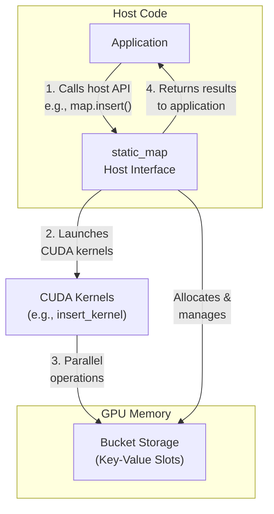

Sources: [include/cuco/static_map.cuh:45-70](include/cuco/static_map.cuh:45-70)

## Constructing a Static Map

The static_map provides several constructors with different parameter options to create a map with the desired characteristics.

### Capacity-Based Construction

```mermaid
classDiagram
    class "static_map constructor" {
        +static_map(capacity, empty_key_sentinel, empty_value_sentinel, ...)
        +static_map(capacity, empty_key_sentinel, empty_value_sentinel, erased_key_sentinel, ...)
    }

    class "Parameters" {
        +Extent capacity: Requested minimum size
        +empty_key<Key>: Reserved value for empty slots
        +empty_value<T>: Reserved value for empty slots
        +erased_key<Key>: Reserved value for erased slots (optional)
        +KeyEqual: Key comparison predicate (optional)
        +ProbingScheme: Collision resolution strategy (optional)
        +cuda_thread_scope: Thread scope (optional)
        +Storage: Storage type (optional)
        +Allocator: Memory allocator (optional)
        +cuda::stream_ref: CUDA stream (optional)
    }

    "static_map constructor" -- "Parameters"
```

The map can be constructed with a specified capacity, which determines the number of slots to allocate. Since `static_map` has a fixed size, it's important to allocate enough space for all expected elements.

```cpp
// Basic constructor example with minimum required parameters
cuco::static_map<int32_t, int64_t> map{
    1000000,                      // Capacity
    cuco::empty_key<int32_t>{-1}, // Value used to represent empty keys
    cuco::empty_value<int64_t>{-1} // Value used for empty values
};
```

Sources: [include/cuco/static_map.cuh:178-187](include/cuco/static_map.cuh:178-187), [include/cuco/static_map.cuh:258-267](include/cuco/static_map.cuh:258-267)

### Load Factor-Based Construction

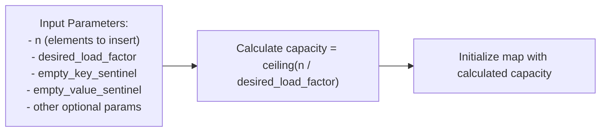

You can also construct a map by specifying the number of elements to insert and a desired load factor:

```cpp
// Load factor-based constructor
cuco::static_map<int32_t, int64_t> map{
    1000000,                      // Number of elements to insert
    0.7,                          // Desired load factor
    cuco::empty_key<int32_t>{-1}, // Value used to represent empty keys
    cuco::empty_value<int64_t>{-1} // Value used for empty values
};
```

The load factor affects the performance of hash table operations. A lower load factor typically provides better performance at the cost of higher memory usage.

Sources: [include/cuco/static_map.cuh:222-231](include/cuco/static_map.cuh:222-231)

## Basic Operations

### Size and Capacity

- `size()`: Returns the number of elements in the map
- `capacity()`: Returns the total number of slots available in the map
- `empty()`: Returns true if the map contains no elements

### Clearing the Map

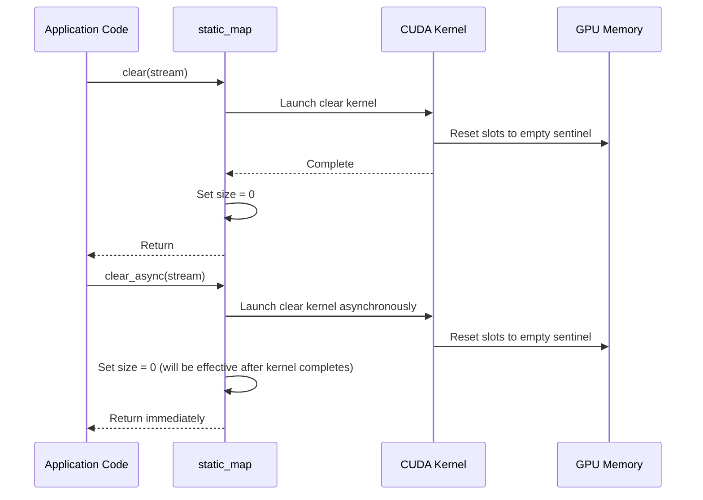

The map provides two methods for clearing all entries:

- `clear(stream)`: Synchronously removes all elements, waiting for completion before returning
- `clear_async(stream)`: Asynchronously removes all elements, returning immediately

```cpp
// Synchronous clear
map.clear();

// Asynchronous clear with specified stream
cudaStream_t stream;
cudaStreamCreate(&stream);
map.clear_async(stream);
```

Sources: [include/cuco/static_map.cuh:274-283](include/cuco/static_map.cuh:274-283)

## Bulk Insertion Operations

### Basic Insertion

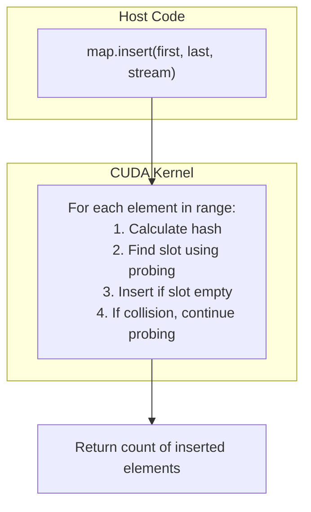

The basic insertion operation takes iterators to a range of key-value pairs:

```cpp
// Create device vectors for keys and values
thrust::device_vector<int> d_keys(1000);
thrust::device_vector<int> d_values(1000);

// Create pairs iterator
auto pairs_begin = thrust::make_transform_iterator(
    thrust::counting_iterator<int>(0),
    [] __device__(int i) { return cuco::pair<int, int>(i, i*2); }
);

// Insert pairs into the map
auto inserted_count = map.insert(pairs_begin, pairs_begin + 1000);
```

Sources: [include/cuco/static_map.cuh:302-304](include/cuco/static_map.cuh:302-304), [include/cuco/detail/static_map_kernels.cuh:82-108](include/cuco/detail/static_map_kernels.cuh:82-108)

### Conditional Insertion

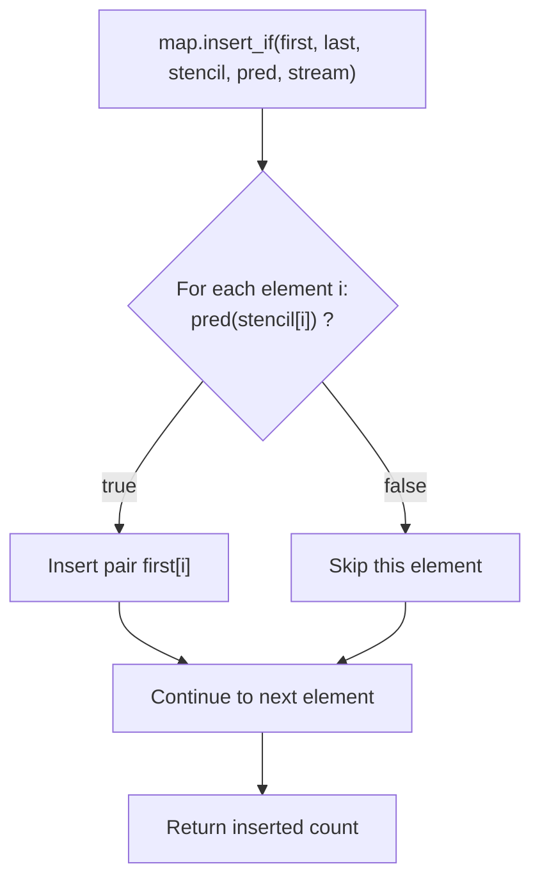

Conditional insertion allows inserting elements only if they satisfy a predicate:

```cpp
// Create a predicate that inserts only even-indexed elements
auto stencil = thrust::counting_iterator<int>(0);
auto pred = [] __device__(int idx) { return idx % 2 == 0; };

// Insert only elements that satisfy the predicate
auto inserted_count = map.insert_if(
    pairs_begin, pairs_begin + 1000, 
    stencil, pred
);
```

Sources: [include/cuco/static_map.cuh:343-345](include/cuco/static_map.cuh:343-345), [include/cuco/detail/static_map_kernels.cuh:305-347](include/cuco/detail/static_map_kernels.cuh:305-347)

### Insert and Find

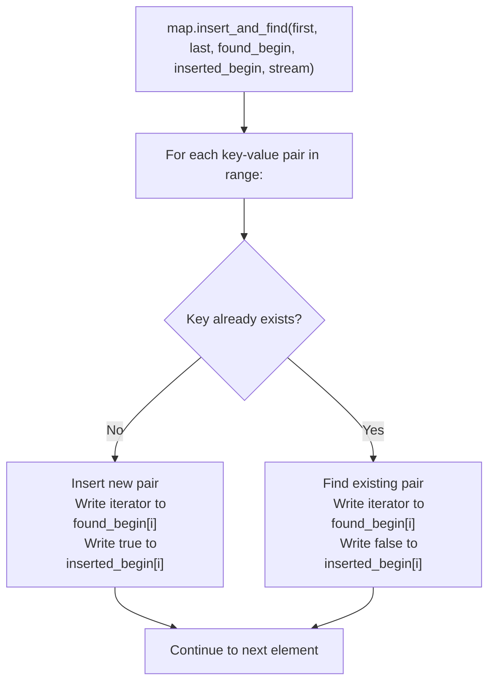

Insert and find combines insertion with returning information about whether each element was inserted:

```cpp
// Create output vectors for results
thrust::device_vector<int> d_found(1000);
thrust::device_vector<bool> d_inserted(1000);

// Insert elements and get information about each insertion
map.insert_and_find(
    pairs_begin, pairs_begin + 1000,
    d_found.begin(), d_inserted.begin()
);
```

Sources: [include/cuco/static_map.cuh:395-400](include/cuco/static_map.cuh:395-400), [include/cuco/static_map.cuh:423-428](include/cuco/static_map.cuh:423-428)

## Bulk Query Operations

### Contains

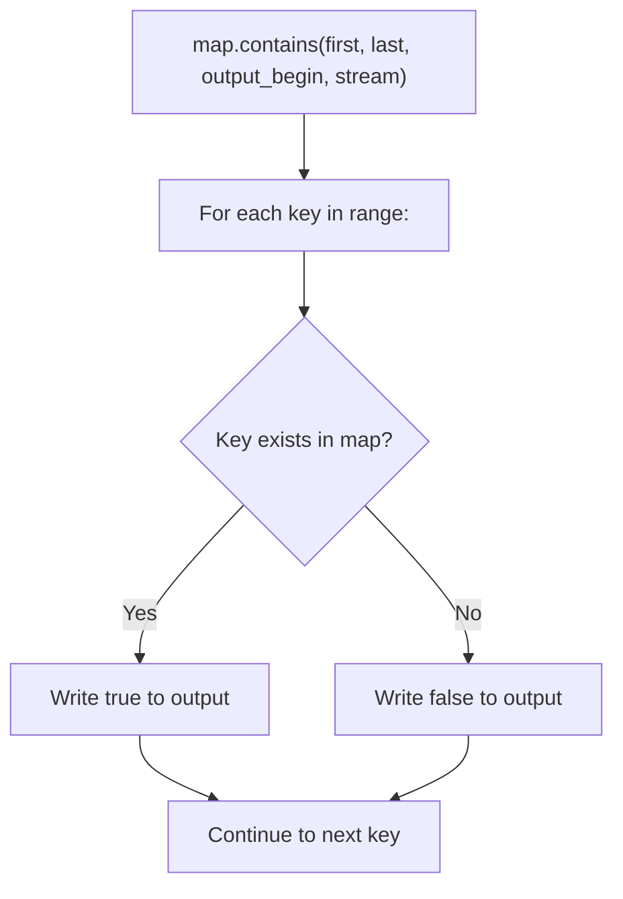

The contains operation checks whether keys exist in the map:

```cpp
// Create device vector for keys
thrust::device_vector<int> d_keys(1000);
thrust::sequence(d_keys.begin(), d_keys.end());

// Create output vector for results
thrust::device_vector<bool> d_contained(1000);

// Check if keys are in the map
map.contains(d_keys.begin(), d_keys.end(), d_contained.begin());
```

Sources: [include/cuco/static_map.cuh:643-647](include/cuco/static_map.cuh:643-647), [include/cuco/detail/static_map_kernels.cuh:495-523](include/cuco/detail/static_map_kernels.cuh:495-523)

### Find

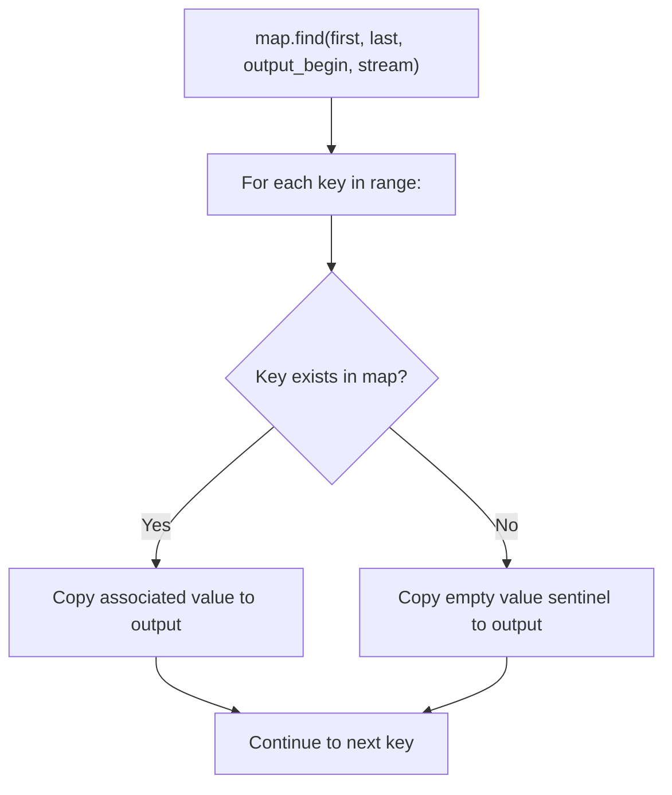

The find operation retrieves values associated with keys:

```cpp
// Create device vector for keys
thrust::device_vector<int> d_keys(1000);
thrust::sequence(d_keys.begin(), d_keys.end());

// Create output vector for values
thrust::device_vector<int> d_values(1000);

// Find values for keys
map.find(d_keys.begin(), d_keys.end(), d_values.begin());
```

Sources: [include/cuco/static_map.cuh:747-748](include/cuco/static_map.cuh:747-748), [include/cuco/detail/static_map_kernels.cuh:371-403](include/cuco/detail/static_map_kernels.cuh:371-403)

### Retrieve All

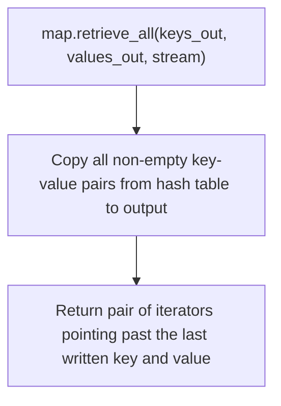

The retrieve_all operation extracts all key-value pairs from the map:

```cpp
// Create output vectors for all keys and values
thrust::device_vector<int> d_keys(map.size());
thrust::device_vector<int> d_values(map.size());

// Retrieve all key-value pairs
auto [keys_end, values_end] = map.retrieve_all(d_keys.begin(), d_values.begin());

// Number of elements retrieved
size_t num_elements = thrust::distance(d_keys.begin(), keys_end);
```

Sources: [include/cuco/detail/static_map.inl:212-262](include/cuco/detail/static_map.inl:212-262)

## Bulk Modification Operations

### Insert or Assign

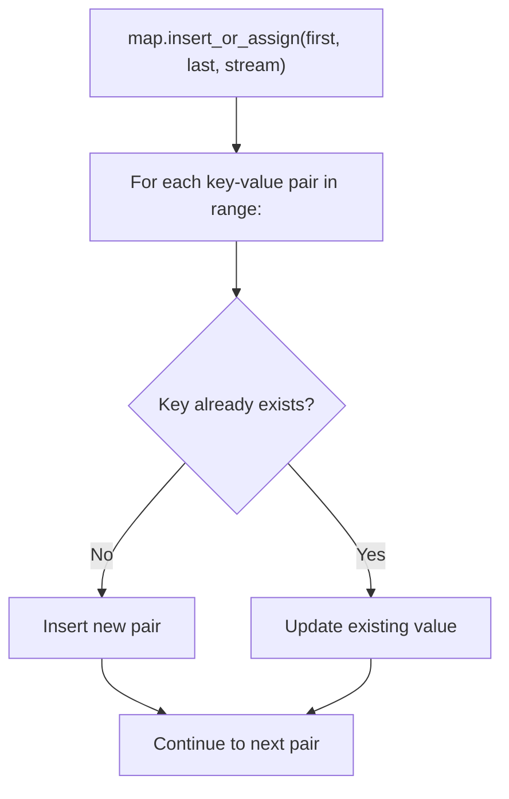

Insert or assign either inserts a new key-value pair or updates the value if the key already exists:

```cpp
// Create pairs iterator with updated values
auto updated_pairs_begin = thrust::make_transform_iterator(
    thrust::counting_iterator<int>(0),
    [] __device__(int i) { return cuco::pair<int, int>(i, i*3); }
);

// Insert new pairs or update existing values
map.insert_or_assign(updated_pairs_begin, updated_pairs_begin + 1000);
```

Sources: [include/cuco/static_map.cuh:448-449](include/cuco/static_map.cuh:448-449), [include/cuco/static_map.cuh:467-468](include/cuco/static_map.cuh:467-468)

### Insert or Apply

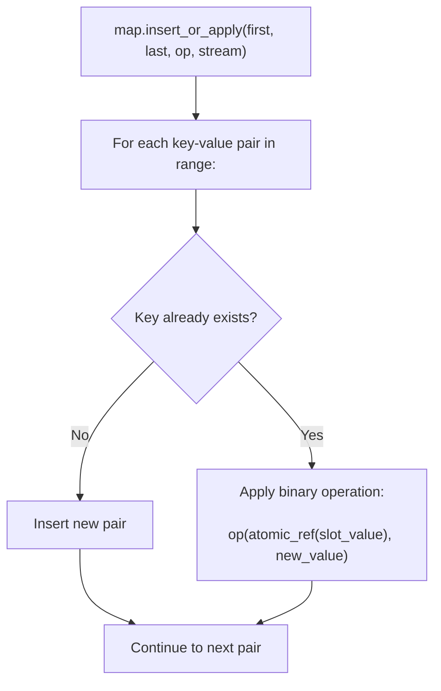

Insert or apply either inserts a new key-value pair or applies a binary operation to combine the existing value with the new value:

```cpp
// Define a binary operation that adds the new value to the existing value
auto add_op = [] __device__(cuda::atomic_ref<int, cuda::thread_scope_device> existing, int new_val) {
    existing.fetch_add(new_val);
};

// Insert new pairs or apply the operation to existing pairs
map.insert_or_apply(pairs_begin, pairs_begin + 1000, add_op);
```

An overload is also provided that takes an initial value:

```cpp
// Define operation with initial value
int init_val = 0;
map.insert_or_apply(pairs_begin, pairs_begin + 1000, init_val, add_op);
```

Sources: [include/cuco/static_map.cuh:491-492](include/cuco/static_map.cuh:491-492), [include/cuco/static_map.cuh:519-520](include/cuco/static_map.cuh:519-520)

## Bulk Erase Operations

### Erase

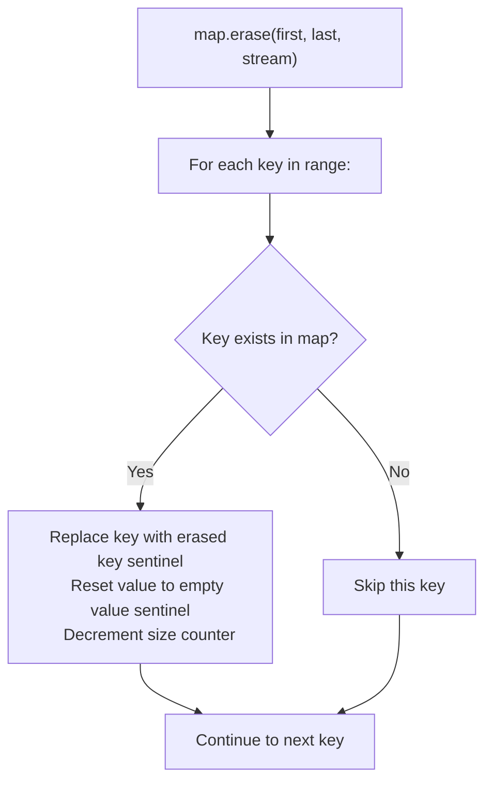

The erase operation removes keys from the map:

```cpp
// Create device vector for keys to erase
thrust::device_vector<int> d_keys_to_erase(500);
thrust::sequence(d_keys_to_erase.begin(), d_keys_to_erase.end());

// Erase keys from the map
map.erase(d_keys_to_erase.begin(), d_keys_to_erase.end());
```

Note that erase requires that an erased key sentinel value was provided during map construction.

Sources: [include/cuco/static_map.cuh:602](include/cuco/static_map.cuh:602), [include/cuco/detail/static_map_kernels.cuh:197-218](include/cuco/detail/static_map_kernels.cuh:197-218)

## Asynchronous Operations

Many operations in the static_map interface have both synchronous and asynchronous versions. The synchronous versions (e.g., `insert`, `find`, `contains`) wait for the operation to complete before returning. The asynchronous versions (e.g., `insert_async`, `find_async`, `contains_async`) return immediately, allowing the host to perform other work while the operation runs on the GPU.

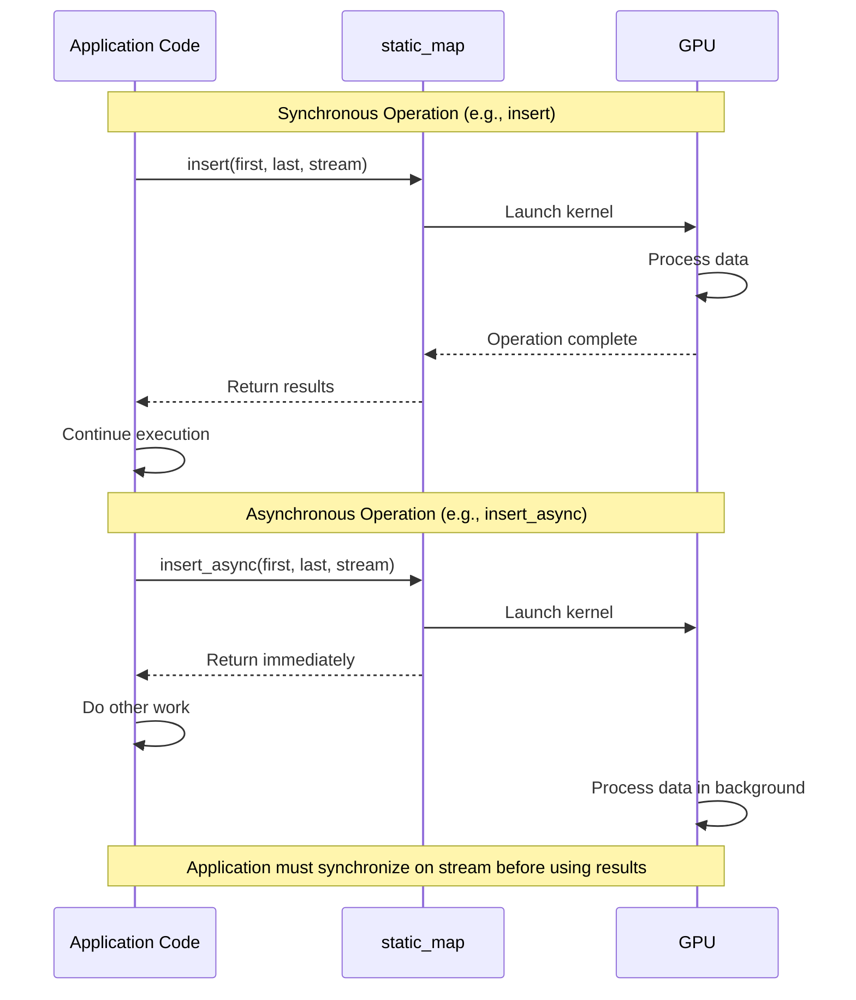

All operations accept an optional CUDA stream parameter. If not provided, the default stream is used.

```cpp
// Create a custom CUDA stream
cudaStream_t stream;
cudaStreamCreate(&stream);

// Asynchronously insert elements
map.insert_async(pairs_begin, pairs_begin + 1000, stream);

// Do other work while insert is running...

// Synchronize when results are needed
cudaStreamSynchronize(stream);
```

Sources: [include/cuco/static_map.cuh:316-317](include/cuco/static_map.cuh:316-317), [include/cuco/static_map.cuh:367-372](include/cuco/static_map.cuh:367-372)

## Typical Workflow Examples

Below is a common workflow pattern for using the static_map host interface:

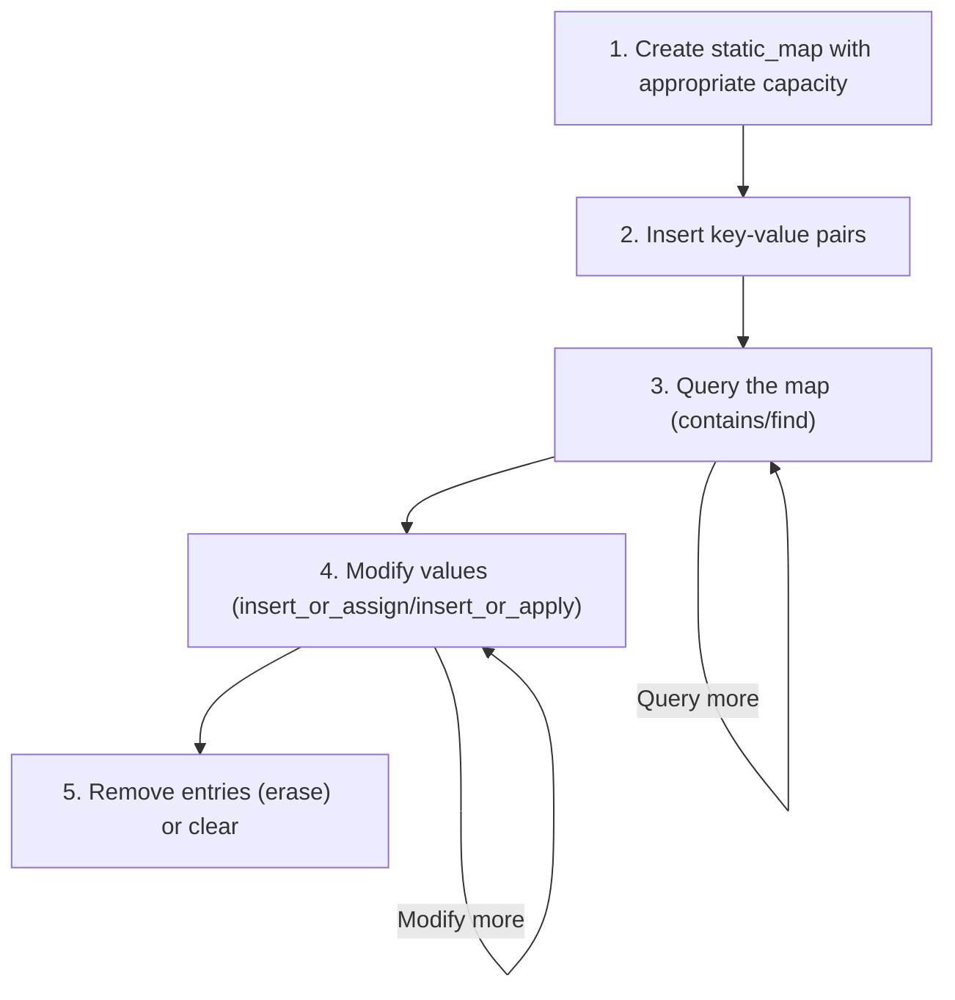

### Performance Considerations

- **Capacity Planning**: Since `static_map` has a fixed size, allocate enough capacity to accommodate all expected elements plus some buffer for good performance.
  
- **Load Factor**: Higher load factors (ratio of elements to capacity) can reduce memory usage but may increase collision rate and decrease performance.
  
- **Sentinel Values**: Choose sentinel values that won't appear in your actual data.
  
- **Asynchronous Operations**: Use asynchronous operations when possible to overlap computation with other work.
  
- **Stream Management**: Use custom streams for better control over operation scheduling and overlap.

Sources: [include/cuco/static_map.cuh:45-70](include/cuco/static_map.cuh:45-70)

## Summary

The static_map host interface provides a comprehensive set of operations for managing a GPU hash map from host code. These operations include construction, insertion, querying, modification, and deletion, with both synchronous and asynchronous variants. The interface is designed to efficiently handle bulk operations on large datasets, leveraging the parallel processing capabilities of GPUs.

---

