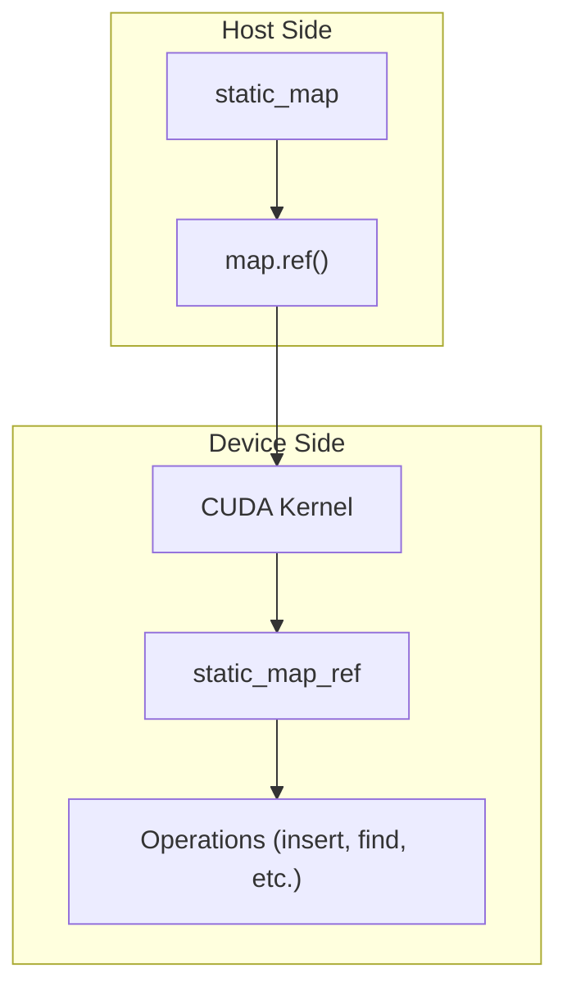
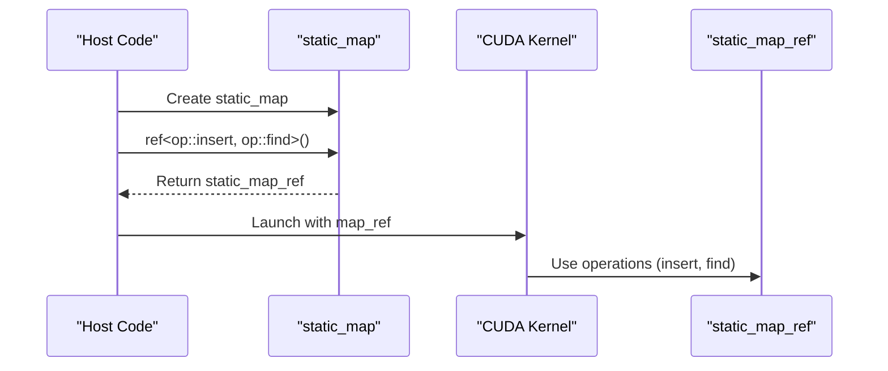
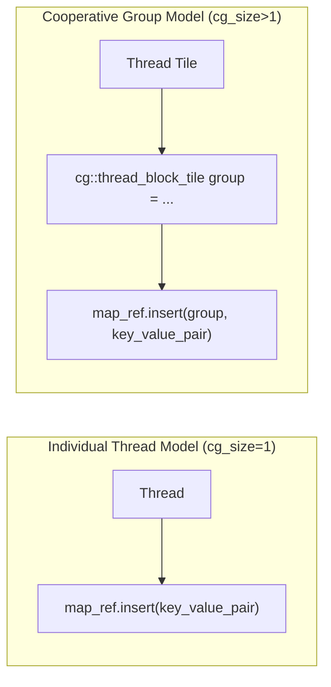
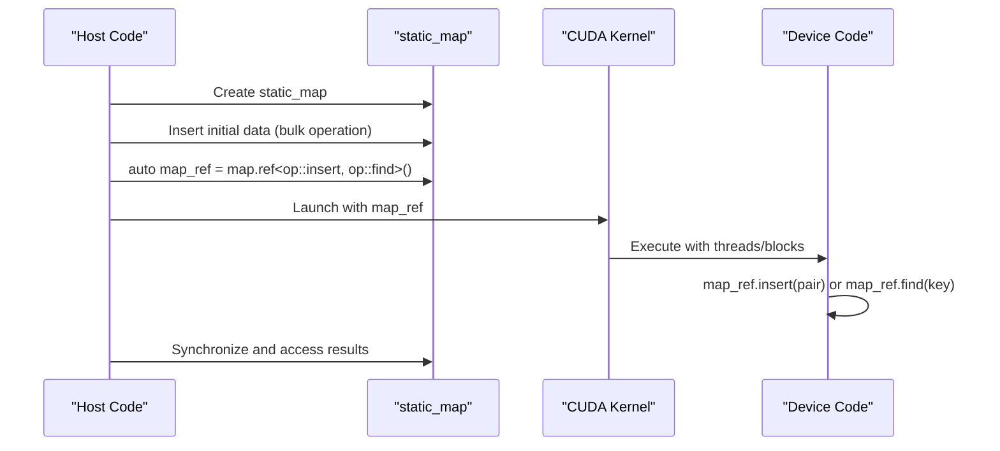
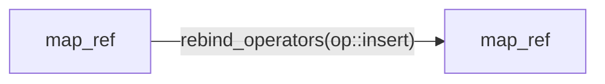
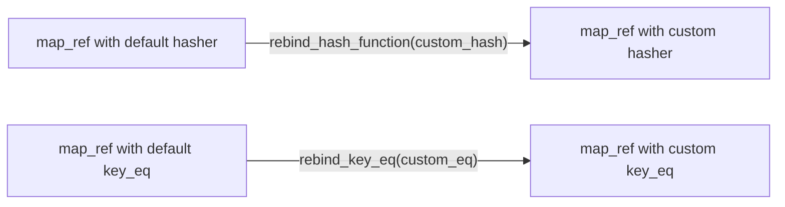
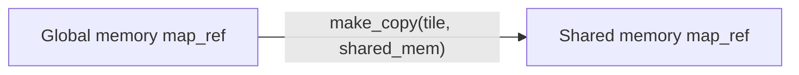
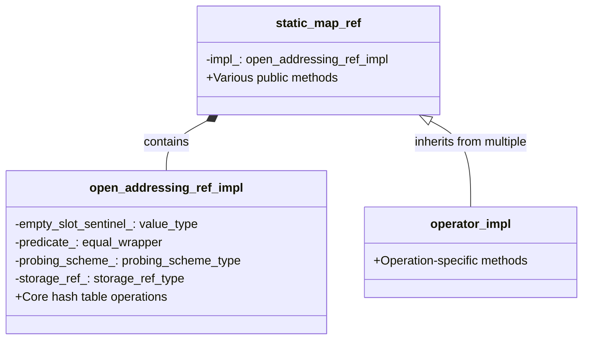
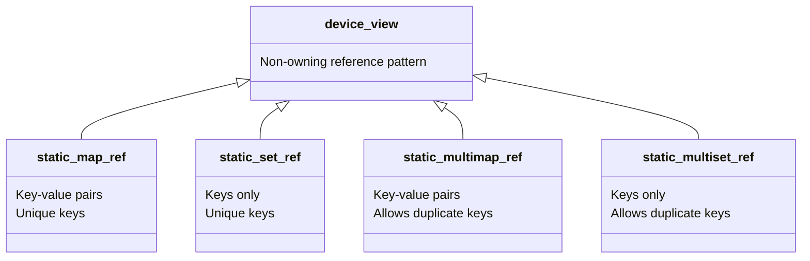

<!-- source: DeepWiki mcp.deepwiki.com · repo NVIDIA/cuCollections · page 2.2 Static Map Device View · fetched 2026-10-26 -->

# Static Map Device View

<details>
<summary>Relevant source files</summary>

The following files were used as context for generating this wiki page:

- [include/cuco/detail/open_addressing/open_addressing_ref_impl.cuh](include/cuco/detail/open_addressing/open_addressing_ref_impl.cuh)
- [include/cuco/detail/static_map.inl](include/cuco/detail/static_map.inl)
- [include/cuco/detail/static_map/static_map_ref.inl](include/cuco/detail/static_map/static_map_ref.inl)
- [include/cuco/detail/static_map_kernels.cuh](include/cuco/detail/static_map_kernels.cuh)
- [include/cuco/detail/static_multimap/static_multimap_ref.inl](include/cuco/detail/static_multimap/static_multimap_ref.inl)
- [include/cuco/detail/static_multiset/static_multiset_ref.inl](include/cuco/detail/static_multiset/static_multiset_ref.inl)
- [include/cuco/detail/static_set/static_set_ref.inl](include/cuco/detail/static_set/static_set_ref.inl)
- [include/cuco/static_map.cuh](include/cuco/static_map.cuh)
- [include/cuco/static_map_ref.cuh](include/cuco/static_map_ref.cuh)
- [include/cuco/static_multimap_ref.cuh](include/cuco/static_multimap_ref.cuh)
- [include/cuco/static_multiset_ref.cuh](include/cuco/static_multiset_ref.cuh)
- [include/cuco/static_set_ref.cuh](include/cuco/static_set_ref.cuh)
- [tests/static_map/erase_test.cu](tests/static_map/erase_test.cu)

</details>


This document explains how to use the device-side views of static_map, which allow CUDA device code to directly access and modify the map. Device views enable fine-grained operations on individual key-value pairs from within CUDA kernels, complementing the host-side bulk operations.

For information about host-side operations on static maps, see [Static Map Host Interface](#2.1). For information about the general device reference pattern used across all cuCollections containers, see [Device References](#7).

## Device View Architecture

A static map device view (or "ref") is a non-owning, trivially-copyable reference that provides access to a static_map from device code. It's designed to be lightweight and efficient for passing to CUDA kernels.



The device view doesn't own the underlying storage but provides an interface to access the static_map's data according to the operators specified during its creation.

Sources:
- [include/cuco/static_map.cuh:134-141]
- [include/cuco/static_map_ref.cuh:31-71]

## Creating a Device View

To obtain a device view from a static_map, you need to specify which operations the view should support using the operator tags from `cuco::op`. This is typically done using the `ref()` template method of the static_map.



The device view's functionality is determined by the operators you specify when creating it, using a mixin pattern for composition.

Sources:
- [include/cuco/static_map.cuh:134-141]
- [include/cuco/static_map_ref.cuh:111-139]
- [include/cuco/detail/static_map/static_map_ref.inl:92-106]

## Supported Operations

The static_map_ref operations are enabled through the operator tags specified at creation time:

| Operator Tag | Method | Description |
|--------------|--------|-------------|
| `op::insert` | `insert(value)` | Inserts a key-value pair |
| `op::find` | `find(key)` | Finds the value associated with a key |
| `op::contains` | `contains(key)` | Checks if a key exists |
| `op::erase` | `erase(key)` | Removes a key-value pair |
| `op::insert_or_assign` | `insert_or_assign(value)` | Inserts or updates a value |
| `op::insert_or_apply` | `insert_or_apply(value, op)` | Inserts or applies an operation |
| `op::find_or_insert` | `find_or_insert(value)` | Finds an existing entry or inserts |

Each operator mixin adds specific functionality to the device view, keeping it minimal and efficient.

```mermaid
classDiagram
    class static_map_ref {
        +empty_key_sentinel() : key_type
        +empty_value_sentinel() : T
        +key_eq() : KeyEqual
        +hash_function() : hasher
        +capacity() : size_type
        +end() : iterator
    }
    
    class op_insert {
        +insert(value) : bool
    }
    
    class op_find {
        +find(key) : iterator
    }
    
    class op_contains {
        +contains(key) : bool
    }
    
    class op_erase {
        +erase(key) : bool
    }
    
    static_map_ref <|-- op_insert : with op::insert
    static_map_ref <|-- op_find : with op::find
    static_map_ref <|-- op_contains : with op::contains
    static_map_ref <|-- op_erase : with op::erase
```

Sources:
- [include/cuco/detail/static_map/static_map_ref.inl:400-460]
- [include/cuco/detail/static_map/static_map_ref.inl:460-800]
- [include/cuco/detail/open_addressing/open_addressing_ref_impl.cuh:375-580]

## Thread Cooperation Models

Static map device views support both individual thread operations and cooperative group operations, depending on the `ProbingScheme::cg_size` template parameter:



When using cooperative groups:
- Multiple threads cooperate to perform a single operation
- The operation's result is the same for all threads in the group
- Typically provides better performance at high load factors
- Requires CUDA Cooperative Groups API

Sources:
- [include/cuco/detail/open_addressing/open_addressing_ref_impl.cuh:376-416]
- [include/cuco/detail/open_addressing/open_addressing_ref_impl.cuh:428-498]
- [include/cuco/detail/static_map/static_map_ref.inl:448-458]

## Working with Device Views

Here's how to work with device views in a typical workflow:



Device views can be passed to kernels like any other parameter, and used inside device code to perform operations on the map.

Sources:
- [include/cuco/static_map.cuh:58-62]
- [include/cuco/detail/static_map/static_map_ref.inl:430-458]

## Advanced Features

### Rebinding Operators

Device views support rebinding operators to create new views with different functionality:



This allows for creating specialized variants of a device view based on specific needs without creating a new reference from the host.

### Customizing Hash and Equality Functions

Device views support rebinding the hash function and key equality comparator:



This enables specialized hash or comparison operations for different parts of your algorithm.

### Shared Memory Copies

For performance-critical code, you can create copies of small maps in shared memory:



This provides faster access times but requires careful management of shared memory resources.

Sources:
- [include/cuco/static_map_ref.cuh:215-242]
- [include/cuco/detail/static_map/static_map_ref.inl:298-358]
- [include/cuco/detail/open_addressing/open_addressing_ref_impl.cuh:315-339]

## Implementation Details

The static_map_ref is implemented as a thin wrapper around the open_addressing_ref_impl class, which contains the core hash table operations:



The implementation uses a technique similar to CRTP (Curiously Recurring Template Pattern) to inject functionality through operator_impl specializations.

Sources:
- [include/cuco/static_map_ref.cuh:66-76]
- [include/cuco/detail/open_addressing/open_addressing_ref_impl.cuh:84-108]
- [include/cuco/detail/static_map/static_map_ref.inl:400-600]

## Performance Considerations

When using static map device views, consider the following factors:

1. **Operator Selection**: Include only the operators you need to minimize the size and complexity of the device view.

2. **Probing Scheme**: The choice of probing scheme affects collision resolution and overall performance:
   - Linear probing is cache-friendly but susceptible to clustering
   - Double hashing reduces clustering but may have more cache misses

3. **Cooperative Groups**: Using cooperative groups (cg_size > 1) generally improves performance at high load factors but requires more threads per operation.

4. **Thread Scope**: The thread scope template parameter affects the atomicity guarantees and synchronization behavior.

5. **Memory Access Patterns**: Consider using shared memory copies for small maps that are accessed frequently.

Sources:
- [include/cuco/static_map_ref.cuh:38-44]
- [include/cuco/detail/open_addressing/open_addressing_ref_impl.cuh:126-130]

## Comparison with Other Device Views

cuCollections provides similar device view patterns for other containers:



All device views follow the same pattern of specifying operators at creation time and providing fine-grained access to container data.

Sources:
- [include/cuco/static_map_ref.cuh:31-66]
- [include/cuco/static_set_ref.cuh:33-66]
- [include/cuco/static_multimap_ref.cuh:32-66]
- [include/cuco/static_multiset_ref.cuh:34-66]

---

