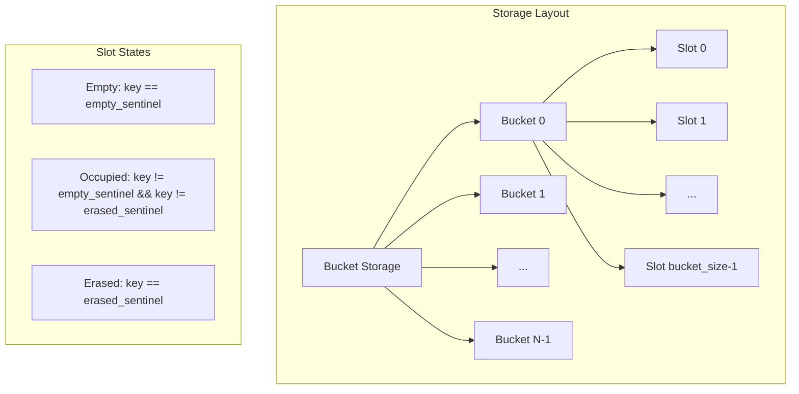
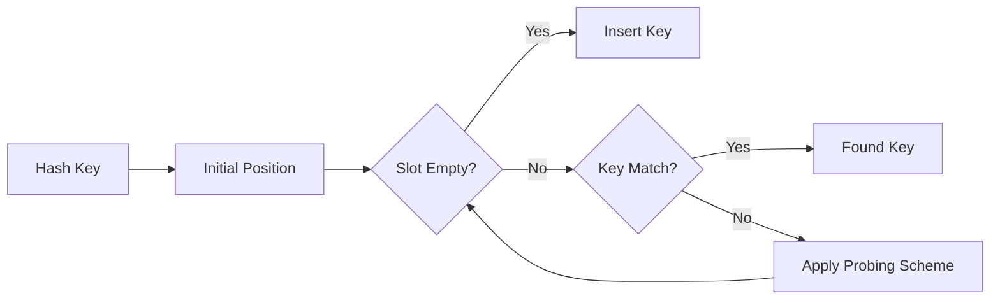
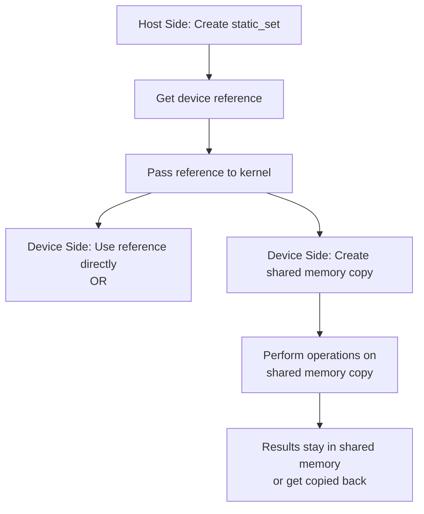

<!-- source: DeepWiki mcp.deepwiki.com · repo NVIDIA/cuCollections · page 3 Static Set · fetched 2026-10-26 -->

# Static Set

<details>
<summary>Relevant source files</summary>

The following files were used as context for generating this wiki page:

- [README.md](README.md)
- [examples/static_set/device_subsets_example.cu](examples/static_set/device_subsets_example.cu)
- [examples/static_set/shared_memory_example.cu](examples/static_set/shared_memory_example.cu)
- [include/cuco/bucket_storage.cuh](include/cuco/bucket_storage.cuh)
- [include/cuco/detail/open_addressing/open_addressing_impl.cuh](include/cuco/detail/open_addressing/open_addressing_impl.cuh)
- [include/cuco/detail/static_map/static_map.inl](include/cuco/detail/static_map/static_map.inl)
- [include/cuco/detail/static_set/static_set.inl](include/cuco/detail/static_set/static_set.inl)
- [include/cuco/static_set.cuh](include/cuco/static_set.cuh)
- [tests/static_map/capacity_test.cu](tests/static_map/capacity_test.cu)
- [tests/static_map/find_test.cu](tests/static_map/find_test.cu)
- [tests/static_map/insert_or_assign_test.cu](tests/static_map/insert_or_assign_test.cu)
- [tests/static_map/shared_memory_test.cu](tests/static_map/shared_memory_test.cu)
- [tests/static_set/capacity_test.cu](tests/static_set/capacity_test.cu)
- [tests/static_set/insert_and_find_test.cu](tests/static_set/insert_and_find_test.cu)
- [tests/static_set/large_input_test.cu](tests/static_set/large_input_test.cu)
- [tests/static_set/retrieve_all_test.cu](tests/static_set/retrieve_all_test.cu)
- [tests/static_set/retrieve_test.cu](tests/static_set/retrieve_test.cu)
- [tests/static_set/shared_memory_test.cu](tests/static_set/shared_memory_test.cu)
- [tests/static_set/unique_sequence_test.cu](tests/static_set/unique_sequence_test.cu)

</details>


The `static_set` is a GPU-accelerated, unordered container that stores unique keys with no associated values. It provides fast, concurrent operations on NVIDIA GPUs through both host and device interfaces. This container is similar to `std::unordered_set` in functionality but is optimized for parallel GPU execution.

For cases where key-value pairs are needed, see [Static Map](#2).

## Key Features

- **Fixed-size container**: Pre-allocated with a specified capacity that doesn't automatically grow
- **High-performance**: Designed for efficient parallel operations on NVIDIA GPUs  
- **Dual interfaces**: Supports both host-side bulk operations and device-side fine-grained access
- **Concurrent operations**: Allows multiple threads to safely insert or lookup keys simultaneously
- **Configurable collision resolution**: Support for different probing schemes

Sources: [include/cuco/static_set.cuh:43-81](include/cuco/static_set.cuh:43-81), [README.md:204-206](README.md:204-206)

## Architecture

The `static_set` is built on an open addressing hash table implementation that uses sentinel values to mark empty and erased slots. The design follows a separation between the host-side container, which owns the storage, and lightweight device-side references that enable GPU kernels to access the container.

```mermaid
classDiagram
    class "static_set" {
        +insert(first, last, stream)
        +contains(first, last, stream)
        +find(first, last, stream)
        +erase(first, last, stream)
        +ref(...) static_set_ref
    }
    
    class "open_addressing_impl" {
        -storage
        -empty_key_sentinel
        -erased_key_sentinel
        -probing_scheme
    }
    
    class "bucket_storage" {
        -data
        -num_buckets
        -capacity
    }
    
    class "static_set_ref" {
        +insert(key)
        +contains(key)
        +find(key)
        +erase(key)
    }
    
    "static_set" --> "open_addressing_impl" : delegates to
    "open_addressing_impl" --> "bucket_storage" : uses
    "static_set" -- "static_set_ref" : creates
    "static_set_ref" ..> "bucket_storage" : references
```

Sources: [include/cuco/static_set.cuh:90-92](include/cuco/static_set.cuh:90-92), [include/cuco/detail/open_addressing/open_addressing_impl.cuh:70-86](include/cuco/detail/open_addressing/open_addressing_impl.cuh:70-86)

### Storage Model

The `static_set` uses a bucket-based storage system:



Each bucket contains a fixed number of slots (controlled by the `Storage` template parameter), and the set is composed of multiple buckets. This organization enables efficient vectorized memory access patterns on the GPU.

Sources: [include/cuco/bucket_storage.cuh:32-34](include/cuco/bucket_storage.cuh:32-34)

### Probing Schemes

The `static_set` supports different probing schemes for handling hash collisions:

1. **Linear Probing**: Checks consecutive slots following the initial hash position.
2. **Double Hashing**: Uses a secondary hash function to determine the step size between probes.

The probing scheme is specified as a template parameter and can be customized based on your workload characteristics.



Sources: [include/cuco/static_set.cuh:86-88](include/cuco/static_set.cuh:86-88)

## Usage

### Creating a Static Set

The `static_set` can be created with a specified capacity or with a desired number of elements and load factor:

```cpp
// Create a set with a specific capacity
auto set1 = cuco::static_set<int>{capacity, cuco::empty_key<int>{-1}};

// Create a set based on expected elements and desired load factor
auto set2 = cuco::static_set<int>{num_elements, 0.7, cuco::empty_key<int>{-1}};

// Create a set with support for erased keys
auto set3 = cuco::static_set<int>{capacity, 
                                 cuco::empty_key<int>{-1}, 
                                 cuco::erased_key<int>{-2}};
```

Sources: [include/cuco/static_set.cuh:152-202](include/cuco/static_set.cuh:152-202)

### Host-side Operations

The `static_set` provides bulk operations that can be executed from the host:

```cpp
// Insert keys
thrust::device_vector<int> keys = {...};
set.insert(keys.begin(), keys.end());

// Check if keys exist
thrust::device_vector<bool> results(keys.size());
set.contains(keys.begin(), keys.end(), results.begin());

// Find keys
thrust::device_vector<int> found_keys(keys.size());
set.find(keys.begin(), keys.end(), found_keys.begin());

// Remove keys
set.erase(keys.begin(), keys.end());
```

Each operation also has an asynchronous version (e.g., `insert_async`, `contains_async`) that doesn't automatically synchronize the CUDA stream.

Sources: [include/cuco/detail/static_set/static_set.inl:125-132](include/cuco/detail/static_set/static_set.inl:125-132), [include/cuco/detail/static_set/static_set.inl:250-256](include/cuco/detail/static_set/static_set.inl:250-256)

### Device-side Operations

For fine-grained access within CUDA kernels, you need to create a device reference:

```cpp
// Create a reference with insert capability
auto insert_ref = set.ref(cuco::op::insert);

// Create a reference with find capability
auto find_ref = set.ref(cuco::op::find);

// Create a reference with multiple capabilities
auto multi_ref = set.ref(cuco::op::insert, cuco::op::find);

// Use in a kernel
my_kernel<<<blocks, threads>>>(insert_ref);
```

Inside the kernel, you can use the reference to perform operations:

```cpp
__global__ void my_kernel(auto set_ref) {
    // Get the thread's key
    int key = threadIdx.x + blockIdx.x * blockDim.x;
    
    // Insert the key
    set_ref.insert(key);
    
    // Check if a key exists
    bool exists = set_ref.contains(key);
    
    // Find a key
    auto found = set_ref.find(key);
    if (found != set_ref.end()) {
        // Key was found
    }
}
```

For cooperative groups, you can use the CG variants of the operations:

```cpp
__global__ void cg_kernel(auto set_ref) {
    auto tile = cg::tiled_partition<CG_SIZE>(cg::this_thread_block());
    int key = threadIdx.x + blockIdx.x * blockDim.x;
    
    set_ref.insert(tile, key);
}
```

Sources: [tests/static_set/shared_memory_test.cu:32-66](tests/static_set/shared_memory_test.cu:32-66), [examples/static_set/device_subsets_example.cu:80-95](examples/static_set/device_subsets_example.cu:80-95)

## Advanced Usage

### Shared Memory

For high-performance scenarios, you can create a `static_set` that uses shared memory within a CUDA block:



Example workflow:

1. Define the shared memory buffer in your kernel
2. Create a copy of the reference that uses the shared memory
3. Perform operations on this local copy

```cpp
__global__ void shared_memory_kernel(SetRef original_ref) {
    // Allocate shared memory for the set
    __shared__ typename SetRef::bucket_type sm_buffer[NUM_BUCKETS];
    
    // Create a copy of the reference using shared memory
    auto g = cooperative_groups::this_thread_block();
    auto sm_ref = original_ref.make_copy(g, sm_buffer, cuco::thread_scope_block);
    
    // Use the shared memory reference
    sm_ref.insert(threadIdx.x);
}
```

Sources: [examples/static_set/shared_memory_example.cu:28-70](examples/static_set/shared_memory_example.cu:28-70), [tests/static_set/shared_memory_test.cu:154-187](tests/static_set/shared_memory_test.cu:154-187)

### Multiple Subsets from One Storage

For efficient memory usage, you can create multiple subsets that share a single storage allocation:

```cpp
// Create a single bulk storage
auto set_storage = storage_type{total_num_buckets};
set_storage.initialize(empty_key_sentinel);

// Create multiple subset references
std::vector<ref_type> set_refs;
for (std::size_t i = 0; i < num_subsets; ++i) {
    storage_ref_type storage_ref{sizes[i], set_storage.data() + offsets[i]};
    set_refs.emplace_back(
        ref_type{cuco::empty_key<key_type>{empty_key_sentinel}, {}, {}, {}, storage_ref});
}
```

This approach is useful when dealing with many small sets, avoiding the overhead of multiple separate allocations.

Sources: [examples/static_set/device_subsets_example.cu:159-174](examples/static_set/device_subsets_example.cu:159-174)

## Performance Considerations

### Capacity Planning

The `static_set` has a fixed capacity that doesn't automatically grow. It's important to allocate sufficient capacity to prevent insertion failures:

- **Rule of thumb**: Allocate a capacity that is 1.3-2.0 times the expected number of unique keys
- **Load factor**: The set's performance degrades as it gets more full; lower load factors (around 50-70%) provide better performance
- **Actual capacity**: The final capacity may be slightly different from the requested capacity due to internal rounding based on the probing scheme and bucket size

Sources: [tests/static_set/capacity_test.cu:31-61](tests/static_set/capacity_test.cu:31-61), [include/cuco/static_set.cuh:194-202](include/cuco/static_set.cuh:194-202)

### Probing Scheme Selection

The choice of probing scheme affects performance characteristics:

- **Linear probing**:
  - Better cache locality
  - Works well with lower load factors
  - May suffer from clustering

- **Double hashing**:
  - Reduces clustering
  - More robust at higher load factors
  - May have slightly higher computational cost

The cooperative group size (`cg_size`) also affects performance:
- Larger CG sizes (e.g., 2, 4, 8) can improve throughput for operations with high contention
- Smaller CG sizes (e.g., 1) may be more efficient for simpler workloads

Sources: [tests/static_set/unique_sequence_test.cu:137-170](tests/static_set/unique_sequence_test.cu:137-170)

### Sentinel Values

The `static_set` requires sentinel values to mark empty and (optionally) erased slots:

- Choose sentinels that will never appear in your actual data to avoid conflicts
- If you need to store values that could conflict with typical sentinels (e.g., -1), consider using a mapping table approach (see examples)

Sources: [include/cuco/static_set.cuh:152-160](include/cuco/static_set.cuh:152-160)

## Common Operations

| Operation | Host API | Device API | Description |
|-----------|----------|------------|-------------|
| Insert | `insert(first, last)` | `ref.insert(key)` | Add keys to the set |
| Contains | `contains(first, last, out)` | `ref.contains(key)` | Check if keys exist |
| Find | `find(first, last, out)` | `ref.find(key)` | Find keys and return values |
| Erase | `erase(first, last)` | `ref.erase(key)` | Remove keys from the set |
| Clear | `clear()` | N/A | Remove all elements |
| Size | `size()` | N/A | Get number of elements |
| Capacity | `capacity()` | `ref.capacity()` | Get maximum capacity |

Each host-side operation has both synchronous and asynchronous versions, with the asynchronous versions having an `_async` suffix (e.g., `insert_async`).

Sources: [include/cuco/static_set.cuh:270-286](include/cuco/static_set.cuh:270-286), [include/cuco/static_set.cuh:464-487](include/cuco/static_set.cuh:464-487)

## Template Parameters

The `static_set` class is highly configurable through template parameters:

```cpp
template <
    class Key,                                      // Key type
    class Extent = cuco::extent<std::size_t>,      // Size type
    cuda::thread_scope Scope = cuda::thread_scope_device, // Scope for atomics
    class KeyEqual = cuda::std::equal_to<Key>,     // Equality comparison
    class ProbingScheme = cuco::double_hashing<4, cuco::default_hash_function<Key>>, // Probing strategy
    class Allocator = cuco::cuda_allocator<Key>,   // Memory allocator
    class Storage = cuco::storage<1>               // Bucket storage type
>
class static_set;
```

- **Key**: Type of keys stored in the set (must be bitwise comparable)
- **Extent**: Type indicating the size/capacity
- **Scope**: CUDA thread scope for atomic operations
- **KeyEqual**: Binary predicate for key equality comparison
- **ProbingScheme**: Strategy for resolving hash collisions
- **Allocator**: Allocator for device memory
- **Storage**: Bucket storage configuration

Sources: [include/cuco/static_set.cuh:82-89](include/cuco/static_set.cuh:82-89)

## Related Components

```mermaid
classDiagram
    class "static_set~Key~" {
        +insert()
        +contains()
        +find()
        +erase()
    }
    class "static_map~Key,Value~" {
        +insert()
        +contains()
        +find()
        +erase()
    }
    class "static_multiset~Key~" {
        +insert()
        +count()
        +retrieve()
    }
    class "static_multimap~Key,Value~" {
        +insert()
        +count()
        +retrieve()
    }
    
    "static_set~Key~" -- "static_map~Key,Value~" : functionally similar
    "static_set~Key~" -- "static_multiset~Key~" : allows duplicates
    "static_map~Key,Value~" -- "static_multimap~Key,Value~" : allows duplicates
```

- **[Static Map](#2)**: Similar to `static_set` but stores key-value pairs
- **[Static Multiset](#5)**: Allows multiple occurrences of the same key
- **[Static Multimap](#4)**: Allows multiple key-value pairs with the same key
- **[Dynamic Map](#6)**: Supports automatic growth when capacity is exceeded

Sources: [README.md:200-248](README.md:200-248)

---

