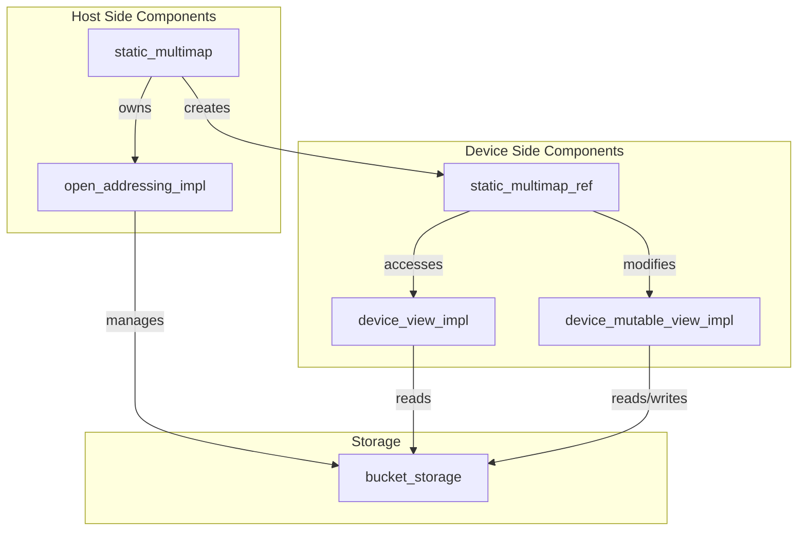
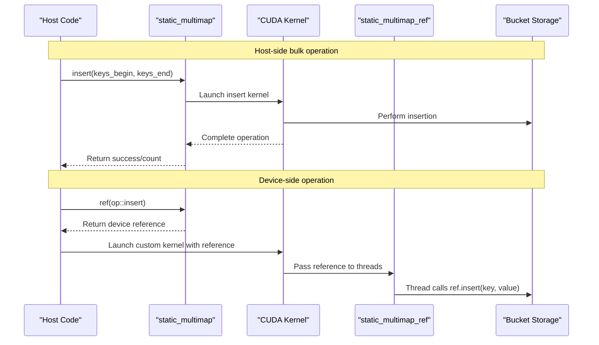
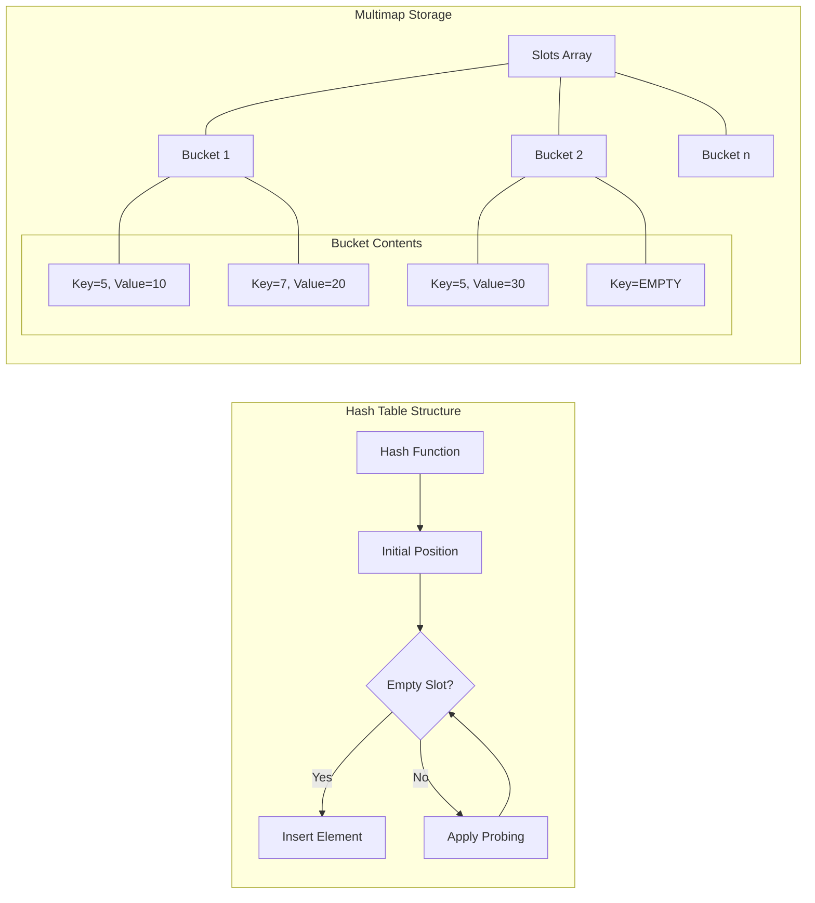
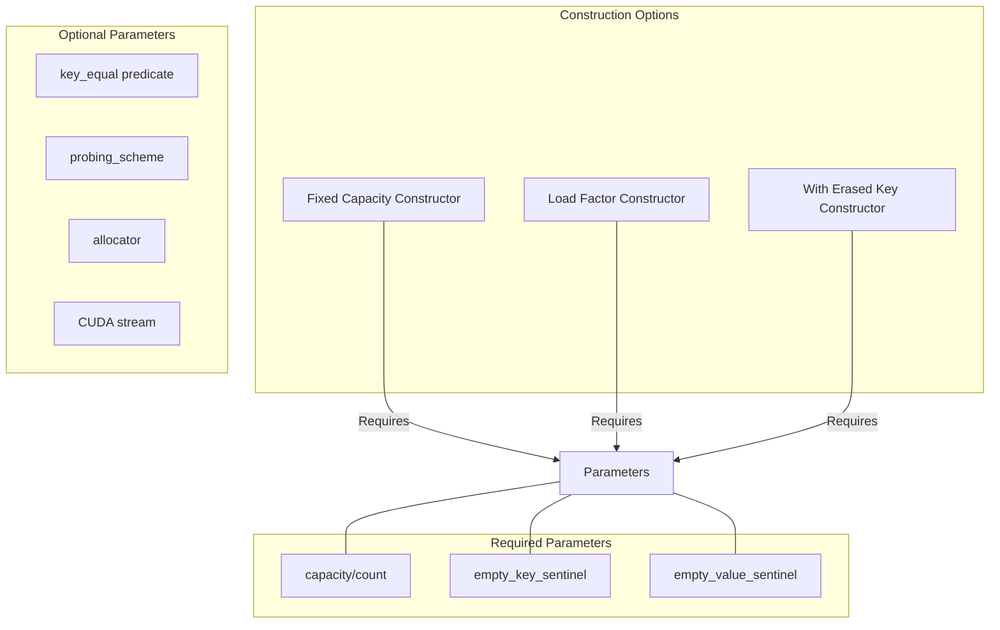
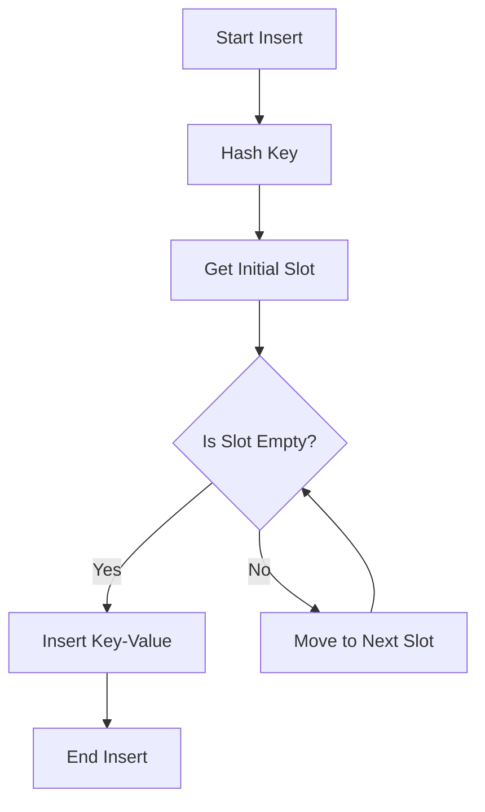
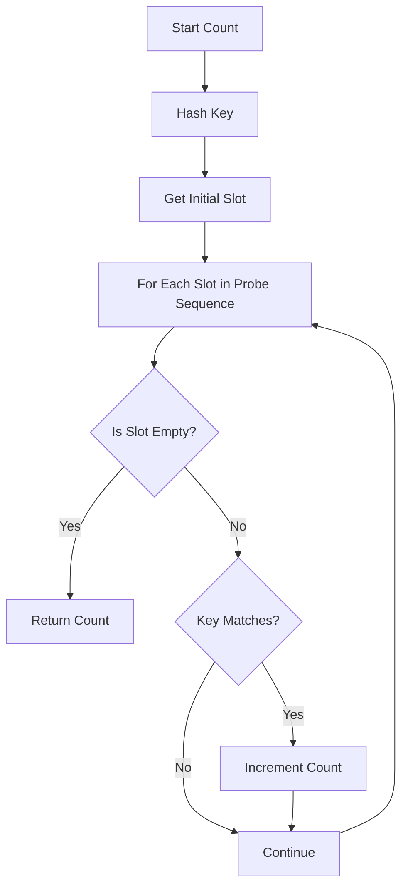
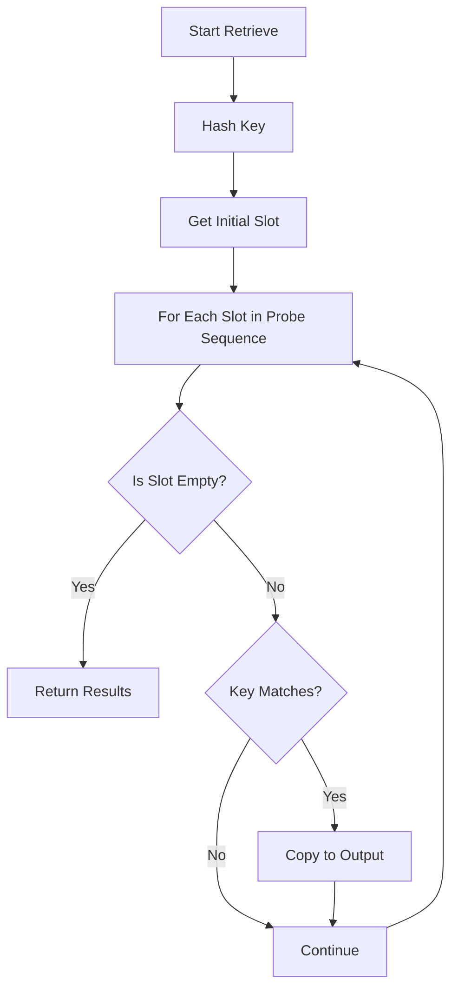
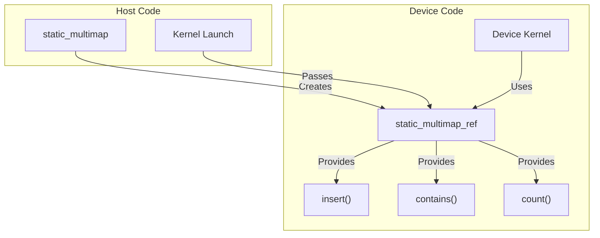

<!-- source: DeepWiki mcp.deepwiki.com · repo NVIDIA/cuCollections · page 4 Static Multimap · fetched 2026-10-26 -->

# Static Multimap

Relevant source files

The following files were used as context for generating this wiki page:

- [include/cuco/detail/static_multimap/device_view_impl.inl](include/cuco/detail/static_multimap/device_view_impl.inl)
- [include/cuco/detail/static_multimap/kernels.cuh](include/cuco/detail/static_multimap/kernels.cuh)
- [include/cuco/detail/static_multimap/static_multimap.inl](include/cuco/detail/static_multimap/static_multimap.inl)
- [include/cuco/static_multimap.cuh](include/cuco/static_multimap.cuh)
- [tests/static_multimap/insert_if_test.cu](tests/static_multimap/insert_if_test.cu)
- [tests/static_multimap/multiplicity_test.cu](tests/static_multimap/multiplicity_test.cu)

The `static_multimap` is a GPU-accelerated, unordered associative container in the cuCollections (cuco) library that can store multiple values per key. Unlike the [Static Map](#2) which allows only one value per key, the static multimap supports storing equivalent keys with different values. It offers constant-time concurrent modify and lookup operations with fixed capacity determined at construction time.

Sources: [include/cuco/static_multimap.cuh:46-144](include/cuco/static_multimap.cuh:46-144)

## Overview and Architecture

The `static_multimap` follows a pattern common to all cuCollections containers: a separation between host-side container objects and device-side reference objects. This architecture allows both bulk operations from the host and fine-grained accesses from device code.

Key architectural components:

1. **Host-side container**: The `static_multimap` class manages allocation and operations
2. **Implementation layer**: Uses `open_addressing_impl` for core functionality 
3. **Device reference**: `static_multimap_ref` provides non-owning access from device code
4. **Storage**: Fixed-size bucket storage for key-value pairs

Sources: [include/cuco/static_multimap.cuh:110-143](include/cuco/static_multimap.cuh:110-143)

## Key Features

The `static_multimap` provides several key features that distinguish it from other containers:

1. **Multiple values per key**: Unlike a regular map, allows storing multiple entries with the same key
2. **Two operation modes**:
   - **Host-side bulk operations**: Process large batches of keys efficiently
   - **Device-side singular operations**: Perform individual operations from device code
3. **Concurrent operations**: Thread-safe design for parallel GPU execution
4. **Customizable components**:
   - Hash functions
   - Probing schemes (double hashing by default)
   - Key comparison predicates
   - Memory allocation

Sources: [include/cuco/static_multimap.cuh:50-71](include/cuco/static_multimap.cuh:50-71)

## Operation Flow

The static multimap provides two distinct patterns for operations: host-side bulk operations and device-side singular operations.

Sources: [include/cuco/static_multimap.cuh:155-210](include/cuco/static_multimap.cuh:155-210), [include/cuco/detail/static_multimap/kernels.cuh:82-96](include/cuco/detail/static_multimap/kernels.cuh:82-96)

## Data Structure and Storage

The `static_multimap` uses open addressing with probing to handle collisions. Since it allows multiple values per key, it will continue probing until it finds an empty slot to insert.

The double hashing probing scheme (default) helps distribute collisions more evenly than linear probing, which is particularly important for multimaps that need to handle multiple elements with the same key.

Sources: [include/cuco/static_multimap.cuh:91-99](include/cuco/static_multimap.cuh:91-99)

## Construction and Initialization

The `static_multimap` provides multiple constructors with different configuration options:

Key construction parameters:
- **capacity**: Fixed maximum size of the container (required)
- **empty_key_sentinel**: Reserved key that represents empty slots (required)
- **empty_value_sentinel**: Reserved value for empty slots (required)
- **erased_key_sentinel**: Optional key that represents erased slots

Sources: [include/cuco/static_multimap.cuh:180-269](include/cuco/static_multimap.cuh:180-269), [include/cuco/detail/static_multimap/static_multimap.inl:38-116](include/cuco/detail/static_multimap/static_multimap.inl:38-116)

## Core Operations

The `static_multimap` supports several key operations for manipulating and accessing data:

### Insert Operations

- **insert**: Adds multiple key-value pairs
- **insert_async**: Asynchronous insertion
- **insert_if**: Conditional insertion based on a predicate

### Query Operations

- **contains**: Checks if keys exist in the map
- **contains_async**: Asynchronous existence check
- **find**: Retrieves values associated with keys
- **count**: Counts occurrences of keys in the map

### Retrieval Operations

- **retrieve**: Gets key-value pairs matching probe keys
- **retrieve_all**: Gets all keys and values in the map
- **for_each**: Applies a function to all elements

Each operation has both synchronous and asynchronous variants, with the synchronous versions internally calling the asynchronous functions and then synchronizing the CUDA stream.

Sources: [include/cuco/static_multimap.cuh:300-316](include/cuco/static_multimap.cuh:300-316), [include/cuco/static_multimap.cuh:665-696](include/cuco/static_multimap.cuh:665-696), [include/cuco/static_multimap.cuh:719-724](include/cuco/static_multimap.cuh:719-724)

## Insert Operation Implementation

The insertion operation in `static_multimap` demonstrates how it handles multiple values with the same key:

Unlike a regular map that would check for key equality and potentially update an existing value, the `static_multimap` simply finds the next empty slot to insert the new key-value pair, regardless of whether the key already exists in the map.

Sources: [include/cuco/detail/static_multimap/device_view_impl.inl:350-442](include/cuco/detail/static_multimap/device_view_impl.inl:350-442)

## Count and Retrieve Operations

Two key operations that highlight the multimap's capability to handle multiple values per key:

### Count Operation

The `count` operation tallies all occurrences of keys:

### Retrieve Operation

The `retrieve` operation collects all key-value pairs with matching keys:

The count operation is often used before retrieve to determine the required output buffer size.

Sources: [include/cuco/detail/static_multimap/device_view_impl.inl:706-789](include/cuco/detail/static_multimap/device_view_impl.inl:706-789), [include/cuco/detail/static_multimap/kernels.cuh:354-429](include/cuco/detail/static_multimap/kernels.cuh:354-429)

## Device Access with static_multimap_ref

The `static_multimap_ref` provides non-owning access to the map from device code:

To access the map from device code, you need to:

1. Create a device reference with desired operations
2. Pass the reference to a kernel
3. Use the reference in device code to perform operations

This pattern allows fine-grained access to the map from individual CUDA threads.

Sources: [include/cuco/static_multimap.cuh:136-143](include/cuco/static_multimap.cuh:136-143), [include/cuco/detail/static_multimap/static_multimap.inl:709-728](include/cuco/detail/static_multimap/static_multimap.inl:709-728)

## Concurrency and Thread Safety

The `static_multimap` uses atomic operations to ensure thread safety during concurrent operations:

| Scope Option | Description | Use Case |
|--------------|-------------|----------|
| `cuda::thread_scope_device` | Atomic operations visible to device | Default, for device-only access |
| `cuda::thread_scope_system` | Atomic operations visible to device and host | For host-device concurrent access |

Thread safety is implemented using:
- Atomic CAS (Compare-And-Swap) operations for inserts
- Atomic loads for reads
- Lock-free algorithms for all operations

Sources: [include/cuco/detail/static_multimap/device_view_impl.inl:242-329](include/cuco/detail/static_multimap/device_view_impl.inl:242-329)

## Probing Schemes

The `static_multimap` supports different probing schemes for resolving hash collisions:

| Probing Scheme | Description | Characteristics |
|----------------|-------------|-----------------|
| `double_hashing` | Uses two hash functions | Default, better distribution |
| `linear_probing` | Probes consecutive slots | Simpler, but more clustering |

The probing scheme affects both performance and the distribution of elements in the table. Double hashing (the default) generally provides better distribution of elements, which is especially important for multimaps that may have many collisions due to equivalent keys.

Sources: [include/cuco/static_multimap.cuh:96-98](include/cuco/static_multimap.cuh:96-98)

## Performance Considerations

When using `static_multimap`, consider the following for optimal performance:

1. **Capacity Sizing**: Oversize the map capacity beyond the number of expected items
2. **Probing Scheme**: Double hashing generally performs better for multimaps
3. **CG Size**: The Cooperative Group size (threads per operation) can affect performance
   - Scalar operations (CG size = 1): Better for low occupancy
   - Vector operations (CG size > 1): Better for high occupancy
4. **Load Factor**: Keep below 70% for best performance
5. **Asynchronous Operations**: Use `*_async` functions when possible to overlap computation
6. **Sentinel Values**: Choose sentinel values that don't conflict with actual data

Sources: [include/cuco/static_multimap.cuh:224-233](include/cuco/static_multimap.cuh:224-233)

## Example Use Cases

The `static_multimap` is particularly useful for:

1. **Graph Adjacency Lists**: Storing edges for each vertex
2. **Inverted Indices**: Mapping terms to document occurrences 
3. **Join Operations**: Database-style join operations with duplicate keys
4. **Histogram Computation**: Counting occurrences of elements
5. **Multi-value Lookups**: Any scenario where multiple values must be associated with a single key

The multiplicity feature (allowing duplicate keys) makes it suitable for applications where one-to-many relationships need to be represented.

Sources: [tests/static_multimap/multiplicity_test.cu:32-82](tests/static_multimap/multiplicity_test.cu:32-82)

## Limitations

It's important to understand the following limitations of `static_multimap`:

1. **Fixed Capacity**: Cannot grow beyond initial capacity
2. **Key and Value Size**: Limited to 8 bytes each
3. **Bitwise Comparable Types**: Keys and values must have unique object representations
4. **Reserved Sentinel Values**: Cannot insert values that match the sentinels

For applications requiring dynamic resizing, consider the [Dynamic Map](#6) container instead, which can grow as elements are inserted.

Sources: [include/cuco/static_multimap.cuh:101-108](include/cuco/static_multimap.cuh:101-108)

---

