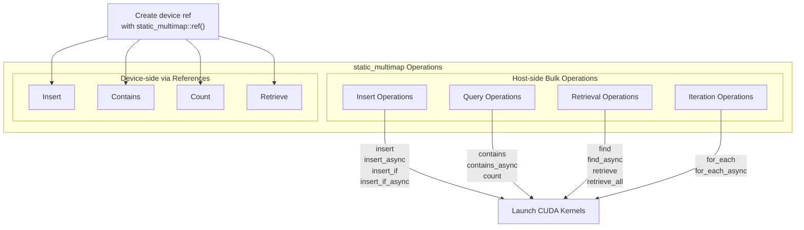
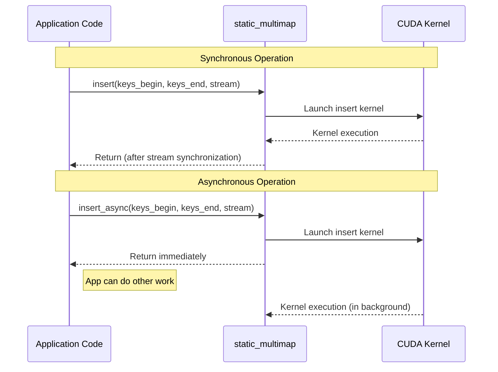
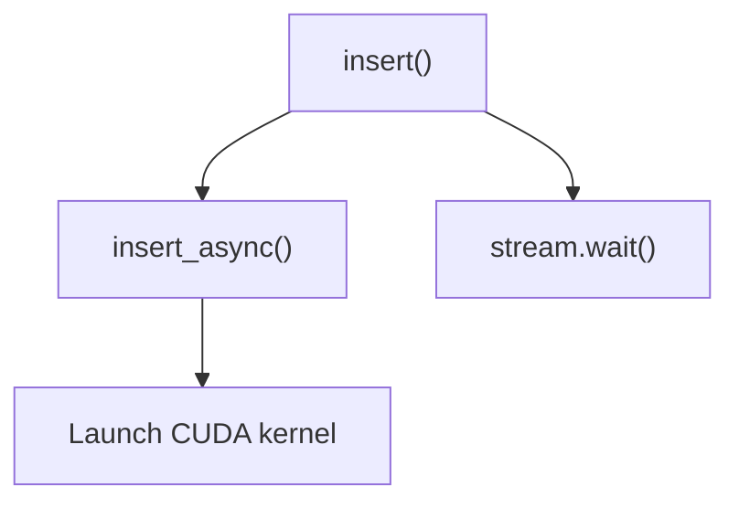
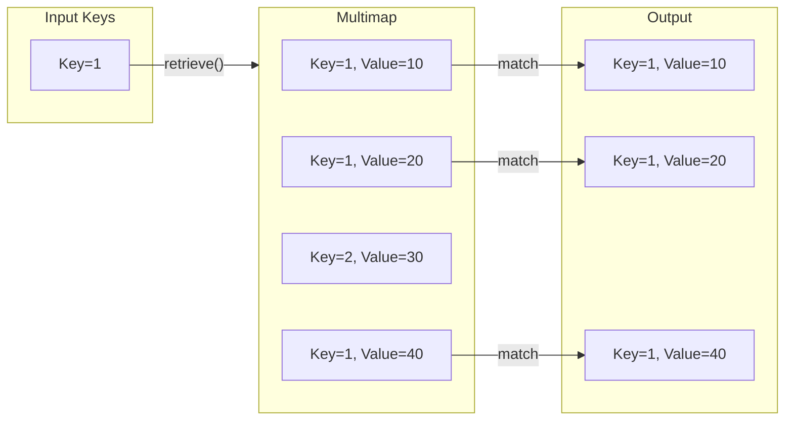
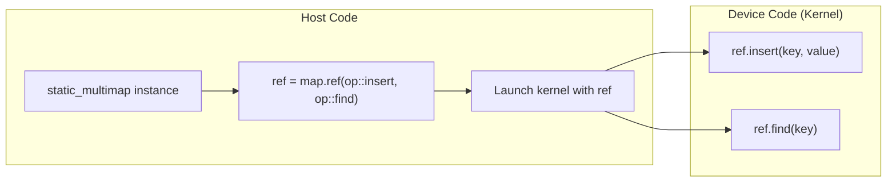
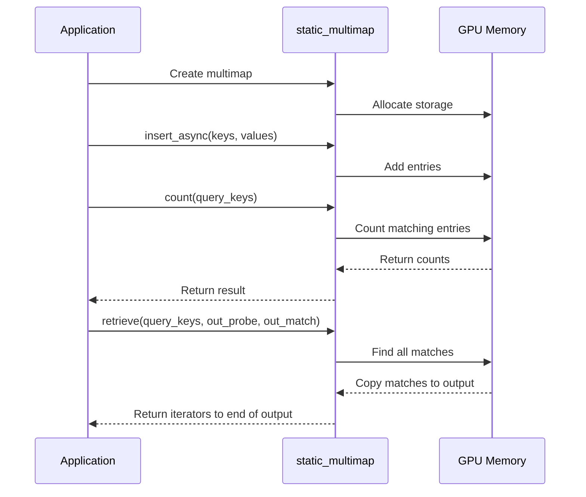

<!-- source: DeepWiki mcp.deepwiki.com · repo NVIDIA/cuCollections · page 4.1 Static Multimap Operations · fetched 2026-10-26 -->

# Static Multimap Operations

<details>
<summary>Relevant source files</summary>

The following files were used as context for generating this wiki page:

- [include/cuco/detail/static_multimap/device_view_impl.inl](include/cuco/detail/static_multimap/device_view_impl.inl)
- [include/cuco/detail/static_multimap/kernels.cuh](include/cuco/detail/static_multimap/kernels.cuh)
- [include/cuco/detail/static_multimap/static_multimap.inl](include/cuco/detail/static_multimap/static_multimap.inl)
- [include/cuco/static_multimap.cuh](include/cuco/static_multimap.cuh)

</details>


The Static Multimap Operations page documents the core operations supported by the `static_multimap` container in cuCollections. This container is a GPU-accelerated, unordered, associative container that supports equivalent keys (multiple values per key). Understanding these operations is essential for effectively utilizing this container in CUDA applications.

## Overview of Operation Types

The `static_multimap` supports two fundamental types of operations:

1. **Host-side "bulk" operations**: Used when processing large numbers of keys/values simultaneously
2. **Device-side "singular" operations**: Used for individual operations from device code



Sources: [include/cuco/static_multimap.cuh:50-64](), [include/cuco/static_multimap.cuh:910-911]()

## Synchronous vs. Asynchronous Operations

Most host-side operations provide both synchronous and asynchronous variants:

- **Synchronous operations**: These functions synchronize the CUDA stream before returning
- **Asynchronous operations**: These functions return immediately without synchronizing the stream



Sources: [include/cuco/static_multimap.cuh:300-316](), [include/cuco/detail/static_multimap/static_multimap.inl:154-160](), [include/cuco/detail/static_multimap/static_multimap.inl:170-175]()

## Insertion Operations

### Insert

The insertion operations add key-value pairs to the map. These operations never fail due to duplicate keys, as the multimap allows equivalent keys.

```cpp
// Add all key-value pairs in the range
void insert(InputIt first, InputIt last, cuda::stream_ref stream = {})

// Asynchronous version - doesn't synchronize the stream
void insert_async(InputIt first, InputIt last, cuda::stream_ref stream = {}) noexcept
```

The implementation of `insert` simply calls `insert_async` and then synchronizes the stream:



Sources: [include/cuco/static_multimap.cuh:301-316](), [include/cuco/detail/static_multimap/static_multimap.inl:154-175]()

### Conditional Insert

For conditional insertion, use the `insert_if` variants that use a stencil and predicate to determine which elements to insert:

```cpp
// Inserts key/value pairs if pred(stencil[i]) returns true
size_type insert_if(InputIt first, InputIt last, StencilIt stencil, Predicate pred, cuda::stream_ref stream = {})

// Asynchronous version of the above
void insert_if_async(InputIt first, InputIt last, StencilIt stencil, Predicate pred, cuda::stream_ref stream = {}) noexcept
```

Sources: [include/cuco/static_multimap.cuh:342-371](), [include/cuco/detail/static_multimap/static_multimap.inl:185-210](), [include/cuco/detail/static_multimap/kernels.cuh:126-146]()

## Query Operations

### Contains

The `contains` operations check whether keys exist in the map:

```cpp
// Indicates whether keys in the range exist in the map
void contains(InputIt first, InputIt last, OutputIt output_begin, cuda::stream_ref stream = {}) const

// Asynchronous version 
void contains_async(InputIt first, InputIt last, OutputIt output_begin, cuda::stream_ref stream = {}) const noexcept
```

For each key in the input range, the corresponding output location will contain `true` if the key exists, or `false` otherwise.

Sources: [include/cuco/static_multimap.cuh:387-409](), [include/cuco/detail/static_multimap/static_multimap.inl:220-244](), [include/cuco/detail/static_multimap/kernels.cuh:172-205]()

### Conditional Contains

Conditional variants are also available:

```cpp
// Check for keys while applying a predicate to a stencil
void contains_if(InputIt first, InputIt last, StencilIt stencil, Predicate pred, OutputIt output_begin, cuda::stream_ref stream = {}) const

// Asynchronous version of the above
void contains_if_async(InputIt first, InputIt last, StencilIt stencil, Predicate pred, OutputIt output_begin, cuda::stream_ref stream = {}) const noexcept
```

Sources: [include/cuco/static_multimap.cuh:436-473](), [include/cuco/detail/static_multimap/static_multimap.inl:254-285]()

### Count

The `count` operations count the number of occurrences of keys in the map:

```cpp
// Counts occurrences of keys in the range
size_type count(InputIt first, InputIt last, cuda::stream_ref stream = {}) const

// Counts with custom hash and key comparator
template <typename InputIt, typename ProbeEqual, typename ProbeHash>
size_type count(InputIt first, InputIt last, ProbeEqual const& probe_equal, ProbeHash const& probe_hash, cuda::stream_ref stream = {}) const
```

Because a multimap can have multiple values per key, the count may be greater than the number of unique keys in the input range.

Sources: [include/cuco/static_multimap.cuh:664-692](), [include/cuco/detail/static_multimap/static_multimap.inl:434-463](), [include/cuco/detail/static_multimap/kernels.cuh:230-264]()

## Retrieval Operations

### Find

The `find` operations retrieve values associated with keys:

```cpp
// Finds values associated with keys in the range
void find(InputIt first, InputIt last, OutputIt output_begin, cuda::stream_ref stream = {}) const

// Asynchronous version
void find_async(InputIt first, InputIt last, OutputIt output_begin, cuda::stream_ref stream = {}) const
```

For a given key, if there are multiple matching elements in the multimap, it retrieves the value of one match (unspecified which). If no match is found, it copies the empty value sentinel.

Sources: [include/cuco/static_multimap.cuh:494-519](), [include/cuco/detail/static_multimap/static_multimap.inl:296-316]()

### Conditional Find

```cpp
// Find with conditions applied to a stencil
void find_if(InputIt first, InputIt last, StencilIt stencil, Predicate pred, OutputIt output_begin, cuda::stream_ref stream = {}) const

// Asynchronous version
void find_if_async(InputIt first, InputIt last, StencilIt stencil, Predicate pred, OutputIt output_begin, cuda::stream_ref stream = {}) const
```

Sources: [include/cuco/static_multimap.cuh:546-583](), [include/cuco/detail/static_multimap/static_multimap.inl:326-357]()

### Retrieve

The `retrieve` operations return all key-value pairs for matching keys:



```cpp
// Retrieves all matches for probe keys in the range
template <typename InputIt, typename OutputProbeIt, typename OutputMatchIt>
std::pair<OutputProbeIt, OutputMatchIt> retrieve(
    InputIt first, InputIt last, 
    OutputProbeIt output_probe, 
    OutputMatchIt output_match,
    cuda::stream_ref stream = {}) const
```

The retrieve operation copies matched key-value pairs to the output locations and returns iterators to the last elements written.

Sources: [include/cuco/static_multimap.cuh:719-724](), [include/cuco/detail/static_multimap/static_multimap.inl:473-483](), [include/cuco/detail/static_multimap/kernels.cuh:355-429]()

### Retrieve All

To retrieve all key-value pairs in the map:

```cpp
// Retrieves all key-value pairs in the map
template <typename KeyOut, typename ValueOut>
std::pair<KeyOut, ValueOut> retrieve_all(
    KeyOut keys_out, 
    ValueOut values_out,
    cuda::stream_ref stream = {}) const
```

Sources: [include/cuco/static_multimap.cuh:789-792](), [include/cuco/detail/static_multimap/static_multimap.inl:521-531]()

## Iteration Operations

### For Each

The `for_each` operations apply a function to elements in the map:

```cpp
// Apply function to all filled slots
template <typename CallbackOp>
void for_each(CallbackOp&& callback_op, cuda::stream_ref stream = {}) const

// Asynchronous version
template <typename CallbackOp>
void for_each_async(CallbackOp&& callback_op, cuda::stream_ref stream = {}) const
```

You can also apply a function only to slots matching specific keys:

```cpp
// Apply function to slots matching keys in the range
template <typename InputIt, typename CallbackOp>
void for_each(InputIt first, InputIt last, CallbackOp&& callback_op, cuda::stream_ref stream = {}) const

// Asynchronous version
template <typename InputIt, typename CallbackOp>
void for_each_async(InputIt first, InputIt last, CallbackOp&& callback_op, cuda::stream_ref stream = {}) const noexcept
```

Sources: [include/cuco/static_multimap.cuh:596-651](), [include/cuco/detail/static_multimap/static_multimap.inl:367-424]()

## Device-Side Operations via References

To perform operations from device code, create a reference object:



```cpp
// Create a device reference with specified operations
template <typename... Operators>
auto ref(Operators... ops) const noexcept
```

The reference object is non-owning and can be passed to device code. The operators specify what operations are available on the reference.

Sources: [include/cuco/static_multimap.cuh:910-911](), [include/cuco/detail/static_multimap/static_multimap.inl:709-728]()

## Performance Considerations

1. **Asynchronous Operations**: For better performance, use asynchronous operations when possible to avoid unnecessary synchronization.

2. **Bulk vs. Singular**: Host-side bulk operations are more efficient for large batches of operations. Device-side singular operations are better for random access patterns from within kernels.

3. **Probing Scheme**: The `static_multimap` uses a double hashing probing scheme by default, which helps with hash collision resolution.

4. **Rehashing**: The container provides `rehash` operations that can be used to optimize storage after many insertions:

```cpp
// Regenerate the container
void rehash(cuda::stream_ref stream = {})

// Regenerate with specified capacity
void rehash(size_type capacity, cuda::stream_ref stream = {})
```

Sources: [include/cuco/static_multimap.cuh:801-860](), [include/cuco/detail/static_multimap/static_multimap.inl:541-589]()

## Example Usage Pattern



Sources: Overall understanding from [include/cuco/static_multimap.cuh]()

## Summary

The `static_multimap` container provides a comprehensive set of operations for efficiently managing collections of key-value pairs with equivalent keys on the GPU. By understanding these operations, developers can effectively use this container for various GPU-accelerated data processing tasks.

---

