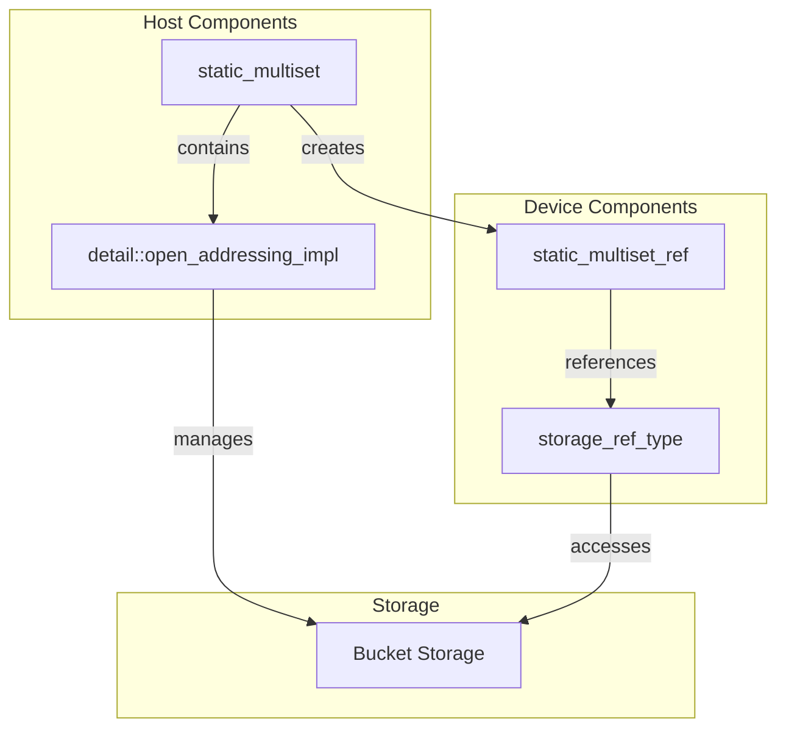
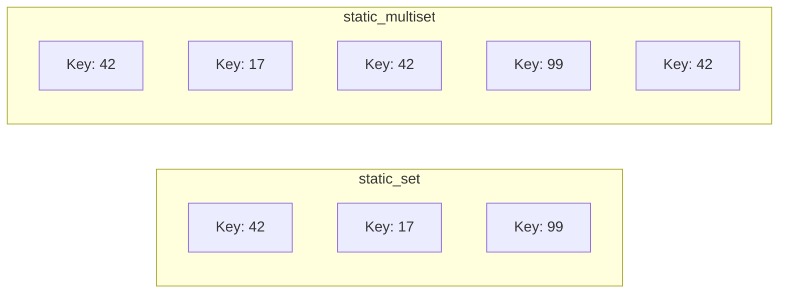
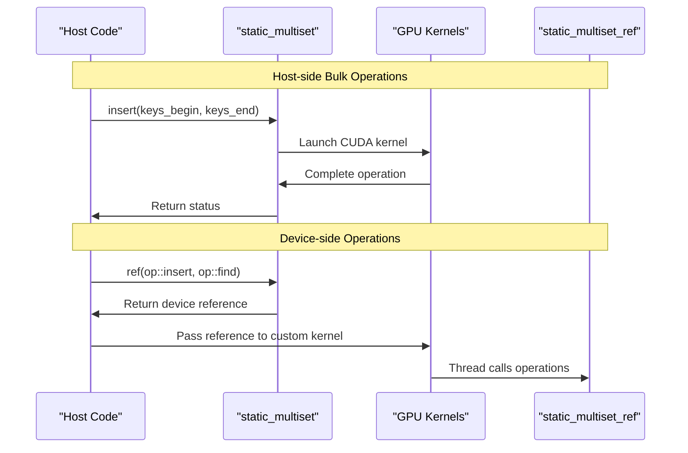
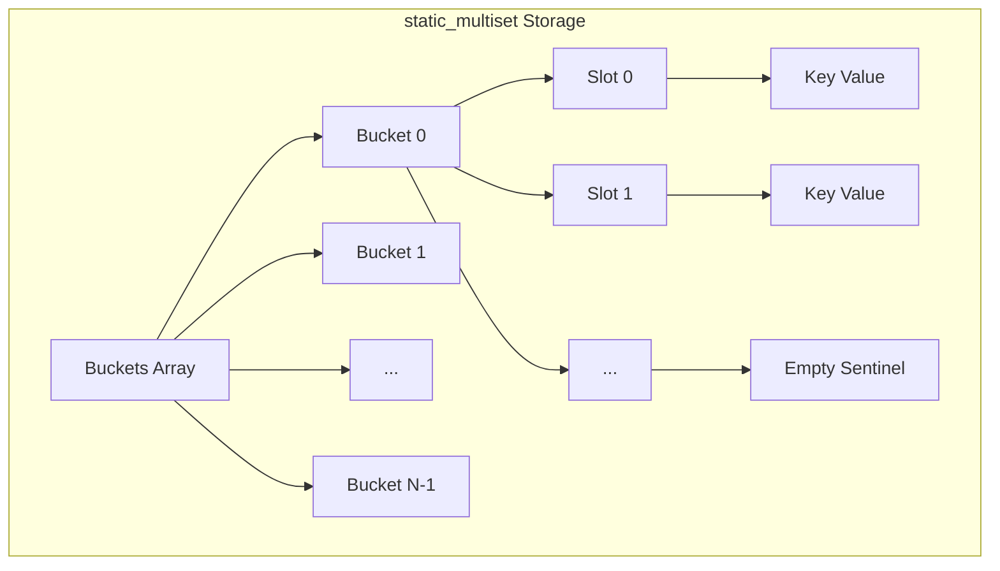
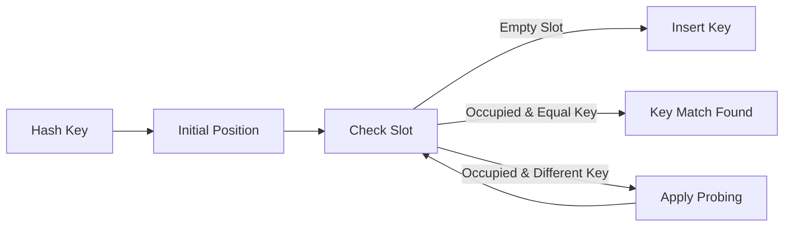
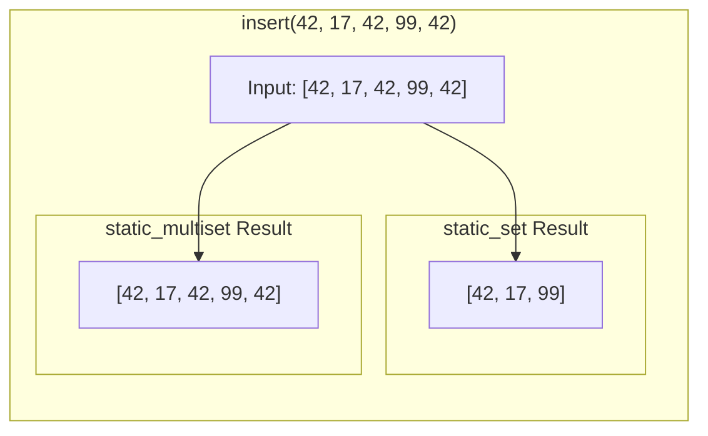

<!-- source: DeepWiki mcp.deepwiki.com · repo NVIDIA/cuCollections · page 5 Static Multiset · fetched 2026-10-26 -->

# Static Multiset

<details>
<summary>Relevant source files</summary>

The following files were used as context for generating this wiki page:

- [include/cuco/detail/prime.hpp](include/cuco/detail/prime.hpp)
- [include/cuco/detail/static_multiset/static_multiset.inl](include/cuco/detail/static_multiset/static_multiset.inl)
- [include/cuco/detail/storage/kernels.cuh](include/cuco/detail/storage/kernels.cuh)
- [include/cuco/detail/utility/cuda.cuh](include/cuco/detail/utility/cuda.cuh)
- [include/cuco/detail/utils.hpp](include/cuco/detail/utils.hpp)
- [include/cuco/static_multiset.cuh](include/cuco/static_multiset.cuh)
- [tests/static_multiset/insert_test.cu](tests/static_multiset/insert_test.cu)

</details>


## Overview

The `static_multiset` is a GPU-accelerated, unordered, associative container for storing possibly non-unique objects. Unlike the [`static_set`](#3) which only allows unique keys, the `static_multiset` can store multiple occurrences of the same key value. This component provides a fixed-size container optimized for concurrent access on NVIDIA GPUs using CUDA.

Sources: [include/cuco/static_multiset.cuh:38-41]()

## Architecture and Design

The `static_multiset` follows cuCollection's core architecture pattern of separating host-side container objects from device-side reference objects. This enables both bulk operations from the host and fine-grained access within CUDA kernels.



The `static_multiset` container wraps an implementation of an open addressing hash table that uses double hashing as the default probing scheme. The fixed size is determined at construction time and cannot be dynamically resized during operation.

Sources: [include/cuco/static_multiset.cuh:76-87](), [include/cuco/static_multiset.cuh:105-111]()

## Key Features and Capabilities

### Multiple Key Occurrences

Unlike standard sets that enforce key uniqueness, the `static_multiset` allows multiple identical keys to be inserted and maintained:



This allows you to track frequency or occurrence data directly in the data structure.

Sources: [include/cuco/static_multiset.cuh:39-41](), [tests/static_multiset/insert_test.cu:47-54]()

### Operation Types

The `static_multiset` supports two primary operation modes:

1. **Host-side bulk operations**: Process large batches of keys at once
2. **Device-side singular operations**: Allow individual threads to perform independent operations



Sources: [include/cuco/static_multiset.cuh:41-54](), [include/cuco/static_multiset.cuh:126-145]()

## Using Static Multiset

### Construction

The `static_multiset` requires:
- A capacity (fixed size)
- An empty key sentinel value (to mark empty slots)
- Optionally, an erased key sentinel (for deletion)

```cpp
// Basic construction
cuco::static_multiset<int> multiset(
    1000,                      // capacity 
    cuco::empty_key<int>{-1},  // sentinel for empty slots
    cuda::stream_ref{}         // CUDA stream
);

// Advanced construction with load factor
cuco::static_multiset<int> multiset(
    500,                       // number of elements to insert
    0.7,                       // desired load factor
    cuco::empty_key<int>{-1},  // sentinel for empty slots
    {}                         // default key equality predicate
);
```

Sources: [include/cuco/static_multiset.cuh:147-155](), [include/cuco/static_multiset.cuh:188-197]()

### Core Operations

The `static_multiset` provides several operations for managing and querying data:

| Operation | Description | Synchronous API | Asynchronous API |
|-----------|-------------|----------------|------------------|
| Insert | Add elements to the multiset | `insert()` | `insert_async()` |
| Contains | Check if elements exist | `contains()` | `contains_async()` |
| Find | Locate elements | `find()` | `find_async()` |
| Count | Count key occurrences | `count()` | N/A |
| Retrieve | Get all matching elements | `retrieve()` | N/A |
| For Each | Apply operations to elements | `for_each()` | `for_each_async()` |

Each operation typically has variants that accept different parameters and predicates.

Sources: [include/cuco/static_multiset.cuh:264-278](), [include/cuco/static_multiset.cuh:337-373](), [include/cuco/static_multiset.cuh:391-395](), [include/cuco/static_multiset.cuh:452-460](), [include/cuco/static_multiset.cuh:560-575]()

### Device Access

To perform operations from device code, you need to obtain a device reference:

```cpp
// Get a reference with specific operations
auto device_ref = multiset.ref(op::insert, op::contains);

// Use the reference in a kernel
my_kernel<<<blocks, threads>>>(device_ref, ...);
```

The reference is a lightweight, non-owning object that can be passed to and used within CUDA kernels.

Sources: [include/cuco/static_multiset.cuh:105-111](), [include/cuco/detail/static_multiset/static_multiset.inl:677-693]()

## Implementation Details

### Storage Structure

The `static_multiset` uses a bucket-based storage structure:



Each bucket contains multiple slots, and each slot can store a key. The default bucket size is 2, as specified in the template parameters.

Sources: [include/cuco/static_multiset.cuh:84]()

### Probing Schemes

When inserting or looking up keys, collisions are resolved using the configured probing scheme:



By default, `static_multiset` uses double hashing with a cooperative group size of 4, but it can be configured to use linear probing or other schemes.

Sources: [include/cuco/static_multiset.cuh:81-83]()

### Memory Management

The `static_multiset` allocates GPU memory during construction based on the requested capacity. The actual number of slots allocated depends on the capacity, the probing scheme, cooperative group size, and bucket size.

When the load factor (ratio of filled slots to total capacity) becomes too high, performance can degrade. The constructor that accepts a desired load factor helps in allocating appropriate capacity upfront.

Sources: [include/cuco/static_multiset.cuh:188-197]()

## Differences from Static Set

The main differences between `static_multiset` and [`static_set`](#3) are:

1. `static_multiset` allows multiple occurrences of the same key
2. `static_multiset` adds count-related operations to determine occurrences
3. `static_multiset` retrieve operations may return multiple entries for the same key



Sources: [include/cuco/static_multiset.cuh:630-656]()

## Performance Considerations

1. **Capacity Planning**: Choose an appropriate capacity with sufficient space to avoid performance degradation at high load factors.

2. **Probing Scheme**: Different probing schemes perform differently depending on your workload pattern:
   - Double hashing (default) generally works well for diverse key distributions
   - Linear probing may be more efficient for sequential or closely grouped keys

3. **Cooperative Group Size**: The cooperative group size (default: 4) affects how many threads collaborate on operations. Larger sizes can improve throughput for certain operations but reduce parallelism.

4. **Operation Choice**: When possible, use asynchronous versions of operations (`*_async`) when you don't need immediate results, and use the bulk operations for large batches of data.

Sources: [include/cuco/static_multiset.cuh:81-83]()

## Example Usage

1. **Frequency Counting**: Count occurrences of values in a dataset.

2. **Multi-value Storage**: When the same key needs to be associated with multiple occurrences or instances.

3. **Histogramming**: Storing intermediate results during histogram computation.

Sources: [tests/static_multiset/insert_test.cu:31-76]()

Note that the `static_multiset` doesn't provide automatic resizing - if your data volume may exceed capacity, consider using the [`dynamic_map`](#6) instead, which can grow as needed.

---

