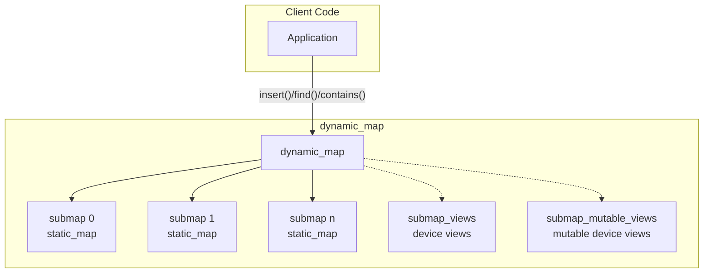
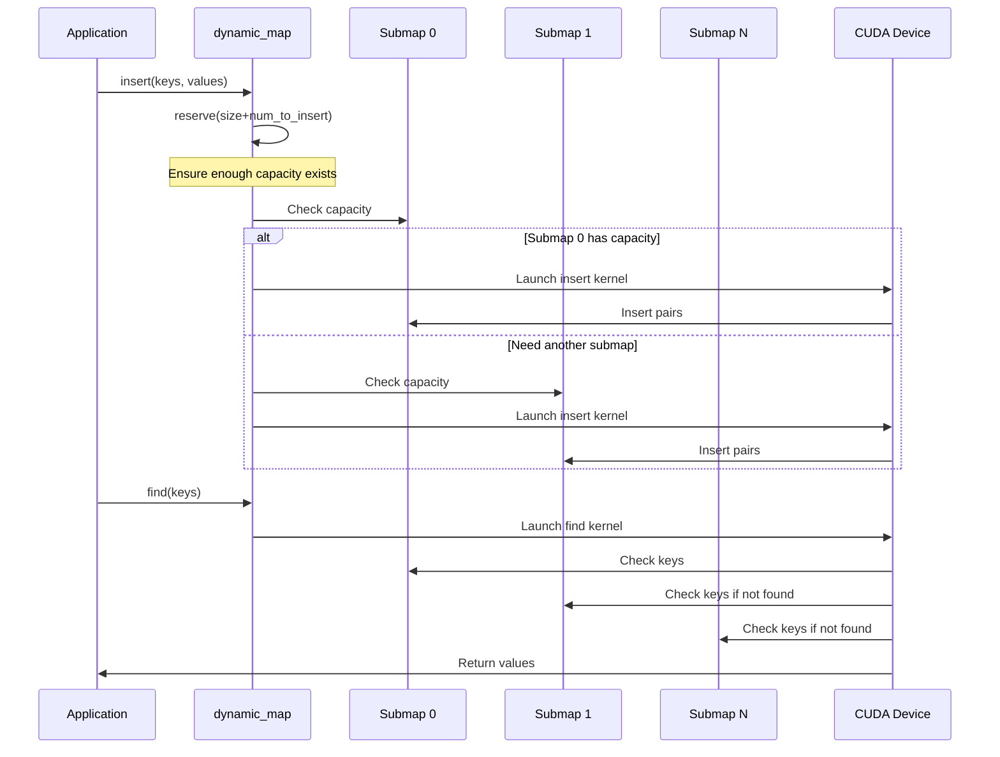
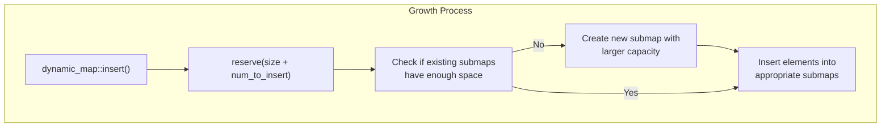
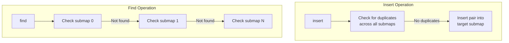
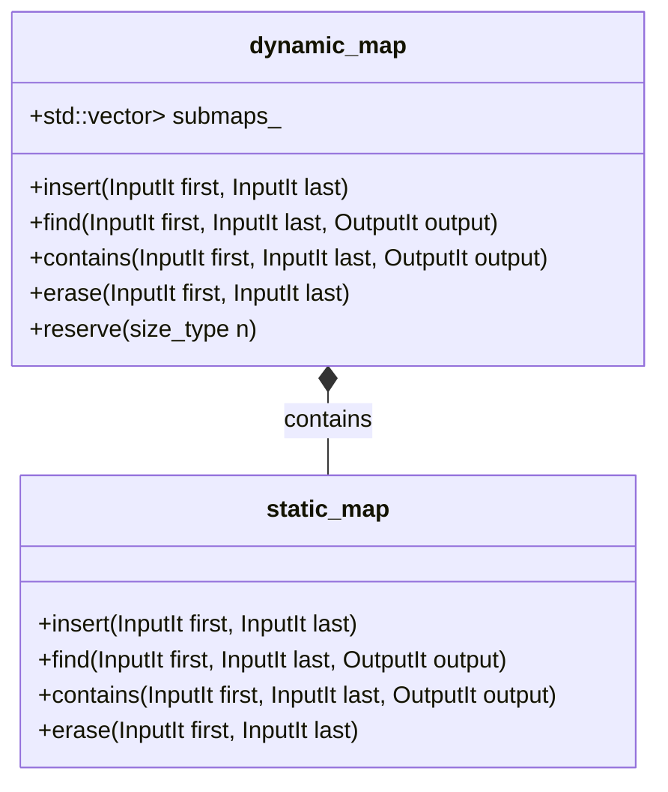

<!-- source: DeepWiki mcp.deepwiki.com · repo NVIDIA/cuCollections · page 6 Dynamic Map · fetched 2026-10-26 -->

# Dynamic Map

<details>
<summary>Relevant source files</summary>

The following files were used as context for generating this wiki page:

- [cmake/thirdparty/get_cccl.cmake](cmake/thirdparty/get_cccl.cmake)
- [include/cuco/detail/dynamic_map.inl](include/cuco/detail/dynamic_map.inl)
- [include/cuco/detail/dynamic_map_kernels.cuh](include/cuco/detail/dynamic_map_kernels.cuh)
- [include/cuco/dynamic_map.cuh](include/cuco/dynamic_map.cuh)
- [tests/dynamic_map/erase_test.cu](tests/dynamic_map/erase_test.cu)

</details>


The Dynamic Map is a GPU-accelerated, unordered, associative container of key-value pairs with unique keys that automatically grows its capacity as elements are inserted. Unlike the [Static Map](#2), which has a fixed capacity, the dynamic map can expand to accommodate more elements until device memory is exhausted.

## Overview

The `dynamic_map` is designed for scenarios where the total number of elements isn't known in advance, providing flexibility at the cost of slightly reduced lookup performance compared to its fixed-size counterpart. It maintains this dynamic capability by managing a collection of static maps and distributing operations across them.

Sources: [include/cuco/dynamic_map.cuh:36-170](), [include/cuco/dynamic_map.cuh:173-227]()

## Architecture

The dynamic map implements a growth-supporting hash table by linking multiple static maps together, each working as a submap. When the current capacity is insufficient for new insertions, a new submap is created with increased capacity.



The dynamic map maintains:
- A vector of unique pointers to submaps (`submaps_`)
- Device vectors of device views for each submap (`submap_views_`, `submap_mutable_views_`)
- Size and capacity tracking
- Growth factor and load factor thresholds

Sources: [include/cuco/dynamic_map.cuh:161-167](), [include/cuco/dynamic_map.cuh:507-519]()

## Data Flow and Operation

The dynamic map routes operations across its constituent submaps, coordinating between them to maintain consistent behavior.



For operations like `find` and `contains`, the dynamic map must check all submaps to determine if a key exists, as keys can be distributed across any submap.

Sources: [include/cuco/detail/dynamic_map.inl:119-173](), [include/cuco/detail/dynamic_map.inl:219-238]()

## Growth Mechanism

The dynamic map grows by creating new submaps with progressively larger capacities when existing submaps are full. The growth strategy is controlled by a load factor threshold.



Key aspects of the growth mechanism:
- Initial capacity is set at construction
- The `reserve()` method ensures enough space exists for a specified number of elements
- New submaps double the capacity of the previous submap
- A maximum load factor (default 0.60) determines when submaps are considered full
- Each submap maintains its own sentinel values for empty/erased slots

Sources: [include/cuco/detail/dynamic_map.inl:77-117](), [include/cuco/dynamic_map.cuh:124]()

## API Overview

### Construction

The dynamic map is initialized with:
- Initial capacity
- Empty key sentinel value (marks unused slots)
- Empty value sentinel value
- Optional erased key sentinel (for erase functionality)

Example:
```cpp
// Create a dynamic map with initial capacity of 1000 elements
// Using -1 as sentinel for both empty keys and values
cuco::dynamic_map<int, int> map{1000, 
                               cuco::empty_key<int>{-1}, 
                               cuco::empty_value<int>{-1}};

// With erase capability
cuco::dynamic_map<int, int> map{1000, 
                               cuco::empty_key<int>{-1}, 
                               cuco::empty_value<int>{-1},
                               cuco::erased_key<int>{-2}};
```

Sources: [include/cuco/dynamic_map.cuh:106-114](), [include/cuco/dynamic_map.cuh:280-315]()

### Key Operations

The dynamic map supports the following primary operations:

| Operation | Description | Example Usage |
|-----------|-------------|---------------|
| `insert`  | Inserts all key/value pairs in a given range | `map.insert(pairs_begin, pairs_end, stream)` |
| `find`    | Finds values corresponding to keys in a given range | `map.find(keys_begin, keys_end, values_out, stream)` |
| `contains` | Checks if keys in a given range exist in the map | `map.contains(keys_begin, keys_end, results_out, stream)` |
| `erase`   | Removes keys in a given range from the map | `map.erase(keys_begin, keys_end, stream)` |
| `reserve` | Ensures capacity for a specific number of elements | `map.reserve(n, stream)` |
| `retrieve_all` | Retrieves all key/value pairs from the map | `map.retrieve_all(keys_out, values_out, stream)` |

Sources: [include/cuco/dynamic_map.cuh:138-149](), [include/cuco/dynamic_map.cuh:417-480]()

## Implementation Details

### Submap Management

The dynamic map manages a collection of static maps through a vector of unique pointers:

```cpp
std::vector<std::unique_ptr<cuco::legacy::static_map<key_type, mapped_type, Scope>>> submaps_;
```

For GPU kernel operations, it maintains device-accessible views:

```cpp
thrust::device_vector<view_type> submap_views_;
thrust::device_vector<mutable_view_type> submap_mutable_views_;
```

Sources: [include/cuco/dynamic_map.cuh:165](), [include/cuco/dynamic_map.cuh:512-516]()

### Kernel Operations

Operations like `insert`, `find`, and `contains` use specialized CUDA kernels that operate across all submaps:



The kernels leverage CUDA Cooperative Groups for improved parallel performance, allowing groups of threads to collaborate on operations.

Sources: [include/cuco/detail/dynamic_map_kernels.cuh:142-196](), [include/cuco/detail/dynamic_map_kernels.cuh:440-488]()

## Performance Considerations

When using the dynamic map, consider these performance implications:

1. The performance of `find` and `contains` gradually decreases as the map grows, as they need to check more submaps
2. The maximum load factor (default 0.60) affects both space efficiency and performance
3. Multiple small insertions may be less efficient than batched larger insertions
4. Erase operations mark slots as erased but do not reclaim memory (capacity does not shrink)

Sources: [include/cuco/dynamic_map.cuh:93-94](), [include/cuco/dynamic_map.cuh:268-269]()

## Usage Example

Here's an example of using the dynamic map to store and retrieve key-value pairs:

```cpp
// Create a dynamic map with initial capacity
cuco::dynamic_map<int, int> map{100'000,
                               cuco::empty_key<int>{-1},
                               cuco::empty_value<int>{-1}};

// Create key-value pairs
thrust::device_vector<cuco::pair<int, int>> pairs(50'000);
thrust::transform(thrust::make_counting_iterator(0),
                 thrust::make_counting_iterator(pairs.size()),
                 pairs.begin(),
                 []__device__(auto i){ return cuco::pair{i, i*2}; });

// Insert pairs into the map
map.insert(pairs.begin(), pairs.end());

// Check if keys exist
thrust::device_vector<int> keys(1000);
thrust::device_vector<bool> results(1000);
thrust::sequence(keys.begin(), keys.end(), 0);
map.contains(keys.begin(), keys.end(), results.begin());

// Find values for keys
thrust::device_vector<int> values(1000);
map.find(keys.begin(), keys.end(), values.begin());
```

Sources: [include/cuco/dynamic_map.cuh:196-225](), [tests/dynamic_map/erase_test.cu:42-75]()

## Relationship to Static Map

The dynamic map builds upon the [Static Map](#2) implementation, effectively serving as a wrapper that manages multiple static maps to provide growth capabilities:



The dynamic map delegates most operations to the underlying static maps but coordinates between them to maintain consistent behavior.

Sources: [include/cuco/dynamic_map.cuh:21](), [include/cuco/dynamic_map.cuh:62]()

---

