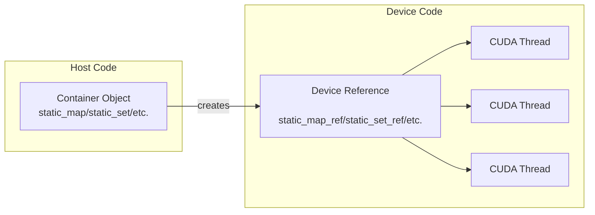
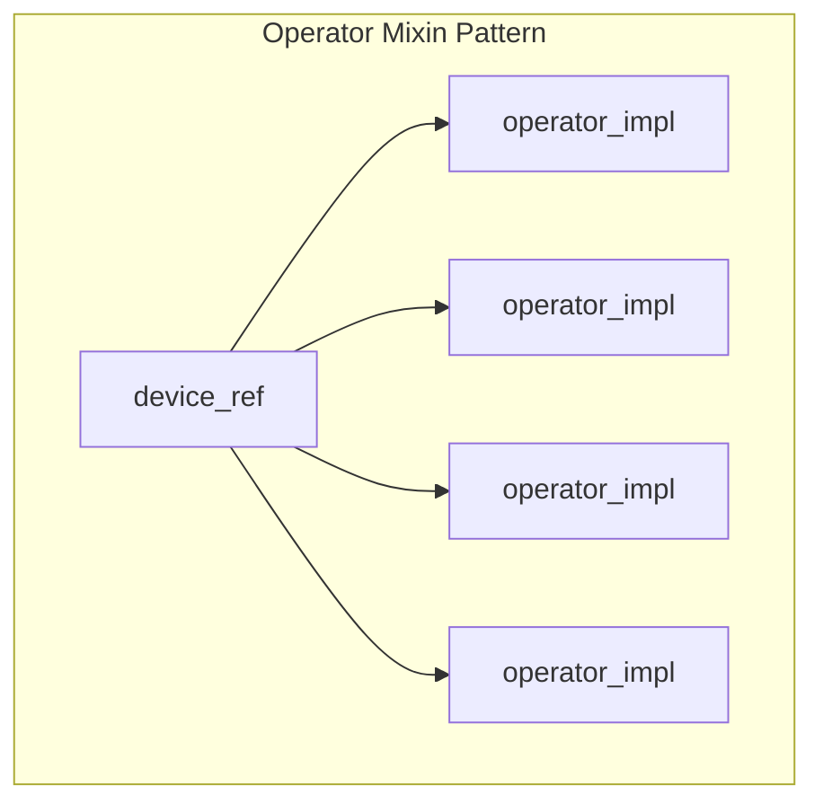
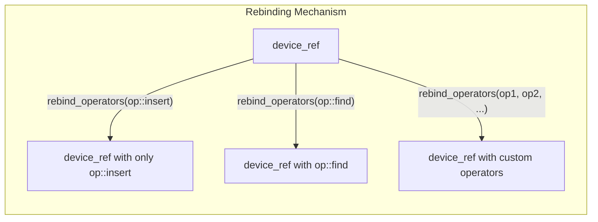
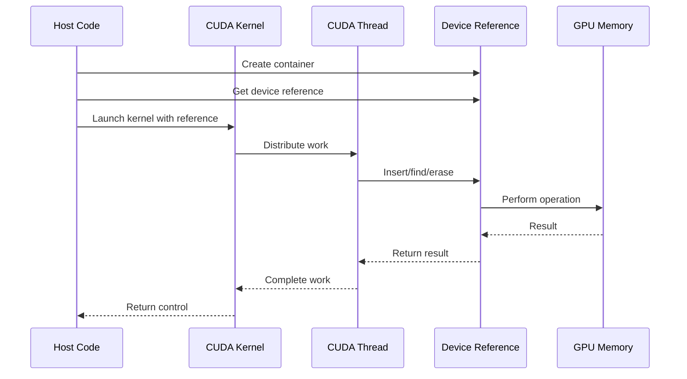
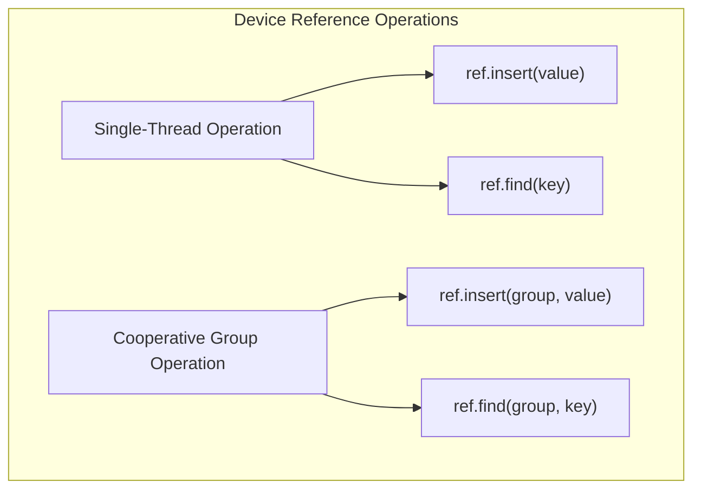
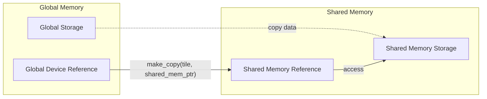
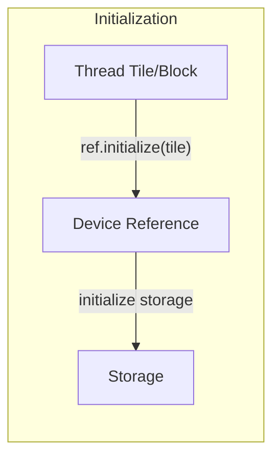
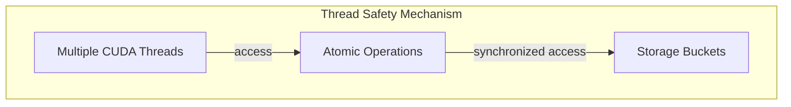

<!-- source: DeepWiki mcp.deepwiki.com · repo NVIDIA/cuCollections · page 7 Device References · fetched 2026-10-26 -->

# Device References

<details>
<summary>Relevant source files</summary>

The following files were used as context for generating this wiki page:

- [include/cuco/detail/open_addressing/kernels.cuh](include/cuco/detail/open_addressing/kernels.cuh)
- [include/cuco/detail/open_addressing/open_addressing_ref_impl.cuh](include/cuco/detail/open_addressing/open_addressing_ref_impl.cuh)
- [include/cuco/detail/static_map/helpers.cuh](include/cuco/detail/static_map/helpers.cuh)
- [include/cuco/detail/static_map/kernels.cuh](include/cuco/detail/static_map/kernels.cuh)
- [include/cuco/detail/static_map/static_map_ref.inl](include/cuco/detail/static_map/static_map_ref.inl)
- [include/cuco/detail/static_multimap/static_multimap_ref.inl](include/cuco/detail/static_multimap/static_multimap_ref.inl)
- [include/cuco/detail/static_multiset/static_multiset_ref.inl](include/cuco/detail/static_multiset/static_multiset_ref.inl)
- [include/cuco/detail/static_set/static_set_ref.inl](include/cuco/detail/static_set/static_set_ref.inl)
- [include/cuco/operator.hpp](include/cuco/operator.hpp)
- [include/cuco/static_map_ref.cuh](include/cuco/static_map_ref.cuh)
- [include/cuco/static_multimap_ref.cuh](include/cuco/static_multimap_ref.cuh)
- [include/cuco/static_multiset_ref.cuh](include/cuco/static_multiset_ref.cuh)
- [include/cuco/static_set_ref.cuh](include/cuco/static_set_ref.cuh)
- [tests/static_map/insert_or_apply_test.cu](tests/static_map/insert_or_apply_test.cu)

</details>


Device references in cuCollections (cuco) are lightweight, non-owning objects that enable fine-grained access to data structures from device (GPU) code. They serve as the bridge between host-side container objects and device-side operations. This page explains how device references work, their architecture, and how they enable efficient GPU-based operations.

## Overview of Device References

Device references are an essential part of cuCollections' architecture, allowing individual CUDA threads to perform operations on data structures while maintaining thread safety. They have several key characteristics:

- **Non-owning**: References do not own the underlying storage
- **Trivially copyable**: Designed to be passed by value to device code
- **Operation-specific**: Operations are composed through templated operator tags
- **Thread-scope aware**: Support different CUDA thread scopes for synchronization
- **Cooperative group compatible**: Can be used with multiple threads working together



Sources: [include/cuco/static_map_ref.cuh:31-58](), [include/cuco/static_set_ref.cuh:32-56]()

## Architecture and Implementation Pattern

All device references in cuCollections follow a common implementation pattern:

```mermaid
classDiagram
    class "static_X_ref<Key, ...Operators>" {
        +impl_: open_addressing_ref_impl
        +capacity() const
        +empty_key_sentinel() const
        +probing_scheme() const
        +storage_ref() const
        +key_eq() const
        +hash_function() const
        +end() const
        +rebind_operators(...) const
        +rebind_key_eq(...) const
        +rebind_hash_function(...) const
        +make_copy(...) const
    }

    class "open_addressing_ref_impl<Key, Scope, ...>" {
        -empty_slot_sentinel_
        -predicate_
        -probing_scheme_
        -storage_ref_
        +insert()
        +erase()
        +contains()
        +find()
        +make_copy()
    }

    class "operator_impl<Op, Ref>" {
        +insert()
        +insert_or_assign()
        +find()
        +contains()
        +erase()
        ...
    }

    "static_X_ref<Key, ...Operators>" *-- "open_addressing_ref_impl<Key, Scope, ...>"
    "static_X_ref<Key, ...Operators>" --|> "operator_impl<Op, Ref>"
```

Each device reference type:

1. Wraps an `open_addressing_ref_impl` instance that provides the core implementation
2. Inherits from multiple `operator_impl` specializations using CRTP (Curiously Recurring Template Pattern)
3. Uses template parameters to specify the operations it supports

Sources: 
[include/cuco/static_map_ref.cuh:66-76](), 
[include/cuco/static_set_ref.cuh:63-73](), 
[include/cuco/static_multimap_ref.cuh:66-76](), 
[include/cuco/static_multiset_ref.cuh:63-73]()

### Common Device Reference Types

cuCollections provides four main types of device references, each corresponding to a container type:

| Device Reference Type | Container Type | Description | Allows Duplicates |
|----------------------|---------------|-------------|-------------------|
| `static_map_ref` | `static_map` | Map with unique key-value pairs | No |
| `static_set_ref` | `static_set` | Set with unique keys | No |
| `static_multimap_ref` | `static_multimap` | Map allowing multiple values per key | Yes |
| `static_multiset_ref` | `static_multiset` | Set allowing duplicate keys | Yes |

Each device reference provides type definitions that mirror its corresponding container, such as `key_type`, `mapped_type` (for maps), `value_type`, and more.

Sources: 
[include/cuco/static_map_ref.cuh:86-97](), 
[include/cuco/static_set_ref.cuh:75-85](), 
[include/cuco/static_multimap_ref.cuh:83-94](), 
[include/cuco/static_multiset_ref.cuh:75-85]()

## Operator Tags System

Device references use a mixin-based architecture where operations are added through template parameters. This design allows for precise control over which operations are available on a reference:



The available operators include:

| Operator Tag | Description | Available on |
|-------------|-------------|--------------|
| `op::insert` | Inserts an element | All references |
| `op::insert_and_find` | Inserts and returns iterator to element | All references |
| `op::insert_or_assign` | Inserts or updates an element | Map references |
| `op::insert_or_apply` | Inserts or applies function to element | Map references |
| `op::erase` | Removes an element | All references |
| `op::contains` | Checks if an element exists | All references |
| `op::find` | Finds an element and returns iterator | All references |
| `op::count` | Counts occurrences of an element | All references |
| `op::retrieve` | Retrieves elements matching a key | Multimap/Multiset |
| `op::for_each` | Applies function to matching elements | All references |

Sources: 
[include/cuco/operator.hpp:45-178](), 
[include/cuco/detail/static_map/static_map_ref.inl:400-470](), 
[include/cuco/detail/static_set/static_set_ref.inl:344-404]()

### Composing Operations with Rebinding

Device references can be customized through "rebinding" methods that create new references with different operators or properties:



Key rebinding methods include:

- `rebind_operators<Ops...>()`: Creates a new reference with different operations
- `rebind_key_eq(equal)`: Creates a new reference with a different key equality function
- `rebind_hash_function(hash)`: Creates a new reference with a different hash function

Sources: 
[include/cuco/static_map_ref.cuh:238-265](), 
[include/cuco/static_set_ref.cuh:215-242]()

## Usage in CUDA Device Code

Device references are designed to be used in CUDA kernels, providing thread-safe access to the underlying data structure:



### Thread Scope and Cooperative Groups

Device references support different thread scopes and can work with CUDA cooperative groups:

1. **Thread Scope**: Determines synchronization visibility (block, device, system)
2. **Cooperative Groups**: Allow multiple threads to work together on a single operation



The `ProbingScheme::cg_size` template parameter determines how many threads work together for operations. When `cg_size == 1`, scalar (non-cooperative) operations are used. When `cg_size > 1`, operations use thread cooperation.

Sources: 
[include/cuco/detail/open_addressing/open_addressing_ref_impl.cuh:375-415](), 
[include/cuco/detail/open_addressing/open_addressing_ref_impl.cuh:787-847]()

## Advanced Features

### Creating Shared Memory Copies

Device references support creating copies in shared memory, which can significantly improve performance for frequently accessed small containers:



This is achieved with the `make_copy` method, which is useful for creating shared memory copies of small static data structures.

Sources: 
[include/cuco/detail/open_addressing/open_addressing_ref_impl.cuh:315-338](), 
[include/cuco/static_map_ref.cuh:286-290]()

### Thread Initialization of Storage

Device references provide methods to initialize storage directly from device code:



This is particularly useful when creating shared memory copies that need to be initialized.

Sources: 
[include/cuco/detail/open_addressing/open_addressing_ref_impl.cuh:350-364](), 
[include/cuco/static_map_ref.cuh:301-302]()

## Type Safety and Constraints

Device references have various compile-time assertions to ensure type safety:

1. Key and mapped types must be bitwise comparable
2. Key and mapped types must not exceed 8 bytes
3. Probing schemes must inherit from the correct base class

These constraints help ensure that the containers work correctly on the GPU.

Sources: 
[include/cuco/detail/open_addressing/open_addressing_ref_impl.cuh:91-100](), 
[include/cuco/static_map_ref.cuh:77-83]()

## Thread Safety and Concurrency

Device references use atomic operations to ensure thread safety when multiple threads access the same container:



Different operations have different concurrency guarantees:
- Lookup operations (`find`, `contains`) can safely run concurrently with each other
- Modification operations (`insert`, `erase`) use atomic operations for thread safety
- Mixed lookup and modification operations work when both operator types are included

Sources:
[include/cuco/detail/open_addressing/open_addressing_ref_impl.cuh:408-415](),
[include/cuco/detail/static_map/static_map_ref.inl:511-525]()

---

